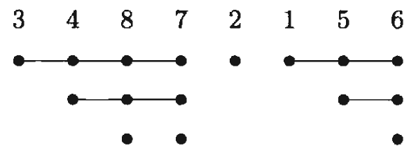

#### 1.3.3 节

1\. [习题](../sec-1-3-3.md#ex-1-3-3-1)  (1 2 4) (365).

2\. [习题](../sec-1-3-3.md#ex-1-3-3-2)  $a \leftrightarrow c , \: c \leftrightarrow f ; \: b \leftrightarrow d .$ 对任意排列的推广是显然的.

3\. [习题](../sec-1-3-3.md#ex-1-3-3-3)  $\begin{pmatrix}a&b&c&d&e&f\\d&b&f&c&a&e\end{pmatrix}.$

4\. [习题](../sec-1-3-3.md#ex-1-3-3-4)  (a d c f e).

5\. [习题](../sec-1-3-3.md#ex-1-3-3-5)  12. (见习题 20.)

6\. [习题](../sec-1-3-3.md#ex-1-3-3-6)  对十每个接在“(”后面的空格字, 总时间减少 8u, 因为 30-32 行花费 4u, 而 26-28,33-34,36-38 行花费 12u. 对于每个接在符号名后面的空格字, 总时间减少 2u, 因为 68-71 行花费 5u, 而 42-46 行或 75-79 行花费 7u. 打头的空格字和循环之间的空格字对于执行时间没有影响. 空格字的位置对于程序 B 不产生任何影响.

7\. [习题](../sec-1-3-3.md#ex-1-3-3-7)  X = 2,Y = 29,M = 5,N = 7, U = 3, V = 1. 由等式 (18), 总时间为 2161u.

8\. [习题](../sec-1-3-3.md#ex-1-3-3-8)  是; 于是我们将保持这个排列的逆排列, 所以 $x _ { i }$ 变为 $x _ { j }$, 当且仅当 T[j] = i. (于是最后的循环形式将利用 T 表从右到左构造.)

9\. [习题](../sec-1-3-3.md#ex-1-3-3-9)  否. 例如, 给定 (6) 作为输入, 程序 A 将产生 “(ADG)(CEB)” 作为输出, 而程序 B 则产生 “(CEB)(DGA)”. 由于循环表示的非唯一性, 这两个答案是等价的, 但不是完全相同的. 在程序 A 中, 对于一个循环第一个选择的元素是可以得到的符号名里最左边的一个; 而在程序 B, 则是从右到左遇到的最后一个不同的符号名.

10\. [习题](../sec-1-3-3.md#ex-1-3-3-10)  (1) 由基尔霍夫定律, A = 1 +C - D,B = A + J + P-1, C = B − (P - L), E = D- L, G = E, $Q = Z$, W = S. (2) 解释: B = 输入的字数 = 16X- 1,C = 非空格字的字数 =Y,D = C - M; E = D - M, F = 符号名表搜索中的比较次数, H = N,K = M, Q = N,R = U, S = R - V, T=N-V 因为其他的每个符号名已做标记. (3) 求和得 (4F+16Y+80X+21N-19M+9U-16V)u, 这个结果比程序 A 更好一些, 因为 F 肯定小于 16NX. 所述情形的时间为 983u, 因为 F=74.

#### 11. [习题](../sec-1-3-3.md#ex-1-3-3-11) 对它“反射”.例如,(acf)(bd)的逆排列是(db)(fca).

12\. [习题](../sec-1-3-3.md#ex-1-3-3-12)  (a) 单元 $L + m n - 1$ 中的值对转置是不变的, 所以我们对它可以不予考虑. 对于其他情况, 如果 $x = n(i - 1) + (j - 1) < mn - 1$, 那么 $L + x$ 中的值应该移到单元 $L+mx\bmod N=L+\bigl(mn(i-1)+$ $m(j-1))\bmod N=L+m(j-1)+(i-1)$, 因为 $mn \equiv 1 \ (\text{modulo }N)$ 和 $0\le m(j-1)+(i-1)<N.$ (b) 如果在每个存储单元中有 1 位是可以使用的 (例如符号位), 那么我们可以利用类似算法Ⅰ的一种算法, 在移动元素时做 “标记”. [见马丁·伯曼, JACM5(1958), 383-384.] 如果没有用作标记位的空间, 那么可以把标记位保存在一个辅助表中, 也可以使用表示所有非单元素循环的一个表: 对于 N 的每个因数 d, 我们可以分别转置是 $d$ 的倍数的元素, 因为 $m$ 与 N 互素. 若 $\operatorname* { g c d } ( x , N ) = d , x$ 所在循环的长度是满足 $m^{r} \equiv 1 ( modulo  N/d)$ 的最小正整数 $r>0$. 对于每个 d, 我们需要从这些循环的每一个中找到 $\varphi(N/d)/r$ 的表示式. 为此可以用某些数论方法, 但是这些方法并不够简单, 不足以真正令人满意. 一种比较复杂的高效算法可以通过结合利用数论与一张小型的标记位的表而得到. [见诺曼·布伦纳, CACM16(1973), 692-694.] 最后, 还有一个类似于算法 J 的方法, 它虽然要慢一些, 但是不需要辅助存储单元, 能够原位就地实现任何排列. [见彼得·温德利, Comp.J.2(1959), 47-48; 高德纳, Proc.IFIP Congress(1971), 1,19–27; 埃斯科·凯特和戴维·特威格, ACM Trans. Math. Software3(1977), 104-110; 费思·菲西, 詹姆斯·蒙罗, 帕特里西欧·奥利瓦雷斯, SICOMP24(1995), 266-278.]

13\. [习题](../sec-1-3-3.md#ex-1-3-3-13)  用归纳法证明, 在 J2 步开始时, $X[i] = +j$, 当且仅当 $j>m$ 且排列π把 j 变到 i; $X[i] = -j$, 当且仅当排列 $\pi^{k + 1}$ 把 i 变到 j, 其中 $k$ 是满足 $\pi^{k}$ 把 i 变成≤m 的数的最小的非负整数.

14\. [习题](../sec-1-3-3.md#ex-1-3-3-14) 用标准循环形式写出给定排列的逆排列, 去掉括号. 数量 A-N 是大于一个给定元素并且紧靠其右边的相继元素的个数之和. 例如, 如果原来的排列是 (165) (3784), 逆排列的标准循环形式是

(3487) (2) (156); 建立阵列

数量 A 是 “圆点” 的数目 16. 在第 $k$ 个元素下方的圆点数目是前面 k 个元素中左向最小值的个数 (在上面的例子中, 在 7 下面有 3 个圆点, 因为在 3487 中有 3 个左向最小值). 因此平均值是 $H _ { 1 } + H _ { 2 } + \cdots + H _ { n } = ( n + 1 ) H _ { n } - n .$

15\. [习题](../sec-1-3-3.md#ex-1-3-3-15) 如果线性表示的第一个字符是 1, 那么标准表示的最后一个字符是 1. 如果线性表示的第一个字符是 $m > 1$, 那么 $\cdots 1 m1 \cdots$ 出现在标准表示中. 所以唯一的解是一个一元排列. (正好, 那也等于零元排列.)

16\. [习题](../sec-1-3-3.md#ex-1-3-3-16) 1324,4231,3214,4213,2143,3412,2413,1243,3421,1324,....

17\. [习题](../sec-1-3-3.md#ex-1-3-3-17)  (a)n 元排列中的一个循环是 m 元循环的概率等于 $n ! / m$ 除以 $n ! H _ { n }$, 所以 $p _ { m } = 1 / ( m H _ { n } )$. 平均长度为 $p _ { 1 } + 2 p _ { 2 } + 3 p _ { 3 } + \cdots = \textstyle \sum _ { m = 1 } ^ { n } m / ( m H _ { n } ) = n / H _ { n } .$ (b) 由于 $m$ 元循环的总数为 $n ! / m$, 在 m 元循环中出现的元素的总数是 $m ! .$ 按照对称性, 每个元素出现的机会都一样, 所以 k 在 m 元循环中出现 $n ! / n$ 次. 因此在这种情况下, 对于所有的 k 和 $m , p _ { m } = 1 / n$, 平均值是 $\textstyle \sum _ { m = 1 } ^ { n } m / n = ( n + 1 ) / 2$

18\. [习题](../sec-1-3-3.md#ex-1-3-3-18)  见习题 22(e).

19\. [习题](../sec-1-3-3.md#ex-1-3-3-19)  $| P _ { n 0 } - n ! / e | = n ! / ( n + 1 ) ! - n ! / ( n + 2 ) ! + \cdots$. 这是每项绝对值递减的交错级数, 它的和小于 $n!/(n + 1)! \leq \frac{1}{2}$

20\. [习题](../sec-1-3-3.md#ex-1-3-3-20)  共有 $\bar { \alpha } _ { 1 } + \alpha _ { 2 } + \cdots$ 个循环, 它们彼此之间可以排列, 而且每个 m 元循环可以独立地用 $m$ 种方式书写. 所以答案为

$$
\left( \alpha _ { 1 } + \alpha _ { 2 } + \cdots \right) ! 1 ^ { \alpha _ { 1 } } 2 ^ { \alpha _ { 2 } } 3 ^ { \alpha _ { 3 } } \cdots .
$$

21\. [习题](../sec-1-3-3.md#ex-1-3-3-21)  如果 $n = \alpha _ { 1 } + 2 \alpha _ { 2 } + \cdots$, 那么概率为 $1 / ( \alpha _ { 1 } ! \operatorname { 1 } ^ { \alpha _ { 1 } } \alpha _ { 2 } ! \operatorname { 2 } ^ { \alpha _ { 2 } } \dots )$; 否则为 0.

证明. 在一行中用空位写出 $\alpha _ { 1 }$ 个一元循环, $\alpha _ { 2 }$ 个二元循环, 等等. 例如, 如果 $\alpha_{1} = 1, \alpha_{2} = 2$ $\alpha_3=\alpha_4=\cdots=0$, 我们会写出 $\text{“}(-)(--)(--)\text{”}$. 用所有可能的 n! 种方式填上这些空位置, 所求形式的每一种排列恰好得到 $\alpha_1!\,1^{\alpha_1}\alpha_2!\,2^{\alpha_2}\cdots$ 次.

22\. [习题](../sec-1-3-3.md#ex-1-3-3-22)  (a) 如果 $k_{1} + 2k_{2} + \cdots = n$, 那么 (ii) 的概率为 $\textstyle \prod _ { j > 0 } f ( w , j , k _ { j } )$, 根据假定, 它应该等于 $(1-w)w^n/(k_1!\,1^{k_1}k_2!\,2^{k_2}\cdots)$; 因此

$$
\frac { f ( w , m , k _  { m } + 1 ) } { f ( w , m , k _  { m } ) } = \bigg ( \prod _ { j > 0 } f ( w , j , k _  { j } ) \bigg ) ^ { - 1 } \prod _ { j > 0 } f ( w , j , k _  { j } + \delta _ { j m } ) = \frac { w ^  { m } } { m ( k _  { m } + 1 ) } .
$$

所以, 归纳可得

$$
f ( w , m , k ) = \frac { 1 } { k ! } \left( \frac { w ^ { m } } { m } \right) ^ { k } f ( w , m , 0 ) .
$$

条件 (i) 现在蕴涵

$$
f(w,m,k)=\frac{1}{k!}\left(\frac{w^m}{m}\right)^k e^{-w^m/m}.
$$

[换句话说, $\alpha _ { m }$ 是按泊松分布选择的. 参见习题 1.2.10-15.]

(b)

$$
\begin{aligned}\sum_{\substack{k_1+2k_2+\cdots=n\\k_1,k_2,\ldots\ge0}}\left(\prod_{j>0}f(w,j,k_j)\right)&=(1-w)w^n\sum_{\substack{k_1+2k_2+\cdots=n\\k_1,k_2,\ldots\ge0}}P(n;k_1,k_2,\ldots)\\&=(1-w)w^n.\end{aligned}
$$

因此 $\alpha_{1} + 2\alpha_{2} + \cdots \leq n$ 的概率为 $(1 - w)(1 + w + \cdots + w^{n}) = 1 - w^{n + 1}.$

(c) $\phi$ 的平均值为

$$
\begin{aligned}&\sum_{n\ge0}\left(\sum_{k_1+2k_2+\cdots=n}\phi(k_1,k_2,\ldots)\Pr(\alpha_1=k_1,\alpha_2=k_2,\ldots)\right)\\&=(1-w)\sum_{n\ge0}w^n\left(\sum_{k_1+2k_2+\cdots=n}\frac{\phi(k_1,k_2,\ldots)}{k_1!\,1^{k_1}k_2!\,2^{k_2}\cdots}\right).\end{aligned}
$$

(d) 令 $\phi ( \alpha _ { 1 } , \alpha _ { 2 } , \dots ) = \alpha _ { 2 } + \alpha _ { 4 } + \alpha _ { 6 } + \dots$. 线性组合 $\phi$ 的平均值等于 $\alpha _ { 2 } , \alpha _ { 4 } , \alpha _ { 6 } , \ldots$. 的平均值之和; 同时 $\alpha _ { m }$ 的平均值为

$$
\sum _ { k \geq 0 } k f ( w , m , k ) = \sum _ { k \geq 1 } \frac { 1 } { ( k - 1 ) ! } \left( \frac { w ^ { m } } { m } \right) ^ { k } e ^ { - w ^ { m } / m } = \frac { w ^ { m } } { m } .
$$

所以 $\phi$ 的平均值为

$$
\frac { w ^ { 2 } } { 2 } + \frac { w ^ { 4 } } { 4 } + \frac { w ^ { 6 } } { 6 } + \cdots = \frac { 1 - w } { 2 } ( H _ { 1 } w ^ { 2 } + H _ { 1 } w ^ { 3 } + H _ { 2 } w ^ { 4 } + H _ { 2 } w ^ { 5 } + H _ { 3 } w ^ { 6 } + \cdots ) .
$$

所求的答案是 ${ \textstyle \frac { 1 } { 2 } } H _ { \lfloor n / 2 \rfloor } .$

(e) 置 $\phi ( \alpha _ { 1 } , \alpha _ { 2 } , \dots ) = z ^ { \alpha _ { m } }$, 注意到 $\phi$ 的平均值为

$$
\begin{align*}\sum_{k \geq 0} f(w, m, k)z^k &= \sum_{k \geq 0} \frac{1}{k!} \Big(\frac{w^m z}{m}\Big)^k e^{-w^m/m} = e^{w^m(z-1)/m} = \sum_{j \geq 0} \frac{w^{mj}}{j!} \Big(\frac{z-1}{m}\Big)^j \\&= (1-w) \sum_{n \geq 0} w^n \bigg( \sum_{0 \leq j \leq n/m} \frac{1}{j!} \Big(\frac{z-1}{m}\Big)^j \bigg) \\&= (1-w) \sum_{n \geq 0} w^n G_{nm}(z).\end{align*}
$$

因此,

$$
G _ { n m } ( z ) = \sum _ { 0 \leq j \leq n / m } \frac { 1 } { j ! } \Big ( \frac { z - 1 } { m } \Big ) ^ { j } ; \quad p _ { n k m } = \frac { 1 } { m ^ { k } k ! } \sum _ { 0 \leq j \leq n / m - k } \frac { ( - 1 / m ) ^ { j } } { j ! } ,
$$

统计量为 $( \min 0, \mathrm{ave} 1/m, \max \left\lfloor n/m \right\rfloor, \mathrm{div} \sqrt{1/m} )$, 其中 $n \geq 2 m .$

23\. [习题](../sec-1-3-3.md#ex-1-3-3-23)  常数λ是 $\int_0^\infty\exp(-t-E_1(t))\,dt$, 其中 $E_{1}(x) = \int_{x}^{\infty} e^{-t} dt / t.$ 见 Trans. Amer. Math. Soc. 121(1966), 340-357, 文中还证明了其他许多结果, 特别是证明最短循环的平均长度近似为 $e ^ { - \gamma } \operatorname { l n } n . l _ { n }$ 渐近表示的其他项已经由泽维尔·古尔登求出, 见 [博士论文, ÉcolePolytechnique(Paris:1996)]; 级数的前面几项为

$$
\begin{array} { r } { \lambda n + \frac { 1 } { 2 } \lambda - \frac { 1 } { 2 4 } e ^ { \gamma } n ^ { - 1 } + \big ( \frac { 1 } { 4 8 } e ^ { \gamma } - \frac { 1 } { 8 } ( - 1 ) ^ { n } \big ) n ^ { - 2 } + \big ( \frac { 1 7 } { 3 8 4 0 } e ^ { \gamma } + \frac { 1 } { 8 } ( - 1 ) ^ { n } + \frac { 1 } { 6 } \omega ^ { 1 - n } + \frac { 1 } { 6 } \omega ^ { n - 1 } \big ) n ^ { - 3 } , } \end{array}
$$

其中 $\omega = e ^ { 2 \pi i / 3 }$. 威廉姆·米歇尔计算出λ的高精度近似值为 0.6243299885435508709929363831008372441796+[Math. Comp.22(1968), 411-415]. 尚不知道λ与经典数学常数之间存在什么关系. 但是, 这个常数也曾由卡尔·狄克曼在另一种背景下计算出来, 见 Arkiv för Mat.,Astron.ochFys.22A,10(1930), 1-14. 直到许多年后人们才注意到这两个结果是一致的 [Theor.Comp. Sci.3(1976), 373].

24\. [习题](../sec-1-3-3.md#ex-1-3-3-24)  见高德纳, Proc. IFIPCongress(1971), 1, 19–27.

25\. [习题](../sec-1-3-3.md#ex-1-3-3-25) 可给出一个对 N 归纳的证明, 基于下述结果: 当第 N 个元素是这些集合中的 s 个集合的成员时, 它对和的贡献恰好是

$$
{ \binom { s } { 0 } } - { \binom { s } { 1 } } + { \binom { s } { 2 } } - \cdots = ( 1 - 1 ) ^ { s } = \delta _ { s 0 } .
$$

另外可给出一个对 M 归纳的证明, 基于下面的事实: 属于 $S_{M}$ 但是不属于 $\underline { { S _ { 1 } } } \cup \cdots \cup \underline { { S _ { M - 1 } } }$ 的元素的个数为

$$
| S _ { M } | - \sum _ { 1 \leq j < M } | S _ { j } \cap S _ { M } | + \sum _ { 1 \leq j < k < M } | S _ { j } \cap S _ { k } \cap S _ { M } | - \cdots .
$$

26\. [习题](../sec-1-3-3.md#ex-1-3-3-26)  令 $N _ { 0 } = N$, 且

$$
N _ { k } = \sum _ { 1 \leq j _ { 1 } < \dots < j _ { k } \leq M } \left| S _ { j _ { 1 } } \cap \dots \cap S _ { j _ { k } } \right| .
$$

这种情况下所求的公式为

$$
N_{r}-\binom{r+1}{r}N_{r+1}+\binom{r+2}{r}N_{r+2}-\cdots.
$$

这可以从容斥原理本身得到证明, 或者像习题 25 那样利用公式

$$
\binom rr\binom sr-\binom{r+1}r\binom s{r+1}+\cdots=\binom sr\binom{s-r}0-\binom sr\binom{s-r}1+\cdots=\delta_{sr}
$$

证明.

27\. [习题](../sec-1-3-3.md#ex-1-3-3-27)  令 $S _ { j }$ 是在所述范围内的 $m_{j}$ 的倍数, 并且令 $N = a m _ { 1 } \dots m _ { t }$, 那么 $| S _ { j } \cap S _ { k } | = N / m _ { j } m _ { k }$, 等等. 所以答案是

$$
N - N \sum _ { 1 \leq j \leq t } \frac { 1 } { m _ { j } } + N \sum _ { 1 \leq j < k \leq t } \frac { 1 } { m _ { j } m _ { k } } - \cdots = N \bigg ( 1 - \frac { 1 } { m _ { 1 } } \bigg ) \cdots \bigg ( 1 - \frac { 1 } { m _ { t } } \bigg ) \: .
$$

如果我们令 $m _ { 1 } , \ldots , m _ { t }$ 是整除 N 的素数, 这也是习题 1.2.4-30 的解答.

28\. [习题](../sec-1-3-3.md#ex-1-3-3-28) 参见以色列·奈森·贺斯汀和欧文·卡普兰斯基, MattersMathematical(1974),§3.5.

29\. [习题](../sec-1-3-3.md#ex-1-3-3-29) 当越过一位男士时, 赋予他一个新的号码 (从 n+1 开始). 于是第 $k$ 位处死的男士的号码是 2k, 并且对于 $j > n$ 的男士号码 j 过去是号码 $(2j)\bmod(2n+1)$. 附带一提, 第 $k$ 位处死的男士的原始号码是 $2n + 1 - (2n + 1 - 2k)2^{\left\lfloor \lg\left( 2n / (2n + 1 - 2k) \right) \right\rfloor}$. [沙姆斯, Proc. Nat. Computer Conf. 2002, English paperssection, 2 (Mashhad, Iran: Ferdowsi University, 2002), 29–33. ]

31\. [习题](../sec-1-3-3.md#ex-1-3-3-31) 见《具体数学》3.3 节. 令 $x_0=jm,\quad x_{i+1}=(m(x_i-n)-d_i)/(m-1)$, 其中 $1 \; \leq \; d _ { i } \; \leq \; m .$ 那么 $x _ { k } = j$ 当且仅当 $a _ { k } j = \ b _ { k } n + t _ { k }$, 其中 $a_k=m^{k+1}-(m-1)^k,\quad b_k=m\bigl(m^k-(m-1)^k\bigr)$, $t_k=\sum_{i=0}^{k-1}m^{k-1-i}(m-1)^i d_i$. 因为 $a _ { k } \perp b _ { k }$, 且对于 $t _ { k }$ 有 $(m - 1)^{k}$ 种不同的可能, 所以 k 步固定元素的平均数是 $( m - 1 ) ^ { k } / a _ { k } .$

32\. [习题](../sec-1-3-3.md#ex-1-3-3-32)  (a) 事实上, 当 $k$ 为偶数时, $k - 1 \leq \pi_{k} \leq k + 2$; 当 $k$ 为奇数时, $k - 2 \leq \pi _ { k } \leq k + 1 .$ (b) 从左到右选择指数, 设置值 $e _ { k } = 1$, 当且仅当 $k$ 和 k+1 是在迄今为止该排列的不同循环中. [史蒂文·阿尔佩恩, J. Combinatorial Theory B25 (1978), 62–73. ]

33\. [习题](../sec-1-3-3.md#ex-1-3-3-33)  对于 $l = 0$, 令 $( \alpha _ { 0 1 } , \alpha _ { 0 2 } ; \beta _ { 0 1 } , \beta _ { 0 2 } ) \: = \: ( \pi , \rho ; \epsilon , \epsilon )$, 令 $( \alpha _ { 1 1 } , \alpha _ { 1 2 } ; \beta _ { 1 1 } , \beta _ { 1 2 } ) \: = \: ( \epsilon , \epsilon ; \pi , \rho )$, 其中 $\pi =$ (14) $) ( 2 3 ) ,   \rho = ( 1 5 ) ( 2 4 ) ,   \epsilon = ( ) .$

假定我们对于某个 $l \geq 0$ 建立了这样一构造, 其中 $\alpha_{jk}^{2} = \beta_{jk}^{2} = ( )$ 对于 $0 \leq j < m$ 和 $1 \leq k \leq n$ 成立. 那么排列

$$
\begin{aligned}&(A_{(jm+j')1},\ldots,A_{(jm+j')(4n)};B_{(jm+j')1},\ldots,B_{(jm+j')(4n)})=\\&\quad(\sigma^-\alpha_{j1}\sigma,\ldots,\sigma^-\alpha_{jn}\sigma,\tau^-\alpha_{j'1}\tau,\ldots,\tau^-\alpha_{j'n}\tau,\\&\qquad\sigma^-\beta_{jn}\sigma,\ldots,\sigma^-\beta_{j1}\sigma,\tau^-\beta_{j'n}\tau,\ldots,\tau^-\beta_{j'1}\tau;\\&\qquad\sigma^-\beta_{j1}\sigma,\ldots,\sigma^-\beta_{jn}\sigma,\tau^-\beta_{j'1}\tau,\ldots,\tau^-\beta_{j'n}\tau,\\&\qquad\sigma^-\alpha_{jn}\sigma,\ldots,\sigma^-\alpha_{j1}\sigma,\tau^-\alpha_{j'n}\tau,\ldots,\tau^-\alpha_{j'1}\tau)\end{aligned}
$$

具有如下性质: 如果 $i = j$ 且 $i ^ { \prime } = j ^ { \prime }$,

$$
\begin{aligned} { A _ { ( i m + i ^ { \prime } ) 1 } B _ { ( j m + j ^ { \prime } ) 1 } \dots A _ { ( i m + i ^ { \prime } ) ( 4 n ) } B _ { ( j m + j ^ { \prime } ) ( 4 n ) } } & { { } = } \\ { \sigma ^ { - } ( 1 } & { { } \: 2 \: 3 \: 4 \: 5 ) \: \sigma \: \tau ^ { - } ( 1 \: 2 \: 3 \: 4 \: 5 ) \: \tau \: \sigma ^ { - } ( 5 \: 4 \: 3 \: 2 \: 1 ) \: \sigma \: \tau ^ { - } ( 5 \: 4 \: 3 \: 2 \: 1 ) \: \tau } \\ \end{aligned}
$$

否则, 这个乘积为 (). 当 $im + i' = jm + j'$ 时, 选择 $\sigma = (2\;3)(4\;5)$ 和 $\tau = (345)$, 将产生所求的乘积 (12345).

从 l 到 l +1 的构造来目戴维·巴林顿 J. Comp. Syst. Sci. 38(1989), 150-164」, 他证明了一个晋遍性定理, 由该定理, 任何布尔函数可以表示成{1,2,3,4,5}的若干排列之乘积. 例如, 用类似的构造, 我们可以求出排列序列 $( \alpha _ { j 1 } , \ldots , \alpha _ { j n } ; \beta _ { j 1 } , \ldots , \beta _ { j n } )$ 使得当 $n = 6^{l + 1} - 4^{l + 1}$ 时,

$$
\alpha_{i1}\beta_{j1}\alpha_{i2}\beta_{j2}\cdots\alpha_{in}\beta_{jn}=\begin{cases}(1\,2\,3\,4\,5),&\text{如果 }i<j;\\(),&\text{如果 }i\ge j.\end{cases}
$$

对于 $0 \leq i , j < m = 2 ^ { 2 ^ { b } }$ 成立.

34\. [习题](../sec-1-3-3.md#ex-1-3-3-34)  令 $N \equiv m + n ,$. 如果 $m \perp n$, 那么仅有一个循环, 因为每个元素可以对于某个整数 $a$ 写成 $am\bmod N$ 的形式. 同时, 一般地, 如果 $\bar{d} = \gcd(m, n)$, 那么恰好有 d 个循环 $C _ { 0 } , \: C _ { 1 } , \: \ldots , \: C _ { d - 1 }$, 其中 $C _ { j }$ 包含按某种次序排列的元素 $\{ \hat { j } , \hat { j } + d , \ldots , \hat { j } + N - d \}$, 为了实现这个排列, 我们可以对 $0 \leq j < d$ 做如下处理 (如果方便, 可以并行处理): 置 $t \leftarrow x_{j}, \quad k \leftarrow j;$ 然后, 当 $(k + m) \bmod N \neq j$ 时, 置 $x _ { k } \leftarrow x _ { ( k + m ) \bmod N } , \quad k \leftarrow ( k + m ) \bmod N$; 最后置 $x _ { k } \leftarrow t .$ 在这个算法中, 关系 $(k+m)\bmod N\ne j$ 成立当且仅当 $( k + m ) \bmod N \geq d$, 所以我们可以任意选用一种效率更高的检验. 威廉姆·弗莱彻和罗兰德·希尔弗, CACM 9(1966), 326.]

35\. [习题](../sec-1-3-3.md#ex-1-3-3-35)  令 $M = l + m + n, \quad N = l + 2m + n$. 所求重排的循环可以从 $\{ 0 , 1 , \ldots , N - 1 \}$ 的排列的循环中获得: 取把 k 变为 $( k + l + m ) \bmod N$ 的排列, 只需对每个循环删除 $\geq M$ 的元素. (比较这种情况同习题 29 的类似情况.)

证明. 若提示的交换置 $\tilde { x } _ { k } \leftarrow \tilde { x } _ { k ^ { \prime } }$ 和 $x_{k'}\leftarrow x_{k''}$, 其中 $k$ 是某个满足 $k' = (k + l + m)\bmod N$ 和 $k''=(k'+l+m)\bmod N$ 以及 $\tilde { k } ^ { \prime } \geq M$ 的数, 则我们知道 $x_{k'} = x_{k''}$. 因此重排 $\alpha \beta \gamma \to \gamma \beta \alpha$ 把 $x_{k}$ 替换为 $x_{k''}$ 1

由此推出, 恰好有 $d = \gcd(l + m, m + n)$ 个循环, 而且我们可以使用同上题类似的算法.

要把这个问题简化成习题 34 的特例, 还有另一种简单一点的办法, 值得注意, 虽然它对存储器的访问稍多一些: 假定 $\gamma = \gamma^{\prime} \gamma^{\prime \prime}$, 其中 $| \gamma ^ { \prime \prime } | = | \alpha |$. 于是我们可以把 $\alpha \beta \gamma ^ { \prime } \gamma ^ { \prime \prime }$ 变成 $\gamma''\beta\gamma'\alpha$, 并且交换 $\gamma''\beta$ 和 $\gamma ^ { \prime } ;$ 如果 $| \alpha | > | \gamma |$, 可用一个类似的方法. [见约翰·穆哈默德和卡洛斯·萨比, J.Algorithms8(1987), 113-121. ]

37\. [习题](../sec-1-3-3.md#ex-1-3-3-37)  当 $n \leq 2$ 时, 结果很明显. 其他情况下, 我们可以寻找 $a , b < n$ 使得 $\pi$ 取 $a$ 到 b, 那么对于 $n - 1$ 元循环 (αa) 和 $\left( b \beta \right) , ~ ( n a ) \pi ( b n ) = ( \alpha a ) ( b \beta )$, 当且仅当 $\pi = (n \alpha a)(b \beta n)$. [见雅克、雷诺曼、朗坦和佩罗特, Comptes Rendus Acad. Sci. 266 (Paris, 1968), A446–A448. ]
