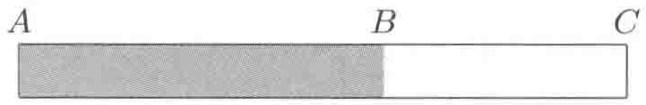
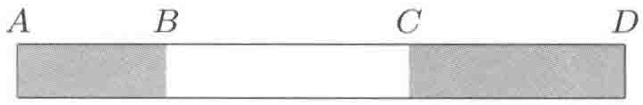
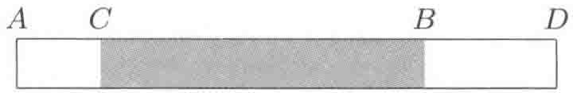

# 2.2.2 节

1\. [习题](../sec-2-2-2.md#ex-2-2-2-1)  M—1 (不是 M). 如果我们允许 M 项, 就像 (6) 和 (7) 那样, 则不可能通过考察 R 和 F 区别空队列和满队列, 因为仅能检测 M 种可能性. 不如放弃一个存储单元, 免得程序过于复杂.

2\. [习题](../sec-2-2-2.md#ex-2-2-2-2)  从队列尾部删除: 如果 R=F 则下溢; $\mathrm{Y} \leftarrow \mathrm{X}[\mathrm{R}]$; 如果 R=1 则 R←M, 否则 R←R-1. 在队列头部插入: 置 $\mathtt X[\mathtt F]\leftarrow\mathtt Y$; 如果 F=1 则 F←M, 否则 F←F-1; 如果 F=R 则上溢.

3\. [习题](../sec-2-2-2.md#ex-2-2-2-3)  (a) LD1 I; LDA BASE,7:1. 这用 5 个周期, 而不是像 (8) 一样用 4 或 8 个周期.

(b) 解法 1:LDA BASE,2:7, 其中每个基址以 $\mathtt { I } _ { 1 } = 0 , \; \mathtt { I } _ { 2 } = 1$ 存储. 解法 2: 如果希望基址以 $\mathtt { I } _ { 1 } \equiv \mathtt { I } _ { 2 } \equiv 0$ 存储, 则我们可以写 LDAX2,7:1, 其中位置 X2 包含 NOPBASE,2:7. 第二种解法多用一个周期, 但是可以通过任意变址寄存器使用基址表.

(c) 这等价于 LD4X(0:2), 并用相同的执行时间, 区别是当 X(0:2) 包含-0 时, rI4 将设置为+0.

4\. [习题](../sec-2-2-2.md#ex-2-2-2-4)  (a) $\mathtt { N O P } * , 7 .$ (b)LDA X,7:7(0:2). (c)这是不可能的。如果位置 Y包含NOPX,7:7,那么代码LDA Y,7:7会打破7:7 上的限制.（见习题5.)(d)LDA X,7:1,连同辅助常数

$$
\begin{aligned}& X  \quad  N0P  \quad *+1,7:2; \\& \quad  N0P  \quad *+1,7:3; \\& \quad  N0P  \quad *+1,7:4; \\& \quad  N0P  \quad 0,5:6\end{aligned}
$$

执行时间为 6 个单位时间. (e)INC6X,7:6, 其中 X 包含 NOP 0,6:6.

5\. [习题](../sec-2-2-2.md#ex-2-2-2-5) (a) 考虑指令 ENTA1000,7:7 与内存格局

|  |  |  |  |
| --- | --- | --- | --- |
| location | ADDRESS | $互 _{\bot}$ | I2 |
| 1000: | 1001 | 7 | 7 |
| 1001: | 1004 | 7 | 1 |
| 1002: | 1002 | 2 | 2 |
| 1003: | 1001 | 1 | 1 |
| 1004: | 1005 | 1 | 7 |
| 1005: | 1006 | 1 | 7 |
| 1006: | 1008 | 7 | 7 |
| 1007: | 1002 | 7 | 1 |
| 1008: | 1003 | 7 | 2 |

并且 rI1 = 1, rI2 = 2. 我们发现 $1 0 0 0 , 7 , 7 = 1 0 0 1 , 7 , 7 , 7 = 1 0 0 4 , 7 , 1 , 7 , 7 = 1 0 0 5 , 1 , 7 , 1 , 7 , 7 = 1 0 0 6 , 7 , 1 , 7 , 7 = 1 0 0 7 , 1 , 7 = 1 0 0 7 , 1 , 7 = 1 0 0 7 , 1 , 7 = 1 0 0 7 , 1 , 7 = 1 0 0 7 , 1 , 1 , 7 = 1 0 0 7 , 1 , 1 , 1 , 1 , 1 , 1 , 1 , 1 , 1 , 1 , 1 , 1 , 1 , 1 , 1 , 1 , 1 , 1 , 1 , 1 , 1 , 1 , 1 , 1 , 1 , 1 , 1 , 1 , 1 , 1 , 1 , 1 , 1 , 1 , 1 , 1 , 1 , 1 , 1 , 1 , 1 , 1 , 1 , 1 , 1 , 1 , 1 , 1 , 1 , 1 , 1 , 1 , 1 , 1 , 1 , 1 , 1 , 1 , 1 , 1 , 1 , 1 , 1 , 1 , 1 , 1 , 1 , 1 , 1 , 1 , 1 , 1 , 1 , 1 , 1 , 1 , 1 , 1 , 1 , 1 , 1 , 1 , 1 , 1 , 1 , 1 , 1 , 1 , 1 , 1 , 1 , 1 , 1 , 1 , 1 , 1 , 1 , 1 , 1 , 1 , 1 , 1 , 1 , 1 , 1 , 1 , 1 , 1 , 1 , 1 , 1 , 1 , 1 , 1 , 1 , 1 , 1 , 1 , 1 , 1 , 1 , 1 , 1 , 1 , 1 , 1 , 1 , 1 , 1 , 1 , 1 , 1 , 1 , 1 , 1 , 1 , 1 , 1 , 1 , 1 , 1 , 1 , 1 , 1 , 1 , 1 , 1 , 1 , 1 , 1 , 1 , 1 , 1 , 1 , 1 , 1 , 1 , 1 , 1 , 1 , 1 , 1 , 1 , 1 , 1 , 1 , 1 , 1 , 1 , 1 , 1 , 1 , 1 , 1 , 1 , 1 , 1 , 1 , 1 , 1 , 1 , 1 , 1 , 1 , 1 , 1 , 1 , 1 , 1 , 1 , 1 , 1 , 1 , 1 , 1 , 1 , 1 , 1 , 1 , 1 , 1 , 1 , 1 , 1 , 1 , 1 , 1 , 1 , 1 , 1 , 1 , 1 , 1 , 1 , 1 , 1 , 1 , 1 , 1 , 1 , 1 , 1 , 1 , 1 , 1 , 1 , 1 , 1 , 1 , 1 , 1 , 1 , 1 , , 1 , 1 , 1 , 1 , 1 , 1 , , 1 , 1 , 1 , 1 , , 1 , 1 , 1 , 1 , , 1 , 1 , 1 , , 1 , 1 , , 1 , 1 , , 1 , 1 , , 1 , , 1 , 1 , , 1 , , 1 , 1 , , 1 , , 1 , 1 , , 1 , 1 , , 1 , , 1 , , 1 1 , , , 1 , 1 , , 1 , , 1 , 1 , 1 , , 1 , 1 , 1 , , 1 , 1 , 1 , , 1 , 1 , 1 , , 1 , 1 , , 1 , 1 , 1 , , 1 , 1 , 1 , , 1 , 1 , 1 , 1 , 1 , 1 , , 1 , 1 , 1 , 1 , 1 , 1 , , 1 , 1 , 1 , 1 , 1 , 1 , 1 , 1 , 1 , 1 , , 1 , 1 , 1 , 1 , 1 , 1 , 1 , 1 , 1 , 1 , 1 , 1 , 1 , 1 , 1 , , 1 1 1 , , 1 , 1 1 , , 1 , 1 , 1 1 , 1 , , , 1 1 1 , , , 1 , 1 1 , 1 , 1 , , 1 1 , , 1 , , 1 1 , 1 , , 1 , 1 , 1 , 1 , 1 , , 1 , 1 1 , 1 , , 1 , , , 1 , , 1 1 , , , 1 1 , , 1 , 1 , , , 1 1 , , 1 , 1 , , 1 1 , , , , 1 , , 1 1 , 1 , , , 1 , , 1 1 , , 1 , , 1 1 , , 1 , , , , 1 1 , , , 1 1 , , , 1 , 1 1 , , , 1 , , 1 1 , , 1 , 1 , , , 1 , , , 1 , , , 1 1 , 1 , , 1 , , , 1 , 1 , , , , 1 1 , , 1 , , , 1 1 , 1 1 , 1 , , , , , 1 , 1 , , 1 , 1 , 1 , , , 1 , , , 1 , , 1 1 , , , 1 1 , 1 , , , 1 , , , , 1 , 1 1 , , , 1 , , 1 , , 1 1 , , 1 , , , 1 1 , , , 1 , , 1 , 1 , , 1 , , , , , , 1 1 1 , , , 1 , 1 1 , , , 1 , 1 , , , , , , 1 , , 1 , 1 , 1 , , , 1 , 1 1 , , , , , , , , 1 1 , , , , , 1 , 1 1 1 , , , , 1 1 , , , , , 1 , 1 1 , 1 , , , , 1 , , , , 1 1 , 1 , , , , , , , , 1 1 , , 1 , 1 , , , , , , 1 , 1 , , 1 1 , 1 , , , , , 1 1 1 , , , , , 1 , 1 , , , , 1 1 , , 1 , , , , , , , , 1 , , , , , , , , , , , , , , , , 1 , , , , , , , , , , , , , 1 , , 1$ $1 0 0 8 { , } 7 { , } 7 { , } 1 { , } 7 { , } 7 = 1 0 0 3 { , } 7 { , } 2 { , } 7 { , } 1 { , } 7 { , } 7 = 1 0 0 1 { , } 1 { , } 1 { , } 2 { , } 7 { , } 1 { , } 7 { , } 7 = 1 0 0 2 { , } 1 { , } 2 { , } 7 { , } 1 { , } 7 { , } 7 = 1 0 0 3 { , } 2 { , } 7 { , } 1 { , } 7 { , } 7 = 1 0 0 5 { , } 7 { , } 1 { , } 7 { , } 7$ $= 1 0 0 6 , 1 , 7 , 1 , 7 , 7 = 1 0 0 7 , 7 , 1 , 7 , 7 = 1 0 0 2 , 7 , 1 , 1 , 7 , 7 = 1 0 0 2 , 2 , 2 , 1 , 1 , 7 , 7 = 1 0 0 4 , 2 , 1 , 1 , 7 , 7 = 1 0 0 6 , 1 , 1 , 7 , 7 =$ $\mathtt{1007,1,7,7}=\mathtt{1008,7,7}=\mathtt{1003,7,2,7}=\mathtt{1001,1,2,7}=\mathtt{1002,1,2,7}=\mathtt{1003,2,7}=\mathtt{1005,7}=\mathtt{1006,1,7}=$ $^ { 1 0 0 7 , 7 = 1 0 0 2 , 7 , 1 = 1 0 0 2 , 2 , 2 , 1 = 1 0 0 4 , 2 , 1 = 1 0 0 6 , 1 = 1 0 0 7 } .$ (手工做此推导更快的方法是依次计算位置 1002,1003,1007,1008,1005,1006,1004,1001,1000 中指定的地址, 但是计算机显然需要按上面所示的次序计算.) 我尝试了多种有趣的方案, 试图在计算地址的同时改变内存的内容, 最终在得到最后的地址时一切都恢复原样. 类似的算法出现在 2.3.5 节. 然而, 这些尝试并没有多大成效, 似乎总是没有足够的空间来存放必要的信息.

(b,c) 设 H 和 C 是辅助寄存器, N 是计数器. 为了得到有效地址 M, 对于位置 L 中的指令, 如下操作.

A1.[初始化.] 置 $\mathtt H\leftarrow0,\quad\mathtt C\leftarrow\mathtt L,\quad\mathtt N\leftarrow0.$ (在这个算法中, C 是 “当前” 位置, H 用来把各个变址寄存器的内容加到一起, N 度量间接寻址的深度.)

A2.[检查地址.] 置 $\mathtt M\leftarrow\mathtt{ADDRESS}(\mathtt C).\quad\text{如果 }\mathrm I_1(\mathtt C)=j,\quad1\le j\le6$, 置 $\mathrm{M} \leftarrow \mathrm{M} + \mathrm{r}\mathrm{I}j$. 如果 $\mathtt I_2(\mathtt C)=j,\quad1\le j\le6$, 置 $\mathtt H\leftarrow\mathtt H+\mathrm{rI}j.$ 如果 $\mathtt { I } _ { 1 } \left( \mathtt { C } \right) = \mathtt { I } _ { 2 } \left( \mathtt { C } \right) = 7$, 置 N←N+1, H←0.

A3. [间接?] 如果 $\mathrm{T_1}(\mathrm{C})$ 或 $\mathrm{T}_{2}(\mathrm{C})$ 等于 7, 置 C←M 并转到 A2. 否则置 M←M+H,H←0.  
A4.[降低深度.] 如果 N>0, 置 $\mathtt C\leftarrow\mathtt M,\quad\mathtt N\leftarrow\mathtt N-1$, 并转到 A2. 否则 M 是所求答案.

除了 $\mathtt { I } _ { 1 } = 7 , 1 \leq \mathtt { I } _ { 2 } \leq 6$, 并且 ADDRESS 中地址的计算涉及 $\mathtt { I } _ { 1 } = \mathtt { I } _ { 2 } = 7$ 的情况之外, 这个算法将正确地处理其他任何情况. 其效果就好像 $互 _2$ 为 0 一样. 为了理解算法 A 的操作, 考虑 (a) 部分的记号: 状态 $\text{“}\mathtt{L,7,1,2,5,2,7,7,7,7}\text{”}$ 被 C 或 M=L, N=4 (末尾 7 的个数) 表示, 并且 $\mathtt H=\mathrm{rI1}+\mathrm{rI2}+\mathrm{rI5}+\mathrm{rI2}$ (后变址). 在本题 (b) 部分的解中, 计数器 N 总是 0 或 1.

6\. [习题](../sec-2-2-2.md#ex-2-2-2-6) (c) 导致上溢. (e) 导致下溢, 并且如果程序继续运行, 则它在最终的 $\mathrm I_2$ 导致上溢.

7\. [习题](../sec-2-2-2.md#ex-2-2-2-7) 不可能, 因为 TOP[i] 必须大于 OLDTOP[i].

8\. [习题](../sec-2-2-2.md#ex-2-2-2-8) 使用栈, 有用的信息出现在一端, 而空信息出现在另一端:

其中 $A=\mathtt{BASE}[j]$ $B = \mathtt { T O P } \left[ j \right]$ $C = \mathtt { B A S E } \left[ j + 1 \right]$. 使用队列或双端队列, 有用信息出现在两端, 空信息在中间某处:

或有用信息在中间, 空信息在两端:

其中 $A = \mathrm{BASE}[j]$, B = REAR[j], $C = \mathrm{FR0NT}[j]$, $D = \mathtt { B A S E } \left[ j + 1 \right]$. 在非空队列, 两种情况分别通过条件 $B \leq C$ 和 $B > C$ 识别; 如果已知队列未上溢, 识别条件也可以分别采用 $B < C$ 和 $\underline { { B } } \geq C .$ 因此, 应该用一种明显的方法修改该算法, 以加大或缩小空信息的间隔. (这样, 当 $B = C$ 上溢时, 我们只移动一部分, 在 B 和 C 之间产生空间.) 在步骤 G2 计算 SUM 和 D[j] 时, 每个队列应该视为比实际多占一个单元 (见习题 1).

9\. [习题](../sec-2-2-2.md#ex-2-2-2-9)  给定任意序列 $a _ { 1 } , a _ { 2 } , \ldots , a _ { m }$, 对于每个满足 $j < k$ 且 $a _ { j } > a _ { k }$ 的数对 (j,k), 需要一次移动操作. (这种数对称作 “反序”, 见 5.1.1 节.) 因此, 这样的数对的个数就是需要移动的次数. 现在, 想象所有 $n ^ { m }$ 个序列都已经列出, 并对 (2) 个满足 $j < k$ 的数对 (j,k), 分别计数有多少个序列满足 $\bar { a } _ { j } > \tilde { a } _ { k }$. 显然, 这等于 $a _ { j }$ 和 $a _ { k }$ 的可选取值数 (), 再乘以填充其余位置的方法数 $n ^ { m - 2 } .$ 因此, 所有序列中的总移动次数为 $\binom m2\binom n2 n^{m-2}.$ 除以 $n ^ { m }$, 得到平均值 (14) 式.

10\. [习题](../sec-2-2-2.md#ex-2-2-2-10) 与习题 9 一样, 我们发现该期望值为

$$
\begin{aligned} { \binom { m } { 2 } \sum _ { 1 \leq j < k \leq n } p _ { j } p _ { k } } & { { } = \frac { 1 } { 2 } \binom { m } { 2 } ( ( p _ { 1 } + \cdots + p _ { n } ) ^ { 2 } - ( p _ { 1 } ^ { 2 } + \cdots + p _ { n } ^ { 2 } ) ) } \\ { } & { { } = \frac { 1 } { 2 } \binom { m } { 2 } ( 1 - ( p _ { 1 } ^ { 2 } + \cdots + p _ { n } ^ { 2 } ) ) . } \\ \end{aligned}
$$

对于这个模型, 表的相对次序是什么完全没有关系! (片刻沉思就能明白为什么. 考虑一个给定序列 $a _ { 1 } , \ldots , a _ { m }$ 的所有可能的排列, 则我们发现, 所有这些排列的总移动次数仅依赖于不同元素 $a _ { j } \neq a _ { k }$ 的数对的个数.)

11\. [习题](../sec-2-2-2.md#ex-2-2-2-11) 与前面一样计数, 我们发现该期望数为

$$
E_{mnt}=\frac1{n^m}\binom n2\sum_{k=1}^m\sum_{r\ge t}(k-1)\binom{k-2}{r}(n-1)^{k-2-r}n^{m-k},
$$

这里, r 是 $a _ { 1 } , a _ { 2 } , \ldots , a _ { k - 1 }$ 中等于 $a _ { k }$ 的元素个数. 这个公式可化简为

$$
E _ { m n t } = \frac { 1 } { n ^ { m } } \binom { n } { 2 } \sum _ { k > t } \binom { m } { k } ( n - 1 ) ^ { m - k } \left( \binom { k } { 2 } - \binom { t + 1 } { 2 } \right) , \quad  对   于  t \geq 0.
$$

答案还能进一步化简吗? 显然不能, 因为对于给定的 n 和 $t ,$ 生成函数为

$$
\sum _ { m } E _ { m n t } z ^ { m } = \frac { n - 1 } { 2 n } \frac { z } { ( 1 - z ) ^ { 3 } } \Big ( \frac { z } { n - ( n - 1 ) z } \Big ) ^ { t + 1 } ( z + ( 1 - z ) ^ { } { n ( t + 1 ) } ) .
$$

12\. [习题](../sec-2-2-2.md#ex-2-2-2-12)  如果 m =2k, 则平均值为 $2 ^ { - 2 k }$ 乘以

$$
\binom { 2 k } { 0 } 2 k + \binom { 2 k } { 1 } ( 2 k - 1 ) + \dots + \binom { 2 k } { k } k + \binom { 2 k } { k + 1 } ( k + 1 ) + \dots + \binom { 2 k } { 2 k } 2 k .
$$

上面的和式等于

$$
{ 2 k \choose k } k + 2 \Biggl ( { 2 k - 1 \choose k } 2 k + \cdots + { 2 k - 1 \choose 2 k - 1 } 2 k \Biggr ) = { 2 k \choose k } k + 4 k \cdot \frac { 1 } { 2 } \cdot 2 ^ { 2 k - 1 } .
$$

当 $m = 2k + 1$ 时, 可以使用类似的论证. 答案是

$$
\frac m2+\frac m{2^m}\binom{m-1}{\lfloor m/2\rfloor}.
$$

13\. [习题](../sec-2-2-2.md#ex-2-2-2-13)  姚期智证明了当 $p<\tfrac12$ 时, 对于大的 m, 有 $\operatorname { E } \operatorname* { m a x } ( k _ { 1 } , k _ { 2 } ) = \textstyle { \frac { 1 } { 2 } } m + ( 2 \pi ( 1 - 2 p ) ) ^ { - 1 / 2 } \sqrt { m } +$ $O ( m ^ { - 1 / 2 } ( \operatorname { l o g } m ) ^ { 2 } )$. [SICOMP10(1981), 398-403.] 弗拉若莱扩充了这一分析, 特别证明当 $p=\tfrac12$ 时, 该期望值逼近αm, 其中

$$
\alpha = \frac { 1 } { 2 } + 8 \sum _ { n \geq 1 } \frac { \sin ( n \pi / 2 ) \cosh ( n \pi / 2 ) } { n ^ { 2 } \pi ^ { 2 } \sinh n \pi } \approx 0 . 6 7 5 3 1   4 4 8 3 3 .
$$

此外, 当 $p > \frac{1}{2}$ 时, $k _ { 1 }$ 的值随 $m \to \infty$ 而趋向于均匀分布, 因此 $\operatorname { E } \operatorname* { m a x } ( k _ { 1 } , k _ { 2 } ) \approx { \textstyle \frac { 3 } { 4 } } m$. [见 LectureNotes in Comp. Sci. 233 (1986), 325–340. ]

14\. [习题](../sec-2-2-2.md#ex-2-2-2-14)  令 $k _ { j } = m / n + \sqrt { m }   x _ { j }$. (这一思想是德·布鲁因提出的.) 当 $k _ { 1 } + \cdots + k _ { n } = m$ 并且所有 $x$ 都一致有界时, 斯特林近似公式表明

$$
\begin{aligned} { n ^ { - m } } & { { } \frac { m ! } { k _ { 1 } ! \ldots k _ { n } ! } \operatorname* { m a x } ( k _ { 1 } , \ldots , k _ { n } ) } \\ { } & { { } \quad = ( \sqrt { 2 \pi } ) ^ { 1 - n } n ^ { n / 2 } \left( \frac { m } { n } + \sqrt { m } \operatorname* { m a x } ( x _ { 1 } , \ldots , x _ { n } ) \right) } \\ { } & { { } \quad \times \operatorname { e x p } \left( - \frac { n } { 2 } ( x _ { 1 } ^ { 2 } + \cdots + x _ { n } ^ { 2 } ) \right) ( \sqrt { m } ) ^ { 1 - n } \left( 1 + O \Big ( \frac { 1 } { \sqrt { m } } \Big ) \right) , } \\ \end{aligned}
$$

后一个量对满足这一条件的所有非负 $k _ { 1 } , \ldots , k _ { n }$ 求和, 近似得到一个黎曼积分. 可以推出这个和的渐近行为是 $a _ { n } ( m / n ) + c _ { n } \sqrt { m } + O ( 1 )$, 其中

$$
a _ { n } = ( \sqrt { 2 \pi } ) ^ { 1 - n } n ^ { n / 2 }     \int _ { x _ { 1 } + \dots + x _ { n } = 0 } \exp \left( - \frac { n } { 2 } ( x _ { 1 } ^ { 2 } + \dots + x _ { n } ^ { 2 } ) \right)   d x _ { 2 } \dots d x _ { n }   ,
$$

$$
c _ { n } = ( \sqrt { 2 \pi } ) ^ { 1 - n } n ^ { n / 2 } { \int _ { x _ { 1 } + \dots + x _ { n } = 0 } } \operatorname* { m a x } ( x _ { 1 } , \dots , x _ { n } ) \operatorname { e x p } \left( - \frac { n } { 2 } ( x _ { 1 } ^ { 2 } { + \dots + } x _ { n } ^ { 2 } ) \right) \mathop { }  { d } x _ { 2 } \dots \mathop { }  { d } x _ { n } ,
$$

这是因为可以证明, 对于任意 $\epsilon _ { \perp }$, 对应的和在 an 和 $c _ { n }$ 的 ∈邻域之内.

我们知道 $a _ { n } = 1$, 因为对应的和可以显式求值. $c _ { n }$ 表达式中的积分等于 $n I _ { 1 }$, 其中

$$
I _ { 1 } = \int _ { \stackrel { x _ { 1 } + \dots + x _ { n } = 0 } { x _ { 1 } \geq x _ { 2 } , \dots , x _ { n } } } x _ { 1 } \operatorname { e x p } { \left( - \frac { n } { 2 } ( x _ { 1 } ^ { 2 } + \dots + x _ { n } ^ { 2 } ) \right) } d x _ { 2 } \dots d x _ { n } .
$$

我们可以换元,

$$
x_1=\frac1n(y_2+\cdots+y_n),\quad x_2=x_1-y_2,\quad x_3=x_1-y_3,\quad\ldots,\quad x_n=x_1-y_n.
$$

于是发现 $\bar { I } _ { 1 } = I _ { 2 } / n ^ { 2 }$, 其中

$$
I _ { 2 } = \int _ { y _ { 2 } , \dots , y _ { n } \geq 0 } ( y _ { 2 } + \dots + y _ { n } ) \operatorname { e x p } \Bigl ( - \frac { Q } { 2 } \Bigr ) \: d y _ { 2 } \dots d y _ { n } \: ,
$$

并且 $Q=n(y_2^2+\cdots+y_n^2)-(y_2+\cdots+y_n)^2$. 现在, 由对称性, $I_{2}$ 是 (n-1) 乘以该积分, 但把 $( y _ { 2 } + \dots + y _ { n } )$ 换成 y2. 因此 $I _ { 2 } = ( n - 1 ) I _ { 3 }$, 其中

$$
\begin{aligned} { I _ { 3 } } & { { } = \int _ { y _ { 2 } , \dots , y _ { n } \geq 0 } ( n y _ { 2 } - ( y _ { 2 } + \dots + y _ { n } ) ) \operatorname { e x p } \Bigl ( - \frac { Q } { 2 } \Bigr ) \mathop { } \mathopen { } d y _ { 2 } \dots \mathop { } \mathopen { } d y _ { n } } \\ { } & { { } = \int _ { y _ { 3 } , \dots , y _ { n } \geq 0 } \operatorname { e x p } \Bigl ( - \frac { Q _ { 0 } } { 2 } \Bigr ) \mathop { } \mathopen { } d y _ { 3 } \dots \mathop { } \mathopen { } d y _ { n } , } \\ \end{aligned}
$$

这里, $Q_{0}$ 是在 Q 中用 0 替换 $y _ { 2 }$ 得到的. [当 $n \equiv 2$ 时, 令 $I _ { 3 } = 1 .$ ] 现在, 令 $z_{j} = \sqrt{n}   y_{j} - (y_{3} + \cdots +$ $y_{n} ) / ( \sqrt{2} + \sqrt{n} ), \; 3 \leq j \leq n$. 于是, $Q _ { 0 } = z _ { 3 } ^ { 2 } + \cdots + z _ { n } ^ { 2 }$, 并且推出 $I _ { 3 } = I _ { 4 } / n ^ { ( n - 3 ) / 2 } \sqrt { 2 }$, 其中

$$
\begin{aligned} { I _ { 4 } } & { { } = \int _ { y _ { 3 } , \dots , y _ { n } \geq 0 } \operatorname { e x p } { \left( - \frac { z _ { 3 } ^ { 2 } + \dots + z _ { n } ^ { 2 } } { 2 } \right) } d z _ { 3 } \dots d z _ { n } } \\ { } & { { } = \alpha _ { n } \int \operatorname { e x p } { \left( - \frac { z _ { 3 } ^ { 2 } + \dots + z _ { n } ^ { 2 } } { 2 } \right) } d z _ { 3 } \dots d z _ { n } = \alpha _ { n } ( \sqrt { 2 \pi } \: ) ^ { n - 2 } , } \\ \end{aligned}
$$

其中 $\alpha _ { n }$ 是由向量 $( n + \sqrt { 2 n } , \: 0 , \ldots , 0 ) - ( 1 , 1 , \ldots , 1 ) , \ldots , \quad ( 0 , 0 , \ldots , n + \sqrt { 2 n } \: ) - ( 1 , 1 , \ldots , 1 )$ 张成的 $(n - 2)$ 维空间中的 “立体角”, 除以整个空间的总立体角. 因此

$$
c _ { n } = \frac { ( n - 1 ) \sqrt { n } } { 2 \sqrt { \pi } } \alpha _ { n } .
$$

我们有 $\alpha _ { 2 } = 1$, $\alpha_3=\tfrac12,\quad\alpha_4=\pi^{-1}\arctan\sqrt2\approx .304$, 并且

$$
\alpha _ { 5 } = \frac { 1 } { 8 } + \frac { 3 } { 4 \pi } \operatorname { a r c t a n } \frac { 1 } { \sqrt { 8 } } \approx . 2 0 6 .
$$

一 $[\ c_3$ 的值是罗伯特·科泽尔卡找到的, 见 Annals ofMath. Stat.27(1956), 507-512. 但是, 对于较大的 $n$ 值, 这一问题的解尚未见诸文献.]

16\. [习题](../sec-2-2-2.md#ex-2-2-2-16) 不能, 除非队列满足用于 (4) 和 (5) 的基本方法的限制.

17\. [习题](../sec-2-2-2.md#ex-2-2-2-17)  首先证明 $\begin{aligned} { \mathtt { \bar { B A S E } } \left[ { j } \right] _ { 0 } \leq \mathtt { \bar { B A S E } } \left[ { j } \right] _ { 1 } } \\ \end{aligned}$ 总是成立. 然后注意到栈 i 每次在 $s _ { 0 } ( \sigma )$ 中上溢但不在 $s _ { 1 } ( \sigma )$ 中上溢的时候, 栈 i 都比以前任何时候更长, 但并不长于在 $s _ { 1 } ( \sigma )$ 中分配给栈 i 的初始长度.

18\. [习题](../sec-2-2-2.md#ex-2-2-2-18) 假设一次插入的代价为 a, 如果重新分配的话, 再加上 bN+cn, 其中 N 是所占据的单元数; 设删除的代价为 d. 重新分配之后, N 个单元被占用, S=M—N 个单元为空. 设想下一次重新分配之前的每次插入代价为 $a + b + 1 0 c + 1 0 ( b + c ) n N / S = O ( 1 + n \alpha / ( 1 - \alpha ) )$, 其中 $\alpha = \tilde { N } / M .$ 如果在重新分配之前出现 p 次插入和 q 次删除, 则设想的代价为 $p ( a + b + 1 0 c + 1 0 ( b + c ) n N / S ) + q d$, 而实际代价为 $p a + b N ^ { \prime } + c n + q d \leq p a + p b + b N + c n + q d .$ 后者比设想的代价小, 因为 p>.1S/n; 我们的假定 $M \geq n ^ { 2 }$ 意味着 $c S / n + ( b + c ) N \geq b N + c n .$

19\. [习题](../sec-2-2-2.md#ex-2-2-2-19)  我们可以直接把所有下标减 1. 下面的解稍微好一些. 初始, T=F=R=0.

把 Y 推进栈 X: 如果 T=M 则 OVERFLOW;X[T]←Y;T←T+1.

把 Y 从栈 X 弹出: 如果 T = 0 则 UNDERFLOW; T ←T-1;Y ←X[T].

把 Y 插入队列 X:X[R] ←Y;R ←(R+ 1) mod M; 如果 R = F 则 OVERFLOW.

把 Y 从队列 X 删除: 如果 F = R 则 UNDERFLOW;Y←X[F];F←(F+1)modM. 像以前一样, T 是栈中元素个数, (R-F)modM 是队列中元素个数. 但是, 现在栈顶元素是 X[T—1], 而不是 X[T].

尽管对于计算机科学家而言, 从 0 开始计数几乎总是更好, 但是世上其他人可能永远不会改成从 0 开始计数. 甚至连戴克斯特拉[^cn449-1] 在弹钢琴时也在数着 “1-2-3-4|1-2-3-4”!

[^cn449-1]: 著名计算机科学家, 1972 年图灵奖得主.
