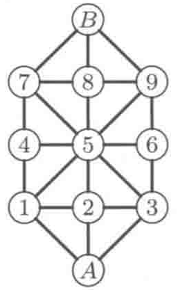

<a id="answers-2-2-3"></a>


# 2.2.3 节

1\. <a id="ans-2-2-3-1"></a>[习题](../sec-2-2-3.md#ex-2-2-3-1)  OVERFLOW 隐含在操作 P ⇐ AVAIL 中.

2\. <a id="ans-2-2-3-2"></a>[习题](../sec-2-2-3.md#ex-2-2-3-2)  INSERT STJ 1F 存放“NOPT”的位置.STJ 9F 存放出口位置.LD1 AVAIL rI1 ⇐ AVAIL.J1Z OVERFLOWLD3 0,1(LINK)ST3 AVAILSTA 0,1(INFO) INFO(rI1) ← Y.1H LD3 \*(0:2) rI3 ← LOC(T).LD2 0,3 rI2 ← T.ST2 0,1(LINK) LINK(rI1) ← T.ST1 0,3 T←rI1.9H JMP \*

3\. <a id="ans-2-2-3-3"></a>[习题](../sec-2-2-3.md#ex-2-2-3-3)  DELETE STJ 1F 存放“NOPT”的位置.STJ 9F 存放出口位置.1H LD2 \*(0:2) rI2 ← LOC(T).LD3 0,2 rI3 ← T.J3Z 9F T = Λ 吗?LD1 0,3(LINK) rI1 ← LINK(T).ST1 0,2 T ← rI1.LDA 0,3(INFO) rA ← INF0(rI1).LD2 AVAIL AVAIL ⇐ rI3.


<a id="pdf-450"></a><a id="p-433"></a>

ST2 0,3(LINK)ST3 AVAILENT3 2 准备第二出口. 9H JMP \*,3

4\. <a id="ans-2-2-3-4"></a>[习题](../sec-2-2-3.md#ex-2-2-3-4)  OVERFLOW STJ 9F 存放rJ的设置。 ST1 8F(0:2) 保存 rI1的设置。 LD1 POOLMAX ST1 AVAIL 设置 AVAIL 到新的位置。 INC1 c ST1 POOLMAX POOLMAX 增值。 CMP1 SEQMIN JG TOOBAD 存储已经超出? STZ -c,1(LINK) 置LINK(AVAIL)←Λ. 9H ENT1 \* 取rJ的设置。 DEC1 2 减2. ST1 \*+2(0:2) 存放出口位置。 8H ENT1 \* 恢复 rI1. JMP \* 返回。

5\. <a id="ans-2-2-3-5"></a>[习题](../sec-2-2-3.md#ex-2-2-3-5)  插入到队列头部本质上与基本插入操作 (8) 一样, 附加对空队列的检测: $\mathtt{P}\Leftarrow \mathtt{AVAIL},\quad \mathtt{INFO}(\mathtt{P})\leftarrow \mathtt{Y},$ $\mathrm{LiNK}(\mathbb{P}) \leftarrow \mathbb{F};$ 如果 F=Λ, 则 $\mathbb { R } \xleftarrow { } \mathbb { P } ; \quad \mathbb { F } \xleftarrow { } \mathbb { P } .$

为了从尾部删除, 我们必须找出哪个结点链接到 NODE(R). 这必定是低效的, 因为我们必须从 F 起, 一路搜索. 例如, 这可以按以下步骤来做:

(a) 如果 $\mathtt { F } = \Lambda$, 则下溢, 否则置 $\mathtt P\leftarrow\mathtt{LOC}(\mathtt F)$

(b) 如果 $\mathrm{LINK}(\mathbb{P}) \neq \mathbb{R}$, 则置 $\mathtt{P}\leftarrow \mathtt{LINK}(\mathtt{P})$, 并重复该步骤直到 $\mathtt{LINK}(\mathtt P)=\mathtt R.$

(c) 置 $\mathtt{Y}\leftarrow \mathtt{INFO}(\mathtt{R}),\quad \mathtt{AVAIL}\Leftarrow \mathtt{R},\quad \mathtt{R}\leftarrow \mathtt{P},\quad \mathtt{LINK}(\mathtt{P})\leftarrow \Lambda .$

6\. <a id="ans-2-2-3-6"></a>[习题](../sec-2-2-3.md#ex-2-2-3-6)  我们如果从 $(17)$ 中删除命令 $\text{“}\mathtt{F}\leftarrow \mathtt{LINK}(\mathtt{P})\text{”}$, 把 “如果 $\mathbb { F } \equiv \Lambda$, 则置 $\mathtt R\leftarrow\mathtt{LOC}(\mathtt F)\text{”}$ 改成 “如果 $\mathtt { F } \equiv \mathtt { R }$, 则 $\mathtt F\leftarrow\Lambda,\quad\mathtt R\leftarrow\mathtt{LOC}(\mathtt F)$, 否则置 $\mathtt F\leftarrow\mathtt{LINK}(\mathtt P)\text{”}$, 则可以从 (14) 中去掉操作 LINK(P)←Λ.

这些改变的效果是队列尾部结点的 LINK 字段将包含程序绝不访问的假信息. 像这样的技巧能节省执行时间, 在实践中非常有用, 不过它违背了垃圾回收的基本假定 (见 2.3.5 节), 因此不能与垃圾回收算法一起使用.

7\. <a id="ans-2-2-3-7"></a>[习题](../sec-2-2-3.md#ex-2-2-3-7) (确保你的解对空表也能工作.)

I1. 置 $\mathtt{P}\leftarrow \mathtt{FIRST},\quad \mathtt{Q}\leftarrow \Lambda .$

I2. 如果 $\mathsf { P } \neq \Lambda$, 则置 R←Q,Q←P,P←LINK(Q), LINK(Q)←R, 并重复此步骤.

I3. 置 FIRST ← Q.

本质上, 我们从一个栈弹出诸结点, 并把它们推入另一个栈.

```txt

```

<a id="ans-2-2-3-8"></a>[习题](../sec-2-2-3.md#ex-2-2-3-8)

```text
8.LD1 FIRST1 I1. P ≡ rI1 ← FIRST.
ENT2 01Q ≡ rI2 ← Λ.
J1Z 2F1I2. 如果表为空，则转移.
1HENTA 0,2nR ≡ rA ← Q.
ENT2 0,1nQ←P.
LD1 0,2(LINK)nP ← LINK(Q).
STA 0,2(LINK)n LINK(Q) ← R.
J1NZ 1Bn$\mathbb{P} \neq \Lambda$吗?
2H ST2 FIRST1 I3. FIRST ← Q.I
```

<a id="pdf-451"></a><a id="p-434"></a>

时间是 (7n+6)u. 可以加快速度, 把时间缩短到 (5n+常数)u, 见习题 1.1-3.

9\. <a id="ans-2-2-3-9"></a>[习题](../sec-2-2-3.md#ex-2-2-3-9) (a) 是. (b) 是, 如果考虑血缘上的亲子关系; 否, 如果考虑法律上的亲子关系. (c) 否 $( - 1 \times 1$ 并且 $1\prec-1\,)$. (d) 希望如此, 否则就会有循环推理. (e)1<3 并且 3<1. (f) 该陈述具有二义性. 如果我们认为被 y 调用的子程序依赖于哪个子程序调用 $y$, 则我们将不得不断言传递律不一定成立. (例如, 对于每种 $I  /  O$ 设备, 一个通用的输入输出处理程序可能调用不同的处理例程, 但是, 在一个程序中往往不需要所有这些处理例程. 这在过去是一个困扰许多自动程序设计系统的问题.)

10\. <a id="ans-2-2-3-10"></a>[习题](../sec-2-2-3.md#ex-2-2-3-10)  对于 (i), 有三种情况: $x = y;x \subset y$ 且 $y = z;   x \subset y$ 且 $y \subset z .$ 对于 (ii), 有两种情况: $x = y;$ 1D$x \neq y .$ 每种情况的处理都是平凡的, (iii) 也是如此.

11\. <a id="ans-2-2-3-11"></a>[习题](../sec-2-2-3.md#ex-2-2-3-11)  “乘出” 下面的表达 式<sup>[^cn451-1]</sup> , 得到所有 52 种解: $1 3 7 4 9 ( 2 5   +   5 2 ) 8 6   +   ( 1 3 7 9   +   1 3 9 7   +   1 9 3 7   +   9 1 3 7 ) ( 4 2 5 8   +$ $4 5 2 8 + 2 4 5 8 + 5 4 2 8 + 2 5 4 8 + 5 2 4 8 + 2 5 8 4 + 5 2 8 4 ) 6 + ( 1 3 9 2 + 1 9 3 2 + 1 9 2 3 + 9 1 2 3 + 9 1 3 2 + 9 2 1 3 ) 7 ( 4 5 8 +$ $548+584)6$

12\. <a id="ans-2-2-3-12"></a>[习题](../sec-2-2-3.md#ex-2-2-3-12)  例如: (a) 对于 $0 \leq k < n$, 先 (以任意次序) 列出所有具有 k 个元素的集合, 再列出所有具有 $k + 1$ 个元素的集合. (b) 用一个 0 和 1 的序列表示一个子集, 指出哪些元素在该子集中. 这通过二进制系统, 给出了所有子集与 0 到 $2^{n} - 1$ 中的整数之间的对应关系. 对应的次序就是一个拓扑序列.

13\. <a id="ans-2-2-3-13"></a>[习题](../sec-2-2-3.md#ex-2-2-3-13) 沙基昌和丹尼尔·克莱特曼 DiscreteMath.63(1987), 271-278] 已经证明该数最多为 $\textstyle \prod _ { k = 0 } ^ { n } { \binom { n } { k } } ^ { \binom { n } { k } }$ 这一上界是明显的下界 $\textstyle \prod _ { k = 0 } ^ { n } { \binom { n } { k } } ! = 2 ^ { 2 ^ { n } ( n + O ( \operatorname { l o g } n ) ) }$ 的 $e ^ { 2 ^ { n } + O ( n ) }$ 倍. 他们猜测该下界比上界更接近真实值.

14\. <a id="ans-2-2-3-14"></a>[习题](../sec-2-2-3.md#ex-2-2-3-14)  如果 $a _ { 1 } \: a _ { 2 } \ldots a _ { n }$ 和 $b_1b_2\ldots b_n$ 是两个可能的拓扑序, 令 $j$ 是使 $a _ { j } \neq b _ { j }$ 的最小下标; 于是, 存在 $k , m > j$, 有 $a _ { k } = b _ { j } , \quad a _ { j } = b _ { m }$. 现在, 由 $k \geq j$ 有 $b _ { j }$ $a _ { j }$, 由 $m > j$ 有 $a_j\npreceq b_j$, 因此 (iv) 为假. 反之, 如果只有一个拓扑序 $a_1a_2\ldots a_n$, 则对于 $1 \leq j < n$, 必然有 $a _ { j } \preceq a _ { j + 1 }$, 否则的话, $a _ { j }$ 与 $a _ { j + 1 }$ 可以互换. 这和传递性蕴涵 (iv).

注意: 下面的另一种证明对无限集也成立. (a) 每个偏序都可以嵌入在一个线性序中. 如果我们有两个元素满足 $x_{0}$ $y _ { 0 }$ 和 $y_0\npreceq x_0$, 则我们可以按规则 $\text{“}x\preceq y$ 或 $( x \preceq x _ { 0 }$ 并且 $y_{0} \preceq y )$ 产生另一个偏序. 后一个序 “包含” 前一个, 并且有 $x _ { 0 } \preceq y _ { 0 }$. 现在, 在通常的方式下使用佐恩引理或超限归纳法完成证明. (b) 显然, 一种线性序不可能嵌入到任何不同的线性序中. (c) 一个具有像 (a) 中那样的不可比较元素 $x_{0}$ 和 $y _ { 0 }$ 的偏序可以拓广成两种线性序, 其中分别有 $x _ { 0 } \preceq y _ { 0 }$ 和 $y _ { 0 } \preceq x _ { 0 }$, 因此至少存在两个线性序.

15\. <a id="ans-2-2-3-15"></a>[习题](../sec-2-2-3.md#ex-2-2-3-15) 如果 S 是有限的, 则我们可以列出在给定的偏序下为真的所有关系 $a \prec b$. 通过一次一个、逐个移去被其他关系蕴涵的关系, 我们得到一个无冗余的集合. 问题是证明无论我们按什么次序移去冗余关系, 恰有一个这样的无冗余集合. 如果有两个无冗余的集合 U 和 V, 其中 $\bar { a } \prec \bar { b }$ 在 U 中出现, 但不在 V 中出现, 则对于某个 $k \geq 1$, V 中存在 $k + 1$ 个关系 $a \prec c _ { 1 } \prec \cdots \prec c _ { k } \prec b .$ 但是, 不使用 $\bar { a } \prec b$ 也能从 U 导出 $a \prec c _ { 1 }$ 和 $c _ { 1 } \prec b$ (由于 $b \not \leq c _ { 1 }$ 和 $c _ { 1 }$ a), 因此关系 $a \prec b$ 在 U 中是冗余的.

当 S 为无限集时, 上述结果为假, S 最多有一个无冗余的关系集. 例如, 如果 $S$ 表示整数和元素 $\infty$ 构成的集合, 对于所有的 $n _ { \gamma }$, 定义 $n \prec n + 1$ 并且 $n \prec \infty$, 则不存在刻画这个偏序的无冗余的关系集.

<a id="ans-2-2-3-16"></a>[习题](../sec-2-2-3.md#ex-2-2-3-16)

$x _ { p _ { 1 } } \: x _ { p _ { 2 } } \ldots x _ { p _ { n } }$ 是 S 的一个拓扑序, 把排列 $p _ { 1 } p _ { 2 } \ldots p _ { n }$

17\. <a id="ans-2-2-3-17"></a>[习题](../sec-2-2-3.md#ex-2-2-3-17)  如果 $k$ 在步骤 T4 从 1 递增到 $n$, 则输出为 1932745860. 如果像在程序 T 中那样, k 在步骤 T4 从 $n$ 递减到 1, 则输出为 9123745860.

18\. <a id="ans-2-2-3-18"></a>[习题](../sec-2-2-3.md#ex-2-2-3-18) 它们按排序次序把诸项链接在一起: QLINK[0] 是第一个, QLINK[QLINK[0]] 是第二个, 如此下去; $\mathtt{QLINK}[\operatorname{last}]=0.$

19\. <a id="ans-2-2-3-19"></a>[习题](../sec-2-2-3.md#ex-2-2-3-19) 在某些情况下将失败: 当队列在步骤 T5 仅包含一个元素时, 修改后的的方法将置 F=0 (从而清空队列), 但是其他项将可能在步骤 T6 被放入队列. 因此, 修改后的版本需要在步骤 T6 进行附加的 F=0 检测.

20\. <a id="ans-2-2-3-20"></a>[习题](../sec-2-2-3.md#ex-2-2-3-20) 确实可以用如下方法使用栈 (步骤 T7 消失):


<a id="pdf-452"></a><a id="p-435"></a>

T4. 置 T ← 0. 对于 $1 \leq k \leq n$, 如果 COUNT[k] 为零, 则做下列工作: 置 SLINK[k]←T,T ←k. (SLINK[k]≡ QLINK[k]. )

T6. 与以前一样, 不同的是转到 T5 而不是 T7, 并且当 COUNT[SUC(P)] 减少至零时, 置 SLINK[SUC(P)] ← T, T ← SUC(P).

21\. <a id="ans-2-2-3-21"></a>[习题](../sec-2-2-3.md#ex-2-2-3-21) 重复的关系只是使算法稍慢, 并且占用更多的存储池空间. 关系 $j<j$ 将被视为一个循环 (在对应的图中是从一个方框指向自身的箭头), 违反偏序.

22\. <a id="ans-2-2-3-22"></a>[习题](../sec-2-2-3.md#ex-2-2-3-22) 为了使程序 “万无一失”, 我们应该 (a) 检查确认 0<n< 某个适当的最大值; (b) 对于每个关系 $0 < j, k \leq n$, 检查条件 jk; (c) 确保所有关系不会溢出存储池区域.

23\. <a id="ans-2-2-3-23"></a>[习题](../sec-2-2-3.md#ex-2-2-3-23) 在步骤 T5 结尾添加 TOP[F]←Λ. (于是, TOP[1],...,TOP[n] 始终指向尚未被消除的关系.) 在步 骤 T8, 如果 N>0, 则打印 “LOOPDETECTEDININPUT:” (检测到输入中的环:), 并且对于 $1 \leq k \leq n ,$ 置 QLINK[k]←0. 现在, 增加如下步骤:

T9. 对于 $\underline { { 1 } } \leq k \leq n$, 置 P←TOP[k],TOP[k]←0,, 并执行步骤 T10. (这将对于每个尚未输出的 j, 将 QLINK[j] 设置为对象 j 的前驱之一. ) 然后转到步骤 T11.

T10. 如果 P≠Λ, 则置 QLINK[SUC(P)]←k,P←NEXT(P), 并重复此步骤.

T11. 找出一个满足 QLINK[k] $\neq 0$ 的 k.

T12. 置 TOP[k]←1,k←QLINK[k]. 现在, 如果 TOP[k] =0, 则重复此步骤.

T13. (我们已经找到一个环的开始.) 打印 $k$ 的值, 置 TOP[k]←0,k←QLINK[k], 如果 TOP[k]=1 则重复此步骤.

T14. 打印 $k$ 的值 (该环的开始和结尾) 并停止. (注意: 该环被逆向打印; 如果想正向打印该环, 则应该在步骤 T12 和 T13 之间用类似于习题 7 的算法.)

24\. <a id="ans-2-2-3-24"></a>[习题](../sec-2-2-3.md#ex-2-2-3-24) 在正文的程序中插入如下三行:

08a PRINTER EQU 18   
14a ST6 NO   
59a STZ X,1(TOP) TOP [F] ← Λ.

用如下诸行替换第 74-75 行:

<table><tr><td colspan="2">74</td><td>J6Z</td><td colspan="2">DONE</td><td></td></tr><tr><td colspan="2">75</td><td>OUT</td><td colspan="2">LINE1(PRINTER)</td><td>打印环标志. </td></tr><tr><td colspan="2">76</td><td>LD6</td><td colspan="2">NO</td><td></td></tr><tr><td colspan="2">77</td><td>STZ</td><td colspan="2">X,6(QLINK)</td><td>QLINK[k] ← 0.</td></tr><tr><td colspan="2">78</td><td>DEC6</td><td colspan="2">1</td><td></td></tr><tr><td colspan="2">79</td><td>J6P</td><td colspan="2">*-2</td><td>$n \geq k \geq 1 .$</td></tr><tr><td colspan="2">80</td><td>LD6</td><td colspan="2">NO</td><td></td></tr><tr><td colspan="2">81</td><td>LD2</td><td>x,6(TOP)</td><td></td><td>P ← TOP[k].</td></tr><tr><td colspan="2">82</td><td>STZ</td><td>X,6(TOP)</td><td></td><td>TOP[k]← 0.</td></tr><tr><td colspan="2">83</td><td>J2Z</td><td>T9A</td><td></td><td>P = Λ 吗? </td></tr><tr><td colspan="2">84</td><td>LD1</td><td>0,2(SUC)</td><td>rI1 ← SUC(P).</td><td></td></tr><tr><td colspan="2">85</td><td>ST6</td><td>X,1(QLINK)</td><td>QLINK[rI1] ← k.</td><td></td></tr><tr><td colspan="2">86</td><td>LD2</td><td>0,2(NEXT)</td><td></td><td>P ← NEXT(P).</td></tr><tr><td colspan="2">87</td><td>J2P</td><td>T10</td><td></td><td>P≠Λ吗? </td></tr><tr><td colspan="2">88</td><td>DEC6</td><td>1</td><td></td><td></td></tr><tr><td colspan="2">89</td><td>J6P</td><td>T9</td><td></td><td>n≥ k ≥ 1.</td></tr><tr><td colspan="2">90</td><td>INC6</td><td>1</td><td></td><td></td></tr></table>

<a id="pdf-453"></a><a id="p-436"></a>

```csv
91LDAX,6(QLINK)
92JAZ*-2找出QLINK[k]≠0的k.
93T12ST6X,6(TOP)TOP [k] ←k.
94LD6X,6(QLINK)k ← QLINK[k].
95LD1X,6(TOP)
96J1ZT12TOP[k] = 0 吗?
97T13ENTA 0,6
98CHAR把k 转换成字母.
99JBUS*(PRINTER)
100STXVALUE打印.
101OUTLINE2(PRINTER)
102J1ZDONE当TOP[k]= 0时停止.
103STZX,6(TOP)TOP [k] ← 0.
104LD6X,6(QLINK)k ← QLINK [k].
105LD1X,6(TOP)
106JMPT13
107LINE1ALFLOOP标题行
108ALFDETEC
109ALFTED I
110ALFN INP
111ALFUT:
112LINE2ALF随后的诸行
113VALUEEQULINE2+3
114ORIG LINE2+24
115DONEHLT计算结束
116xENDTOPSORT1
```

注意: 如果把关系 9<1 和 6<9 添加到数据 (18) 中, 则这个程序将打印环 “9,6,8,5,9”. 26. <a id="ans-2-2-3-26"></a>[习题](../sec-2-2-3.md#ex-2-2-3-26) 一个解法是按以下步骤分两阶段处理.

阶段 1. (使用 X 表作为 (顺序) 栈, 对每个需要使用的子程序标记 B=1 或 2.)

A0. 对于 $1 \leq \mathtt { J } \leq \mathbb { N }$, 如果 $B(\mathbb{X}[J]) \leq 0$, 则置 B(X[J])←B(X[J])+2.

A1. 如果 N =0, 则转到阶段 2; 否则置 P ←X[N], 并且 N 减 1.

A2. 如果|B(P)|=1, 则转 A1, 否则置 P←P+1.

A3. 如果 $\mathtt B(\mathtt{SUB1}(\mathtt P))\le0$, 则置 N←N+1, B $(\mathtt{SUB1}(\mathtt{P}))\leftarrow \mathtt{B}(\mathtt{SUB1}(\mathtt{P}))+2,\quad \mathtt{X}[\mathtt{N}]\leftarrow \mathtt{SUB1}(\mathtt{P})$ 如果 $\mathrm{SUB2}(\mathbb{P}) \neq 0$, 并且 $\mathtt B(\mathtt{SUB2}(\mathtt P))\le0$, 则对 SUB2(P) 执行一组类似的动作. 转到 A2. 阶段 2. (扫描表格并分配内存.)

B1. 置 P ← FIRST.

B2. 如果 P=Λ, 则置 N←N+1,BASE(LOC(X[N]))←MLOC,SUB(LOC(X[N]))←0, 并且终止程序.

B3. 如果 B(P) >0, 则置 N ←N+ 1,BASE(LOC(X[N]))←MLOC,SUB(LOC(X[N])) ←P,MLOC ←MLOC + SPACE(P).

B4. 置 P ← LINK(P), 并返回 B2.

27\. <a id="ans-2-2-3-27"></a>[习题](../sec-2-2-3.md#ex-2-2-3-27) 代码如下, 注释留给读者.

<a id="pdf-454"></a><a id="p-437"></a>

|  |  |  |  |  |  |  |  |
| --- | --- | --- | --- | --- | --- | --- | --- |
|  | EQU | 0:1 | A1 J1Z |  | B1 | INC1 1 |  |
| SPACE | EQU | 2:3 |  | LD2 | x,1 | INCA 2 |  |
| LINK | EQU | 4:5 |  | DEC1 1 |  | STA | 0,3(B) |
| SUB1 | EQU | 2:3 | A2 LDA |  | 0,2(1:1) | ST3 | x,1 |
| SUB2 | EQU | 4:5 |  | DECA 1 |  | JMP | A2 |
| BASE | EQU | 0:3 | JAZ | A1 |  | B1 ENT2 | FIRST |
| SUB | EQU | 4:5 | INC2 |  |  | LDA | MLOC |
| AO | LD2 | N | A3 LD3 | 0,2(SUB1) |  | JMP | 1F |
|  | J2Z | 2F | LDA | 0,3(B) |  | B3 LDX | 0,2(B) |
| 1H | LD3 | x,2 | JAP | 9F |  | JXNPB4 |  |
|  | LDA | 0,3(B) | INC1 1 |  |  | INC1 1 |  |
|  | JAP | *+3 | INCA | 2 |  | ST2 | x,1(SUB) |
|  | INCA |  | STA | 0,3(B) |  | ADD | 0,2(SPACE) |
|  | STA 0,3(B) |  | ST3 | x,1 | 1H STA |  | x+1,1(BASE) |
|  | DEC2 1 |  | 9H LD3 | 0,2(SUB2) | B4 LD2 |  | 0,2(LINK) |
|  | J2P |  | J3Z | A2 |  | B2 J2NZ B3 |  |
| 2H | LD1 | N | LDA | 0,3(B) | STZ | X+1,1(SUB) | I |


28\. <a id="ans-2-2-3-28"></a>[习题](../sec-2-2-3.md#ex-2-2-3-28) 这里, 我们仅对军事游戏给出一点注释. 设 A 是一位游戏者, 指挥三个开始位于结点 A13 的士兵棋子; B 是另一位游戏者. 在这个游戏中, A 必须 “包围”B, 但是如果 B 能让相同的棋局第二次出现, 则我们认为 B 获胜. 然而, 为了避免以诸棋局的形式记录游戏的全部过往史, 我们应该按以下方法来修改算法: 开始, 标注棋局 157-4、789-B 和 359-6 在轮到 B 走时为 B“输” 的棋局, 并使用所提议的算

法. 现在, 基本思想是游戏者 A 只移动到 B 输的棋局. 但是, A 也必须预防重复前面的移动. 好的计算机游戏程序在面对多个获胜的移动时, 将使用随机数产生器从中进行选择, 因此显然可以让计算机在充当 A 时, 从所有引向 B 输的棋局的那些移动中随机选择. 但是, 有一些有趣的情况, 会使这个看似有理的过程失败! 例如, 考虑棋局 258-7, 轮到 A 走, 这是一个 “赢” 棋局. 游戏者 A 可能试图从棋局 258-7 移动到 158-7 (根据算法, 这是 B 的 “输” 棋局). 但是, 其后游戏者 B 走到 158-B, 迫使 A 走到 258-B, 而后 B 回到 258-7, 此时 B 获胜, 因为前面的棋局已经重复! 这个例子表明, 每次移动后, 必须先将先前出现过的棋局标记为 “输” (如果该 A 走) 或 “赢” (如果该 B 走), 再重新调用该算法. 这个军事游戏程序可以制成一个非常令人满意的计算机演示程序.



“军事游戏” 的棋盘

29\. <a id="ans-2-2-3-29"></a>[习题](../sec-2-2-3.md#ex-2-2-3-29) (a) 如果 FIRST =Λ, 则什么都不做; 否则, 置 P←FIRST, 然后重复执行 P←LINK(P) 零或多次, 直到 LINK(P) = Λ. 最后, 置 LINK(P)←AVAIL,AVAIL← FIRST (或许还有 FIRST←Λ). (b) 如果 F=Λ, 则什么也不做; 否则置 LINK(R)←AVAIL,AVAIL←F (或许还有 F←Λ, R←LOC(F)).

30\. <a id="ans-2-2-3-30"></a>[习题](../sec-2-2-3.md#ex-2-2-3-30) 插入: 置 P⇐AVAIL, INFO(P)←Y,LINK(P)←Λ, 如果 F=Λ, 则置 F←P, 否则置 LINK(R)← P,R←P. 删除: 用 F 替换 T 执行 (9). (尽管对于空队列令 R 无定义是方便的, 但是这种不规范的做法 可能像习题 6 一样使垃圾回收程序无所适从.)

[^cn451-1]: 这里, “乘出” 实际上是 “串接”. “+”分隔开不同的解. 例如, 13749(25+52)86=137492586+137495286, 表示两种解 137492586 和 137495286.——译者注
