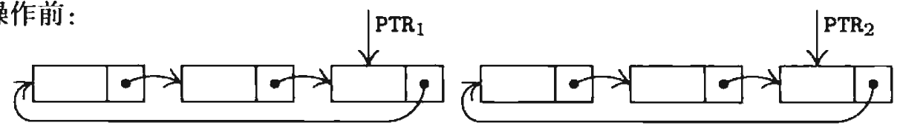
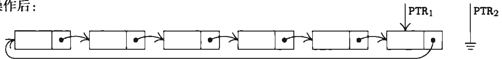
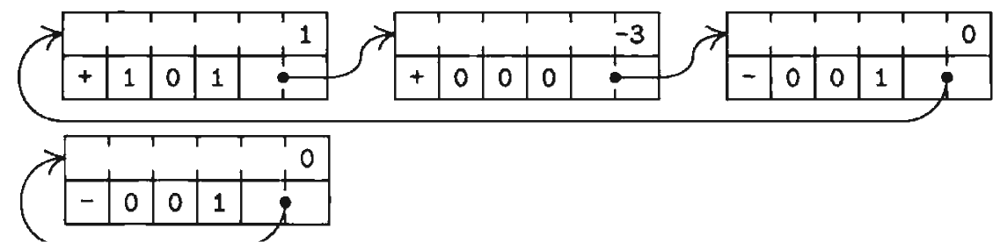

<a id="answers-2-2-4"></a>


#### 2.2.4 节

1\. <a id="ans-2-2-4-1"></a>[习题](../sec-2-2-4.md#ex-2-2-4-1)  否, 这毫无帮助, 反而可能带来防碍. (除非我们把 NODE(LOC(PTR)) 放入表中作为表头, 否则所述约定与循环表的原理并不是特别吻合.)

2\. <a id="ans-2-2-4-2"></a>[习题](../sec-2-2-4.md#ex-2-2-4-2)  操作前:



<a id="pdf-455"></a><a id="p-438"></a>

操作后:



3\. <a id="ans-2-2-4-3"></a>[习题](../sec-2-2-4.md#ex-2-2-4-3)  如果 $\mathtt { P T R } _ { 1 } \equiv \mathtt { P T R } _ { 2 }$, 则唯一的效果是 $\bar { \mathtt { P T R } } _ { 2 } \leftarrow \Lambda .$ 如果 $\mathrm{PTR}_{1} \neq \mathrm{PTR}_{2}$, 则链的交换把表一分为二, 就仿佛一个圆切断两处后一分为二一样. 操作的第二部分是使 $PTR _{1}$ 指向一个循环表, 假如在原来的表中沿着链从 $PTR _{1}$ 到 $\mathrm{PTR_{2}}$ 的话, 就会遍历该循环表中的结点.

4\. <a id="ans-2-2-4-4"></a>[习题](../sec-2-2-4.md#ex-2-2-4-4) 设 HEAD 为表头的地址. 把 Y 推进栈: 置 $\mathtt{P}\Leftarrow \mathtt{AVAIL},\quad \mathtt{INFO}(\mathtt{P})\leftarrow \mathtt{Y},\quad \mathtt{LINK}(\mathtt{P})\leftarrow \mathtt{LINK}(\mathtt{HEAD})$ LINK(HEAD)← P. 从栈弹出到 Y: 如果 LINK(HEAD) =HEAD, 则下溢; 否则置 P←LINK(HEAD), $\mathtt{LINK}(\mathtt{HEAD})\leftarrow \mathtt{LINK}(\mathtt{P}),\quad \mathtt{Y}\leftarrow \mathtt{INFO}(\mathtt{P}),\quad \mathtt{AVAIL}\Leftarrow \mathtt{P}.$

5\. <a id="ans-2-2-4-5"></a>[习题](../sec-2-2-4.md#ex-2-2-4-5)  (与习题 2.2.3-7 比较) 置 Q←Λ,P←PTR, 然后, 当 $P \neq \Lambda$ 时, 重复地置 $\mathtt{R}\leftarrow \mathtt{Q},\quad \mathtt{Q}\leftarrow \mathtt{P},$ P ←LINK(Q), LINK(Q)← R. (之后, Q =PTR.)

6\. <a id="ans-2-2-4-6"></a>[习题](../sec-2-2-4.md#ex-2-2-4-6) 

(a)



7\. <a id="ans-2-2-4-7"></a>[习题](../sec-2-2-4.md#ex-2-2-4-7) 多项式中的匹配项通过一次表扫描定位, 因此避免了重复随机搜索. 此外, 递增序与结束标记 “-1” 不相容.

8\. <a id="ans-2-2-4-8"></a>[习题](../sec-2-2-4.md#ex-2-2-4-8) 如果想要删除当前考虑的结点或在其前面插入另一个结点的话, 我们必须知道什么结点指向该结点. 然而, 也有其他方法: 可以置 Q2←LINK(Q), 然后置 NODE(Q)←NODE(Q2), AVAIL⇐Q2, 从而删除 NODE(Q); 可以先交换 NODE(Q2)↔NODE(Q), 然后置 LINK(Q)←Q2, Q←Q2, 从而在 NODE(Q) 之前插入 NODE(Q2). 这些技巧使得我们无须知道哪个结点链接到 NODE(Q) 就能进行删除和插入, 它们被应用于 IPL 的早期版本. 但是, 它们有一个缺点, 就是多项式尾部的结束标记结点有时会移动, 而其他链变量可能正指向该结点.

9\. <a id="ans-2-2-4-9"></a>[习题](../sec-2-2-4.md#ex-2-2-4-9)  如果 P=Q, 算法 A 一般正常运行, 使多项式 (Q) 加倍. 唯一特例是对于某 $\mathtt { A B C } \geq 0$ 的项有 $\mathtt { C O E F } = 0$ 时, 算法会大错特错. 如果 P =M, 算法 M 也给出预期的结果. 如果 P =Q, 而 $\mathtt { M } = t _ { 1 } + t _ { 2 } + \dots + t _ { k }$ 则算法置多项式 (P)←多项式 (P) 乘以 $( 1 + t _ { 1 } ) ( 1 + t _ { 2 } ) \dots ( 1 + t _ { k } )$ (尽管这并非是显而易见的). 如果 M=Q, 算法 M 令人吃惊地给出预期的结果, 置多项式 (Q)←多项式 (Q)+多项式 (Q)×多项式 (P), 但是当多项式 (P) 的常数项为-1 时算法 M 失败.

10\. <a id="ans-2-2-4-10"></a>[习题](../sec-2-2-4.md#ex-2-2-4-10) 完全不变. (唯一可能不同之处在步骤 M2, 取消了 A、B 或 C 个别可能溢出的出错检查; 这些错误检查未指定, 因为我们假定它们不是必需的.) 换言之, 这一节的算法可以看作多项式 $f(x^{b^{2}},x^{b},x)$ 上的运算, 而不是多项式 $f(x,y,z)$ 上的运算.

<table><tr><td>11. <a id="ans-2-2-4-11"></a><a href="../sec-2-2-4.md#ex-2-2-4-11">习题</a>  COPY</td><td>STJ</td><td>9F</td><td>(注释留给</td><td></td><td>ST6 1,3(LINK)</td></tr><tr><td></td><td>ENT3 9F</td><td></td><td></td><td>ENT3 0,6</td></tr><tr><td>LDA</td><td>1,1</td><td>读者.)</td><td>LD1</td><td>1,1(LINK)</td></tr><tr><td>1H</td><td>LD6 AVAIL</td><td></td><td>LDA</td><td>1,1</td></tr><tr><td></td><td>OVERFLOW</td><td></td><td>JANN</td><td>1B</td></tr><tr><td>J6Z LDX</td><td>1,6(LINK)</td><td></td><td>LD2</td><td>8F(LINK)</td></tr><tr><td>STX</td><td>AVAIL</td><td></td><td>ST2</td><td>1,3(LINK)</td></tr><tr><td></td><td>1,6</td><td></td><td></td><td></td></tr><tr><td>STA</td><td></td><td></td><td>9HJMP</td><td>*</td></tr><tr><td>LDA STA</td><td>0,1 0,6</td><td></td><td>8H CON</td><td>0</td></tr></table>

12\. <a id="ans-2-2-4-12"></a>[习题](../sec-2-2-4.md#ex-2-2-4-12)  设被复制的多项式有 p 项. 程序 A 用 $(27p + 13)u$, 而为了公平比较, 我们应该加上创建一个零多项式的时间, 比如说用习题 14 需要 18u. 习题 11 的程序用 (21p+31)u, 大约是程序 A 的 78%.

<a id="pdf-456"></a><a id="p-439"></a>

```csv

```

<a id="ans-2-2-4-13"></a>[习题](../sec-2-2-4.md#ex-2-2-4-13)

```text
13. ERASE STJ9F
LDXAVAIL
LDA1,1(LINK)
STAAVAIL
STX1,1(LINK)
9HJMP*

```

<a id="ans-2-2-4-14"></a>[习题](../sec-2-2-4.md#ex-2-2-4-14)

```text
14. ZERO STJ9FMOVE 1F(2)
LD1AVAILST2 1,2(LINK)
J1ZOVERFLOW9HJMP*
LDX1,1(LINK)1H CON0
STXAVAILCON-1(ABC)
ENT2 0,1

```

<a id="ans-2-2-4-15"></a>[习题](../sec-2-2-4.md#ex-2-2-4-15)

```text
15. MULT STJ9F子程序入口
LDA5F改变开关的设置
STASW1
LDA6F
STASW2
STASW3
JMP*+2
2HJMPADDM2. 乘法循环.
1HLD41,4(LINK)M1.下一个乘式.M←LINK(M).
LDA1,4
JANN 2B如果ABC(M)≥0,则转到M2.
8HLDA7F恢复开关的设置.
STASW1
LDA8F
STASW2
STASW3
9HJMP*返回.
5HJMP*+1SW1 的新设置
LDA0,1
MUL0,4rX ← COEF(P) × COEF(M).
LDA1,1(ABC)ABC(P)
JAN*+2
ADD1,4(ABC)+ ABC(M),如果ABC(P)≥0.
SLA2移入 rA 的0:3 字段.
STXOF保存 rX 以供 SW2 和SW3 中使用.
JMPSW1+1
6HLDAOFSW2 和 SW3的新设置
7HLDA1,1SW1的通常设置
8HLDA0,1SW2 和SW3 的通常设置
OHCON0临时存储
```

16\. <a id="ans-2-2-4-16"></a>[习题](../sec-2-2-4.md#ex-2-2-4-16) 设 r 是多项式 (M) 中的项数. 子程序需要 $21pr+38r+29+27\sum m'+18\sum m''+27\sum p'+8\sum q'$ 个单位时间, 其中求和涉及程序 A 的 r 次激活期间一些对应的量. 每次激活程序 A, 多项式 (Q) 中的项数就上升 $p ^ { \prime } = m ^ { \prime } .$ 如果我们做并非不合理的假定 $m ^ { \prime } = 0 , p ^ { \prime } = \alpha p$, 其中 $0 < \alpha < 1$, 则我们得到这些和分别为 0、(1-α)pr、αpr 和 $r q _ { 0 } ^ { \prime } + \alpha p \left( r ( r - 1 ) / 2 \right)$, 其中 $q _ { 0 } ^ { \prime }$ 是 $q ^ { \prime }$ 在第一次迭代的值. 总和为<a id="pdf-457"></a><a id="p-440"></a>$4 \alpha p r ^ { 2 } + 4 0 p r + 4 \alpha p r + 8 q _ { 0 } ^ { \prime } r + 3 8 r + 2 9 .$ 这一分析表明, 乘式应该比被乘式的项数多, 因为我们更多地跳过多项式 (Q) 中的非匹配项. (关于更快的算法, 见习题 5.2.3-29.)

17\. <a id="ans-2-2-4-17"></a>[习题](../sec-2-2-4.md#ex-2-2-4-17) 实际上没什么优点. 两类表的加法和乘法例程实质上相同. ERASE 子程序 (见习题 13) 的效率看来是唯一的重要差别.

18\. <a id="ans-2-2-4-18"></a>[习题](../sec-2-2-4.md#ex-2-2-4-18)  设结点 $x _ { i }$ 的链字段包含 $\mathtt { L O C } ( x _ { i + 1 } ) \oplus \mathtt { L O C } ( x _ { i - 1 } )$, 其中是 “异或”, 也能使用其他可逆操作, 如加法或减法关于指针字段的长度取模. 循环表中包含两个相邻表的表头是方便的, 有助于正确开始 (这种巧妙技术的起源并不清楚).
