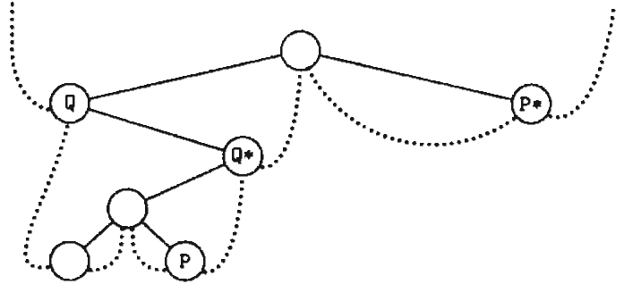
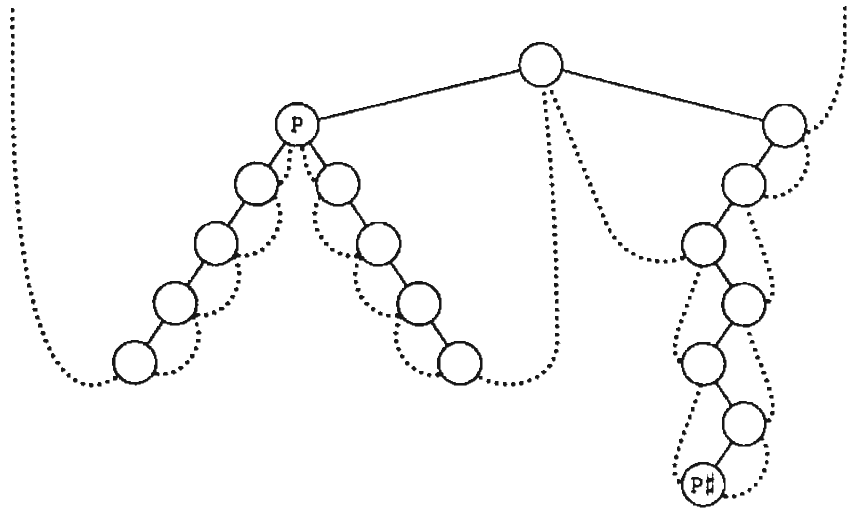
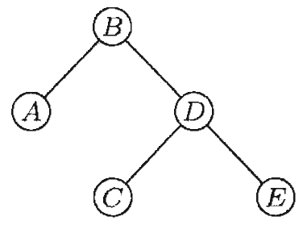
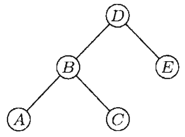

<a id="answers-2-3-1"></a>


#### 2.3.1 节

1\. <a id="ans-2-3-1-1"></a>[习题](../sec-2-3-1.md#ex-2-3-1-1)  $\mathrm{INFO}(\mathrm T)=A$, $\mathrm{INFO}(\mathrm{RLINK}(\mathrm T))=C$, 等等; 答案是 $H$.

2\. <a id="ans-2-3-1-2"></a>[习题](../sec-2-3-1.md#ex-2-3-1-2) 先序: 1245367; 对称序: 4251637; 后序: 4526731.

<a id="pdf-466"></a><a id="p-449"></a>

3\. <a id="ans-2-3-1-3"></a>[习题](../sec-2-3-1.md#ex-2-3-1-3) 该陈述为真. 例如, 注意在习题 2 中, 结点 4、5、6、7 总是按这一次序出现. 对二叉树的大小归纳, 可立即证明这一结果.

4\. <a id="ans-2-3-1-4"></a>[习题](../sec-2-3-1.md#ex-2-3-1-4)  它是后序的逆. (用归纳法容易证明这一点.)

5\. <a id="ans-2-3-1-5"></a>[习题](../sec-2-3-1.md#ex-2-3-1-5) 例如, 在习题 2 的树中, 使用二进制记号 (在此情况下等价于杜威系统), 先序是 1,10,100,101,  
11,110,111. 这些数字串已经排好序, 像字典中的词一样.

一般地, 如果使用 “空白” $< 0 < 1$, 从左到右按字典序对结点排序, 则诸结点将按先序列出. 如果使用 $0 < 1 < \frac{\pi}{2}$ 空白”, 按字典序排序, 则诸结点将按后序列出. 使用 $0 < \cdot$ 空白”<1, 则为中序.

<a id="ans-2-3-1-6"></a>[习题](../sec-2-3-1.md#ex-2-3-1-6)

(此外, 如果我们想象左边有空白, 把杜威记数法视为一般的二进制数, 则得到层次序, 见 2.3.3-(8).)$6 . p _ { 1 } p _ { 2 } \ldots p _ { n }$ 可以用栈得到, 容易通过对 n 归纳证明. 事实上, 可以指出, 算法 T 准确执行其栈动作要求的事情. (习题 2.2.1-3 中对应的 S 和 X 的序列与双序中作为下标的 1 和 2 的序列一样, 见习题 18.)

反之, 如果 $p _ { 1 } \: p _ { 2 } \ldots p _ { n }$ 可以用栈得到, 并且 $p _ { k } = 1$, 则 $p_1\ldots p_{k-1}$ 是 $\{ 2 , \ldots , k \}$ 的一个排列, 并且 $p _ { k + 1 } \ldots p _ { n }$ 是 $\{ k + 1 , \ldots , n \}$ 的一个排列. 这些排列对应于左子树和右子树, 并且二者都可以用栈得到. 因此, 归纳即可完成证明.

7\. <a id="ans-2-3-1-7"></a>[习题](../sec-2-3-1.md#ex-2-3-1-7) 由先序知道根; 然后由中序知道左子树和右子树. 事实上, 我们知道两棵子树各结点的先序和中序. 因此, 树容易构造 (构造一个简单的算法, 首先在 LLINK 中以先序、在 RLINK 中以中序将结点链接在一起, 逐渐按通常的方式把结点链接成一棵树, 这一过程很有趣). 类似地, 后序与中序一起能够刻画该结构. 但是, 先序与后序不能, 例如有两棵二叉树以 AB 为先序, 以 BA 为后序. 如果二叉树的所有非终端结点都有两个非空分支, 则先序和后序能够刻画其结构.

8\. <a id="ans-2-3-1-8"></a>[习题](../sec-2-3-1.md#ex-2-3-1-8) (a) 所有 LLINK 为空的二叉树. (b) 具有零个或一个结点的二叉树. (c) 所有 RLINK 为空的二叉树.

9\. <a id="ans-2-3-1-9"></a>[习题](../sec-2-3-1.md#ex-2-3-1-9)  T1 执行一次, T2 执行 2n+1 次, T3 执行 n 次, T4 执行 n+1 次, T5 执行 n 次. 这些计数可以用归纳法, 或用基尔霍夫定律, 或通过考察程序 T 推出.

10\. <a id="ans-2-3-1-10"></a>[习题](../sec-2-3-1.md#ex-2-3-1-10) 所有 RLINK 为空的二叉树将把所有 n 个结点的地址推入栈中, 然后才开始从栈中删除结点.

11\. <a id="ans-2-3-1-11"></a>[习题](../sec-2-3-1.md#ex-2-3-1-11)  令 $a _ { n k }$ 为一类有 n 个结点的二叉树个数, 它使用算法 T 时, 栈中包含的项绝不超过 k 项. 如果 $g _ { k } ( z ) = \textstyle \sum _ { n } a _ { n k } z ^ { n }$, 则我们发现 $g _ { 1 } ( z ) = 1 / ( 1 - z ) , \: g _ { 2 } ( z ) = 1 / \big ( 1 - z / ( 1 - z ) \big ) = ( 1 - z ) / ( 1 - 2 z )$, $\ldots,\quad g_k(z)=1/(1-zg_{k-1}(z))=q_{k-1}(z)/q_k(z),\quad\text{其中 }q_{-1}(z)=q_0(z)=1,\quad q_{k+1}(z)=q_k(z)-zq_{k-1}(z).$ 因此, $g_k(z)=\bigl(f_1(z)^{k+1}-f_2(z)^{k+1}\bigr)/\bigl(f_1(z)^{k+2}-f_2(z)^{k+2}\bigr)$, 其中 $f_{j}(z) = \frac{1}{2}(1 \pm \sqrt{1 - 4z})$ 现在可以证明 $a _ { n k }   =   [ u ^ { n } ] ( 1 - u ) ( 1 + u ) ^ { 2 n } ( 1 - u ^ { k + 1 } ) / ( 1 - u ^ { k + 2 } )$, 因此 $s _ { n } = \textstyle \sum _ { k \geq 1 } k ( a _ { n k } - a _ { n ( k - 1 ) } )$ 是 $\begin{array} { r } { \left[ u ^ { n + 1 } \right] ( 1 - u ) ^ { 2 } ( 1 + u ) ^ { 2 n } \sum _ { j \geq 1 } u ^ { j } / ( 1 - u ^ { j } ) } \end{array}$ 再减去 $a _ { n n } ,$. 利用习题 5.2.2-52 的方法, 求得渐近级数

$$
s _ { n } / a _ { n n } = \sqrt { \pi n } - \frac { 3 } { 2 } - \frac { 1 3 } { 2 4 } \sqrt { \frac { \pi } { n } } + \frac { 1 } { 2 n } + O ( n ^ { - 3 / 2 } ) .
$$

德·布鲁因、高德纳和斯蒂芬·莱斯, 《图论与计算》(GraphTheoryandComputing, 罗纳德·里德编辑 (New York: Academic Press, 1972), 15–22. ]

当二叉树像 2.3.2 节描述的那样表示森林时, 这里分析的量是森林的高度 (结点与根的最远距离加 1). 弗拉若莱和奥德里兹科得到了其他类型的树的推广 [J. Computer and System Sci.25(1982), 171-213]. 随后, 弗拉若莱、高志成、奥德里兹科和里士满分析了高度在均值附近和远离均值的渐近分布 [ Combinatorics, Probability, and Computing 2 (1993), 145–156 ]

12\. <a id="ans-2-3-1-12"></a>[习题](../sec-2-3-1.md#ex-2-3-1-12) 在步骤 T2 与 T3 之间访问 NODE(P), 而不是在步骤 T5. 为了证明, 基本与正文一样, 论证命题: “设步骤 T2 开始时, P 是指向 n 个结点的二叉树的指针………栈 A 恢复到它原先的值 $\mathbb { A } \left[ { 1 } \right] \ldots \mathbb { A } \left[ { m } \right]$ ”

13\. <a id="ans-2-3-1-13"></a>[习题](../sec-2-3-1.md#ex-2-3-1-13) (修罗·阿罗约的解, 1976) 除新变量 Q 在步骤 T1 初始化为Λ外, 步骤 T1 到 T4 不变; 如果有的话, Q 将指向最后一个被访问的结点. 步骤 T5 变成两步:

$\overline{ T 5}'.$ [右分支已完成?] 如果 $\mathtt{RLINK}(\mathtt P)=\Lambda$ 或 $\mathrm{RLINK}(\mathbb{P}) = 0$, 则继续 $\mathrm{T6}';$ 否则置 $\mathbb { A } \Leftarrow \mathbb { P }$ $\mathtt{P}\leftarrow \mathtt{RLINK}(\mathtt{P})$, 并返回步骤 T2.

$\mathrm{T6'}.$ [访问 P.] 访问 NODE(P), 置 Q←P, 并返回 T4. 可以使用类似的证明.

(步骤 T4 和 T5 可以形成流水线, 使得结点不会出栈又立即重新插入.)

<a id="pdf-467"></a><a id="p-450"></a>

14\. <a id="ans-2-3-1-14"></a>[习题](../sec-2-3-1.md#ex-2-3-1-14) 由归纳法, 总是恰有 n+1 个Λ链 (当 T 为空时包括它). 包括 T 共有 n 个非空链, 因此正文中空链占多数的评述成立.

15\. <a id="ans-2-3-1-15"></a>[习题](../sec-2-3-1.md#ex-2-3-1-15) 某结点有一个指向它的 LLINK (或 RLINK) 线索, 当且仅当该结点有一个非空的右子树 (或左子树). (见图 24.)

16\. <a id="ans-2-3-1-16"></a>[习题](../sec-2-3-1.md#ex-2-3-1-16)  如果 $\mathrm{LTAG}(\mathbb{Q}) = 0$, 则 $\mathtt{Q}{*}$ 是 LLINK(Q), 此时 Q\*向左下一步. 否则沿树向上 (如有必要则反复向上), 直到第一次能向右下而不走回头路, 就得到 Q\*. 如下面的树所示, 从 P 到 P\*和从 Q 到 $\mathtt{Q}{*}$ 都是典型的例子.



17\. <a id="ans-2-3-1-17"></a>[习题](../sec-2-3-1.md#ex-2-3-1-17)  如果 $\mathtt{LTAG}(\mathtt P)=0$, 则置 $\mathbb{Q} \leftarrow \mathrm{LLINK}(\mathbb{P})$ 并终止, 否则, 置 $\mathbb { Q } \leftarrow \mathbb { P }$, 然后置 $\mathtt{Q}\leftarrow \mathtt{RLINK}(\mathtt{Q})$ 零次或多次, 直到找到 $\mathrm{RTAG}(\mathbb{Q}) = 0$, 最后再置 Q←RLINK(Q) 一次.

18\. <a id="ans-2-3-1-18"></a>[习题](../sec-2-3-1.md#ex-2-3-1-18)  修改算法 T, 插入步骤 T2.5, “第一次访问 $\mathtt{NODE}(\mathtt P)\text{”}$; 在步骤 T5 第二次访问 NODE(P). 给定线索树, 遍历极其简单:

$$
(\mathtt P,1)^\triangle=\begin{cases}(\mathtt{LLINK}(P),1),&\text{如果 }\mathtt{LTAG}(P)=0,\\(\mathtt P,2),&\text{否则}.\end{cases}
$$

$$
(\mathtt P,2)^\triangle=\begin{cases}(\mathtt{RLINK}(P),1),&\text{如果 }\mathtt{RTAG}(P)=0,\\(\mathtt{RLINK}(P),2),&\text{否则}.\end{cases}
$$

在每种情况下, 我们最多在树中移动一步, 因此在实践中, 双序和 d 与 $e$ 的值已经嵌入在程序中, 不再明确指出.

去掉所有的第一次访问, 就得到算法 T 和 S; 去掉所有的第二次访问, 则得到习题 12 和 17 的解. 19. <a id="ans-2-3-1-19"></a>[习题](../sec-2-3-1.md#ex-2-3-1-19) 基本思想是, 从找出 P 的父母 Q 开始. 然后, 如果 $\mathbb{P} \neq \mathrm{LLINK}(\mathbb{Q})$, 则有 $\mathtt { P } \sharp = \mathtt { Q }$; 否则可以反复置 $Q \leftarrow Q s$ 零次或多次, 直到 $\mathrm{RTAG}(\mathbb{Q}) = 1$, 找出 P#. (例如, 见所示树中的 P 和 Pα.)



在一般的右线索树中, 没有找出 P 的父母的高效算法, 因为所有左链均为空的退化的右线索树基本相当于一个循环表, 其中链的走向都是错误的. 因此, 如果不保留如何到达当前结点 P 的记录, 就不可能像习题 13 的栈方法那样高效地按后序遍历右线索树.

但是, 如果树是双向线索的, 则我们可以高效找到 P 的父母:

F1. 置 $\mathbb { Q } \leftarrow \mathbb { P } , \quad \mathbb { R } \leftarrow \mathbb { P } .$

F2. 如果 $\mathtt { L T A G ( Q ) } = \mathtt { R T A G ( R ) } = 0$, 则置 $\mathtt Q\leftarrow\mathtt{LLINK}(\mathtt Q),\quad\mathtt R\leftarrow\mathtt{RLINK}(\mathtt R)$, 并重复这一步骤. 否则如果 $\mathtt{RTAG}(\mathtt R)=1$, 则转到 F4.

F3. 置 $\mathtt{Q}\leftarrow \mathtt{LLINK}(\mathtt{Q})$, 如果 $\mathbb{P} =  RLINK (\mathbb{Q})$, 则终止, 否则置 $\mathrm{R} \leftarrow \mathrm{RLINK}(\mathrm{R})$ 零次或多次, 直到 $\mathtt{RTAG}(\mathtt R)=1$, 然后置 $\mathbb{Q} \leftarrow  RLINK (\mathbb{R})$ 并终止.

<a id="pdf-468"></a><a id="p-451"></a>

F4. 置 R←RLINK(R), 如果 P=LLINK(R), 则置 Q←R 并终止. 否则, 置 Q←LLINK(Q) 零次或多次, 直到 LTAG(Q)=1, 然后置 Q←LLINK(Q) 并终止.

当 P 是树的一个随机结点时, 算法 F 的平均运行时间为 O(1). 当 P 是右子女时, 只计算步骤 Q←LLINK(Q), 或当 P 是左子女时, 只计算步骤 R←RLINK(R), 则每个链都恰为了一个结点 P 而遍历.

20\. <a id="ans-2-3-1-20"></a>[习题](../sec-2-3-1.md#ex-2-3-1-20)  06-09 行改为: 12-13 行改为:


|  |  |  |  |  |
| --- | --- | --- | --- | --- |
| ENT4 | 0,6 |  | LD4 | 0,6(LINK) |
| LD6 | AVAIL |  | LD5 | 0,6(INF0) |
| J6Z | OVERFLOW |  | LDX | AVAIL |
| LDX | 0,6(LINK) |  | STX | 0,6(LINK) |
| STX | AVAIL |  | ST6 | AVAIL |
| ST5 | 0,6(INF0) |  | ENT6 | 0,4 |
| ST4 |  | 0,6(LINK) |  |  |


如果在 06 行处再加两行代码

```mixal
T3  LD3  0,5(LLINK)
    J3Z  T5              如果 LLINK(P) = Λ，则转到 T5。
```

并在 10 和 11 行进行适当调整, 则运行时间从 (30n+a+4)u 个单位时间降低到 (27a+6n-22)u 个单位时间. (如果置 $a = (n + 1)/2$, 则该方法将稍稍改进程序 T 的运行时间, 把它降低到 (12a+6n-7)u 个单位时间.)

21\. <a id="ans-2-3-1-21"></a>[习题](../sec-2-3-1.md#ex-2-3-1-21) 约瑟夫·莫里斯给出下面的解 [Inf.Proc.Letters9(1979), 197-200], 也是按先序遍历 (见习题  
18).

U1. [初始化. ] 置 P ←T,R ←Λ.

U2.[完成?] 如果 P=Λ, 则算法终止.

U3.[左看.] 置 Q←LLINK(P). 如果 Q=Λ, 则按先序访问 NODE(P) 并转到 U6.

U4.[搜索线索.] 置 `Q ← RLINK(Q)` 零次或多次, 直到 $Q=R$ 或 $\mathtt{RLINK}(Q)=\Lambda$.

U5.[插入或删除线索.] 如果 $\mathbb { Q } \neq \mathbb { R }$, 则置 RLINK(Q)←P, 并转到 U8. 否则置 RLINK(Q)←Λ(此前临时改变为 P, 但是现在已经遍历完 P 的左子树).

U6.[中序访问.] 按中序访问 NODE(P).

U7.[向右或向上.] 置 R←P,P←RLINK(P), 并返回到 U2.

U8.[先序访问.] 按先序访问 NODE(P).

U9.[转左.] 置 P←LLINK(P) 并返回到步骤 U3.

莫里斯还提出了一种稍复杂的后序遍历方法.

约翰·罗布森发现了一种完全不同的解 [Inf.Proc. Letters2(1973), 12-14]. 我们说一个结点是 “满的”, 如果它的 LLINK 和 RLINK 都非空; 一个结点是 “空的”, 如果 LLINK 和 RLINK 都为空. 罗布森发现了一种方法, 使用空结点中的链字段, 维护指向其右子树将被访问的满结点的指针的栈!

还有另一种避免使用辅助栈的方法由加里·林德斯特伦@林德斯特伦, GaryEdward Lindstrom 和巴瑞·德怀尔独立地发现 [Inf. Proc. Letters2(1973), 47-51,143-145]. 他们的算法用三序遍历, 访问每个结点恰好三次, 先序、中序和后序各一次, 但不知道当前正在以哪个序访问.

W1.[初始化.] 置 $\mathtt{P}\leftarrow \mathtt{T},\quad \mathtt{Q}\leftarrow \mathtt{S}$, 其中 S 是一个标记值—已知不同于树中任何链的任意数 (例如-1).

W2.[绕开空链.] 如果 P=Λ, 则置 $\mathtt{P}\leftarrow \mathtt{Q},\quad \mathtt{Q}\leftarrow \Lambda .$

W3.[完成?] 如果 P=S, 则终止算法. (终止时有 Q=T.)

W4.[访问.] 访问 NODE(P).

<a id="pdf-469"></a><a id="p-452"></a>

W5.[轮转.] 置 R←LLINK(P), LLINK(P)←RLINK(P), RLINK(P)←Q, Q←P, P←R, 并返回到 W2.

正确性从如下事实得出: 如果在 W2 开始时, P 指向二叉树 T 的根, Q 指向不在该树中的链 X, 则算法将三次遍历该树并到达步骤 W3, 此时有 P=X 和 Q=T.

如果 $\alpha ( \mathtt { T } ) = x _ { 1 } x _ { 2 } \dots x _ { 3 n }$ 是三序下得到的结点序列, 则有 $\alpha(\mathtt{T})=\mathtt{T}\,\alpha(\mathtt{LLINK}(\mathtt{T}))\,\mathtt{T}\,\alpha(\mathtt{RLINK}(\mathtt{T}))\,\mathtt{T}.$ 因此, 正如林德斯特伦所指出的, 三个子序列 $x _ { 1 } x _ { 4 } \ldots x _ { 3 n - 2 } , \enspace x _ { 2 } x _ { 5 } \ldots x _ { 3 n - 1 } ; \enspace x _ { 3 } x _ { 6 } \ldots x _ { 3 n }$ 每个都包含树的每个结点恰好一次. (由于 $x_{j + 1}$ 或者是 $x _ { j }$ 的父母, 或者是 $x _ { j }$ 的子女, 因此这些子序列在访问结点时, 每个结点至多与它的前驱相距 3 个链. 7.2.1.6 节介绍了一种称作先后序 (prepostorder) 的一般遍历策略, 它不仅对二叉树, 而且对一般的树也具有这种性质.)

22\. <a id="ans-2-3-1-22"></a>[习题](../sec-2-3-1.md#ex-2-3-1-22) 这个程序使用程序 T 和 S 的约定, Q 在 rI6 和/或 rI4 中. 旧式 MIX 计算机并不擅长比较变址寄存器中的值是否相等, 因此变量 R 去掉, 判定 $\text{" } \mathbb{Q} \equiv \mathbb{R}  \text{" }$ 改成 “RLINK(Q) = P”.


|  |  |  |  |  |  |
| --- | --- | --- | --- | --- | --- |
| 01 U1 |  | LD5 | HEAD(LLINK) | 1 | U1. 初始化. P ← T. |
| 02 | U2A | J5Z | DONE | 1 | 如果 P=Λ, 则停止. |
| 03 | U3 | LD6 | 0,5(LLINK) | n+a−1 | U3. 左看. Q← LLINK(P). |
| 04 |  | J6Z | U6 | n+a−1 | 如果 Q =Λ, 则转 U6. |
| 05 U4 |  |  | CMP5 1,6(RLINK) | 2n−2b | U4. 搜索线索. |
| 06 |  | JE | 5F | 2n−2b | 如果 RLINK(Q) =P, 则转移. |
| 07 |  | ENT4 0,6 |  | 2n-2b−a+1 | rI4 ← Q. |
| 08 |  |  | LD6 1,6(RLINK) | 2n−2b−a+1 |  |
| 09 |  | J6NZ U4 |  | $2n - 2b - a + 1$ | 如果, 转到 U4 $\ne 0,\ \mathbb{Q} \leftarrow  RLINK (\mathbb{Q})$ |
| 10 | U5 | ST5 | 1,4(RLINK) | a−1 | U5a. 插入线索. RLINK(Q) ←P. |
| 11 U9 |  | LD5 | 0,5(LLINK) | a−1 | U9. 转左. P←LLINK(P). |
| 12 |  | JMP | U3 | a-1 | 转到U3. |
| 13 | 5H | STZ | 1,6(RLINK) | a−1 | U5b. 删除线索. $\mathtt{RLINK}(\mathtt{Q})\leftarrow \Lambda .$ |
| 14 U6 |  | JMP | VISIT | n | U6. 中序访问。 |
| 15 | U7 | LD5 | 1,5(RLINK) | n | U7. 转右或上. $\mathtt P\leftarrow\mathtt{RLINK}(\mathtt P).$ |
| 16 | U2 | J5NZ U3 |  | n | U2. 完成? 如果, 则转到 U3. $\mathbb { P } \neq \Lambda ,$ |
| 17 | DONE... |  |  |  | I |


总运行时间为 21n+6a—3-14b 个单位时间, 其中 $n$ 是结点数, a 是空 RLINK 数 (因此 a-1 是非空 LLINK 数), b 是树的 “右刺”T、RLINK(T)、RLINK(RLINK(T)) 等上的结点数.

23\. <a id="ans-2-3-1-23"></a>[习题](../sec-2-3-1.md#ex-2-3-1-23)  插入右边: $\mathtt{RLINKT}(\mathtt Q)\leftarrow\mathtt{RLINKT}(\mathtt P),\quad\mathtt{RLINK}(\mathtt P)\leftarrow\mathtt Q,\quad\mathtt{RTAG}(\mathtt P)\leftarrow0,\quad\mathtt{LLINK}(\mathtt Q)\leftarrow\Lambda.$ 假定 LLINK(P) = Λ, 插入左边: 置 LLINK(P)← Q, LLINK(Q) ←Λ, RLINK(Q)←P, RTAG(Q) ←1. 在 P 和 $\mathrm{LLINK}(\mathbb{P}) \neq \Lambda$ 之间, 插入左边: 置 R←LLINK(P), LLINK(Q)←R, 然后置 R←RLINK(R) 零或多次, 直到 RTAG(R)=1; 最后, 置 RLINK(R)← Q, LLINK(P)← Q, RLINK(Q)←P, RTAG(Q)←1.

(对寸最后一种情况, 如果你知道一个结点 F 使得 P=LLINK(F) 或 P=RLINK(F), 则可以使用更高效的算法: 例如假定有 P=RLINK(F), 可以置 INFO(P)↔INFO(Q), RLINK(F)←Q, LLINK(Q)←P, RLINKT(Q)←RLINKT(P), RLINK(P)←Q, RTAG(P)←1. 这只需要固定的时间, 但是一般并不推荐, 因为它在内存中交换结点.)

24\. <a id="ans-2-3-1-24"></a>[习题](../sec-2-3-1.md#ex-2-3-1-24)  否.





<a id="pdf-470"></a><a id="p-453"></a>

25\. <a id="ans-2-3-1-25"></a>[习题](../sec-2-3-1.md#ex-2-3-1-25) 我们对 T 中结点个数归纳, 先证明 (b), 并类似地证明 (c). 现在, (a) 分解成几类情形: 如果 (i) 成立, 记作 $T \preceq _ { 1 } T ^ { \prime }$; 如果 (ii) 成立, 记作 $T \preceq _ { 2 } T ^ { \prime }$; 等等. 于是, $T \preceq _ { 1 } T ^ { \prime }$ 和 $T ^ { \prime } \preceq T ^ { \prime \prime }$ 蕴涵 $T \preceq _ { 1 } T ^ { \prime \prime }$ $T \preceq _ { 2 } T ^ { \prime }$ 和 $T ^ { \prime } \preceq T ^ { \prime \prime }$ 蕴涵 $T \preceq _ { 2 } T ^ { \prime \prime }$, 其余两种情况通过对 T 中结点个数归纳证明 (a) 来处理.

26\. <a id="ans-2-3-1-26"></a>[习题](../sec-2-3-1.md#ex-2-3-1-26)  如果 T 的双序是 $( u _ { 1 } , d _ { 1 } ) , ( u _ { 2 } , d _ { 2 } ) , \ldots , ( u _ { 2 n } , d _ { 2 n } )$, 其中诸 u 是结点, 诸 d 是 1 或 2, 则构造该树的 “迹” $( v _ { 1 } , s _ { 1 } ) , ( v _ { 2 } , s _ { 2 } ) , \ldots , ( v _ { 2 n } , s _ { 2 n } )$, 其中 $v _ { j } = \operatorname { i n f o } ( u _ { j } )$, 依据 $d _ { j } = 1$ 或 2 相应有 $s _ { j } = l ( u _ { j } )$ 或 $\bar { r } ( u _ { j } )$. 现在, $T \preceq T ^ { \prime }$ 当且仅当 T 的迹 (按这里的定义) 按字典序先于或等于 $T ^ { \prime }$ 的迹. 形式地, 这意味着两种情形, 第一种是对于 $1 \leq j \leq 2 n$, 有 $\tilde { n } \leq n ^ { \prime }$ 和 $( v _ { j } , s _ { j } ) = ( v _ { j } ^ { \prime } , s _ { j } ^ { \prime } )$; 否则存在一个 k, 对于 $1 \leq j < k$, 有 $( v _ { j } , s _ { j } ) = ( v _ { j } ^ { \prime } , s _ { j } ^ { \prime } )$, 此时为第二种情形, 或者 $v _ { k } \prec v _ { k } ^ { \prime }$, 或者 $v _ { k } = v _ { k } ^ { \prime }$ 并且 $s _ { k } < s _ { k } ^ { \prime } .$

27\. <a id="ans-2-3-1-27"></a>[习题](../sec-2-3-1.md#ex-2-3-1-27)  R1.[初始化.] 置 P←HEAD, $\mathtt{P}'\leftarrow \mathtt{HEAD}'$; 这些分别是给定右线索二叉树的表头. 转 R3.

R2. [检查 INFO.] 如果 $\mathtt{INFO}(\mathtt P)\prec\mathtt{INFO}(\mathtt P')$, 则终止 $(T\prec T')$; 如果 $\mathtt{INFO}(\mathtt P)\succ\mathtt{INFO}(\mathtt P')$, 则终 止 $( T \succ T ^ { \prime } )$

R3. 转左. 」如果 $\mathrm{LLINK(P)} = \Lambda = \mathrm{LLINK(P')}$, 则转 R4; 如果 $\mathtt { L L I N K ( P ) } = \bar { \Lambda } \neq \mathtt { L L I N K ( P ^ { \prime } ) }$, 则终止 $(T\prec T')$; 如果 LLINK $(\mathtt{P})\ne \Lambda =\mathtt{LLINK}(\mathtt{P}')$, 则终止 $(T\succ T')$; 否则置 $\mathbb { P } \longleftarrow \mathbb { L } \mathbb { L } \mathbb { L } \mathbb { N } \mathbb { K } ( \mathbb { P } )$, $\mathtt{P}'\leftarrow \mathtt{LLINK}(\mathtt{P}')$, 并转到 R2.

R4.[树结束?] 如果 P=HEAD (或等价地, 如果 $\mathtt{P}'=\mathtt{HEAD}')$, 则终止 (T 等价于 $T ^ { \prime } )$

R5.[转右.] 如果 $\mathtt { R T A G ( P ) } = 1 = \mathtt { R T A G ( P ^ { \prime } ) }$, 则置 $\mathtt P\leftarrow\mathtt{RLINK}(\mathtt P),\quad\mathtt P'\leftarrow\mathtt{RLINK}(\mathtt P')$, 并转到 R4. 如果 $\mathtt{RTAG}(\mathtt{P})=1\ne \mathtt{RTAG}(\mathtt{P}')$, 则终止 $( T \prec T ^ { \prime } )$; 如果 $\mathtt{RTAG}(\mathtt{P})\ne1=\mathtt{RTAG}(\mathtt{P}')$, 则终止 $( T \succ T ^ { \prime } )$. 否则, 置 $\mathtt{P}\leftarrow \mathtt{RLINK}(\mathtt{P}),\quad \mathtt{P}'\leftarrow \mathtt{RLINK}(\mathtt{P}')$, 并转到 R2.

为了证明这一算法的正确性 (从而理解其工作机制), 可以对树 $T _ { 0 }$ 的大小归纳, 证明如下命题成立: 设步骤 R2 开始时, P 和 $\mathrm{P}^{\prime}$ 指向两棵非空的右线索二叉树 $T _ { 0 }$ 和 $T _ { 0 } ^ { \prime }$ 的根, 如果 $T_{0}$ 和 $T _ { 0 } ^ { \prime }$ 不等价, 则该算法将终止, 指出是 $T _ { 0 } \prec T _ { 0 } ^ { \prime }$, 还是 $T _ { 0 } \succ T _ { 0 } ^ { \prime }$; 如果 $T _ { 0 }$ 与 $T_{0}^{\prime}$ 等价, 则算法将到达步骤 R4,P 和 $\mathrm{P}'$ 分别指向 $T_{0}$ 和 $T_{0}^{\prime}$ 在对称序下的后继结点.

#### 28. <a id="ans-2-3-1-28"></a>[习题](../sec-2-3-1.md#ex-2-3-1-28)  等价并且相似。

29\. <a id="ans-2-3-1-29"></a>[习题](../sec-2-3-1.md#ex-2-3-1-29) 对树 T 的大小归纳, 证明如下命题成立: 设步骤 C2 开始时, P 指向非空二叉树 T 的根, Q 指向一个具有空的左右子树的结点, 该过程置 $\mathtt{INFO}(\mathtt{Q})\leftarrow \mathtt{INFO}(\mathtt{P})$, 把 NODE(Q) 的左右子树的副本附在 NODE(P) 上, 最终到达步骤 C6, 此时 P 和 Q 分别指向树 T 和 NODE(Q) 在先序下的后继结点. 30. <a id="ans-2-3-1-30"></a>[习题](../sec-2-3-1.md#ex-2-3-1-30) 假定 (2) 中的指针 T 是 (10) 中的 LLINK(HEAD). 因此, LOC(T) = HEAD, 且 $\mathtt{HEAD}\mathord{\$}$ 是对称序下二叉树的第一个结点.

L1.[初始化.] 置 $\mathtt{Q}\leftarrow \mathtt{HEAD},\quad \mathtt{RLINK}(\mathtt{Q})\leftarrow \mathtt{Q}.$

L2. [前进.] 置 $\mathtt P\leftarrow\mathtt Q\$.\ \text{(见下.)}$

L3. [线索.] 如果 $\mathtt{RLINK}(\mathtt Q)=\Lambda$, 则置 $\mathtt{RLINK}(\mathtt{Q})\leftarrow \mathtt{P},\quad \mathtt{RTAG}(\mathtt{Q})\leftarrow 1$; 否则置 $\mathtt{RTAG}(\mathtt{Q})\leftarrow 0.$ 如 果 LLINK(P) = Λ, 则置 $\mathtt{LLINK}(\mathtt{P})\leftarrow \mathtt{Q},\quad \mathtt{LTAG}(\mathtt{P})\leftarrow 1$; 否则置 LTAG(P) ←0.

L4.[完成?] 如果 P≠HEAD, 则置 Q←P, 并返回 L2.

算法的步骤 L2 意味着激活算法 T 之类中序遍历协同例程, 附带条件是算法 T 在完全遍历树之后访问 HEAD. 这个简化记号方便描述树算法, 避免一再重复算法 T 的栈机制. 当然, 不可能在步骤 L2 期间使用算法 S, 因为树还未线索化. 但是, 习题 21 答案中的算法 U 可以在步骤 L2 中使用, 这提供了一种不使用任何附加栈对树线索化的巧妙方法.

31\. <a id="ans-2-3-1-31"></a>[习题](../sec-2-3-1.md#ex-2-3-1-31)  X1. 置 P ← HEAD.

X2. 置 `Q ← P$` (例如使用为右线索树修改后的算法 S).

X3. 如果 $\mathrm{P} \neq \mathrm{HEAD}$, 则置 $\mathtt { A V A I L } \Leftarrow \mathtt { P } .$

X4. 如果 $\mathbb{Q} \neq \mathrm{HEAD}$, 则置 P← Q, 并转回 X2.

X5. 置 LLINK(HEAD) ← Λ.

<a id="pdf-471"></a><a id="p-454"></a>

显然存在减少内层循环长度的其他解, 不过基本步骤的次序相当重要. 所述过程之所以有效, 是因为在算法 S 考察完一个结点的 LLINK 和 RLINK 之前, 我们绝不会把它送回可用存储. 正如正文中所指出的, 在一次完整的树遍历期间, 这些链都恰好使用一次.

<a id="ans-2-3-1-32"></a>[习题](../sec-2-3-1.md#ex-2-3-1-32)

$$
\begin{aligned}32.\quad&\mathtt{RLINK}(\mathtt{Q})\leftarrow \mathtt{RLINK}(\mathtt{P}),\quad \mathtt{SUC}(\mathtt{Q})\leftarrow \mathtt{SUC}(\mathtt{P}),\\&\mathtt{SUC}(\mathtt{P})\leftarrow \mathtt{RLINK}(\mathtt{P})\leftarrow \mathtt{Q},\quad \mathtt{PRED}(\mathtt{Q})\leftarrow \mathtt{P},\quad \mathtt{PRED}(\mathtt{SUC}(\mathtt{Q}))\leftarrow \mathtt{Q}.\end{aligned}
$$

33\. <a id="ans-2-3-1-33"></a>[习题](../sec-2-3-1.md#ex-2-3-1-33) 把 NODE(Q) 插入到 NODE(P) 的左下边相当简单: 置 $\mathtt{LLINKT}(\mathtt{Q})\leftarrow \mathtt{LLINKT}(\mathtt{P}),\quad \mathtt{LLINK}(\mathtt{P})\leftarrow \mathtt{Q}$ LTAG(P)←0,RLINK(Q)←Λ. 插入到右边相当困难, 因为它本质上需要找到\*Q, 这与找到 Q 一样难 (见习题 19), 或许可以使用习题 23 讨论的结点移动方法. 因此, 使用这类线索, 一般的插入更加困难. 但是, 算法 C 所要求的插入不太困难, 事实上复制过程反而稍微快一些:

C1. 置 $\mathtt{P}\leftarrow \mathtt{HEAD},\quad \mathtt{Q}\leftarrow \mathtt{U}$, 转到 C4. (始终使用正文中算法 C 的假定和原理.)

C2. 如果 $\mathtt{RLINK}(\mathtt{P})\ne \Lambda ,\text{ 则置 }\mathtt{R}\Leftarrow \mathtt{AVAIL},\;\mathtt{LLINK}(\mathtt{R})\leftarrow \mathtt{LLINK}(\mathtt{Q}),\;\mathtt{LTAG}(\mathtt{R})\leftarrow 1,\;\mathtt{RLINK}(\mathtt{R})\leftarrow \Lambda$ $\mathtt{RLINK}(\mathtt{Q})\leftarrow \mathtt{LLINK}(\mathtt{Q})\leftarrow \mathtt{R}.$

C3. 置 INFO(Q) ←INFO(P).

C4. 如果 $\mathtt{LTAG}(\mathtt P)=0$, 则置 $\mathtt{R}\Leftarrow \mathtt{AVAIL},\quad \mathtt{LLINK}(\mathtt{R})\leftarrow \mathtt{LLINK}(\mathtt{Q}),\quad \mathtt{LTAG}(\mathtt{R})\leftarrow 1,\quad \mathtt{RLINK}(\mathtt{R})\leftarrow \Lambda ,$ $\mathtt{LLINK}(\mathtt{Q})\leftarrow \mathtt{R},\quad \mathtt{LTAG}(\mathtt{Q})\leftarrow 0.$   
C5. 置 $\mathbb { P } \longleftarrow \mathbb { L } \mathbb { L } \mathbb { N } \mathbb { N } \left( \mathbb { P } \right) , \mathbb { Q } \longleftarrow \mathbb { L } \mathbb { L } \mathbb { N } \mathbb { N } \mathbb { C } \mathbb({\mathbb Q{ Q } } )$   
C6. 如果 $\mathrm{P} \neq \mathrm{HEAD}$, 则转到 C2.

现在, 这个算法看上去太简单了, 很难相信它正确!

对于线索和右线索二叉树, 由于在步骤 C5 计算 P\*和 Q\*需要额外时间, 算法 C 所用的时间稍多一点.

通过在步骤 C2 和 C4 适当地设置 RLINK 和 RLINK(P) 的值, 与这种复制方法配合使用, 有可能用通常的方法使 RLINK(R) 线索化, 或把 P 放到 RLINKT(Q) 中.

34\. <a id="ans-2-3-1-34"></a>[习题](../sec-2-3-1.md#ex-2-3-1-34)  A1. 置 Q ← P, 然后重复执行 $\mathtt{Q}\leftarrow \mathtt{RLINK}(\mathtt{Q})$ 零或多次, 直到 $\mathtt { R T A G } ( \mathbb { Q } ) = 1 .$

A2. 置 $\mathbb{R} \leftarrow  RLINK (\mathbb{Q})$. 如果 $\mathtt{LLINK}(\mathtt{R})=\mathtt{P}$, 则置 $\mathtt{LLINK}(\mathtt R)\leftarrow\Lambda.$ 否则, 置 $\mathtt{R}\leftarrow \mathtt{LLINK}(\mathtt{R})$ 然后重复执行 $\mathtt{R}\leftarrow \mathtt{RLINK}(\mathtt{R})$ 零次或多次, 直到 RLINK(R) = P; 最后, 置 $\mathtt{RLINKT}(\mathtt R)\leftarrow$ RLINKT(Q). (这一步从原来的树中删除 NODE(P) 及其子树.)

$$
\mathbf{A3}.\;\text{置 } \mathtt{RLINK}(\mathtt{Q})\leftarrow \mathtt{HEAD},\quad \mathtt{LLINK}(\mathtt{HEAD})\leftarrow \mathtt{P}.\quad\blacksquare
$$

(想出或理解该算法的关键是构造好的 “前后对比” 图.)

36\. <a id="ans-2-3-1-36"></a>[习题](../sec-2-3-1.md#ex-2-3-1-36) 否, 见习题 1.2.1-15(e) 的答案.

37\. <a id="ans-2-3-1-37"></a>[习题](../sec-2-3-1.md#ex-2-3-1-37)  如果在表示 (2) 中 $\mathtt{LLINK}(\mathtt{P})=\mathtt{RLINK}(\mathtt{P})=\Lambda$, 则令 $\mathrm{LINK(P)} = \Lambda$; 否则令 LINK(P) = Q, 其中 NODE(Q) 对应于 NODE(LLINK(P)), NODE(Q + 1) 对应于 NODE(RLINK(P)). 条件 LLINK(P) 或 RLINK(P) =Λ分别被 NODE(Q) 或 NODE(Q+1) 中的标记表示. 这种表示使用的存储位置在 n 和 2n-1 之间. 在所述假定下, (2) 需要 18 个字的内存, 而新方案需要 11 个字. 在两种表示下, 插入和删除都具有大致相同的效率. 但是, 这种表示与其他结构结合并不很灵活.
