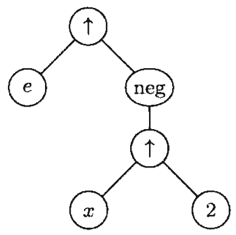
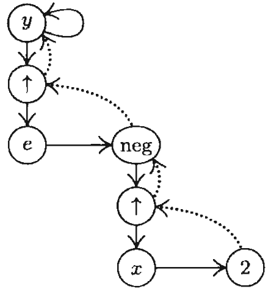

<a id="answers-2-3-2"></a>


#### 2.3.2 节

1\. <a id="ans-2-3-2-1"></a>[习题](../sec-2-3-2.md#ex-2-3-2-1) 如果 B 为空, 则 F(B) 是一个空森林. 否则, $F ( B )$ 由一棵树 T 加上一个森林 $F \big ( \mathrm { r i g h t } ( B ) \big )$ 组成, 其中 $\operatorname { r o o t } ( T ) = \operatorname { r o o t } ( B )$, 并且 $\operatorname{subtrees}(T)=F(\operatorname{left}(B))$.

2\. <a id="ans-2-3-2-2"></a>[习题](../sec-2-3-2.md#ex-2-3-2-2) 二进制记号下 0 的个数是十进制记号下小数点的个数, 对应关系的准确公式是

$$
a_1.a_2.\ldots.a_k\leftrightarrow1^{a_1}01^{a_2-1}0\ldots01^{a_k-1},
$$

其中 $1 ^ { a }$ 表示连续 a 个 1.

<a id="pdf-472"></a><a id="p-455"></a>

3\. <a id="ans-2-3-2-3"></a>[习题](../sec-2-3-2.md#ex-2-3-2-3)  把结点的杜威记数法按字典序排序 (像字典一样, 由左到右). 对于先序, 较短的序列 $a _ { 1 } , \cdots , a _ { k }$ 放在其扩展 $a _ { 1 } , \cdots . a _ { k } , \cdots . a _ { r }$ 的前面, 而对于后序则把它放在其扩展的后面. 这样, 如果我们对词而不是对数的序列排序, 则按通常的字典序放置词 cat,cataract 可得到先序; 逆转初始的子词的序, 排成 cataract,cat 可得到后序. 这些结果容易通过对树的大小归纳来证明.

4\. <a id="ans-2-3-2-4"></a>[习题](../sec-2-3-2.md#ex-2-3-2-4)  为真, 对结点数归纳可证.

5\. <a id="ans-2-3-2-5"></a>[习题](../sec-2-3-2.md#ex-2-3-2-5) (a) 中序. (b) 后序. 严格归纳证明这些遍历算法的等价性是有趣的.

6\. <a id="ans-2-3-2-6"></a>[习题](../sec-2-3-2.md#ex-2-3-2-6)  我们有先序 $(T) \equiv  先序  (T')$, 后序 $(T)=\text{中序}\,(T')$, 即便 T 的结点可以仅有一个子女. 其他两个序并无简单的关系, 以 T 的根为例, 它在两个序中分别处在末尾和差不多中间.

7\. <a id="ans-2-3-2-7"></a>[习题](../sec-2-3-2.md#ex-2-3-2-7) (a) 是; (b) 否; (c) 否; (d) 是. 注意, 森林的颠倒先序等于左右颠倒的森林的后序 (在镜像反射的 意义下).

8\. <a id="ans-2-3-2-8"></a>[习题](../sec-2-3-2.md#ex-2-3-2-8)  $T \preceq T ^ { \prime }$ 意味着或者 $\operatorname { i n f o } ( \operatorname { r o o t } ( T ) ) \prec \operatorname { i n f o } ( \operatorname { r o o t } ( T ^ { \prime } ) )$, 或者这两个 info 相等并且如下条件成立: 假设 $\operatorname { r o o t } ( T )$ 的子树为 $T _ { 1 } , \ldots , T _ { n }$, 而 $\operatorname { r o o t } ( \widetilde { T } ^ { \prime } )$ 的子树为 $T _ { 1 } ^ { \prime } , \ldots , T _ { n ^ { \prime } } ^ { \prime }$, 并设 $k \geq 0$ 是使得对于 $1 \leq j \leq k , \quad T _ { j }$ 等价于 $T_{j}^{\prime}$ 的尽可能大的 k. 于是, 或者 $k = n$, 或者 $k < n$ 并且 $T _ { k + 1 } \preceq T _ { k + 1 } ^ { \prime }$

9\. <a id="ans-2-3-2-9"></a>[习题](../sec-2-3-2.md#ex-2-3-2-9)  在一个非空的森林中, 非终端结点数比为Λ的右链数少 1, 因为空右链对应于每个非终端结点的最右子女, 也对应于森林的最右树的根. (这一事实给出了习题 2.3.1-14 的另一个证明, 因为空左链数显然等于终端结点数.)

10\. <a id="ans-2-3-2-10"></a>[习题](../sec-2-3-2.md#ex-2-3-2-10) 森林 F 和 F 相似, 当且仅当 $n = n ^ { \prime }$, 并且对于 $1 \leq j \leq n$, 有 $d ( u _ { j } ) = d ( u _ { j } ^ { \prime } )$; 它们等价, 当且仅当还有对于 $1\le j\le n,\quad\operatorname{info}(u_j)=\operatorname{info}(u'_j)$. 证明类似于前面的证明, 推广引理 2.3.1P, 令 $f(u) = d(u) - 1.$ 11. <a id="ans-2-3-2-11"></a>[习题](../sec-2-3-2.md#ex-2-3-2-11) 





12\. <a id="ans-2-3-2-12"></a>[习题](../sec-2-3-2.md#ex-2-3-2-12)  如果 $\mathtt{INFO}(\mathtt{Q1})\ne0;$ 置 $\mathtt R\leftarrow\mathtt{COPY}(\mathtt{P1})$; 然后, 若 TYPE(P2) = 0 且 $\mathrm{INF0}(\mathrm{P2}) \neq 2$, 则置 R← TREE(“↑”, R,TREE(INFO(P2)-1)); 若 TYPE(P2)≠0, 则置 R← TREE(“↑”, R,TREE $(\text{“−”},\mathtt{COPY}(\mathtt{P2})$ TREE(1))); 然后置 Q1←MULT(Q1,MULT(COPY(P2), R)).

如果 $\mathrm{INF0}(\mathbb{Q}) \neq 0$: 置 $\mathtt Q\leftarrow\mathtt{TREE}(\text{“}\times\text{”}$, MULT(TREE(“ln”, COPY(P1)), Q), TREE(“↑” $\mathrm{COPY}(\mathrm{P}1)$ 9 COPY(P2))).

最后转到 DIFF[4].

13\. <a id="ans-2-3-2-13"></a>[习题](../sec-2-3-2.md#ex-2-3-2-13)  下面的程序令 rI1≡P,rI2≡Q,rI3≡R, 并适当地改变了初始和终止条件, 实现算法 2.3.1C:

```txt
064ST36F(0:2)保存rI3和rI2的内容.
065ST27F(0:2)C1. 初始化.
066ENT2 8F首先创建NODE(U)并置
067JMP1FRLINK(U) = Λ.
0688H CON0用于初始化的常量0
0694HLD10,1(LLINK)置$\mathtt{P}\leftarrow \mathtt{LLINK}(\mathtt{P})=\mathtt{P}{*}.$
0701HLD3AVAILR⇐AVAIL.
071J3ZOVERFLOW
072LDA0,3(LLINK)
073STA AVAIL
```

<a id="pdf-473"></a><a id="p-456"></a>

|  |  |  |  |
| --- | --- | --- | --- |
| 074 | ST3 | 0,2(LLINK) | LLINK(Q) ← R. |
| 075 | ENNA 0,2 |  |  |
| 076 | STA | 0,3(RLiNKt) | RLINK(R) ← Q, RTAG(R) ← 1. |
| 077 | INCA 8B |  | rA ← LOC (初始结点) - Q. |
| 078 |  | ENT2 0,3 | 置 Q←R = Q*. |
| 079 | JAZ | C3 | 转到 C3, 第一次. |
| 080 | C2 LDA | 0,1 | C2. 右边有什么？ |
| 081 | JAN | C3 | 如果 RTAG(P) = 1, 则转移. |
| 082 | LD3 | AVAIL | R⇐AVAIL. |
| 083 | J3Z | OVERFLOW |  |
| 084 | LDA | 0,3(LLINK) |  |
| 085 | STA | AVAIL |  |
| 086 | LDA | 0,2(RLINKT) |  |
| 087 | STA | 0,3(RLINKT) | 置RLINKT(R)←RLINKT(Q). |
| 088 | ST3 | 0,2(RLINKT) | RLINK(Q) ← R, RTAG(Q) ← O. |
| 089 | C3 LDA | 1,1 | C3. 复制INFO. |
| 090 | STA | 1,2 | 复制完INFO字段。 |
| 091 | LDA | 0,1(TYPE) |  |
| 092 | STA | 0,2(TYPE) | 复制完TYPE字段。 |
| 093 | C4 LDA | 0,1(LLINK) | C4. 左边有什么？ |
| 094 | JANZ4B |  | 如果 LLINK(P)≠Λ, 则转移. |
| 095 | STZ | 0,2(LLINK) | LLINK(Q) ←Λ. |
| 096 | C5 LD2N | 0,2(RLINKT) | C5. 前进. Q← —RLINKT(Q). |
| 097 | LD1 | 0,1(RLINK) | P←RLINK(P). |
| 098 | J2P | C5 | 如果RTAG(Q)为1. |
| 099 |  | ENN20,2 | Q←一 Q. |
| 100 | C6 J2NZ C2 |  | C6. 检查是否完成. |
| 101 | LD1 | 8B(LLINK) | rI1 ← 创建的第一个结点的地址 |
| 102 | 6H ENT3* |  | 恢复变址寄存器. |
| 103 | 7H ENT2* |  | I |


14\. <a id="ans-2-3-2-14"></a>[习题](../sec-2-3-2.md#ex-2-3-2-14) 设 a 是复制的非终端 (运算符) 结点数. 前面程序各行的执行次数如下: 064-067,1;069,a;  
070-079, a+ 1; 080-081, n - 1;082-088, n - 1- a; 089-094, n; 095, n - a; 096-098, n + 1;  
099-100, n-a; 101-103, 1. 总时间为 (36n+22)u 个单位时间, 其中大约 20%的时间得到可用结点,  
40%的时间遍历, 40%的时间复制 INF0 和 LINK 信息.

#### 15. <a id="ans-2-3-2-15"></a>[习题](../sec-2-3-2.md#ex-2-3-2-15) 注释留给读者。


|  |  |  |  |  |  |  |  |  |  |
| --- | --- | --- | --- | --- | --- | --- | --- | --- | --- |
| 218 | DIV LDA | 1,6 |  | 227 | JMP | COPYP2 | 236 | ENTA | 0,1 |
| 219 |  | JAZ 1F |  | ST1 |  | 1F(0:2) | 237 | ENT1 | 0,5 |
| 220 |  | JMP COPYP2 |  | ENTA | CON2 |  | 238 | JMP | MULT |
| 221 |  | ENTA SLASH |  | JMP | TREEO |  | 239 | ENTX | 0,1 |
| 222 |  | ENTX 0,6 |  | 231 | ENTA | UPARROW | 240 | 1H ENT1 | * |
| 223 |  | JMP TREE2 |  | 232 1H | ENTX * |  | 241 | ENTA | SLASH |
| 224 |  | ENT6 0,1 |  | 233 | JMP | TREE2 | 242 | JMP | TREE2 |
| 225 | 1H | LDA 1,5 |  | 234 | ST1 | 1F(0:2) | 243 | ENT5 | 0,1 |
| 226 |  | JAZ SUB |  | 235 | JMP | COPYP1 | 244 | JMP | SUB |

<a id="pdf-474"></a><a id="p-457"></a>

16\. <a id="ans-2-3-2-16"></a>[习题](../sec-2-3-2.md#ex-2-3-2-16)  注释留给读者.


|  |  |  |  |  |  |  |  |  |  |  |
| --- | --- | --- | --- | --- | --- | --- | --- | --- | --- | --- |
| 245 | PWR | LDA | 1,6 | 263 | JMP | TREEO |  | 281 |  | ENTA LOG |
| 246 |  | JAZ | 4F | 264 | 1H ENTX | * |  | 282 | JMP | TREE1 |
| 247 |  | JMP | COPYP1 | 265 |  | ENTA MINUS |  | 283 | ENTA | 0,1 |
| 248 |  | ST1 | R(0:2) | 266 |  | JMP TREE2 |  | 284 | ENT1 | 0,5 |
| 249 |  | LDA | 0,3(TYPE) | 267 | 5H LDX | R(0:2) |  | 285 | JMP | MULT |
| 250 |  | JANZ | 2F | 268 |  | ENTA UPARROW |  | 286 | ST1 | 1F(0:2) |
| 251 |  | LDA | 1,3 | 269 | JMP | TREE2 |  | 287 | JMP | COPYP1 |
| 252 |  | DECA 2 |  | 270 | ST1 | R(0:2) |  | 288 | ST1 | 2F(0:2) |
| 253 |  | JAZ | 3F | 271 | 3H JMP | COPYP2 |  | 289 | JMP | COPYP2 |
| 254 |  | INCA 1 |  | 272 |  | ENTA 0,1 |  |  | 2H ENTX | * |
| 255 |  | STA | CONO+1 | 273 | R | ENT1 |  |  | ENTA | UPARROW |
| 256 |  | ENTA | CONO | 274 |  | JMP MULT |  | 292 | JMP | TREE2 |
| 257 |  | JMP | TREEO | 275 |  | ENTA 0,6 |  | 293 | 1H ENTX | * |
| 258 |  | STZ | CONO+1 | 276 | JMP | MULT |  | 294 | ENTA | TIMES |
| 259 |  | JMP | 5F | 277 |  | ENT6 0,1 |  | 295 | JMP | TREE2 |
| 260 | 2H | JMP | COPYP2 | 278 | 4HLDA | 1,5 |  | 296 | ENT5 | 0,1 |
| 261 |  | ST1 1F(0:2) |  | 279 | JAZ | ADD | 297 |  | JMP | ADD ı |
| 262 |  | ENTA CON1 |  | 280 | JMP | COPYP1 |  |  |  |  |


17\. <a id="ans-2-3-2-17"></a>[习题](../sec-2-3-2.md#ex-2-3-2-17)  关于这些问题的早期工作可以在琼·萨米特的综述文章中找到 [CACM9(1966), 555-569].

18\. <a id="ans-2-3-2-18"></a>[习题](../sec-2-3-2.md#ex-2-3-2-18)  首先, 对于所有的 j, 置 $\mathrm{LLINK}[j] \leftarrow \mathrm{RLINK}[j] \leftarrow j$, 使得每个结点都在一个长度为 1 的循环表中. 然后, 对于 $j = n ,   n - 1 , \ldots , 1$ (按这种次序), 如果 PARENT[j]=0, 则置 $r \gets j$, 否则按以下步骤, 把 j 开始的循环表插入到以 PARENT[j] 开始的循环表中: k←PARENT[j], l←RLINK[k], i←LLINK[j], LLINK[j] ←k, RLINK[k]←j, LLINK[l] ← i, RLINK[i]←l. 该算法有效, 因为 (a) 每个非根结点之前总有其父母或其父母的一个后代; (b) 每家的诸结点都按位置序出现在其父母的列表中; (c) 先序是满足 (a) 和 (b) 的唯一序.

20\. <a id="ans-2-3-2-20"></a>[习题](../sec-2-3-2.md#ex-2-3-2-20)  如果 $u$ 是 v 的一个先辈, 则由归纳法立即得到: 在先序下 $u$ 在 v 之前, 在后序下 $u$ 在 v 之后. 反之, 假设在先序下 u 在 v 之前, 在后序下 u 在 v 之后, 我们必须证明 u 是 v 的一个先辈. 如果 $u$ 是第一棵树的根, 则这是显然的. 如果 $u$ 是第一棵树的非根结点, 则 v 必然也是, 因为在后序下, u 跟在 v 之后, 于是可以使用归纳法. 类似地, 如果 $u$ 不在第一棵树中, 则 v 必然也不在, 因为在先序下 u 在 v 之前. (这一题也容易从习题 3 的结果得到. 如果我们知道两个结点在先序和后序下的位置, 由此可以快速得知它们有无先辈关系.)

21\. <a id="ans-2-3-2-21"></a>[习题](../sec-2-3-2.md#ex-2-3-2-21) 如果 NODE(P) 是一个二元运算符, 则指向它的两个操作数的指针是 $\mathtt{P1}=\mathtt{LLINK(P)}$ 和 $\mathtt{P2}=\mathtt{RLINK(P1)}=\mathord{\$}\mathtt P$. 算法 D 利用 $\mathtt{P2}\mathord{\$}=\mathtt P$ 这一事实, 使得 RLINK(P1) 可改变成指向 NODE(P1) 的导数的指针 Q1; 然后, RLINK(P1) 稍后在步骤 D3 重新设置. 对于三元运算, 我们将有 P1=LLINK(P), P2 =RLINK(P1), $\mathtt{P3}=\mathtt{RLINK(P2)}=\mathord{\$}\mathtt P$, 因此很难推广二元运算的技巧. 计算完导数 Q1 之后, 可以临时置 RLINK(P1)←Q1, 然后, 计算完下一个导数 Q2 之后, 我们可以置 RLINK(Q2)←Q1, RLINK(P2)←Q2, 并重新设置 RLINK(P1)←P2. 但是, 这样做肯定不优雅, 运算符的度数越高, 做法会显得越麻烦. 因此, 在算法 D 中临时地改变 RLINK(P1) 肯定是投机取巧, 而不是通用方法. 基于算法 2.3.3F 可以设计一种控制微分过程的更优雅的方法, 既能推广到更高度数的运算符, 又不依赖于个别情况的技巧, 见习题 2.3.3-3.

22\. <a id="ans-2-3-2-22"></a>[习题](../sec-2-3-2.md#ex-2-3-2-22) 由定义立即推出该关系是传递的, 即如果 $T \subseteq T ^ { \prime }$ 并且 $T ^ { \prime } \subseteq T ^ { \prime \prime }$, 则 $T \subseteq T ^ { \prime \prime } .$ (事实上, 容易看出该关系是偏序.) 设 f 是把诸结点映射到自身的函数, 显然, $l ( T ) \subseteq T , \quad r ( T ) \subseteq T .$ 因此, 如果 $T\subseteq l(T')$ 或 $T \subseteq r ( T ^ { \prime } )$, 则必然有 $T \subseteq T ^ { \prime } .$

<a id="pdf-475"></a><a id="p-458"></a>

假设 $f_{i}$ 和 $f_{r}$ 是函数, 分别揭示 $l ( T ) \subseteq l ( T ^ { \prime } )$ 和 $r(T) \subseteq r(T')$. 如果 $u$ 在 l(T) 中, 令 $f(u) = f_l(u)$   
如果 $u$ 在 $\operatorname { r o o t } ( T )$ 中, 令 $f(u) = \mathrm{rot}(T')$; 其他情况下, 令 $f(u) = f_r(u)$. 现在, 容易推出 f 揭示  
$\underline { { T } } \subseteq \underline { { T } } ^ { \prime }$ 例如, 如果令 $r ^ { \prime } ( T )$ 表示 $( T ) = \mathrm { r o o t } ( T ) ( l ( T ) ) ( r ^ { \prime } ( T ) )$; 先序 $( T ^ { \prime } ) = f \big ( \mathrm { r o o t } ( T ) \big ) \; \big ( l ( T ^ { \prime } ) \big ) \; \big ( r ^ { \prime } ( T ^ { \prime } ) \big )$ 其逆不成立, 考虑图 25 中以 b 和 b′为根的子树.
