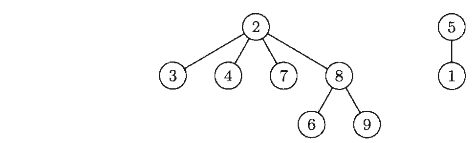

# 2.3.3 节

1\. [习题](../sec-2-3-3.md#ex-2-3-3-1)  是, 可以重构 LLINK, 做法像由 (4) 导出 (3) 一样, 但是要交换 LTAG 和 RTAG,LLINK 和 RLINK, 并且使用队列而不是栈.

2\. [习题](../sec-2-3-3.md#ex-2-3-3-2) 在算法 F 中作如下改变: 步骤 F1 改为 “森林在先序下的最后一个结点.” 步骤 F2 把两处 $\text{" } f(x_d), \ldots, f(x_1)  \text{" }$ 都改为 $\text{" } f(x_1), \ldots, f(x_d)  \text{" }$. 步骤 F4 改成 “如果 P 是先序下第一个结点, 则终止算法. (于是, 从栈顶到栈底, 栈将包含 $f ( \operatorname { r o o t } ( T _ { 1 } ) ) , \ldots , f ( \operatorname { r o o t } ( T _ { m } ) )$, 其中 $T _ { 1 } , \ldots , T _ { m }$ 是给定森林中从左到右的树.) 否则, 置 P 为它在先序下的前驱 (在给定的表示中, $\mathtt{P}\leftarrow \mathtt{P}-c)$, 并返回步骤 F2.”

3\. [习题](../sec-2-3-3.md#ex-2-3-3-3)  在步骤 D1, 还设置 $\mathtt{S}\leftarrow \Lambda .$ (S 是一个指向栈顶的链变量.) 步骤 D2 可以改变成 “如果 NODE(P) 表 $示$ 一元运算符, 则置 Q←S,S←RLINK(Q), P1←LLINK(P); 如果它表示二元运算符, 则置 $\mathtt{Q}\leftarrow \mathtt{S},$ Q1 ← RLINK(Q), S ←RLINK(Q1), P1 ← LLINK(P), P2 ← RLINK(P1). 然后, 执行 DIFF[TYPE(P)].” 步骤 D3 改变成 “置 $\mathtt{RLINK}(\mathtt{Q})\leftarrow \mathtt{S},\quad \mathtt{S}\leftarrow \mathtt{Q}.\text{”}$ 步骤 D4 改变成 “置 $\mathtt { P } \leftarrow \mathtt { P } \mathtt { S } .$ ” 如果我们假定 LLINK(DY)←Q, 则步骤 D5 中的操作 SLLINK(DY) 可以去掉. 这一方法显然可以推广到三元或更高阶的运算符.

4\. [习题](../sec-2-3-3.md#ex-2-3-3-4)  像 (10) 一样的表示用到 n-m 个 LLINK 和 $n + (n - m)$ 个 RLINK. 两种表示形式的链总数之差为 $n - 2 m .$ 当一个结点中 LLINK 和 INFO 字段需要大致相同的空间, 并且当 $m$ 相当大时, 即当非终端结点具有相当大的度数时, (10) 更合适.

5\. [习题](../sec-2-3-3.md#ex-2-3-3-5) 使用线索化的 RLINK 肯定是不明智的, 因为 RLINK 线索只不过指向 PARENT 而已. 如果我们想按颠倒的后序, 或按家族序遍历树的话, 那么像 2.3.2-(4) 中的线索的 LLINK 是有用的; 但是除非结点具有很高的度数, 否则的话, 没有线索的 LLINK, 这些操作也不会显著困难.

6\. [习题](../sec-2-3-3.md#ex-2-3-3-6)  L1. 置 P ← FIRST, FIRST ← Λ.

L2. 如果 P=Λ, 则终止, 否则置 $\mathbb { Q } \leftarrow \mathtt { R L I N K } ( \mathbb { P } )$

L3. 如果 $\mathtt{PARENT}(\mathtt P)=\Lambda$, 则置 $\mathtt{RLINK}(\mathtt{P})\leftarrow \mathtt{FIRST},\quad \mathtt{FIRST}\leftarrow \mathtt{P},$ 否则置 $\mathtt R\leftarrow\mathtt{PARENT}(\mathtt P)$ $\mathtt{RLINK}(\mathtt{P})\leftarrow \mathtt{LCHILD}(\mathtt{R}),\quad \mathtt{LCHILD}(\mathtt{R})\leftarrow \mathtt{P}.$

L4. 置 P←Q 并返回到 L2.

7\. [习题](../sec-2-3-3.md#ex-2-3-3-7)  {1, 5}{2, 3, 4, 7}{6, 8, 9}.

8\. [习题](../sec-2-3-3.md#ex-2-3-3-8)  执行算法 E 的步骤 E3, 然后检查是否有 $j = k .$

9\. [习题](../sec-2-3-3.md#ex-2-3-3-9)  PARENT[k]: 5 0 2 2 0 8 2 2 8

k: 1 2 3 4 5 6 7 8 9

10\. [习题](../sec-2-3-3.md#ex-2-3-3-10) 一种想法是设置每个根结点的 PARENT 为树中结点数的相反数 (这个值容易保持最新); 然后, 如果步骤 E4 有 $\lvert \mathtt{PARENT}[j]\rvert>\lvert \mathtt{PARENT}[k]\rvert$, 则 j 与 k 的角色互换. 这一技术 (由马尔科姆·道格拉斯·麦克罗伊提出) 确保每个操作用 $O ( \operatorname { l o g } n )$ 步.

为了获得更快的速度, 可以采纳艾伦·崔特的如下建议: 在步骤 E4, 对于在步骤 E3 遇到的所有的 $x \neq k$, 置 PARENT[x]←k. 这对树做了一次额外的扫描, 但是它瓦解了树, 使得将来的搜索更快. (见 7.4.1 节. )

11\. [习题](../sec-2-3-3.md#ex-2-3-3-11)  只需要定义对每个输入 (P,j,Q,k) 要做的变换就足够了:

T1. 如果 $\mathrm{PARENT}(\mathrm{P}) \neq \Lambda$, 则置 $j \leftarrow j + \mathrm { D E L T A ( ( P ) } \  , \enspace P \leftarrow \mathrm { P A R E N T ( P ) }$, 并且重复这一步骤.

T2. 如果 $\mathrm{PARENT}(Q) \neq \Lambda$, 则置 k ←k + DELTA(Q), Q← PARENT(Q), 并且重复这一步骤.

T3. 如果 P=Q, 则检查 j=k (否则输入错误, 包含矛盾的等价关系). 如果 $\mathbb { P } \neq \mathbb { Q }$, 则置 DELTA(Q) ← j − k, PARENT(Q) ← PLBD(P) ← min(LBD(P), LBD(Q) + DELTA(Q)), $\mathtt{UBD}(\mathtt{P})\leftarrow$ $\max(\mathtt{UBD}(\mathtt{P}),\mathtt{UBD}(\mathtt{Q})+\mathtt{DELTA}(\mathtt{Q})).$ I

注意: 在不难理解的适当条件下, 可以允许 ARRAYX[l:u] 说明与等价性混合出现, 或者允许变量的某些地址先赋值, 再确定与其他变量的等价关系, 等等. 关于这一算法的进一步发展, 见 CACM7(1964), 301-303,506.

12\. [习题](../sec-2-3-3.md#ex-2-3-3-12) (a) 是. (如果不需要这个条件, 则出现在步骤 A2 和 A9 中 S 上的循环可以避免.)(b) 是.

13\. [习题](../sec-2-3-3.md#ex-2-3-3-13) 至关重要的事实是: 从 P 向上的 UP 链总是与从 Q 向上的 UP 链涉及相同的变量和这些变量的相同指数, 但后一个链对于指数为 0 的变量可能包含附加的步骤. (这一条件在该算法的大部分地方成立, 只有步骤 A9 和 A10 执行期间除外.) 既然到达 A8 或者经过 A3, 或者经过 A10, 在两种情况下都验证了 $\mathrm{EXP}(\mathbb{Q}) \neq 0$, 因此, $\mathrm{EXP}(\mathbb{P}) \neq 0$, 特别推出 $\mathtt{P}\ne\Lambda ,\quad \mathtt{Q}\ne\Lambda ,\quad \mathtt{UP}(\mathtt{P})\ne\Lambda ,\quad \mathtt{UP}(\mathtt{Q})\ne\Lambda$, 由此得到习题中陈述的结果. 所以, 该证明依赖于证明上面所述的 UP 链条件在该算法的动作中保持成立.

14,15. [习题14](../sec-2-3-3.md#ex-2-3-3-14) [习题15](../sec-2-3-3.md#ex-2-3-3-15)  见马丁·沃德和侯赛因·泽丹, “Provably correct derivation of algorithms using FermaT”, Formal Aspects of Computing 26 (2014), 993–1031.

16\. [习题](../sec-2-3-3.md#ex-2-3-3-16) (对单棵树 T 的结点个数作归纳) 证明: 如果 P 是指向 T 的指针, 并且栈初始为空, 则步骤 F2 到 F4 将以单个值 f(root(T)) 在栈中结束. 对于 $n=1$, 这显然为真. 如果 $n > 1$, 则有 $0 < d = \mathtt { D E G R E E } ( \operatorname { r o o t } ( T ) )$ _棵子树 $T _ { 1 } , \ldots , T _ { d } \colon$ 根据归纳假设和栈的性质, 由于后序由 $T _ { 1 } , \ldots , T _ { d }$ 后随 root(T) 组成, 因此正如我们所希望的, 算法计算 $f ( T _ { 1 } ) , \ldots , f ( T _ { d } )$, 然后计算 $f(\operatorname{root}(T))$. 算法 F 对森林的正确性由此可得.

17\. [习题](../sec-2-3-3.md#ex-2-3-3-17) G1. 置栈为空, 并令 P 指向树的根 (后序下的最后一个结点). 计算 f(NODE(P)).

G2. 把 $f(\mathrm{N0DE}(\mathbb{P}))$ 的 DEGREE(P) 份副本推入栈中.

G3. 如果 P 是后序下的第一个结点, 则算法终止. 否则, 置 P 指向它在后序下的前驱 (即 (9) 中的 $\mathtt{P}\leftarrow \mathtt{P}-c)$

G4. 使用栈顶的值计算 f(NODE(P)), 这等价于计算 f(NODE(PARENT(P))). 把该值弹出栈, 并返回 G2. 1

注意: 如习题 2, 可以基于先序而不是后序, 设计类似的算法. 事实上, 也可以使用家族序或层次序. 使用层次序时, 应使用队列, 而不是栈.

18\. [习题](../sec-2-3-3.md#ex-2-3-3-18) INF01 和 RLINK 表, 连同正文给出的关于计算 LTAG 的建议, 为我们提供了通常的二叉树表示的等价表示. 基本思想是按后序遍历这棵树, 同时计算结点的度数:

P1. 令 R、D 和 I 是初始为空的栈; 然后, 置 $\mathtt{R}\Leftarrow n+1,\quad \mathtt{D}\Leftarrow 0,\quad j\leftarrow 0,\quad k\leftarrow 0.$

P2. 如果 $\operatorname { t o p } ( \mathtt { R } ) > j + 1$, 则转到 P5. (假如有 LTAG 字段, 则可以测试 $\mathtt { L T A G } \left[ j \right] = 0$, 而不是测试 $\operatorname{top}(\mathtt R)>j+1.\ )$

P3. 如果 I 为空, 则算法终止; 否则, 置 $i\leftarrow\mathtt I,\quad k\leftarrow k+1,\quad\mathtt{INFO2}[k]\leftarrow\mathtt{INFO1}[i],\quad\mathtt{DEGREE}[k]\Leftarrow\mathtt D,$

P4. 如果 RLINK[i]=0, 则转到 P3; 否则, 删除 R 的栈顶元素 (它应该等于 RLINK[i]).

P5. 置 $\operatorname{top}(\mathtt{D})\leftarrow \operatorname{top}(\mathtt{D})+1,\quad j\leftarrow j+1,\quad \mathtt{I}\Leftarrow j,\quad \mathtt{D}\Leftarrow 0.\quad\text{如果 }\mathtt{RLINK}[j]\ne0,$ 则置 $\mathtt{R}\Leftarrow \mathtt{RLINK}[j]$ 转到 P2.

19\. [习题](../sec-2-3-3.md#ex-2-3-3-19) (a) 这一性质等价于各个 SCOPE 链互不相交. (b) 森林的第一棵树包含 $d _ { 1 } + 1$ 个元素, 然后可以用归纳法证明. (c) 取最小值时, (a) 的条件成立.

注意: 根据习题 2.3.2-20, $d _ { 1 } d _ { 2 } \ldots d _ { n }$ 也能逆向解释, 如果后序下的第 $k$ 个结点是先序下的第 $p_{k}$ 个结点, 则 $d _ { k }$ 是在 $p _ { 1 } p _ { 2 } \ldots p _ { n }$ 中 k 的左边出现的大于 k 的元素个数.

还有一种类似的方案, 即列出后序下森林的每个结点的后代数目, 得出具有如下性质的数列 $c _ { 1 } c _ { 2 } \ldots c _ { n } :$ (i) $0 \leq c _ { k } < k$ 并且 (ii) $k \geq j \geq k - c _ { k }$ 蕴涵 $j - c _ { j } \geq k - c _ { k }$. 让·帕罗研究了基于这种序列的若干算法 [Comp. J.29 (1986), 171-175]. 注意, $c _ { k }$ 是对应的二叉树在对称序下第 $k$ 个结点的左子树的大小. 我们还可以把 $d _ { k }$ 解释成适当的二叉树在对称序下第 $k$ 个结点的右子树的大小, 所谓 “适当的二叉树” 就是按照习题 2.3.2-5 的双线索方法得到的对应于给定森林的二叉树.

关系 $d_{k} \leq d_{k}^{\prime} (1 \leq k \leq n)$ 定义了森林和二叉树的有意义的格序, 最早由多弗·塔迈里 [Thèse(Paris:1951)] 用另一种方法提出, 见习题 6.2.3-32.
