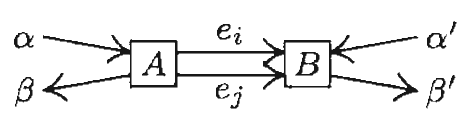
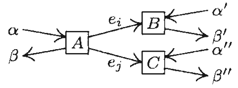
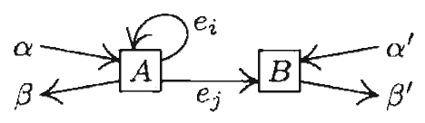
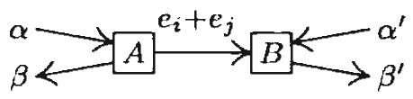
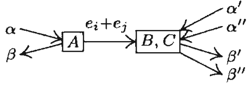
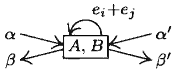

#### 2.3.4.1 节

1\. [习题](../sec-2-3-4-1.md#ex-2-3-4-1-1)  $\left( B , A , C , D , B \right) , ~ \left( B , A , C , D , E , B \right) , ~ \left( B , D , C , A , B \right) , ~ \left( B , D , E , B \right) , ~ \left( B , E , D , B \right) ,$ $( B , E , D , C , A , B ) .$

2\. [习题](../sec-2-3-4-1.md#ex-2-3-4-1-2)  令 $(V_0,V_1,\ldots,V_n)$ 为从 V 到 $V ^ { \prime }$ 的最短通路. 如果对于某 $j < k$ 有 $V _ { j } = V _ { k }$, 则

$$
( V _ { 0 } , \ldots , V _ { j } , \: V _ { k + 1 } , \ldots , V _ { n } )
$$

将是一条更短的通路.

3\. [习题](../sec-2-3-4-1.md#ex-2-3-4-1-3)  (基本路径经过 $e _ { 3 }$ 和 $e_{4}$ 一次, 但是回路 $C_{2}$ 经过它们-1 次, 净总数为 0.) 经过如下边: $e _ { 1 } , \: e _ { 2 } ,$ $e _ { 6 } , e _ { 7 } , e _ { 9 } , e _ { 1 0 } , e _ { 1 1 } , e _ { 1 2 } , e _ { 1 4 } .$

4\. [习题](../sec-2-3-4-1.md#ex-2-3-4-1-4)  如果否, 则令 $G ^ { \prime \prime }$ 是通过删除每条 $E _ { j } = 0$ 的边 $e _ { j }$ 得到的 $G ^ { \prime }$ 的子图. 于是, $G ^ { \prime \prime }$ 是一个没有回路并且至少有一条边的有限图, 因此根据定理 A 的证明, 至少存在一个顶点 V, 它恰与一个其他顶点 V 相邻. 令 $e _ { j }$ 为连接 V 到 $V ^ { \prime }$ 的边, 于是在顶点 V 上的基尔霍夫方程 (1) 是 $E _ { j } = 0$, 与 $G''$ 的定义矛盾.

[习题](../sec-2-3-4-1.md#ex-2-3-4-1-5)

$\mathbf{5.}\quad A=1+E_8,\quad B=1+E_8-E_2,\quad C=1+E_8,\quad D=1+E_8-E_5,\quad E=1+E_{17}-E_{21},\quad F=$ $1 { + } E _ { 1 3 } ^ { \prime \prime } { + } E _ { 1 7 } { - } E _ { 2 1 } , G = 1 { + } E _ { 1 3 } ^ { \prime \prime } , H = E _ { 1 7 } { - } E _ { 2 1 } , J = E _ { 1 7 } , K = E _ { 1 9 } ^ { \prime \prime } { + } E _ { 2 0 } , L = E _ { 1 7 } { + } E _ { 1 9 } ^ { \prime \prime } { + } E _ { 2 0 } { - } E _ { 2 1 } ,$ $P=E_{17}+E_{20}-E_{21},\quad Q=E_{20},\quad R=E_{17}-E_{21},\quad S=E_{25}$. 注意: 本例也可以用 $A , B , \ldots , S$ 解出 $E _ { 2 } , E _ { 5 } , \ldots , E _ { 2 5 }$, 因此有 9 个独立的解, 解释了为什么在 1.3.3-(8) 中消去了 6 个变量.

6\. [习题](../sec-2-3-4-1.md#ex-2-3-4-1-6) (下面的解基于这样的一种思想: 我们可以打印出每条不与前面的边形成回路的边.) 使用算法  
2.3.3E, 用 $( \bar { a } _ { i } , \bar { b } _ { i } )$ 表示其中的 $a _ { i } \equiv b _ { i } .$ 唯一的改变是在步骤 E4, 如果 $j \neq k$ 则打印 $( a _ { i } , b _ { i } )$

为了证明该算法正确, 我们必须证明 (a) 算法打印的边都不会形成回路, 并且 (b) 如果 G 至少包含一棵自由子树, 则该算法打印 $n = 1$ 条边. 定义 $j \equiv k$, 如果存在一条从 $V_{j}$ 到 $V _ { k }$ 的路径或 $j = k .$ 显然, 这是一个等价关系, 并且 $j \equiv k$ 当且仅当这一关系可以被等价式 $a_1\equiv b_1,\ \ldots,\ a_m\equiv b_m$ 导出. 因此, (a) 成立, 因为打印的边都不与前面打印的边形成回路; (b) 为真, 因为如果所有顶点都等价, 则恰有一个 k 使 PARENT [k] = 0.

基于深度优先搜索可以设计效率更高的算法, 见算法 2.3.5A 和 7.4.1 节.

7\. [习题](../sec-2-3-4-1.md#ex-2-3-4-1-7)  基本回路: $C_{0}=e_{0}+e_{1}+e_{4}+e_{9}$ (基本路径是 $e_1+e_4+e_9);\quad C_5=e_5+e_3+e_2;\quad C_6=e_6-e_2+e_4;$ $C_{7}=e_{7}-e_{4}-e_{3}; C_{8}=e_{8}-e_{9}-e_{4}-e_{3}$. 因此, 我们发现 $E _ { 1 } = 1 , \quad E _ { 2 } = E _ { 5 } - E _ { 6 } , \quad E _ { 3 } = E _ { 5 } - E _ { 7 } - E _ { 8 } ,$ $E _ { 4 } = 1 + E _ { 6 } - E _ { 7 } - E _ { 8 } , \quad E _ { 9 } = 1 - E _ { 8 } .$

8\. [习题](../sec-2-3-4-1.md#ex-2-3-4-1-8) 归约过程的每一步都把从同一方框开始的两个箭头 $e _ { i }$ 和 $e _ { j }$ 组合起来, 只需证明这些步骤都是可逆的就足够了. 因此, 组合后得到值 $\hat { e } _ { i } + \hat { e } _ { j }$, 组合前也必须对 $e _ { i }$ 和 $e _ { j }$ 赋予一致的值. 存在三种不同情况

情况 1

组合前

情况 2

情况 3

组合后

这里, A、B 和 C 代表顶点或超级顶点, 诸 $\alpha$ 和 $\beta$ 代表除 $e _ { i } + e _ { j }$ 之外的其他给定的流量, 这些流量可能分布在多条边上, 尽管只显示了一条边. 在情况 $1 \; ( \; e _ { i }$ 和 $e _ { j }$ 指向相同的框), 我们可以任意地选取 $e _ { i }$, 然后令 $e _ { j } \leftarrow ( e _ { i } + e _ { j } ) - e _ { i }$. 在情况 2( $e _ { i }$ 和 $e _ { j }$ 指向不同的框), 我们必须置 $e_i\leftarrow\beta'-\alpha',\quad e_j\leftarrow\beta''-\alpha''.$ 在情况 $3\;(e_i$ 是环, 而 $e _ { j }$ 不是), 我们必须置 $e _ { j } \leftarrow \beta ^ { \prime } - \alpha ^ { \prime } , e _ { i } \leftarrow ( e _ { i } + e _ { j } ) - e _ { j }$. 在每种情况下, 我们都成功逆转了组合步骤.

这一习题的结果基本上证明, 归约后的流程图中的基本回路数, 就是为确定其他所有顶点流量而必须测定的顶点流量数. 在给出的例子中, 归约后的流程图揭示, 只需要测定 3 个顶点 (例如 a、c、d) 的流量, 而习题 7 的原图有 4 个独立的边流量. 在归约时, 每出现一次情况 1, 就减少一个需要测定的量.

组合流入而不是流出给定框的箭头, 可以得到类似的归约过程. 可以证明, 除超级顶点可能包含不同的名字外, 这将产生相同的归约后的流程图.

这一习题的构造思想来自阿芒·纳哈培蒂安和弗朗西斯·斯蒂文森. 关于更多的解释, 参见纳哈培蒂安, ActaInformatica 3(1973), 37-41; 高德纳和斯蒂文森, BIT 13(1973), 313-322.

9\. [习题](../sec-2-3-4-1.md#ex-2-3-4-1-9) 从一个顶点到自身的每条边都独立形成一条 “基本回路”. 如果顶点 V 和 $V ^ { \prime }$ 之间有 k+1 条边 $e , e ^ { \prime } , \ldots , e ^ { ( k ) }$, 则构造 k 条基本回路 $e ^ { \prime } \pm e , \: \ldots , \: e ^ { ( k ) } \pm e$ (根据边沿相同或相反方向选择+或-), 然后就像只有 $e$ 出现一样处理.

实际上, 如果我们定义图时, 允许顶点之间有多条边, 也允许边从一个顶点到自身, 则这种情况从概念上讲更简单, 因为路径和回路用边而不是用顶点定义. 事实上, 在 2.3.4.2 节, 有向图就是如此定义的.

10\. [习题](../sec-2-3-4-1.md#ex-2-3-4-1-10) 如果所有的端点都已经连接在一起, 则对应的图在图论意义下一定是连通的. 最少连线数将不涉及回路, 因此必然存在自由树. 根据定理 A, 自由树包含 n-1 条连线, 而具有 n 个顶点和 n-1 条边的图是自由树当且仅当它是连通的.

11\. [习题](../sec-2-3-4-1.md#ex-2-3-4-1-11)  只需要证明, 当 $n> 1$ 并且 $c(n - 1,   n)$ 是最小的 $c ( i , n )$ 时, 至少存在一棵最小代价树, 在该树中 $T_{n - 1}$ 连接到 $T _ { n } ,$ (因为使用算法的约定, 如果我们把 $T _ { n - 1 }$ 和 $T _ { n }$ 看作 “同一个” 顶点, 则任何具有 $n > 1$ 个顶点, 并且 $T _ { n = 1 }$ 连接到 $T _ { n }$ 的最小代价树必然也是具有 $n - 1$ 个顶点的最小代价树.)

为了证明上面的陈述, 假设我们有一棵最小代价树, 其中 $T _ { n - 1 }$ 未连接到 $T_{n}$. 如果添加一条线 $T _ { n - 1 } \mathop { \longrightarrow } T _ { n }$, 则得到一条回路, 并且该回路中的其他连线都可以删除. 删除连接 $T _ { n }$ 的其他线将产生另一棵树, 其总代价不会大于原来的树, 并且 $T _ { n - 1 } \longrightarrow T _ { n }$ 也出现在该树中.

12\. [习题](../sec-2-3-4-1.md#ex-2-3-4-1-12)  维护两个辅助表 $a ( i )$ 和 $b(i) (1 \leq i < n)$, 表示要从 $T _ { i }$ 以最廉价的方式连接到某个已选定顶点, 应该连接 $T _ { b ( i ) }$, 代价为 $a ( i )$. 初始, $a(i)=c(i,n)$, b(i) = n. 然后, 执行如下操作 $\tilde { n } - 1$ 次: 找出 i 使得 $a(i)=\min_{1\le j<n}a(j)$; 从 $T _ { i }$ 连接到 $T_{b(i)}$; 对于 $1 \leq j < n$, 如果 $c(i,j) < a(j)$, 则置 $a ( j ) \leftarrow c ( i , j )$ 9$b(j) \leftarrow i;$ 并且置 $a(i) \leftarrow \infty.$ 这里, 当 $j < i$ 时, $c(i,j)$ 意指 $c(j,i)$

(不使用 $\infty$, 代之以维护一个尚未选取的 j 的一路链接表效率稍微高一点. 无论是否使用这种直截了当的改进, 该算法都需要 $O ( n ^ { 2 } )$ 次操作.) 又见戴克斯特拉, Proc. Nederl.Akad.Wetensch.A63(1960), 196-199; 高德纳, The Stanford GraphBase(New York: ACMPress,1994), 460-497. 找最小代价生成树的更好算法在 7.5.4 节讨论.

13\. [习题](../sec-2-3-4-1.md#ex-2-3-4-1-13)  如果对于某 $i \neq j$, 没有从 $V _ { i }$ 到 $V _ { j }$ 的路径, 则没有对换的乘积把 i 移到 $j .$ 因此, 如果生成了所有排列, 则图必然是连通的. 反之, 如果图是连通的, 则必要时删除一些边, 直至得到一棵自由树. 重新对顶点编号, 使得 $V _ { n }$ 仅与一个其他顶点相邻, 即与 $V_{n - 1}$ 相邻. (参见定理 A 的证明.) 现在, 除 $(n{-}1\; n)$ 之外的对换形成一棵具有 n-1 个顶点的自由树. 因此, 根据归纳法, 如果π是 $\{ 1 , 2 , \ldots , n \}$ 的保持 n 固定的任意排列, 则π可以写成这些对换的乘积. 如果 $\pi$ 把 n 移到 $j$, 则 $\pi ( \hat { j } n { - } 1 ) ( n { - } 1 n ) = \rho$ 固定 $n$, 因此 $\pi = \rho(n - 1 n)(j n - 1)$ 可以写成给定对换的乘积.
