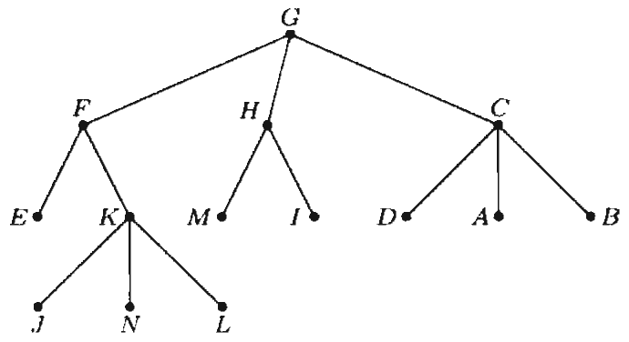
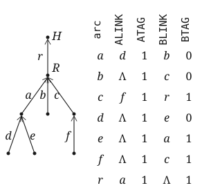
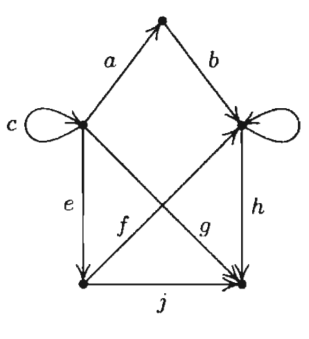

#### 2.3.4.2 节

1\. [习题](../sec-2-3-4-2.md#ex-2-3-4-2-1)  令 $( e _ { 1 } , \ldots , e _ { n } )$ 为一条从 V 到 $V ^ { \prime }$ 的长度最短的定向通路. 如果对于 $j < k$ $\operatorname { i n i t } ( e _ { k } ) = \operatorname { i n i t } ( e _ { j } ) = ,$ 则 $( e _ { 1 } , \ldots , e _ { j - 1 } , e _ { k } , \ldots , e _ { n } )$ 将是更短的通路. 如果对于 j<k, $\operatorname { f i n } ( e _ { j } ) = \operatorname { f i n } ( e _ { k } )$, 也可使用类似的论证. 因此, $( e _ { 1 } , \ldots , e _ { n } )$ 是简单的.

2\. [习题](../sec-2-3-4-2.md#ex-2-3-4-2-2)  所有符号都相同的回路为: $\ _ { C _ { 0 } , , } C _ { 8 } , \bar { C } _ { 1 3 } ^ { \prime \prime } , C\bar { C } _ { 1 7 } , \bar { C } _ { 1 9 } ^ { \prime \prime } , \bar { C } _ { 2 0 }$

3\. [习题](../sec-2-3-4-2.md#ex-2-3-4-2-3)  例如, 使用 3 个顶点 A,B,C, 加上从 A 到 B 和从 A 到 C 的弧.

4\. [习题](../sec-2-3-4-2.md#ex-2-3-4-2-4)  如果没有定向回路, 则算法 2.2.3T 对图 G 拓扑排序. 如果有定向回路, 则拓扑排序显然是不可能的. (依赖于如何解释该题, 长度为 1 的定向回路可以不考虑.)

5\. [习题](../sec-2-3-4-2.md#ex-2-3-4-2-5)  令 $k$ 是最小整数, 使得对于某 $j \leq k, \mathrm{~fin}(e_k) = \mathrm{iii}(e_j)$ 于是, $( e _ { j } , \ldots , e _ { k } )$ 是一条定向回路.

6\. [习题](../sec-2-3-4-2.md#ex-2-3-4-2-6) 假 (严格说来), 因为从一个顶点到另一个可能存在多条不同的弧.

7\. [习题](../sec-2-3-4-2.md#ex-2-3-4-2-7) 对于有限的有向图为真: 如果我们从任意顶点开始, 沿着唯一可能的定向路径前进, 则不会遇到任何顶点两次, 因此必然最终到达 R (唯一没有后继的顶点). 对于无限图, 结果显然为假, 因为可能有顶点 $R   , \  V _ { 1 } ,  V _ { 2 } ,  V _ { 3 } , \ldots$. 和从 $V _ { j }$ 到 $V_{j + 1} \quad (j \geq 1)$ 的弧.

9\. [习题](../sec-2-3-4-2.md#ex-2-3-4-2-9)  所有的弧都向上指.

10\. [习题](../sec-2-3-4-2.md#ex-2-3-4-2-10)  G1. 置 $k\leftarrow P[j]$ $P [ j ] \leftarrow 0 .$

G2. 如果 $k =0$, 则停止; 否则置 $\overline { { m } } \leftarrow P [ \underline { { k } } ]$, P[k]←j,j← k,k ←m, 并重复步骤 G2.11. [习题](../sec-2-3-4-2.md#ex-2-3-4-2-11) 这个算法把算法 2.3.3E 和上一题的方法结合在一起, 使得所有的定向树的弧都对应于有向图中的实际的弧. S[j] 是一个辅助表, 它指出一个弧是从 j 到 $P [ j ] ( S [ j ] = + 1 )$ 还是从 $P [ j ]$ 到 $j\;(S[j]=-1)$ 初始, $P[1] = \cdots = P[n] = 0$. 如下步骤可以用来处理每条弧 (a,b):

C1. 置 $j \leftarrow a , k \leftarrow P [ j ] , P [ j ] \leftarrow 0 , s \leftarrow S [ j ] .$

C2. 如果 $k =0$, 则转到 C3; 否则, 置 $m \leftarrow P [ k ]$, t ← S[k], $P[k]\leftarrow j$, S[k $]\leftarrow-s,\quad s\leftarrow t,$ j ← k, k ← m, 并重复步骤 C2.

C3. (现在 a 作为它所在树的根出现) 置 j←b, 然后, 如果 $P[j] \neq 0$, 则反复置 $j\leftarrow P[j]$, 直到 $P [ j ] = 0 .$

C4. 如果 $j \equiv a$, 则转到 C5; 否则置 $P[a] \leftarrow b,\; S[a] \leftarrow +1$, 打印 (a,b) 作为属于该自由树的弧, 并且终止.

C5. 打印 $\text{“}\mathtt{CYCLE}\text{”}$ 后随 $\text{“}(a,b)\text{”}$

C6. 如果 $P [ b ] = 0$, 则终止. 否则, 如果 $\widetilde{S}[\widetilde{b}] = + 1$, 则打印 $\text{" }+(b,\;P[b]) \text{" }$, 否则打印 $\text{“}-(P[b],b)\text{”}$ 置 $b \leftarrow \vec { P } [ b ]$, 并重复步骤 C6.

注意: 如果我们结合习题 2.3.3-10 答案中麦克罗伊的建议, 则该算法最多需要 O(mlogn) 步. 但是, 有一个更好的解, 只需要 $\mathcal { O } ( m )$ 步: 使用深度优先搜索, 构造一棵 “棕榈树”(palmtree), 每个 “叶状体”(frond) 对应一条基本回路 [罗伯特·塔扬, SICOMP1(1972), 146-150].

12\. [习题](../sec-2-3-4-2.md#ex-2-3-4-2-12) 它等于入度; 每个顶点的出度只可能为 0 或 1.

13\. [习题](../sec-2-3-4-2.md#ex-2-3-4-2-13)  定义 G 的定向子树的序列如下: $G _ { 0 }$ 是单个顶点 $\bar { R } . \quad G _ { k + 1 }$ 是 $G_{k}$ 加上 G 的任意不在 $G_{k}$ 中但存在一条从 V 到 $V ^ { \prime }$ 的弧的顶点 V, 其中 $V ^ { \prime }$ 在 $G_{k}$ 中, 再对每个这样的 V 加上一条弧 $e [ V ]$. 根据归纳法立即得知, 对于所有的 $k \geq 0 , \quad G _ { k }$ 都是定向树, 并且如果 G 中存在一条从 V 到 R 的长度为 k 的定向路径, 则 V 在 $G_{k}$ 中, 因此, 在任意 $G_{k}$ 中所有 V 和 $e [ V ]$ 的集合 $G_{\infty}$ 就是所求的 G 的定向树.

14\. [习题](../sec-2-3-4-2.md#ex-2-3-4-2-14) 

$$
\begin{array}{ll}(e_{12},e_{20},e_{00},e_{01}',e_{10},e_{01},e_{12}',e_{22},e_{21})&(e_{12},e_{20},e_{00},e_{01}',e_{12}',e_{22},e_{21},e_{10},e_{01})\\(e_{12},e_{20},e_{01}',e_{10},e_{00},e_{01},e_{12}',e_{22},e_{21})&(e_{12},e_{20},e_{01}',e_{12}',e_{22},e_{21},e_{10},e_{00},e_{01})\\(e_{12},e_{22},e_{20},e_{00},e_{01}',e_{10},e_{01},e_{12}',e_{21})&(e_{12},e_{22},e_{20},e_{00},e_{01}',e_{12}',e_{21},e_{10},e_{01})\\(e_{12},e_{22},e_{20},e_{01}',e_{10},e_{00},e_{01},e_{12}',e_{21})&(e_{12},e_{22},e_{20},e_{01}',e_{12}',e_{21},e_{10},e_{00},e_{01})\end{array}
$$

在字典序下; 8 种可能来自 $e _ { 0 0 }$ 或 $e _ { 0 1 } ^ { \prime } { , } e _ { 1 0 }$ 或 $e _ { 1 2 } ^ { \prime } , \; e _ { 2 0 }$ 或 $e_{22}$ 的次序的独立选择.

15\. [习题](../sec-2-3-4-2.md#ex-2-3-4-2-15) 对有限图为真: 如果它是连通和平衡的, 并且具有一个以上顶点, 则它具有接触所有顶点的欧拉迹. (但在一般情况下为假.)

16\. [习题](../sec-2-3-4-2.md#ex-2-3-4-2-16) 考虑有向图 G, 它具有顶点 $V _ { 1 } , \; \dots , \; V _ { 1 3 }$, 并且对于第 $j$ 叠中的每个 k 有一条从 $V _ { j }$ 到 $V _ { k }$ 的弧; 这个图是平衡的. 赢得游戏等价于在 G 中找到一条欧拉迹, 因为当遇到第四条到 $V_{13}$ 的弧时 (即遇到第四个 k 时) 游戏结束. 如果游戏获胜, 则由引理 E, 所述的图是一棵定向子树. 反之, 如果所述的图是一棵定向子树, 则由定理 D, 游戏获胜.

17\. [习题](../sec-2-3-4-2.md#ex-2-3-4-2-17)  $\frac { 1 } { 1 3 } .$ 我第一次求解时, 用 2.3.4.4 节的方法, 辛辛苦苦地枚举特殊类型的定向树, 运用生成函数, 等等, 得到答案. 但是, 这种简单的答案应该有简单直接的证明. 确实存在这样的证明 [见托尔·斯塔韦尔, Norsk Matematisk Tidsskrift28(1946), 88-89]. 定义一个翻转整副牌的次序如下: 遵照游戏规则直到停下为止, 然后 “作弊”, 翻动第一张可翻的牌 (从第一叠顺时针前进找到第一个非空叠), 像以前一样继续, 直到所有的牌都最终被翻开. 牌的翻动次序完全是随机序 (因为牌的值直到翻开后才能确定). 因此, 只需要计算随机洗牌的一叠纸牌最后一张牌是 K 的概率. 更一般地, 游戏结束时, 仍然有 k 张牌面朝下的概率是随机洗牌后最后一张 K 后面有 k 张牌的概率, 即 $4 ! { \binom { 5 1 - k } { 3 } }$ 因此, 不作弊的玩家每玩一次平均翻开 42.4 张牌. 注意: 类似地, 可以证明, 玩家在上面介绍的过程中必须 “作弊”k 次的概率恰为斯特林数 $\left[ ^{13}_{k + 1} \right] / 13!$. (见 1.2.10-(9) 和习题 1.2.10-7, 更一般的牌叠见习题 1.2.10-18.)

18\. [习题](../sec-2-3-4-2.md#ex-2-3-4-2-18)  (a) 如果存在回路 $( V _ { 0 } , V _ { 1 } , \ldots , V _ { k } )$, 其中必须有 $\underline { { 3 } } \leq k \leq n$, 则对应于回路中 k 条边的 A 的 k 行之代数和 (带有相应的符号) 是一行 0. 因此, 如果 G 不是自由树, 则 $A_{0}$ 的行列式为 0.

但是, 如果 G 是自由树, 则我们可以把它看作一棵以 $V _ { 0 }$ 为根的有序树, 并重新安排 $A_{0}$ 的行和列, 使得它的诸列按先序排列, 第 $k$ 行对应于从第 $k$ 个顶点 (列) 到它的父母的边. 于是, 矩阵是三角矩阵, $\pm 1$ 在对角线上, 因此行列式的值为 $\pm 1 ,$

(b) 根据比内一柯西公式 (习题 1.2.3-46), 有

$$
\operatorname* { d e t } \tilde { A } _ { 0 } ^ { T } \tilde { A } _ { 0 } = \sum _ { 1 \leq i _ { 1 } < \dots < i _ { n } \leq m } ( \operatorname* { d e t } \tilde { A } _ { i _ { 1 } \dots i _ { n } } ) ^ { 2 } ,
$$

其中 $A _ { i _ { 1 } \ldots i _ { n } }$ 表示由 $A_{0}$ 的行 $i _ { 1 } , \ldots , i _ { n }$ 组成的矩阵 (因此对应于在 G 中选择 $n$ 条边的一种方法). 由 (a) 得到结果.

[见冈田幸千生和小野寺力夫, Bull.Yamagata Univ.2(1952), 89-117.]

19\. [习题](../sec-2-3-4-2.md#ex-2-3-4-2-19)  (a) 条件 $a _ { 0 0 } = 0$ 和 $a _ { j j } = 1$ 正是定向树定义的条件 (a) 和 (b). 如果 G 不是定向树, 则存在一条定向回路 (习题 7), 对应于这条定向回路的 $A_{0}$ 各行相加, 将得到一行 0, 因此 $\operatorname* { d e t } A _ { 0 } = 0 .$ 如果 G 是一棵定向树, 则对每个家族的子女赋予一个任意序, 并把 G 看作有序树. 现在, 改变 $A_{0}$ 的行和列次序, 直到它们对应于顶点的先序. 由于相同的排列用于行和列, 因此行列式的值不变, 所得矩阵是三角矩阵, 对角线上每个位置都为+1.

(b) 我们可以假定, 对于所有的 j 都有 $a _ { 0 j } = 0$, 因为定向子树中不会有从 $V _ { 0 }$ 出发的边. 我们还可以假定, 对于所有的 $j \geq 1$ 都有 $a _ { j j } > 0$, 否则的话整个第 $j$ 行为 0, 显然没有定向子树. 现在, 对弧的条数归纳: 如果 $a _ { j j } > 1$, 则令 $e$ 为某条从 $V _ { j }$ 出发的弧; 令 $B_{0}$ 为类似于 $A_0$ 的矩阵, 但删除了弧 e; 令 $C _ { 0 }$ 是类似于 $A_{0}$ 的矩阵, 但删除了除 e 之外所有从 $V _ { j }$ 出发的弧. 例如, 如果 $A_0=\begin{pmatrix}3&-2\\-1&2\end{pmatrix}$, $j = 1$, e 是一条从 $V _ { 1 }$ 到 $V _ { 0 }$ 的弧, 则 $B _ { 0 } = \left( \begin{matrix} { \phantom { - } 2 \phantom { - } - 2 } \\ { - 1 \phantom { - } \phantom { - } 2 } \\ \end{matrix} \right)$, $C_0=\begin{pmatrix}1&0\\-1&2\end{pmatrix}$. 一般有 det $A _ { 0 } = \operatorname* { d e t } B _ { 0 } + \operatorname* { d e t } C _ { 0 }$, 因为这些矩阵在除第 $j$ 行之外的所有行上都一致, 而在第 $j$ 行上, $A_{0}$ 为 $B_{0}$ 与 $C _ { 0 }$ 的和. 此外, G 的定向树的个数是不使用 $e$ 的子树的个数 (由归纳法, 即 det $B_{0}$ 加上使用 $e$ 的子树的个数 (即 det C0).

注意: 仿照偏微分方程理论的拉普拉斯算子概念, 矩阵 A 通常类似称为图的拉普拉斯算子矩阵. 如果我们从矩阵 A 删除任意一组行构成的集合 S, 并且删除相同一组列, 则结果矩阵的行列式是其根为顶点 $\{ V _ { k } \mid k \in S \}$, 其弧属于给定的有向图的定向森林数. 定向树的矩阵树定理最先被詹姆斯·西尔维斯特于 1857 年陈述而未加证明 (见习题 28), 之后被遗忘多年, 直到被威廉·塔特重新独立发现 ProcCambridgePhil. Soc.44(1948), 463-482,§3]. 在矩阵 A 是对称矩阵、图是无向图的特殊情况下, 首个正式发表的证明由卡尔·博尔夏特给出 [Crelle57(1860), 111-121]. 一些作者认为这个定理是基尔霍夫提出的, 但是基尔霍夫证明的结果与之很不相同 (尽管相关).

20\. [习题](../sec-2-3-4-2.md#ex-2-3-4-2-20)  利用习题 18, 我们发现 $B=A_0^{T}A_0.$ 或者根据习题 19,B 是用两条弧 (每个方向一条) 取代 G 的每条边得到的有向图 $G ^ { \prime }$ 的矩阵 A0, G 的每棵自由子树唯一地对应于 $G ^ { \prime }$ 的一棵以 $V_{0}$ 为根的定向子树, 因为弧的方向由根的选取所确定.

21\. [习题](../sec-2-3-4-2.md#ex-2-3-4-2-21)  像习题 19 一样, 构造矩阵 A 和 $A^{*}$. 对于图 36 和图 37 中的图例 G 和 $G ^ { * }$

$$
A=\begin{pmatrix}2&-2&0\\-1&3&-2\\-1&-1&2\end{pmatrix},\qquad A^{*}=\begin{array}{r|rrr|rrr|rrr}&{[00]}&{[10]}&{[20]}&{[01]}&{[01]}&{[21]}&{[12]}&{[12]}&{[22]}\\{[00]}&2&0&0&-1&-1&0&0&0&0\\{[10]}&-1&3&0&-1&-1&0&0&0&0\\{[20]}&-1&0&3&-1&-1&0&0&0&0\\{[01]}&0&-1&0&3&0&0&-1&-1&0\\{[01]}&0&-1&0&0&3&0&-1&-1&0\\{[21]}&0&-1&0&0&0&3&-1&-1&0\\{[12]}&0&0&-1&0&0&-1&3&0&-1\\{[12]}&0&0&-1&0&0&-1&0&3&-1\\{[22]}&0&0&-1&0&0&-1&0&0&2\end{array}
$$

把不确定的 $\lambda$ 加到 A 和 $A^{*}$ 的每个对角线元素上. 如果 $t ( G )$ 和 $t(G^{*})$ 是 G 和 $G ^ { * }$ 的定向子树的个数, 则 $\det A = \lambda t(G) + O(\lambda^2)$, det $\tilde { A } ^ { * } = \lambda t ( G ^ { * } ) + O ( \lambda ^ { 2 } )$. (根据习题 22, 对于任意给定的根, 平衡图的定向子树的个数都相同, 但我们不需要这一事实.)

如果我们把顶点 $V_{jk}$ 按相等的 k 分组, 则可以划分矩阵 $A^{*}$ 如上所示. 令 $\boldsymbol{B}_{kk'}$ 是 $A^{*}$ 的子矩阵, 对于使得 $V_{j k}$ 和 $V_{j'k'}$ 在 $G ^ { * }$ 中的所有 $j$ 和 $j',\ B_{kk'}$ 由 $V_{j k}$ 的行和 $V_{j'k'}$ 的列组成. 在每个子矩阵中, 把第 $2 , \cdots ,$ m 列加到第 1 列, 然后从第 $2 , \ldots , m$ 行减去第 1 行, 则矩阵 $A^{*}$ 被变换, 使得

$$
B_{kk'}=\begin{pmatrix}a_{kk'}&*&\cdots&*\\0&0&\cdots&0\\\vdots&\vdots&\ddots&\vdots\\0&0&\cdots&0\end{pmatrix}\quad\text{对于 }k\ne k',\qquad B_{kk}=\begin{pmatrix}\lambda+a_{kk}&*&\cdots&*\\0&\lambda+m&\cdots&0\\\vdots&\vdots&\ddots&\vdots\\0&0&\cdots&\lambda+m\end{pmatrix}.
$$

在变换后的子矩阵中, 首行的 “\*” 是不相关的值, 因为 $A^{*}$ 的行列式为 $(\lambda + m)^{(m - 1)n}$ 乘以

$$
\operatorname* { d e t } \left( \begin{matrix} { \lambda + a _ { 0 0 } } & { a _ { 0 1 } } & { \dots } & { a _ { 0 ( n - 1 ) } } \\ { a _ { 1 0 } } & { \lambda + a _ { 1 1 } } & { \dots } & { a _ { 1 ( n - 1 ) } } \\ { \vdots } & { \vdots } & { \ddots } & { \vdots } \\ { a _ { ( n - 1 ) 0 } } & { a _ { ( n - 1 ) 1 } } & { \dots } & { \lambda + a _ { ( n - 1 ) ( n - 1 ) } } \\ \end{matrix} \right) = \lambda t ( G ) + O ( \lambda ^ { 2 } ) .
$$

注意, 特殊地, 当 $\bar { n } = 1$ 并且从 $V _ { 0 }$ 到自身有 $m$ 条弧时, 我们发现在 $m$ 个标号的结点上恰有 $m ^ { \widetilde { m } - 1 }$ 棵可能的定向树. 这一结果将在 2.3.4.4 节用截然不同的方法得到.

这一推导可以推广. 对于任意有向图 G, 确定 $G ^ { * }$ 的定向子树的个数, 见里德·道森和古德, Ann.Math. Stat. 28 (1957), 946-956; 高德纳, Journal of Combinatorial Theory 3 (1967), 309-314. 詹姆斯·奥林给出了另一种纯组合数学的证明, 见 Journal of Combinatorial Theory B25(1978), 187-198.

22\. [习题](../sec-2-3-4-2.md#ex-2-3-4-2-22)  总数为 $( \sigma _ { 1 } + \cdots + \sigma _ { n } )$ 乘以从给定的边 $e _ { 1 }$ 开始的欧拉迹的个数, 其中 $\operatorname { i n i t } ( e _ { 1 } ) = V _ { 1 }$. 由引理 E, 每个这样的迹确定一棵以 $V _ { 1 }$ 为根的定向子树, 并且对于 T 棵定向子树的每一棵, 存在 $\textstyle \prod _ { j = 1 } ^ { n } ( \sigma _ { j } - 1 ) !$ 条满足定理 D 的三个条件的通路, 对应于弧 $\{e\mid\operatorname{init}(e)=V_j,\ e\ne e[V_j],\ e\ne e_1\}$ 进入 P 的不同次序. (习题 14 是一个简单的例子.)

23\. [习题](../sec-2-3-4-2.md#ex-2-3-4-2-23)  按照提示, 构造具有 $m^{k - 1}$ 个顶点的有向图 $G _ { k }$, 并且用 $[ x _ { 1 } , \ldots , x _ { k } ]$ 表示所提及的弧. 对于每个具有最大周期长度的函数, 我们可以定义一条唯一对应的欧拉迹: 如果弧 $[ x _ { 1 } , \ldots , x _ { k } ]$ 后面是弧 $[ x _ { 2 } , \ldots , x _ { k + 1 } ]$ 则令 $f ( x _ { 1 } , \ldots , x _ { k } ) = x _ { k + 1 }$. (如果一个欧拉迹只是另一个的循环排列, 则我们把它们看作等同的.) 在习题 21 的意义下, $G_{k} \equiv G_{k - 1}^{*}$. 因此, $G _ { k }$ 的定向子树个数是 $G_{k - 1}$ 的 $m ^ { m ^ { k - 1 } - m ^ { k - 2 } }$ 倍. 归纳可知, $G_{k}$ 有 $m ^ { m ^ { k - 1 } - 1 }$ 棵定向子树, 其中 $m ^ { m ^ { k - 1 } - k }$ 棵具有给定的根. 因此, 由习题 22, 具有最大周期的函数个数, 即从给定的弧出发的 $G_{k}$ 的欧拉迹的个数, 是 $m^{-k}(m!)^{m^{k-1}}.\;[\,m=2$ 的结果归功于卡米尔·圣玛丽, L’Intermédiaire des Mathématiciens 1 (1894), 107-110. ]

24\. [习题](../sec-2-3-4-2.md#ex-2-3-4-2-24) 定义一个新的有向图, 对于 $0 \leq j \leq m , \quad e _ { j }$ 有 $E _ { j }$ 个副本. 这个图是平衡的, 因此由定理 G, 它包含一个欧拉迹 $( e _ { 0 } , \dots )$. 从该欧拉迹中删除边 $e _ { 0 }$, 得到所求定向通路.

25\. [习题](../sec-2-3-4-2.md#ex-2-3-4-2-25)  对集合 $I _ { j } = \{ e \mid \operatorname { i n i t } ( e ) = V _ { j } \}$ 和 $F_j=\{e\mid\operatorname{fin}(e)=V_j\}$ 中的所有弧指定一个任意次序. 对于 $I _ { j }$ 中的每条弧 $e,$ 令 $\mathtt{ATAG}(e)=0$, ALINK $(e)=e'$, 如果在 $I _ { j }$ 的次序下 $e ^ { \prime }$ 紧接在 $e$ 后面; 令 $\mathrm{ATAG}(e) = 1$, ALINK $(e) \equiv e'$, 如果 $e$ 是 $I _ { j }$ 中的最后一个, 并且 $e ^ { \prime }$ 是 $F_{j}$ 的第一个. 在后一种情况, 令 $\mathtt{ALINK}(e)=\Lambda$ 如果 $F _ { j }$ 为空. 颠倒 init 和 fin 的角色, 用相同的规则定义 BLINK 和 BTAG.

例子 (在每个弧集合中使用字母序):

$$
\begin{array}{ccccc}\mathrm{arc}&\mathtt{ALINK}&\mathtt{ATAG}&\mathtt{BLINK}&\mathtt{BTAG}\\a&c&0&b&1\\b&a&1&d&0\\c&e&0&a&1\\d&h&0&f&0\\e&g&0&f&1\\f&j&0&d&1\\g&c&1&h&0\\h&b&1&j&0\\j&e&1&\Lambda&1\end{array}
$$

注意: 如果在该定向树表示中, 另外增加一条从日到自身的弧, 则情况很有趣: 或者得到表头处 LLINK、LTAG、RLINK、RTAG 互换的 2.3.1-(8) 的标准约定, 或者 (如果新弧在该序下放在最后) 得到上述标准约定, 只是与树的根相关联的结点中有 $\mathtt { R T A G } = 0 .$

这一习题基于威廉·林奇向我表达的思想. 使用这种表示, 能否把算法 2.3.1S 那样的树遍历算法, 推广到并非定向树的有向图类?

27\. [习题](../sec-2-3-4-2.md#ex-2-3-4-2-27) 令 $a _ { i j }$ 为从 $V _ { i }$ 到 $V _ { j }$ 的所有弧 $e$ 上的 $p(e)$ 之和. 我们要证明对于所有的 j, $t_j=\sum_i a_{ij}t_i,$. 由于 $\textstyle \sum _ { i } a _ { j i } = 1$, 我们必须证明 $\textstyle \sum _ { i } a _ { j i } t _ { j } = \sum _ { i } a _ { i j } t _ { i } .$ 这并不困难, 因为等式两边都表示所有满足下列条件的乘积 $p ( e _ { 1 } ) \ldots p ( e _ { n } )$ 的和: G 中的子图 $\{ e _ { 1 } , \ldots , e _ { n } \}$ 使得 $\operatorname { i n i t } ( e _ { i } ) = V _ { i }$, 存在唯一定向回路包含在 $\{ e _ { 1 } , \ldots , e _ { n } \}$ 中, 且这条回路包含 $V_{j}$. 删除该回路中的任意一条弧产生一棵定向树, 该等式的左边对应于离开 $V _ { j }$ 的弧, 而右边对应于进入 $V _ { j }$ 的弧.

在某种意义下, 这一题结合了习题 19 和 26.

28\. [习题](../sec-2-3-4-2.md#ex-2-3-4-2-28)  该展开式的每一项为 $a _ { 1 p _ { 1 } } \dots a _ { m p _ { m } } b _ { 1 q _ { 1 } } \dots b _ { n q _ { n } }$ 乘以某整数系数, 其中对于 $0 \leq p _ { i } \leq n , 1 \leq i \leq m$ 对于 $1 \leq j \leq n , 0 \leq q _ { j } \leq m$. 把这个乘积表示成顶点 $\{ \vec { 0 } , u _ { 1 } , \ldots , u _ { \underline { { m } } } , v _ { 1 } , \ldots , v _ { \bar { n } } \}$ 上的有向图, 具有从 $u _ { i }$ 到 vpi 和从 $v _ { j }$ 到 $\tilde { u } _ { \tilde { q _ { j } } }$ 的弧, 其中 $u _ { 0 } = v _ { 0 } = 0 .$

如果该有向图包含一个回路, 则整数系数为 0. 因为每条回路对应于形如

$$
a _ { i _ { 0 } j _ { 0 } } \: b _ { j _ { 0 } i _ { 1 } } \: a _ { i _ { 1 } j _ { 1 } } \: \dots \: a _ { i _ { k - 1 } j _ { k - 1 } } \: b _ { j _ { k - 1 } i _ { 0 } }
$$

的因子, 其中下标 $( i _ { 0 } , i _ { 1 } , \ldots , i _ { k - 1 } )$ 互不相同, 下标 $( j _ { 0 } , j _ { 1 } , \ldots , j _ { k - 1 } )$ 也互不相同. 对于 $0 \leq l < k$ $0 \leq j \leq n$, 置 $a _ { i _ { l } j } \leftarrow [ j = j _ { l } ]$, 并且对于 $0 \leq i \leq m$, 置 $b_{j_l i} \leftarrow [i = i_{(l+1) \bmod k}]$, 其他 m + n − 2k 行中的变量不变, 得到一个 (\*) 倍行列式. 该行列式也等于包含因子 (\*) 的所有项之和. 该行列式肯定为 0, 因为上部行 $i _ { 0 } { , } i _ { 1 } { , } { \ldots , } i _ { k - 1 }$ 的和等于下部行 $j_0,j_1,\ldots,j_{k-1}$ 的和.

另一方面, 如果该有向图没有回路, 则整数系数为+1. 这是因为每个因子 $a_{ip_i}$ 和 $b_{j q_{j}}$ 一定来自该行列式的对角线: 如果在上部的 $i _ { 0 }$ 行选取任意非对角线元素 $\vec { a } _ { i _ { 0 } j _ { 0 } }$, 则必须从左部 $j _ { 0 }$ 行选取某非对角线元素 $b _ { j _ { 0 } i _ { 1 } }$, 因此必须从上部 $i _ { 1 }$ 行选取非对角线元素 $a _ { i _ { 1 } j _ { 1 } }$, 等等, 形成一条回路.

因此, 系数为+1, 当且仅当对应的有向图是一棵以 0 为根的定向树. 为计算这样的项的个数 (即这种定向树的个数), 可以置每个 $a _ { i j }$ 和 $b _ { j i }$ 为 1, 例如

$$
\begin{aligned}\operatorname{det}\begin{pmatrix}4 & 0 & 1 & 1 & 1 \\0 & 4 & 1 & 1 & 1 \\1 & 1 & 3 & 0 & 0 \\1 & 1 & 0 & 3 & 0 \\1 & 1 & 0 & 0 & 3\end{pmatrix}&= \operatorname{det}\begin{pmatrix}4 & 0 & 1 & 1 & 1 \\-4 & 4 & 0 & 0 & 0 \\1 & 1 & 3 & 0 & 0 \\0 & 0 & -3 & 3 & 0 \\0 & 0 & -3 & 0 & 3\end{pmatrix}&= \operatorname{det}\begin{pmatrix}4 & 0 & 3 & 1 & 1 \\0 & 4 & 0 & 0 & 0 \\2 & 1 & 3 & 0 & 0 \\0 & 0 & 0 & 3 & 0 \\0 & 0 & 0 & 0 & 3\end{pmatrix}\\&= \operatorname{det}\begin{pmatrix}4 & 3 \\2 & 3\end{pmatrix} \cdot 4 \cdot 3 \cdot 3.\end{aligned}
$$

一般地, 我们得到 $\det\binom{n + 1 \quad n}{m \quad m + 1} \cdot (n + 1)^{m - 1} \cdot (m + 1)^{n - 1}.$

注记: 西尔维斯特 [Quarterly J. of Pure and AppliedMath.1(1857), 42-56] 考虑了特殊情况 $m = n, a_{10} = a_{20} = \cdots = a_{m0} = 0$, 并正确地猜想项的总数为 $n^{n}(n + 1)^{n - 1}$. 他还未加证明地说, 当 $a _ { i j } = \delta _ { i j }$ 时, 有 $(n + 1)^{n - 1}$ 个非 0 项, 对应于 $\{ \hat { 0 } , \hat { 1 } , \ldots , n \}$ 上所有连通的无回路的图. 在那种特殊情况下, 他把该行列式归约为习题 19 的矩阵树定理形式, 例如

$$
\operatorname* { d e t } \left( \begin{matrix} { b _ { 1 0 } + b _ { 1 2 } + b _ { 1 3 } } & { - b _ { 1 2 } } & { - b _ { 1 3 } } \\ { - b _ { 2 1 } } & { b _ { 2 0 } + b _ { 2 1 } + b _ { 2 3 } } & { - b _ { 2 3 } } \\ { - b _ { 3 1 } } & { - b _ { 3 2 } } & { b _ { 3 0 } + b _ { 3 1 } + b _ { 3 2 } } \\ \end{matrix} \right) .
$$

凯利 [Crelle52(1856), 279] 引述了这一结果, 并表示这是由西尔维斯特提出的, 然而讽刺的是, 人们常常认为是凯利提出了关于这种图的个数的定理.

对该行列式的前 m 行取反, 然后对前 m 列取反, 可以把这一习题归结为矩阵树定理.

[在偏微分方程的迭代法求解中, 具有这一习题所考虑的一般形式的矩阵非常重要, 称作具有 “性质 $\mathcal{A}^{\prime\prime}$ 的矩阵. 见路易斯·哈格曼和戴维·扬, 《实用迭代方法》(Applied IterativeMethods, AcademicPress,1981) 第 9 章.]
