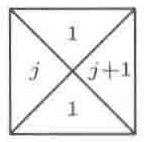

#### 2.3.4.3 节

1\. [习题](../sec-2-3-4-3.md#ex-2-3-4-3-1)  根是空序列, 弧从 $( x _ { 1 } , \ldots , x _ { n } )$ 到 $( x _ { 1 } , \ldots , x _ { n - 1 } )$

2\. [习题](../sec-2-3-4-3.md#ex-2-3-4-3-2)  取一个四分形类型并把它旋转 $1 8 0 ^ { \circ }$, 得到另一个四分形类型. 使用两种类型, 重复 2×2 模式, 显然可以平铺平面 (不需要进一步旋转).

3\. [习题](../sec-2-3-4-3.md#ex-2-3-4-3-3) 对于所有正整数 $j$, 考虑四分形类型 1 的集合. 右半平面可以用不可数种方法铺满; 但是, 无论什么正方形放在平面的中心, 继续向左铺的距离极限都是有限的.

4\. [习题](../sec-2-3-4-3.md#ex-2-3-4-3-4)  对于 $n = 1 , 2 , \ldots ,$ 系统地枚举平铺一个 $n \times n$ 块的所有可能方法, 在这些块的范围内寻找环形解. 如果没有方法铺满平面, 则根据无限性引理, 存在一个 n, 没有 $n \times n$ 解. 如果有一种方法铺满平面, 则根据假定, 存在一个 n, 有一个 $n \times n$ 解是由矩形产生的环形解. 因此, 在两种情况下, 算法都将终止.

[但是正如下一题所示, 所述假定其实不成立. 事实上, 不存在算法在有限步内确定能否用给定四分形类型铺满平面. 另一方面, 如果不存在这样的平铺, 那么在某种意义下, 总有一种平铺 (quasitoroidal), 对于一些函数 $f$, 它的每个 $n \times n$ 块在每个 $f(n) \times f(n)$ 块中至少出现一次. 参见巴里·杜兰, TheoreticalComputer Science 221 (1999), 61–75. ]

5\. [习题](../sec-2-3-4-3.md#ex-2-3-4-3-5)  首先注意, 我们需要 $\begin{smallmatrix}\alpha&\beta\\\gamma&\delta\end{smallmatrix}$ 在任意解的 2×2 组内重复. 然后, 步骤 1: 只考虑 $\alpha$ 正方形, 证明模式 $\begin{smallmatrix}a&b\\c&d\end{smallmatrix}$ $a b$ 必须在 $\alpha$ 正方形的 $2 \times 2$ 组内重复. 步骤 $n \geq 1$: 确定必须出现在高度和宽度为 2”-1 的十字形区域中的模式. 十字的中间有在整个平面重复的模式 $\begin{array} { l } { \displaystyle { { N a } { N b } , } } \\ { \displaystyle { { N c } { N d } . } } \\ \end{array}$

例如, 第 3 步之后, 我们将知道整个平面的 $7 \times 7$ 块的内容, 每 8 个单位被单位长度的条带分开. 中心的类 $N a$ 的 $7 \times 7$ 块形如

|  |  |  |  |  |  |  |
| --- | --- | --- | --- | --- | --- | --- |
| αa $\gamma P J$ | βKQ δNa | αb γRB | βQP δQK | αa γLJ | βBK δNb | αb $\gamma P B$ |
| αc | βDS δPJ | αd γPXB | βQTY δNa | αc γRQ | βBS δRB | αd γRB |
| γPQ αa | βUK | αb | βDP | αa | βBK | αb |
| γTJ | δNc | γSB | δDS | γSJ | δNd | γTB |
| αc | βQS | αd | βDT | αc | βBS | αd |

中间列和中间行是第 3 步刚填入的 “十字”; 其他 3×3 正方形是第 2 步之后填入的; 这个 $7 \times 7$ 正方形右边和下面的正方形是将在步骤 4 填入的 15×15 十字的一部分.

由一种类似的构造, 可推出一个只有 35 个四分形类型的集合, 它只有非环形解, 见拉斐尔·罗宾逊的 Inventiones Math.12(1971), 177-209. 罗宾逊还展示了一个由 6 个方形构成的集合, 即便允许旋转和反射, 它也只能非环形地铺满整个平面. 1974 年, 罗杰·潘洛斯基于黄金分割比而不是方形格, 发现了一个仅有两个多边形的集合, 它只能非周期地铺满平面, 由此可推出只有非环形解的只有 16 个四分形类型的集合 [见布兰科·格兰巴姆和杰弗里·谢泼德, Tilings and Patterns(Freeman,1987), 第 10-11 章; 加德纳, Penrose Tiles to Trapdoor Ciphers(Freeman, 1989), 第 1-2 章.]

6\. [习题](../sec-2-3-4-3.md#ex-2-3-4-3-6) 令 $k$ 和 m 是固定的. 考虑定向树, 它的每个顶点代表对于某个 n, 把 $\{ \hat { 1 } , \dots , n \}$ 划分成 k 部分的一个划分, 不包含长度为 $m$ 的算术级数. 划分 $\{ 1 , \ldots , n + 1 \}$ 的结点是划分 $\{ 1 , \ldots , n \}$ 的结点的子女, 如果两个划分在 $\{ 1 , \ldots , n \}$ 上一致. 假如存在到根的无限路径, 则我们将有方法把所有的整数划分成 k 个不包含长度为 m 的算术级数的集合. 因此, 根据无限性引理和范德瓦尔登定理, 这棵树是有限的. (如果 k=2, $m=3$, 这棵树可以很快人工计算出来, 最小的 N 值为 9. 关于范德瓦尔登如何发现他的定理的证明, 他本人的说法很有趣, 见《纯数学研究》[StudiesinPureMathematics, 利昂·米尔斯基编辑 (Academic Press, 1971), 251-260 ]. )

7\. [习题](../sec-2-3-4-3.md#ex-2-3-4-3-7)  正整数可以划分成两个集合 $S_{0}$ 和 $S_{1}$, 使得每个集合都不包含无限的可计算的序列 (见习题 3.5-32), 特别是不存在无限算术级数. 定理 K 不能使用, 因为部分解无法放进每个顶点都具有有限度数的树中.

8\. [习题](../sec-2-3-4-3.md#ex-2-3-4-3-8) 令一个 “反例序列” 为违反克鲁斯卡尔定理的树的无限序列, 如果存在这样的序列. 假定该定埋不成立, 令 $T_{1}$ 为具有最小结点数的树, 使得 $T _ { 1 }$ 可以是该反例序列中的第一棵树; 如果 $T _ { 1 } , \ldots , T _ { j }$ 已经选定, 则令 $T_{j + 1}$ 为具有最小结点数的树, 使得 $T _ { 1 } , \: \ldots , \: T _ { j } , \: T _ { j + 1 }$ 是反例序列的前 j+1 棵树. 这一过程定义了一个反例序列 $\left\langle T_{n} \right\rangle$. 这些 T 都不仅仅是一个根. 现在, 让我们仔细考察这个序列.

(a) 假设有一个子序列 $T _ { n _ { 1 } } ,  _ { T _ { n _ { 2 } } } , . . .$ 使得 $l ( T _ { n _ { 1 } } ) , \: l ( T _ { n _ { 2 } } ) ,$. 是一个反例序列. 这是不可能的, 否则的话 $T_1,\ldots,T_{n_1-1},l(T_{n_1}),l(T_{n_2})$, ... 将是一个反例序列, 与 $T_{n_{1}}$ 的定义矛盾.

(b) 由于 (a), 只存在有限多个 $j$, 使得对于任意 $k>j,\quad l(T_j)$ 都不可能嵌入 $l ( T _ { k } )$ 中. 因此, 取 $n_{1}$ 大于所有这样的 $j$, 可以找到一个子序列满足 $l ( T _ { n _ { 1 } } ) \subseteq l ( T _ { n _ { 2 } } ) \subseteq l ( T _ { n _ { 3 } } ) \subseteq \cdots$

(c) 现在, 根据习题 2.3.2-22 的结果, 对于任何 $k>j,\ r(T_{n_j})$ 都不能嵌入中 $r(T_{n_k})$, 否则 $T _ { n _ { j } } \subseteq T _ { n _ { \underline { { k } } } } .$ 因此, $T _ { 1 } , \ldots , T _ { n _ { 1 } - 1 } , r ( T _ { n _ { 1 } } ) , r ( T _ { n _ { 2 } } ) , \ldots$. 是一个反例序列. 但是, 这与 Tn1 的定义矛盾.

注记: 克鲁斯卡尔 [Trans.Amer.Math.Soc.95(1960), 210-225] 实际使用较弱的嵌入概念, 证明了一个更强的结果. 他的定理并不能直接从无限性引理得到, 尽管两者的结论大致类似. 事实上, 无限性引理的提出者科尼格也证明了克鲁斯卡尔定理的一个特例, 证明不存在逐对不可比较的非负整数的 $n$ 元组的无限序列, “可比较” 意味一个 $n$ 元组的所有分量都小于或等于另一个的对应分量 [Matematikai

és Fizikai Lapok 39 (1932), 27-29]. 关于进一步研究进展, 见 J. Combinatorial Theory A13(1972), 297-305. 关于算法终止的应用, 又见德肖维茨, Inf.Proc.Letters9(1979), 212-215.
