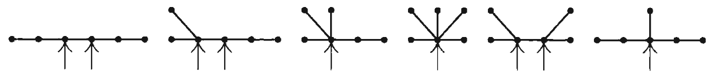
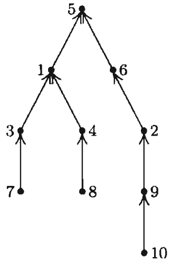
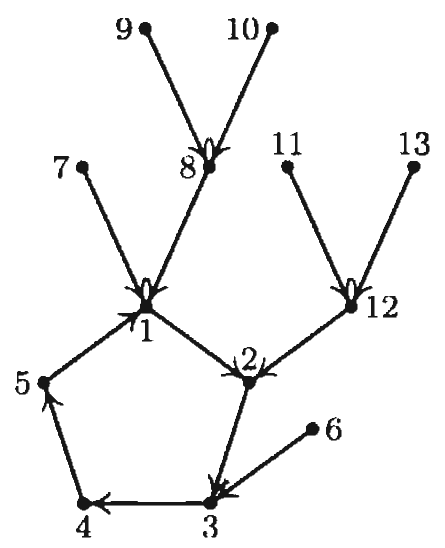
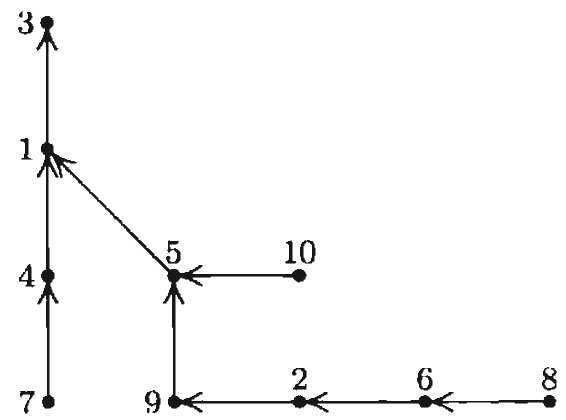
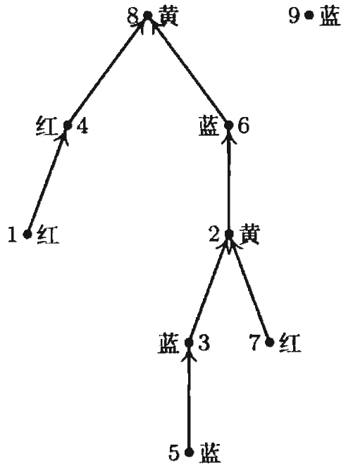

# 2.3.4.4 节

[习题](../sec-2-3-4-4.md#ex-2-3-4-4-1)

$$
1.\quad\ln A(z)=\ln z+\sum_{k\ge1}a_k\ln\!\left(\frac1{1-z^k}\right)=\ln z+\sum_{k,t\ge1}\frac{a_k z^{kt}}{t}=\ln z+\sum_{t\ge1}\frac{A(z^t)}{t}.
$$

2\. [习题](../sec-2-3-4-4.md#ex-2-3-4-4-2)  微分, 令 $\tilde { z } ^ { n }$ 的系数相等, 得到等式

$$
n a _ { n + 1 } = \sum _ { k \geq 1 } \sum _ { d \setminus k } d a _ { d } a _ { n + 1 - k } .
$$

现在, 交换求和次序.

4\. [习题](../sec-2-3-4-4.md#ex-2-3-4-4-4)  (a) A(z) 至少对 $|z| < \frac{1}{4}$ 肯定收敛, 因为 $a _ { n }$ 小于有序树的个数 $b _ { n - 1 } ,$. 由于 $\bar{A}(1)$ 是无限的, 并且所有的系数为正, 因此存在正数 $\bar { \alpha } \leq 1$ 使得 $A(z)$ 对于任意 $| z | < \alpha$ 收敛, 并且在 $z = \alpha$ 上是奇异的. 令 $\psi(z) = A(z)/z$ 由于 $\psi ( z ) > e ^ { z \psi ( z ) }$, ψ(z) = m 蕴涵 $z < \ln m / m$, 因此 $\psi ( z )$ 是有界的, $\operatorname { l i m } _ { z \to \alpha - } \psi ( z )$ 存在. 于是, $\alpha < 1$, 由阿贝尔极限定理, $a = \alpha \cdot \exp(a + \frac{1}{2}A(\alpha^2) + \frac{1}{3}A(\alpha^3) + \cdots)$

(b) 对于 $|z|<\sqrt\alpha,\quad A(z^2),\ A(z^3);$ ... 都是解析的, 并且 $\frac{1}{2}A(z^{2}) + \frac{1}{3}A(z^{3}) + \cdots$ 在一个稍小的半径内是一致收敛的.

(c) 如果 $\partial F / \partial w = a - 1 \neq 0$, 则隐函数定理蕴涵, 存在 $( \alpha , a / \alpha )$ 邻域内的解析函数 $f(z)$, 使得 $F(z,f(z)) = 0.$ 但是, 这又蕴涵 $f(z) = A(z) / z$, 与 A(z) 在α上奇异矛盾.

(d) 显然.

(e) $\partial F / \partial w = A ( z ) - 1$ 并且 $|A(z)| < A(\alpha) = 1$, 因为 A(z) 的系数均为正. 因此, 与 (c) 中一样, A(z) 在所有这种点上都是正则的.

(f) 邻近 $( \alpha , 1 / \alpha )$, 成立等式 $0 = \beta ( z - \alpha ) + ( \alpha / 2 ) ( w - 1 / \alpha ) ^ { 2 } +$ 高阶项, 其中 $w = A ( z ) / z .$ 因此, 根据隐函数定理, w 是 $\sqrt{z - \alpha}$ 的解析函数, 因而, 存在一个区域 $| z | < \alpha_{1}$ 减去一个割 $[\alpha,\alpha_1],\quad A(z)$ 在其中具有所述形式. (选择减号是因为加号最终使系数为负.)

(g) 具有所述形式的任何函数的系数都渐近为 $\frac{\sqrt{2\beta}}{\alpha^n}\binom{1/2}{n}$. 注意

$$
{ \binom { 3 / 2 } { n } } = O \left( \frac { 1 } { n } { \binom { 1 / 2 } { n } } \right) .
$$

关于详细分析和自由树个数的渐近值, 见奥特, Ann.Math. (2)49(1948), 583-599.

5\. [习题](../sec-2-3-4-4.md#ex-2-3-4-4-5) 

$$
c _ { n } = \sum _ { j _ { 1 } + 2 j _ { 2 } + \dots = n } \binom { c _ { 1 } + j _ { 1 } - 1 } { j _ { 1 } } \dots \binom { c _ { n } + j _ { n } - 1 } { j _ { n } } - c _ { n } , \quad n > 1 .
$$

因此

$$
2 C ( z ) + 1 - z = ( 1 - z ) ^ { - c _ { 1 } } ( 1 - z ^ { 2 } ) ^ { - c _ { 2 } } ( 1 - z ^ { 3 } ) ^ { - c _ { 3 } } \ldots = \operatorname { e x p } \bigl ( C ( z ) + \frac { 1 } { 2 } C ( z ^ { 2 } ) + \cdots ) .
$$

于是, $C(z)=z+z^2+2z^3+5z^4+12z^5+33z^6+90z^7+261z^8+766z^9+\cdots,\quad\text{当}$ $n > 1$ 时, 具有 n 条 边的串并联网络的数目为 $2 c _ { n }$ [见珀西·麦克马洪, Proc. LondonMath. Soc. 22(1891), 330–339].

[习题](../sec-2-3-4-4.md#ex-2-3-4-4-6)

$6 . z G ( z ) ^ { 2 } = 2 G ( z ) - 2 - z G ( z ^ { 2 } ) ; G ( z ) = 1 + z + z ^ { 2 } + 2 z ^ { 3 } + 3 z ^ { 4 } + 6 z ^ { 5 } + 1 1 z ^ { 6 } + 2 3 z ^ { 7 } + 4 6 z ^ { 8 } + 9 8 z ^ { 9 } + \cdots .$

函数 $F(z) = 1 - zG(z)$ 满足较简单的关系 $F(z^{2}) = 2z + F(z)^{2}$. [约瑟夫·韦德伯恩, Annals ofMath. (2) 24 (1922), 121–140. ]

[习题](../sec-2-3-4-4.md#ex-2-3-4-4-7)

$g _ { n } = c a ^ { n } n ^ { - 3 / 2 } ( 1 + O ( 1 / n ) )$, 其中 $c \approx 0$ 0.7916031835775, a≈2.483253536173.

8\. [习题](../sec-2-3-4-4.md#ex-2-3-4-4-8) 

9\. [习题](../sec-2-3-4-4.md#ex-2-3-4-4-9) 如果有两个形心, 则考虑从一个到另一个的路径, 我们发现不可能有中间点, 因此两个形心是相邻的.  
一棵树不可能包含三个相互相邻的顶点, 因此最多有两个形心.

10\. [习题](../sec-2-3-4-4.md#ex-2-3-4-4-10) 如果 X 和 Y 相邻, 则令 $s ( X , Y )$ 为 X 的 Y 子树的顶点数. 于是 $s(X,Y)+s(Y,X)=n.$ 正文中的论证表明, 如果 Y 是形心, 则 $\operatorname { w e i g h t } ( \underline { { X } } ) = \underline { { s } } ( X , Y )$. 因此, 如果 X 和 Y 都是形心, 则 $\operatorname { w e i g h t } ( X ) =$ weight $(Y) = n / 2.$

使用这种记号, 正文中的论证还表明, 如果 $s ( X , Y ) \geq s ( Y , X )$, 则 X 的 Y 子树中有一个形心. 因此, 如果两棵具有 m 个顶点的自由树用 X 和 Y 之间的一条边连接, 则形成一棵自由树, 其中 $s ( X , Y ) = m = s ( Y , X )$, 这棵树一定有两个形心 (即 X 和 Y).

[一个很好的程序设计练习是, 在 $\mathcal { O } ( n )$ 步内对于所有相邻的 X 和 Y 计算 s(X,Y). 由此, 我们可以快速找出形心. 第一种高效的形心定位算法见艾伦·古德曼, Transportation Sci.5(1971), 212-221.]11. [习题](../sec-2-3-4-4.md#ex-2-3-4-4-11)  $zT(z)^t=T(z)-1$, 因此 $z + T(z)^{-t} = T(z)^{1-t}.$ 由 1.2.9-(21), $\textstyle T ( z ) = \sum _ { n } A _ { n } ( 1 , - t ) z ^ { n }$, 因此 t 叉树的个数为

$$
{ \binom { 1 + t n } { n } } { \frac { 1 } { 1 + t n } } = { \binom { t n } { n } } { \frac { 1 } { ( t - 1 ) n + 1 } } .
$$

12\. [习题](../sec-2-3-4-4.md#ex-2-3-4-4-12)  考虑一类有向图: 对于所有的 $i \neq j$, 它有一条从 $V _ { i }$ 到 $V _ { j }$ 的弧. 习题 2.3.4.2-19 的矩阵 $A_{0}$ 是一个组合的 $( n - 1 ) \times ( n - 1 )$ 矩阵, 对角线元素为 n-1, 非对角线元素为-1. 因此, 它的行列式为

$$
( n + ( n - 1 ) ( - 1 ) ) n ^ { n - 2 } = n ^ { n - 2 } ,
$$

是具有给定根的定向树的个数. (也可以利用习题 2.3.4.2-20.)

13\. [习题](../sec-2-3-4-4.md#ex-2-3-4-4-13) 

14\. [习题](../sec-2-3-4-4.md#ex-2-3-4-4-14) 真, 因为直到所有其他分支都删除后, 根才变成树叶.

15\. [习题](../sec-2-3-4-4.md#ex-2-3-4-4-15)  在标准表示中, $\quad V _ { {  } 1 } {  } , {  } V _ { {  } 2 } {  } , {  } \ldots {  } , {  } V _ { {  } n {  } - {  } 1 } {  } , {  } f {  } ( {  } V _ { {  } n {  } - {  } 1 } {  } )$ 是被视为有向图的定向树的拓扑序, 但是算法 2.2.3T 一般不会输出这个序. 可以修改算法 2.2.3T, 使得它确定 $V _ { 1 } , \: V _ { 2 } , \: \ldots , \: V _ { n - 1 }$ 的值. 做法是把步骤 T6 中的 “插入队列” 操作改为一个修改链的过程, 使得列表中的项从队头到队尾以升序出现, 于是队列变成了优先队列.

(然而, 为确定标准表示, 并不需要使用一般的优先队列, 只需要从 1 到 n 扫描顶点, 寻找树叶, 同时从小于已扫描的指针的新树叶处剪掉路径, 见下一题.)

16\. [习题](../sec-2-3-4-4.md#ex-2-3-4-4-16)  D1. 置 C[1] $\leftarrow\cdots\leftarrow\mathtt C[n]\leftarrow0$, 然后对于 $1 \leq j < n$, 置 $\mathbb { C } \left[ f ( V _ { j } ) \right] \leftarrow \mathbb { C } \left[ f ( V _ { j } ) \right] + 1 .$ (顶点 k 是树叶, 当且仅当 $\mathbb{C}[k] = 0.$ 置 $k\leftarrow0,\quad j\leftarrow1.$

D2.k 增值一次或多次, 直到 C[k]=0, 然后置 $l \leftarrow k .$

D3. 置 $\mathtt { P A R E N T } \left[ l \right] \leftarrow f ( V _ { j } ) , \quad l \leftarrow f ( V _ { j } ) , \quad \mathtt { C } \left[ l \right] \leftarrow \mathtt { C } \left[ l \right] - 1 , \quad j \leftarrow j + 1 .$

D4. 如果 $j =n$, 则置 PARENT [l] ← 0, 终止本算法.

D5. 如果 C[l]= 0, 并且 $l < k$, 则转到 D3; 否则转回 D2.

17\. [习题](../sec-2-3-4-4.md#ex-2-3-4-4-17)  一定恰有一条回路 $x _ { 1 } , \; x _ { 2 } , \; \ldots , \; x _ { k }$, 其中 $f(x_{j}) = x_{j + 1}$ 并且 $f ( x _ { k } ) = x _ { 1 }$. 我们将枚举所有这样的 $f ;$ 它具有长度为 k 的回路, 每个 $x$ 的迭代最终都进入这个回路. 像正文中那样定义标准表示 $f(V_{1})$, $\quad f {  } ( {  } V _ { {  } 2 } {  } ) {  } , {  } \ldots {  } , {  } f {  } ( {  } V {  } _ { {  } m {  } - {  } k } {  } )$. 由于 $f(V_{m - k})$ 在该回路中, 因此我们写下该回路的其余部分 $f ( f ( V _ { m - k } ) )$, $f(f(f(V_{m-k})))$, 等等, 也能得到 “标准表示”. 例如, 当 $\overline { { m } } = 1 3$ 时, 根据如图所示的函数, 可写出表示 3,1,8,8,1,12,12,2,3,4,5,1. 我们得到 m-1 个数的序列, 其中后 k 个数互不相同. 反之, 由任意一个这样的序列, 可以逆转这一构造 (假定 $k$ 已知). 因此, 恰有 $m ^ { \underline { { k } } } m ^ { m - k - 1 }$ 个具有一条长度为 k 的回路的函数. (相关结果参见习题 3.1-14. 公式 $m^{m - 1}Q(m)$ 首先由莱奥·卡茨得到, 见 Annals of Math. Statistics 26 (1955), 512-517.)

18\. [习题](../sec-2-3-4-4.md#ex-2-3-4-4-18)  为了由序列 $s _ { 1 } , \; s _ { 2 } , \; \ldots , \; s _ { n - 1 }$ 构造树, 首先以 $s_{1}$ 为根, 然后相继把指向 $s _ { 1 } , \; s _ { 2 } , \; . \;$. 的弧附加到树上. 如果顶点 $s_{k}$ 已经在前面出现, 则指向 $\mathcal { S } k - 1$ 的弧的起始顶点不命名, 否则给这个顶点以名称 $S_{k}$ 当所有 n-1 条弧都已经加上之后, 以递增序使用还未出现的数, 按照顶点的创建次序, 对仍然没有名字的所有顶点命名.

例如, 由 3,1,4,1,5,9,2,6,5, 我们可以构造如图所示的树. 这种方法与正文中的方法之间没有简单的联系. 也存在其他表示方法, 参见埃里克·内维尔的论文 [Proc. Cambridge Phil. Soc. 49(1953), 381-385].

19\. [习题](../sec-2-3-4-4.md#ex-2-3-4-4-19) 标准表示恰有 n-k 个不同值, 因此可以用这一性质枚举 $n - 1$ 个数的序列. 答案是 $n^{\underline{n-k}}\genfrac{\{}{\}}{0pt}{}{n-1}{n-k}$

20\. [习题](../sec-2-3-4-4.md#ex-2-3-4-4-20) 考虑这种树的标准表示. 我们是问 $( x _ { 1 } + \cdots + x _ { n } ) ^ { n - 1 }$ 有多少项具有 $k _ { 0 }$ 个指数 0, $k _ { 1 }$ 个指数 1, 等等. 答案显然是这样的项的系数乘以这样的项的项数, 即

$$
\frac{(n - 1)!}{(0!)^{k_0}(1!)^{k_1} \cdots (n!)^{k_n}} \times \frac{n!}{k_0! k_1! \cdots k_n!}
$$

21\. [习题](../sec-2-3-4-4.md#ex-2-3-4-4-21)  具有 2m 个顶点的此类树一个也没有. 如果有 $\tilde { n } = 2 m + 1$ 个顶点, 则令 $k_{0}=m+1,\ k_{2}=m$, 从习题 20 得到答案, 即 ${ 2 m + 1 \choose m } ( 2 m ) ! / 2 ^ { m }$

22\. [习题](../sec-2-3-4-4.md#ex-2-3-4-4-22)  恰为 $n ^ { n - 2 }$, 因为如果 X 是一个特定顶点, 则自由树与以 X 为根的定向树一一对应.

23\. [习题](../sec-2-3-4-4.md#ex-2-3-4-4-23) 可以用 n! 种方法对每一棵无标号的有序树加标号, 得到的每棵带标号的有序树都互不相同. 因此, 总数为 $n !   b_{n-1} = (2n-2)! / (n-1)!$ 1.

24\. [习题](../sec-2-3-4-4.md#ex-2-3-4-4-24) 以任一给定顶点为根的有标号有序树的个数都一样多, 因此, 一般情况下的答案为 $1 / n$ 乘以习题 23 的结果, 在本题具体情况下, 答案是 30.

25\. [习题](../sec-2-3-4-4.md#ex-2-3-4-4-25)  对于 $0 \leq q < n,   r(n,q) = (n - q)n^{q - 1}.$ (特殊情况 $s =1$ 见式 (24).)

26\. [习题](../sec-2-3-4-4.md#ex-2-3-4-4-26)  (k=7)

27\. [习题](../sec-2-3-4-4.md#ex-2-3-4-4-27)  给定 $\{ \vec { 1 } , \vec { 2 } , \ldots , \vec { r } \}$ 到 $\{ 1 , \widehat { 2 } , \ldots , q \}$ 的函数 $g _ { i }$, 使得增加从 $V_{k}$ 到 $U_{g(k)}$ 的弧不引入定向回路, 构造一个序列 $a _ { 1 } , \: . . . , \: a _ { r }$ 如下: 我们称顶点 $V_{k}$ 是 “自由的”, 如果对于任意 $j \neq k$, 不存在从 $V_{j}$ 到 $V _ { k }$ 的定向路径. 由于不存在定向回路, 因此至少存在一个自由顶点. 令 $b _ { 1 }$ 是使得 $V_{b_{1}}$ 是自由顶点的最小整数, 并假定 $b _ { 1 } , \ldots , b _ { t }$ 已经选定. 令 $b_{t+1}$ 是不同于 $b _ { 1 } , \; \dots , \; b _ { t }$ 的最小整数, 使得在删除了从 $V_{b_{k}}$ 到 $U_{g(b_k)}$ 的弧 $(1\le k\le t)$ 后得到的图中 $V_{b_{t+1}}$ 是自由的. 这一规则定义了整数 $\{ 1 , \hat { 2 } , \ldots , r \}$ 的一个排列 $b _ { 1 } b _ { 2 } \ldots b _ { r }$. 对于 $1 \leq k \leq r$, 令 $a _ { k } \equiv g ( b _ { k } )$. 这定义了一个序列, 使得对于 $1 \leq k < r , \enspace 1 \leq a _ { k } \leq q$, 并且 $1 \leq a _ { r } \leq p .$

反之, 如果给定这样的序列 $a _ { 1 } , \; . . . , \; a _ { r }$, 则称 $V _ { k }$ 是 “自由的”, 如果不存在 $j$ 使得 $a _ { j } > p$ 并且 $f ( a _ { j } ) = k .$ 由于 $a _ { r } \leq p$, 因此最多有 $r - 1$ 个非自由的顶点. 设 $b _ { 1 }$ 是使得 $V_{b_{1}}$ 是自由顶点的最小整数; 若 $b _ { 1 } , \: \ldots , \: b _ { t }$ 已经选定, 令 $b_{t+1}$ 是不同于 $b _ { 1 } , \: \ldots , \: b _ { t }$ 的最小整数, 使得 $V _ { b _ { t + 1 } }$ 关于序列 $a _ { t + 1 } , \: \ldots , \: a _ { r }$ 是自由的. 这一规则定义了整数 $\{ 1 , \bar { 2 } , \ldots , r \}$ 的一个排列 $b _ { 1 } b _ { 2 } \ldots b _ { r } .$ 对于 $1 \leq k \leq r$, 令 $g ( b _ { k } ) = a _ { k } .$ 这定义了一个函数, 使得增加从 $V_{k}$ 到 $U _ { g ( k ) }$ 的弧不会引人定向回路.

28\. [习题](../sec-2-3-4-4.md#ex-2-3-4-4-28)  令 $f$ 是从 $\{ 2 , \ldots , m \}$ 到 $\{ 1 , 2 , \ldots , n \}$ 的 $n ^ { m - 1 }$ 个函数中的任意一个, 考虑具有顶点 $\begin{aligned} { U _ { 1 } { , } { \ldots , } U _ { m } { , } V _ { 1 } , } \\ \end{aligned}$ 7$\cdots , V _ { n }$ 和从 $U_{k}$ 到 $V_{f(k)}\ (1<k\le m)$ 的弧的有向图. 以 $p = 1, q = m, r = n$, 使用习题 27, 证明存在 $m^{\widetilde{n}-1}$ 种方法进一步增加从诸 V 到诸 U 的弧, 得到以 $U_{1}$ 为根的定向树. 由于所求的自由树的集合与以 $U_{1}$ 为根的定向树的集合之间存在一一对应, 因此答案是 $n ^ { m - 1 } m ^ { n - 1 }$. 这一构造可以广泛地推广, 参见高德纳, Canadian J.Math.20(1968), 1077-1086.]

29\. [习题](../sec-2-3-4-4.md#ex-2-3-4-4-29)  如果 $y = x ^ { t }$, 则 $( t z ) y = \ln y$, 只要对 $t=1$ 证明该等式就足够了. 如果 $z\bar{x} = \ln \bar{x}$, 则由习题 25 可知, 对于非负整数 $m,\quad x^m=\sum_k E_k(m,1)z^k$. 因此

$$
\begin{align*}x^{r} = e^{zxr} = \sum_{k} \frac{(zxr)^{k}}{k!} &= \sum_{j,k} \frac{r^{k}z^{k+j}E_{j}(k,1)}{k!} = \sum_{k} \frac{z^{k}}{k!} \sum_{j} \binom{k}{j} j!E_{j}(k-j,1)r^{k-j} \\&= \sum_{k} \frac{z^{k}}{k!} \sum_{j} \binom{k-1}{j}k^{j}r^{k-j} = \sum_{k} z^{k}E_{k}(r,1).\end{align*}
$$

[习题 4.7-22 推导出了更加一般的结果.]

30\. [习题](../sec-2-3-4-4.md#ex-2-3-4-4-30)  所描述的每个图都定义了一个集合 $C_x\subseteq\{1,\ldots,n\}$, $j$ 在 $C_x$ 中当且仅当对于某个 $i\le x$, 存在一条从 $t_j$ 到 $r_i$ 的路径. 对于给定的 $C_x$, 所描述的每个图都由两个独立的部分组成: 一部分是顶点 $r_i,s_{jk},t_j$($i\le x,\ j\in C_x$) 上 $x(x+\epsilon_1z_1+\cdots+\epsilon_nz_n)^{\epsilon_1+\cdots+\epsilon_n-1}$ 个图中的一个, 其中 $\epsilon_j=[j\in C_x]$, 另一部分是其他顶点上的 $y(y+(1-\epsilon_1)z_1+\cdots+(1-\epsilon_n)z_n)^{(1-\epsilon_1)+\cdots+(1-\epsilon_n)-1}$ 个图中的一个.

31\. [习题](../sec-2-3-4-4.md#ex-2-3-4-4-31)  $G(z)=z+G(z)^2+G(z)^3+G(z)^4+\cdots=z+G(z)^2/(1-G(z))$. 因此, $G(z)=\tfrac14(1+z-\sqrt{1-6z+z^2})=z+z^2+3z^3+11z^4+45z^5+\cdots$. [注记: 与该问题等价的另一个问题由厄恩斯特·施罗德提出并解决, 见 Zeitschrift für Mathematik undPhysik15(1870), 361-376. 他确定了在一个凸 $(n + 1)$ 边形中插入不重叠的对角线的方法数. 对于 $n > 1$, 该数仅为习题 2.2.1-11 得到的值的一半, 因为普拉特允许相关联顶点分析树的根结点为 1 度. 该近似值的计算结果见习题 2.2.1-12. 说来奇怪, 似乎在公元前 2 世纪, 喜帕恰斯就已经计算了值 $\left[ z ^ { 1 0 } \right] \tilde { G } ( z ) = 1 0 3 0 4 9$, 把它作为 “可以仅由 10 个简单命题表述的肯定复合命题” 的数目, 参见理查德·斯坦利, AMM104(1997), 344-350; 法比奥·阿切尔比, Archive for History of Exact Sciences 57 (2003), 465-502. 1

32\. [习题](../sec-2-3-4-4.md#ex-2-3-4-4-32)  如果 $n _ { 0 } \neq 1 + n _ { 2 } + 2 n _ { 3 } + 3 n _ { 4 } + \cdots$, 则为 0 (见习题 2.3-21); 否则为

$$
( n _ { 0 } + n _ { 1 } + \dots + n _ { m } - 1 ) ! / n _ { 0 } ! \: n _ { 1 } ! \dots n _ { m } ! .
$$

为了证明这一结果, 回想具有 $\hat { n } = n _ { 0 } + n _ { 1 } + \cdots + n _ { m }$ 个结点的无标号的树, 如何用后序下结点的度数序列 $d _ { 1 } \: d _ { 2 } \ldots d _ { n }$ 刻画 (2.3.3 节). 此外, 这样一个度数序列对应于一棵树, 当且仅当对于 $0 < k \leq n$ $\textstyle \sum _ { j = 1 } ^ { k } ( 1 - d _ { j } ) > 0 .$ (波兰后缀表示法 (postfixnotation) 的这一重要性质容易用归纳法证明, 见算法 2.3.3F, 其中 $f$ 是创建树的函数, 类似于 2.3.2 节的 TREE 函数.) 特别要求 $d _ { 1 }$ 必须为 0. 因此, 本题的答案是, j 出现 $n _ { j }$ 次 $( j > 0 )$ 的序列 $d _ { 2 } \ldots d _ { n }$ 的个数, 即多项式系数

$$
\left( \begin{matrix} { n - \hat { 1 } } \\ { n _ { 0 } - 1 , \: n _ { 1 } , \ldots , n _ { m } } \\ \end{matrix} \right) ,
$$

减去满足如下条件的序列 $d _ { 2 } \ldots d _ { n }$ 的个数: 对于某个 $k\ge2,\quad\sum_{j=2}^k(1-d_j)<0.$

要排除的序列可以枚举如下: 令 $t$ 为使得 $\textstyle \sum _ { j = 2 } ^ { t } ( 1 - d _ { j } ) < 0$ 的最小整数, 于是, $\sum_{j=2}^t(1-d_j)=-s$ 其中 $1 \leq s < d _ { t }$, 可以构造子序列 $d'_2\ldots d'_n=d_{t-1}\ldots d_2 0 d_{t+1}\ldots d_n$, 其中对于 $j=d_t$, j 出现 $n _ { j }$ 次, 对于 $j \neq d _ { t } , j$ 出现 $\bar { n } _ { j } - 1$ 次. 因此, 当 $k = \overline { { n } }$ 时 $\textstyle \sum _ { j = 2 } ^ { k } ( 1 - d _ { j } ^ { \prime } )$ 等于 $d _ { t }$, 而当 $k = t$ 时它等于 $d _ { t } - s ;$ 当 $k < t$ 时, 它是

$$
\sum _ { 2 \leq j < t } ( 1 - d _ { j } ) - \sum _ { 2 \leq j \leq t - k } ( 1 - d _ { j } ) \leq \sum _ { 2 \leq j < t } ( 1 - d _ { j } ) = d _ { t } - s - 1 .
$$

由此, 给定 $s$ 和任意序列 $d _ { 2 } ^ { \prime } \ldots d _ { n } ^ { \prime }$, 则该构造是可逆的. 因此, 具有给定 $d _ { t }$ 和 $s$ 值的序列 $d _ { 2 } \ldots d _ { n }$ 的个数是多项式系数

$$
\binom { n - 1 } { n _ { 0 } , \ldots , n _ { d _ { t } } - 1 , \ldots , n _ { m } } .
$$

对所有可能的 $d _ { t }$ 和 $s$ 值求和, 得到序列 $d _ { 2 } \ldots d _ { n }$ 的个数:

$$
\sum_{j=0}^{m}(1-j)\binom{n-1}{n_0,\ldots,n_j-1,\ldots,n_m}=\frac{(n-1)!}{n_0!\,n_1!\cdots n_m!}\sum_{j=0}^{m}(1-j)n_j,
$$

其中, 后一个和为 1.

更简单的证明由雷尼给出 [ Transactions of theAmerican Math. Society 94(1960), 441-451]. 如果 $d_1d_2\ldots d_n$ 是任意序列, 其中 $j$ 出现 $n _ { j }$ 次, 则恰有一个对应于树的循环重排 $d _ { k } \ldots d _ { n } d _ { 1 } \ldots d _ { k - 1 }$, 此时 k 是使 $\textstyle \sum _ { j = 1 } ^ { k - 1 } ( 1 - d _ { j } )$ 最小的最大值. [在二叉树情况下, 这一论证显然首先由查尔斯·皮尔士发现, 写在一 篇未发表的手稿中, 见 New Elements of Mathematics 4(The Hague: Mouton, 1976), 303-304. 在 t 叉 树的情况下, 则由阿列耶夫. 德瓦列茨基和费得罗. 莫茨金发现, 见 DukeMath.J.14(1947), 305-313.]

伯格曼还给出了另一种证明, 如果 $d _ { k } > 0$, 则归纳地用 $( d _ { k } + d _ { k + 1 } - 1 )$ 替换 $d_{k}d_{k + 1}  [A] \mathrm{gebera}$ Universalis 8 (1978), 129-130 ].

上面的方法可以推广, 证明只要满足条件 $n _ { 0 } = f + n _ { 2 } + 2 n _ { 3 } + \cdots$, 则具有 f 棵树和 $n _ { j }$ 个 j 度结点的 (有序的、无标号的) 森林数为 $(n-1)!f/(n_0!\,n_1!\cdots n_m!).$

33\. [习题](../sec-2-3-4-4.md#ex-2-3-4-4-33)  考虑具有 $n_{1}$ 个标号为 1 的结点, $n_{2}$ 个标号为 2 的结点, $\cdots$ 并使得标号为 $j$ 的每个结点为 $e _ { j }$ 度的树的个数. 令该数为 $c ( n _ { 1 } , n _ { 2 } , \dots )$, 而所说明的度数 $e _ { 1 } , e _ { 2 } , \ldots .$ 看作固定的. 生成函数 $G ( z _ { 1 } , z _ { 2 } , \ldots ) = \sum c ( n _ { 1 } , n _ { 2 } , \ldots ) z _ { 1 } ^ { n _ { 1 } } z _ { 2 } ^ { n _ { 2 } } \ldots$. 满足等式 $G = z _ { 1 } G ^ { e _ { 1 } } + \cdots + z _ { r } G ^ { e _ { r } }$ 因为 $z _ { j } G ^ { e _ { j } }$ 枚举根结点标号为 $j$ 的树. 根据上一题的结果,

$$
c(n_1,n_2,\ldots)=\begin{cases}\dfrac{(n_1+n_2+\cdots-1)!}{n_1!\,n_2!\cdots},&\text{如果 }(1-e_1)n_1+(1-e_2)n_2+\cdots=1;\\0,&\text{其他.}\end{cases}
$$

更一般地, 由于 $G^{f}$ 枚举具有这种标号的有序森林的个数, 因此对于整数 $f > 0$, 有

$$
w ^ { f } = \sum _ { f = ( 1 - e _ { 1 } ) n _ { 1 } + ( 1 - e _ { 2 } ) n _ { 2 } + \cdots } \frac { ( n _ { 1 } + n _ { 2 } + \cdots - 1 ) ! f } { n _ { 1 } ! n _ { 2 } ! \cdots } \: z _ { 1 } ^ { n _ { 1 } } z _ { 2 } ^ { n _ { 2 } } \ldots .
$$

当 $r = \infty$ 时, 上述公式有意义, 并且本质上等价于拉格朗日反演公式.
