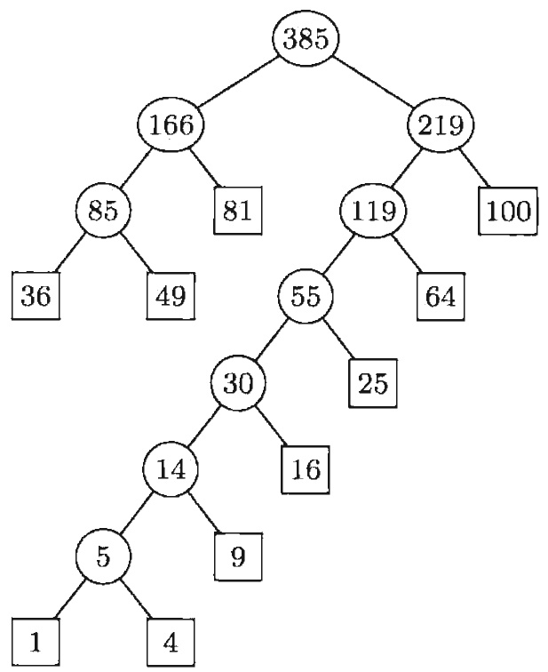
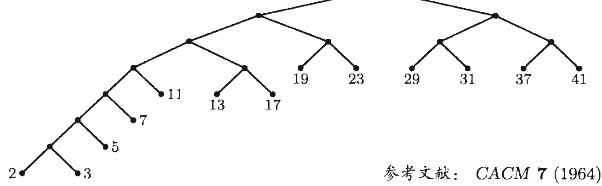
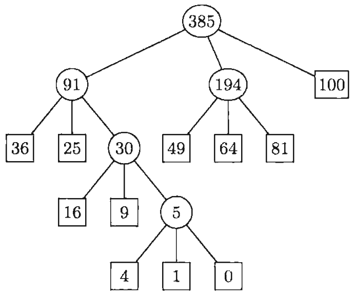

# 2.3.4.5 节

1\. [习题](../sec-2-3-4-5.md#ex-2-3-4-5-1)  总共有 () 棵, 因为编号为 8,9,10,11,12 的结点可以附在 4,5,6,7 之下的 8 个位置的任何一个.

2\. [习题](../sec-2-3-4-5.md#ex-2-3-4-5-2) 

3\. [习题](../sec-2-3-4-5.md#ex-2-3-4-5-3)  对 m 归纳可证, 该条件是必要的. 反之, 如果 $\textstyle \sum _ { j = 1 } ^ { m } 2 ^ { - l _ { j } } = 1$, 则我们想构造一棵具有路径长度 $l _ { 1 } , \ldots ,$ $l _ { m }$ 的扩展的二叉树. 当 $m = 1$ 时, $l_{1} = 0$, 构造是平凡的. 否则, 可以假定诸 l 是有序的, 对于某个满足 $1 \leq q \leq m$ 的 $q , l _ { 1 } = l _ { 2 } = \cdots = l _ { q } > l _ { q + 1 } \geq l _ { q + 2 } \geq \cdots \geq l _ { m } > 0 .$ 由于 $2^{l_{1}-1}=\sum_{j=1}^{m}2^{l_{1}-l_{j}-1}=\frac{1}{2}q+$ 整数, 因此 $q$ 为偶数. 对 m 作归纳, 存在一棵具有路径长度 $l _ { 1 } - 1 , \: l _ { 3 } , \: l _ { 4 } , \ldots , \: l _ { m }$ 的树. 取这棵树, 用一个其子女在 $l _ { 1 } = l _ { 2 }$ 层的内部结点取代第 $l_{1} - 1$ 层的一个外部结点.

4\. [习题](../sec-2-3-4-5.md#ex-2-3-4-5-4)  首先, 用哈夫曼方法找一棵树. 如果 $\tilde { w } _ { j } < \tilde { w } _ { j + 1 }$, 则 $l _ { j } \geq l _ { j + 1 }$, 因为这棵树是最优的. 利用习题 3 答案中的构造, 得到另一棵树, 它具有相同的诸路径长度, 权重序列也符合题目要求. 例如, 树 (11) 变成

5\. [习题](../sec-2-3-4-5.md#ex-2-3-4-5-5)  (a) $b_{np}=\sum_{\substack{k+l=n-1\\r+s+n-1=p}}b_{kr}b_{ls},$ 因此 $zB(w,wz)^2=B(w,z)-1.$

(b) 关于 w 求偏导数:

$$
2 z B ( w , w z ) \big ( B _ { w } ( w , w z ) + z B _ { z } ( w , w z ) \big ) = B _ { w } ( w , z ) .
$$

因此, 如果 $H ( z ) = B _ { w } ( 1 , z ) = \textstyle \sum _ { n } h _ { n } z ^ { n }$, 则求得 $H(z) = 2zB(z)(H(z) + zB'(z))$. B(z) 的公式蕴涵

$$
H(z) = \frac{1}{1 - 4z} - \frac{1}{z} \left( \frac{1 - z}{\sqrt{1 - 4z}} - 1 \right), \qquad  所以  \qquad h_n = 4^n - \frac{3n + 1}{n + 1} \binom{2n}{n}.
$$

平均值为 $h_n/b_n.\quad\text{(c)}$ 近似值为 $n \sqrt{\pi n} = 3n + O(\sqrt{n}).$

关于类似问题的解, 见约翰·赖尔登, IBMJ.Res.andDevel.4(1960), 473-478; 阿尔弗雷德·雷尼和乔治·塞凯赖什, J.AustralianMath.Soc. 7(1967), 497-507; 赖尔登和尼尔·斯洛恩, J.AustralianMath. Soc. 10(1969), 278-282; 以及习题 2.3.1-11.

6\. [习题](../sec-2-3-4-5.md#ex-2-3-4-5-6)  $n + s - 1 = t n .$

7\. [习题](../sec-2-3-4-5.md#ex-2-3-4-5-7)  $E = ( t - 1 ) I + t n .$

8\. [习题](../sec-2-3-4-5.md#ex-2-3-4-5-8)  分部求和, 得到 $\sum_{k=1}^{n}\left\lfloor\log_t((t-1)k)\right\rfloor=nq-\sum$ k, 右端和式的求和范围是使得 $0 \leq k \leq n$ 并且对  
于某个 j 有 $(t - 1)k + 1 = t^{j}$ 的所有 k, 后一部分可以写  
成 $\sum_{j=1}^{q}(t^j-1)/(t-1).$

9\. [习题](../sec-2-3-4-5.md#ex-2-3-4-5-9)  对树的大小归纳.

10\. [习题](../sec-2-3-4-5.md#ex-2-3-4-5-10) 如果必要的话, 通过增加一些 0 权重, 我们可以假定 $m\bmod(t-1)=1$. 为了得到具有极小加权路径长度的 t 叉树, 可以在每一步组合 t 个最小的值, 并且用它们的和替换它们. 证明基本上与二叉树情况相同. 所求的三叉树如图所示.

黄光明 [ SIAM J. Appl. Math. 37 (1979), 124–127 ] 指出, 对于具有任意确定度数多重集的极小加权路径长度树, 类似的过程有效: 在每一步组合 t 个最小的权重, 其中 $t$ 尽可能小.

11\. [习题](../sec-2-3-4-5.md#ex-2-3-4-5-11) “杜威” 记数法的记号是结点数的二进制表示.

12\. [习题](../sec-2-3-4-5.md#ex-2-3-4-5-12) 根据习题 9, 以随机结点为根的子树的平均大小是内部路径长度除以 n, 再加上 1. (这一结果对一般的树和二叉树都成立.)

13\. [习题](../sec-2-3-4-5.md#ex-2-3-4-5-13)  [见扬·莱文, Proc. 3rd International Colloq. Automata, Languages and Programming (Edinburgh University Press, 1976), 382–410. ]

H1.[初始化.] 对于 $1 \leq i \leq m$, 置 $A [ m - 1 + i ] \leftarrow w _ { i } .$ 然后, 置 $A[2m] \leftarrow \infty, x \leftarrow m,$ $i\leftarrow m+1,\quad j\leftarrow m-1,\quad k\leftarrow m,$ (在这个算法运行期间, $A [ i ] \leq \cdots \leq A [ 2 m - 1 ]$ 是未使用的外部权重的队列; $A [ k ] \geq \dots \geq A [ j ]$ 是未使用的内部权重的队列, 如果 $j<k$ 则为空; 当前的左右指针为 x 和 y.)

H2.[找右指针.] 如果 $j < k$ 或 $A[i]\le A[j]$, 则置 $y \leftarrow i,\ i \leftarrow i + 1$; 否则置 $y \leftarrow j , ~ j \leftarrow j - 1 .$

H3, [创建内部结点.] 置 k ← k−1,L[k]←x,R[k]← y, $A [ k ] \leftarrow A [ x ] + A [ y ] .$

H4, [完成?] 如果 $k=1$, 则终止算法.

H5.[找左指针, \](此时, $j \geq k$, 队列总共包含 k 个未使用的权重. 如果 $A[y] < 0$, 则 $j = k$, $i = y + 1$, 并且 $A[i]>A[j].\;)$ 如果 $A[i] \leq A[j]$, 则置 $x \leftarrow i, \; i \leftarrow i + 1$; 否则置 $x\leftarrow i,\quad i\leftarrow i+1$, j ← j -1. 返回步骤 H2.

14\. [习题](../sec-2-3-4-5.md#ex-2-3-4-5-14)  对于 k = m − 1 的证明稍作改变. [见 SIAM J. Appl. Math. 21 (1971), 518. ]

15\. [习题](../sec-2-3-4-5.md#ex-2-3-4-5-15)  在式 (9) 中, 分别使用组合权重函数 (a) $\underline { { 1 } } + \operatorname* { m a x } ( w _ { 1 } , w _ { 2 } )$ 和 (b) $x w _ { 1 } + x w _ { 2 }$, 而不是 $w_1+w_2.\quad[\,\text{(a)}$ 基于马丁·戈隆比克, IEEETrans.C-25(1976), 1164-1167; (b) 基于胡德强、丹尼尔·克莱特曼和玉置惠子, SIAMJ.App1.Math.37(1979), 246-256. 哈夫曼问题是 x→1 时 (b) 的极限情况, 因为 $\begin{array} { r } { \sum ( 1 + \epsilon ) ^ { l _ { j } } w _ { j } = \sum w _ { j } + \epsilon \sum w _ { j } l _ { j } + O ( \epsilon ^ { 2 } ) . } \end{array}$ 1

道格拉斯·帕克指出, 当 $0 < x < 1$ 时, 如果像 (b) 一样, 每步组合两个最大的权重, 一种类哈夫曼算法也能找出极小的 $w _ { 1 } 2 ^ { - l _ { 1 } } + \cdots + w _ { m } 2 ^ { - l _ { m } }$. 特别是当 $w _ { 1 } x ^ { l _ { 1 } } + \cdots + w _ { m } x ^ { l _ { m } }$ 时, $w _ { 1 } / 2 + \cdots + w _ { m - 1 } / 2 ^ { m - 1 } + w _ { m } / 2 ^ { m - 1 }$ 的极小值为 $w _ { 1 } \leq \cdots \leq w _ { m }$. 关于进一步推广, 见高德纳, J.Comb. Theory A32 (1982), 216-224.

16\. [习题](../sec-2-3-4-5.md#ex-2-3-4-5-16)  令 $l_{m+1}=l_{m+1}^{\prime}=0$ 于是

$$
\sum _ { j = 1 } ^ { m } w _ { j } l _ { j } \leq \sum _ { j = 1 } ^ { m } w _ { j } l _ { j } ^ { \prime } = \sum _ { k = 1 } ^ { m } ( l _ { k } ^ { \prime } - l _ { k + 1 } ^ { \prime } ) \sum _ { j = 1 } ^ { k } w _ { j } \leq \sum _ { k = 1 } ^ { m } ( l _ { k } ^ { \prime } - l _ { k + 1 } ^ { \prime } ) \sum _ { j = 1 } ^ { k } w _ { j } ^ { \prime } = \sum _ { j = 1 } ^ { m } w _ { j } ^ { \prime } l _ { j } ^ { \prime } \; ,
$$

因为像习题 4 中一样, $l _ { j } ^ { \prime } \geq l _ { j + 1 } ^ { \prime }$. 同样的证明对于许多其他类型的最优树也成立, 例如习题 10.

17\. [习题](../sec-2-3-4-5.md#ex-2-3-4-5-17) (a) 这是习题 14. (b) 我们可以把 $f(n)$ 扩充成凹函数 $f(x)$, 使得所述不等式成立. F(m) 是极小的 $\textstyle \sum _ { j = 1 } ^ { m - 1 } f ( s _ { j } )$, 其中 $s _ { j }$ 是以 1,1,...,1 为权重的扩展的二叉树的内部结点权重. 哈夫曼算法在此情况下构造具有 m-1 个内部结点的完全二叉树, 产生最优树. 取值 $k = 2 ^ { \lceil \operatorname { l g } ( n / 3 ) \rceil }$ 定义具有相同内部权重的二叉树, 因此对于每个 n, 它产生递推式中的最小值. [SIAMJ.Appl.Math.31(1976), 368-378.] 可以在O(log n) 步内计算 $F(n)$, 见习题 5.2.3-20 和 5.2.3-21. 如果 $f(n)$ 是凸的而不是凹的, 使得 $\Delta ^ { 2 } f ( n ) \geq 0$ 则当 $k = \lfloor n/2 \rfloor$ 时得到递推式的解.
