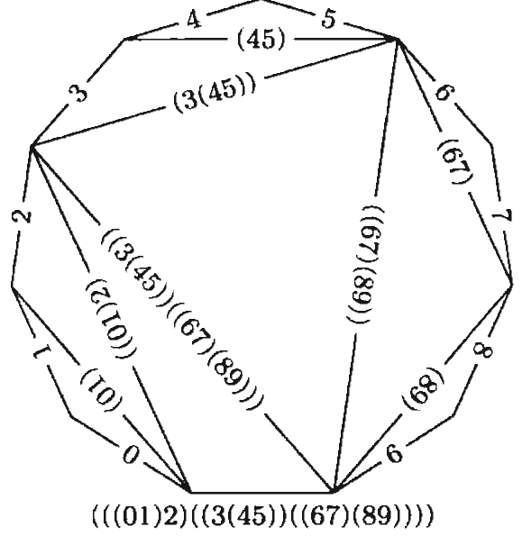
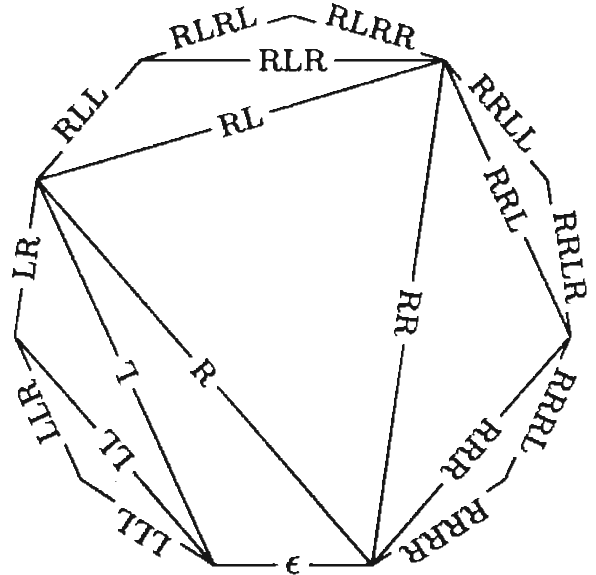
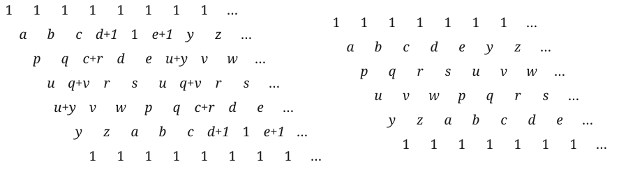

#### 2.3.4.6 节

1\. [习题](../sec-2-3-4-6.md#ex-2-3-4-6-1) 选择多边形的一条边, 并称它为基. 给定一个三角剖分, 令基上的三角形对应于一棵二叉树的根, 并定义该三角形的其他两边为左右子多边形的基, 它们以同样的方式对应于左右子树. 递归地进行, 直至得到 “两边形”, 它对应于空二叉树.

下面用另一种方法陈述这一对应关系. 用整数 0,...,n 标记被三角剖分的多边形的非基边. 当一个三角形的两条相邻边以顺时针被标记为 $\alpha$ 和 $\beta$ 时, 可以标记第三边为 $(\alpha\beta)$. 于是, 基的标记刻画二叉树和三角剖分. 例如

对应于 2.3.1-(1) 中的二叉树. [见亨利·福德, Mathematical Gazette 45(1961), 199-201.]

2\. [习题](../sec-2-3-4-6.md#ex-2-3-4-6-2) (a) 像习题 1 中那样, 取基边. 如果该基边属于被切分的 r 边形中的 $(d + 1)$ 边形, 那么给它 d 条边作为后代, 这 d 条边则是诸子树的基. 这定义了科克曼问题与具有 r-1 个树叶、k+1 个非树叶、没有 1 度结点的所有有序树之间的对应关系. (当 $k = r - 3$ 时, 得到习题 1 的情况.)

(b) 存在 $\binom{r+k}{k+1}\binom{r-3}{k}$ 个非负整数序列 $d _ { 1 } d _ { 2 } \ldots d _ { r + k }$ 使得 r-1 个 $d _ { j }$ 等于 0, 所有 $d _ { j }$ 均不等于 1, 并且其和为 $r + k - 1 ,$ 循环排列 $d _ { 1 } d _ { 2 } \ldots d _ { r + k } , d _ { 2 } \ldots d _ { r + k } d _ { 1 } , \ldots , d _ { r + k } d _ { 1 } \ldots d _ { r + k - 1 }$ 中, 恰有一个满足附加的条件: 对于 $1 \leq q \leq r + k, \quad \sum_{j = 1}^{q}(1 - d_{j}) > 0.$

[科克曼对他的猜想给出了证据, 见 Philos.Trans.147(1857), 217-272§22. 凯利给出了证明, 但未注意到它与树的联系, 见 Proc.London Math. Soc. 22(1891), 237–262.]

3\. [习题](../sec-2-3-4-6.md#ex-2-3-4-6-3)  (a) 令顶点为 $\{ 1 , 2 , \ldots , n \}$. 如果 $i$ 和 $j$ 是相同部分的相继元素, 并且 $i < j$, 则从 i 到 j 画一个 RLINK; 如果 $j + 1$ 是所在部分的最小者, 则从 $j$ 到 j+1 画一个 LLINK. 于是, 存在 k-1 个非空 LLINK 和 $n - k$ 个非空 RLINK, 得到一棵二叉树, 其结点在先序下为 12...n. 使用 2.3.2 节的自然对应关系, 这一规则定义了 “把 n 边形的顶点划分成 k 个不相交部分” 与 “具有 n 个顶点和 $n - k + 1$ 个树叶的森林” 之间的一一对应关系. 交换 LLINK 和 RLINK, 也给出 “具有 n 个顶点和 k 个树叶的森林”.

(b) 具有 n 个顶点和 k 个树叶的森林也对应于包含 n 个左括号、n 个右括号和 k 个 $\text{“}()\text{”}$ 的嵌套括号序列. 我们可以如下枚举这样的序列.

一个 0 和 1 的串称作 $(m,n,k)$ 串, 如果其中出现 $m$ 个 0, $n$ 个 1 和 $k$ 个 “01”. 于是, `0010101001110` 是一个 $(7,6,4)$ 串. $(m,n,k)$ 串的个数为 $\binom{m}{k}\binom{n}{k}$, 因为我们可以自由地选择哪些 0 和哪些 1 形成 01 对.

令 $S(\alpha)$ 为 $\alpha$ 中 0 的个数减去 1 的个数. 如果只要 $\alpha$ 是 $\sigma$ 的前缀就有 $S(\alpha)\ge0$ (换言之, $\sigma=\alpha\beta$ 蕴涵 $S(\alpha)\ge0$), 则称串 $\sigma$ 是好的; 否则, $\sigma$ 是坏的. 下面的方案与习题 2.2.1-4 的 “反射原理” 不同, 也能建立坏的 (n,n, k) 串与任意 $(n - 1, n + 1, k)$ 串之间的一一对应关系:

任何坏的 $( n , n , k )$ 串 $\sigma$ 都可以唯一写成 $\sigma = \alpha 0 \beta$ 的形式, 其中 $\overline{\alpha}^{R}$ 和 $\beta$ 是好的. (这里, $\overline{\alpha}^{R}$ 是翻转 $\alpha$ 并对各位取补得到的串.) 于是, $\sigma ^ { \prime } = \alpha 1 \bar { \beta }$ 是一个 $(n - 1, n + 1, k)$ 串. 反之, 每个 $(n - 1, n + 1, k)$ 二串都可以唯一地写成 $\alpha 1 \beta$ 的形式, 其中 $\overline{\alpha}^{R}$ 和 $\beta$ 是好的, 于是 $\alpha 0 \beta$ 是一个坏的 $( \bar { n } , \bar { n } , ]$ k) 串.

因此, 具有 n 个顶点和 k 个树叶的森林数为 $\textstyle { \binom { n } { k } \binom { n } { k } - \binom { n - 1 } { k } \binom { n + 1 } { k } = \binom { n - 1 } { k - 1 } \binom { n } { k } - \binom { n - 1 } { k } \binom { n } { k - 1 } = }$ $n ! \left( n - 1 \right) ! / ( n - k + 1 ) ! \left( n - k \right) !$ k! (k - 1)!, 又称那罗延数. [那罗延, Comptes Rendus Acad.Sci. 240(Paris, 1955), 1188–1189. ]

注记: 杰尔曼·克雷韦拉斯 [DiscreteMath.1(1972), 333-350] 用另一种方法枚举了不交叉的划分. 改进划分的偏序, 可得到森林的有趣偏序, 与习题 2.3.3-19 中讨论的偏序不同, 见伊夫·波帕尔, Cahiersdu Bureau Univ. de Recherche Opérationnelle 16 (1971), 第 8 章; Discrete Math. 2 (1972), 279-288; 保罗·埃德尔曼, DiscreteMath.31(1980), 171-180,40(1982), 171-179; 德肖维茨和什穆埃尔·扎克斯, Discrete Math. 64 (1986), 215-218.

定义森林的自然格序还有第三种方法, 由斯坦利 [FibonacciQuarterly13(1975), 215-232] 提出: 假设像上面一样, 用表示左右括号的 0 和 1 的串 $\sigma$ 表示森林, 于是 $\sigma \leq \sigma ^ { \prime }$, 当且仅当对于所有的 k 都有 $S(\sigma_{k}) \leq S(\sigma_{k}')$, 其中 $\sigma _ { k }$ 表示 $\sigma$ 的前 k 位. 与前两种方法不同, 斯坦利的格是分配格.

4\. [习题](../sec-2-3-4-6.md#ex-2-3-4-6-4)  令 $m = n + 2$; 由习题 1, 我们想求出三角剖分 m 边形和 $( m - 1 )$ 行饰带之间的对应关系. 首先, 对三角剖分的边使用 “自顶向下” 标记, 而不是习题 1 的 “自底向上” 标记, 更仔细地观察之前发现的对应关系: 对基赋予一个空标号∈, 然后递归地对基标记为 $\alpha$ 的三角形的对边赋予标记 $\alpha L$ 和 $\bar { \alpha } R .$ 例如, 在新的约定下, 前面的图变成

如果这个例子中的基边称作 10, 而其他边与以前一样是 0 到 9, 则可以写 $0 = 1 0 L L L , 1 = 1 0 L L R$ $2 = 10LR, 3 = 10RL$, 等等. 任何其他边也都可以选为基, 如果选定 0 为基, 则有 $1 = 0L, 2 = 0RL$ $3 = 0 R R L L L$, 等等. 不难验证, 如果 $u = v \alpha$, 则 $v = u \alpha ^ { T }$, 其中 $\alpha ^ { T }$ 是从右向左读α并把 L 与 R 互换得到的. 例如, $10=0RRR=1LRR=2LR=3RRL$, 等等. 如果 $u$、v 和 $w$ 是多边形的边, 满足 $w = u \alpha L \gamma$ 和 $w = v \beta R \gamma$, 则 $u = v \beta L \alpha ^ { T }$ $v = u \alpha R \hat { \beta } ^ { T }$

给定各边编号为 $0 , \: 1 , \ldots , \: m - 1$ 的多边形的一个三角剖分, 对任意一对不同的边 u 和 $\underline { { v } } ,$ 定义 $( u , v )$ 如下: 令 $u = v \alpha$, 又令 $L=\begin{pmatrix}1&1\\0&1\end{pmatrix}$, $R=\begin{pmatrix}1&0\\1&1\end{pmatrix}$ 把 $\alpha$ 解释为 $2 \times 2$ 矩阵, 于是 $(u,v)$ 定义为 $\alpha$ 的左上角元素. 注意 $R=L^T,\ \alpha^T$ 是矩阵 $\alpha$ 的转置, 因此 $( v , u ) = ( u , v )$. 另外注意, $(u,v) \equiv 1$, 当且仅当 $u _ { - }$ 和 $v _ { - }$ 被三角剖分的一条边连接, 其中 $u _ { - }$ 表示边 u 和 u−1 之间的顶点.

对于多边形的所有边 u, 令 $(u,u)=0$. 现在, 我们可以证明 $v = u \alpha$ 蕴涵

$$
\alpha=\begin{pmatrix}(u,v)&(u,v+1)\\(u+1,v)&(u+1,v+1)\end{pmatrix}\qquad\text{对于所有 }u\ne v,\qquad \text{(*)}
$$

其中 u+1 和 v+1 是 u 和 v 顺时针方向的后继. 证明方法是对 m 归纳: 当 $m = 2$ 时, (\*) 式是显然的, 因为两条平行的边 u 和 v 被 $u = v \epsilon$ 相关联, 而 $\alpha = \epsilon$ 是单位矩阵. 如果在某条边 v 上增加三角形 $\bar { v } \: v ^ { \prime } \: v ^ { \prime \prime }$, 可扩展三角剖分, 则 $v = u \alpha$ 蕴涵 $v ^ { \prime } = \bar { u } \bar { \alpha } \tilde { L }$ 和 $v ^ { \prime \prime } = u \alpha R$, 因此扩展后的多边形中的 $( u , v ^ { \prime } )$ 和 $( u , v ^ { \prime \prime } )$ 分别等于原多边形中的 $( u , v )$ 和 $(u,v)+(u,v+1)$. 由此推出,

$$
\alpha L = \begin{pmatrix} (u, v') & (u, v'') \\ (u + 1, v') & (u + 1, v'') \end{pmatrix} \qquad  和  \qquad \alpha R = \begin{pmatrix} (u, v'') & (u, v'' + 1) \\ (u + 1, v'') & (u + 1, v'' + 1) \end{pmatrix} ,
$$

并且在扩展后的多边形中, 式 (\*) 仍然成立.

对应于给定三角剖分的饰带模式, 定义为周期序列

(0,1) (1,2) (2,3) .. (m−1,0) (0,1) (1,2) (0,2) (1,3) (2,4) ... (m−1,1) (0,2) (1,3)   
(m−1,2) (0,3) (1,4) ... (m−2,1)(m−1,2) (0,3) (m−1,3) (0,4) (1,5) ... (m−2,2)(m−1,3) (0,4)

如此下去, 直到 m-1 行被定义. 当 $m > 3$ 时, 最后一行首项为 $\left( \lceil m / 2 \rceil + 1 , \lceil m / 2 \rceil \right)$. 条件 (\*) 证明这个模式是饰带, 即

$$
( u , v ) ( u + 1 , v + 1 ) - ( u , v + 1 ) ( u + 1 , v ) = 1 ,
$$

因为 det $L=\det R=1$ 蕴涵 detα =1. 由本题的三角剖分, 得到饰带

|  |  |  |  |  |  |  |  |  |  |  |  |  |  |  |  |  |  |  |  |  |  |
| --- | --- | --- | --- | --- | --- | --- | --- | --- | --- | --- | --- | --- | --- | --- | --- | --- | --- | --- | --- | --- | --- |
|  |  |  |  | 1 | 1 | 1 | 1 | 1 |  |  | 1 |  |  | 1 |  | I | 1 | 1 |  |  |  |
|  | 1 2 4 |  | 2 |  | 5 |  |  |  |  |  |  |  | 2 |  | 2 | 1 |  | 1 |  | 3 1 4 |  |
| 2 1 7 7 1 |  |  |  |  |  |  | 2 | 2 |  | 3 11 | 2 |  |  |  |  |  |  | 4 | 2 | 2 3 | . |
|  |  |  | 1 3 12 3 3 |  | 3 |  |  |  |  |  | 7 |  | 3 |  | 12 3 | 3 | 3 |  |  | 7 1 5 8 |  |
| 3 2 5 5 |  |  |  | 8 |  | 5 | 3 | 2 | 13 | 5 |  |  | 5 |  |  |  |  | 5 | 3 | 2 13 | 3. |
|  | 5 3 | 2 | 13 | 5 |  |  |  | 5 |  |  | 3 | 2 5 | 3 | 5 |  | 2 | 3 |  | 5 |  |  |
| 3 7 1 |  |  | 5 8 |  | 3 | 2 |  |  |  |  |  |  |  |  | 2 13 5 |  |  | 2 |  | 55 8 |  |
|  | 4 2 2 |  | 3 11 2 |  |  |  | 3 |  | 12 3 |  | 3 |  |  |  | 8 |  |  |  |  | 3 12 3 |  |
|  |  |  |  |  |  |  |  |  |  |  |  |  |  |  | 3 11 2 |  |  |  | 1 7 7 1 |  |  |
| 5 1 3 | 1 1 1 |  | 1 | 4 | 1 | 1 | 2 | 4 | 2 | 1 | 5 | 1 1 | 3 |  |  | 3 |  | 2 |  | 4 2 1 1 | ... |

关系 $(u,v)=1$ 定义三角剖分的边, 因此不同的三角剖分产生不同的饰带. 为了完成一一对应关系的证明, 我们必须证明, 每一个 (m—1) 行的正整数的饰带模式都可以用这种方法从某个三角剖分得到.

给定任意 m—1 行的饰带, 在上部增加新的第 0 行, 在下部增加新的第 $m$ 行, 它们都全部由 0 组成. 称第 0 行的元素为 (0,0), (1,1), (2,2), 等等, 并对于所有非负整数 $\underline { { u } } < \underline { { v } } \leq \underline { { u } } + m$, 令 $( u , v )$ 为 $( u , u )$ 东南对角线与 (v,v) 西南对角线交点处的元素. 根据假定, 条件 (\*\*) 对于所有 $u < v < u + m$ 成立. 事实上, 我们可以把 (\*\*) 扩充为更加一般的关系

$$
(t,u)(v,w)+(t,w)(u,v)=(t,v)(u,w)\qquad\text{对于 }t\le u\le v\le w\le t+m.
\qquad \text{(***)}
$$

因为, 如果 (\*\*\*) 为假, 则令 $( \hat { t } , \hat { u } , \hat { v } , \hat { w } )$ 为具有最小 $( \bar { w } - t ) m + \bar { u } - \bar { t } + \bar { w } - \bar { v }$ 值的反例. 情况 $1 \colon t + 1 \; < \tilde { u } .$ 于是, 对于 $( t , \tilde { t } + 1 , v , w )  、 ( t , \tilde { t } + 1 , u , v )$ 和 $(t+1,u,v,w)$, 式 (\*\*\*) 成立, 因此 $\quad ( {  } ( {  } t {  } , {  } u {  } ) {  } ( {  } v {  } , {  } w {  } ) {  } + {  } ( {  } t {  } , {  } w {  } ) {  } ( {  } u {  } , {  } v {  } ) {  } ) {  } ( {  } t {  } + {  } 1 {  } , {  } v {  } ) {  } = {  } ( {  } t {  } , {  } v {  } ) {  } ( {  } u {  } , {  } w {  } ) {  } ( {  } t {  } + {  } 1 {  } , {  } v {  } )$, 而这蕴涵 $(t + 1, v) = 0$, 矛盾. 情况 2: $\tilde { v } + 1 < \tilde { w } .$ 于是, 对于 $(t,u,w-1,w),\quad(u,v,w-1,w)$ 和 $( t , u , v , w - 1 )$, 式 (\*\*\*) 成立, 同理可得 $(u,w-1)=0$, 矛盾. 情况 $3:\quad u=t+1,\quad w=v+1$. 在这种情况下, 式 (\*\*\*) 归结成式 (\*\*).

在式 (\*\*\*) 中令 $u=t+1,\quad w=t+m$, 则得到对于 $\underline { { t } } \leq \underline { { v } } \leq \underline { { t } } + \underline { { m } }$, 有 $(t,v)=(v,t+m)$ 因为 $(t + 1, t + m) = 1$ 并且 $(t,t+m)=0$. 由此得出结论, 任何 (m-1) 行的饰带都是周期的: $(u,v)=(v,u+m)=(u+m,v+m)=(v+m,u+2m)=\cdots.$

每个正整数的饰带模式的第 2 行都包含一个 1. 因为如果在 (\*\*\*) 式中令 $t = 0,\ v = u + 1,\ w = u + 2$, 则得到 $( 0 , u + 1 ) ( u , u + 2 ) = ( 0 , u ) + ( 0 , u + 2 )$. 因此, $( 0 , u + 2 ) - ( 0 , u + 1 ) \geq ( 0 , u + 1 ) - ( 0 , u )$, 当且仅当 $( u , u + 2 ) \geq 2 .$ 这不可能对区间 $0 \leq u \leq m - 2$ 中的所有 u 都成立, 因为 (0,1)-(0,0)=1, 并且 $(0,m)-(0,m-1)=-1$

最后, 如果 $m > 3$, 则第 2 行不可能有两个连续的 1, 因为 $(u,u+2)=(u+1,u+3)=1$ 蕴涵 $(u,u+3)=0$. 因此, 我们可以把该饰带归约为具有 (m1) 行的另一个饰带, 如下所示把 7 行归约为 6 行:

根据归纳法, 归约后的饰带对应于一个三角剖分, 而未归约的饰带对应于再附加一个三角形的三角剖分. [Math. Gazette 57 (1974), 87-94,175-183; 康威和盖伊, The Book of Numbers (NewYork:Copernicus, 1996), 74–76, 96–97, 101–102. ]

注记: 这个证明展示, 只要 $( t , u , v , w )$ 是多边形在顺时针序下的边, 利用 2×2 矩阵在任意三角剖分上定义的函数 (u,v) 就满足式 (\*\*\*). 我们可以把每个 (u,v) 表示成数 $a_j=(j-1,j+1)$ 的多项式, 它们除了各项的符号外, 基本上与 4.5.3 节讨论的 “连续音”(continuant) 相同. 事实上, $( j , k ) = i ^ { 1 - k + j } K _ { k - j - 1 } ( i a _ { j + 1 } , i a _ { j + 2 } , \ldots , i a _ { k - 1 } )$. 因此, (\*\*\*) 等价于习题 4.5.3-32 答案中关于连续音的欧拉恒等式. 矩阵 L 和 R 具有一个有趣的性质: 行列式为 1 的任意负整数的 2×2 矩阵都可以唯一地表示成若干个 L 和若干个 R 的乘积.

此外, 还有一些有趣的联系. 例如, 在整数饰带对应的剖分多边形中, 每个顶点所在的三角形个数之和就是饰带第 2 行中的相应数. 在基本区域 $0 \leq u < v - 1 < m - 1, \quad ( u , v ) \neq ( 0 , m - 1 )$ 中, $(u,v)=1$ 出现的总次数是剖分的对角线 (弦) 的个数, 即 m—3=n—1. 2 的总数也是 n-1, 因为 $(u,v) \equiv 2$ 当且仅当 u_和 v_是与一根弦邻近的两个三角形的相对顶点.

(u,v) 的另一种解释由杜安·布罗林、唐纳德·克罗和欧文·艾萨克斯发现 [GeometriæDedicata3(1974), 171-176]: u 和 v—1 这两条边之间有 v-u-1 个顶点, 与这些顶点邻接的不同三角形和这些顶点匹配的方法数就是 (u,v).
