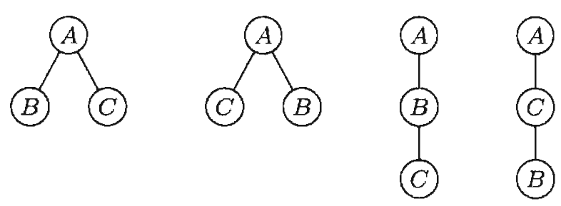
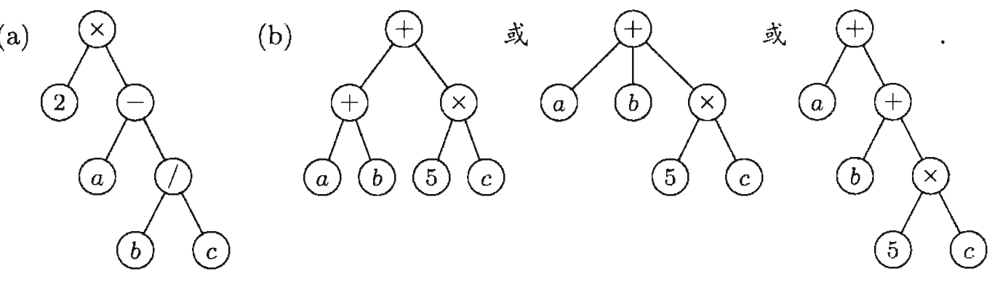
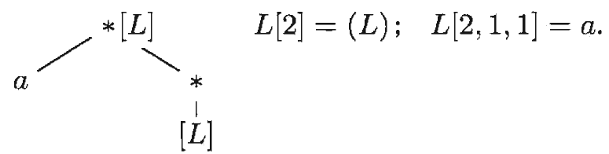
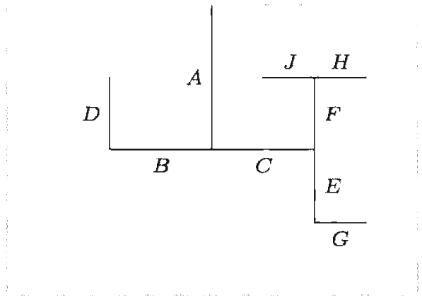
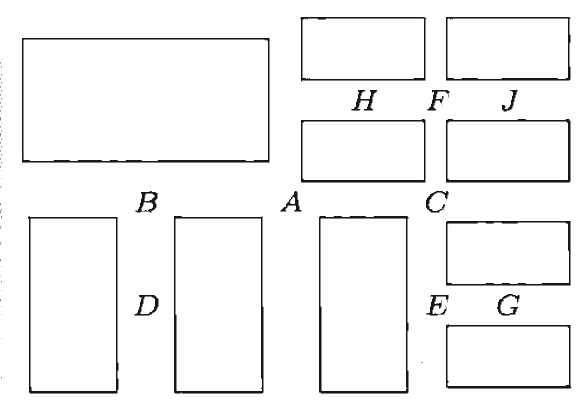

# 2.3 节

1\. [习题](../sec-2-3.md#ex-2-3-1)  有三种方法选择根. 一旦选定根, 比如说选定 A, 有三种方法把其他结点划分到子树中: {B}, {C};{C}, {B}; $\{ B , C \}$. 在最后一种情况下, 有两种方法把 $\{ B , C \}$ 放到树中, 取决于哪个是根. 因此, 当 A 是根时, 我们得到所示的 4 棵树, 而总共有 12 棵树. 对于任意结点数 n, 该问题在习题 2.3.4.4-23 中解决.

2\. [习题](../sec-2-3.md#ex-2-3-2)  在习题 1 的答案中, 作为定向树, 前两棵树是相同的, 因此在这种情况下, 我们只得到 9 种可能性. 关于一般解, 见 2.3.4.4 节, 那里证明了公式 $n ^ { n - 1 }$

3\. [习题](../sec-2-3.md#ex-2-3-3) 第一部分: 证明至少有一个这样的序列. 设树有 n 个结点. 当 $n=1$ 时结果是显然的, 因为 X 必然是树根. 如果 $n > 1$, 则定义蕴涵存在一个根 $X_{1}$ 和子树 $T _ { 1 } , T _ { 2 } , \ldots , T _ { m }$, 或者 $X \equiv X_{1}$, 或者 X 是唯一的 $T _ { j }$ 的一个成员, 在后一种情况, 根据归纳假设, 有一条路径 $X _ { 2 } , \ldots , X$, 其中 $X_{2}$ 是 $T _ { j }$ 的根, 又由于 $X_{1}$ 是 $X_{2}$ 的父母, 因此有一条路径 $X _ { 1 } , X _ { 2 } , \ldots , X _ { \cdot }$

第二部分: 证明最多有一个这样的序列. 我们将归纳地证明: 如果 X 不是根, 则 X 有唯一的父母 (于是 $X_{k}$ 确定 $X _ { k - 1 } , X _ { k - 1 }$ 确定 $X_{k - 2}$, 等等). 如果树有一个结点, 则无需证明; 否则, X 在唯一的 $T _ { j }$ 中. 或者 X 是 $T_{j}$ 的根, 此时根据定义, X 有唯一父母; 或者 X 不是 $T_{j}$ 的根, 此时根据归纳假设, X 在 $T_{j}$ 中有唯一父母, 并且 $T _ { j }$ 之外的结点都不可能是 X 的父母.

4\. [习题](../sec-2-3.md#ex-2-3-4)  真 (很遗憾).

5\. [习题](../sec-2-3.md#ex-2-3-5)  4.

6\. [习题](../sec-2-3.md#ex-2-3-6)  令 $\operatorname{parent}^{[0]}(X)$ 表示 $X$, 并令 $\operatorname{parent}^{[k+1]}(X)=\operatorname{parent}(\operatorname{parent}^{[k]}(X))$, 使得 $\operatorname{parent}^{[1]}(X)$ 是 $X$ 的父母, $\operatorname{parent}^{[2]}(X)$ 是 $X$ 的祖父母; 当 $k\ge2$ 时, $\operatorname{parent}^{[k]}(X)$ 是 $X$ 的 “(曾)$^{k-2}$ 祖父母”. 所要求的堂亲关系条件为 $\operatorname{parent}^{[m+1]}(X)=\operatorname{parent}^{[m+n+1]}(Y)$, 但是 $\operatorname{parent}^{[m]}(X)\ne\operatorname{parent}^{[m+n]}(Y)$. 当 $n>0$ 时, 两人的关系不是关于 $X$ 和 $Y$ 对称的, 尽管人们在日常生活中常常说成 “相差 $n$ 辈的第 $m$ 代堂表亲”, 把它看作对称的.

7\. [习题](../sec-2-3.md#ex-2-3-7)  使用习题 6 中定义的 (非对称) 条件, 再约定如果 $j$ 或 $k$ (或二者) 为 $-1$, 则 $\operatorname{parent}^{[j]}(X)\ne\operatorname{parent}^{[k]}(Y)$. 为了证明这一关系总是对于唯一的 $m$ 和 $n$ 成立, 考虑 $X$ 和 $Y$ 的杜威记数法记号, 即 $1.a_1.\cdots.a_p.b_1.\cdots.b_q$ 和 $1.a_1.\cdots.a_p.c_1.\cdots.c_r$, 其中 $p\ge0$, $q\ge0$, $r\ge0$, 并且 (如果 $qr\ne0$) 有 $b_1\ne c_1$. 任意一对结点的杜威数都可以写成这种形式, 而显然我们必须取 $m=q-1$, $m+n=r-1$.
8\. [习题](../sec-2-3.md#ex-2-3-8) 二叉树实际上都不是树. 尽管非空二叉树的图形看上去像树, 但是两个概念完全不同.

9\. [习题](../sec-2-3.md#ex-2-3-9)  A 是根, 因为我们约定把根放在顶部.

10\. [习题](../sec-2-3.md#ex-2-3-10) 任何嵌套集的有限集族都对应于一个正文中定义的森林: 设 $A _ { 1 } , \ldots , A _ { n }$ 是该集族中不被其他集合包含的嵌套集. 对于固定的 j, 包含在 $A _ { j }$ 中的所有集合的子集族是嵌套的, 因此, 我们可以假定这个子集族对应于一棵以 $A_{j}$ 为根的 (无序的) 树.

11\. [习题](../sec-2-3.md#ex-2-3-11) 在嵌套集族 C 中, 如果存在某个 $Z \in \mathcal { C }$ 使得 $X \cup Y \subseteq Z$, 则令 $X \equiv Y .$ 这个关系显然是自反的和对称的, 并且它事实上是等价的, 因为 $W \equiv X$ 和 $X \equiv Y$ 蕴涵 C 中存在 $Z _ { 1 }$ 和 $Z_{2}$, 使得 $W \subseteq Z _ { 1 } , X \subseteq Z _ { 1 } \cap Z _ { 2 } , Y \subseteq Z _ { 2 } .$ 由于 $Z _ { 1 } \cap Z _ { 2 } \neq \emptyset$, 因此或者 $Z _ { 1 } \subseteq Z _ { 2 }$, 或者 $Z _ { 2 } \subseteq Z _ { 1 }$, 从而推出 $W \cup Y \subseteq Z _ { 1 } \cup Z _ { 2 } \in \mathcal { C } .$ 既然 C 是嵌套的集族, 我们按以下规则定义一个对应于 C 的定向森林: X 是 Y 的一个先辈, Y 是 X 的一个后代 (真正的先辈或后代), 当且仅当 $X X \supset Y .$ C 中的每个等价类对应于一棵定向树, 即一个对于所有 X 和 Y 满足 XY 的定向森林. (这样就推广了对有限集给出的树和森林的定义.) 使用这些术语, 可以定义 X 的层为 ancestors(X) 的基数, X 的度为嵌套集合 descendants(X) 中的等价类的基数. 如果 X 是 Y 的先辈之一, 并且不存在 Z 使得 $X \supset Z \supset Y$, 则称 X 是 Y 的父母, 而 Y 是 X 的子女. (X 有可能会有后代而无子女, 有先辈而无父母.) 为了得到有序树和森林, 用某种特别的方法, 例如像习题 2.2.3-14 中那样把关系⊆嵌入到线性序中, 对上面提到的等价类排定顺序.

例 (a): 令 $S_{\alpha k} = \left\{ x \mid x = \right.$ 十进制形式的 $. d _ { 1 } d _ { 2 } d _ { 3 } \ldots$, 其中 $\alpha =$ 十进制形式的 $. e _ { 1 } e _ { 2 } e _ { 3 } \ldots$, 并且如果 $j \bmod 2^k \neq 0 \}$, 则 $d _ { j } = e _ { j }$. 集合 $\mathcal { C } = \left\{ S _ { \alpha k } \mid k \geq 0 , 0 < \alpha < 1 \right\}$ 是嵌套的, 它给出的树具有无限多层, 每个结点具有不可数的度.

例 (b)、(c): 在平面中定义这个集合比用实数定义更方便, 定义依据是平面与实数之间存在一一对应关系. 令 $S _ { \alpha m n } = \{ ( \alpha , y ) | m / 2 ^ { n } \leq y < ( m + 1 ) / 2 ^ { n } \}$, 并令 $T _ { \alpha } = \{ ( x , y ) \mid x \leq \alpha \}$. 容易看出集合 $\mathcal { C } = \left\{ S _ { \alpha m n } \mid 0 < \alpha < 1 , \: n \geq 0 , \: 0 \leq m < 2 ^ { n } \right\} \cup \left\{ T _ { \alpha } \mid 0 < \alpha < 1 \right\}$ 是嵌套的. $S _ { \alpha m n }$ 的子女为 $S _ { \alpha ( 2 m ) ( n + 1 ) }$ 和 $S _ { \alpha ( 2 m + 1 ) ( n + 1 ) }$, $T _ { \alpha }$ 有子女 $S_{\alpha 0 0}$ 加上子树 $\{ S _ { \beta m n } \mid \beta < \alpha \} \cup \{ T _ { \beta } \mid \beta < \alpha \}$. 因而, 每个结点为 2 度, 并且每个结点有不可数多个形如 $T _ { \alpha }$ 的先辈. 这一构造由理查德·比奇洛提出.

注意: 如果我们适当地取实数的良序, 并定义 $T _ { \underline { { \alpha } } } = \{ ( x , y ) \mid x \succ \alpha \}$, 可以稍微改进这一构造, 得到一个嵌套集, 其中每个结点具有不可数的层, 度数为 2, 并且有两个子女.

12\. [习题](../sec-2-3.md#ex-2-3-12) 我们在偏序上加上一个附加条件 (类似于 “嵌套集” 上的条件), 以确保它对应于一个森林: 如果 $\tilde { x } \preceq y$ 并且 $\bar { x } \preceq \bar { z }$, 则或者 $\bar { y } \preceq \bar { z }$ 或者 $z \preceq y .$ 换言之, 大于任意给定元素的元素是线性有序的. 为了构成树, 还要断言存在一个最大元 r, 使得对于所有的 $x,\quad x\preceq r.$ 当结点的个数有限时, 这给出了一棵如正文中定义的无序树. 其证明类似于习题 10 中关于嵌套集的证明.

13\. [习题](../sec-2-3.md#ex-2-3-13)  a1.a2. ··.ak, a1.a2..·.ak−1, ..., a1.a2, a1.

14\. [习题](../sec-2-3.md#ex-2-3-14)  由于 S 非空, 因此它包含一个元素 $1 . a _ { 1 } . \cdots . a _ { k }$, 其中 $k$ 尽可能小; 如果 $k > 0$, 则我们还取 $a _ { k }$ 在 $S$ 中尽可能小, 于是立即看出 k 一定为 0. 换言之, S 必定包含元素 1. 令 1 是根. 所有其他元素都有 $k > 0 .$, 因此可以对某个 $m \geq 0$, 把 $S$ 中的其他元素划分成集合 $S _ { j } = \{ 1 . j . a _ { 2 } . \cdots . a _ { k } \}$, $1 \leq j \leq m .$ 如果 $m \neq 0$ 并且 $S _ { m }$ 非空, 按照如上推理, 我们推断对于每个 $S _ { j }$, 1.j 在 $S _ { j }$ 中, 因此每个 $S _ { j }$ 非空. 于是容易看出, 集合 $S _ { j } ^ { \prime } = \{ 1 . a _ { 2 } . \cdots . a _ { k } \mid 1 . j . a _ { 2 } . \cdots . a _ { k }$ 在 $S _ { j }$ 中}和 S 满足相同的条件. 根据归纳假设, 每个 $S _ { j }$ 形成一棵树.

15\. [习题](../sec-2-3.md#ex-2-3-15)  设根为 1, 并设α的左子树和右子树 (如果有的话) 的根分别为α.0 和α.1. 例如, 国王 ChristianIX 出现在图 18(a) 的两个位置上, 即 1.0.0.0.0 和 1.1.0.0.1.0. 为简短起见, 我们省略小数点, 简单地写成 10000 和 110010. 注意: 这种记号是弗朗西斯·高尔顿提出的 [Natural Inheritance(Macmillan,1889), 249]. 对于家谱, 用 F 和 M 替代 0 和 1, 去掉开始处的 1, 会更好记, 例如 ChristianIX 是 Charles

的 MFFMF, 即他的母亲的父亲的父亲的母亲的父亲. 0 和 1 的约定令人感兴趣有另外的原因: 它提供了二叉树结点与二进制正整数 (即计算机内存地址) 之间的重要对应关系.

16\. [习题](../sec-2-3.md#ex-2-3-16)  (a)

[习题](../sec-2-3.md#ex-2-3-17)

$$
\mathbf { 1 7 } { \mathrm { . ~  ~ p a r e n t } } ( Z [ 1 ] ) = A   { \mathrm { ; ~  ~ p a r e n t } } ( Z [ 1 , 2 ] ) = C   { \mathrm { ; ~   p a r e n t } } ( Z [ 1 , 2 , 2 ] ) = E .
$$

18\. [习题](../sec-2-3.md#ex-2-3-18)  L[5, 1, 1] = (2). $L[3,1]$ 没有意义, 因为 $L [ 3 ]$ 是一个空表.

19\. [习题](../sec-2-3.md#ex-2-3-19) 

20\. [习题](../sec-2-3.md#ex-2-3-20) (可以直观看出, 删除 0-2 树的所有终端结点, 就得到 0-2 树与二叉树之间的对应关系, 见 2.3.4.5 节的重要结构.) 令具有一个结点的 0-2 树对应于空二叉树; 具有多于一个结点的 0-2 树由一个根 $r$ 和 0-2 树 $T_{1}$ 和 $T_{2}$ 组成, 令其对应于具有根 $r$、左子树 $T_{1}^{\prime}$ 和右子树 $T_{2}^{\prime}$ 的二叉树, 其中 $T _ { 1 }$ 和 $T_{2}$ 分别对应于 $T_{1}^{\prime}$ 和 $T_{2}^{\prime}$.

21\. [习题](../sec-2-3.md#ex-2-3-21)  $1+0\cdot n_{1}+1\cdot n_{2}+\cdots+(m-1)\cdot n_{m}$. 证明: 树中的结点数为 $n _ { 0 } + n _ { 1 } + n _ { 2 } + \cdots + n _ { m }$, 这也等于  
1+(树中的子女数 $)=1+0\cdot n_0+1\cdot n_1+2\cdot n_2+\cdots+m\cdot n_m$

22\. [习题](../sec-2-3.md#ex-2-3-22) 基本想法是递归地处理, 非空二叉树的表示定义为它的根加上它的左、右子树的折半旋转 (half-size-and-rotated) 表示. 这样, 一棵任意大的二叉树可以表示在一张纸上, 只要有倍数足够高的放大镜就行.

这种模式的许多形式都是可行的. 例如, 一种想法是在一张给定的横向放置的纸上, 用一条从中心到顶边的线段表示根, 并把左子树表示在左半张纸上顺时针旋转 $9 0 ^ { \circ }$, 把右子树表示在右半张纸上逆时针旋转 $90^\circ$. 每个结点用一条线段表示. (当这种方法用于具有 k 层、 $2^{k} - 1$ 个结点的完全二叉树时, 它产生所谓的 “H-树”, 这是完全二叉树在 VLSI 芯片上的最高效布局 [见理查德·布伦特和孔祥重, Inf.Proc.Letters 11(1980), 46-48 ]. )

另一种想法是用某种方框表示空二叉树, 并旋转非空二叉树的表示, 根据递归的深度是偶还是奇, 使得左子子树 (subsubtree) 交替位于对应的右子子树的左边或下方. 方框对应于扩展的二叉树 (见 2.3.4.5 节) 的外部结点. 这种表示与 6.5 节讨论的 2-d 树和四叉树密切相关, 当外部结点携带信息, 而内部结点不携带时, 特别合适.
