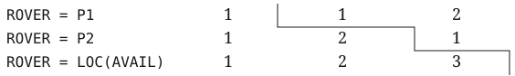

<a id="answers-2-5"></a>


#### 2.5 节

1\. <a id="ans-2-5-1"></a>[习题](../sec-2-5.md#ex-2-5-1)  在这种幸运情况下, 可以使用类似栈的操作: 令内存池区域位于 0 到 M-1, 并令 AVAIL 指向最低自由单元. 要保留 N 个字, 如果 $\mathtt { A V A I L + N \geq M }$, 则报告失败; 否则, 置 AVAIL←AVAIL+N. 要释放这 N 个字, 只需置 $\mathtt { A V A I L } \leftarrow \mathtt { A V A I L } - \mathtt { N } .$

同理, 类似循环队列的操作适用于先进先出原则.

2\. <a id="ans-2-5-2"></a>[习题](../sec-2-5.md#ex-2-5-2)  长度为 l 的项所需存储空间量为 $k \left[ l / (k - b) \right]$, 其平均值为 $kL/(k - b) + (1 - \alpha)k$, 其中α假定为 1/2, 独立于 k. 当 $k = b + \sqrt{2bL}$ 时, 该表达式取极小值 (对于 $k$ 的实数值而言). 因此, 选择 k 为刚好大于或小于该值的整数, 都使得 $kL/(k-b)+\tfrac12 k$ 取最小值. 例如, 若 $b=1$ 且 L=10, 则我们可以选择 $k \approx 1 + \sqrt{20} = 5$ 或 6, 两个都一样合适. 关于这一问题的更多细节, 参见 JACM12(1965), 53-70.

4\. <a id="ans-2-5-4"></a>[习题](../sec-2-5.md#ex-2-5-4)  rI1 ≡ Q, rI2 ≡ P.

```txt
A1 LDA NrA ← N.
ENT2 AVAILP ← LOC(AVAIL).
A2A ENT1 0,2Q←P.
A2 LD20,1(LINK)P←LINK(Q).
J2NOVERFLOW若P=Λ，则没有空间.
A3 CMPA 0,2(SIZE)
JGA2A若$\mathrm{N} > \mathrm{SIZE}(\mathrm{P})$，则跳转.
A4SUB0,2(SiZE)rA ← N — SIZE(P) ≡ K.
JANZ*+3若$K \neq 0$，则跳转.
LDX0,2(LINK)
STX0,1(LINK)LINK(Q) ← LINK(P).
STA0,2(SIZE)SIZE(P) ←K.
LD10,2(SIZE)可选的结束，
INC10,2置 rI1 ←P + K.
```

5\. <a id="ans-2-5-5"></a>[习题](../sec-2-5.md#ex-2-5-5)  很可能不合适. 刚好在单元 P 之前的不可用存储区域将接着成为可用的, 其长度将增长数量 K, 而长度增加 99 是不可忽略的.

<a id="pdf-501"></a><a id="p-484"></a>

6\. <a id="ans-2-5-6"></a>[习题](../sec-2-5.md#ex-2-5-6)  想法是每次试图在 AVAIL 表的不同部分查找. 我们可以使用一个 “游动指针”, 例如叫做 ROVER, 对它进行如下处理: 在步骤 A1 中, 置 Q←ROVER. 步骤 A4 之后, 若 LINK $( \overline { Q } ) \neq \Lambda$, 则置 ROVER ← LINK(Q); 否则, 置 ROVER←LOC(AVAIL). 在步骤 A2 中, 当算法 A 的特定执行期间第一次出现 P=Λ时, 置 $\mathtt{Q}\leftarrow \mathtt{LOC}(\mathtt{AVAIL})$ 并重复步骤 A2. 当第二次 P=Λ时, 算法失败终止. 在这种方式下, ROVER 基本上指向 AVAIL 表中的一个随机点, 而且大小将更为均衡. 在程序的开始处, 置 $\mathtt{ROVER}\leftarrow\mathtt{LOC}(\mathtt{AVAIL})$; 在程序中其他地方, 只要从 AVAIL 表取出块, 而块的地址等于 ROVER 的当前设置, 就同样有必要置 ROVER 为 LOC(AVAIL). (但是, 程序开始时拥有小块有时是有用的, 比如严格的最先匹配方法. 例如, 我们可能希望在内存高端存放一个顺序栈. 此时可以遵循习题 6.2.3-30 的建议, 使用树结构, 减少搜索时间.)

7\. <a id="ans-2-5-7"></a>[习题](../sec-2-5.md#ex-2-5-7) 对于大小为 800、1300 的内存请求, 可用内存区域为 2000、1000. 最差匹配成功而最佳匹配失败的例子已由理查德·韦兰德构造出来.]

8\. <a id="ans-2-5-8"></a>[习题](../sec-2-5.md#ex-2-5-8)  在步骤 A1 中, 也置 $\mathtt M\leftarrow\infty,\quad\mathtt R\leftarrow\Lambda,$. 在步骤 A2 中, 若 P=Λ, 则转到 $\mathrm{A6''}.$ 在步骤 A3 中, 转到 $A 5 ^ { \prime \prime }$ 而不是 A4. 增加如下新步骤:

$\mathrm{A5}''.$ [较好的匹配?] 若 $\mathtt M>\mathtt{SIZE}(\mathtt P)$, 则置 $\mathtt{R}\leftarrow \mathtt{Q},\quad \mathtt{M}\leftarrow \mathtt{SIZE}(\mathtt{P})$. 然后置 $\mathtt { Q } \leftarrow \mathtt { P }$ 并返回 A2.

$\mathbf{A}\mathbf{6}^{\prime\prime}.$ [找到了?] 若 R=Λ, 则算法失败终止. 否则, 置 $\mathtt{Q}\leftarrow \mathtt{R},\quad \mathtt{P}\leftarrow \mathtt{LINK}(\mathtt{Q})$, 并转到 A4.

9\. <a id="ans-2-5-9"></a>[习题](../sec-2-5.md#ex-2-5-9)  显然, 如果我们碰巧找到了 $\mathtt{SIZE}(\mathtt P)=\mathtt N$, 就有了最佳匹配而不必再搜索. (当只有寥寥几种不同的块大小时, 这种情况经常出现.) 如果使用像算法 C 那样的 “边界标记” 方法, 则可能要根据大小维护有序的 AVAIL 表; 因此, 平均而言, 搜索长度可以降为该列表长度的一半或更小. 但是, 最好的解决方案是, 如果预期 AVAIL 表会很长, 则像 6.2.3 节所描述的那样, 将它构造成平衡树.

10\. <a id="ans-2-5-10"></a>[习题](../sec-2-5.md#ex-2-5-10) 进行如下修改:

步骤 B2, 将 $\text{“}\mathtt P>\mathtt{P0}\text{”}$ 改为 $\text{“}\mathtt{P}\ge \mathtt{P0}\text{”},$

步骤 B3, 开头插入 “若 $\mathtt { P } 0 + \mathtt { N } > \mathtt { P }$ 且 $\mathbb { P } \neq \Lambda$, 则置 $\mathtt{N}\leftarrow \max(\mathtt{N},\mathtt{P}+\mathtt{SIZE}(\mathtt{P})-\mathtt{P0}),\quad \mathtt{P}\leftarrow \mathtt{LINK}(\mathtt{P})$ 并重复步骤 B3.”

步骤 B4, 将 $\text{“}\mathtt{Q}+\mathtt{SIZE}(\mathtt{Q})=\mathtt{P0}\text{”}$ 改为 $\text{“}\mathtt{Q}+\mathtt{SIZE}(\mathtt{Q})\ge \mathtt{P0}\text{”}$; 并将 $\text{“}\mathtt{SIZE}(\mathtt{Q})\leftarrow \mathtt{SIZE}(\mathtt{Q})+\mathtt{N}\text{”}$ 改 为 $\text{“}\mathtt{SIZE}(\mathtt{Q})\leftarrow \max(\mathtt{SIZE}(\mathtt{Q}),\mathtt{P0}+\mathtt{N}-\mathtt{Q})\text{”}$

11\. <a id="ans-2-5-11"></a>[习题](../sec-2-5.md#ex-2-5-11) 右 PO 大寸 ROVER, 我们可以在步骤 B1 中置 $\mathbb { Q } \leftarrow \mathtt { R O V E R }$ 代替 Q ← LOC(AVAIL). 若 AVAIL 表中有 n 个条目, 则步骤 B2 的平均迭代次数是 $\textstyle ( 2 n + 3 ) ( n + 2 ) / ( 6 n + 6 ) = \frac { 1 } { 3 } n + \frac { 5 } { 6 } + O \left( \frac { 1 } { n } \right)$. 例如, 若 $n = 2$, 则有 $9$ 种等概率情况, 其中 P1 和 P2 指向两个当前可用块:

$$
\mathtt { P 0 < P 1 \qquad P 1 < P 0 < P 2 \qquad P 2 < P 0 }
$$



该图说明了在每种情况下所需的迭代次数. 平均值为

$$
\frac{1}{9}\left( \binom{2}{2} + \binom{3}{2} + \binom{4}{2} + \binom{3}{2} + \binom{2}{2} \right) = \frac{1}{9}\left( \binom{5}{3} + \binom{4}{3} \right) = \frac{14}{9}.
$$

12\. <a id="ans-2-5-12"></a>[习题](../sec-2-5.md#ex-2-5-12) A1\*. 置 $\mathbb{P} \leftarrow \mathbb{R} \mathbb{O} \mathbb{V} \mathbb{E} \mathbb{R}, \mathbb{F} \leftarrow 0.$

$\overline{A} \overline{2}^{*},$. 若 $\mathrm{P} = \mathrm{L0C}(\mathrm{AVAL})$ 且 $\mathtt F=0$, 则置 $\mathtt{P}\leftarrow \mathtt{AVAIL},\quad \mathtt{F}\leftarrow 1$, 并重复步骤 $A 2 ^ { * }$ 若 $\mathrm{P} = \mathrm{L0C} (\mathrm{AVAL})$ 且 $\mathbb{F} \neq 0$, 则算法失败终止.

$A 3 ^ { * } .$ 若 $\mathtt { S I Z E } ( \mathbb { P } ) \geq \mathbb { N }$, 则转到 $A  4^{\ast}$; 否则, 置 P←LINK(P) 并返回到 A2.

$\mathbf{A4{\ast}}$. 置 ROVER ← LINK(P), $\hat { \mathbb { K } } \leftarrow \hat { \mathtt { S I Z E } } ( \mathbb { P } ) = \hat { \mathbb { N } } .$ 若 $\mathtt{K}<c$ (其中 $c$ 为≥2 的常数), 则置 LINK(LINK(P+1)) ←ROVER, LINK(ROVER+1)←LINK(P+1), L ←P; 否则, 置 $\mathtt{L}\leftarrow \mathtt{P}+\mathtt{K}$ $\mathtt{SIZE}(\mathtt{P})\leftarrow \mathtt{SIZE}(\mathtt{L}-1)\leftarrow \mathtt{K},\quad \mathtt{TAG}(\mathtt{L}-1)\leftarrow \text{“−”}$, SIZE(L) ← N. 最后, 置 TAG(L) ← $\bar { T A G } ( \bar { L } + \bar { S I Z E } ( \bar { L } ) - 1 ) \leftarrow \bar {    {^\ } a} +  .$ I

<a id="pdf-502"></a><a id="p-485"></a>

13\. <a id="ans-2-5-13"></a>[习题](../sec-2-5.md#ex-2-5-13)  $\mathrm{rI1}\equiv\mathrm P$, $\mathrm{rX}\equiv\mathrm F$, $\mathrm{rI2}\equiv\mathrm L$.

```text
LINK  EQU  4:5
SIZE  EQU  1:2
TSIZE EQU  0:2
TAG   EQU  0:0
A1    LDA  N             rA ← N.
      SLA  3             移入 SIZE 字段。
      ENTX 0             F ← 0.
      LD1  ROVER         P ← ROVER.
      JMP  A2
A3    CMPA 0,1(SIZE)
      JLE  A4            若 N ≤ SIZE(P)，则跳转。
      LD1  0,1(LINK)     P ← LINK(P).
A2    ENT2 -AVAIL,1      rI2 ← P − LOC(AVAIL).
      J2NZ A3
      JXNZ OVERFLOW      Is F ≠ 0?
      ENTX 1             置 F ← 1.
      LD1  AVAIL(LINK)   P ← AVAIL.
      JMP  A2
A4    LD2  0,1(LINK)
      ST2  ROVER         ROVER ← LINK(P).
      LDA  0,1(SIZE)     rA ≡ K ← SIZE(P) − N.
      SUB  N
      CMPA =c=
      JGE  1F            若 K ≥ c，则跳转。
      LD3  1,1(LINK)     rI3 ← LINK(P + 1).
      ST2  0,3(LINK)     LINK(rI3) ← ROVER.
      ST3  1,2(LINK)     LINK(ROVER + 1) ← rI3.
      ENT2 0,1           L ← P.
      LD3  0,1(SIZE)     rI3 ← SIZE(P).
      JMP  2F
1H    STA  0,1(SIZE)     SIZE(P) ← K.
      LD2  0,1(SIZE)
      INC2 0,1           L ← P + K.
      LDAN 0,1(SIZE)     rA ← −K.
      STA  -1,2(TSIZE)   SIZE(L − 1) ← K, TAG(L − 1) ← “−”.
      LD3  N             rI3 ← N.
2H    ST3  0,2(TSIZE)    TAG(L) ← “+”, also set SIZE(L) ← rI3.
      INC3 0,2
      STZ  -1,3(TAG)     TAG(L + SIZE(L) − 1) ← “+”. ▮
```

14\. <a id="ans-2-5-14"></a>[习题](../sec-2-5.md#ex-2-5-14)  (a) 在步骤 C2 中, 需要这个字段来定位块的开始. 可以用到块的第一个字的链接来代替它 (也许更有利). 参见习题 19. (b) 需要这个字段是因为, 我们有时需要保留多于 $N$ 个字 (例如, 若 $K=1$), 后续释放该块时, 必须知道保留的数量.

15, 16. <a id="ans-2-5-15"></a>[习题15](../sec-2-5.md#ex-2-5-15) <a id="ans-2-5-16"></a>[习题16](../sec-2-5.md#ex-2-5-16)  $\mathrm{rI1}\equiv\mathrm{P0}$, $\mathrm{rI2}\equiv\mathrm{P1}$, $\mathrm{rI3}\equiv\mathrm F$, $\mathrm{rI4}\equiv\mathrm B$, $\mathrm{rI6}\equiv-\mathrm N$.

```text
C1 LD1  P0            C1.
   LD2  0,1(SIZE)
```

<a id="pdf-503"></a><a id="p-486"></a>

```txt
ENN6 0,2N ← SIZE(PO).
INC2 0,1$\mathtt { P 1 } \leftarrow \mathtt { P 0 } + \mathtt { N } .$
LD50,2(TSIZE)
J5ND4若$\mathtt{TAG}(\mathtt{P1})=\text{“−”}$，则转到C4.
C2 LD5-1,1(TSIZE)C2.
J5ND7若 TAG(PO-1)=“—”，则转到C7.
C3 LD3AVAIL(LINK)C3. 置F ← AVAIL.
ENT4 AVAILB ← LOC(AVAIL).
JMPD5转到 D5.
C4 INC6 0,5C4.$\mathtt{N}\leftarrow \mathtt{N}+\mathtt{SIZE}(\mathtt{P1}).$
LD30,2(LINK)F ← LINK(P1).
LD4 1,2(LINK)B ← LINK(P1 + 1).
CMP2 ROVER(新代码，因为习题集12的ROVER
JNE *+3特性：
ENTX AVAIL若 P1 = ROVER,
STX ROVER则置 ROVER ← LOC(AVAIL). )
DEC20,5$\mathtt { P 1 } \leftarrow \mathtt { P 1 } + \mathtt { S I Z E } ( \mathtt { P 1 } ) .$
LD5-1,1(TSIZE)
J5ND6若$\mathrm{TAG(PO - 1) = \Delta}$，则转到C6.
C5 ST30,1(LINK)C5. LINK(PO) ← F.
ST41,1(LINK)LINK(PO + 1) ← B.
ST11,3(LINK)LINK(F + 1) ← PO.
ST10,4(LINK)LINK(B) ← PO.
JMPD8转到C8.
C6 ST30,4(LINK)C6. LINK(B) ← F.
ST41,3(LINK)LINK(F + 1) ← B.
C7 INC6 0,5C7. N ← N + SIZE(PO - 1).
INC1 0,5PO ← PO - SIZE(PO - 1).
C8 ST6 0,1(TSIZE)C8. SIZE(PO) ←N, TAG(PO) ←“”.
ST6 -1,2(TSIZE)SIZE(P1 − 1) ← N, TAG(P1 − 1) ← “_”.
```

17\. <a id="ans-2-5-17"></a>[习题](../sec-2-5.md#ex-2-5-17)  两个 LINK 字段都等于 LOC(AVAIL).

18\. <a id="ans-2-5-18"></a>[习题](../sec-2-5.md#ex-2-5-18) 算法 A 保留一个大块的高端. 当存储完全可用的时候, 最先匹配方法实际上首先保留高位置单元, 但是, 一旦这些单元重新变得可用, 它们就不会被再次保留, 因为通常已经在较低位置找到了 “匹配”. 因此, 使用 “最先匹配” 时, 位于内存低端的初始大块很快就消失了. 但是, 一个大块很少会是 “最佳匹配”, 所以, 最佳匹配方法在内存开始处留下了一个大块.

19\. <a id="ans-2-5-19"></a>[习题](../sec-2-5.md#ex-2-5-19)  使用习题 12 的算法, 但从步骤 A4 中删除对 SIZE(L-1)、TAG(L-1) 和 $\mathtt { T A G } \left( \mathtt { L } + \mathtt { S I Z E } ( \mathtt { L } ) - 1 \right)$ 的引用, 并在步骤 A2 和 A3 之间插入如下新步骤:

**A2½.** 置 `P1 ← P + SIZE(P)`. 若 `TAG(P1) = “+”`, 则前进到 A3. 否则, 置 `P2 ← LINK(P1)`, `LINK(P2 + 1) ← LINK(P1 + 1)`, `LINK(LINK(P1 + 1)) ← P2`, `SIZE(P) ← SIZE(P) + SIZE(P1)`. 若 `ROVER = P1`, 则置 `ROVER ← P2`. 重复步骤 A2½.

显然, 这里不会出现 $(2)(3)(4)$ 的情况, 该修改对存储分配实际只有两处影响: 搜索往往比习题 12 中的更长一些, 而且有时 K 将小于 c, 尽管实际上在这个块的前面还有我们不知道的另一个可用块.

(另一种方案是从内层循环 A3 中去掉结合步骤, 仅在步骤 $A 2.5^{\ast}$ 中, 在最终分配之前或在内层循环中, 如果不结合算法就以失败终止的时候, 才进行结合. 这种方案需要进行模拟研究, 来看看它是否改进原算法.)

<a id="pdf-504"></a><a id="p-487"></a>

该算法经过改进, 已用于 TEX 和 MATAFONT 的实现, 事实证明效果非常令人满意. 参见 TEX:The Program (Addison-Wesley, 1986), §125. ]

20\. <a id="ans-2-5-20"></a>[习题](../sec-2-5.md#ex-2-5-20) 当在结合循环期间发现了可用的伙伴的时候, 我们希望将该块从它的 AVAIL[k] 表中删除, 但是, 我们不知道该更新哪些链接, 除非 (i) 进行可能很长的搜索, 或者 (ii) 该列表是双链的.

21\. <a id="ans-2-5-21"></a>[习题](../sec-2-5.md#ex-2-5-21)  若 $n = 2 ^ { k } \alpha$, 其中 $1 \leq \alpha \leq 2$, 则 $a _ { n }$ 是 $2^{2k + 1}(\alpha - \frac{2}{3}) + \frac{1}{3}$, 而 $b _ { n }$ 是 $2^{2k - 1}\alpha^{2} + 2^{k - 1}\alpha$. 对于很大的 n, 比值 $a_n/b_n$ 本质上是 $4(\alpha-\tfrac23)/\alpha^2$, 当α=1 和 2 时, 它取最小值 $\frac{4}{3}$, 当 $\alpha = 1 \textstyle \frac { 1 } { 3 }$ 时, 它取最大值 $\frac{3}{2}.$ 因此, $\bar { a } _ { n } / \bar { b } _ { n }$ 没有极限, 它在这两个极值之间振荡. 但是, 4.2.4 节的取平均方法的确产生平均比值 $4(\ln2)^{-1}\int_1^2(\alpha-\tfrac23)\,d\alpha/\alpha^3=(\ln2)^{-1}\approx1.44.$

22\. <a id="ans-2-5-22"></a>[习题](../sec-2-5.md#ex-2-5-22) 这个想法要求在 11 字块的若干字中有一个 TAG 字段, 而不仅是在第一个字中. 如果有空间安排这些额外的 TAG 位的话, 这就是一个切实可行的想法, 似乎特别适合在计算机硬件中使用.

23\. <a id="ans-2-5-23"></a>[习题](../sec-2-5.md#ex-2-5-23) 011011110100;011011100000.

24\. <a id="ans-2-5-24"></a>[习题](../sec-2-5.md#ex-2-5-24) 这会在程序中引人一个错误: 当 TAG(0)=1 时, 我们可能到达步骤 S1, 因为 S2 可以返回到 S1. 为了避免上述错误, 在步骤 S2 中 $\text{“}\mathtt{L}\leftarrow \mathtt{P}\text{”}$ 之后增加 $\text{“}\mathtt{TAG}(\mathtt{L})\leftarrow 0\text{”}$. (更方便的假定是 $\mathtt{TAG}(2^m)=0.\ )$

25\. <a id="ans-2-5-25"></a>[习题](../sec-2-5.md#ex-2-5-25) 这个想法绝对正确. (评判未必就是否定.) 对于 $n < k \leq m$, 可以去掉列表表头 AVAIL[k]; 若在步骤 R1 和 S1 中将 “m” 改为 “n”, 则可以使用正文中的算法. 初始条件 (13) 和 (14) 应该改为表示 $2 ^ { m - n }$ 个大小为 $2 ^ { n }$ 的块, 而不是一个大小为 $2 ^ { m }$ 的块.

26\. <a id="ans-2-5-26"></a>[习题](../sec-2-5.md#ex-2-5-26) 使用 M 的二进制表示, 容易修改初始条件 (13) 和 (14), 使得所有内存单元都分成大小为 2 的幂的块, 这些块按大小递减排列. 算法 S 中, 每当 $\mathtt { P } \geq \mathtt { M } - 2 ^ { k }$ 的时候, 就应认为 TAG(P) 是 0.

27\. <a id="ans-2-5-27"></a>[习题](../sec-2-5.md#ex-2-5-27)  rI1 ≡ k, rI2 ≡ j, rI3 ≡ j − k, rI4 ≡ L, $\mathtt{LOC}(\mathtt{AVAIL}[j])=\mathtt{AVAIL}+j.$ 假定对于 $0 \leq j \leq \underline { { m } }$, 辅助表 $\mathtt{TWO}[j]=2^j$ 存储在 TW0+j 的位置. 进一步假定“+”和 “-” 表示标记 0 和 1, 且 TAG(LOC(AVAIL[j])) =“”, 但 TAG(LOC(AVAIL[m+1]))=“+”是一个结束标志.

```csv
01TAGEQU0:0
02LINKFEQU1:2
03LINKB EQU3:4
04TLNKF EQU0:2
05R1LD1K1R1. 找到块.
06ENT2 0,11j ← k.
07ENT3 01
08LD4AVAIL,2(LINKF)1
091HENT5 AVAIL,21 + R
10DEC5 0,41 + R
11J5NZR21+ R 若$\mathtt { A V A I L F } \left[ j \right] \neq \mathtt { L O C } ( \mathtt { A V A I L } \left[ j \right] )$，则跳转.
12INC2 1R增加j.
13INC3 1R
14LD4N AVAIL,2(TLNKF)R
15J4NN 1BR$j \leq m$吗?
16JMPOVERFLOW
17R2LD50,4(LINKB)1R2. 从列表中删除.
18ST5AVAIL,2(LINKB)1AVAILB[j]← LINKB(L).
19ENTA AVAIL,21
20STA0,5(LINKF)1LINKF(L) ← LOC(AVAIL[j]).
21STZ0,4(TAG)1TAG(L)← 0.
22R3J3ZDONE1R3. 需要拆分吗？
```

<a id="pdf-505"></a><a id="p-488"></a>

|  |  |  |  |  |
| --- | --- | --- | --- | --- |
| 23 R4 | DEC3 1 |  | R | R4. 拆分。 |
| 24 |  | DEC2 1 |  | 减少j. |
| 25 |  | LD5 TWO,2 | R | rI5 ≡ P. |
| 26 | INC5 | 0,4 | R | $\mathtt{P}\leftarrow \mathtt{L}+2^j.$ |
| 27 | ENNA | AVAIL,2 | R |  |
| 28 | STA | 0,5(TLNKF) | R | $\mathtt { T A G ( P ) \leftarrow 1 , \: L I N K F ( P ) \leftarrow L O C ( A V A I L \left[ \: j \right] ) } .$ |
| 29 | STA | 0,5(LINKB) | R | LINKB(P) ← LOC(AVAIL[j]). |
| 30 | ST5 | AVAIL,2(LINKF) | R | AVAILF[j] ←P. |
| 31 | ST5 | AVAIL,2(LINKB) | R | AVAILB[j] ← P. |
| 32 | ST2 | 0,5(KVAL) | R | KVAL(P)←j. |
| 33 | J3P | R4 | R | 转到 R3. |
| 34 | DONE |  |  | 1 |


28\. <a id="ans-2-5-28"></a>[习题](../sec-2-5.md#ex-2-5-28)  rI1 ≡ k, rI5 ≡ P, rI4 ≡ L, 假定 $\mathtt{TAG}(2^m)=\text{“+”}.$

```csv
01 S1 LD4 L1S1. 伙伴可用吗？
02LD1K1
031H ENTA 0,41 + S
04XORTWO,11 + SrA ← buddyk (L).
05STATEMP1 + S
06LD5TEMP1 + SP ← rA.
07LDA0,51 + S
08JANN S31+ S若 TAG(P)= 0，则跳转.
09CMP10,5(KVAL)B + S
10JNES3B+ S若 KVAL(P)≠k，则跳转.
11 S2 LD20,5(LINKB)SS2. 与伙伴合并.
12LD30,5(LINKF)S
13ST30,2(LINKF)SLINKF(LINKB(P))←LINKF(P).
14ST20,3(LINKB)SLINKB(LINKF(P))←LINKB(P).
15INC1 1S增加 k.
16CMP4 TEMPS
17JL1BS
18ENT4 0,5A若L>P，则置L←P.
19JMP1BA
20S3 LD2AVAIL,1(LINKF)1S3. 放入列表.
21ENNA AVAIL,11
22STA0,4(0:4)1TAG(L)←1, LINKB(L)←LOC(AVAIL[k]).
23ST20,4(LINKF)1LINKF(L) ← AVAILF[k].
24ST10,4(KVAL)1KVAL(L) ← k.
25ST40,2(LINKB)1LINKB(AVAILF[k])←L.
26ST4AVAIL,1(LINKF)1AVAILF[k] ←L.
```

29\. <a id="ans-2-5-29"></a>[习题](../sec-2-5.md#ex-2-5-29) 可以, 但有代价, 要么增加搜索, 要么 (此种做法更好) 需要以某种方式组装 TAG 位的附加表. (很容易想到的一种方案是在算法 S 期间不将伙伴结合在一起, 只在算法 R 中当没有足够大的块满足要求时才结合伙伴. 但这很可能会导致内存变得非常零碎.)

31\. <a id="ans-2-5-31"></a>[习题](../sec-2-5.md#ex-2-5-31) 参见戴玮·拉塞尔, SICOMP6(1977), 607-621.

32\. <a id="ans-2-5-32"></a>[习题](../sec-2-5.md#ex-2-5-32) 史蒂文·克雷恩指出, 该方法必然在 16667 的时间内释放所有的块并重新开始, 因此所述极限当然存在. 证明: 令 $u _ { n } = n + t _ { n }$, 使得 $g _ { n } = \left\lfloor \frac { 5 } { 4 } \operatorname* { m i n } ( 1 0 0 0 0 , f ( u _ { n - 1 } - n ) , f ( u _ { n - 2 } - n ) , \ldots , f ( u _ { 0 } - n ) ) \right\rfloor$. 令<a id="pdf-506"></a><a id="p-489"></a>$x _ { 0 } = 0 , x _ { 1 } = u _ { 0 }$, 对于 $k \geq 1$, 令 $x _ { k + 1 } = \operatorname* { m a x } ( u _ { 0 } , \ldots , u _ { x _ { k } - 1 } )$. 若 $x _ { k } > x _ { k - 1 }$, 则对于 $x _ { k - 1 } \leq n < x _ { k }$ 有

$$
u _ { n } \leq n + \frac { 5 } { 4 } f ( x _ { k } - n ) = \frac { 5 } { 4 } x _ { k } - \frac { 1 } { 4 } n \leq \frac { 5 } { 4 } x _ { k } - \frac { 1 } { 4 } x _ { k - 1 } .
$$

因此, $x_{k+1}-x_k\le\tfrac14(x_k-x_{k-1})$, 所以在时间 $1 2 5 0 0 + \lfloor 1 2 5 0 0 / 4 \rfloor + \lfloor 1 2 5 0 0 / 4 ^ { 2 } \rfloor + \cdots$ 之前, 一定有 $x _ { k } = x _ { k - 1 }$

33\. <a id="ans-2-5-33"></a>[习题](../sec-2-5.md#ex-2-5-33)  G1. [清除各 LINK.] 置 P ←1, 并重复操作 LINK(P) ←Λ, P ←P+SIZE(P), 直到 P = AVAIL. (这仅仅将每个结点第一个字的 LINK 字段置为Λ. 在大多数情况下, 我们可以假定这一步不是必要的, 因为 LINK(P) 将在下面的步骤 G9 中被置为Λ, 存储分配程序也可以将它置为Λ.)

G2.[初始化标记阶段.] 置 TOP ←USE,LINK(TOP)← AVAIL,LINK(AVAIL)←Λ. (TOP 像在算 法 2.3.5D 中那样指向栈顶.)

G3. [出栈] 置 P ←TOP,TOP ←LINK(TOP). 若 TOP = Λ, 则转到 G5.

G4. [将新链接放入栈中.] 对于 $1 \leq k \leq \mathtt { T } ( \mathtt { P } )$, 进行如下操作: 置 Q←LINK(P+k); 然后, 若 Q≠Λ且 LINK(Q) =Λ, 则置 LINK(Q)←TOP, TOP← Q. 然后, 转回到 G3.

G5.[初始化下一阶段. \](现在 P=AVAIL, 标记阶段已经完成, 使得每个可访问结点的第一个字有一个非空 LINK. 我们的下一目标是, 为了加快后面步骤的速度, 对相邻的不可访问结点进行合并, 并为可访问结点分配新的地址.) 置 Q←1,LINK(AVAIL)←Q, SIZE(AVAIL)←0,P←1. (位置 AVAIL 用作结束标志, 在后续阶段用来表示循环的结束.)

G6.[分配新地址.] 若 LINK(P) =Λ, 则转到 G7. 否则, 若 SIZE(P) = 0, 则转到 G8. 否则, 置 LINK(P)←Q, Q←Q+SIZE(P), P←P+SIZE(P), 并重复该步骤.

G7.[结合可用区域.] 若 LINK(P+SIZE(P))=Λ, 则将 SIZE(P+SIZE(P)) 加到 SIZE(P) 上, 并 重复该步骤. 否则, 置 P←P+SIZE(P) 并返回到 G6.

G8.[转换所有链接. \](现在, 每个可访问结点的第一个字中的 LINK 字段包含该结点将移动到的地址.) 置 USE←LINK(USE), AVAIL←Q. 然后, 置 P←1, 并重复下面的操作, 直到 SIZE(P)=0: 若 LINK(P)≠Λ, 对所有满足 P<Q≤P+T(P) 且 LINK(Q)≠Λ的 Q, 置 LINK(Q)←LINK(LINK(Q)); 然后, 无论 LINK(P) 为何值, 都置 P←P+ SIZE(P).

G9.[移动.] 置 P←1, 并重复下面的操作, 直到 SIZE(P)=0: 置 Q←LINK(P); 若 $\mathtt{Q}\ne\Lambda$, 则 置 LINK(P)←Λ及 NODE(Q)←NODE(P); 然后, 无论是否 Q =Λ, 都置 P←P+SIZE(P). (操 作 NODE(Q)←NODE(P) 意味着移动 SIZE(P) 个字. 由于一定有 Q≤P, 因此按照从最小位置到 最大位置的次序移动各字是安全的.)

[这个方法称为 “LISP2 垃圾回收器”. 另一种有趣的方案不需要结点开始处的 LINK 字段, 而是将指向每个结点的所有指针链接在一起, 参见托雷利, BIT16(1976), 426-441; 罗伯特·迪尤尔和安东尼·麦卡恩, Software Practice & Exp. 7(1977), 95-113; 莫里斯, CACM 21(1978), 662-665, 22 (1979), 571; 亨里克斯·琼克斯, Inf. Proc. Letters9(1979), 26-30; 约翰内斯·马丁, CACM25(1982), 571-581; 莫里斯, Inf.Proc.Letters15(1982), 139-142,16(1983), 215. 此外, 还有其他方法, 见布鲁斯·哈登和威廉姆·韦特, Comp.J.10(1967), 162-165; 本·韦格布里特, Comp.J.15(1972), 204-208; 德里克·扎韦, Inf. Proc.Letters 3(1975), 167-169. 科昂和尼古劳分析了其中的四种方法, 见 ACMTrans.Prog. Languages and Systems 5 (1983), 532–553. ]

34\. <a id="ans-2-5-34"></a>[习题](../sec-2-5.md#ex-2-5-34)  令 TOP≡rI1,Q≡rI2,P ≡rI3,k ≡rI4,SIZE(P)≡rI5. 进一步假定Λ = 0 且 LINK(0)≠0 以简 化步骤 G4. 省略步骤 G1.

```txt
01LINK EQU4:5
02INFO EQU0:3
03SIZEEQU1:2
04TEQU3:3
```

<a id="pdf-507"></a><a id="p-490"></a>

|  |  |  |  |  |  |
| --- | --- | --- | --- | --- | --- |
| 05 | G2 | LD1 | USE | 1 | G2. 初始化标记阶段. TOP ←USE. |
| 06 |  | LD2 | AVAIL | 1 |  |
| 07 |  | ST2 | 0,1(LINK) | 1 | LINK(TOP) ← AVAIL. |
| 08 |  | STZ | 0,2(LINK) | 1 | LINK(AVAIL)← Λ. |
| 09 | G3 | ENT3 0,1 |  | a+1 | G3. 出栈. P ← TOP. |
| 10 |  | LD1 | 0,1(LINK) | a+1 | TOP ← LINK(TOP). |
| 11 |  | J1Z | G5 | a+1 | 若 TOP = Λ, 则转到 G5. |
| 12 | G4 | LD4 | 0,3(T) | a | G4. 新链接入栈. k ← T(P). |
| 13 | 1H | J4Z | G3 | a+b | k = 0? |
| 14 |  | INC3 1 |  | b | P←P+1. |
| 15 |  | DEC4 1 |  | b | k ←k−1. |
| 16 |  | LD2 | 0,3(LINK) | b | Q← LINK(P). |
| 17 |  | LDA | 0,2(LINK) | b |  |
| 18 |  | JANZ 1B |  | b | 若 LINK(Q)≠Λ, 则跳转. |
| 19 |  | ST1 | 0,2(LINK) | a-1 | 否则, 置 LINK(Q)←TOP. |
| 20 |  |  | ENT1 0,2 | a−1 | TOP ← Q. |
| 21 |  | JMP | 1B | a−1 |  |
| 22 | G5 | ENT21 |  | 1 | G5. 初始化下一阶段. Q←1. |
| 23 |  | ST2 0,3 |  | 1 | LINK(AVAIL) ← 1, SIZE(AVAIL) ← 0. |
| 24 |  | ENT3 1 |  | 1 | P←1. |
| 25 |  | JMP | G6 | 1 |  |
| 26 | 1H | ST2 | 0,3(LINK) | a | LINK(P) ← Q. |
| 27 |  | INC2 0,5 |  | a | Q←Q+SIZE(P). |
| 28 |  | INC30,5 |  | a | P←P+SIZE(P). |
| 29 | G6 | LDA | 0,3(LINK) | a+1 | G6. 分配新地址。 |
| 30 | G6A | LD5 | 0,3(SIZE) | a+c+1 |  |
| 31 |  | JAZ | G7 | a+c+1 | 若 LINK(P) =Λ, 则跳转. |
| 32 |  | J5NZ 1B |  | a+1 | 若 SIZE(P)≠0, 则跳转. |
| 33 | G8 | LD1 | USE | 1 | G8. Translate all links |
| 34 |  | LDA | 0,1(LINK) | 1 |  |
| 35 |  | STA | USE | 1 | USE ← LINK(USE). |
| 36 |  | ST2 | AVAIL | 1 | AVAIL ← Q. |
| 37 |  | ENT3 1 |  | 1 | P←1 |
| 38 |  | JMP | G8P | 1 |  |
| 39 | 1H | LD6 | 0,6(SIZE) | d |  |
| 40 |  | INC5 0,6 |  | d | rI5 ← rI5 + SIZE(P + SIZE(P)). |
| 41 | G7 | ENT60,3 |  | c + d | G7. 结合可用区域. |
| 42 |  | INC6 0,5 |  | c+d | rI6 ← P + SIZE(P). |
| 43 |  | LDA | 0,6(LINK) | c+ d |  |
| 44 |  | JAZ 1B |  | c+ d | 若 LINK(rI6)≡Λ, 则跳转. |
| 45 |  | ST5 | 0,3(SIZE) | c | SIZE(P) ← rI5. |
| 46 |  | INC3 0,5 |  | c | P←P+SIZE(P). |
| 47 |  | JMP | G6A | c |  |
| 48 | 2H | DEC4 1 |  | b | k←k−1. |
| 49 |  | INC2 1 |  | b | Q←Q+1. |
| 50 |  | LD6 | 0,2(LINK) | b |  |
| 51 |  | LDA | 0,6(LINK) | b |  |

<a id="pdf-508"></a><a id="p-491"></a>

```txt
52STA0,2(LINK)bLINK(Q) ← LINK(LINK(Q)).
53 1HJ4NZ 2Ba+ b若$k \neq 0 ,$，则跳转.
54 3HINC3 0,5a+cP ← P + SIZE(P).
55 G8PLDA 0,3(LINK)1 + a+ c
56LD50,3(SIZE)1 + a + c
57JAZ3B1+a+ cIs LINK(P) = Λ?
58LD4 0,3(T)1 + ak ← T(P).
59ENT2 0,31+ aQ←P.
60J5NZ 1B1 + a跳转，除非 SIZE(P) = 0.
61G9ENT3 11G9. 移动.P ←1.
62ENT1 11为 MOVE指令置 rI1.
63JMPG9P1
641HSTZ0,3(LINK)aLINK(P) ← Λ.
65ST5*+1(4:4)a
66MOVE 0,3(*)aNODE(rI1) ← NODE(P), rI1 ← rI1 + SIZE(P).
67 3HINC3 0,5a+cP ←P+SIZE(P).
68G9PLDA0,3(LINK)1 + a + c
69LD50,3(sIZE)1 + a + c
70JAZ3B1 + a + c若 LINK(P) = Λ，则跳转.
71J5NZ 1B1+ a跳转，除非 SIZE(P) = 0.I
```

在 66 行中, 我们假定每个结点的尺寸足够小, 可以用单条 MOVE 指令移动. 对大多数情况而言, 当这种类型的垃圾回收可用的时候, 这似乎是一个合理的假设.

这个程序的总运行时间是 $( 4 4 a + 1 7 b + 2 w + 2 5 c + 8 d + 4 7 ) u$, 其中, a 是可访问结点的数目, b 是其中链字段的数目, c 是前面不是不可访问结点的那些不可访问结点的数目, d 是前面是不可访问结点的那些不可访问结点的数目, w 是可访问结点中的总字数. 如果内存包含 n 个结点, 其中有ρn 个是不可访问的, 那么我们可以估计 $a = (1 - \rho)n, \quad c = (1 - \rho)\rho n, \quad d = \rho^{2}n.$ 例如: 每个结点有 5 个字 (平均而言) 和 2 个链字段 (平均而言), 内存共有 1000 个结点, 则当 $\rho = \frac{1}{5}$ 时, 恢复每个可用结点花费时间 374u; 当 $\rho = \frac{1}{2}$ 时, 花费 104u; 而当 $\rho = \textstyle \frac { 4 } { 5 }$ 时, 仅花费 33u.

36\. <a id="ans-2-5-36"></a>[习题](../sec-2-5.md#ex-2-5-36) 单个顾客将可以在 16 个座位 1,3,4,6,...,23 之一落座. 如果一对顾客进入, 则一定有空位; 否则, 至少有两个人在座位 (1,2,3), 至少有两个人在 (4,5,6),..., 至少有两个人在 (19,20,21), 而且至少有一个人在 22 或 23, 因此, 至少有 15 人已经就座.

37\. <a id="ans-2-5-37"></a>[习题](../sec-2-5.md#ex-2-5-37) 首先 16 个单独男性顾客进入, 服务员安排他们就坐. 在已被占用的座位之间有 17 个由空座位组成的间隙 (两端各计一个间隙), 相邻两个已占据座位之间假定有长度为 0 的间隙. 空座位的总数即所有这 17 个间隙的总和, 是 6. 假定有 x 个间隙的长度为奇数, 则 6 一 x 个座位可以用来坐成对的顾客 (注意, $6 - x$ 是偶数且 $\ge0)$. 现在, 坐在座位 1、3、5、7、9、11、13 的顾客中, 两边的空座位间隙长度均为偶数的顾客从左到右依次吃完午餐并离席. 每个长度为奇数的间隙最多防止这 8 位用餐者之一离开, 因此至少有 $8 - x$ 人离开. 仍然只有 6-x 个座位可供成对者入座. 但现在有 $( 8 - x ) / 2$ 对进入.

38\. <a id="ans-2-5-38"></a>[习题](../sec-2-5.md#ex-2-5-38) 这些论证容易推广. 对于 $n\ge1,\quad N(n,2)=\lfloor(3n-1)/2\rfloor$. [罗布森已经证明, 当服务员使用最先匹配策略而不是最优匹配时, 必要且充分的座位数是 [(5n-2)/3].]

39\. <a id="ans-2-5-39"></a>[习题](../sec-2-5.md#ex-2-5-39)  将内存分为大小为 $N(n_1,m) 、 N(n_2,m)$ 和 $N(2m-2,m)$ 的三个独立区域. 要处理空间请求, 对于每个块选择第一个不会超出声明容量的区域, 使用相关的最优策略把该块放入该区域. 这不会出错, 因为如果不能满足 $x$ 个单元的请求, 则必须有至少 $( n _ { 1 } - x + 1 ) + ( n _ { 2 } - x + 1 ) + ( 2 m - x - 1 ) > n _ { 1 } + n _ { 2 } - x$ 个单元已被占据.

现在如果 $f(n)=N(n,m)+N(2m-2,m)$, 则有次加定律 $f ( n _ { 1 } + n _ { 2 } ) \leq f ( n _ { 1 } ) + f ( n _ { 2 } )$. 因此 $\lim f(n)/n$ 存在. (证明: $f ( a + b c ) \leq f ( a ) + b f ( c )$, 因此, 对于所有的 c, lim $\operatorname { t s u p } _ { n \to \infty } f ( n ) / n =$

<a id="pdf-509"></a><a id="p-492"></a>

$\textstyle \operatorname* { m a x } _ { 0 \leq a < c } \operatorname* { l i m } \operatorname* { s u p } _ { b \to \infty } f ( a + b c ) / ( a + b c ) \leq f ( c ) / c$, 于是 $\operatorname { l i m } \operatorname { s u p } _ { n \to \infty } f ( n ) / n \leq \operatorname { l i m } \operatorname { i n f } _ { n \to \infty } f ( n ) / n . )$ 所以, lim $N(n,m)/n$ 存在.

[从习题 38 可知, $\begin{array} { l } { N ( 2 ) = \frac { 3 } { 2 } . } \\ \end{array}$. 对任意 $m > 2$, 值 $N ( m )$ 是未知的. 不难证明, 对于只有两个块大小, 1 和 b, 乘法因子是 $\widehat{2}-1/b;$ 因此, $N ( 3 ) \geq 1 { \textstyle \frac { 2 } { 3 } }$. 根据罗布森的方法, $N(3)\le1\tfrac{11}{12},\quad2\le N(4)\le2\tfrac16.\;]$ 一 40. <a id="ans-2-5-40"></a>[习题](../sec-2-5.md#ex-2-5-40)  罗布森已经证明, $N ( 2 ^ { r } ) \leq 1 + r$. 证明策略如下: 每块分配大小为 k, $2 ^ { m } \leq k < 2 ^ { m + 1 }$, k 个单元的第一个可用块位置从 $2 ^ { m }$ 的倍数开始.

当所有块的大小限制在集合 $\{ b _ { 1 } , b _ { 2 } , \ldots , b _ { n } \}$ 中的时候, 令 $N ( \{ b _ { 1 } , b _ { 2 } , \ldots , b _ { n } \} )$ 表示乘法因子, 使得 $N(n) = N(\{1,2,\ldots,n\})$. 罗布森和施泰因·克罗格达尔已经发现, 只要对于 $1 < i \leq n,\ b_{i}$ 是 $b_{i-1}$ 的倍数, 就有 $N ( \{ b _ { 1 } , b _ { 2 } , \ldots , b _ { n } \} ) = n - ( b _ { 1 } / b _ { 2 } + \cdots + b _ { n - 1 } / b _ { n } )$. 事实上, 罗布森已经建立了精确的公式 $N ( 2 ^ { r } m , \{ 1 , 2 , 4 , \ldots , 2 ^ { r } \} ) = 2 ^ { r } m \big ( 1 + { \textstyle \frac { 1 } { 2 } } r \big ) - 2 ^ { r } + 1 .$ 因此, 特别有 $N ( n ) \geq 1 + \textstyle { \frac { 1 } { 2 } } \lfloor \operatorname { l g } n \rfloor$ 他推导出了上界 $N ( n ) \leq 1 . 1 8 2 5 \operatorname { l n } n + O ( 1 )$, 还谨慎猜想 $\bar { N } ( n ) = \bar { H } _ { n }$. 如果一般有 $N ( \{ b _ { 1 } , b _ { 2 } , \ldots , b _ { n } \} )$ 等于 $n - ( b _ { 1 } / b _ { 2 } + \cdots + b _ { n - 1 } / b _ { n } )$, 则这个猜想将成立, 遗憾的是情况并非如此, 因为罗布森已经证明了 $N(\{3,4\})\ge1\tfrac{4}{15}$. (参见 Inf. Proc. Letters2(1973), 96–97;JACM 21(1974), 491–499.)

41\. <a id="ans-2-5-41"></a>[习题](../sec-2-5.md#ex-2-5-41)  考虑维护大小为 $2^{k}$ 的块: 大小为 $1 , \: 2 , \: 4 , \: \ldots , \: 2 ^ { k - 1 }$ 的请求将定期要求拆分大小为 $2^{k}$ 的新块, 或者返回大小为 $2 ^ { k }$ 的块. 对 k 归纳, 可以证明, 如此拆分的那些块所占用的总存储量不超过 $k n$, 这是因为在每次请求拆分一个大小为 $2 ^ { k + 1 }$ 的块之后, 在已拆分的 $2^{k}$ 块中至多有 kn 个单元正在使用, 而在未拆分的块中至多 n 个单元正在使用.

可加强这一论证, 证明 $a _ { r } n$ 个单元就够了, 其中, $a _ { 0 } = 1$ $a _ { k } = 1 + a _ { k - 1 } ( 1 - 2 ^ { - k } )$. 我们有


|  |  |  |  |  |  |  |
| --- | --- | --- | --- | --- | --- | --- |
| k = | 0 | 1 | 2 | 3 | 4 | 5 |
| ak = | 1 | $1 \frac { 1 } { 2 }$ | $2\tfrac18$ | $2\frac{55}{64}$ | $3\frac{697}{1024}$ | 4 $\frac{18535}{32768}$ |


相反, 对于 $r \leq 5$, 可以证明, 如果修改步骤 R1 和 R2 中的机制, 选取最坏的可用 2j 块而不是第一个块进行拆分, 则伙伴系统有时需要 $a _ { r } n$ 个单元之多.

容易修改罗布森对 $N ( 2 ^ { r } ) \leq 1 + r$ 的证明 (见习题 40), 从而证明, 为大小为 $1 , 2 , 4 , \ldots , 2 ^ { r }$ 的块分配空间, 那样的 “最左” 策略从不需要超过 $(1+\tfrac12r)n$ 个单元, 因为大小为 $2^{k}$ 的块不会位于 $\geq \left(1+\frac{1}{2}k\right)n$ 的位置. 尽管罗布森的算法似乎很像伙伴系统, 但结果表明伙伴系统都不如他的算法, 即使修改步骤 R1 和 R2 以选取最好的可用 $2 ^ { j }$ 块进行拆分也是一样. 例如, 对于 $n=16$ 及 $r=3$, 考虑如下的内存 “快照” 序列:


|  |  |  |  |
| --- | --- | --- | --- |
| 11111111 | 11111111 | 00000000 | 00000000 |
| 10101010 | 10101010 | 2-2-2-2- | 00000000 |
| 11110000 | 11110000 | 2-110000 | 00000000 |
| 11111111 | 11110000 | 11110000 | 00000000 |
| 10101010 | 10102-2- | 10102-2- | 00000000 |
| 10001000 | 10002-00 | 10002-00 | 4---4- |
| 10000000 | 10000000 | 10000000 | 4---0000 |


这里 0 表示一个可用单元, k 表示一个 k 块 (大小为 k 的块) 的开始单元. 有一个类似的操作序列, 每当 $n$ 是 16 的倍数时, 操作就迫使 $\frac{3}{16}  元$ 个大小为 8 的块有 $\frac{1}{8}$ 被充满, 还有 $\tfrac1{16}n$ 个块被充满 $\frac{1}{2} .$ 如果 $n$ 是 128 的倍数, 随后对 $\frac{9}{128}n$ 个大小为 8 的块的请求将需要超过 2.5n 个内存单元. (伙伴系统允许多余的大小为 1 的块塞进 $\tfrac{3}{16}n$ 个 8 块中, 因为在关键时候没有其他可用的 2 块供拆分; “最左” 算法则限制所有大小为 1 的块.)

42\. <a id="ans-2-5-42"></a>[习题](../sec-2-5.md#ex-2-5-42)  我们可以假定 $m \geq 6 .$ 基本思路是, 对于 $k = 0 , 1 , \ldots$, 在内存的开始建立占用模式 $R _ { m - 2 } ( F _ { m - 3 } R _ { 1 } ) ^ { k }$ 其中, $R_{j}$ 和 $F _ { j }$ 分别表示大小为 j 的保留块和自由块. 从 k 到 k+1 的转换时, 首先是

$$
\begin{aligned} { R _ { m - 2 } ( F _ { m - 3 } R _ { 1 } ) ^ { k } } & { { } \to R _ { m - 2 } ( F _ { m - 3 } R _ { 1 } ) ^ { k } R _ { m - 2 } R _ { m - 2 } } \\ { } & { { } \to R _ { m - 2 } ( F _ { m - 3 } R _ { 1 } ) ^ { k - 1 } F _ { 2 m - 4 } R _ { m - 2 } } \\ { } & { { } \to R _ { m - 2 } ( F _ { m - 3 } R _ { 1 } ) ^ { k - 1 } R _ { m } R _ { m - 5 } R _ { 1 } R _ { m - 2 } } \\ { } & { { } \to R _ { m - 2 } ( F _ { m - 3 } R _ { 1 } ) ^ { k - 1 } F _ { m } R _ { m - 5 } R _ { 1 } \; ; } \\ \end{aligned}
$$

<a id="pdf-510"></a><a id="p-493"></a>

然后, 使用交换序列 $F _ { m - 3 } R _ { 1 } F _ { m } R _ { m - 5 } R _ { 1 } \to F _ { m - 3 } R _ { 1 } R _ { m - 2 } R _ { 2 } R _ { m - 5 } R _ { 1 } \to F _ { 2 m - 4 } R _ { 2 } R _ { m - 5 } R _ { 1 } \to$ $R _ { m } R _ { m - 5 } R _ { 1 } R _ { 2 } R _ { m - 5 } R _ { 1 } \to F _ { m } R _ { m - 5 } R _ { 1 } F _ { m - 3 } R _ { 1 }$ 共 k 次, 直到得到 $F _ { m } R _ { m - 5 } R _ { 1 } ( F _ { m - 3 } R _ { 1 } ) ^ { k } \to F _ { 2 m - 5 } R _ { 1 }$ $( F _ { m - 3 } R _ { 1 } ) ^ { k } \to R _ { m - 2 } ( F _ { m - 3 } R _ { 1 } ) ^ { k + 1 }$. 最后, 当 $k$ 达到足够大时, 除非内存大小至少为 $(n - 4m + 11)(m - 2)$ 否则最终会发生溢出; 细节见 Comp.J.20(1977), 242-244. [注意, 想象得到的最糟糕的最坏情况只不过比这更糟一点而已, 它以模式 $F _ { m - 1 } R _ { 1 } F _ { m - 1 } R _ { 1 } F _ { m - 1 } R _ { 1 } \ldots$. 开始, 而习题 6 的 “下一个匹配” 策略就可以产生这种最坏的模式.]

43\. <a id="ans-2-5-43"></a>[习题](../sec-2-5.md#ex-2-5-43) 我们将证明, 如果 $D _ { 1 } , \: D _ { 2 } , \: . \:$. 是使得 $D _ { 1 } / m + D _ { 2 } / ( m + 1 ) + \cdots + D _ { m } / ( 2 m - 1 ) \geq 1$ 对于所有 $m \geq 1$ 成立的任意数的序列, 且 $C _ { \underline { { m } } } = D _ { 1 } / 1 + D _ { 2 } / 2 + \cdots + D _ { \underline { { m } } } / m$, 则 $N _ { \operatorname { F F } } ( n , m ) \leq n C _ { m }$. 特别地, 因为

$$
\frac { 1 } { m } + \frac { 1 } { m + 1 } + \cdots + \frac { 1 } { 2 m + 1 } = 1 - \frac { 1 } { 2 } + \cdots + \frac { 1 } { 2 m - 3 } - \frac { 1 } { 2 m - 2 } + \frac { 1 } { 2 m - 1 } > \operatorname { l n } 2 ,
$$

常数序列 $D _ { m } = 1 / \operatorname { l n } 2$ 满足必要条件. 对 m 归纳证明: 对于 $j \geq 1$, 令 $N _ { j } = n C _ { j }$, 并假定针对大小为 m 的块的某一请求不能分配在内存的最左 $N_{m}$ 个单元中, 于是 $\overline { { m } } > 1 ,$. 对于 $0 \leq j < m$, 令 $N_{j}^{\prime}$ 表示分配给大小 $\leq j$ 的块的最右位置, 若所有保留块都大于 j 则 $N_{j}^{\prime}$ 为 0; 通过归纳, 有 $N'_j\le N_j$. 此外, 令 $\bar{N}_{m}^{\prime}$ 为 $\leq N _ { m }$ 的最右被占用位置, 使得 $N _ { m } ^ { \prime } \geq N _ { m } - m + 1$. 则区间 $( ( N _ { j - 1 } ^ { \prime } \dots N _ { j } ^ { \prime } ] ]$ 包含至少 $\left[ j \left( N _ { j } ^ { \prime } - N _ { j - 1 } ^ { \prime } \right) / ( m + j - 1 ) \right]$ 个被占用单元, 因为它的自由块的大小 $< m$ 且它的保留块的大小 $\geq j .$ 由此可得, $n-m\ge$ 被占用单元数 $\textstyle \geq \sum _ { j = 1 } ^ { m } j ( N _ { j } ^ { \prime } - N _ { j - 1 } ^ { \prime } ) / ( m + j - 1 ) = m N _ { m } ^ { \prime } / ( 2 m - 1 ) - ( m - 1 ) \sum _ { j = 1 } ^ { m - 1 } N _ { j } ^ { \prime } / ( m + j ) ( m + j - 1 ) >$ $\textstyle m N _ { m } / ( 2 m { - } 1 ) { - } m { - } ( m { - } 1 ) \sum _ { j = 1 } ^ { m { - } 1 } N _ { j } \bigl ( 1 / ( m { + } j { - } 1 ) { - } 1 / ( m { + } j ) \bigr ) = \sum _ { j = 1 } ^ { m } n D _ { j } / ( m { + } j { - } 1 ) { - } m \geq n { - } m ,$ 矛盾.

[这个证明的结论比题目要求稍强一些. 如果用 $D_{1}/m+\cdots+D_{m}/(2m-1)=1$ 来定义各个 $D_{j}$ 则序列 $C _ { 1 } , \: C _ { 2 } , \: \ldots$ 为 $\frac{7}{4}, \frac{161}{72}, \frac{7483}{2880}, \ldots;$ 而且即使在 $m = 2$ 的情况下 (见习题 38), 这个结果仍可继续改进.]

44\. <a id="ans-2-5-44"></a>[习题](../sec-2-5.md#ex-2-5-44)  $\lceil F^{-1}(1/N)\rceil,\ \lceil F^{-1}(2/N)\rceil,\ldots,\ \lceil F^{-1}(N/N)\rceil.$
