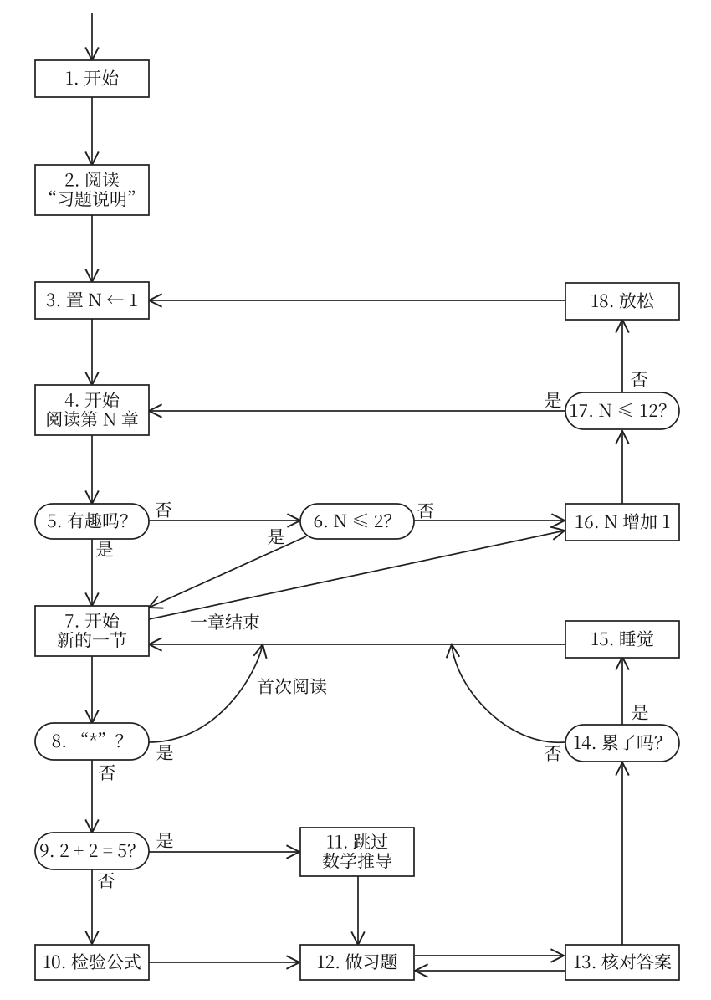

# 计算机程序设计艺术　卷 1：基本算法（第 3 版）

[目录](#contents)　·　[习题答案](./sec-answers.md#sec-answers)　·　[索引](./sec-index.md#sec-index)

## 致中国读者

Greetings to all readers of these books in China! I fondly hope that many Chinese computer programmers will learn to recognize my Chinese name “高德纳”, which was given to me by Francis Yao just before I visited your country in 1977. I still have very fond memories of that three-week visit, and I have been glad to see “高德纳” on the masthead of the *Journal of Computer Science and Technology* since 1989. This name makes me feel close to all Chinese people although I cannot speak your language.

People who devote much of their lives to computer programming must do a great deal of hard work and must master many subtle technical details. Not many are able to do this well. But the rewards are great, because a well written program can be a beautiful work of art, and because computer programs are helping to bring all people of the world together.

Donald E. Knuth

向我这些书的所有中国读者问好! 我天真地希望中国的程序员们能记住我的中文名字叫高德纳, 这是我 1977 年访问你们中国前夕, 姚期智的夫人姚储枫给我起的名字. 对于那次为期三周的访问, 我至今仍然留有深切的记忆, 而且让我非常高兴的是, 从 1989 年以后, 《计算机科学技术学报》的刊头就用了我的中文名字. 虽然我不会说你们的中国话, 但这个名字拉近了我们之间的距离.

投身计算机程序设计的人需要做大量相当艰苦的工作, 而且必须掌握很多微妙的技术细节. 许多人还不能成功地做到这一点. 但是如果你做到了, 就可以得到巨大的回报, 因为精心编写的程序就像一个美丽的艺术作品, 而且计算机程序能够聚拢全世界的人.

高德纳

## 前言

> 本书应数以千计的读者来信之邀而出版. 我们用了多年的时间对大量的食谱进行了反复检验, 挑选出最佳的、有趣的、完美的食谱奉献给大家. 现在我们可以自信满满地说, 不管是谁, 即使此前从来没有做过菜, 只要严格按书中的说明进行操作, 也能获得跟我们一样的烹饪效果.  
> ——*McCall’s Cookbook*(1963)

为数字计算机编写程序的过程特别愉快, 因为我们不仅可以获得经济和科学两方面的收益, 还能尽享写诗或作曲般的艺术体验. 本书是多卷丛书中的第一卷, 整个丛书旨在培训读者掌握程序员必备的各种技能.

在接下来的章节中, 我不打算介绍计算机程序设计的入门知识, 而是假定读者已有了一定的基础. 预备知识实际上非常简单, 但初学者恐怕需要一些时间并动手实践, 方能理解数字计算机的概念. 读者应该具有如下知识.

- (a) 对存储程序式数字计算机的工作原理有一些认识. 不一定需要电子学背景, 但需要知道指令在机器内存中是如何保存和连续执行的.

- (b) 能够用计算机可以 “理解” 的确切术语来描述问题的解决方案. (这些机器不懂所谓的常识, 它们只会精准地按要求干活, 不会多做也不会少做. 这是刚开始接触计算机时最难领悟的概念.)

- (c) 掌握一些最基本的计算机技术, 例如循环 (重复执行一组指令)、子程序的使用、下标变量的使用.

- (d) 能够了解常见的计算机术语, 如内存、寄存器、位、浮点、溢出、软件等. 正文中未给出定义的一些术语, 会在每卷最后的索引部分给出简明的定义.

或许可以把这四点归结为一个要求: 读者起码为一台计算机编写和测试过至少 (比如说)4 个程序.

我力图使本套丛书能满足两方面的需求. 首先, 这些书总结了几个重要领域的知识, 可以作为参考书; 其次, 它们可以用作自学教材或计算机与信息科学专业的大学教材. 为此, 我在书中加入了大量的习题, 并为多数习题提供了答案. 此外, 我在书中尽可能地用事实说话, 言之有据, 避免做一些含糊的泛泛而谈.

这套书针对的读者不是那些对计算机只有一时兴趣的人, 但也绝不仅限于计算机专业人士. 其实, 我的一个主要目标是使其他领域的广大工作者能够方便地了解这些程序设计方法, 他们本可以利用计算机获得更丰硕的成果, 但却没时间去技术刊物中查找必需的信息.

本套丛书的主题可以称为 “非数值分析”. 在传统意义上, 计算机是与方程求根、数值插值与积分等数值问题求解联系在一起的, 但我不会专门讨论数值问题, 最多顺带提一下. 数值计算的程序设计是一个发展迅猛、引人入胜的领域, 目前已出版了许多相关图书. 不过, 从 20 世纪 60 年代初期开始, 计算机更多地用于处理那些很少出现数值的问题, 此时用到的是计算机的决策能力而非算术运算能力. 非数值问题中也会用到一些加法和减法, 但基本不需要乘法和除法. 当然, 即便是主要关注数值计算的程序设计的人也可以在非数值方法的学习中受益, 因为数值程序中也会用到非数值方法.

非数值分析的研究成果散见于大量科技刊物中. 通过研究, 我从大量文献中提炼出了一些可以用于多种编程场合的最基本的方法, 并尝试着将其组织为一套 “理论”. 同时, 我还展示了如何应用这一理论解决大量的实际问题.

当然, “非数值分析” 是一种太过负面的否定性的提法, 使用肯定性的描述语来刻画这一研究领域要好得多. “信息处理” 对于我们的内容而言过于宽泛, “程序设计技术” 又显得太狭窄了, 因此我提出用*算法分析*来概括本套丛书的主题比较恰当, 这一名称暗示我们将探讨 “与特定计算机算法的性质有关的理论”.

整套丛书以《计算机程序设计艺术》为题, 内容总览如下.

- **卷 1　基本算法**
  - 第 1 章　基本概念
  - 第 2 章　信息结构

- **卷 2　半数值算法**
  - 第 3 章　随机数
  - 第 4 章　算术

- **卷 3　排序与查找**
  - 第 5 章　排序
  - 第 6 章　查找

- **卷 4　组合算法**
  - 第 7 章　组合查找
  - 第 8 章　递归

- **卷 5　语法算法**
  - 第 9 章　词法扫描
  - 第 10 章　语法分析

第 4 卷涉及的范围很大, 实际上包含三本书 (卷 4A、4B 和 4C). 此外, 我还计划编写两卷更具专业性的内容: 第 6 卷语言理论 (第 11 章) 和第 7 卷编译器 (第 12 章).

1962 年, 我打算按顺序把上述章节组织成一本书, 但很快就意识到应该深入介绍这些主题, 而不能蜻蜓点水般地只讲些皮毛. 最终写成的篇幅表明, 每一章包含的内容都无法在一学期的大学课程中讲完, 因此只能分卷出版. 我知道一本书仅有一章或两章会显得很奇怪, 但为了便于相互参照, 我决定保留原来的章节编号. 我计划出一本第 1 卷至第 5 卷的精简版, 供大学用作本科计算机课程的参考书或教材. 该精简版的内容是这 5 卷的子集, 但略去了专业性较强的信息. 精简版与完整版的章节编号将保持一致.

本卷可以看成是整套丛书的交集, 因为它包含了其他各卷都需要用到的基本内容, 而第 2 卷至第 5 卷则可以彼此独立地阅读. 第 1 卷不仅可以作为阅读其他各卷的参考书, 还可以用作下述课程的大学教材或自学读物:*数据结构*(主要是第 2 章的内容), 或者*离散数学*(主要是 1.1 节、1.2 节、1.3.3 节和 2.3.4 节的内容)、*机器语言程序设计*(主要是 1.3 节和 1.4 节的内容) 等.

我撰写本书的出发点不同于当前的大多数计算机程序设计书籍. 我教给读者的不是如何使用别人的软件, 而是如何自己编写更好的软件.

我最初的目标是引领读者到达每个主题的知识前沿. 然而, 身处一个经济上有利可图的领域, 要保持不落伍是极端困难的, 计算机科学的迅猛发展使我这一梦想最终破灭了. 我们讨论的每一个主题都包含了全世界成千上万的能人异士所贡献出的成千上万的精妙成果. 因此, 我一改初衷, 开始专注于那些很可能在多年后仍然很重要的 “经典” 方法, 并尽我所能来描述它们. 特别地, 我尽力跟踪了每个主题的演变历史, 为其未来的发展打好坚实的基础; 我尽力选择了与当前用法一致的简明术语; 我尽力囊括了与顺序计算机程序设计相关的所有美妙且易于表述的思想.

对于本套丛书的数学内容还需要说几句. 从内容选择上来说, 具有高中代数知识的普通读者就可以阅读这些书, 遇到涉及较多数学知识的部分时可以略读, 而偏好数学的读者则可以学到许多与离散数学相关的很有意思的数学方法. 为在行文上兼顾这两类读者, 我给每道习题都标定了等级, 数学性强的题目会被特别标示出来, 我还在多数章节里把主要数学结果放在其证明之前陈述. 相关证明要么留作习题 (答案单独用一节集中给出), 要么在小节的最后给出.

如果读者主要对程序设计而非相关的数学内容感兴趣, 那么可以在感觉数学难度显著加大时停止阅读这一节, 而对数学有兴趣的读者则能在这些节中发现许多丰富而有趣的内容. 不少已经发表的与计算机程序设计有关的数学文章都含有错误, 本书的目标之一就是用正确的数学方法向读者传授相关的内容. 我自认为是一名数学家, 因此会竭尽所能地维护数学的完整性, 对此我责无旁贷.

其实有基本的微积分知识就足够理解本丛书中的多数数学内容, 因为所需的其他理论大多是由此建立起来的. 当然, 有时我会用到复变函数理论、概率论、数论等更深入的定理, 这种情况下我会列出相应的教科书供读者参考.

撰写这套丛书时最艰难的抉择, 在于如何展示各种各样的方法. 采用流程图且非形式化地逐步描述算法显然很有优势, 相关讨论可以参考《ACM 通讯》第 6 卷 (1963 年 9 月) 第 555–563 页的 “Computer-Drawn Flowcharts” (计算机绘制流程图) 一文. 不过, 描述任何计算机算法时, 形式化的准确语言也是必不可少的, 我需要决定是使用 ALGOL 或 FORTRAN 这样的代数语言, 还是使用一种面向机器的语言. 可能当今的许多计算机专家都不赞同我最终使用了面向机器的语言, 但我确信自己的选择是恰当的, 理由如下.

- (a) 程序员在很大程度上受编程语言的影响. 如今的主流趋势就是, 使用语言中最简单的结构而不是对机器而言性能最好的特性来构建程序. 如果学习并理解了面向机器的语言, 程序员会倾向于使用一种效率高得多的方法, 这更贴近实际.

- (b) 除了个别情况, 我们所用的程序都相当短小. 因此只要有台合适的计算机, 理解这些程序不会有什么难度.

- (c) 高级语言不适合用来讨论协同程序链接、随机数生成、多精度算术以及与内存有效使用相关的许多问题的底层细节.

- (d) 只要不是对计算机只有一时兴趣的人, 都应该学好机器语言, 这是计算机的基础.

- (e) 无论如何, 我们都需要某种机器语言作为许多示例中的软件程序的输出.

- (f) 代数语言每隔 5 年左右就会改朝换代, 而我想强调的是永恒的思想.

从另一个角度来看, 我承认如果使用高级程序设计语言, 程序的编写要容易一些, 程序的调试更是容易很多. 事实上, 计算机已非常强大快速, 我从 1970 年开始就很少使用低级的机器语言编写程序了. 然而, 对于书中许多有趣的问题而言, 程序员的技巧是至关重要的. 例如, 某些组合计算需要重复 1 万亿次, 其内循环时间每减少 1 微秒, 我们就能节省 11.6 天. 类似

地, 多花些时间编写每天需要在许多计算机装置中多次使用的软件也是值得的, 因为软件只需要编写一次.

既然已经决定了使用面向机器的语言, 下一个问题就是应该用哪种语言. 我可以选择特定机器 $X$ 上的语言, 但若如此, 没有机器 $X$ 的人就会认为本书是仅仅针对 $X$ 用户的. 此外, 机器 $X$ 可能具有许多与本书内容无关的特性, 仍需加以解释. 两年后, 生产机器 $X$ 的厂家可能会推出 $X+1$ 或 $10X$, 那时候就不会再有人对 $X$ 感兴趣了.

为了避免陷入这样的窘境, 我尝试着设计了一种操作规则非常简单 (甚至只要一个小时就能掌握) 的 “理想” 计算机, 它跟实际的机器很类似. 学生没有理由对学习多种计算机的特性感到恐惧: 一旦掌握了某种机器语言, 其他机器的语言自然就很简单了. 毫无疑问, 真正的程序员在职业生涯中会碰到许多种机器语言. 对于我们的假想机而言, 现在唯一的缺陷就是难以执行为它编写的程序. 幸运的是, 许多志愿者已经自告奋勇地站出来为其编写模拟程序了, 因此程序的执行也不再是问题了. 这些模拟程序非常适合于教学目的, 因为它们甚至比实际的计算机还要易于使用.

我尽量在讨论每个主题时引用最好的早期论文, 并摘录一些新的进展. 对期刊文献的引用一般采用标准的缩写方式, 但下列引用最频繁的杂志例外, 它们的缩写如下:

| 缩写 | 刊名或会议名 | 中文名 |
| :--- | :--- | :--- |
| *CACM* | Communications of the Association for Computing Machinery | 《ACM 通讯》 |
| *JACM* | Journal of the Association for Computing Machinery | 《ACM 杂志》 |
| *Comp. J.* | The Computer Journal (British Computer Society) | 英国计算机学会《计算机杂志》 |
| *Math. Comp.* | Mathematics of Computation | 《计算数学》 |
| *AMM* | American Mathematical Monthly | 《美国数学月刊》 |
| *SICOMP* | SIAM Journal on Computing | 《SIAM 计算杂志》 |
| *FOCS* | IEEE Symposium on Foundations of Computer Science | 《IEEE 计算机科学基础论文集》 |
| *SODA* | ACM-SIAM Symposium on Discrete Algorithms | 《ACM-SIAM 离散算法论文集》 |
| *STOC* | ACM Symposium on Theory of Computing | 《ACM 计算理论论文集》 |
| *Crelle* | Journal für die reine und angewandte Mathematik | 《理论与应用数学杂志》 |

例如, 我将用 “*CACM* **6** (1963), 555–563” 表示前面提到的那篇文献. 此外, 还会用《具体数学》表示 *Concrete Mathematics* 一书, 1.2 节引言部分会引用到它.

这套丛书的许多技术性内容出现在习题中. 有些重要习题的构思不是我的原创, 我会尽力给出原创者的信息. 相应的文献引用通常在该节的正文或者习题的答案中给出. 但许多情况下, 习题基于未发表的材料, 此时就无法给出进一步的引文信息了.

许多人在本套丛书的撰写过程中给予了帮助, 在此表示深深的谢意. 首先是我的妻子高精蘭, 感谢她的极大耐心, 感谢她为本书绘制了部分插图, 感谢她各方面无尽的支持. 其次感谢罗伯特·弗洛伊德, 他早在 20 世纪 60 年代就为增强本套丛书的内容投入了大量的时间. 此外, 其他数以千计的人士也提供了重要的帮助, 如果要一一列出他们的名字还需要一本书的篇幅! 他们中的许多人无私地允许我使用其尚未公开发表的内容. 我在加州理工大学和斯坦福大学从事研究工作时, 国家科学基金会和海军研究署给予了多年的慷慨赞助. 从我 1962 年开始写书

起, Addison-Wesley 公司就一直提供着大力的支持和合作. 我知道, 向他们表示感谢的最好方法就是尽我所能把书写成他们所期待的样子, 不负他们的投入.

### 第 3 版前言

花 10 年时间开发了用于计算机排版的 TeX 系统和 METAFONT 系统之后, 我现在已经能够实现当初的一个梦想了: 用这些系统来排版《计算机程序设计艺术》. 最终, 本书的全部内容都存储在我的个人电脑中, 该电子格式可以随时适应印刷技术和显示技术的改进. 新的设置使得我可以在文字上进行数千处的改进, 这是我多年来一直想做的.

我对新版的文字逐字进行了认真的审阅, 力图在保持原有的蓬勃朝气的同时, 加入一些可能更成熟的论断. 新版增加了几十道新的习题, 并为原有的几十道习题给出了改进的新答案.

 《计算机程序设计艺术》丛书尚未完稿, 因此书中有些部分还带有 “建设中” 的图标, 以向读者致歉——这部分内容还不是最新的. 我电脑中的文件里堆满了重要的材料, 打算写进第 1 卷最后壮丽无比的第 4 版中, 或许从现在算起还需要 15 年的时间. 但我必须先完成第 4 卷和第 5 卷, 非到万不得已, 我不想拖延这两卷的出版时间.

我一直在努力扩展和改进这套书, 从 1980 年开始, 有了 Addison-Wesley 出版公司的编辑彼得·戈登的指导, 这一工作的进展大有提高. 他已经不仅是我的出版伙伴, 而且成为了我私交很好的朋友, 是他不断地促使我朝着卓有成效的方向前进. 的确, 这三十多年来, 我和出版社数十位朋友的互动交往, 恐怕是远远超过了一个作者所能享受到的待遇. 特别值得赞许的是, 责任编辑约翰·富勒永不知疲倦地提供支持, 尽管我频繁更新书中内容, 他也始终如一地注重任何一个细节, 让这套书以最高质量标准面世.

准备这一新版本的大部分艰苦工作是由菲利斯·温克勒、西尔维奥·利维和杰弗里·奥尔德姆完成的. 温克勒和利维把第 2 版的全部文本熟练地录入了计算机, 并做了编辑修改, 奥尔德姆则几乎把所有的插图都转换成了 METAPOST 格式. 我修正了细心的读者在第 2 版中发现的所有错误 (还有读者未能察觉的一些错误), 并尽量避免在新增内容中引入新的错误. 但我猜测可能仍然有一些缺陷, 我希望能尽快加以改正. 因此, 我很乐意向首先发现技术性错误、印刷错误或历史知识错误的人按每处支付 \$2.56. 下列网页上列出了所有已反馈给我的最新勘误: <http://www-cs-faculty.stanford.edu/~knuth/taocp.html>.

高德纳  
加利福尼亚斯坦福  
1997 年 4 月

> 过去二十年里发生了巨变.  
> ——比尔·盖茨 (1995)

*阅读本套书的流程图*

## 阅读本套书的步骤

1\. 先阅读本步骤, 除非你已经在读了. 继续忠实遵循这些步骤. (这个步骤的一般形式及其流程图贯穿全书.)

2\. 阅读 “习题说明”.

3\. 置 $N=1$.

4\. 开始阅读第 $N$ 章. 不要阅读章首的引文.

5\. 你对这一章的主题是否有兴趣? 是, 转到第 7 步; 不是, 转到第 6 步.

6\. $N\le2$ 吗? 不是, 转到第 16 步; 是, 无论如何要通读这一章. (第 1 章和第 2 章包含重要的导引材料, 也回顾了基本的程序设计方法. 最低限度, 你应该略读有关记号和有关 MIX 的那几节.)

7\. 开始阅读这一章的下一节. 如果这章已读完, 转到第 16 步.

8\. 这一节是否标记了星号 (\*)? 若是, 首次阅读时可以先略去 (其中包含了有趣的特定专题, 不过不是必不可读的); 返回第 7 步.

9\. 你喜欢数学吗? 如果数学对你而言是天书, 转到第 11 步; 否则, 转到第 10 步.

10\. 检查这一节中的数学推导 (发现错误请告知作者). 转到第 12 步.

11\. 如果当前这一节都是数学计算, 你最好不读推导过程. 但是, 你应该熟悉这一节的基本结果. 这些结果通常在开始处陈述, 或者以仿宋体放在难读部分的后面.

12\. 遵照第 2 步提到的 “习题说明” 做这一节的习题.

13\. 做完习题并觉得满意之后, 按照书后的答案核对你的结果 (如果那道题有答案). 你也应该读读没时间做的那些习题的答案. 注: 多数情况下, 理应在做第 $n+1$ 道习题之前阅读第 $n$ 道题的答案, 所以第 12 步和第 13 步通常是同时进行的.

14\. 累了吗? 没有, 返回第 7 步.

15\. 睡觉. 醒后返回第 7 步.

16\. $N$ 增加 1. 如果 $N=3,5,7,9,11,12$, 开始阅读这套书的下一卷.

17\. 若 $N$ 小于或等于 12, 返回第 4 步.

18\. 祝贺你! 现在说服你的朋友买一本卷 1 阅读吧. 也请返回第 3 步.

> 只读一本书的人是悲哀的.  
> ——乔治·赫伯特,*Jacula Prudentum*, 1144(1640)

> 所有著作的唯一共同缺点, 在于表达形式过于冗长.  
> ——沃夫纳格,*Réflexions*, 628(1746)

> 书是平凡的, 唯有生命是伟大的.  
> ——托马斯·卡莱尔,*Journal*(1839)

## 习题说明

这套书的习题既可用于自学, 也可用于课堂练习. 任何人单凭阅读而不运用获得的知识解决具体问题, 进而激励自己思考所阅读的内容, 就想学会一门学科, 即便可能, 也很困难. 再者, 人们只有对亲身发现的事物才有透彻的了解. 因此, 习题是这套书的一个主要部分. 我力求习题的信息尽可能丰富, 并且兼具趣味性和启发性.

很多书会把容易的题和很难的题随意混杂在一起. 这样做往往并不合适, 因为读者在做题前想知道需要花多少时间, 不然他们完全可以跳过所有习题. 理查德·贝尔曼的《动态规划》(*Dynamic Programming*) 一书就是个典型的例子. 这是一本具有重要价值的开创性著作, 在书中某些章后 “习题和研究题” 的标题下, 极为平常的问题与深奥的未解难题掺杂在一起. 据说有人问过贝尔曼博士, 如何区分习题和研究题, 他回答说: “若你能求解, 它就是一道习题; 否则, 它就是一道研究题.”

在本书这种类型的书中, 有足够理由同时收录容易做的习题和研究题. 因此, 为了避免读者陷入区分习题和研究题的困境, 这里用等级编号来说明习题的难易程度. 这些编号的意义如下所示.

| 等级 | 说明 |
| :--- | :--- |
| 00 | 极为容易的习题, 只要理解了文中内容就能立即解答. 这样的习题几乎总是可以 “在脑子中” 形成答案. |
| 10 | 简单问题, 它让你思考刚阅读的材料, 但决非难题. 你至多在一分钟内就能做完, 借助笔和纸求解会更有帮助. |
| 20 | 普通问题, 检验你对正文内容的基本理解, 完全解答可能需要 15 到 20 分钟. |
| 30 | 具有中等难度或复杂性的问题. 为了找到满意的答案, 可能需要两小时以上. 要是开着电视机, 时间甚至更长. |
| 40 | 非常困难或者很长的问题, 适合作为课堂教学中一个学期的设计项目. 学生应当有能力在一段相当长的时间内解决这个问题, 解答不是浅显的. |
| 50 | 研究题, 尽管有许多人尝试, 但直到我写书时尚未有满意的解答. 你若找到这类问题的答案, 应该写文发表. 而且, 我乐于尽快获知这个问题的解答 (只要它是正确的). |

依据上述尺度, 其他等级的意义便清楚了. 例如, 一道等级为 17 的习题就比普通问题略微简单点. 等级为 50 的问题, 若是将来被某个读者解决了, 可能会在本书以后的版本中标记为 40 等, 并发布在因特网上的本书勘误表中.

等级编号除以 5 得到的余数, 表示完成这道习题的具体工作量. 因此, 求解一道等级为 24 的习题, 比求解一道等级为 25 的习题可能花更长的时间, 不过做后一种习题需要更多的创造性. 所有等级为 46 及以上的习题都是开放式问题, 有待进一步研究, 其难度等级由尝试解决该问题的人数而定.

我力求为习题指定精确的等级编号, 但这很困难, 因为出题人无法确切知道别人在求解时会有多大难度; 同时, 每个人都会在解决某些类型的问题时更有天赋. 希望等级编号能合理地估测习题的难度, 读者应把它们看成一般的指导而非绝对的指标.

本书是为具有不同程度数学教育和素养的读者编写的, 因此某些习题仅供喜欢数学的读者使用. 如果习题涉及的数学概念或者动机大大超过了仅对算法编程感兴趣的读者的接受能力,

那么等级编号前会有一个字母 *M*. 如果习题的求解必须用到本书中没有详细讨论的微积分或者其他高等数学知识, 那么会用两个字母 *HM*.*HM* 记号并不一定意味习题很难.

某些习题前有个箭头 ▸, 这表示问题极具启示性, 特别向读者推荐. 当然, 不能期待读者或者学生做全部习题, 所以我挑选出了看起来最有价值的习题. (这并非要贬低其他习题!) 每位读者至少应该尝试去解答等级为 10 或者以下的所有习题, 箭头或许有助于指示哪些较高等级的习题应该优先考虑.

多数习题的答案在书后给出了. 请读者明智地使用它们, 未经自己认真求解之前不要求助于答案, 除非你确实没有时间做某道习题. 在你得到自己的答案或者做了应有的努力之后, 你可能会发现习题答案是有教益和帮助的. 给出的解答通常非常简短, 因为假定了你已经用自己的方法做了认真的尝试, 所以只概述其细节. 有时解答给出的信息比要求的少, 不过通常会给出更多. 你完全可能得到比书后答案更好的答案, 或者发现了答案中的错误, 对此, 我愿闻其详. 本书的后续印次会给出改进后的答案, 同时在适当情况下给出解答者的姓名.

你做一道习题时, 可以利用前面习题的答案, 除非明确禁止这样做. 在指定习题等级时已经考虑到了这一点, 因此, 习题 $n+1$ 的等级可能低于习题 $n$ 的等级, 尽管它将习题 $n$ 的结果作为了一个特例.

**编号摘要**

| 符号 | 说明 | 等级 | 说明 |
| :--- | :--- | :--- | :--- |
| | | 00 | 立即回答 |
| | | 10 | 简单 (一分钟) |
| | | 20 | 普通 (一刻钟) |
| ▸ | 推荐的 | 30 | 中等难度 |
| *M* | 面向数学的 | 40 | 学期设计项目 |
| *HM* | 需要 “高等数学” | 50 | 研究题 |

### 习题

1\. [答案](./answers/intro.md#ans-intro-1)  ▸ [00] 等级 “*M20*” 的含义是什么?
2\. [10] 教科书中的习题对于读者具有什么价值?
3\. [14] 证明 $13^3=2197$. 推广你的答案. (这是一类令人讨厌的问题, 我尽量不出这类题.)
4\. [答案](./answers/intro.md#ans-intro-4)  [*HM45*] 证明: 当 $n$ 为大于 2 的整数时 ($n>2$), 方程 $x^n+y^n=z^n$ 无正整数解 $x,y,z$.

> 我们能够面对问题.  
> 我们会侦破这起悬案的,  
> 因为我们能够理出头绪, 找到办法.  
> ——赫尔克里·波洛, 《东方快车谋杀案》(1934)

## 目录

- [<samp>第 1 章</samp>　基本概念](./sec-1.md#sec-1)　[1](./sec-1.md#p-1)
  - [<samp>1.1</samp>　算法](./sec-1-1.md#sec-1-1)　[1](./sec-1.md#p-1)
  - [<samp>1.2</samp>　数学准备](./sec-1-2.md#sec-1-2)　[8](./sec-1-2.md#p-8)
    - [<samp>&nbsp;1.2.1&nbsp;</samp>　数学归纳法](./sec-1-2-1.md#sec-1-2-1)　[8](./sec-1-2.md#p-8)
    - [<samp>&nbsp;1.2.2&nbsp;</samp>　数、幂和对数](./sec-1-2-2.md#sec-1-2-2)　[16](./sec-1-2-1.md#p-16)
    - [<samp>&nbsp;1.2.3&nbsp;</samp>　和与积](./sec-1-2-3.md#sec-1-2-3)　[21](./sec-1-2-2.md#p-21)
    - [<samp>&nbsp;1.2.4&nbsp;</samp>　整数函数与初等数论](./sec-1-2-4.md#sec-1-2-4)　[30](./sec-1-2-3.md#p-30)
    - [<samp>&nbsp;1.2.5&nbsp;</samp>　排列与阶乘](./sec-1-2-5.md#sec-1-2-5)　[35](./sec-1-2-4.md#p-35)
    - [<samp>&nbsp;1.2.6&nbsp;</samp>　二项式系数](./sec-1-2-6.md#sec-1-2-6)　[41](./sec-1-2-5.md#p-41)
    - [<samp>&nbsp;1.2.7&nbsp;</samp>　调和数](./sec-1-2-7.md#sec-1-2-7)　[59](./sec-1-2-6.md#p-59)
    - [<samp>&nbsp;1.2.8&nbsp;</samp>　斐波那契数](./sec-1-2-8.md#sec-1-2-8)　[62](./sec-1-2-7.md#p-62)
    - [<samp>&nbsp;1.2.9&nbsp;</samp>　生成函数](./sec-1-2-9.md#sec-1-2-9)　[69](./sec-1-2-8.md#p-69)
    - [<samp>&nbsp;1.2.10</samp>　典型算法分析](./sec-1-2-10.md#sec-1-2-10)　[76](./sec-1-2-9.md#p-76)
    - [<samp>*1.2.11</samp>　渐近表示](./sec-1-2-11.md#sec-1-2-11)　[85](./sec-1-2-10.md#p-85)
      - [<samp>*1.2.11.1</samp>　大 O 记号](./sec-1-2-11-1.md#sec-1-2-11-1)　[85](./sec-1-2-10.md#p-85)
      - [<samp>*1.2.11.2</samp>　欧拉求和公式](./sec-1-2-11-2.md#sec-1-2-11-2)　[88](./sec-1-2-11-1.md#p-88)
      - [<samp>*1.2.11.3</samp>　若干渐近计算式](./sec-1-2-11-3.md#sec-1-2-11-3)　[92](./sec-1-2-11-2.md#p-92)
  - [<samp>1.3</samp>　MIX](./sec-1-3.md#sec-1-3)　[99](./sec-1-3.md#p-99)
    - [<samp>&nbsp;1.3.1&nbsp;</samp>　MIX 的描述](./sec-1-3-1.md#sec-1-3-1)　[99](./sec-1-3.md#p-99)
    - [<samp>&nbsp;1.3.2&nbsp;</samp>　MIX 汇编语言](./sec-1-3-2.md#sec-1-3-2)　[116](./sec-1-3-1.md#p-116)
    - [<samp>&nbsp;1.3.3&nbsp;</samp>　排列的应用](./sec-1-3-3.md#sec-1-3-3)　[131](./sec-1-3-2.md#p-131)
  - [<samp>1.4</samp>　若干基本程序设计技术](./sec-1-4.md#sec-1-4)　[150](./sec-1-4.md#p-150)
    - [<samp>&nbsp;1.4.1&nbsp;</samp>　子程序](./sec-1-4-1.md#sec-1-4-1)　[150](./sec-1-4.md#p-150)
    - [<samp>&nbsp;1.4.2&nbsp;</samp>　协同程序](./sec-1-4-2.md#sec-1-4-2)　[155](./sec-1-4-1.md#p-155)
    - [<samp>&nbsp;1.4.3&nbsp;</samp>　解释程序](./sec-1-4-3.md#sec-1-4-3)　[161](./sec-1-4-2.md#p-161)
      - [<samp>&nbsp;1.4.3.1&nbsp;</samp>　MIX 模拟程序](./sec-1-4-3-1.md#sec-1-4-3-1)　[162](./sec-1-4-3.md#p-162)
      - [<samp>*1.4.3.2&nbsp;</samp>　追踪程序](./sec-1-4-3-2.md#sec-1-4-3-2)　[171](./sec-1-4-3-1.md#p-171)
    - [<samp>&nbsp;1.4.4&nbsp;</samp>　输入与输出](./sec-1-4-4.md#sec-1-4-4)　[173](./sec-1-4-3-2.md#p-173)
    - [<samp>&nbsp;1.4.5&nbsp;</samp>　历史和参考文献](./sec-1-4-5.md#sec-1-4-5)　[184](./sec-1-4-4.md#p-184)
- [<samp>第 2 章</samp>　信息结构](./sec-2.md#sec-2)　[187](./sec-2.md#p-187)
  - [<samp>2.1</samp>　引论](./sec-2-1.md#sec-2-1)　[187](./sec-2.md#p-187)
  - [<samp>2.2</samp>　线性表](./sec-2-2.md#sec-2-2)　[191](./sec-2-2.md#p-191)
    - [<samp>&nbsp;2.2.1&nbsp;</samp>　栈、队列和双端队列](./sec-2-2-1.md#sec-2-2-1)　[191](./sec-2-2.md#p-191)
    - [<samp>&nbsp;2.2.2&nbsp;</samp>　顺序分配](./sec-2-2-2.md#sec-2-2-2)　[195](./sec-2-2-1.md#p-195)
    - [<samp>&nbsp;2.2.3&nbsp;</samp>　链接分配](./sec-2-2-3.md#sec-2-2-3)　[203](./sec-2-2-3.md#p-203)
    - [<samp>&nbsp;2.2.4&nbsp;</samp>　循环链表](./sec-2-2-4.md#sec-2-2-4)　[217](./sec-2-2-3.md#p-217)
    - [<samp>&nbsp;2.2.5&nbsp;</samp>　双链表](./sec-2-2-5.md#sec-2-2-5)　[222](./sec-2-2-4.md#p-222)
    - [<samp>&nbsp;2.2.6&nbsp;</samp>　数组与正交表](./sec-2-2-6.md#sec-2-2-6)　[237](./sec-2-2-5.md#p-237)
  - [<samp>2.3</samp>　树](./sec-2-3.md#sec-2-3)　[245](./sec-2-3.md#p-245)
    - [<samp>&nbsp;2.3.1&nbsp;</samp>　遍历二叉树](./sec-2-3-1.md#sec-2-3-1)　[253](./sec-2-3-1.md#p-253)
    - [<samp>&nbsp;2.3.2&nbsp;</samp>　树的二叉树表示](./sec-2-3-2.md#sec-2-3-2)　[265](./sec-2-3-1.md#p-265)
    - [<samp>&nbsp;2.3.3&nbsp;</samp>　树的其他表示](./sec-2-3-3.md#sec-2-3-3)　[276](./sec-2-3-2.md#p-276)
    - [<samp>&nbsp;2.3.4&nbsp;</samp>　树的基本数学性质](./sec-2-3-4.md#sec-2-3-4)　[287](./sec-2-3-3.md#p-287)
      - [<samp>&nbsp;2.3.4.1&nbsp;</samp>　自由树](./sec-2-3-4-1.md#sec-2-3-4-1)　[287](./sec-2-3-3.md#p-287)
      - [<samp>&nbsp;2.3.4.2&nbsp;</samp>　定向树](./sec-2-3-4-2.md#sec-2-3-4-2)　[294](./sec-2-3-4-1.md#p-294)
      - [<samp>*2.3.4.3&nbsp;</samp>　无限性引理](./sec-2-3-4-3.md#sec-2-3-4-3)　[301](./sec-2-3-4-2.md#p-301)
      - [<samp>*2.3.4.4&nbsp;</samp>　树的枚举](./sec-2-3-4-4.md#sec-2-3-4-4)　[304](./sec-2-3-4-3.md#p-304)
      - [<samp>&nbsp;2.3.4.5&nbsp;</samp>　路径长度](./sec-2-3-4-5.md#sec-2-3-4-5)　[314](./sec-2-3-4-4.md#p-314)
      - [<samp>*2.3.4.6&nbsp;</samp>　历史和参考文献](./sec-2-3-4-6.md#sec-2-3-4-6)　[320](./sec-2-3-4-5.md#p-320)
    - [<samp>&nbsp;2.3.5&nbsp;</samp>　表和垃圾回收](./sec-2-3-5.md#sec-2-3-5)　[322](./sec-2-3-4-6.md#p-322)
  - [<samp>2.4</samp>　多链结构](./sec-2-4.md#sec-2-4)　[333](./sec-2-4.md#p-333)
  - [<samp>2.5</samp>　动态存储分配](./sec-2-5.md#sec-2-5)　[342](./sec-2-5.md#p-342)
  - [<samp>2.6</samp>　历史和参考文献](./sec-2-6.md#sec-2-6)　[358](./sec-2-6.md#p-358)
- [习题答案](./sec-answers.md#sec-answers)　[364](./sec-answers.md#p-364)
- [<samp>附录 A</samp>　数值表](./sec-app-a.md#sec-app-a)　[494](./sec-app-a.md#p-494)
- [<samp>附录 B</samp>　记号索引](./sec-app-b.md#sec-app-b)　[498](./sec-app-b.md#p-498)
- [<samp>附录 C</samp>　算法和定理索引](./sec-app-c.md#sec-app-c)　[502](./sec-app-c.md#p-502)
- [人名索引](./sec-names.md#sec-names)　[503](./sec-names.md#p-503)
- [索引](./sec-index.md#sec-index)　[508](./sec-index.md#p-508)
