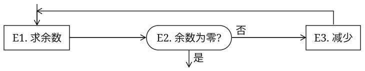

### 1.1　算法

算法是计算机程序设计的基本概念, 所以我们就从分析这个概念入手.

algorithm (算法) 这个词非常有趣, 乍一看, 仿佛有人想写 logarithm (对数), 但把前面 4 个字母的次序弄乱了. 直到 1957 年, 《韦氏新世界词典》(*Webster’s New World Dictionary*) 仍未收录 algorithm 这个词. 我们只能找到更古老的词形 algorism, 它表示用阿拉伯数字进行的算术运算. 在中世纪, 珠算人员用算盘进行计算, 而数算人员 (algorist) 则依据十进制计算规则用阿拉伯数字做计算. 迄至文艺复兴时期, 这个词的来源已经成谜. 早期的语言学家猜测, 它源自 algiros (费力的)＋ arithmos (数字) 的组合. 另一些人则反对这种说法, 认为这个词由卡斯蒂利亚王国的国王阿尔哥尔 (Algor) 衍生而来. 最终, 数学史研究者找到了 algorism 这个词的真正来源: 它出自波斯知名教科书作者的名字 Abū ‘Abd Allāh Muḥammad ibn Mūsā al-Khwārizmī(约公元 825 年), 其字面意义是 “穆罕默德, 阿卜杜拉之父, 摩西之子, 花刺子模之居民”[^p1-3]. 中亚地区的咸海在古代称为花刺子模湖, 而花刺子模地区位于咸海正南方的阿姆河盆地[^p1-4]. 这位花拉子米写就了著名的阿拉伯文教科书 *Kitāb al-jabr wa’l-muqābala*(还原和相等的规则), 该书系统研究了线性方程和二次方程求解. 由书名又衍生出另一个词 algebra (代数). [关于花拉子米的生平及著作的评述, 可参阅海因茨·泽马内克的 *Lecture Notes in Computer Science* **122** (1981), 1–81.]

algorism 一词的形式和含义逐渐变得面目全非. 正如《牛津英语词典》(*Oxford English Dictionary*) 的解释: “(这个词) 经过伪词源学多次附会曲解, 如新近的词汇 algorithm (算法), 有意同 arithmetic (算术) 的希腊词根相混淆.” 鉴于人们已经忘记了原词的出处, 从 algorism (十进制计算法) 到 algorithm (算法) 的变化就不难理解了. 一本早年出版的德国《数学大全辞典》[*Vollständiges mathematisches Lexicon* (Leipzig: 1747)] 给出了 Algorithmus (算法) 的定义: “该词结合了加、减、乘、除四则算术运算的概念.” 那时, 拉丁语词组 algorithmus infinitesimalis (无穷小量的算法) 用于表示戈特弗里德·莱布尼茨所建立的 “用无穷小量计算的方法”.

<!-- archive-footnote: p1-1 -->
<!-- archive-footnote: p1-2 -->
[^p1-3]: 花拉子米, 阿拉伯数学家和天文学家, 把印度和阿拉伯的数学和代数介绍到欧洲. 他关于印度和阿拉伯数学的著作被译成拉丁文, 书名是《印度计算法》(*Algoritmi de numero Indorum*). algoritmi 是其名字的拉丁文译名, 后来演变成 algorithm (算法) 一词. ——译者注
[^p1-4]: 阿姆河流经现今土库曼斯坦和乌兹别克斯坦境内, 古代称阿姆河沿岸地带为花刺子模. ——译者注

到了 1950 年, 算法一词最常使人联想到欧几里得算法 (辗转相除法), 这是一种求解两个正整数的最大公因数的过程, 出自欧几里得《几何原本》(*Elements*) 第 7 卷的命题 1 和命题 2. 在此向读者展示欧几里得算法, 它具有启示作用.

**算法 E**(欧几里得算法). 给定两个正整数 $m$ 和 $n$, 求它们的最大公因数, 即同时整除 $m$ 和 $n$ 的最大正整数.

**E1.** [求余数.] 用 $n$ 除 $m$, 令 $r$ 为余数. (我们将有 $0\le r<n$.)

**E2.** [余数为 0?] 如果 $r=0$, 算法终止. $n$ 是答案.

**E3.** [减少.] 置 $m\leftarrow n$, $n\leftarrow r$, 然后返回步骤 E1.　∎

当然, 欧几里得当初并不是用这种形式叙述他的算法的. 上述形式展现了本书所有算法的呈现风格.

我们对所考虑的每个算法设定一个标识字母 (上例中是 E), 算法的步骤用这个字母加一个数字来标识 (E1, E2, E3). 书中各章分成带编号的若干节, 一节之内的算法只用字母标识. 引用其他章节的算法时, 要加注相应的节号. 例如, 我们当前处在 1.1 节, 欧几里得算法在本节中称为算法 E, 而在后续各节中称为算法 1.1E.

算法的每一步 (例如上面的步骤 E1) 以方括号括起的短语开始, 这个短语尽可能简要概括了这一步的主要内容. 这种短语也常出现在相应的流程图中, 例如 [图 1](#fig-1-1), 这样读者就很容易清楚理解算法了.

**图 1**　算法 E 的流程图

概括性短语之后, 以文字和符号说明要执行的某种操作或者某种判定. 随后也可能出现带括号的注释, 例如步骤 E1 的第二句. 注释作为这一算法步骤的解释性信息, 通常指出变量的某些不变特征或者这一步的当前目标. 注释不具体说明算法的操作, 仅提供或有助于读者理解算法的辅助资料.

步骤 E3 中的箭头 “$\leftarrow$” 是极其重要的替换操作, 有时也称为赋值或者代入: $m\leftarrow n$ 的意思是用变量 $n$ 的当前值替换变量 $m$ 的值. 在算法 E 开始时, $m$ 和 $n$ 的值是最初给定的正整数; 当算法结束时, 这两个变量通常具有不同的值. 箭头用于区分替换操作与相等关系: 我们不说 “置 $m=n$”, 但也许会问 “$m=n$ 吗?”. 等号 “$=$” 表示可以检验的条件, 而箭头 “$\leftarrow$” 表示可以执行的操作. “$n$ 增加 1” 的操作用 “$n\leftarrow n+1$” 表示 (读作 “用 $n+1$ 替换 $n$” 或者 “$n$ 得到 $n+1$”). 一般地, “变量 $\leftarrow$ 算式” 的含义是: 用出现在算式中的任何变量的当前值计算该算式, 然后用结果替换箭头左端变量的原有值. 没有接受过计算机专业教育的人, 有时习惯把 $n$ 增加 1 的运算说成 “$n$ 变成 $n+1$”, 写成 $n\to n+1$. 这种符号表示会引起混乱, 因为它同规范约定相冲突, 应当避免使用.

请注意, 步骤 E3 中的操作顺序很重要: “置 $m\leftarrow n$, $n\leftarrow r$” 完全不同于 “置 $n\leftarrow r$, $m\leftarrow n$”. 后一种操作顺序意味着 $n$ 的原值已经失去, 无法赋给 $m$, 因此它等价于 “置 $n\leftarrow r$, $m\leftarrow r$”. 当需要把多个变量全部设置为同一个值时, 我们可以用多个箭头. 例如 “$n\leftarrow r$, $m\leftarrow r$” 可以写成 “$n\leftarrow m\leftarrow r$”. 为了交换两个变量的值, 我们可以写 “交换 $m\leftrightarrow n$”. 这个操作也可以利用一个新变量 $t$ 来表示, 写成 “置 $t\leftarrow m$, $m\leftarrow n$, $n\leftarrow t$”.

算法从号码最小的一步开始执行 (通常就是步骤 1), 然后按照顺序执行随后的操作步骤, 除非出现执行其他步骤的说明. 在欧几里得算法的步骤 E3 中, 强制语句 “返回步骤 E1” 直接指定计算步骤的顺序. 在步骤 E2 中, 操作以 “如果 $r=0$” 开始; 如果 $r\ne0$, 那么该操作语句中的其余部分就不再执行, 也未指定操作. 自然, 我们可以增加一个多余的操作语句: “如果 $r\ne0$, 继续转到步骤 E3.”

步骤 E3 后面有一道粗黑竖直线段 ▮, 表示算法终结, 回到正文.

至此, 我们实际上已经讨论了本书算法的全部符号约定, 只剩下一个符号, 那就是用于表示有序数组元素的 “下标” 项的符号. 假定有 $n$ 个量 $v_1,v_2,\ldots,v_n$, 我们通常用 $v[j]$ 表示其中的第 $j$ 个元素, 而不把它写成 $v_j$. 同样, 我们往往选用 $a[i,j]$ 表示像 $a_{ij}$ 这样的双下标量. 变量命名有时也采用含多个字母的名称, 一般用大写字母, 例如 `TEMP` 可表示用于临时保存某个计算值的变量, 而 `PRIME[K]` 可表示第 `K` 个素数, 如此等等.

关于算法的形式, 我们就讲到这里, 现在来说说如何执行算法. 需要立即指出的是, 不能像读小说那样读算法, 因为那样会很难理解算法流程. 必须把算法看成是可信的, 而要全面了解算法的最好途径就是试用它. 读者应当纸笔不离手, 每读到一个算法, 就立即执行一个例子. 本书通常会大致介绍一个可执行的算法实例, 若是没有例子, 读者也能很容易想出一个. 这样做可以轻松地理解给定算法, 而其他所有方法通常都不会成功.

下面我们就执行算法 E 的一个实例. 假定已知 $m=119$ 和 $n=544$, 我们从步骤 E1 开始. (读者应当按照我们的详细说明, 逐步执行这个算法.) 在这种情况下, 用 $n$ 除 $m$ 非常简单. 真是太简单了, 因为商为 0, 余数是 119. 于是, $r\leftarrow119$. 我们进入步骤 E2, 由于 $r\ne0$, 因而无操作. 在步骤 E3, 我们置 $m\leftarrow544$, $n\leftarrow119$. 很明显, 如果最初 $m<n$, 那么步骤 E1 中的商始终为 0, 算法总要以这种颇为烦琐的方式交换 $m$ 与 $n$. 为此, 我们增加一个新的操作步骤:

**E0.** [保证 $m\ge n$.] 如果 $m<n$, 交换 $m\leftrightarrow n$.

这种做法没有实质性地改变算法, 只是略微增加了一点文字长度, 并在大约半数情况下减少了运行时间.

返回步骤 E1, 我们求出 $544/119=4+68/119$, 所以 $r\leftarrow68$. 此时仍然不执行步骤 E2. 在步骤 E3, 我们置 $m\leftarrow119$, $n\leftarrow68$. 下一轮, 我们先置 $r\leftarrow51$, 最终置 $m\leftarrow68$, $n\leftarrow51$. 再下一轮, 先置 $r\leftarrow17$, 再置 $m\leftarrow51$, $n\leftarrow17$. 最后, 17 整除 51, 我们置 $r\leftarrow0$, 算法在步骤 E2 终止. 由算法求出, 119 与 544 的最大公因数是 17.

看, 这就是一个算法. 算法的现代含义与食谱、流程、方法、工序步骤、例行手续和繁文缛节非常接近, 不过 “算法” 一词的内涵有着细微的差异. 一个算法不仅仅是一组数量有限的规则, 给出求解特定一类问题的一系列操作步骤, 除此之外, 它还具备如下 5 个重要特征.

(1)**有限性 (有穷性)**. 算法必须在执行有限步之后终止. 算法 E 满足这个条件, 因为在步骤 E1 后 $r$ 的值小于 $n$. 如果 $r\ne0$, 那么下一次再执行步骤 E1 后, $n$ 的值减少. 一个递减的正整数序列最后必然终止, 所以对于 $n$ 的任何初始值, 步骤 E1 仅仅执行有限次. 不过需要注意, 这个步数可以取到任意大的值, 例如适当选取相当大的 $m$ 和 $n$, 便可能使步骤 E1 执行超百万次.

(一个过程如果具备算法除有限性外的全部特征, 那么可以称为*计算方法*. 欧几里得当年不仅介绍了求两个数最大公因数的算法, 而且也给出了求两条线段长度的 “最大公测度” 的非常相似的几何构造. 如果两条线段的长度是不可通约的, 那么这就是一个不会终止的计算方法. 不终止的计算方法的另一个例子是*反应式进程*, 这种进程不断与环境交互作用.)

(2)**确定性**. 算法的每一步都必须精确定义, 对于每种情况要执行的操作必须给出严格而无歧义的说明. 本书中的所有算法都满足这条准则 (但愿如此), 但是它们是用自然语言说明的, 所以读者的理解可能和我的意图有出入. 为避免这种困境, 明确指定算法, 我们有形式化定义的程序设计语言或者计算机语言, 其中每个语句都具有非常确定的含义. 本书中的许多算法将同时用自然语言和计算机语言给出. 用计算机语言表示的计算方法称为*程序*(program).

在算法 E 中, 对步骤 E1 应用确定性准则, 就意味着读者应当完全了解用 $n$ 除 $m$ 的含义以及余数的含义. 事实上, 如果 $m$ 和 $n$ 不是正整数, 那么对于这种含义并没有一般共识. 试问, 用 $-\pi$ 除 $-8$ 的余数是什么? 用 0 除 $59/13$ 的余数是什么? 因此根据确定性准则, 我们必须确保每当执行步骤 E1 时, $m$ 和 $n$ 的值一定是正整数. 依据假设, 这在算法开始时为真. 经过步骤 E1 之后, 如果我们到达步骤 E3, $r$ 必须是不为 0 的非负整数. 所以, $m$ 和 $n$ 确实是合乎要求的正整数.

(3)**输入**. 一个算法具有 0 个或者多个*输入*(input): 算法开始前赋给它的初始量, 或者在算法执行中动态赋给它的量. 这样的输入取自特定的对象集合. 例如, 在算法 E 中有两个输入, 即 $m$ 和 $n$, 它们都取自正整数集.

(4)**输出**. 一个算法具有 1 个或者多个*输出*(output): 与输入有着某种指定关系的量. 算法 E 有一个输出, 即步骤 E2 中的 $n$, 它是两个输入的最大公因数.

(容易证明, 这个数确实是最大公因数. 在步骤 E1 之后有

$$
m=qn+r,
$$

其中 $q$ 是某个整数. 如果 $r=0$, 那么 $m$ 是 $n$ 的倍数, 此时 $n$ 显然是 $m$ 和 $n$ 的最大公因数. 注意到如果 $r\ne0$, 任何同时整除 $m$ 和 $n$ 的数必定整除 $m-qn=r$, 而且任何同时整除 $n$ 和 $r$ 的数必定整除 $qn+r=m$, 所以 $m$ 和 $n$ 的公因数集合与 $n$ 和 $r$ 的公因数集合是相同的. 特别地, $m$ 和 $n$ 的最大公因数与 $n$ 和 $r$ 的最大公因数是相同的. 所以, 步骤 E3 不会改变原问题的答案.)

(5)**可行性 (有效性)**. 通常还要求算法在下述意义下是可行的: 它的所有操作必须足够基本, 原则上人们可以用笔和纸在有限时间内准确地执行. 算法 E 的操作仅有正整数相除, 检验一个整数是否为 0, 以及置一个变量的值与另一个变量的值相等. 这些操作是可行的, 因为可以用有限的形式把整数写在纸上, 并且至少存在一种计算正整数除法的方法 (“除法算法”). 但是, 如果涉及的值是用无穷小数展开式表示的任意实数, 或者是真实线段的长度 (不能准确确定), 同样的操作就是不可行的. 再举一个不可行操作步骤的例子: “如果 4 是使得方程 $w^n+x^n+y^n=z^n$ 存在正整数解 $w,x,y,z$ 的最大整数 $n$, 那么转到步骤 E4.” 这样的操作步骤是不可行的, 除非有人成功构造出一个能够判定 4 是否是具备所述性质的最大整数的算法.

我们来比较一下算法和食谱的概念. 食谱多半具备有限性 (尽管人们常说守着的壶是烧不开的)、输入 (鸡蛋、面粉等) 以及输出 (盒饭等), 但是它的显著缺陷是缺乏确定性. 在烹饪指南中常常出现不确定的情况——“加少许盐”. 所谓 “少许” 可以定义为 “少于 $1/8$ 茶匙”, 盐或许算是有明确定义的, 但是究竟应把盐加在哪儿? 顶上还是边上? 像 “轻轻搅拌直到均匀混合” 或者 “在小锅中微热白兰地” 之类的指示, 已经完全适合解释给训练有素的厨师听; 但是对于算法的描述, 必须达到连计算机也能够理解照做的程度. 尽管如此, 计算机程序员还是能从研究食谱佳作中学到很多东西的. (事实上, 我几乎想把本丛书的这一卷定名为 “程序员的食谱”. 或许有一天, 我会尝试写一本名为 “厨房的算法” 的书.)

我们应当指出, 有限性的要求太低了, 不足以满足实际应用的需求. 一个有用的算法的步骤数不仅应当有限, 而且应当*非常*有限, 大小合理. 例如有个国际象棋的算法, 可以判定执白子一方在不失误的情况下是否一定能获胜 (见习题 2.2.3–28). 那个算法足以求解一个引起成千上万人强烈兴趣的问题, 但是完全可以断定, 我们在有生之年不会看到它的答案, 因为执行算法需要的时间虽然是有限的, 不过长得难以想象. 此外, 请参阅第 8 章关于某些有限数的讨论, 那些数大得让人完全无法理解.

在实践中, 我们不仅需要各种算法, 而且还要求这些算法在广义美学意义下是好的. 好算法的一个标准是算法执行时间, 这可以用每一步执行的次数来表达. 其他标准还包括算法对于不同类型计算机的适应性, 算法本身的简单和优雅, 等等.

我们经常会面对同一问题的多种算法, 因此需要判别哪个算法是最佳的. 这种状况把我们引向了*算法分析*(algorithmic analysis) 这个极为有趣且极端重要的领域: 给定一个算法, 我们要确定它的性能特征.

我们按这种观点来考虑欧几里得算法. 假如我们提个问题: “假定 $n$ 的值已知, $m$ 在全部正整数范围内取值, 那么执行算法 E 的步骤 E1 的*平均次数* $T_n$ 将是多少?” 首先, 我们需要检验这个问题是否存在有意义的答案, 因为我们想在 $m$ 有无限多选择的条件下获得平均值. 不过很明显, 在首次执行 E1 后, 仅会用到 $m$ 除以 $n$ 所得的余数, 不再需要 $m$. 所以为了求 $T_n$, 我们只需对 $m=1,m=2,\ldots,m=n$ 试用算法, 统计出步骤 E1 的总执行次数, 然后再除以 $n$.

现在, 我们要确定 $T_n$ 的性质. 例如, 它是近似等于 $\tfrac13n$, 还是 $\sqrt n$? 事实上, 这个数学问题非常难解答, 也非常令人着迷, 至今尚未完全解决, 4.5.3 节将进行更详细的探讨. 可以证明, 对于很大的 $n$ 值, $T_n$ 近似等于 $(12(\ln 2)/\pi^2)\ln n$, 即与 $n$ 的自然对数成正比, 而这个比例常数根本不可能随便猜出! 对欧几里得算法以及计算最大公因数的其他方法的详细讨论, 请参阅 4.5.2 节.

我喜欢用*算法分析*这个名称描述这类研究. 算法分析的一般思想是, 取某个特定的算法, 确定它的定量特性. 偶尔, 我们也要研究一个算法在某种意义下是不是最优的. 至于*算法理论*, 则完全属于另一主题, 它主要研究对于计算特定量是否存在可行算法.

迄今为止, 我们对算法的讨论并不精确. 重视数学的读者完全有理由认为, 将有关算法的任何理论建立在前面解释的基础上是非常不稳固的. 因此, 我们在本节的最后, 简要介绍一种方法, 把数学的集合论作为算法概念的坚实基础. 我们把一种*计算方法*形式地定义为一个四元组 $(Q,I,\Omega,f)$, 其中 $Q$ 是包含子集 $I$ 和 $\Omega$ 的集合, $f$ 是从 $Q$ 映射到自身的函数. 此外, $\Omega$ 在 $f$ 下应保持点点不动; 也就是说, 对于 $\Omega$ 中的所有元素 $q$, $f(q)$ 应当等于 $q$. 四个量 $Q,I,\Omega,f$ 分别用来表示计算状态、输入、输出和计算规则. 集合 $I$ 中的每个输入 $x$ 定义一个计算序列 $x_0,x_1,x_2,\ldots$ 如下:

$$
x_0=x\qquad\text{和}\qquad x_{k+1}=f(x_k)\quad\text{对于 }k\ge0.\qquad \text{(1)}
$$

如果 $k$ 是使 $x_k$ 在 $\Omega$ 中的最小整数, 就说计算序列在 $k$ 步内*终止*, 此时就说从 $x$ 产生输出 $x_k$. (请注意, 如果 $x_k$ 在 $\Omega$ 中, 那么 $x_{k+1}$ 也在 $\Omega$ 中, 因为此时 $x_{k+1}=x_k$.) 某些计算序列可能永远不会终止. 对于 $I$ 中的所有 $x$ 都能在有限步内终止的计算方法就是*算法*.

以算法 E 为例, 它可以用这些术语形式化地表述如下: 令 $Q$ 为所有单元素 $(n)$、所有有序数偶 (序偶)$(m,n)$ 以及所有有序四元组 $(m,n,r,1)$、$(m,n,r,2)$、$(m,n,p,3)$ 的集合, 其中 $m,n,p$ 是正整数, $r$ 是非负整数. 令 $I$ 为所有有序数偶 $(m,n)$ 组成的 $Q$ 的子集, $\Omega$ 为所有单元素 $(n)$ 组成的 $Q$ 的子集. $f$ 定义为:

$$
\begin{aligned}
f((m,n))&=(m,n,0,1); & f((n))&=(n);\\
f((m,n,r,1))&=(m,n,\text{用 }n\text{ 除 }m\text{ 的余数},2);\\
f((m,n,r,2))&=\begin{cases}(n),&r=0,\\(m,n,r,3),&\text{其他情形};\end{cases}\\
f((m,n,p,3))&=(n,p,p,1).
\end{aligned}\qquad \text{(2)}
$$

这种表示法同算法 E 之间的对应是显而易见的.

算法概念的这种表达方式, 不再涉及前面提到的可行性的限制. 例如, $Q$ 可以表示无法手工计算的无穷序列, $f$ 可以包含凡人有时无法执行的操作. 如果我们想要限制算法的概念, 使其只包含基本的操作, 那么我们可以限制 $Q,I,\Omega,f$, 例如设置如下的约束条件: 令 $A$ 为字母的有限集, $A^*$ 为 $A$ 上所有字符串的集合 (所有有序序列 $x_1x_2\ldots x_n$ 的集合, 其中 $n\ge0$, $x_j$($1\le j\le n$) 是 $A$ 中的元素). 这步的思路是对计算状态编码, 以便用 $A^*$ 的字符串表示计算状态. 现在令 $N$ 为一个非负整数, $Q$ 为所有 $(\sigma,j)$ 的集合, 其中 $\sigma$ 是 $A^*$ 中的元素, $j$ 是一个整数, $0\le j\le N$; 令 $I$ 为取 $j=0$ 时 $Q$ 的子集, $\Omega$ 为取 $j=N$ 时 $Q$ 的子集. 如果 $\theta$ 和 $\sigma$ 是 $A^*$ 中的字符串, 那么当 $\sigma$ 对于字符串 $\alpha$ 和 $\omega$ 具有 $\alpha\theta\omega$ 的形式时, 我们就说 $\theta$ 出现在 $\sigma$ 中. 最后, 令 $f$ 为下述类型的函数, 其中 $\theta_j$ 和 $\phi_j$ 是字符串, $a_j$ 和 $b_j$($0\le j<N$) 是整数:

$$
\begin{aligned}
f((\sigma,j))&=(\sigma,a_j) &&\text{如果 }\theta_j\text{ 不出现在 }\sigma\text{ 中};\\
f((\sigma,j))&=(\alpha\phi_j\omega,b_j) &&\text{如果 }\alpha\text{ 是满足 }\sigma=\alpha\theta_j\omega\text{ 的最短字符串};\\
f((\sigma,N))&=(\sigma,N).
\end{aligned}\qquad \text{(3)}
$$

这类计算方法的每一步显然是可行的. 而且经验表明, 这种模式匹配规则也足以胜任任何可以手工计算的工作. 还有很多方法可以表述可行计算方法的概念 (例如利用图灵机), 它们在本质上是等价的. 上面的表述与安德烈·马尔可夫在其《算法论》(*The Theory of Algorithms*) 一书中给出的定义其实是相同的 [*Trudy Mat. Inst. Akad. Nauk* **42** (1954), 1–376], 该书后来由尼古拉·纳戈尔内修订并增补 [Moscow: Nauka, 1984], 并有英文版 [Dordrecht: Kluwer, 1988].

#### 习题

1\. [10] [答案](./answers/1-1.md#ans-1-1-1)  正文中展示了可以利用替换记号, 通过置 $t\leftarrow m$, $m\leftarrow n$, $n\leftarrow t$, 交换变量 $m$ 和 $n$ 的值. 请说明怎样通过一连串替换, 把四个变量 $(a,b,c,d)$ 重新排列成 $(b,c,d,a)$. 换句话说, $a$ 的新值是 $b$ 的初始值, 以此类推. 试用最少的替换次数实现.

2\. [15] [答案](./answers/1-1.md#ans-1-1-2)  证明从步骤 E1 第二次执行起, 每次该步开始时, $m$ 必然大于 $n$ (第一次执行时可能不满足).

3\. [20] [答案](./answers/1-1.md#ans-1-1-3)  (为了提高效率) 修改算法 E, 使其避免出现 $m\leftarrow n$ 之类的平凡替换操作. 按照算法 E 的风格写出这个新算法, 将其称为算法 F.

4\. [16] [答案](./answers/1-1.md#ans-1-1-4)  2166 与 6099 的最大公因数是多少?

▸ 5. [12] [答案](./answers/1-1.md#ans-1-1-5)  说明 “阅读本套书的步骤” 其实不是一个真正的算法, 因为在算法的五个特征中, 它至少缺少三个! 另外请指出它与算法 E 在格式上的差异.

6\. [20] [答案](./answers/1-1.md#ans-1-1-6)  当 $n=5$ 时, 执行算法 E 步骤 E1 的平均次数 $T_5$ 是多少?

▸ 7. [M21] [答案](./answers/1-1.md#ans-1-1-7)  $m$ 已知, $n$ 在所有正整数范围内取值, 令 $U_m$ 为算法 E 中步骤 E1 执行的平均次数. 说明 $U_m$ 具有合理定义. $U_m$ 与 $T_m$ 有关系吗?

8\. [M25] [答案](./answers/1-1.md#ans-1-1-8)  通过指定式 (3) 中的 $\theta_j,\phi_j,a_j,b_j$, 给出计算正整数 $m$ 和 $n$ 的最大公因数的 “可行的” 形式算法. 令输入由字符串 $a^mb^n$ 表示, 也就是在 $m$ 个 $a$ 后连着 $n$ 个 $b$. 你的解法应当力求尽可能简单. [提示: 利用算法 E, 把步骤 E1 中的除法改为置 $r\leftarrow |m-n|$, $n\leftarrow\min(m,n)$.]

▸ 9. [M30] [答案](./answers/1-1.md#ans-1-1-9)  假定 $C_1=(Q_1,I_1,\Omega_1,f_1)$ 和 $C_2=(Q_2,I_2,\Omega_2,f_2)$ 是两个计算方法. 例如, $C_1$ 可以代表式 (2) 中的算法 E, 不过要限制 $m$ 和 $n$ 的大小; 而 $C_2$ 可以代表算法 E 的一个计算机程序实现. (因此 $Q_2$ 可以是计算机所有状态的集合, 也就是计算机内存和寄存器所有可能的配置; $f_2$ 可以是计算机单步操作的定义; $I_2$ 可以是初始状态的集合, 包括确定最大公因数的相应程序以及 $m$ 和 $n$ 的值.)

试就 “$C_2$ 是 $C_1$ 的一个表示” 或者 “$C_2$ 模拟 $C_1$” 的概念, 给出集合论定义. 直观上, 这意味着 $C_1$ 的任何计算序列都由 $C_2$ 模拟实现, 不过 $C_2$ 可能要用更多的计算步骤, 保留更多的状态信息. (因此, 我们得以严格解释 “程序 $X$ 是算法 $Y$ 的一个实现” 这一陈述.)
