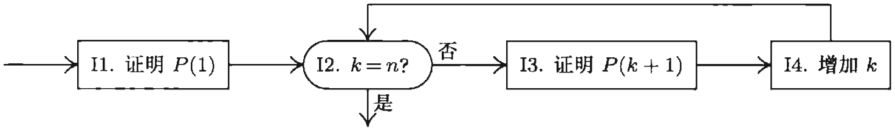
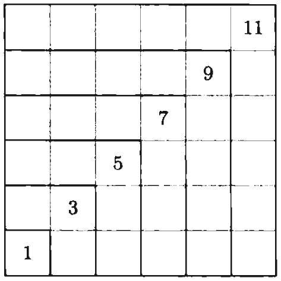
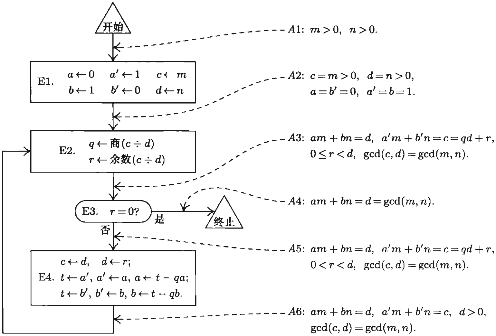
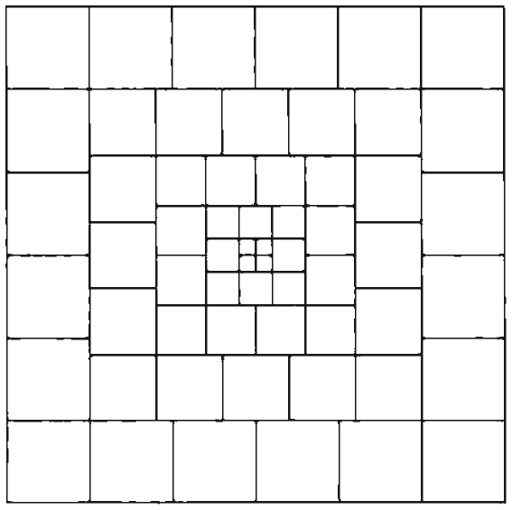

# 1.2.1 数学归纳法

令 $P(n)$ 是关于整数 $n$ 的某个命题, 例如 $\text{“}n$ 乘 ($n+3$) 是偶数”, 或者 “如果 $n \geq 1 0$, 那么 $2^n>n^3\text{”}$. 假定我们需要证明 $P(n)$ 对于所有正整数 $n$ 为真, 一种重要做法是:

(a) 证明 $\underline { { P } } ( 1 )$ 为真;

(b) 证明 “如果 $P ( 1 ) , P ( 2 ) , \ldots , P ( n )$ 全部为真, 那么 $P(n + 1)$ 也为真”, 这个证明应对任意正整数 $n$ 成立.

考虑下面的等式序列, 自古以来, 有许多人独立地发现了它们:

$$
\begin{aligned}1&=1^2\\1+3&=2^2\\1+3+5&=3^2\\1+3+5+7&=4^2\end{aligned}
$$

$$
1+3+5+7+9=5^2.
\qquad \text{(1)}
$$

可以用如下公式表示一般的性质:

$$
1+3+\cdots+(2n-1)=n^2,
\qquad \text{(2)}
$$

我们暂且把这个等式称为 $P(n)$. 我们希望证明 $P(n)$ 对于所有正整数 $n$ 为真. 遵循上面概述的过程, 我们有:

(a)“因为 $1 = 1 ^ { 2 }$, 所以 $P(1)$ 为真.”

(b)“如果 $P ( 1 ) , \ldots , P ( n )$ 全部为真, 特别是 $P ( n )$ 为真, 于是式 (2) 成立; 对两端加 $2 n + 1$, 得到

$$
1 + 3 + \cdots + ( 2 n - 1 ) + ( 2 n + 1 ) = n ^ { 2 } + 2 n + 1 = ( n + 1 ) ^ { 2 } .
$$

由此证明, $P(n + 1)$ 也为真.”

我们可以把这个方法看成一个算法式证明过程. 事实上, 如果已经确立上面的步骤 (a) 和 (b), 那么下述算法对于任意正整数 $n$, 都能产生 $\tilde{P}(n)$ 为真的证明.

算法Ⅰ(构造证明). 给定一个正整数 $n$, 这个算法将产生 $\widetilde{P}(n)$ 为真的证明.

I1. [证明 P(1). ] 置 $k \gets 1$, 并且根据 (a), 输出 P(1) 的证明.

I2. $\left[ \begin{array} { l } k = n ? \end{array} \right]$ 如果 $k=n$, 算法终止, 所需的证明已经输出.

I3. 证明 $P(k + 1).$ 根据 (b), 输出 “如果 $P ( 1 ) , \ldots , P ( k )$ 全部为真, 那么 $P(k + 1)$ 为真” 的证明, 并输出: “我们已经证明 $P ( 1 ) , \ldots , P ( k )$, 因此 $P(k + 1)$ 为真.”

I4. [增加 $k$.]$k$ 增加 1, 转到步骤 I2.

*图 2　算法 I: 数学归纳法*

由于这个算法显然对于任意给定的正整数 $n$ 给出了 $P(n)$ 的证明, 因而这个包含步骤 (a) 和 (b) 的证明技法在逻辑上是正确的. 这个证明称为数学归纳法证明.

应该把数学归纳法的概念同科学中常说的归纳推理区别开来. 科学家对客观事物进行特定的观察, 通过 “归纳” 创立解释事实的某种一般性理论或者假说. 例如, 我们可以观察式 (1) 中的 5 个关系式, 并且提出式 (2). 在这种意义下, 归纳无非是我们对于这一情况的最佳猜测, 数学家称之为经验结果或者猜想.

另一个例子有助于理解科学中的归纳. 用 $p(n)$ 表示正整数 $n$ 的分拆数目, 就是以不同方式把 $n$ 写成正整数之和的数目, 其中不考虑分拆次序. 因为 5 恰好可以用 7 种方式分拆:

$$
1+1+1+1+1=2+1+1+1=2+2+1=3+1+1=3+2=4+1=5,
$$

所以有 $p(5)=7,$ 事实上, 很容易确定前几个数的分拆数目:

$$
p ( 1 ) = 1 \quad p ( 2 ) = 2 \quad p ( 3 ) = 3 \quad p ( 4 ) = 5 \quad p ( 5 ) = 7 .
$$

至此, 我们可能想要通过归纳提出假设: 分拆序列 $p(2),p(3),\ldots$ .. 取遍所有素数. 为了检验这个假设, 我们继续计算 $p(6)$ 并观察结果, 竟然 $p(6)=11$, 同我们的猜测一致!

遗憾的是, $p ( 7 )$ 等于 15, 一切化为泡影, 我们必须从头再试. 众所周知, 尽管斯里尼瓦瑟·拉马努金成功猜测和证明了有关数 $p ( n )$ 的许多重要结果, 但它们是非常复杂的. 进一步的资料可参见哈代的《拉马努金》[Ramanujan(London:Cambridge University Press,1940)] 一书的第 6 章和第 8 章. 另见 7.2.1.4 节.]

数学归纳法与刚才解释的归纳完全不同. 它不是猜测, 而是对命题的确定性证明. 实际上, 它是对无限多命题的证明, 对于每个 $n$ 都有一个命题. 这种方法之所以称为 “归纳法”, 仅仅因为人们在应用数学归纳法之前, 必须首先设法确定要证明的结论. 今后在本书中, “归纳 (法)” 一词仅表示数学归纳法证明.

有一种证明式 (2) 的几何方法, 如 [图3](#fig-1-3) 所示. 对于 $n=6$, 我们把 $n^{2}$ 个方格分组成 $1+3+\cdots+(2n-1)$ 个方格. 但是, 在最后的分析中, 我们仅当证明对于所有的 $n$ 都能够实现这种构造时, 才能把这幅图看成是一种 “证明”, 而且这样的图示证明本质上与用归纳法证明是相同的.

我们对式 (2) 的证明仅仅使用了 (b) 的一个特例, 即我们只证明了 $P(n)$ 为真蕴涵 $P(n + 1)$ 为真. 这种简单情形很常见, 也很重要, 下面的例子更加说明了归纳法的能力. 我们用 $F _ { 0 } = 0 ,$ $F_{1} = 1$ 以及其后每一项是它前面两项之和的规则, 定义斐波那契数列 $F _ { 0 } , \: F _ { 1 } , \: F _ { 2 } , \ldots$. 因此, 这个数列开头的几项是 0,1,1,2,3,

*图 3　奇数之和是平方数*

$5 ,   8 ,   1 3 ,   \ldots .$ 我们将在 1.2.8 节详述该数列的性质. 现在我们证明, 如果令 $\phi { = } ( 1 + \sqrt { 5 } ) / 2$, 那么对于所有正整数 $n$, 有

$$
F_n\le\phi^{n-1},
\qquad \text{(3)}
$$

我们称这个公式为 $P(n)$

如果 $n=1$, 那么 $F_{1} = 1 = \phi^{0} = \phi^{1 - 1}$, 所以步骤 (a) 已经完成. 对于步骤 (b), 我们首先注意到 $P(2)$ 亦为真, 因为 $F_{2}=1<1.6<\phi^{1}=\phi^{2-1}$. 现在, 如果 $\bar { P } ( \tilde { 1 } ) , \: \bar { P } ( \tilde { 2 } ) , \: \ldots , \: \bar { P } ( n )$ 全部为真, 并且 $n > 1$, 那么我们特别知道 P(n−1) 和 $P(n)$ 为真, 所以 $F_{n - 1} \leq \phi^{n - 2}, F_n \leq \phi^{n - 1}.$ 两式相加, 得到

$$
F_{n+1}=F_{n-1}+F_n\le\phi^{n-2}+\phi^{n-1}=\phi^{n-2}(1+\phi).
\qquad \text{(4)}
$$

数 $\phi$ 有一条重要性质, 也是我们对该题选择这个数的根源, 即

$$
1+\phi=\phi^2.
\qquad \text{(5)}
$$

把式 (5) 代入式 (4), 得出 $F _ { n + 1 } \leq \phi ^ { n }$, 这就是 $P(n + 1)$. 所以步骤 (b) 已经完成, 而式 $(3) 已$ 经由数学归纳法得到证明. 请注意, 这里我们采用两种不同的方法实现了步骤 (b) 的证明: 当 $n=1$ 时, 直接证明 $P(n + 1)$ 为真; 当 $n > 1$ 时, 则利用归纳方法. 这样做是必要的, 因为当 $n = 1$ 时提及 $P(n - 1) = P(0)$ 是不合法的.

数学归纳法还可以用来证明有关算法的问题, 例如欧几里得算法的下述推广.

算法 E (推广的欧几里得算法). 给定两个正整数 $m$ 和 $n$, 计算它们的最大公因数 $d$, 并计算两个未必为正数的整数 $a$ 和 $b$, 使得 $a m + b n = d .$

E1.[初始化.] 置 $a ^ { \prime } \leftarrow b \leftarrow 1 , \quad a \leftarrow b ^ { \prime } \leftarrow 0 , \quad c \leftarrow m , \quad d \leftarrow n .$

E2.[除法.] 令 $q$ 和 $r$ 分别是用 $d$ 除 $c$ 所得的商和余数. (我们有 $c = q d + r$ 和 $0\le r<d.\ )$

E3.[余数为 0?] 如果 $r=0$, 算法终止, 此时有 $a m + b n = d$, 正如所求.

E4.[循环.] 置 $c \leftarrow d , \enspace d \leftarrow r , \enspace t \leftarrow a ^ { \prime } , \enspace a ^ { \prime } \leftarrow a , \enspace a \leftarrow t - q a , \enspace t \leftarrow b ^ { \prime } , \enspace b ^ { \prime } \leftarrow b , \enspace b \leftarrow t - q b$, 然 后返回 E2.

如果从这个算法中去掉变量 $a , \: b , \: a ^ { \prime } , \: b ^ { \prime }$, 并且用 $m$ 和 $n$ 表示辅助变量 $c$ 和 $d$, 我们就得到了原来的算法 1.1E. 这个新算法增加的一点功能是确定系数 $a$ 和 $b$. 假定 $m=1769$, $n=551$, 我们相继得到 (每次执行 E2 后):

|  |  |  |  |  |  |  |  |
| --- | --- | --- | --- | --- | --- | --- | --- |
| a′ | a | b′ | 6 | C | d | q | r |
| 1 | 0 | 0 | 1 | 1769 | 551 | 3 | 116 |
| 0 | 1 | 1 | -3 | 551 | 116 | 4 | 87 |
| 1 | -4 | -3 | 13 | 116 | 87 | 1 | 29 |
| -4 | 5 | 13 | -16 | 87 | 29 | 3 | 0 |

答案是正确的: $5 \times 1769 - 16 \times 551 = 8845 - 8816 = 29$, 这是 1769 和 551 的最大公因数.

问题是如何证明这个算法对于所有 $m$ 和 $n$ 都能得到正确答案. 我们可以令 $P(n)$ 为命题 “算法 E 对于 $n$ 和所有整数 $m$ 有效”, 来应用数学归纳法. 然而, 这样处理难度很大, 还需要证明某些其他事实. 稍作考虑后我们发现, 必须证明关于 $a , b , a ^ { \prime } , b ^ { \prime }$ 的某些事实, 合适的结果就是等式

$$
a'm+b'n=c,\qquad am+bn=d
\qquad \text{(6)}
$$

在步骤 E2 执行后总是成立. 我们可以直接证明这两个等式, 只需注意到当首次转到 E2 时它们肯定成立, 而且 E4 不改变它们的正确性 (见习题 6).

现在我们对 $n$ 归纳, 证明算法 E 是正确的: 如果 $m$ 是 $n$ 的倍数, 算法显然能够正确执行, 因为在第一次到达 E3 时就立即完成了. 当 $n = 1$ 时这种情况总是出现, 剩下的情况仅是 $n > 1$ 且 $m$ 不是 $n$ 的倍数. 在这种情形下, 算法在第一次执行后置 $\tilde { c } \leftarrow \tilde { n }$ 和 $d \leftarrow r$, 并且由于 $r < n$, 按归纳法可以假设, $d$ 的最终值是 $n$ 和 $r$ 的最大公因数. 根据 1.1 节给出的论证, 数偶 $\{ m , n \}$ 和 $\{ n , r \}$ 具有相同的公因数, 特别地, 它们具有相同的最大公因数. 因此 $d$ 是 $m$ 和 $n$ 的最大公因数, 而且由式 (6), $a m + b n = d .$

上面证明中的楷体短语表明, 在归纳法证明中经常使用固定的习惯表述: 当实现 (b) 部分时, 我们不说 “我们现在假设 $P ( 1 ) , P ( 2 ) , \ldots , P ( n )$, 并且用这个假设证明 $P(n+1)\text{”}$, 通常只说 “我们现在证明 $P ( n )$; 按归纳法可以假设, 当 $1 \leq k < n$ 时 $P(k)$ 恒为真”.

如果非常仔细地检查这个论证, 并且稍微改变一下视角, 就能想象出一种可证明任意算法正确性的一般方法. 这种方法的思想是对某个算法画出流程图, 并且在表示计算流程的每个箭头上标记关于当前状态的断言. 如 [图4](#fig-1-4) 所示, 其中的断言依次标记为 ${ \underline { { { A 1 } } } } , \: { \underline { { { A 2 } } } } , \: \ldots , \: { \underline { { { A 6 } } } } .$ (所有这些断言都约定变量为整数, 为节省篇幅略去了这一规定.)A1 给出了算法开始时的初始假设, 而 A4 叙述了我们希望就输出值 $a$, $b$, $d$ 证明的结果.

这个一般方法要求对于流程图中的每个方框证明命题:

如果指向某方框的至少一个箭头上的断言在执行方框内操作之前为真, 那么离开该方框的相关箭头上的所有断言在执行方框内操作之后都为真.　(7)

由此，我们必须证明一些命题，例如E2之前的断言A2或A6分别蕴涵E2之后的A3.(本例中A2是比A6更强的命题，即A2蕴涵A6. 所以我们仅需证明，E2之前的A6蕴涵E2之后的A3. 请注意，A6 中的 $d > 0$ 是保证操作E2有意义的必要条件.）此外，还需要证明A3且 $r = 0$ 蕴涵 A4，A3 且 $r \neq 0$ 蕴涵A5，等等。需要给出的每一项证明都是非常容易的。

*图 4　算法 E 的流程图, 标记了证明算法正确性的断言*

一旦对每个方框都证明了命题 (7), 就可以推出在算法执行期间, 所有断言均为真. 因为我们可以对计算的步数 (即流程图中通过的箭头数) 应用归纳法. 当通过从 “开始” 引出的第一个箭头时, 断言 A1 为真, 因为我们始终假定输入值是符合规定的, 所以第一个箭头上的断言是正确的. 如果第 $n$ 个箭头上的断言为真, 那么根据命题 (7), 第 ($n+1$) 个箭头上的断言亦为真.

利用这种一般方法, 证明一个给定算法是正确算法的难点显然主要在于构造流程图中的正确断言. 这个归纳环节一旦完成, 再证明 “指向某方框的每个断言在逻辑上蕴涵离开该方框的每个断言” 就完全平淡无奇了. 事实上, 一旦找到少数几个难度大的断言, 构造其他断言本身也是平淡无奇之事. 因此在我们的例子中, 只要给定了 A1、A4 和 A6, 要写出 A2、A3 和 A5 就非常简单了. 其中, 断言 A6 是整个证明中最具创造性的部分, 其余的断言原则上都是机械性的补充工作. 因此, 本书后续算法不会按 [图4](#fig-1-4) 的详细程度给出周全的形式证明, 只会叙述关键的归纳断言. 那些断言要么出现在算法之后的讨论中, 要么以带括号的注释形式出现在算法自身的描述中.

这个证明算法正确性的方法还具有另一个更重要的性质: 它反映我们理解算法的途径. 不妨回忆一下, 1.1 节曾经告诫读者, 不能像读小说那样读算法, 而是建议用样本数据实际运行一两次算法. 之所以这样明确提醒读者, 是因为试运行算法的一个例子有助于读者在心中形成各种断言. 我认为, 我们只有在头脑里像 [图4](#fig-1-4) 一样清晰地填好了各种断言, 才会真正理解算法为什么是正确的. 对于人们相互之间正确交流算法, 这个观点在心理学上有一个重要的推论: 向别人解释一个算法时, 始终应该明确陈述那些不能由自动机轻易导出的关键性断言. 例如陈述算法 E 时, 应同时提及断言 A6.

然而细心的读者会注意到, 我们刚才对算法 E 的证明中有一处漏洞. 我们从未证明算法必会终止, 我们只证明了如果算法终止, 那么它会给出正确的答案!

(请注意, 假如我们允许算法 E 的变量 $m , \: n , \: c , \: d , \: r$ 取 $u + v \sqrt{2}$ 形式的值, 其中 $u$ 和 $v$ 为整数, 那么算法 E 依然是有意义的. 这时, 变量 $\overline { { q , } } a , \overline { { b , } } a ^ { \prime } , \overline { { b ^ { \prime } } }$ 依然取整数值. 例如, 如果我们取初始值 $m = 12 - 6\sqrt{2}$ 和 $n = 20 - 10\sqrt{2}$, 这一方法将计算出 “最大公因数” $d = 4 - 2\sqrt{2}$, 以及 $a = + 2$ 和 $b$=-1. 即使在这种扩充假设下, 断言 A1 至 A6 的证明仍然有效. 所以, 所有断言在算法的任何执行过程中均为真. 但是, 如果我们从 $m=1$ 和 $n = \sqrt { 2 }$ 开始, 那么计算就不会终止 (见习题 12). 因此, 断言 A1 至 A6 的证明从逻辑上不能证明算法是有限的.)

通常需要单独证明算法会终止. 但是习题 13 表明, 对于许多重要情形, 可以扩充上面的方法, 将算法终止性的证明作为副产品包括在内.

至此我们已经两次证明了算法 E 的正确性. 为了确保逻辑的严密性, 我们也应尝试证明本小节的第一个算法, 即算法Ⅰ是正确的. 事实上, 我们已经用算法Ⅰ证实了一切归纳法证明的正确性. 如果我们试图证明算法Ⅰ是正确有效的, 就要面对进退维谷的困境——不再次用归纳法就无法真正证明它! 论证将变成循环推理.

在上面的分析中, 整数的每一种性质在证明过程中必定用到了归纳法, 因为如果我们深入到基本概念, 整数本质上就是用归纳法定义的. 因此, 我们可以把这种思想公理化: 任何正整数 $n$ 或者等于 1, 或者可以从 1 开始重复加 1 而得到. 这就足以证明算法Ⅰ是正确的. (关于整数基本概念的严格讨论, 参见 “关于数学归纳法”[“OnMathematicalInduction”, 李昂·汉金, AMM67(1960), 323–338 这篇论文.)

由此可知, 数学归纳法隐含的思想同数的概念有着紧密的关系. 把数学归纳法用于严格证明的第一位欧洲人是意大利科学家弗朗西斯科·马若利科, 那是在 1575 年. 皮埃尔·德·费马在 17 世纪初进一步改进了数学归纳法, 称之为 “无穷递降法”. 布莱士·帕斯卡在其晚期的著作中也明确表述了这个概念 (1653). “数学归纳法” 这个词组是奥古斯塔斯·德·摩根在 19 世纪初创造的. 见 The Penny Cyclopædia 12 (1838), 465-466;AMM 24(1917), 199-207;25(1918), 197-201;Arch.Hist. Exact Sci.9(1972), 1-21.] 对数学归纳法更深入的讨论, 参见乔治·波利亚的《数学中的归纳与类比》[Induction and Analogy inMathematics, Princeton,N.J.:PrincetonUniversity Press,1954] 一书的第 7 章.

像上面那样用断言和归纳表述的算法证明, 主要发明人是罗伯特·弗洛伊德. 他指出, 一种程序设计语言中每个操作的语义定义均可表示成一条逻辑规则, 该规则明确表述能够根据什么断言在操作执行之前为真, 证明什么断言在操作执行之后为真见 “AssigningMeaningsto Programs”, Proc. Symp. Appl. Math., Amer. Math. Soc., 19 (1967), 19–32]. 彼得·诺尔 [BIT6(1966), 310-316] 也独立提出了类似的思想, 他把断言称为 “一般瞬象”. 查尔斯·霍尔 [CACM14(1971), 39-45] 引人了 “不变量” 的概念, 这是一个重大改进. 后来人们发现, 不如把弗洛伊德的证明方向颠倒过来, 从一个操作执行之后应该成立的断言, 推断操作执行之前必须成立的 “最弱前条件”. 这样一来, 我们可以从输出结果的具体要求开始逆推, 发现保证正确的新算法. [见艾兹赫尔·戴克斯特拉, CACM18(1975), 453-457;A Discipline ofProgramming, Prentice-Hall, 1976. ]

实际上, 归纳断言概念的原始形态出现于 1946 年, 与荷曼·哥斯廷和约翰·冯·诺依曼发明流程图在同一时期, 他们最初的流程图包含了 “断言框”, 与 [图4](#fig-1-4) 中的断言极为相似. [参见冯·诺依曼, Collected Works 5,New York: Macmillan, 1963,91–99. 另请参阅阿兰·图灵早期对于验证的评述和图表介绍, 见 Report of a Conference on High Speed Automatic CalculatingMachines,Cambridge Univ.,1949,67-68; 经弗朗西斯·莫里斯和克利福德·琼斯评论, 重刊于 Annals of the History of Computing6 (1984), 139–143. ]

编写程序时, 若在恰当的时机提供有关机器状态的一两个命题, 极其有助于了解程序的工作原理.

在绝对的理论的方法中, 要为断言提供严密的数学证明. 在绝对的实验的方法中, 要在机器上用各种各样的初始条件试验, 仅当断言在每种情况下都成立时, 才能宣告程序是正确的.

这两种方法都有不足之处

——图灵, FerrantiMark|程序设计手册 (1950)

#### 习题

1\. [05] [答案](./answers/1-2-1.md#ans-1-2-1-1) 如果要对所有非负整数 $n = 0,   1,   2,   \ldots$. 而不是对 $\bar{n} = 1,   2,   3,   \ldots$. 证明某个命题 $P(n)$, 请说明应如何修改数学归纳法证明思路.

2\. [15] [答案](./answers/1-2-1.md#ans-1-2-1-2)  下面的定理证明必定有错. 错在哪里?

定理. 令 $a$ 为任意正数. 对于所有正整数 $n$, 有 $a^{n - 1} = 1.$

证明. 如果 $n =1$, 那么 $a^{n - 1} = a^{1 - 1} = a^{0} = 1$. 于是, 按照归纳法, 假设定理对 $1 , \: 2 , \: \ldots , \: n$ 为真, 我们有

$$
a^{(n + 1) - 1} = a^n = \frac{a^{n - 1} \times a^{n - 1}}{a^{(n - 1) - 1}} = \frac{1 \times 1}{1} = 1,
$$

所以定理对 $n+1$ 也为真.

3\. [18] [答案](./answers/1-2-1.md#ans-1-2-1-3)  下面定理的归纳法证明表面上是正确的, 但是由于某种原因, 当 $n=6$ 时, 等式左端给出 $\frac{1}{2} + \frac{1}{6} + \frac{1}{12} + \frac{1}{20} + \frac{1}{30} = \frac{5}{6}$, 而右端给出 $\frac{3}{2} - \frac{1}{6} = \frac{4}{3}$, 你能找出错误吗?

定理.

$$
\frac{1}{1 \times 2}+\frac{1}{2 \times 3}+\cdots+\frac{1}{(n-1) \times n}=\frac{3}{2}-\frac{1}{n}.
$$

证明. 我们对 $n$ 用归纳法. 对于 $n =1$, 显然 $3 / 2 - 1 / n = 1 / ( 1 \times 2 )$. 假设定理对于 $n$ 为真, 那么

$$
\begin{aligned}\frac{1}{1 \times 2}+\cdots+\frac{1}{(n-1) \times n}+\frac{1}{n \times(n+1)} & \\=\frac{3}{2}-\frac{1}{n}+\frac{1}{n(n+1)} & =\frac{3}{2}-\frac{1}{n}+\left(\frac{1}{n}-\frac{1}{n+1}\right)=\frac{3}{2}-\frac{1}{n+1}\end{aligned}
$$

4\. [20] 证明: 斐波那契数除满足等式 (3) 外, 还对一切正整数 $n$ 满足 $F _ { n } \geq \phi ^ { n - 2 } .$

5\. [21] [答案](./answers/1-2-1.md#ans-1-2-1-5) 素数是>1 且除 1 和其自身外没有其他正整数因数的整数. 根据此定义和数学归纳法, 证明每个 $>1$ 的整数可以写成一个或多个素数的乘积. (一个素数视为单个素数的 “乘积”, 也就是它本身.)

6\. [20] [答案](./answers/1-2-1.md#ans-1-2-1-6) 证明: 如果式 (6) 在步骤 E4 之前成立, 那么在执行 E4 后也成立.

7\. [23] [答案](./answers/1-2-1.md#ans-1-2-1-7)  对于 $1 ^ { 2 } ,   2 ^ { 2 } - 1 ^ { 2 } ,   3 ^ { 2 } - 2 ^ { 2 } + 1 ^ { 2 } ,   4 ^ { 2 } - 3 ^ { 2 } + 2 ^ { 2 } - 1 ^ { 2 } ,   5 ^ { 2 } - 4 ^ { 2 } + 3 ^ { 2 } - 2 ^ { 2 } + 1 ^ { 2 }$ 等和式, 给出求和规则, 并用归纳法予以证明.

▶ 8. [答案](./answers/1-2-1.md#ans-1-2-1-8)  $[25]$ (a) 用数学归纳法, 证明尼科马彻斯 (约公元 100 年) 提出的下述定理: $1^{3} = 1, \; 2^{3} = 3 + 5,$ $3^{3} = 7 + 9 + 11,   4^{3} = 13 + 15 + 17 + 19,   \cdot \cdot \cdot$ (b) 利用这个结果, 证明著名的公式 $1^{3} + 2^{3} + \cdots + n^{3} =$ $( 1 + 2 + \cdots + n ) ^ { 2 }$

注记: 这个公式有一个引人注目的几何解释, 由沃伦·勒什鲍给出, 如 [图5](#fig-1-5) 所示, 见 Math.Gazette49(1965), 200. 其思想同尼科马彻斯定理和 [图3](#fig-1-3) 有关. 在马丁·加德纳的《打结的甜甜圈》(KnottedDoughnuts,NewYork:Freeman,1986) 第 16 章以及约翰·康威和理查德·盖伊的《数字之篇》(TheBook of Numbers,New York:Copernicus,1996) 第 2 章中, 可以找到其他 “无字” 证明.]

$$
边长  = 5 + 5 + 5 + 5 + 5 + 5 = 5 \cdot (5 + 1)
$$

$$
\begin{aligned} 边长  &= 5 + 4 + 3 + 2 + 1 + 1 + 2 + 3 + 4 + 5 \\&= 2 \cdot (1 + 2 + \cdots + 5)\end{aligned}
$$

$$
\begin{aligned} 面积  &= 4 \cdot 1^{2} + 4 \cdot 2 \cdot 2^{2} + 4 \cdot 3 \cdot 3^{2} + 4 \cdot 4 \cdot 4^{2} + 4 \cdot 5 \cdot 5^{2} \\&= 4 \cdot (1^{3} + 2^{3} + \cdots + 5^{3})\end{aligned}
$$

*图 5　习题 8(b) 的几何形式*

9\. [20] 用归纳法证明: 如果 $0 < a < 1$, 那么 $( 1 - a ) ^ { n } \geq 1 - n a .$

10\. [M22] [答案](./answers/1-2-1.md#ans-1-2-1-10) 用归纳法证明: 如果 $n \geq 1 0$, 那么 $2 ^ { n } > n ^ { 3 } .$

11\. [M30] [答案](./answers/1-2-1.md#ans-1-2-1-11) 试求下式的简单求和公式, 并予以证明:

$$
\frac{1^{3}}{1^{4}+4}-\frac{3^{3}}{3^{4}+4}+\frac{5^{3}}{5^{4}+4}-\cdots+\frac{(-1)^{n}(2n+1)^{3}}{(2n+1)^{4}+4}
$$

12\. [M25] [答案](./answers/1-2-1.md#ans-1-2-1-12) 正文提到, 可以推广算法 E, 使之能够接受形如 $u + v \sqrt{2}$ 的输入值, 其中 $u$ 和 $v$ 为整数. 说明如何推广, 使得计算仍然可以用初等方法完成 (即不用 $\sqrt { 2 }$ 的无穷十进制展开式). 另外证明, 如果 $m = 1$ 和 $n = \sqrt { 2 }$, 则计算不会终止.

▶ 13. [M23] [答案](./answers/1-2-1.md#ans-1-2-1-13) 扩充算法 E, 添加新变量 $T$, 在每一步的开头增加操作 $T \leftarrow T + 1$. (因此, T 相当于统计执行步数的计数器.) 假定 T 的初值为 0, 则 [图4](#fig-1-4) 中的断言 A1 变为 $\text{“}m>0,n>0,T=0\text{”}$. 同样, 应该把附加条件 $T = 1$ 添加到 A2. 请说明如何把附加条件添加到各个断言中, 使得 $A 1 , \; A 2 , \ldots , \; A 6$ 中的任何一个断言都蕴涵 $T \leq 3 n$, 而且仍然可以实现归纳法证明. (因此, 计算至多在 3n 步必定终止.)

14\. [50] (弗洛伊德) 编写一个计算机程序, 它接受的输入是某种程序设计语言的程序以及可选的断言. 为了证明这个计算机程序是正确的, 它试图补充所需的其他断言. [例如, 力求编写一个程序, 它能在只给定 A1、A4 和 A6 的条件下, 证明算法 E 是正确的. 关于该问题的进一步讨论, 见罗伯特·弗洛伊德和詹姆斯·金发表在国际信息处理联合会大会会刊 (IFIPCongressproceedings,1971) 上的论文.]

▶ 15. [HM28] [答案](./answers/1-2-1.md#ans-1-2-1-15) (广义归纳法) 正文说明了如何证明依赖于单个整数 $n$ 的命题 $P(n)$, 但是没有描述如何证明依赖于两个整数 $m$ 和 $n$ 的命题 $P ( m , n )$. 在后面这种情况, 证明通常是通过某种 “二重归纳法” 给出的, 这种归纳法常常显得不易理解. 实际上, 有一个比简单归纳法更一般的重要原理, 它不仅适用于两个整数的情况, 还适用于证明关于不可数集合的命题, 例如对于所有实数 $x$ 的命题 $P(x)$. 这个一般原理称为良序 (well-ordering) 原理.

令是集合 $S$ 上的一个关系, 它具备下述性质:

(i) 给定 S 中的元素 $x$, $y$, $z$, 如果 $\widehat{x} \prec \widehat{y}$ 且 $\hat { y } \prec \hat { z }$, 那么 $x \prec z$

(ii) 给定 S 中的元素 $x$ 和 $y$, 下面三种可能性中恰有一种为真: $x \prec y, x = y, y \prec x;$

(iii) 如果 A 是 S 的任意非空子集, 那么 A 中存在元素 $x$, 对于 A 中的所有元素 $y$, 满足 $\bar { x } \preceq y$ (即 $\overline { { x } } \prec \overline { { y } }$ 或 $x = y )$

这个关系称为 $S$ 的一个良序关系. 例如, 按照平常的 “小于” 关系<, 正整数显然是良序的.

(a) 证明: 按照<关系, 所有整数的集合不是良序的.

(b) 在所有整数的集合上定义一个良序关系.

(c) 按照<关系, 所有非负实数的集合是良序的吗?

(d)(词典序) 令 $S$ 按<关系是良序的; 对于 $n > 0$, 令 $T _ { n }$ 为 S 中元素 $x _ { j }$ 的所有 $n$ 元组 $( x _ { 1 } , x _ { 2 } , \ldots , x _ { n } )$ 的集合. 如果存在某个 $k ( 1 \leq k \leq n )$ 使得 $x _ { j } = y _ { j }$ 对于 $1 \leq j < k$ 恒成立, 而 $\widehat { x } _ { k } \prec \widehat { y } _ { k }$ 那么定义 $( x _ { 1 } , x _ { 2 } , \ldots , x _ { n } ) \prec ( y _ { 1 } , y _ { 2 } , \ldots , y _ { n } )$. 人是 $T _ { n }$ 的一个良序关系吗?

(e) 接 (d), 令 $T = \textstyle \bigcup _ { n \geq 1 } T _ { n }$. 如果对于某个 $k \leq \min(m, n)$ $x_{j} = y_{j}$ 对于 $1 \leq j < k$ 恒成立, 而 $x _ { k } \prec y _ { k } ,$; 或者如果 $m < n$, 而 $x _ { j } = y _ { j }$ 对于 $1 \leq j \leq m$ 恒成立, 那么定义 $( x _ { 1 } , x _ { 2 } , \ldots , x _ { m } ) \prec$ $( y _ { 1 } , y _ { 2 } , \ldots , y _ { n } ) . \prec$ 是 T 的一个良序关系吗?

(f) 证明: 是 S 的一个良序关系, 当且仅当它满足上面的条件 (i) 和 (ii), 并且不存在无穷序列 $x_{1}$ $x _ { 2 } , x _ { 3 } , \ldots$ 满足 $j \geq 1$ 时恒有 $x _ { j + 1 } \prec x _ { j }$

(g) 令 S 按照是良序的, 令 $P(x)$ 是关于 S 中的元素 $x$ 的一个命题. 证明: 如果在 $\widetilde{P}(y)$ 对于所有 $y \prec x$ 均为真的假定下能够证明 $P(x)$, 那么 $\widetilde{P}(x)$ 对于 S 中的所有 $x$ 为真.

[注记: (g) 部分是前面提到的简单归纳法的推广. 在 S 为正整数集合时, 它就是正文中讨论的数学归纳法这种简单情形. 此时要求证明, 如果 $P(y)$ 对于所有正整数 $y < 1$ 均为真, 那么 P(1) 为真; 这无异于直接要求证明 $P(1)$, 因为 $P(y)$ 对于所有这样的 $y$ (空集) 必定为真. 由此可知, 在很多情况下无需单独论证 P(1).

把 (d) 同 (g) 结合起来, 就得到了 $n$ 元归纳法的强有力的方法, 用于证明关于 $n$ 个正整数 $m _ { 1 } , \ldots ,$ $m _ { n }$ 的命题 $P ( m _ { 1 } , \ldots , m _ { n } )$

(f) 部分在计算机算法中有进一步应用: 如果把一道计算的每个状态 $x$ 映射到属于良序集 S 的元素 $f(x)$, 使得计算的每一步能够把状态 $x$ 变成状态 $y$, 且有 $f(y) \prec f(x)$, 那么算法必定终止. 这个原理推广了此前证明算法 1.1E 终止时使用的 $n$ 值严格递减的论证.]
