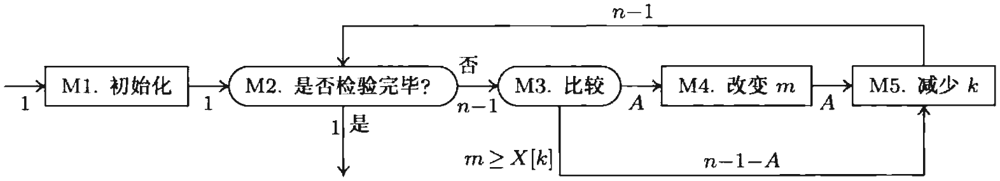
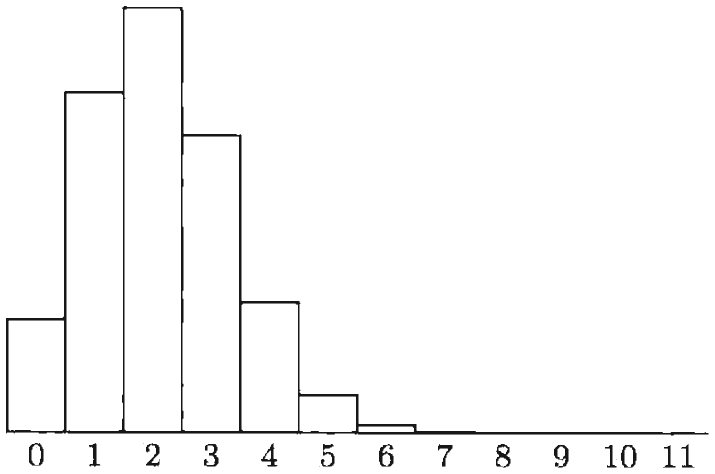
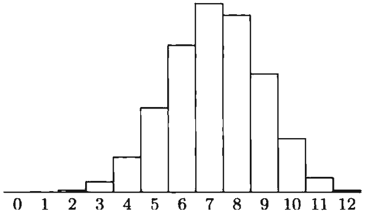

# 1.2.10 典型算法分析

现在我们应用前面几小节讨论的一些方法, 研究一个典型的算法.

算法 M (找出最大值). 给定 $n$ 个元素 $X [ 1 ] , X [ 2 ] , \ldots , X [ n ]$, 我们将求出 $m$ 和 $j$, 使得 $m = X[j] = \max_{1 \leq i \leq n} X[i]$, 其中 $j$ 是满足这个关系式的最大下标.

M1.[初始化.] 置 $j   \leftarrow   n , \; k   \leftarrow   n - 1 , \; m   \leftarrow   X [ n ]$. (算法执行期间, 有 $m = X[j] =$ $\operatorname { m a x } _ { k < i \leq n } X [ i ] . \enspace )$

M2.[是否检验完毕?] 如果 $k=0$, 算法终止.

M3. [比较.] 如果 $X [ k ] \leq m$, 转到 M5.

M4. [改变 $m$. ] 置 $j \leftarrow k,   m \leftarrow X[k]$. (这个 $m$ 值是新的当前最大值.)

M5. 减小 $k$.]$k$ 减 1, 然后返回 M2.

这个相当明显的算法看起来也许很平常, 无需考虑仔细分析, 但是, 它其实能充分展示可以用于更复杂的算法的研究途径. 在计算机程序设计中, 算法分析是非常重要的, 因为对于一种应用通常有若干可供使用的算法, 我们希望知道哪个算法是最佳的.

算法 M 需要固定的存储空间, 所以我们仅分析执行它所需的时间. 为此, 我们将计算每一步执行的次数 (见 [图9](#fig-1-9)):

|  |  |  |
| --- | --- | --- |
| 算法步号 |  | 执行次数 |
| M1 |  | 1 |
| M2 |  | n |
| M3 |  | n− 1 |
| M4 |  | A |
| M5 |  | n−1 |

只要知道每一步执行的次数, 我们就可以确定它在特定计算机上的执行时间.

*图 9　算法 M. 箭头线上的数字标识经过每条路径的次数. 注意必须满足 “基尔霍夫第一定律”: 进出每个结点的流量必须相等*

在上面的算法各步执行次数表中, 除量 A 之外的每个数都是已知的, 而 A 是我们必须改变当前最大值的次数. 为了完成分析, 我们来讨论 A 这个有趣的量.

分析 A 时通常要求 A 的最小值 (为了乐观的人), A 的最大值 (为了悲观的人), A 的平均值 (为了持观望态度的人) 以及 A 的标准差 (衡量取值距离平均值远近的定量指标).

A 的最小值为 0, 此时有

$$
X [ n ] = \operatorname* { m a x } _ { 1 \leq k \leq n } X [ k ] ;
$$

最大值为 $n-1$, 此时有

$$
X [ 1 ] > X [ 2 ] > \cdots > X [ n ] .
$$

因此平均值介于 0 和 $n-1$ 之间. 平均值等于 $\frac{1}{2}n$ 吗? 等于 $\sqrt { n }$ 吗? 为了回答这个问题, 我们需要定义平均值的含义. 而为了正确地定义平均值, 我们对于输入数据 $X [ 1 ] , X [ 2 ] , \ldots , X [ n ]$ 的性质必须做某些假定. 我们将假定 X[$k$] 两两取值不同, 并且这些值的 $n$! 个排列都是等可能的. (在大多数情况下这是一种合理的假定, 但是也可以在其他假定下进行分析, 见本小节末尾的习题.)

算法 M 的性能不依赖于 $X[k]$ 的精确值, 而只与它们的大小顺序有关. 例如, 若 $n = 3$ 我们假定下面 6 种可能性是等可能的.

$$
\begin{aligned} 状态  & \quad & A 值  & \quad &  状态  & \quad & A 值  \\X[1] < X[2] & < X[3] & 0 & \quad & X[2] < X[3] & < X[1] & 1 \\X[1] < X[3] & < X[2] & 1 & \quad & X[3] < X[1] & < X[2] & 1 \\X[2] < X[1] & < X[3] & 0 & \quad & X[3] < X[2] & < X[1] & 2\end{aligned}
$$

当 $n=3$ 时, A 的平均值为 $( 0 + 1 + 0 + 1 + 1 + 2 ) / 6 = 5 / 6 .$

显而易见, 我们可以取 $X [ 1 ] , X [ 2 ] , \ldots , X [ n ]$ 为 1,2,..., $n$ 按某个顺序的排列. 我们按假定, 把这样 $n$! 种排列视为等可能的. A 取 $k$ 值的概率为

$$
p_{nk}=(\text{满足 }A=k\text{ 的 }n\text{ 元排列数})/n!.
\qquad \text{(1)}
$$

例如, 从上面的表可得 $p_{30}=\tfrac13,\quad p_{31}=\tfrac12,\quad p_{32}=\tfrac16.$

我们照例把平均值 (“均值” 或 “期望值”) 定义为

$$
A_n=\sum_k k p_{nk},
\qquad \text{(2)}
$$

把方差 $V _ { n }$ 定义为 $( \tilde { A } - \tilde { A } _ { n } ) ^ { 2 }$ 的平均值, 因此

$$
\begin{aligned}V_n&=\sum_k(k-A_n)^2p_{nk}=\sum_k k^2p_{nk}-2A_n\sum_k kp_{nk}+A_n^2\sum_kp_{nk}\\&=\sum_k k^2p_{nk}-2A_n A_n+A_n^2=\sum_k k^2p_{nk}-A_n^2.\end{aligned}
\qquad \text{(3)}
$$

最后, 我们把标准差 $\sigma _ { n }$ 定义为 $\sqrt{V_n}.$

标准差 $\sigma _ { n }$ 的意义或许最好这样理解: 对于所有 $r \geq 1$, A 落在其平均值的 $r\sigma_n$ 邻域以外的概率小于 $1 / r ^ { 2 }$. 例如, $| A - A _ { n } | > 2 \sigma _ { n }$ 的概率 $< 1 / 4$. (证明: 令 $p$ 为所述概率. 于是如果 $p > 0$, 那么 $(A - A_{n})^{2}$ 的平均值大于 $p \cdot (r \sigma_n)^2 + (1 - p) \cdot 0$, 即 $\begin{array} { l } { V _ { n } > p r ^ { 2 } V _ { n } . } \\ \end{array} )$ 这一关系通常称为切比雪夫不等式, 虽然它其实首先是由边奈美发现的 [Comptes Rendus Acad.Sci. 37(Paris, 1853), 320–321 ].

我们可以通过确定概率 $p_{n k}$ 来测定 A 的特性. 不难用归纳方式进行计算: 按照等式 (1), 我们需要计算满足 $A=k$ 的 $n$ 元排列数. 令此数为 $P _ { n k } = n ! \: p _ { n k } .$

考虑关于 {1,2,..., $n$}的所有排列 $x _ { 1 } x _ { 2 } \ldots x _ { n }$, 见 1.2.5 节. 如果 $x_1=n$, 那么 A 值比它对 $x _ { 2 } \ldots x _ { n }$ 得到的值大 1; 如果 $x_{1} \neq n$, 那么 A 值与它对 $x _ { 2 } \ldots x _ { n }$ 得到的值完全相同. 因此我们求出 $P_{nk} = P_{(n-1)(k-1)} + (n-1)P_{(n-1)k}$, 等价于

$$
p_{nk}=\frac1n p_{(n-1)(k-1)}+\frac{n-1}n p_{(n-1)k}.
\qquad \text{(4)}
$$

如果我们给出初始条件

$$
p_{1k}=\delta_{0k};\qquad p_{nk}=0\quad\text{如果 }k<0,
\qquad \text{(5)}
$$

则可由上式确定 $p _ { n k } ,$

利用生成函数, 我们可以获得关于 $p_{n k}$ 的信息. 令

$$
G_n(z)=p_{n0}+p_{n1}z+\cdots=\sum_k p_{nk}z^k.
\qquad \text{(6)}
$$

我们知道 $A \leq n - 1$, 所以对于很大的 $k$ 值有 $p _ { n k } = 0$; 因此 $G_{n}(z)$ 其实是一个多项式, 我们只是为了方便而把它写成无限和.

从等式 (5) 可得 $G_{1}(z) = 1$; 从式 (4) 可得

$$
G_n(z)=\frac zn G_{n-1}(z)+\frac{n-1}n G_{n-1}(z)=\frac{z+n-1}n G_{n-1}(z).
\qquad \text{(7)}
$$

(读者应当仔细研究等式 (4) 与 (7) 之间的关系.) 我们现在可以看出

$$
\begin{aligned}G_n(z)&=\frac{z+n-1}nG_{n-1}(z)=\frac{z+n-1}n\frac{z+n-2}{n-1}G_{n-2}(z)=\cdots\\&=\frac1{n!}(z+n-1)(z+n-2)\ldots(z+1)\\&=\frac1{z+n}\binom{z+n}n,\end{aligned}
\qquad \text{(8)}
$$

所以 $G _ { n } ( z )$ 实质上是一个二项式系数!

这个函数出现在上一小节的等式 1.2.9-(27) 中, 当时我们有

$$
G_{n}(z)=\frac{1}{n!}\sum_{k}\left[\frac{n}{k}\right]z^{k-1},
$$

所以 $p_{n k}$ 可以通过斯特林数表示:

$$
p_{nk}=\genfrac{[}{]}{0pt}{} n{k+1}\big/n!.
\qquad \text{(9)}
$$

[图 10](#fig-1-10) 显示当 $n = 12$ 时 $p_{n}\bar{k}$ 的近似数值.

*图 10　步骤 M4 在 $n=12$ 时的概率分布. 均值为 $58301/27720$, 约等于 $2.10$. 方差约为 $1.54$*

现在我们只需要把 $p_{nk}$ 的值插入等式 (2) 和 $( 3 )$, 求出要求的平均值. 但是说得轻巧做起来难. 事实上, 很少能够显式地确定概率 $| p _ { n k }$. 在多数问题中, 我们知道生成函数 $G _ { n } ( z )$, 但是对于实际的概率知之甚少. 重要的事实在于, 我们能够从生成函数本身轻而易举地确定均值和方差.

为了看出这一点, 让我们假定有一个生成函数, 它的系数表示概率:

$$
G(z)=p_0+p_1 z+p_2 z^2+\cdots,
$$

其中 $p_{k}$ 是某个事件取 $k$ 值的概率. 我们希望计算均值和方差

$$
\operatorname{mean}(G)=\sum_k kp_k,\qquad\operatorname{var}(G)=\sum_k k^2p_k-\bigl(\operatorname{mean}(G)\bigr)^2.
\qquad \text{(10)}
$$

利用微分方法, 不难发现如何求这两个值. 注意到

$$
G(1)=1,
\qquad \text{(11)}
$$

因为 $G ( 1 ) = p _ { 0 } + p _ { 1 } + p _ { 2 } + \cdots$ ·是所有可能的概率之和. 同样由 $\begin{array} { r } { \hat { G } ^ { \prime } ( z ) = \sum _ { k } k p _ { k } z ^ { k - 1 } } \end{array}$, 我们有

(11)

$$
\operatorname{mean}(G)=\sum_k kp_k=G'(1).
\qquad \text{(12)}
$$

最后再次利用微分, 我们得到 (见习题 2)

$$
\operatorname{var}(G)=G''(1)+G'(1)-G'(1)^2.
\qquad \text{(13)}
$$

等式 (12) 和 (13) 通过生成函数给出所求的均值和方差的表达式.

在例题中, 我们希望计算 $G_{n}^{\prime}(1) = A_{n}$. 从等式 (7) 我们得到

$$
G _ { n } ^ { \prime } ( z ) = \frac { 1 } { n } G _ { n - 1 } ( z ) + \frac { z + n - 1 } { n } G _ { n - 1 } ^ { \prime } ( z ) ;
$$

$$
G_{n}^{\prime}(1)=\frac{1}{n}+G_{n-1}^{\prime}(1).
$$

再由初始条件 $G_{1}^{\prime}(1) = 0$ 求出

$$
A_n=G_n'(1)=H_n-1.
\qquad \text{(14)}
$$

这是所求的执行 M4 步的平均次数; 当 $n$ 很大时, 它近似等于 lnn. [注记: $A + 1$ 的 $r$ 阶矩, 即 $\textstyle \sum _ { k } ( k + 1 ) ^ { r } p _ { n k }$, 等于 $\left[ z ^ { n } \right] ( 1 - z ) ^ { - 1 } \sum _ { k } \left\{ _ { k } ^ { r } \right\} \left( \ln \frac { 1 } { 1 - z } \right) ^ { k }$, 近似值为 $( \ln n ) ^ { r }$. 见皮特·罗斯, CACM9(1966), 342. A 的分布最早由弗里德里克·福斯特和艾伦·斯图尔特研究, 见 J.Roy. Stat. Soc. B16 (1954), 1–22. ]

我们可以用同样的方式计算方差 $V_{n}$. 首先, 让我们提出一个重要的简化结果.

定理 A. 令 $G$ 和 H 是满足 $G ( 1 ) = H ( 1 ) = 1$ 的两个生成函数. 如果 mean(G) 和 var(G) 按照式 (12) 和 (13) 定义, 我们有

$$
\operatorname{mean}(GH)=\operatorname{mean}(G)+\operatorname{mean}(H);\qquad\operatorname{var}(GH)=\operatorname{var}(G)+\operatorname{var}(H).
\qquad \text{(15)}
$$

在后面我们要证明这个定理. 它告诉我们, 生成函数之积的均值与方差可以化为均值之和与方差之和.

$Q _ { n } ( z ) = ( z + n - 1 ) / n$, 我们有 $Q_{n}^{\prime}(1)=1 / n,\ Q_{n}^{\prime \prime}(1)=0.$ 因此

$$
\mathrm{mean}(Q_n) = \frac{1}{n}, \quad \mathrm{var}(Q_n) = \frac{1}{n} - \frac{1}{n^2}.
$$

最后, 由于 $G_{n}(z) = \prod_{k = 2}^{n} Q_{k}(z)$, 推出

$$
\mathrm{mean}(G_n) = \sum_{k=2}^{n} \mathrm{mean}(Q_k) = \sum_{k=2}^{n} \frac{1}{k} = H_n - 1,
$$

$$
\mathrm{var}(G_{n}) = \sum_{k = 2}^{n} \mathrm{var}(Q_{k}) = \sum_{k = 1}^{n} \left( \frac{1}{k} - \frac{1}{k^{2}} \right) = H_{n} - H_{n}^{(2)}.
$$

综上所述, 我们已经求出要求的与量 A 有关的统计值:

$$
A=\left(\min\,0,\quad\operatorname{ave}H_n-1,\quad\max\,n-1,\quad\operatorname{dev}\sqrt{H_n-H_n^{(2)}}\right).
\qquad \text{(16)}
$$

本书将一直使用式 (16) 中的记号描述其他概率量的统计特性.

我们已经完成算法 M 的分析, 其中新出现的内容是对概率论的介绍. 对于本书中的大多数应用而言, 初等概率论就足够了: 我们已经给出均值、方差和标准差的定义和简单的计数方法, 足以应付我们要提出的大部分问题. 更复杂的算法会帮助我们学会熟练推算概率.

让我们来考虑几道简单的概率问题, 练习使用这些方法. 首先想到的极有可能是掷硬币问题: 假定我们掷一枚硬币 $n$ 次, 每一次抛掷得到正面朝上的概率为 $p$, 那么正面朝上的平均次数是多少? 标准差是多少?

我们考虑的是硬币两面不均匀的情况, 也就是说, 我们不做 $\begin{array} { l } { \dot { p } = \frac { 1 } { 2 } } \\ \end{array}$ 的假定. 这样的问题才更有趣味, 何况实际的硬币本来就都是不均匀的 (不然我们就无法区分正面与背面了).

像前面那样, 我们令 $p _ { n k }$ 为掷 $n$ 次硬币出现 $k$ 次正面的概率, 并且令 $G _ { n } ( z )$ 为对应的生成函数. 显然我们有

$$
p_{nk}=p\,p_{(n-1)(k-1)}+q\,p_{(n-1)k},
\qquad \text{(17)}
$$

其中 $q = 1 - p$ 是背面朝上的概率. 同以前一样, 我们从等式 (17) 出发, 证明 $G_{n}(z) =$ $( q + p z ) G _ { n - 1 } ( z )$, 进而从明显的初始条件 $G _ { 1 } ( z ) = q + p z$ 得到

$$
G_n(z)=(q+pz)^n.
\qquad \text{(18)}
$$

因此, 由定理 A,

$$
\mathrm { m e a n } ( G _ { n } ) = n \; \mathrm { m e a n } ( G _ { 1 } ) = p n .
$$

$$
\mathrm{var}(G_{n}) = n \mathrm{var}(G_{1}) = (p - p^{2})n = pqn.
$$

所以, 对于出现正面的次数, 我们得到统计量

$$
(\min\,0,\quad\operatorname{ave}pn,\quad\max\,n,\quad\operatorname{dev}\sqrt{pqn}).
\qquad \text{(19)}
$$

图 11 显示当 $p = \frac{3}{5}   ,   n = 12$ 时 $p _ { n   \ \tilde { k } }$ 的值. 当标准差同 $\sqrt { n }$ 成正比, 而且最大值与最小值之差同 $n$ 成正比时, 我们可以认为状态关于平均值是 “稳定” 的.

*图 11　掷硬币的概率分布: 12 次独立抛掷, 每次成功概率均为 $3/5$*

让我们来处理一个更简单的问题. 假定在某个过程中获得数值 1,2,..., $n$ 的概率是相等的. 这种情况的生成函数为

$$
G(z)=\frac1n z+\frac1n z^2+\cdots+\frac1n z^n=\frac1n\frac{z^{n+1}-z}{z-1}.
\qquad \text{(20)}
$$

经过某些比较困难的计算之后, 我们求出

$$
\begin{aligned} { G ^ { \prime } ( z ) } & { { } = \frac { n z ^ { n + 1 } - ( n + 1 ) z ^ { n } + 1 } { n ( z - 1 ) ^ { 2 } } , } \\ { G ^ { \prime \prime } ( z ) } & { { } = \frac { n ( n - 1 ) z ^ { n + 1 } - 2 ( n + 1 ) ( n - 1 ) z ^ { n } + n ( n + 1 ) z ^ { n - 1 } - 2 } { n ( z - 1 ) ^ { 3 } } . } \\ \end{aligned}
$$

要想计算均值和方差, 我们需要知道 $G^{\prime}(1)$ 和 $G^{\prime\prime}(1)$; 但是代入 $z =1$ 时, 我们得到的这两个等式变成 $0/0$ 型不定式. 因此, 必须求当 $z$ 趋近 1 时的极限, 而这并不轻松.

幸好可以采用一种简单得多的处理方法. 由泰勒定理, 我们有

$$
G(1+z)=G(1)+G'(1)z+\frac{G''(1)}{2!}z^2+\cdots,
\qquad \text{(21)}
$$

因此, 我们只需在生成函数 (20) 中用 z+1 替换 $z$, 直接读出系数:

$$
G ( 1 + z ) = \frac { 1 } { n } \frac { ( 1 + z ) ^ { n + 1 } - 1 - z } { z } = 1 + \frac { n + 1 } { 2 } z + \frac { ( n + 1 ) ( n - 1 ) } { 6 } z ^ { 2 } + \cdots .
$$

由此推出 $G^{\prime}(1)=\frac{1}{2}(n+1),G^{\prime\prime}(1)=\frac{1}{3}(n+1)(n-1)$. 这个均匀分布的统计量为

$$
\left(\min\,1,\quad\operatorname{ave}\frac{n+1}2,\quad\max\,n,\quad\operatorname{dev}\sqrt{\frac{(n+1)(n-1)}{12}}\right).
\qquad \text{(22)}
$$

此时, 偏差近似等于 0.289n, 表示状态明显不稳定.

最后我们来证明定理 A, 把我们的结论与古典概率论联系起来. 设 X 是一个仅取非负整数值的随机变量, $X=k$ 的概率为 $p_{k}$. 这种情况下, $G ( z ) = p _ { 0 } + p _ { 1 } z + p _ { 2 } z ^ { 2 } + \cdots$. 称为 X 的概率生成函数, $G(e^{it}) = p_0 + p_1e^{it} + p_2e^{2it} + \cdots$ 习惯上称为这个分布的特征函数. 由这样的两个生成函数之积给出的分布称为两个分布的卷积 (convolution), 它代表分别具有相应分布的两个独立随机变量之和.

随机变量 $X$ 的均值 (或平均值) 通常称为它的期望值, 记作 EX. 于是, X 的方差是 E $X^{2} = (\mathrm{E} X)^{2}$, 使用这个记号, 在 X 仅取非负整数值的情况下, X 的概率生成函数 $G ( z ) = \operatorname { E } z ^ { X }$, 也就是 $z ^ { X }$ 的期望值. 同样, 如果 X 是一个或者是真或者是假的命题, 使用艾弗森记号 (式 1.2.3-(16)), X 为真的概率是 $\mathrm{Pr}(X) = \mathrm{E}[X]$

均值和方差只不过是索瓦尔德·蒂勒于 1889 年发现的所谓半不变量或者累积量中的两个量 [见安德斯·哈尔德, InternationalStatisticalReview68(2000), 137-153]. 半不变量 $\kappa _ { 1 } , \kappa _ { 2 } , \kappa _ { 3 } , .$. 由规则

$$
\frac{\kappa_1t}{1!}+\frac{\kappa_2t^2}{2!}+\frac{\kappa_3t^3}{3!}+\cdots=\ln G(e^t)
\qquad \text{(23)}
$$

定义. 我们有

$$
\kappa _ { n } = \frac { d ^ { n } } { d t ^ { n } } \operatorname { l n } G ( e ^ { t } ) \Big | _ { t = 0 } ,
$$

特别地, 因为 $\textstyle G ( 1 ) = \sum _ { k } p _ { k } = 1$, 有

$$
\kappa_1=\left.\frac{e^tG'(e^t)}{G(e^t)}\right|_{t=0}=G'(1)
$$

以及

$$
\kappa _ { 2 } = \frac { e ^ { 2 t } G ^ { \prime \prime } ( e ^ { t } ) } { G ( e ^ { t } ) } + \frac { e ^ { t } G ^ { \prime } ( e ^ { t } ) } { G ( e ^ { t } ) } - \frac { e ^ { 2 t } G ^ { \prime } ( e ^ { t } ) ^ { 2 } } { G ( e ^ { t } ) ^ { 2 } } \Big | _ { t = 0 } = G ^ { \prime \prime } ( 1 ) + G ^ { \prime } ( 1 ) - G ^ { \prime } ( 1 ) ^ { 2 } .
$$

由于半不变量是通过生成函数的对数定义的, 定理 A 显然成立, 而且实际上可以推广定理 A, 使之适用于所有的半不变量.

正态分布的半不变量除平均值和方差之外全部为 0. 在正态分布中, 我们可以大大加强切比雪夫不等式: 正态分布的随机值同均值之差小于标准差的概率为

$$
\frac{1}{\sqrt{2\pi}} \int_{-1}^{+1} e^{-t^2/2}   dt.
$$

所占比例约为 68.268949213709%. 两者之差小于两倍标准差的概率大约为 95.449973610364%, 小于三倍标准差的概率大约为 99.730020393674%. 由等式 (8) 和 (18) 定义的分布当 $n$ 很大时为近似正态分布 (见习题 13 和 14).

如果一个随机变量不大可能偏离其均值太多, 则我们经常需要确切知道这样的信息. 有两个极为简单然而很有效的公式可以方便估计这样的概率, 这两个公式称为尾概率不等式. 如果 X 的概率生成函数是 $G ( z )$, 那么

$$
\Pr(X\le r)\le x^{-r}G(x)\qquad\text{如果 }0<x\le1;
\qquad \text{(24)}
$$

$$
\Pr(X\ge r)\le x^{-r}G(x)\qquad\text{如果 }x\ge1.
\qquad \text{(25)}
$$

这两个不等式很容易证明: 如果 $G(z) = p_{0} + p_{1}z + p_{2}z^{2} + \cdots$, 那么当 $0 < x \leq 1$ 时, 有

$$
\operatorname* { P r } ( X \leq r ) = p _ { 0 } + p _ { 1 } + \cdots + p _ { \lfloor r \rfloor } \leq x ^ { - r } p _ { 0 } + x ^ { 1 - r } p _ { 1 } + \cdots + x ^ { \lfloor r \rfloor - r } p _ { \lfloor r \rfloor } \leq x ^ { - r } G ( x ) ;
$$

而当 $x\ge 1$ 时, 有

$$
\operatorname* { P r } ( X \geq r ) = p _ { \lceil r \rceil } + p _ { \lceil r \rceil + 1 } + \cdots \leq x ^ { \lceil r \rceil - r } p _ { \lceil r \rceil } + x ^ { \lceil r \rceil + 1 - r } p _ { \lceil r \rceil + 1 } + \cdots \leq x ^ { - r } G ( x ) .
$$

选择 $x$ 的值使不等式 (24) 和 (25) 的右端达到或者接近最小值, 左端通常可以获得非常接近真实尾概率的上界.

习题 21-23 说明几种重要情形的尾概率不等式. 这些不等式是一个一般原理的特例, 该原理最早见于安德雷·柯尔莫哥洛夫的著作 [Grundbegriffe der Wahrscheinlichkeitsrechnung(Springer,1933)]: 如果 $f(t) \geq s > 0$ 对于所有 $t \geq r$ 成立, $f(t) \geq 0$ 对于所有在随机变量 $X$ 定义域内的 $t$ 成立, 那么只要 Ef(X) 存在, 就有 $\operatorname* { P r } ( X \geq r ) \leq s ^ { - 1 } \operatorname { E } f ( X )$. 当 $f(t) = x^{t}$ 且 $s = x ^ { r }$ 时, 我们得到式 (25). [伯恩斯坦贡献了关键思路, 见 Uchenye zapiskiNauchno-Issledovatel'skikhkafedr Ukrainy 1 (1924), 38–48. ]

#### 习题

1\. [10] [答案](./answers/1-2-10.md#ans-1-2-10-1) 根据等式 (4) 和 (5), 确定 $p _ { n 0 }$ 的值, 从算法 M 的观点解释得到的结果.

2\. [HM16] [答案](./answers/1-2-10.md#ans-1-2-10-2) 从等式 (10) 推导等式 (13).

3\. [M15] [答案](./answers/1-2-10.md#ans-1-2-10-3) 如果我们利用算法 M 求 1000 个随机排序、两两不同的项的最大值, 那么步骤 M4 执行次数的最小值、最大值、平均值和标准差是什么? (给出这几个量的十进制近似值.)

4\. [M10] [答案](./answers/1-2-10.md#ans-1-2-10-4) 对于掷硬币试验的等式 (17), 给出 $p _ { n k }$ 的显式闭合式.

5\. [M13] [答案](./answers/1-2-10.md#ans-1-2-10-5) [图11](#fig-1-11) 的分布的均值和标准差是什么?

6\. [HM27] [答案](./answers/1-2-10.md#ans-1-2-10-6) 我们已经计算了重要的概率分布 (8) (18) (20) 的均值和方差. 这几种分布的第三个半不变量 $\kappa _ { 3 }$ 分别是什么?

7\. [M27] [答案](./answers/1-2-10.md#ans-1-2-10-7) 在对算法 M 的分析中, 我们假定所有 X[$k$] 两两不同. 如果我们改用更弱的假定: $X [ 1 ] , X [ 2 ] , \ldots , X [ n ]$ 恰好包含 $m$ 个不同的值; 服从这个约束条件的具体取值是随机取的. 在这种情况下 A 的概率分布是什么?

8\. [M20] [答案](./answers/1-2-10.md#ans-1-2-10-8) 假定每个 X[$k$] 的值是从含有 M 个不同元素的集合中随机取出的, 于是 $X[1],X[2],\ldots,X[n]$ 的取值有 $M ^ { n }$ 种可能选择, 视为是等可能的. 所有 X[$k$] 两两不同的概率有多大?

9\. [M25] [答案](./answers/1-2-10.md#ans-1-2-10-9) 推广上题的结果, 对于这些 X 中恰好出现 $m$ 个不同值的概率求一个公式. 用斯特林数表示你的答案.

10\. [M20] [答案](./answers/1-2-10.md#ans-1-2-10-10) 结合上面三道习题的结果, 在每个 X 是从 M 个不同对象的集合中随机选取的假设下, 求 $A =k$ 的概率计算公式.

▶ 11. [M15] [答案](./answers/1-2-10.md#ans-1-2-10-11) 如果我们把 $G(z)$ 改为 $F ( z ) = z ^ { n } G ( z )$, 分布的半不变量会发生什么变化?

12\. [HM21] [答案](./answers/1-2-10.md#ans-1-2-10-12) 当 $G ( z ) \; = \; p _ { 0 } + p _ { 1 } z + p _ { 2 } z ^ { 2 } + \cdots$. 代表一个概率分布时, $M_n=\textstyle\sum_k k^n p_k$ 和 $m _ { n } =$ $\sum_{k} (k - M_{1})^{n} p_{k}$ 这两个量分别称为 “$n$ 阶矩” 和 “$n$ 阶中心矩”. 证明 $G(e^{t}) = 1 + M_{1}t + M_{2}t^{2} / 2! + \cdots;$ 然后用阿伯加斯特公式 (习题 1.2.5-21) 证明

$$
\kappa _ { n } = \sum _ { \stackrel { k _ { 1 } , k _ { 2 } , \ldots , k _ { n } \geq 0 } { k _ { 1 } + 2 k _ { 2 } + \cdots - n } } \frac { ( - 1 ) ^ { k _ { 1 } + k _ { 2 } + \cdots + k _ { n } - 1 } n ! \left( k _ { 1 } + k _ { 2 } + \cdots + k _ { n } - 1 \right) ! } { k _ { 1 } ! \; 1 ! ^ { k _ { 1 } } k _ { 2 } ! \; 2 ! ^ { k _ { 2 } } \ldots k _ { n } ! \; n ! ^ { k _ { n } } } M _ { 1 } ^ { k _ { 1 } } M _ { 2 } ^ { k _ { 2 } } \ldots M _ { n } ^ { k _ { n } } .
$$

特别地, $\kappa _ { 1 } = M _ { 1 } , \kappa _ { 2 } = M _ { 2 } - M _ { 1 } ^ { 2 }$ (这是我们已知的), $\kappa _ { 3 } = M _ { 3 } - 3 M _ { 1 } M _ { 2 } + 2 M _ { 1 } ^ { 3 }$ $\kappa_{4} = M_{4} -$ $4M_{1}M_{3}+12M_{1}^{2}M_{2}-3M_{2}^{2}-6M_{1}^{4}.$ 当 $n \geq 2$ 时, 通过中心矩 $m _ { 2 } , m _ { 3 } , \ldots$ 表示 $\kappa _ { n }$ 的类似表达式是什么? 13. [HM38] [答案](./answers/1-2-10.md#ans-1-2-10-13) 具有均值 $\mu _ { n }$ 和标准差 $\sigma _ { n }$ 的概率生成函数 $G _ { n } ( z )$ 构成一个序列. 如果对于 $t$ 的所有实数值有

$$
\operatorname* { l i m } _ { n \to \infty } e ^ { - i t \mu _ { n } / \sigma _ { n } } G _ { n } ( e ^ { i t / \sigma _ { n } } ) = e ^ { - t ^ { 2 } / 2 } ,
$$

就说这个序列趋近正态分布. 利用等式 (8) 给出的 $G _ { n } ( z )$, 证明 $G _ { n } ( z )$ 趋近正态分布.

注记: 可以证明, 此处定义的 “趋近正态分布” 等价于

$$
\operatorname* { l i m } _ { n \to \infty } \operatorname* { P r } \left( { \frac { X _ { n } - \mu _ { n } } { \sigma _ { n } } } \leq x \right) = { \frac { 1 } { \sqrt { 2 \pi } } } \int _ { - \infty } ^ { x } e ^ { - t ^ { 2 } / 2 }   d t   ,
$$

其中 $X_{n}$ 是一个随机量, 它的概率由 $G _ { n } ( z )$ 确定. 这是列维重要的 “连续性定理” 的一个特例, 列维定理是概率论的基本数学结果, 它的证明远离本书正题, 不过并不是非常困难 [可参阅格涅坚科和柯尔莫哥洛夫的《相互独立随机变数之和的极限分布》[^cn101-1], 钟开莱的英译版见 LimitDistributions for Sums ofIndependent Random Variables, (Reading, Mass.: Addison-Wesley, 1954) ].

14\. [HM30] [答案](./answers/1-2-10.md#ans-1-2-10-14) (棣莫弗) 利用上题的约定, 证明由等式 (18) 给出的二项分布 $G _ { n } ( z )$ 趋近正态分布.

15\. [HM23] [答案](./answers/1-2-10.md#ans-1-2-10-15) 当某个量取 $k$ 值的概率为 $e^{-\mu}(\mu^{k}/k!)$ 时, 就说它有均值为 $\mu$ 的泊松分布.

(a) 这一组概率的生成函数是什么?

(b) 它的各个半不变量的值是什么?

(c) 证明: 当 $n \to \infty$ 时, 均值为 np 的泊松分布在习题 13 的意义下趋近正态分布.

16\. [M25] [答案](./answers/1-2-10.md#ans-1-2-10-16) 假定 X 是随机变量, 其值是由 $g_1(z),g_2(z),\ldots,g_r(z)$ 生成的概率分布的混合. 所谓 “混合” 是指它以概率 $p_{k}$ 取值 $g _ { k } ( z )$, 其中 $p _ { 1 } + p _ { 2 } + \cdots + p _ { r } = 1$. X 的生成函数是什么? 通过 $g _ { 1 } , \; g _ { 2 } , \; \ldots , \; g _ { r }$ 的均值和方差表示 X 的均值和方差.

17\. [M27] [答案](./answers/1-2-10.md#ans-1-2-10-17) 令 $f(z)$ 和 $g(z)$ 是表示概率分布的生成函数.

(a) 证明 $h(z) = g(f(z))$ 也是表示概率分布的生成函数.

(b) 通过 $f(z)$ 和 $g(z)$ 解释 $h$($z$) 的意义. (由 $h$($z$) 的系数表示的概率具有什么意义?)

(c) 给出用 $f$ 和 $g$ 的均值和方差表示 $h$ 的均值和方差的公式.

18\. [M28] [答案](./answers/1-2-10.md#ans-1-2-10-18) 假定算法 M 中, $X [ 1 ] , X [ 2 ] , \ldots , X [ n ]$ 的取值恰好包含 $k _ { 1 }$ 个 1, $k _ { 2 }$ 个 $2 , \ldots , k _ { n }$ 个 $n$, 它们按随机次序排列. (这里

$$
k _ { 1 } + k _ { 2 } + \cdots + k _ { n } = n .
$$

之前正文中假定 $k_1=k_2=\cdots=k_n=1.\ )$ 证明: 在这种推广的情况下, 生成函数 (8) 变成

$$
\left( \frac { k _ { n } z } { k _ { n } } \right) \left( \frac { k _ { n - 1 } z + k _ { n } } { k _ { n - 1 } + k _ { n } } \right) \left( \frac { k _ { n - 2 } z + k _ { n - 1 } + k _ { n } } { k _ { n - 2 } + k _ { n - 1 } + k _ { n } } \right) \ldots \left( \frac { k _ { 1 } z + k _ { 2 } + \cdots + k _ { n } } { k _ { 1 } + k _ { 2 } + \cdots + k _ { n } } \right) \bigg / z ,
$$

约定 $0/0=1$

19\. [M21] [答案](./answers/1-2-10.md#ans-1-2-10-19) 如果 $a _ { k } > a _ { j }$ 对于 $1 \leq j < k$ 都成立, 我们就说 $a _ { k }$ 是序列 $a _ { 1 } \: a _ { 2 } \: \ldots \: a _ { n }$ 的一个右向最大值 (从左到右的最大值). 假定 $a _ { 1 } \: a _ { 2 } \: \ldots \: a _ { n }$ 是 $\{ 1 , 2 , \ldots , n \}$ 的一个排列, 令 $b _ { 1 } \: b _ { 2 } \: \ldots \: b _ { n }$ 是其逆排列, 于是 $a _ { k } = l$ 当且仅当 $b_l=k.$ 证明: $a _ { k }$ 是 $\underline { { a } } _ { 1 } \: \underline { { a } } _ { 2 } \: \ldots \: \underline { { a } } _ { n }$ 的一个右向最大值, 当且仅当 $k$ 是 $b _ { 1 } \: b _ { 2 } \: \ldots \: b _ { n }$ 的一个左向最小值.

▶ 20. [M22] [答案](./answers/1-2-10.md#ans-1-2-10-20) 假定我们要计算 $\operatorname* { m a x } \{ | a _ { 1 } - \tilde { b } _ { 1 } | , | a _ { 2 } - \tilde { b } _ { 2 } | , \ldots , | a _ { n } - \tilde { b } _ { n } | \}$, 其中 $b _ { 1 } \leq b _ { 2 } \leq \cdots \leq b _ { n }$, 证明只要计算 $\operatorname* { m a x } \{ m _ { L } , m _ { R } \}$ 就足够了, 其中

$$
m_L=\max\{a_k-b_k\mid a_k\text{ 是 }a_1a_2\cdots a_n\text{ 的一个右向最大值}\},
$$

$$
m_R=\max\{b_k-a_k\mid a_k\text{ 是 }a_1a_2\cdots a_n\text{ 的一个左向最小值}\}.
$$

因此, 如果各个 $a$ 是按随机顺序排列的, 那么减法必须执行的次数 $k$ 大约仅为 2lnn.]

▶ 21. [HM21] [答案](./answers/1-2-10.md#ans-1-2-10-21) 令 $X$ 为抛掷一枚随机硬币 $n$ 次时出现正面的次数, 其生成函数为 (18). 利用不等式 (25) 证明: 当 $\epsilon \geq 0$ 时,

$$
\operatorname* { P r } ( X \geq n ( p + \epsilon ) ) \leq e ^ { - \epsilon ^ { 2 } n / ( 2 q ) } ,
$$

并且获取对于 $\operatorname* { P r } ( X \leq n ( p - \epsilon ) )$ 的类似估计.

▶ 22. [HM22] [答案](./answers/1-2-10.md#ans-1-2-10-22)  假定 X 具有生成函数 $( q _ { 1 } + p _ { 1 } z ) ( q _ { 2 } + p _ { 2 } z ) \ldots ( q _ { n } + p _ { n } z )$, 其中对于 $1 \leq k \leq n$ 有 $p _ { k } + q _ { k } = 1$ 令 $\mu = \mathrm{E}X = p_{1} + p_{2} + \cdots + p_{n}.$ 证明:

$$
\Pr(X \leq \mu r) \leq (r^{-r}e^{r-1})^{\mu}, \quad  如果  0 < r \leq 1;
$$

$$
\Pr(X \geq \mu r) \leq \left(r^{-r}e^{r-1}\right)^{\mu}, \quad  如果   r \geq 1.
$$

(b) 当 $r \approx 1$ 时, 把上面两个估计式的右端表示成简便的形式. (c) 证明: 如果 $r$ 是充分大的数, 我们有 $\operatorname* { P r } ( X \geq \mu r ) \leq 2 ^ { - \mu r } .$

23\. [HM23] [答案](./answers/1-2-10.md#ans-1-2-10-23) 一个随机变量具有负二项分布, 生成函数为 $(q - pz)^{-n}$, 其中 $q=p+1$. 估计它的尾概率.

[^cn101-1]: 中文版由王寿仁翻译, 科学出版社 1955 年出版. ——译者注
