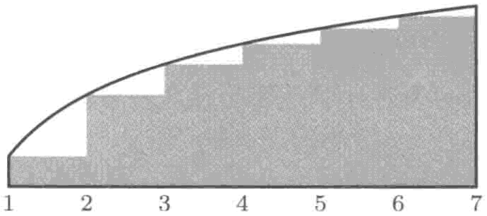

# \*1.2.11.2　欧拉求和公式

欧拉提出了一种极有用的求和方法, 能获得令人满意的近似值. 他的方法是用积分逼近有限和, 在许多情况下, 利用这种手段可以不断改进近似值. [ Commentarii Academiæ Scientiarum Imperialis Petropolitanæ 6 (1732), 68–97. ]

[图12](#fig-1-12) 对比了当 $n = 7$ 时的 $\int_{1}^{n} f(x)   dx$ 与 $\textstyle \sum _ { k = 1 } ^ { n - 1 } f ( k )$. 假定函数 $f(x)$ 可微, 欧拉的策略给出一个计算两者之差的有用公式.

*图 12　比较有限和与积分*

为方便起见, 我们将使用记号

$$
\{x\}=x\bmod1=x-\lfloor x\rfloor.
\qquad \text{(1)}
$$

我们的推导从下述恒等式开始:

$$
\begin{aligned}\int_k^{k+1}\left(\{x\}-\tfrac12\right)f'(x)\,dx&=\left.\left(x-k-\tfrac12\right)f(x)\right|_k^{k+1}-\int_k^{k+1}f(x)\,dx\\&=\tfrac12\bigl(f(k+1)+f(k)\bigr)-\int_k^{k+1}f(x)\,dx.\end{aligned}
\qquad \text{(2)}
$$

(这个结果是由分部积分法得到的.) 等式的两端都对 $1 \leq k < n$ 求和, 得到

$$
\int_1^n\left(\{x\}-\tfrac12\right)f'(x)\,dx=\sum_{1\le k<n} f(k)+\tfrac12\bigl(f(n)-f(1)\bigr)-\int_1^n f(x)\,dx;
$$

即

$$
\sum_{1\le k<n}f(k)=\int_1^n f(x)\,dx-\tfrac12\bigl(f(n)-f(1)\bigr)+\int_1^n B_1(\{x\})f'(x)\,dx,
\qquad \text{(3)}
$$

其中 $B _ { 1 } ( x ) )$ 是多项式 $x - \frac { 1 } { 2 }$. 这便是所求的有限和与积分之间的联系.

我们如果继续分部积分, 可以进一步求近似值. 但是在此之前, 我们先来讨论伯努利数, 即下述无穷级数的系数:

$$
\frac z{e^z-1}=B_0+B_1z+\frac{B_2z^2}{2!}+\cdots=\sum_{k\ge0}\frac{B_kz^k}{k!}.
\qquad \text{(4)}
$$

这个级数的系数出现在形形色色的应用问题中. 雅各布·伯努利去世后出版的著作《猜度术》[ArsConjectandi,1713] 将它介绍给了欧洲数学家. 无独有偶, 差不多在同一时间, 日本的関孝和也发现了这类数——同样在他去世后不久的 1712 年发表 [《関孝和全集》(大阪: 1974), 39–42 ].

前几个伯努利数是

$$
B_0=1,\quad B_1=-\tfrac12,\quad B_2=\tfrac16,\quad B_3=0,\quad B_4=-\tfrac1{30}.
\qquad \text{(5)}
$$

附录 A 的表 3 中列出了接下去的一些数值. 由于

$$
\frac{z}{e^{z}-1}+\frac{z}{2}=\frac{z}{2}\;\frac{e^{z}+1}{e^{z}-1}=-\frac{z}{2}\;\frac{e^{-z}+1}{e^{-z}-1}
$$

是一个偶函数, 因此

$$
B_3=B_5=B_7=B_9=\cdots=0.
\qquad \text{(6)}
$$

如果伯努利数的定义式 (4) 两端同时乘以 $e^{z} - 1$, 并令 $z$ 的同次幂的系数相等, 便得到公式

$$
\sum_k\binom nk B_k=B_n+\delta_{n1}.
\qquad \text{(7)}
$$

(见习题 1.) 现在我们定义伯努利多项式

$$
B_m(x)=\sum_k\binom mk B_k x^{m-k}.
\qquad \text{(8)}
$$

如果 $m=1$, 那么 $B _ { 1 } ( x ) = B _ { 0 } x + B _ { 1 } = x - \textstyle \frac { 1 } { 2 }$, 对应于上面 (3) 中使用的多项式. 如果 $m > 1$ 那么由 (7) 有 $B _ { m } ( 1 ) = B _ { m } = B _ { m } ( 0 )$; 换句话说, $B _ { m } ( \{ x \} )$ 在整数点 x 处不间断.

讲了伯努利多项式和伯努利数, 它们与我们的问题之间有什么关系 $\therefore 2$ 答案立刻揭晓. 我们对等式 (8) 求导数, 得到

$$
\begin{aligned}B'_m(x)&=\sum_k\binom mk(m-k)B_kx^{m-k-1}\\&=m\sum_k\binom{m-1}k B_kx^{m-1-k}\\&=mB_{m-1}(x).\end{aligned}
\qquad \text{(9)}
$$

因此, 当 $\underline { { m } } \geq 1$ 时可以分部积分如下:

$$
\begin{aligned} { \frac { 1 } { m ! } \int _ { 1 } ^ { h } B _ { m } ( \{ x \} ) f ^ { ( m ) } ( x ) \mathop { } \mathopen { } d x = \frac { 1 } { ( m + 1 ) ! } \big ( B _ { m + 1 } ( 1 ) f ^ { ( m ) } } & { { } ( n ) - B _ { m + 1 } ( 0 ) f ^ { ( m ) } ( 1 ) \big ) } \\ { } & { { } - \frac { 1 } { ( m + 1 ) ! } \int _ { 1 } ^ { n } B _ { m + 1 } ( \{ x \} ) f ^ { ( m + 1 ) } ( x ) \mathop { } \mathopen { } d x . } \\ \end{aligned}
\qquad \text{(9)}
$$

据此可以继续改进式 (3) 的近似值, 并且利用式 (6) 得到欧拉的一般公式:

$$
\begin{aligned}\sum_{1\le k<n}f(k)&=\int_1^n f(x)\,dx-\tfrac12(f(n)-f(1))+\frac{B_2}{2!}(f'(n)-f'(1))+\cdots\\&\quad+\frac{(-1)^mB_m}{m!}(f^{(m-1)}(n)-f^{(m-1)}(1))+R_{mn}\\&=\int_1^n f(x)\,dx+\sum_{k=1}^m\frac{B_k}{k!}(f^{(k-1)}(n)-f^{(k-1)}(1))+R_{mn},\end{aligned}
\qquad \text{(10)}
$$

其中

$$
R_{mn}=\frac{(-1)^{m+1}}{m!}\int_1^n B_m(\{x\})f^{(m)}(x)\,dx.
\qquad \text{(11)}
$$

当 $\widetilde{B}_{m}(\{x\})f^{(m)}(x)/m!$ 非常小的时候, 余项 $R_{mn}$ 是很小的. 事实上, 可以证明, 当 $m$ 为偶数时,

$$
\left|\frac{B_m(\{x\})}{m!}\right|\le\frac{|B_m|}{m!}<\frac4{(2\pi)^m}.
\qquad \text{(12)}
$$

[见《具体数学》9.5 节.] 另一方面, 当 $m$ 增加时, $f^{(m)}(x)$ 通常随之变大. 所以对于给定的 n, 存在 m 的 “最佳” 值, 使 $| R _ { m n } |$ 取最小值.

人们已经知道, 当 $m$ 为偶数时, 存在数θ满足: 只要 $\begin{array} { l } { \tilde { f } ^ { ( m + 2 ) } ( x ) \tilde { f } ^ { ( m + 4 ) } ( x ) > 0 } \end{array}$ 对于 $1 < x < n$ 成立, 就有

$$
R_{mn}=\theta\frac{B_{m+2}}{(m+2)!}\bigl(f^{(m+1)}(n)-f^{(m+1)}(1)\bigr),\qquad0<\theta<1.
\qquad \text{(13)}
$$

所以此时余项与第一个舍弃项符号相同, 而绝对值更小. 这个结果有一种更简单的形式, 将在习题 3 证明.

现在让我们把欧拉公式应用到两个重要的例子中. 首先, 置 $f ( x ) = 1 / x$. 它的 m 阶导数为 $\widetilde{f}^{(m)}(x)=(-1)^{m}m!/x^{m+1}$, 所以我们由式 (10) 得到

$$
H_{n-1}=\ln n+\sum_{k=1}^m\frac{B_k}k(-1)^{k-1}\left(\frac1{n^k}-1\right)+R_{mn}.
\qquad \text{(14)}
$$

现在求出

$$
\gamma=\lim_{n\to\infty}(H_{n-1}-\ln n)=\sum_{k=1}^m\frac{B_k}k(-1)^k+\lim_{n\to\infty}R_{mn}.
\qquad \text{(15)}
$$

由于 $\begin{array} { r } { \operatorname* { l i m } _ { n \to \infty } R _ { m n } = - \int _ { 1 } ^ { \infty } B _ { m } ( \{ x \} )   d x / x ^ { m + 1 } } \end{array}$ 存在, 证明确实存在常数 $\gamma .$ 因此可以结合式 (14) 和 (15), 推出调和数的一般近似值:

$$
\begin{aligned} { H _ { n - 1 } } & { { } = \operatorname { l n } n + \gamma + \sum _ { k = 1 } ^ { m } \frac { ( - 1 ) ^ { k - 1 } B _ { k } } { k n ^ { k } } + \int _ { n } ^ { \infty } \frac { B _ { m } ( \{ x \} )  { \mathop { }  { d } } x } { x ^ { m + 1 } } } \\ { } & { { } = \operatorname { l n } n + \gamma + \sum _ { k = 1 } ^ { m - 1 } \frac { ( - 1 ) ^ { k - 1 } B _ { k } } { k n ^ { k } } + O \Big ( \frac { 1 } { n ^ { m } } \Big ) . } \\ \end{aligned}
$$

把 m 换成 m + 1, 得出

$$
H_{n-1}=\ln n+\gamma+\sum_{k=1}^m\frac{(-1)^{k-1}B_k}{kn^k}+O\!\left(\frac1{n^{m+1}}\right).
\qquad \text{(16)}
$$

此外, 我们从等式 (13) 看出, 误差小于第一个舍弃项. 我们可以得到一个特例 (对两端加 $1 / n )$:

$$
H _ { n } = \ln n + \gamma + \frac { 1 } { 2 n } - \frac { 1 } { 1 2 n ^ { 2 } } + \frac { 1 } { 1 2 0 n ^ { 4 } } - \epsilon , \ 0 < \epsilon < \frac { B _ { 6 } } { 6 n ^ { 6 } } = \frac { 1 } { 2 5 2 n ^ { 6 } } .
$$

这就是式 1.2.7-(3). 对于很大的 k, 伯努利数 $B_{k}$ 将变得非常大 (当 $k$ 为偶数时近似等于 $( - 1 ) ^ { 1 + k / 2 } 2 ( k ! / ( 2 \pi ) ^ { k } )$, 所以式 (16) 对于任何固定的 $n$ 值, 不可能扩展为一个收敛的无穷级数.

可以用同样的方法推导斯特林近似式. 这一次我们置 $f(x) = \ln x$, 由式 (10) 得到

$$
\ln(n-1)!=n\ln n-n+1-\tfrac12\ln n+\sum_{1<k\le m}\frac{B_k(-1)^k}{k(k-1)}\left(\frac1{n^{k-1}}-1\right)+R_{mn}.
\qquad \text{(17)}
$$

沿用上面的做法, 我们发现极限

$$
\operatorname* { l i m } _ { n \to \infty } ( \ln n ! - n \ln n + n - { \textstyle { \frac { 1 } { 2 } } } \ln n ) = 1 + \sum _ { 1 < k \leq m } { \frac { B _ { k } ( - 1 ) ^ { k + 1 } } { k ( k - 1 ) } } + \operatorname* { l i m } _ { n \to \infty } R _ { m n }
$$

存在; 暂且把它称为σ(“斯特林常数”). 我们得到斯特林的结果

$$
\ln n!=\left(n+\tfrac12\right)\ln n-n+\sigma+\sum_{1<k\le m}\frac{B_k(-1)^k}{k(k-1)n^{k-1}}+O\!\left(\frac1{n^m}\right).
\qquad \text{(18)}
$$

特别地, 令 $m =5$, 得到

$$
\ln n ! = ( n + { \textstyle { \frac { 1 } { 2 } } } ) \ln n - n + \sigma + { \frac { 1 } { 1 2 n } } - { \frac { 1 } { 3 6 0 n ^ { 3 } } } + O \Big ( { \frac { 1 } { n ^ { 5 } } } \Big ) .
$$

以两端为指数, 求 $e$ 的幂:

$$
n ! = e ^ { \sigma } \sqrt { n } \Big ( \frac { n } { e } \Big ) ^ { n } \exp \Bigg ( \frac { 1 } { 1 2 n } - \frac { 1 } { 3 6 0 n ^ { 3 } } + O \Big ( \frac { 1 } { n ^ { 5 } } \Big ) \Bigg ) .
$$

利用 $e^{\sigma} = \sqrt{2\pi}$ (见习题 5), 展开指数部分, 我们获得最终结果:

$$
n!=\sqrt{2\pi n}\left(\frac ne\right)^n\left(1+\frac1{12n}+\frac1{288n^2}-\frac{139}{51840n^3}-\frac{571}{2488320n^4}+O\!\left(\frac1{n^5}\right)\right).
\qquad \text{(19)}
$$

#### 习题

1\. [M18] [答案](./answers/1-2-11-2.md#ans-1-2-11-2-1) 证明等式 (7).

2\. [HM20] [答案](./answers/1-2-11-2.md#ans-1-2-11-2-2) 请注意, 对于任何序列 $B_{n}$, 而不仅限于由式 (4) 定义的序列, 都能从 (8) 推出 (9). 解释等式 (10) 成立为什么要求序列是由 (4) 定义的.

3\. [HM20] [答案](./answers/1-2-11-2.md#ans-1-2-11-2-3) 令 $C_{mn} = \left( B_m / m! \right) \left( f^{(m-1)}(n) - f^{(m-1)}(1) \right)$ 是欧拉求和公式中的第 $m$ 个修正项. 假定 $f^{(m)}(x)$ 在 $1 \leq x \leq n$ 内不变号, 证明 $| R _ { m n } | \leq | C _ { m n } |$ 对 $m = 2k > 0$ 成立; 换句话说, 证明余项的绝对值不大于计算出的最后一项的绝对值.

4\. [HM20] [答案](./answers/1-2-11-2.md#ans-1-2-11-2-4) (幂的和) 当 $f(x)=x^m$ 时, f 的高阶导数全部为 0, 所以欧拉求和公式用伯努利数给出

$$
S _ { m } ( n ) = \sum _ { 0 \leq k < n } k ^ { m }
$$

这个和的准确值. (伯努利与関孝和当年就是因为研究 $S _ { m } ( n )$ $m = 1 ,   2 ,   3 ,   \ldots$, 才会发现伯努利数.) 用伯努利多项式表示 $S _ { m } ( n )$. 对于 $m=0,1$, 2 验证你的答案. (注意求和范围是 $0 \leq k < n$ 而不是 $1 \leq k < n$; 欧拉求和公式在完全用 0 替换 1 时依然适用.)

5\. [HM30] [答案](./answers/1-2-11-2.md#ans-1-2-11-2-5) 已知

$$
n ! = \kappa   \sqrt { n } \bigg ( \frac { n } { e } \bigg ) ^ { n } \bigg ( 1 + O \bigg ( \frac { 1 } { n } \bigg ) \bigg )   ,
$$

利用沃利斯乘积 (习题 1.2.5-18), 证明 $\dot { \kappa } = \sqrt { 2 \pi } .$ 提示: 考虑 ${ \binom { 2 n } { n } }$, n 取较大的值.]

6\. [HM30] [答案](./answers/1-2-11-2.md#ans-1-2-11-2-6) 证明斯特林近似式对于非整数 $n$ 也成立:

$$
\Gamma ( x + 1 ) = \sqrt { 2 \pi x } \bigg ( \frac { x } { e } \bigg ) ^ { x } \bigg ( 1 + O \bigg ( \frac { 1 } { x } \bigg ) \bigg )   , \quad x \geq a > 0 .
$$

提示: 在欧拉求和公式中令 $f(x) = \ln(x + c)$, 并且应用在 1.2.5 节给出的Γ(x) 的定义. ]

7\. [HM32] [答案](./answers/1-2-11-2.md#ans-1-2-11-2-7)  $1 ^ { 1 } 2 ^ { 2 } 3 ^ { 3 } \ldots n ^ { n }$ 的近似值是什么?

8\. [M23] [答案](./answers/1-2-11-2.md#ans-1-2-11-2-8)  求 $\ln(an^{2}+bn)!$ 带绝对误差 $\mathcal { O } ( n ^ { - 2 } )$ 的近似值. 当 $c$ 为正常数时, 利用前一个渐近值计算 ${ \binom { c n ^ { 2 } } { n } } / ( c ^ { n } { \binom { n ^ { 2 } } { n } } )$ 带相对误差 $\mathcal { O } ( n ^ { - 2 } )$ 的渐近值. 此处, 绝对误差∈是指 (真实值)=(近似值)+€, 相对误差∈是指 (真实值)=(近似值) $( 1 + \epsilon )$

9\. [M25] [答案](./answers/1-2-11-2.md#ans-1-2-11-2-9) 用两种方法求 $\binom { 2 n } { n }$ 带相对误差 $\mathcal{O}(n^{-3})$ 的渐近值: (a) 通过斯特林近似式; (b) 通过习题 1.2.6-47 和式 1.2.11.1-(16).
