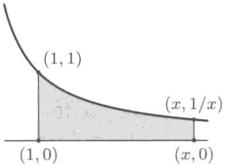

#### 1.2.2 数、幂与对数

现在, 我们来仔细考察一下数, 以此开始对数值数学的研究. 整数 (integernumber) 指的是

$$
\ldots ,   - 3 ,   - 2 ,   - 1 ,   0 ,   1 ,   2 ,   3 ,   \ldots
$$

包括负整数、零和正整数. 有理数 (rationalnumber) 是两个整数之比 (商) $p / q$, 其中 $q$ 为正整数. 实数 (realnumber)$x$ 是具有十进制展开式

$$
x=n+0.d_1d_2d_3\ldots
\qquad \text{(1)}
$$

的量, 其中 $n$ 是整数, 每个 $d _ { i }$ 是 0 与 9 之间的一位数字, 而且数字序列末尾不能是无限多个连续的 9. 表示式 (1) 意味着, 对于所有正整数 $k$,

$$
n+\frac{d_1}{10}+\frac{d_2}{100}+\cdots+\frac{d_k}{10^k}\le x<n+\frac{d_1}{10}+\frac{d_2}{100}+\cdots+\frac{d_k}{10^k}+\frac{1}{10^k}.
\qquad \text{(2)}
$$

有些实数不是有理数, 如

$$
\pi=3.14159265358979\ldots \  圆周率 ,\  圆的周长与直径之比;
$$

$\phi=1.61803398874989\ldots$　黄金分割比 $(1+\sqrt5)/2$, 见 1.2.8 节.

附录 A 中给出了精度达小数点后 40 位的重要常数表. 我们对实数的加法、减法、乘法、除法以及比较大小都很熟悉, 因此不需要讨论这些运算的性质.

求解关于整数的难题时常常用到实数, 而求解关于实数的难题时则常常用到一类更一般的数, 即复数. 复数 (complex number) 是形如 $z = x + iy$ 的量 $z$, 其中 $x$ 和 $y$ 为实数, 而 $i$ 是满足等式 $\tilde { i } ^ { 2 } = - 1$ 的一个特殊量. $x$ 和 $y$ 称为 $z$ 的实部和虚部, $z$ 的模定义为

$$
|z|=\sqrt{x^2+y^2}.
\qquad \text{(3)}
$$

$z$ 的复共轭为 $\overline{z} = x - iy$, 而且有 $z\overline{z} = x^{2} + y^{2} = |z|^{2}$. 复数理论在很多方面比实数理论更简单, 更优美, 不过人们一般认为它更高深. 所以我们在本书中将集中讨论实数, 只在实数变得过于复杂时才用复数.

如果 $u$ 和 $v$ 是实数, 且 $u \leq v$, 那么闭区间 $\left[ u \ldots v \right]$ 是满足 $u \leq x \leq v$ 的实数 $x$ 的集合. 类似地, 开区间 $(u{.}{.}v)$ 是满足 $u < x < v$ 的实数 $x$ 的集合. 同样可以定义半开半闭区间 $\left[ u \ldots v \right)$ 或 $( u \dots v ]$. 此外, 在区间的开端点允许 $u$ 取 $- \infty$ 或者 $v$ 取 $\infty$, 分别表示区间没有下界或者没有上界, 因此 $( - \infty , \infty )$ 代表全部实数的集合, 而 $[ 0 \ldots \infty )$ 代表非负实数的集合.

在这一节, 字母 $b$ 均表示一个正实数. 如果 $n$ 是一个整数, 那么用如下熟悉的规则定义 $b ^ { n }$

$$
b^0=1,\qquad b^n=b^{n-1}b\quad\text{如果 }n>0,\qquad b^n=b^{n+1}/b\quad\text{如果 }n<0.
\qquad \text{(4)}
$$

用归纳法很容易证明, 只要 $x$ 和 $y$ 是整数, 指数定律就成立:

$$
b^{x+y}=b^xb^y,\qquad (b^x)^y=b^{xy}.
\qquad \text{(5)}
$$

如果 $u$ 是一个正实数, $m$ 是一个正整数, 那么总存在唯一的正实数 $v$, 使得 $v ^ { m } = u$, $v$ 称为 $u$ 的 $m$ 次根, 记为 $v = \sqrt [ m ] { u } .$

现在, 我们对于有理数 $r = p / q$, 如下定义 $b ^ { r }$

$$
b^{p/q}=\sqrt[q]{b^p}.
\qquad \text{(6)}
$$

这个定义是由尼克尔·奥里斯姆 (约公元 1360 年) 给出的. 它是一个圆满的定义, 因为 $\bar{b}^{ap/aq} = \bar{b}^{p/q}$, 并且指数定律即使在 $x$ 和 $y$ 为任意有理数时依然成立 (见习题 9).

最后, 对于所有实数值 $x$, 定义 $b ^ { x }$. 首先假定 $b > 1$. 如果 $x$ 是由等式 (1) 给定的, 我们要求

$$
b^{n+d_1/10+\cdots+d_k/10^k}\le b^x<b^{n+d_1/10+\cdots+d_k/10^k+1/10^k}
\qquad \text{(7)}
$$

由上式, $b ^ { x }$ 就被定义为唯一确定的正实数, 因为式 (7) 右端与左端的差为

$$
b^{n + \bar{d}_1/10 + \cdots + \bar{d}_k/10^k}(b^{1/10^k} - 1).
$$

由后面的习题 13 可知, 这个差小于 $b^{n + 1}(b - 1) / 10^{k}$, 因此如果取足够大的 $k$, 就能获得任意精度的 $b ^ { x }$ 值.

例如, 我们求出

$$
10^{0.30102999}=1.9999999739\ldots,\qquad 10^{0.30103000}=2.0000000199\ldots,
\qquad \text{(8)}
$$

所以, 如果 $b = 1 0 , x = 0 . 3 0 1 0 2 9 9 9 \ldots$, 我们就能得到精度达到小数点后第 7 位的 $b ^ { x }$ 之值 (尽管我们仍然无法确定 $b ^ { x }$ 的十进制数展开是 1.999... 还是 2.000...).

当 $b < 1$ 时, 我们定义 $b^{x} = (1/b)^{-x}$; 当 $b=1$ 时, 我们定义 $b^{x} = 1$. 在这样的定义下, 可以证明指数定律 $( 5 )$ 对于 $x$ 和 $y$ 的任何实数值都成立. 定义 $b ^ { x }$ 的这些思想是由约翰·沃利斯 (1655) 和艾萨克·牛顿 (1669) 最先明确提出的.

现在, 我们来看一个重要的问题. 给定正实数 $y$, 我们能否求出一个实数 $x$, 使得 $y = b^{x}?$ 答案是 “能” (假如 $b \neq 1$, 因为当已知 $b ^ { x } = y$ 时, 我们只需逆向利用式 (7), 就能确定 $n$ 和 $d _ { 1 } , d _ { 2 } , \ldots$ 这样得到的数 $x$ 称为以 $b$ 为底 $y$ 的对数, 记为 $x = \operatorname { l o g } _ { b } y$. 根据这个定义, 我们有

$$
x=b^{\log_b x}=\log_b(b^x).
\qquad \text{(9)}
$$

例如, 式 (8) 说明

$$
\log_{10}2=0.30102999\ldots.
\qquad \text{(10)}
$$

从指数定律推出

$$
\log_b(xy)=\log_b x+\log_b y,\qquad\text{如果 }x>0,\quad y>0
\qquad \text{(11)}
$$

和

$$
\log_b(c^y)=y\log_b c,\qquad\text{如果 }c>0.
\qquad \text{(12)}
$$

等式 (10) 是所谓的常用对数, 即以 10 为底的对数. 人们也许认为, 在计算机领域, 二进制对数 (以 2 为底) 更有用, 因为大多数计算机进行二进制算术运算. 实际上我们会看到, 二进制对数确实非常有用, 但最主要的原因并不是二进制运算, 而是因为计算机算法经常产生双向分支 (二路分支). 二进制对数出现得非常频繁, 应当用一种简洁的记号表示它, 所以我们将采纳爱德华·莱因戈尔德的建议, 记

$$
\lg x=\log_2 x.
\qquad \text{(13)}
$$

现在的问题是, $\lg x$ 与 $\log_{10}x$ 之间是否有任何关系. 很幸运, 确实有. 由等式 (9) 和 (12), 我们有

$$
\operatorname { l o g } _ { 1 0 } x = \operatorname { l o g } _ { 1 0 } ( 2 ^ { \operatorname { l g } x } ) = ( \operatorname { l g } x ) ( \operatorname { l o g } _ { 1 0 } 2 ) .
$$

因此, $\lg x = \log_{10} x / \log_{10} 2$, 而且一般情况下有

$$
\log_c x=\frac{\log_b x}{\log_b c}.
\qquad \text{(14)}
$$

等式 $(11)(12)(14)$ 是对数运算的基本规则.

其实在多数情况下, 10 和 2 都不是处理对数运算最便利的底数, 有一个实数记为 $e = 2 . 7 1 8 2 8 1 8 2 8 4 5 9 0 4 5 \ldots$, 以它为底的对数具有更加简单的性质. 习惯上我们把以 $e$ 为底的对数称为自然对数, 记为

$$
\ln x=\log_e x.
\qquad \text{(15)}
$$

这个相当随意的定义 (事实上我们还没有真正定义 $e$) 或许在读者看来并不 “自然”, 不过我

们会发现, 我们越是使用 lnx, 它就越发显得自然. 其实约翰·纳皮尔在 1590 年之前就发现了自然对数 (但形式略有不同, 也没有发现它同幂的联系), 这比发现任何其他类型的对数早很多年. 下面有两个经典的例子, 每本微积分教科书都会证明它们, 它们多少说明了为什么纳皮尔对数堪称 “自然” 对数. (a) 在 [图6](#fig-1-6) 中, 阴影区域的面积等于 lnx. (b) 如果一家银行的年利率为 $r$, 以半年为期计算复利, 那么每一美元一年后本息和为 $(1 + r / 2)^{2}$ 美元; 如果以季度为期计算复利, 得到的是 $(1 + r / 4)^{4}$ 美元; 如果以天为期计算复利,

*图 6　自然对数*

可以得到 $(1+r/365)^{365}$ 美元. 如果连续计算复利, 那么对于存入的每一美元将恰好得到 $\boldsymbol { e } ^ { \boldsymbol { r } }$ 美元 (忽略舍入误差). 在当今这个计算机时代, 许多银行实际上已经采用了这个极限公式.

弗·卡约里曾发表一系列文章, 介绍了对数和指数概念的有趣历史 [AMM20(1913), 5-14,35-47, 75–84, 107–117, 148–151, 173-182, 205-210].

结束这一节前, 我们来考虑如何计算对数. 由不等式 (7) 可以直接看出一个方法: 如果令 $b ^ { x } = y$, 并且使不等式的各个部分都变成原来的 $1 0 ^ { k }$ 次幂, 那么存在整数 $m$, 使得

$$
b^m\le y^{10^k}<b^{m+1}.
\qquad \text{(16)}
$$

为了得到 $y$ 的对数, 只需要把 $y$ 自乘到这个巨大的幂, 然后求出哪个 $m$ 使得结果介于 $b$ 的 $m$ 和 $m + 1$ 次幂之间. 这时, $m / 10^{k}$ 就是精确到小数点后第 $k$ 位的答案.

虽然这个方法显然不切实际, 但是略加修改, 就导出一个简单合理的计算对数的过程. 我们来说明如何计算 $\log_{10} x$, 并且用二进制数把答案表示成

$$
\log_{10}x=n+b_1/2+b_2/4+b_3/8+\cdots.
\qquad \text{(17)}
$$

首先我们向左或者向右移动 $x$ 的小数点, 使其达到 $1 \leq x / 10^n < 10$, 这样确定了整数部分 $n ,$ 为了得到 $b _ { 1 } , \: b _ { 2 } , \ldots$, 置 $x_{0}=x/10^{n}$, 并对于 $k \geq 1$, 置

$$
b_k=0,\qquad x_k=x_{k-1}^2,\qquad\text{如果 }x_{k-1}^2<10;
$$

$$
b_k=1,\qquad x_k=x_{k-1}^2/10,\qquad\text{如果 }x_{k-1}^2\ge 10.
\qquad \text{(18)}
$$

这个计算过程的正确性由下述事实推出: 对于 $k = 0 , 1 , 2 , \ldots ,$

$$
1\le x_k=x^{2^k}/10^{2^k(n+b_1/2+\cdots+b_k/2^k)}<10.
\qquad \text{(19)}
$$

而这很容易用归纳法证明.

当然, 实际计算时我们只能用有限的精度, 所以不能准确地置 $x _ { \underline { { k } } } = x _ { k - 1 } ^ { 2 }$, 而是置 $x _ { k } = x _ { k - 1 } ^ { 2 }$ 舍入或者截断到一定位数的值. 例如, 下面是 $\log_{10}2$ 舍入到 4 位有效数字的计算:

$$
\begin{aligned} { x _ { 0 } } & { { } = \; 2 . 0 0 0 \; ; } \\ { x _ { 1 } } & { { } = \; 4 . 0 0 0 \; , } \\ { x _ { 2 } } & { { } = \; 1 . 6 0 0 \; , } \\ { x _ { 3 } } & { { } = \; 2 . 5 6 0 \; , } \\ { x _ { 4 } } & { { } = \; 6 . 5 4 \; , } \\ { x _ { 5 } } & { { } = \; 4 . 2 9 5 \; , } \\ \end{aligned} \qquad \begin{aligned} { b _ { 1 } } & { { } = \; 0 \; ; } \\ { b _ { 2 } } & { { } = \; 1 \; ; } \\ { b _ { 3 } } & { { } = \; 1 \; ; } \\ { b _ { 5 } } & { { } = \; 1 \; ; } \\ \end{aligned} \qquad \begin{aligned} { x _ { 6 } } & { { } = \; 1 . 8 4 5 \; , } \\ { x _ { 7 } } & { { } = \; 3 . 4 0 4 \; , } \\ { x _ { 8 } } & { { } = \; 1 . 1 5 9 \; , } \\ { x _ { 9 } } & { { } = \; 1 . 3 4 3 \; , } \\ { x _ { 1 0 } } & { { } = \; 1 . 8 0 4 \; , } \\ \end{aligned} \qquad \begin{aligned} { b _ { 6 } } & { { } = \; 1 \; ; } \\ { b _ { 7 } } & { { } = \; 0 \; ; ; } \\ { b _ { 8 } } & { { } = \; 0 \; ; ; } \\ { b _ { 1 0 } } & { { } = \; 0 \; ; ; } \\ \end{aligned}
$$

计算误差引起了误差的传播. $x_{10}$ 的真实舍入值为 1.798, 最终导致 $b_{19}$ 计算错误, 得到二进制值 (0.0100110100010000011...)2, 对应于十进制小数 0.301031..., 而不是式 (10) 中给出的真实值.

采用此类方法时, 我们必须检查位数限制带来的计算误差. 习题 27 推导出这个误差的一个上界. 像上面那样保留 4 位数字计算时, 对数计算值的误差保证低于 0.00044. 上面我们得到了更加精确的答案, 主要是因为我们得到了 $x _ { 0 } , x _ { 1 } , x _ { 2 }$ 和 $x_{3}$ 的准确值.

这个方法既简单, 又饶有趣味, 但是它或许不是在计算机上计算对数的最好方法. 另一种方法在习题 25 中给出.

#### 习题

1\. [00] [答案](./answers/1-2-2.md#ans-1-2-2-1) 最小的正有理数是多少?

2\. [00] [答案](./answers/1-2-2.md#ans-1-2-2-2) 1+0.239999999... 是一个十进制展开式吗?

3\. [02] [答案](./answers/1-2-2.md#ans-1-2-2-3)  $(-3)^{-3}$ 是多少?

4\. [05] [答案](./answers/1-2-2.md#ans-1-2-2-4) (0.125)-2/3 是多少?

5\. [05] 我们通过十进制展开式定义了实数. 讨论怎样改用二进制展开式定义实数, 并且给出替代式 (2) 的定义.

6\. [10] [答案](./answers/1-2-2.md#ans-1-2-2-6)  令 $x = m + 0 . d _ { 1 } d _ { 2 } . . .$. 和 $y = n + 0.e_{1}e_{2}$ ... 为实数. 基于十进制表示, 给出用来判定 $x = y$ $x < y$ 还是 $x> y$ 的规则.

7\. [M23] [答案](./answers/1-2-2.md#ans-1-2-2-7) 已知 $x$ 和 $y$ 为整数, 从式 (4) 给出的定义出发, 证明指数定律.

8\. [25] [答案](./answers/1-2-2.md#ans-1-2-2-8) 令 $m$ 为正整数. 证明每个正实数 $u$ 有唯一的 $m$ 次正根, 做法是给出一种方法, 依次构造根的十进制展开式中的 $n , \: d _ { 1 } , \: d _ { 2 } , \: . \:$. 的值.

9\. [M23] [答案](./answers/1-2-2.md#ans-1-2-2-9) 假定当 $x$ 和 $y$ 为整数时指数定律成立, 证明 $x$ 和 $y$ 为有理数时指数定律也成立.

10\. [18] [答案](./answers/1-2-2.md#ans-1-2-2-10) 证明 $\log_{10}2$ 不是有理数.

▶ 11. [10] [答案](./answers/1-2-2.md#ans-1-2-2-11)  如果 $b = 10, x \approx \log_{10} 2$, 为了确定 $b ^ { x }$ 的十进制展开式的前 3 位小数, 我们需要知道多少位精度的 $x$ 值? [注记: 可以利用习题 10 的结果.]

12\. [02] [答案](./answers/1-2-2.md#ans-1-2-2-12) 解释式 (10) 为什么可由式 (8) 推出.

▶ 13. [M23] [答案](./answers/1-2-2.md#ans-1-2-2-13) (a) 已知 $x$ 是正实数, $n$ 是正整数, 证明不等式 $\sqrt [ n ] { 1 + x } - 1 \leq x / n .$ (b) 利用这个结果解释式 (7) 后面的说明.

14\. [15] [答案](./answers/1-2-2.md#ans-1-2-2-14)  证明式 (12).

15\. [10] [答案](./answers/1-2-2.md#ans-1-2-2-15) 证明或证伪:

$$
\log_{b}x/y=\log_{b}x-\log_{b}y,\quad  如果 \quad x,y>0.
$$

16\. [00] [答案](./answers/1-2-2.md#ans-1-2-2-16) 怎样用 lnx 和 ln10 表示 $\log_{10}x\mathord{?}$

▶ 17. [05] [答案](./answers/1-2-2.md#ans-1-2-2-17)  计算: lg32; $\log _ { \pi } \pi ; \ln e ; \log _ { b } 1 ; \log _ { b } ( - 1 ) .$

18\. [10] [答案](./answers/1-2-2.md#ans-1-2-2-18) 证明或证伪: $\log _ { 8 } x = \frac { 1 } { 2 } \lg x.$

19\. [20] [答案](./answers/1-2-2.md#ans-1-2-2-19)  如果整数 $n$ 的十进制表示长 14 位数, $n$ 的值能否存入容量为 47 个二进制位和 1 个符号位的一个计算机字?

20\. [10] [答案](./answers/1-2-2.md#ans-1-2-2-20) 在 $\log_{10}2$ 与 $\log_{2}10$ 之间是否存在简单的关系?

21\. [15] [答案](./answers/1-2-2.md#ans-1-2-2-21) (对数的对数) 用 $\ln \ln x,   \ln \ln b,   \ln b$ 表示 $\log _ { b } \log _ { b } x$.

▶ 22. [20] [答案](./answers/1-2-2.md#ans-1-2-2-22) (理查德·汉明) 证明

$$
\lg x \approx \ln x + \log_{10} x.
$$

且误差小于 1%! (因此利用自然对数表和常用对数表也可以获得二进制对数的近似值.)

23\. [M25] [答案](./answers/1-2-2.md#ans-1-2-2-23) 根据 [图6](#fig-1-6), 给出 $\ln xy = \ln x + \ln y$ 的几何证明.

24\. [15] [答案](./answers/1-2-2.md#ans-1-2-2-24) 说明怎样修改本小节最后用于计算以 10 为底的对数的方法, 使之能计算以 2 为底的对数.

25\. [22] [答案](./answers/1-2-2.md#ans-1-2-2-25) 假定我们有一台二进制的计算机和一个数 $x,\quad1\le x<2.$ 说明利用下面的算法, 可以计算 $y = \operatorname { l o g } _ { b } x$ 的近似值, 仅需使用同所需精度的小数位数成正比的移位、加法、减法运算:

L1.[初始化.] 置 $y \leftarrow 0,\ z \leftarrow x$ 右移 1 位, k ← 1.

L2. [检验算法终结.] 如果 $x=1$, 终止.

L3. [比较.] 如果 $x-z<1$, 置 $z \leftarrow z$ 右移 1 位, k←k+1, 重复这一步.

L4. [减少值.] 置 $x \leftarrow x - z, \quad z \leftarrow x$ 右移 $k$ 位, $y \leftarrow y + \log_{b}(2^{k}/(2^{k} - 1))$, 然后转到 L2.

[注记: 这个方法同计算机硬件中做除法的方法非常相似. 其原始思想要追溯到亨利·布里格斯, 他以此方法计算的对数表于 1624 年出版 (当时他用的是十进制而不是二进制). 我们需要一份包含 $\operatorname { l o g } _ { b } 2 ,$ $\log _ { b } ( 4 / 3 ) , \log _ { b } ( 8 / 7 )$ 等常数的辅助表, 位数要与计算机精度相同. 算法有意由数字向右移位引入计算误差, 以保证最终 $x$ 减少到 1 而使算法终止. 这道习题意在说明这个算法为何会终止, 为何能计算出 $\operatorname { l o g } _ { b } \bar { x }$ 的近似值.]

26\. [M27] 根据算术运算中用到的精度, 对于上题算法的固有误差求出一个严格的上界.

▶ 27. [M25] [答案](./answers/1-2-2.md#ans-1-2-2-27) 考虑正文中讨论的计算 $\operatorname { l o g } _ { 1 0 } x$ 的方法. 令 $\bar{x}_{k}^{\prime}$ 表示计算到 $x _ { k }$ 时的近似值, 定义如下: $x(1 - \delta) \leq 10^n x'_0 \leq x(1 + \epsilon)$. 在用式 (18) 计算 $x'_k$ 时, 用 $y _ { k }$ 代替 $(x_{k - 1}^{\prime})^{2}$, 其中 $(x_{k-1}')^2(1-\delta) \leq y_k \leq$ $(x_{k - 1}^{\prime})^{2}(1 + \epsilon)$, 且 $1 \leq y _ { k } < 1 0 0 .$ 这里 $\delta$ 和∈是很小的常数, 反映由于舍入或者截断而产生的误差的上界和下界. 如果用 $\operatorname { l o g } ^ { \prime } x$ 表示计算的结果, 证明在 $k$ 步之后有

$$
\operatorname { l o g } _ { 1 0 } x + 2 \operatorname { l o g } _ { 1 0 } ( 1 - \delta ) - 1 / 2 ^ { k } < \operatorname { l o g } ^ { \prime } x \leq \operatorname { l o g } _ { 1 0 } x + 2 \operatorname { l o g } _ { 1 0 } ( 1 + \epsilon ) .
$$

28\. [M30] [答案](./answers/1-2-2.md#ans-1-2-2-28) (理查德·费曼) 建立当 $0 \leq x < 1$ 时计算 $b ^ { x }$ 的一种方法, 仅使用移位、加法和减法 (类似于习题 25 的算法), 并且分析它的精度.

29\. [HM20] [答案](./answers/1-2-2.md#ans-1-2-2-29) 给定大于 1 的实数 $x$. (a) 实数 $b>1$ 取什么值时, $b \log_{b} x$ 取到最小值? (b) 整数 $b > 1$ 取什么值时, $b \operatorname { l o g } _ { b } x$ 取到最小值? (c) 整数 $b>1$ 取什么值时, $(b + 1)\log_{b}x$ 取到最小值?

30\. [12] [答案](./answers/1-2-2.md#ans-1-2-2-30) 假定 $n > 1$ 且 $n\ne e$, 化简表达式 $( \operatorname { l n } n ) ^ { \operatorname { l n } n / \operatorname { l n } \operatorname { l n } n } .$
