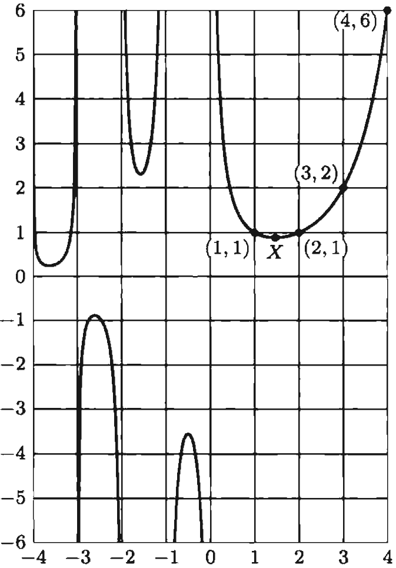

#### 1.2.5 排列与阶乘

一个 $n$ 元排列 ($n$ 个对象的排列) 是 $n$ 个不同对象排成一行的一种排放方式. 3 个对象 $\{ a , b , c \}$ 有 6 种排列:

$$
a\,b\,c,\qquad a\,c\,b,\qquad b\,a\,c,\qquad b\,c\,a,\qquad c\,a\,b,\qquad c\,b\,a.
\qquad \text{(1)}
$$

在算法分析中, 排列的性质是非常重要的. 我们将推导有关排列的许多有趣结果. [^cn53-1] 首要任务就是计数: 共有多少种 $n$ 元排列? 总共有 $n$ 个对象, 选择最左端的对象有 $n$ 种方式, 选定第一个对象之后, 下一个位置有 $n-1$ 种方式选择一个不同的对象, 这样前两个位置就有 $n$($n-1$) 种选择. 类似地, 对于不同于前两个对象的第三个对象有 $n-2$ 种选择, 所以对于前 3 个对象共有 $n ( n - 1 ) ( n - 2 )$ 种选择方式. 一般地, 如果用 $p_{n k}$ 表示从 $n$ 个对象中选择 $k$ 个对象排成一行的方式数目, 则

$$
p_{nk}=n(n-1)\ldots(n-k+1).
\qquad \text{(2)}
$$

所以, 所有排列的总数是 $p _ { n n } = n ( n - 1 ) \ldots ( 1 ) .$

假定已经构造出 $n-1$ 个对象的所有排列, 然后按照归纳的方式构造 $n$ 个对象的所有排列, 这一过程在我们的各种应用中是非常重要的. 我们用数字{1,2,3}代替字母{$a$, $b$, $c$}, 重新写出式 (1), 则之前的排列变成

$$
1\,2\,3,\qquad1\,3\,2,\qquad2\,1\,3,\qquad2\,3\,1,\qquad3\,1\,2,\qquad3\,2\,1.
\qquad \text{(3)}
$$

想想看, 如何从这个阵列获得{1,2,3,4}的排列? 从 $n-1$ 元排列出发, 构造 $n$ 元排列, 主要有两种方法.

方法 1. 对于 {1,2,..., $n-1$} 的每个排列 $a _ { 1 } \: a _ { 2 } \: \ldots \: a _ { n - 1 }$, 在所有可能的位置插入数字 $n$, 构成 $n$. 个新排列.

$$
n\,a_1a_2\ldots a_{n-1},\qquad a_1 n a_2\ldots a_{n-1},\qquad\ldots\qquad a_1a_2\ldots n a_{n-1},\qquad a_1a_2\ldots a_{n-1}n.
$$

例如, 我们由 (3) 中的排列 231, 得到 4231,2431,2341,2314. 明显看出, 用这种方式可以获得所有 $n$ 元排列, 而且不会出现重复.

方法 2. 对于 {1,2,..., $n-1$}的每个排列 $\underline { { a _ { 1 } } } \: \underline { { a _ { 2 } } } \: \ldots \: \underline { { a _ { n - 1 } } }$, 按照下述方式构成 $n$ 个新排列: 首先构造阵列

$$
a_1a_2\ldots a_{n-1}\tfrac12,\quad a_1a_2\ldots a_{n-1}\tfrac32,\quad\ldots\quad a_1a_2\ldots a_{n-1}(n-\tfrac12).
$$

然后从小到大用数字{1,2,..., $n$}重新命名每个排列中的元素, 保持次序. 例如, 我们由 (3) 中的排列 231, 得到

$$
2\,3\,1\,\tfrac12,\qquad2\,3\,1\,\tfrac32,\qquad2\,3\,1\,\tfrac52,\qquad2\,3\,1\,\tfrac72,
$$

重新命名便得到

$$
3 4 2 1 , \quad 3 4 1 2 , \quad 2 4 1 3 , \quad 2 3 1 4 .
$$

用另一种方法描述这个过程: 取排列 $a _ { 1 } a _ { 2 } \ldots a _ { n - 1 }$ 以及整数 $k$, $1 \leq k \leq n$; 对于值 $\geq k$ 的每个 $a _ { j }$ 加 1, 这样得到元素 $\{ 1 , \ldots , k - 1 , k + 1 , \ldots , n \}$ 的一个排列 $b _ { 1 } b _ { 2 } \ldots b _ { n - 1 }$, 于是 $b _ { 1 } b _ { 2 } \ldots b _ { n - 1 } k$ 是 $\{ 1 , \ldots , n \}$ 的一个排列.

显然, 这个构造同样获得每种 $n$ 元排列恰好一次. 把 $k$ 置于最左端, 或者改成任何其他固定位置, 显然也是可行的.

如果 $p_{n}$ 是 $n$ 元排列的总数, 上述两种方法都说明 $p _ { n } = n p _ { n - 1 }$. 由此, 我们可以用两种新方法证明式 (2) 已经证出的 $p _ { n } = n ( n - 1 ) \ldots ( 1 )$

[^cn53-1]: 事实上, 由于排列极其重要, 沃恩·普拉特提议把它的英文由 permutation 缩短为 perm. 要是这个建议得到采纳, 计算机科学的教科书将变得更薄 (或许还会更便宜).

$p_{n}$ 这个重要的值称为 $n$ 的阶乘, 记为

$$
n!=1\cdot2\cdot\ldots\cdot n=\prod_{k=1}^n k.
\qquad \text{(4)}
$$

根据此前对空乘积的约定 (1.2.3 节)

$$
0!=1,
\qquad \text{(5)}
$$

且按照这个约定, 基本恒等式

$$
n!=(n-1)!\,n
\qquad \text{(6)}
$$

对于所有正整数 $n$ 成立.

在计算机作业中, 阶乘是相当常见的, 建议读者记住前面几个阶乘的值:

$$
0 ! = 1 , \quad 1 ! = 1 , \quad 2 ! = 2 , \quad 3 ! = 6 , \quad 4 ! = 2 4 , \quad 5 ! = 1 2 0 .
$$

阶乘增加非常快, 1000! 在十进制中已超过 2500 位.

应该记住 $10! = 3 628 800$, 牢记 10! 大约为 360 万. 在一定意义下, 计算是否可行大致以此为界. 如果一个算法需要检验超过 10! 种情形, 那么它就可能耗时过长而不实用; 另一方面, 如果我们决定检验 10! 种情形, 假如检验每种情形耗时 1 毫秒的计算机时间, 那么算法的全部运行时间约为 1 小时. 当然, 这只是非常粗略的解释, 但是至少有助于读者直观地认识计算上可行的范围.

很自然, 读者可能想知道 $n!$ 同数学中的其他量有什么关系. 例如, 假如不费劲计算式 (4) 的乘法, 能否判断出 1000! 究竟有多大? 詹姆斯·斯特林找到了这个问题的答案, 见他的名著《微分法》(MethodusDifferentialis, 1730) 第 137 页.

$$
n!\approx\sqrt{2\pi n}\left(\frac ne\right)^n
\qquad \text{(7)}
$$

式中的 $\text{“}\approx\text{”}$ 表示 “约等于”, 而 $\text{" } \mathrm{e}^{\text{" }}$ 是在 1.2.2 节介绍的自然对数的底数. 我们将在 1.2.11.2 节证明斯特林近似公式 (7). 习题 24 简单证明了更粗略的估计.

下面, 我们举例说明如何应用这个公式. 可以计算

$$
4 0 3 2 0 = 8 ! \approx 4 \sqrt { \pi } \left( \frac { 8 } { e } \right) ^ { 8 } = 2 ^ { 2 6 } \sqrt { \pi }   e ^ { - 8 } \approx 6 7 1 0 8 8 6 4 \cdot 1 . 7 7 2 4 5 \cdot 0 . 0 0 0 3 3 5 4 6 \approx 3 9 9 0 2   ,
$$

误差约为 1%. 我们在后面会看到, 这个公式的相对误差约为 1/(12n).

除了由式 (7) 给出的近似值之外, 我们也容易获得 $n!$ 分解成素因子的准确值. 事实上, 素数 $p$ 是 $n!$ 的因子, 重数为

$$
\mu=\left\lfloor\frac np\right\rfloor+\left\lfloor\frac n{p^2}\right\rfloor+\left\lfloor\frac n{p^3}\right\rfloor+\cdots=\sum_{k>0}\left\lfloor\frac n{p^k}\right\rfloor.
\qquad \text{(8)}
$$

例如, 如果 $n=1000$, $p=3$, 那么

$$
\begin{aligned}\mu &= \left\lfloor \frac{1000}{3} \right\rfloor + \left\lfloor \frac{1000}{9} \right\rfloor + \left\lfloor \frac{1000}{27} \right\rfloor + \left\lfloor \frac{1000}{81} \right\rfloor + \left\lfloor \frac{1000}{243} \right\rfloor + \left\lfloor \frac{1000}{729} \right\rfloor \\&= 333 + 111 + 37 + 12 + 4 + 1 = 498.\end{aligned}
$$

所以, 1000! 被 $3 ^ { 4 9 8 }$ 整除, 但不能被 $3^{499}$ 整除. 式 (8) 虽然写成无限和的形式, 不过对于任何确定的 $n$ 值和 $p$ 值, 它其实是有限和, 因为后面的项均为 0. 从习题 1.2.4-35 推出 $\lfloor n / p ^ { k + 1 } \rfloor = \left\lfloor \lfloor n / p ^ { k } \rfloor / p \right\rfloor$, 据此可以简化式 (8) 中的计算, 因为只用求出 $p$ 除前一项的商, 舍弃余数.

式 (8) 由下述事实推出: $\lfloor n / p ^ { k } \rfloor$ 等于在 $\{1,2,\ldots,n\}$ 中是 $p^{k}$ 倍数的整数之个数. 如果我们考察乘积 (4) 中的整数, 那么被 $p^j$ 整除但是不能被 $p^{j + 1}$ 整除的任何整数在式 (8) 中恰好计数 $j$ 次: 在 $\lfloor n / p \rfloor$ 中计数一次, 在 $\lfloor n/p^2\rfloor$ 中计数一次, …, 在 $\lfloor n/p^j\rfloor$ 中计数一次. 这就是因子 $p$ 在 $n!$ 中出现的总次数 (重数). [见勒让德的《数论导引》法语版第 8 页, 即*Essai sur la Théorie des Nombres*, 2nd edition (Paris: 1808), page 8. ]

自然出现另外一个问题: 我们对于非负整数 $n$ 定义了阶乘函数 $n!$, 它对于 $n$ 的有理数值甚至实数值是否也有意义? 例如, $(\tfrac12)!$ 是什么? 为了阐明这个问题, 让我们引入一个 “阶和”(termial) 函数

$$
n?=1+2+\cdots+n=\sum_{k=1}^n k,
\qquad \text{(9)}
$$

它与阶乘函数类似, 只是用加法代替乘法. 我们从式 1.2.3-(15) 已经知道这个等差级数之和:

$$
n?=\tfrac12 n(n+1).
\qquad \text{(10)}
$$

这个结果启示我们, 用式 (10) 代替式 (9), 可以把 “阶和” 函数推广到任意 $n .$ 我们有 $( \frac { 1 } { 2 } ) ? = \frac { 3 } { 8 } .$

斯特林本人曾多次试图把 $n!$ 推广到非整数 $n .$ 他把近似式 (7) 扩展为无限和, 可惜这个和有时并不收敛. 他的方法给出了极好的近似值, 但是不能扩展到给出准确值. [对于这种特殊情况的讨论, 见康拉德·克诺普, Theory and Application of Infinite Series, 2nd ed. (Glasgow:Blackie, 1951), 518–520, 527, 534. ]

斯特林又试了一回. 他注意到

$$
\begin{aligned}n!={}&1+\left(1-\frac1{1!}\right)n+\left(1-\frac1{1!}+\frac1{2!}\right)n(n-1)\\&+\left(1-\frac1{1!}+\frac1{2!}-\frac1{3!}\right)n(n-1)(n-2)+\cdots.\end{aligned}
\qquad \text{(11)}
$$

(我们将在下一小节证明这个公式.) 式 (11) 中的和表面上是无限和, 其实对于任何非负整数 $n$ 都是有限和. 但是, 它不能按我们想要的方式推广 $n !$, 因为除非 $n$ 是非负整数, 这个无限和都是不存在的. (见习题 16.)

斯特林没有气馁, 他找到了一个序列 $a _ { 1 } , a _ { 2 } , \ldots ,$ 这个序列满足

$$
\ln n!=a_1n+a_2n(n-1)+\cdots=\sum_{k\ge0}a_{k+1}\prod_{0\le j\le k}(n-j).
\qquad \text{(12)}
$$

他未能证明这个和对于 $n$ 的所有分数值都定义了 $n!$, 尽管他能推导出 $\left( { \textstyle \frac { 1 } { 2 } } \right) ! = \sqrt { \pi } / 2 .$

差不多在同一时期, 欧拉思考了同一问题, 率先找到了正确的推广:

$$
n!=\lim_{m\to\infty}\frac{m^n m!}{(n+1)(n+2)\ldots(n+m)}.
\qquad \text{(13)}
$$

欧拉于 1729 年 10 月 13 日写信把这一思想告诉哥德巴赫. 他的公式对于负整数以外的任何 $n$ 值都能定义 $n!$; 当 $n$ 为负整数时分母变为 0, 视为 $n!$ 取无限大. 习题 8 和习题 22 说明了式 (13) 为什么是一个合理的定义.

又过了将近两个世纪, 埃尔米特于 1900 年证明, 斯特林的构想 (12) 其实对于非整数 $n$ 成功地定义了 $n!$. 他还证明, 欧拉的推广与斯特林的推广其实是等价的.

早期, 人们对于阶乘用过多种记号. 欧拉实际上把它写成 [$n$], 卡尔·弗里德里希·高斯则写成 $\Pi n$, 而在英国和意大利流行 $\boxed { n }$ 和 $[ \frac { n } { } ]$ 两种符号. 如今, 当 $n$ 为整数时普遍使用的记号 $n!$ 是由一位不大知名的数学家基斯顿·卡曼创造的, 最早出现在一部代数教科书中 [Élémensd’Arithmétique Universelle (Cologne: 1808), page 219 ].

*图 7　函数 $\Gamma(x)=(x-1)!$. $X$ 点取局部极小值, 坐标 $(1.46163\,21449\,68362\,34126\,26595,\;0.88560\,31944\,10888\,70027\,88159)$*

然而, 当 $n$ 不是整数时, 我们通常不用记号 $n!$, 改用勒让德提出的记号:

$$
n!=\Gamma(n+1)=n\Gamma(n).
\qquad \text{(14)}
$$

这个函数 $\Gamma(x)$ 称为 $\Gamma$ 函数. 由式 (13), 它的定义为

$$
\Gamma(x)=\frac{x!}x=\lim_{m\to\infty}\frac{m^x m!}{x(x+1)(x+2)\ldots(x+m)},
\qquad \text{(15)}
$$

$\Gamma ( x )$ 的图象如 [图7](#fig-1-7) 所示.

等式 (13) 和 (15) 对于复数值同实数值一样定义阶乘和 $\Gamma$ 函数. 不过, 当考虑同时带有实部和虚部的变量时, 我们一般用字母 $z$ 代替 $n$ 或 $x$. 阶乘函数与 $\Gamma$ 函数关系密切, 不仅有 $z ! = \Gamma ( z + 1 )$, 而且当 $z$ 不是整数时也满足

$$
(-z)!\,\Gamma(z)=\frac{\pi}{\sin\pi z}.
\qquad \text{(16)}
$$

(见习题 23.)

尽管 $\Gamma ( z )$ 当 $z$ 为 0 或者负整数时取无穷大, 但是函数 $1 / \Gamma (z)$ 对于所有复数 $z$ 却是有明确定义的 (见习题 1.2.7-24). $\Gamma$ 函数的高等应用通常要用到一个重要的围道积分公式, 它由赫尔曼·汉克尔提出:

$$
\frac1{\Gamma(z)}=\frac1{2\pi i}\oint\frac{e^t\,dt}{t^z}.
\qquad \text{(17)}
$$

复积分的路径从 $- \infty$ 开始, 按逆时针方向环绕原点一周再回到 $-\infty$. [*Zeitschrift für Math. und Physik* **9** (1864), 1–21.]

离散数学中的许多公式包含类似阶乘的乘积, 称为阶乘幂. 当 $k$ 为正整数时, $x^{\underline{k}}$ 和 $x^{\overline k}$ (读作 “$x$ 的 $k$ 次降幂” 和 “$x$ 的 $k$ 次升幂”) 定义如下:

$$
x^{\underline{k}}=x(x-1)\ldots(x-k+1)=\prod_{j=0}^{k-1}(x-j);
\qquad \text{(18)}
$$

$$
x^{\overline{k}}=x(x+1)\ldots(x+k-1)=\prod_{j=0}^{k-1}(x+j).
\qquad \text{(19)}
$$

于是, 式 (2) 中的 $p_{n k}$ 正好是 $n^{\underline{k}}$. 请注意, 我们有

$$
x^{\overline{k}}=(x+k-1)^{\underline{k}}=(-1)^k(-x)^{\underline{k}}.
\qquad \text{(20)}
$$

可以用一般公式

$$
x^{\underline{k}}=\frac{x!}{(x-k)!},\qquad x^{\overline{k}}=\frac{\Gamma(x+k)}{\Gamma(x)}
\qquad \text{(21)}
$$

定义其他 $k$ 值的阶乘幂. [$x^{\overline{k}}$ 和 $x^{\underline{k}}$ 这两个记号的出处分别是 A. 卡佩利,*Giornale di Mat. di Battaglini* **31** (1893), 291–313 以及 L. 托斯卡诺, *Comment. Accademia delle Scienze* **3** (1939), 721–757.]

关于阶乘从斯特林时代演变至今的有趣历史, “欧拉积分: Γ函数的历史剪影” 一文做了追溯. [见菲利普·戴维斯, “Leonhard Euler’s integral: A historical profile of the gamma function”,*AMM* **66** (1959), 849–869. 另见雅克·杜卡,*Archive for History of Exact Sciences* **31** (1984), 15–34. ]

#### 习题

1\. [00] [答案](./answers/1-2-5.md#ans-1-2-5-1) 洗一副 52 张的纸牌, 有多少种不同结果?

2\. [10] [答案](./answers/1-2-5.md#ans-1-2-5-2) 用式 (2) 中的记号, 证明 $p_{n(n-1)} = p_{nn}$, 并说明原因.

3\. [10] [答案](./answers/1-2-5.md#ans-1-2-5-3) 方法 1 和方法 2 分别会从排列 3124 构造出{1,2,3,4,5}的什么排列?

4\. [13] [答案](./answers/1-2-5.md#ans-1-2-5-4)  已知 $\log _ { 1 0 } 1 0 0 0 ! = 2 5 6 7 . 6 \hat { 0 } \hat { 4 } \hat { 6 } \hat { 4 } \ldots$, 试准确给出 1000! 在十进制中有多少位数. 首位数字是几? 末位数字是几?

5\. [15] [答案](./answers/1-2-5.md#ans-1-2-5-5) 利用下述更精确的斯特林近似公式估计 8! 的值:

$$
n ! \approx \sqrt { 2 \pi n } \left( \frac { n } { e } \right) ^ { n } \left( 1 + \frac { 1 } { 1 2 n } \right) .
$$

6\. [17] [答案](./answers/1-2-5.md#ans-1-2-5-6) 利用式 (8) 把 20! 写成素因数的乘积.

7\. [M10] 证明: 式 (10) 中的 “广义阶和” 函数对于所有实数 $x$ 满足恒等式 $x? = x + (x - 1)?.$

8\. [HM15] [答案](./answers/1-2-5.md#ans-1-2-5-8) 证明: 当 $n$ 为非负整数时, 式 (13) 中的极限确实等于 $n!$.

9\. [M10] [答案](./answers/1-2-5.md#ans-1-2-5-9)  已知 $( \frac{1}{2} ) ! = \sqrt{\pi} / 2$, 求 $\Gamma ( \frac { 1 } { 2 } )$ 和 $\Gamma ( - \frac { 1 } { 2 } ) .$

10\. [HM20] [答案](./answers/1-2-5.md#ans-1-2-5-10) 恒等式 $\Gamma(x + 1) = x\Gamma(x)$ 对于所有实数 $x$ 都成立吗? (见习题 7.)

11\. [M15] [答案](./answers/1-2-5.md#ans-1-2-5-11) 令 $n$ 的二进制表示为 $n = 2^{e_1} + 2^{e_2} + \cdots + 2^{e_r}$, 其中 $e _ { 1 } \geq e _ { 2 } \geq \cdots \geq e _ { r } \geq 0 .$ 证明 $n!$ 被 $2 ^ { n - r }$ 整除, 但是不能被 $2^{n - r + 1}$ 整除.

12, [M22] [答案](./answers/1-2-5.md#ans-1-2-5-12) (勒让德, 1808) 推广上题的结果, 令 $p$ 为素数, 并且令 $n$ 的 $p$ 进制表示为 $n =$ $a_{k}p^{k}+a_{k-1}p^{k-1}+\cdots+a_{1}p+a_{0}$. 把式 (8) 中的数μ表示成包含 $n$、$p$ 和各个 $a$ 的简单公式.

13\. [M23] [答案](./answers/1-2-5.md#ans-1-2-5-13) (威尔逊定理, 实际由莱布尼茨证明, 1682) 如果 $p$ 为素数, 那么 $(p - 1)! \bmod p = p - 1.$ 通过让 $\{ 1 , 2 , \ldots , \: p - 1 \}$ 各数两两配对, 使每对数的乘积模 $p$ 余 1, 证明这个定理.

14\. [M28] [答案](./answers/1-2-5.md#ans-1-2-5-14)  (施蒂克贝格, 1890) 利用习题 12 的记号, 对于任何正整数 $n$, 我们可以通过 $p$ 进制表示确定 $n!\bmod p$, 从而推广威尔逊定理. 事实上, 证明 $n ! / p ^ { \mu } \equiv ( - 1 ) ^ { \mu } a _ { 0 } !   a _ { 1 } ! \ldots a _ { k } ! \mathrm { ~ ( m o d u l o ~ } p \mathrm { ) }$ ).

15\. [HM15] [答案](./answers/1-2-5.md#ans-1-2-5-15) 方阵的积和式与行列式的展式定义基本相同, 只不过积和式的每项都取正号, 而行列式是交 替地取正号和负号. 于是

$$
\left( \begin{matrix} { a } & { b } & { c } \\ { d } & { e } & { f } \\ { g } & { h } & { i } \\ \end{matrix} \right)
$$

的积和式是 $aei+bfg+cdh+gec+hfa+idb$. 那么方阵

$$
\begin{pmatrix}
1\times1 & 1\times2 & \cdots & 1\times n\\
2\times1 & 2\times2 & \cdots & 2\times n\\
\vdots & \vdots & \ddots & \vdots\\
n\times1 & n\times2 & \cdots & n\times n
\end{pmatrix}
$$

的积和式是什么?

16\. [HM15] [答案](./answers/1-2-5.md#ans-1-2-5-16) 证明: 式 (11) 中的无限和不收敛, 除非 $n$ 是非负整数.

17\. [HM20] [答案](./answers/1-2-5.md#ans-1-2-5-17) 证明: 如果 $\alpha _ { 1 } + \cdots + \alpha _ { k } = \beta _ { 1 } + \cdots + \beta _ { k }$, 且各个 $\beta$ 都不是负整数, 那么无穷乘积

$$
\prod _ { n \geq 1 } \frac { ( n + \alpha _ { 1 } ) \dots ( n + \alpha _ { k } ) } { ( n + \beta _ { 1 } ) \dots ( n + \beta _ { k } ) }
$$

等于 $\quad \Gamma {  } ( {  } 1 {  } + {  } \beta _ { {  } 1 } {  } ) {  } \ldots {  } \Gamma {  } ( {  } 1 {  } + {  } \beta _ { {  } k } {  } ) {  } / {  } \Gamma {  } ( {  } 1 {  } + {  } \alpha _ { {  } 1 } {  } ) {  } \ldots {  } \Gamma {  } ( {  } 1 {  } + {  } \alpha _ { {  } k } {  } ) {  } .$

18\. [M20] [答案](./answers/1-2-5.md#ans-1-2-5-18) 假定 $\pi / 2 = { \textstyle { \frac { 2 } { 1 } } } \cdot { \textstyle { \frac { 2 } { 3 } } } \cdot { \textstyle { \frac { 4 } { 3 } } } \cdot { \textstyle { \frac { 4 } { 5 } } } \cdot { \textstyle { \frac { 6 } { 5 } } } \cdot { \textstyle { \frac { 6 } { 7 } } } \cdot \cdot \cdot \cdot$ (这是沃利斯乘积, 由约翰·沃利斯在 1655 年得到, 我们将在习题 1.2.6-43 中证明它.) 利用上题, 证明 $( \frac{1}{2} )! = \sqrt{\pi} / 2.$

19\. [HM22] [答案](./answers/1-2-5.md#ans-1-2-5-19) 用 $\Gamma _ { m } ( x )$ 表示等式 (15) 中出现在 $\operatorname* { l i m } _ { m \to \infty }$ 之后的量. 证明: 如果 $x > 0$

$$
\Gamma_m(x)=\int_0^m\left(1-\frac{t}{m}\right)^mt^{x-1}\,dt=m^x\int_0^1(1-t)^mt^{x-1}\,dt.
$$

20\. [HM21] [答案](./answers/1-2-5.md#ans-1-2-5-20) 如果 $0 \leq t \leq m$, 那么 $0 \leq e ^ { - t } - ( 1 - t / m ) ^ { m } \leq t ^ { 2 } e ^ { - t } / m$. 利用这个事实和上题结果, 证明: 如果 $x > 0$, 那么 $\Gamma(x)=\int_0^\infty e^{-t}t^{x-1}\,dt$

21\. [HM25] [答案](./answers/1-2-5.md#ans-1-2-5-21) (路易斯·阿伯加斯特, 1800) 令 $D _ { x } ^ { k } u$ 代表函数 $u$ 对 $x$ 的 $k$ 阶导数. 链式法则表明 $D _ { x } ^ { 1 } w = D _ { u } ^ { 1 } w D _ { x } ^ { 1 } u .$ 如果对二阶导数应用链式法则, 则 $D _ { x } ^ { 2 } w = D _ { u } ^ { 2 } w ( D _ { x } ^ { 1 } u ) ^ { 2 } + D _ { u } ^ { 1 } w D _ { x } ^ { 2 } u .$ 证明一般公式为

$$
D _ { x } ^ { n } w = \sum _ { j = 0 } ^ { n } \sum _ { \begin{matrix} { k _ { 1 } + k _ { 2 } + \dots + k _ { n } = j } \\ { k _ { 1 } + 2 k _ { 2 } + \dots + n k _ { n } = n } \\ { k _ { 1 } , k _ { 2 } , \dots , k _ { n } \geq 0 } \\ \end{matrix} } D _ { u } ^ { j } w \frac { n ! } { k _ { 1 } ! \left( 1 ! \right) ^ { k _ { 1 } } \dots k _ { n } ! \left( n ! \right) ^ { k _ { n } } } ( D _ { x } ^ { 1 } u ) ^ { k _ { 1 } } \dots ( D _ { x } ^ { n } u ) ^ { k _ { n } } .
$$

▶ 22. [HM20] [答案](./answers/1-2-5.md#ans-1-2-5-22) 设想你是欧拉, 正在寻找把 $n!$ 推广到非整数值 $n$ 的方法. 由于 $(n + \frac{1}{2})! / n!$ 乘 $(n + \frac{1}{2}) +$ $\frac{1}{2} \left( \left( n + \frac{1}{2} \right) \right)$ 等于 $(n + 1)! / n! = n + 1$, 因此看起来 $(n + \frac{1}{2})! / n!$ 自然应该近似等于 $\sqrt { n } .$ 同样应有 $(n + \frac{1}{3})! / n! \approx \sqrt[3]{n}.$ 建立当 $n$ 趋近于无穷大时关于比值 $(n + x)! / n!$ 的一个假设. 当 $x$ 为整数时, 你的假设正确吗? 当 $x$ 不是整数时, 你的假设能否给出 $x$! 的适当的值?

23\. [HM20] [答案](./answers/1-2-5.md#ans-1-2-5-23) 已知 $\pi z \prod_{n = 1}^{\infty} \left( 1 - z^{2} / n^{2} \right) = \sin \pi z$, 证明等式 (16).

▶ 24. [HM21] [答案](./answers/1-2-5.md#ans-1-2-5-24) 证明有用的不等式

$$
\frac{n^n}{e^{n-1}} \leq n! \leq \frac{n^{n+1}}{e^{n-1}}, \quad  整数   n \geq 1.
$$

提示: $1 + x \leq e ^ { x }$ 对于所有实数 $x$ 成立, 因此 $( k + 1 ) / k \leq e ^ { 1 / k } \leq k / ( k - 1 ) .$

25\. [M20] [答案](./answers/1-2-5.md#ans-1-2-5-25) 阶乘幂满足类似普通指数定律 $x^{m + n} = x^m x^n$ 的定律吗?
