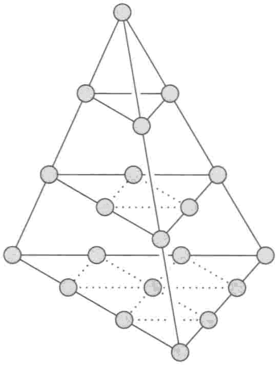

#### 1.2.6 二项式系数

从 $n$ 个对象中一次取 $k$ 个对象的组合是从 $n$ 个对象的集合取出 $k$ 个不同元素的全部选择方式, 不计选取对象的次序. 从 5 个对象 $\{ a , b , c , d , e \}$ 一次选取 3 个对象的组合是

$$
abc,\quad abd,\quad abe,\quad acd,\quad ace,\quad ade,\quad bcd,\quad bce,\quad bde,\quad cde.
\qquad \text{(1)}
$$

很容易计算 $n$ 个对象取出 $k$ 个的组合数. 上一小节的等式 (2) 表明, 从 $n$ 个对象中选取 $k$ 个进行排列, 有 $n(n-1)\cdots(n-k+1)$ 种方法, 其中每个 $k$ 元组合在这些排列中恰好出现 $k!$ 次, 因为它的内部共有 $k!$ 种排列. 我们用 $\binom nk$ 表示组合数, 于是它就等于

$$
\binom nk=\frac{n(n-1)\cdots(n-k+1)}{k(k-1)\cdots(1)},\qquad \text{(2)}
$$

例如

$$
\binom53=\frac{5\cdot4\cdot3}{3\cdot2\cdot1}=10
$$

就是式 (1) 中的组合数.

数 $\binom nk$ 读作 “$n$ 中选取 $k$”, 称为*二项式系数*, 有着非常多的应用. 这类数或许是算法分析用到的最重要的数, 所以读者务必熟悉它们.

即使当 $n$ 不是整数时, 也可以用等式 (2) 定义 $\binom nk$. 确切地说, 对于所有实数 $r$ 和所有整数 $k$, 我们定义符号 $\binom rk$:

$$
\begin{aligned}
\binom rk&=\frac{r(r-1)\cdots(r-k+1)}{k(k-1)\cdots(1)}\\
&=\frac{r^{\underline k}}{k!}=\prod_{j=1}^k\frac{r+1-j}{j},\quad\text{整数 }k\ge0;\\
\binom rk&=0,\quad\text{整数 }k<0.
\end{aligned}\qquad \text{(3)}
$$

$k$ 取特殊值时, 有

$$
\binom r0=1,\qquad\binom r1=r,\qquad\binom r2=\frac{r(r-1)}2.\qquad \text{(4)}
$$

表 1 给出 $r$ 和 $k$ 取 0 至 9 的整数时二项式系数的值, 读者应该记住 $0\le r\le4$ 的值.

**表 1　二项式系数表 (帕斯卡三角)**

| $r$ | $\binom{r}{0}$ | $\binom{r}{1}$ | $\binom{r}{2}$ | $\binom{r}{3}$ | $\binom{r}{4}$ | $\binom{r}{5}$ | $\binom{r}{6}$ | $\binom{r}{7}$ | $\binom{r}{8}$ | $\binom{r}{9}$ |
| ---: | ---: | ---: | ---: | ---: | ---: | ---: | ---: | ---: | ---: | ---: |
| 0 | 1 | 0 | 0 | 0 | 0 | 0 | 0 | 0 | 0 | 0 |
| 1 | 1 | 1 | 0 | 0 | 0 | 0 | 0 | 0 | 0 | 0 |
| 2 | 1 | 2 | 1 | 0 | 0 | 0 | 0 | 0 | 0 | 0 |
| 3 | 1 | 3 | 3 | 1 | 0 | 0 | 0 | 0 | 0 | 0 |
| 4 | 1 | 4 | 6 | 4 | 1 | 0 | 0 | 0 | 0 | 0 |
| 5 | 1 | 5 | 10 | 10 | 5 | 1 | 0 | 0 | 0 | 0 |
| 6 | 1 | 6 | 15 | 20 | 15 | 6 | 1 | 0 | 0 | 0 |
| 7 | 1 | 7 | 21 | 35 | 35 | 21 | 7 | 1 | 0 | 0 |
| 8 | 1 | 8 | 28 | 56 | 70 | 56 | 28 | 8 | 1 | 0 |
| 9 | 1 | 9 | 36 | 84 | 126 | 126 | 84 | 36 | 9 | 1 |

二项式系数的历史悠久而且有趣. 表 1 称为 “帕斯卡三角”, 因为它出现在帕斯卡的《算术三角论》(*Traité du Triangle Arithmétique*, 1653) 一书中. 这本专著具有重要的意义, 因为它是最早的概率论著作之一. 但是二项式系数不是帕斯卡发明的 (在他那个年代, 二项式系数在欧洲已经众所周知). 表 1 也出现在中国元代数学家朱世杰于 1303 年成书的《四元玉鉴》中, 这本书指出二项式系数是一项古老的发明. 杨辉在 1261 年把它归为贾宪 (约 1100 年) 的发现, 但贾宪的著作已经失传. 已知最早的二项式系数详述出现在 10 世纪, 见哈拉尤达当时对平加拉的 *Chandaḥśāstra* 这部印度经典著作的评论. [见查克拉瓦尔蒂,*Bull. Calcutta Math. Soc.* **24** (1932), 79–88.] 早在大约 850 年, 另外一位印度数学家马哈维拉已在其 Gaņita Sāra Sangraha 一书的第 6 章中解释了 $\binom{r}{k}$ 的计算规 则 (3); 后来在 1150 年, 婆什迦罗在其名作 Lilāvatī一书临近 结尾处再次叙述了马哈维拉的规则. $k$ 值小的二项式系数很早 就为人所知, 曾以几何解释的形式出现在希腊人和罗马人的著 作中 (见 [图8](#fig-1-8)). 记号 $\binom { T } { k }$ 是由安德烈亚斯·冯·厄廷格豪森最 早使用的, 见其《组合分析》(Die combinatorische Analysis, Vienna:1826) 一书的§31.

读者可能已经注意到了, 表 1 有几个有意思的规律和模式. 毫不夸张地说, 二项式系数满足成千上万的恒等式. 千百年以来, 它的种种奇特性质不断浮出水面, 为人所知. 实际上, 由于涉及它的关系实在是太多了, 因此每当有人发现一个新的恒等式时, 都几乎只有发现者自己才会为之兴奋. 为了运用在算法分析中出现的公式, 必须有办法处理二项式系数, 所以在这一小节, 我将简单说明如何对它进行运算. 马克·吐温[^cn60-1] 一度

*图 8　$\binom{n+2}{3}$ 的几何解释 ($n=4$)*

想把全天下所有的笑话浓缩成十几种基本形式 (例如关于农夫女儿的, 关于丈母娘的, 等等), 我们则力图把成千上万种恒等式提炼成少数几个基本运算, 运用它们可以求解今后遇到的几乎所有同二项式系数有关的问题.

在大多数应用问题中, $\binom{r}{k}$ 中的 $r$ 和 $k$ 均为整数, 而我们将要描述的方法中, 有几种仅适用于这种情况. 所以, 我们将在每一个带编号的等式的右端, 仔细列出对式中变量的所有约束条件. 例如, 等式 (3) 要求 $k$ 为整数, 对于 $r$ 则不做限制. 约束条件最少的恒等式也是最有用的.

现在, 我们来探讨二项式系数的基本运算方法.

A. 用阶乘表示二项式系数. 从等式 (3), 我们立即得到

$$
\binom nk=\frac{n!}{k!(n-k)!},\qquad\text{整数 }n\ge\text{整数 }k\ge0.
\qquad \text{(5)}
$$

因此, 阶乘的组合和二项式系数能相互表示.

B. 对称性条件. 由等式 (3) 和等式 (5), 我们得到

$$
\binom nk=\binom n{n-k},\qquad\text{整数 }n\ge0,\quad\text{整数 }k.
\qquad \text{(6)}
$$

这个公式对于所有的整数 $k$ 都成立. 当 $k$ 为负数或者 $k > n$ 时, 二项式系数为 0 (假定 $n$ 为非负整数).

C. 移进括号和移出括号. 从定义 (3), 我们得到

$$
\binom rk=\frac rk\binom{r-1}{k-1},\qquad\text{整数 }k\ne0.
\qquad \text{(7)}
$$

这个公式非常有用, 可以用来把一个表达式中的二项式系数同其他部分结合起来. 通过初等变换, 我们得到规则

$$
k \binom{r}{k} = r \binom{r - 1}{k - 1}, \quad \frac{1}{r} \binom{r}{k} = \frac{1}{k} \binom{r - 1}{k - 1}.
$$

第一条规则对于所有整数 $k$ 成立, 第二条规则当除数不为 0 时成立. 还有一个类似的关系式:

$$
\binom rk=\frac r{r-k}\binom{r-1}k,\qquad\text{整数 }k\ne r.
\qquad \text{(8)}
$$

[^cn60-1]: 美国著名作家 (1835—1910), 其小说以幽默讽刺见长. ——译者注

我们通过交替运用等式 (6) 和等式 (7), 证明等式 (8), 演示这两条变换规则的用法:

$$
\binom{r}{k}
= \binom{r}{r-k}
= \frac{r}{r-k}\binom{r-1}{r-1-k}
= \frac{r}{r-k}\binom{r-1}{k}.
$$

[注记: 由于等式 (6) 和等式 (7) 的约束条件, 上述推导仅当 $r$ 是不等于 $k$ 的正整数时才成立. 然而, 等式 (8) 宣称对于任意的 $r\ne k$ 成立. 这一结论可以用一种简单而又重要的方式证明: 我们已经对于无限多个 $r$ 值证实

$$
r\binom{r-1}{k}=(r-k)\binom{r}{k},
$$

上式两端都是关于 $r$ 的多项式. 一个 $n$ 次非零多项式至多只能有 $n$ 个不同的零点, 所以 (两式相减) 可证, 如果次数 $\le n$ 的两个多项式在至少 $n+1$ 个不同的点处取相同值, 那么这两个多项式是始终相等的. 这条原理可以把许多恒等式成立的范围从整数扩展到所有实数.]

**D. 加法公式.** 在表 1 中, 基本关系式

$$
\binom{r}{k}=\binom{r-1}{k}+\binom{r-1}{k-1},\qquad \text{整数 }k
\qquad \text{(9)}
$$

显然是成立的 (因为表中的每个值是其左上方和上方的两个值之和), 而且容易根据等式 (3) 证明它是普遍成立的. 另一方面, 等式 (7) 和 (8) 告诉我们

$$
r\binom{r-1}{k}+r\binom{r-1}{k-1}
=(r-k)\binom{r}{k}+k\binom{r}{k}
=r\binom{r}{k}.
$$

当 $r$ 为整数时, 等式 (9) 经常可以在对 $r$ 归纳证明时发挥作用.

**E. 求和公式.** 重复应用公式 (9), 给出

$$
\begin{aligned}
\binom{r}{k}
&=\binom{r-1}{k}+\binom{r-1}{k-1}\\
&=\binom{r-1}{k}+\binom{r-2}{k-1}+\binom{r-2}{k-2}=\cdots
\end{aligned}
$$

或者

$$
\begin{aligned}
\binom{r}{k}
&=\binom{r-1}{k-1}+\binom{r-1}{k}\\
&=\binom{r-1}{k-1}+\binom{r-2}{k-1}+\binom{r-2}{k}=\cdots.
\end{aligned}
$$

于是我们导出如下两个重要的求和公式:

$$
\begin{aligned}
\sum_{k=0}^{n}\binom{r+k}{k}
&=\binom{r}{0}+\binom{r+1}{1}+\cdots+\binom{r+n}{n}\\
&=\binom{r+n+1}{n},\qquad \text{整数 }n\ge 0;
\end{aligned}
\qquad \text{(10)}
$$

$$
\begin{aligned}
\sum_{k=0}^{n}\binom{k}{m}
&=\binom{0}{m}+\binom{1}{m}+\cdots+\binom{n}{m}\\
&=\binom{n+1}{m+1},\qquad \text{整数 }m\ge 0,\quad \text{整数 }n\ge 0.
\end{aligned}
\qquad \text{(11)}
$$

通过对 $n$ 归纳可以轻易证明等式 (11). 有趣的是, 对等式 (10) 两次应用等式 (6) 也能导出它:

$$
\begin{aligned}
\sum_{0\le k\le n}\binom{k}{m}
&=\sum_{0\le m+k\le n}\binom{m+k}{m}\\
&=\sum_{-m\le k<0}\binom{m+k}{m}
 +\sum_{0\le k\le n-m}\binom{m+k}{k}\\
&=0+\binom{m+(n-m)+1}{n-m}=\binom{n+1}{m+1},
\end{aligned}
$$

其中假定 $n\ge m$. 如果 $n<m$, 则等式 (11) 是显而易见的.

等式 (11) 应用非常频繁. 事实上, 我们此前已经推导出了它的一些特例. 例如当 $m=1$ 时, 我们就见到了亲爱的老朋友——等差数列之和:

$$
\binom{0}{1}+\binom{1}{1}+\cdots+\binom{n}{1}
=0+1+\cdots+n=\binom{n+1}{2}=\frac{(n+1)n}{2}.
$$

假定我们想推导和 $1^2+2^2+\cdots+n^2$ 的简单计算公式. 这可以通过注意 $k^2=2\binom{k}{2}+\binom{k}{1}$ 得到, 因此,

$$
\sum_{k=0}^{n} k^2
=\sum_{k=0}^{n}\left(2\binom{k}{2}+\binom{k}{1}\right)
=2\binom{n+1}{3}+\binom{n+1}{2}.
$$

同时, 这个用二项式系数表示的答案在需要时也可以改回多项式表示:

$$
\begin{aligned}
1^2+2^2+\cdots+n^2
&=2\frac{(n+1)n(n-1)}{6}+\frac{(n+1)n}{2}\\
&=\tfrac13 n(n+\tfrac12)(n+1).
\end{aligned}
\qquad \text{(12)}
$$

用同样的方法可以得到 $1^3+2^3+\cdots+n^3$ 的公式. 任意多项式 $a_0+a_1k+a_2k^2+\cdots+a_m k^m$ 都可以表示成 $b_0\binom{k}{0}+b_1\binom{k}{1}+\cdots+b_m\binom{k}{m}$, 其中 $b_0,\ldots,b_m$ 是恰当选择的系数. 后面我们还会讨论这方面的内容.

**F. 二项式定理.** 当然, 二项式定理是我们最主要的工具之一:

$$
(x+y)^r=\sum_k\binom{r}{k}x^k y^{r-k},\qquad \text{整数 }r\ge 0.
\qquad \text{(13)}
$$

例如, $(x+y)^4=x^4+4x^3y+6x^2y^2+4xy^3+y^4$. (我们总算能够说明 $\binom{r}{k}$ 为什么得名 “二项式系数” 了.)

有必要指出, 我们在等式 (13) 中用的是 $\sum_k$ 的写法, 而不是读者可能意料之中的记号 $\sum_{k=0}^{r}$. 如果对 $k$ 不加限制, 我们是对所有整数 $k$ 求和, 即求和范围是 $-\infty<k<+\infty$. 但是, 在式 (13) 中, 两个记号完全是等价的, 因为 $k<0$ 或者 $k>r$ 的项为零. 我们更愿用 $\sum_k$ 这种形式更简单的记号, 因为求和的条件越简单, 计算也就越简单. 如果无需记下求和的上下限, 我们就省去大量单调乏味的工作, 所以只要不必指定上下限, 我们就不做无用功. 我们采用的记号还有另外一个优点: 如果 $r$ 不是非负整数, 等式 (13) 变成无限和, 而微积分的二项式定理说明, 如果 $|x/y|<1$, 等式 (13) 对于所有 $r$ 成立.

应该指出, 公式 (13) 给出了

$$
0^0=1,
\qquad \text{(14)}
$$

我们将始终采用这个约定.

在等式 (13) 中 $y=1$ 的特例是很重要的, 在此特别写出:

$$
\sum_k\binom{r}{k}x^k=(1+x)^r,\qquad \text{整数 }r\ge 0\text{ 或者 }|x|<1.
\qquad \text{(15)}
$$

二项式定理是牛顿发现的. 他于 1676 年 6 月 13 日和 10 月 24 日先后致信英国皇家学会秘书亨利·奥顿堡, 在信中宣布了这一发现. [见德克·斯特洛伊克,*Source Book in Mathematics* (Harvard Univ. Press, 1969), 284–291.] 但是, 他显然没有给出真正的证明. 在牛顿那个年代, 严格证明的必要性尚未得到充分认识. 欧拉在 1774 年首次试图给出证明, 不过他的证明并不完整. 最后, 高斯于 1812 年首次给出了真正的证明. 事实上, 这是第一次有人圆满证明关于无限和的结果.

19 世纪初, 尼尔斯·阿贝尔发现了二项式公式 (13) 的一个出人意外的推广:

$$
(x+y)^n=\sum_k\binom{n}{k}x(x-kz)^{k-1}(y+kz)^{n-k},
\qquad \text{整数 }n\ge 0,\quad x\ne 0.
\qquad \text{(16)}
$$

这是关于三个变量 $x , y , z$ 的恒等式 (见习题 50-52). 阿贝尔在刚刚创刊的《理论与应用数学杂 志》上发表了这个公式及其证明, 见 Journal für die reine und angewandteMathematik (1826) 第 1 卷第 159-160 页. 这本由奥古斯特·克雷尔创办的德国杂志很快声名鹊起. 值得注意的是, 阿贝尔在此卷杂志上还发表了很多篇论文, 包括关于 5 次或 5 次以上代数方程无根式解以及关 于二项式定理的著名论文. 有关公式 (16) 的若干参考文献, 可参阅亨利·古尔德, AMM69 (1962), 572.

G. 上标取反. 由定义 (3), 对分子的每一项加负号, 直接推出基本恒等式

$$
\binom rk=(-1)^k\binom{k-r-1}k,\qquad\text{整数 }k,
\qquad \text{(17)}
$$

这对上标取相反数的变换经常很有用.

等式 (17) 的一个简单推论是求和公式

$$
\sum_{k\le n}\binom rk(-1)^k=\binom r0-\binom r1+\cdots+(-1)^n\binom rn=(-1)^n\binom{r-1}n,\qquad\text{整数 }n.
\qquad \text{(18)}
$$

这个恒等式可以利用等式 (9) 用归纳法证明, 也可以直接利用等式 (17) 和 (10) 证明:

$$
\sum_{k \leq n} \binom{r}{k} (-1)^k = \sum_{k \leq n} \binom{k - r - 1}{k} = \binom{-r + n}{n} = (-1)^n \binom{r - 1}{n}.
$$

在等式 (17) 中令 $r$ 取整数可获得另外一个重要应用:

$$
\binom nm=(-1)^{n-m}\binom{-(m+1)}{n-m},\qquad\text{整数 }n\ge0,\quad\text{整数 }m.
\qquad \text{(19)}
$$

(在等式 (17) 中置 $r = n   ,   k = n - m$, 利用等式 (6).) 把 $n$ 从上标的位置移到了下标的位置.

H. 简化乘积. 当出现二项式系数的乘积时, 通常可以利用等式 (5) 把它们展成阶乘再写回二项式系数, 从而用多种方式重新表示它们. 例如,

$$
\binom rm\binom mk=\binom rk\binom{r-k}{m-k},\qquad\text{整数 }m,\quad\text{整数 }k.
\qquad \text{(20)}
$$

当 $r$ 是 $\geq m$ 的整数时, 足以证明等式 (20) 成立 (见等式 (8) 后面的注释); 当 $0 \leq k \leq m$ 时也可以. 于是有

$$
\binom{r}{m} \binom{m}{k} = \frac{r!m!}{m!(r-m)!k!(m-k)!} = \frac{r!(r-k)!}{k!(r-k)!(m-k)!(r-m)!} = \binom{r}{k} \binom{r-k}{m-k}.
$$

如果二项式系数中有一个指标 (上式中的 $m$) 同时出现在上标和下标的位置, 而我们希望它只出现在其中一个位置, 那么等式 (20) 就非常有用. 请注意, 等式 (7) 是等式 (20) 在 $k=1$ 时的特例.

I. 乘积之和. 为了圆满结束对二项式系数处理的全部讨论, 我们提出下面几个非常一般的恒等式, 它们的证明在本小节的习题中给出. 这些公式说明如何对两个二项式系数的乘积求和, 其中操作变量 $k$ 分别出现在各种不同的位置:

$$
\sum_k\binom rk\binom s{n-k}=\binom{r+s}n,\qquad\text{整数 }n;
\qquad \text{(21)}
$$

$$
\sum_k\binom r{m+k}\binom s{n+k}=\binom{r+s}{r-m+n},\qquad\text{整数 }m,\quad\text{整数 }n,\quad\text{整数 }r\ge0;
\qquad \text{(22)}
$$

$$
\sum_k\binom rk\binom{s+k}n(-1)^{r-k}=\binom s{n-r},\qquad\text{整数 }n,\quad\text{整数 }r\ge0;
\qquad \text{(23)}
$$

$$
\sum_{k=0}^r\binom{r-k}m\binom s{k-t}(-1)^{k-t}=\binom{r-t-s}{r-t-m},
$$

$$
\text{整数 }t\ge0,\quad\text{整数 }r\ge0,\quad\text{整数 }m\ge0;
\qquad \text{(24)}
$$

$$
\sum_{k=0}^r\binom{r-k}m\binom{s+k}n=\binom{r+s+1}{m+n+1},
$$

$$
\text{整数 }n\ge\text{整数 }s\ge0,\quad\text{整数 }m\ge0,\quad\text{整数 }r\ge0;
\qquad \text{(25)}
$$

$$
\sum_{k\ge0}\binom{r-tk}k\binom{s-t(n-k)}{n-k}\frac r{r-tk}=\binom{r+s-tn}n,\qquad\text{整数 }n.
\qquad \text{(26)}
$$

在这些恒等式中, 等式 (21) 是迄今为止最重要的一个, 应该特别记住. 记忆它的一种方法是, 把右端理解为从 $r$ 位男士和 $s$ 位女士中间选择 $n$ 人的方式的数目, 左端每一项是选择 $k$ 位男士和 $n-k$ 位女士的方式的数目. 等式 (21) 通常称为范德蒙德恒等式, 因为范德蒙德发表了它 [Mé$m$. Acad. Roy. Sciences(Paris, 1772), part 1,489-498]. 然而, 这个等式早已出现在前面提到的朱世杰写于 1303 年的专著中见约瑟·尼达姆, Science and Civilisationin China 3(Cambridge University Press, 1959), 138–139 ].

在等式 (26) 中, 如果 $r$=tk, 可以消去分子中的一个因式, 从而避免用 0 作分母. 所以, 等式 (26) 是关于变量 $r$, $s$, t 的多项式恒等式. 显然, 等式 (21) 是等式 (26) 取 $t=0$ 的一个特例.

应该指出, 等式 (23) 和 (25) 有一种不是一目了然的用法: 用左端更复杂的表达式代替右端简单的二项式系数, 交换求和的顺序, 再进行简化, 这样做经常是很有用的. 我们可以把两式左端视为

$$
\binom{s}{n+a} \quad  用  \quad \binom{s+k}{n}
$$

表示的表达式. 等式 (23) 用于取值为负的 $a$, 等式 (25) 用于取值为正的 $a$.

我们对二项式系数运算方法的探讨到此结束. 特别建议读者记住等式 (5) (6) (7) (9) (13)$(17)(20)(21)$ ——用你最喜欢的荧光笔把它们圈起来!

有了这么多方法, 对于出现的几乎所有问题, 我们应该能用至少三种不同的方式解决. 下面几个例子演示如何使用这些方法.

例 1. 当 $r$ 为正整数时, 计算 $\sum_{k} \binom{r}{k} \binom{s}{k} k.$

解. 式 (7) 有助于去掉外部的 $k$:

$$
\sum_{k} \binom{r}{k} \binom{s}{k} k = \sum_{k} \binom{r}{k} \binom{s-1}{k-1} s = s \sum_{k} \binom{r}{k} \binom{s-1}{k-1}.
$$

现在适合用式 (22), 取 $m=0$ 和 $n$ =-1. 所以答案是

$$
\sum_k\binom rk\binom sk k=\binom{r+s-1}{r-1}s,\qquad\text{整数 }r\ge0.
$$

例 2. 如果 $n$ 为非负整数, 计算 $\sum_{k} \binom{n + k}{2k} \binom{2k}{k} \frac{(-1)^k}{k + 1}.$

解. 这个问题难一些, 求和指标 $k$ 出现在 6 处! 首先应用等式 (20), 得到

$$
\sum_{k} \binom{n + k}{k} \binom{n}{k} \frac{(-1)^k}{k + 1}.
$$

现在我们可以松一口气了, 因为原来公式中几处令人生畏的特性已经消失. 下一步处理是显而易见的, 我们参考例 1 的方法, 应用等式 (7):

$$
\sum_k\binom{n+k}k\binom{n+1}{k+1}\frac{(-1)^k}{n+1}.
\qquad \text{(27)}
$$

很好, 又有一个 $k$ 消失了. 接下来有两种同样有效的处理途径. 我们可以用 ${ \binom{n + k}{n} }$ 替换 $\binom{n + k}{k}$ 其中假定 $k \geq 0$, 再用等式 (23) 求和:

$$
\begin{aligned} { \sum _ { k \geq 0 } } & { { } \binom { n + k } { n } \binom { n + 1 } { k + 1 } \frac { ( - 1 ) ^ { k } } { n + 1 } } \\ { } & { { } = - \frac { 1 } { n + 1 } \sum _ { k \geq 1 } \binom { n - 1 + k } { n } \binom { n + 1 } { k } ( - 1 ) ^ { k } } \\ { } & { { } = - \frac { 1 } { n + 1 } \sum _ { k \geq 0 } \binom { n - 1 + k } { n } \binom { n + 1 } { k } ( - 1 ) ^ { k } + \frac { 1 } { n + 1 } \binom { n - 1 } { n } } \\ { } & { { } = - \frac { 1 } { n + 1 } ( - 1 ) ^ { n + 1 } \binom { n - 1 } { - 1 } + \frac { 1 } { n + 1 } \binom { n - 1 } { n } = \frac { 1 } { n + 1 } \binom { n - 1 } { n } . } \\ \end{aligned}
$$

二项式系数 $\binom{n - 1}{n}$ 一般等于 0, 只有当 $n=0$ 时它等于 1. 所以我们能够用艾弗森记号 (式 1.2.3-(16)) 简便地把答案表述为 $[ n = 0 ]$, 或用克罗内克尔 $\delta$ 记号 (式 1.2.3-(19)) 表述为 $\delta_{n0*}$ 从等式 (27) 出发的另外一种处理途径是, 利用等式 (17) 得到

$$
\sum _ { k } \binom { - ( n + 1 ) } { k } \binom { n + 1 } { k + 1 } \frac { 1 } { n + 1 } .
$$

现在我们可以应用等式 (22), 得到和

$$
{ \binom{n + 1 - (n + 1)}{n + 1 - 1 + 0} } \frac{1}{n + 1} = { \binom{0}{n} } \frac{1}{n + 1}.
$$

我们再次导出了答案:

$$
\sum_k\binom{n+k}{2k}\binom{2k}k\frac{(-1)^k}{k+1}=\delta_{n0},\qquad\text{整数 }n\ge0.
\qquad \text{(28)}
$$

例 3. 当 $m$ 和 $n$ 为正整数时, 计算 $\sum_{k} \binom{n + k}{m + 2k} \binom{2k}{k} \frac{(-1)^k}{k + 1}.$

解. 假如 $m$ 为 0, 所求式就是例 2. 但是, 式中出现 $m$ 意味着我们甚至不能从例 2 的解法入手, 因为第一步用到的式 (20) 就已经不再适用了. 在这种情况下, 我们不惜先把事情复杂化, 用形如 $\binom{x + k}{2k}$ 的和替换麻烦的 $\binom { n + k } { m + 2 k }$, 因为这样能把问题转化为我们知道如何求解的问题. 因此, 我们使用等式 (25), 取

$$
r = n + k - 1   , \quad m = 2 k   , \quad s = 0   , \quad n = m - 1   ,
$$

得到

$$
\sum_k\sum_{0\le j\le n+k-1}\binom{n+k-1-j}{2k}\binom{2k}k\binom j{m-1}\frac{(-1)^k}{k+1}.
\qquad \text{(29)}
$$

我们希望首先对 $k$ 求和, 但是交换求和次序要求我们对 $k \geq 0$ 且 $k \geq j - n + 1$ 的 $k$ 值求和. 可惜后面这个条件有麻烦, 因为如果 $j \geq n$, 我们不知道所要求的和. 没关系, 我们有办法应对. 注意到当 $n \leq j \leq n + k - 1$ 时, 式 (29) 中的项为 0. 这个条件蕴涵 $k \geq 1$, 因此, $0 \leq n + k - 1 - j \leq k - 1 < 2k$, 从而式 (29) 中第一个二项式系数将变成 0. 所以, 我们可以用 $0 \leq j < n$ 代替第二个求和条件, 再交换求和次序就平淡无奇了. 现在由等式 (28) 对 $k$ 求和, 给出

$$
\sum_{0 \leq j < n} \binom{j}{m - 1} \delta_{(n - 1 - j)0},
$$

式中除 $j=n-1$ 之外的所有项为 0. 因此, 最后的答案是

$$
{ \binom { n - 1 } { m - 1 } } .
$$

这个问题的求解过程相当复杂, 但是实际上不难理解, 每一步都有理有据, 应当仔细研究这个推导过程, 因为它以实例说明如何巧妙运用等式中的条件. 然而, 求解这个问题实际上还有更好的方法, 我们把它作为习题留给读者, 请想办法把给定的和变换成适用公式 (26) 的形式 (见习题 30).

例 4. 证明

$$
\sum_k A_k(r,t)\,A_{n-k}(s,t)=A_n(r+s,t),\qquad\text{整数 }n\ge0.
\qquad \text{(30)}
$$

其中 $A _ { n } ( x , t )$ 是 $x$ 的 $n$ 次多项式, 满足

$$
A_{n}(x,t)=\binom{x-nt}{n}\frac{x}{x-nt}, \quad  对于  x \neq nt.
$$

解. 我们可以假定 $0 \leq k \leq n$ 时有 $r \neq k t \neq s$, 因为等式 (30) 的两端都是 $\bar { r } , \bar { s } , \bar { t }$ 的多项式. 我们的问题是求

$$
\sum _ { k } \binom { r - k t } { k } \left( \begin{matrix} { s - ( n - k ) t } \\ { n - k } \end{matrix} \right) \frac { r } { r - k t } \frac { s } { s - ( n - k ) t } .
$$

表面上, 这甚至比前面的问题更可怕! 但是, 请注意它同等式 (26) 很相似, 而且还要注意 $t = 0$ 的情况. 我们可能想把

$$
\binom{r-kt}{k}\frac{r}{r-kt}\quad\text{改写成}\quad\binom{r-kt-1}{k-1}\frac{r}{k};
$$

只是后者势必失去同等式 (26) 的相似性, 而且当 $k = 0$ 时不成立. 更好的处理方法是利用部分分式. 凭借这种方法, 一个分母复杂的分式经常可以写成一些分母简单的分式之和. 事实上, 我们有

$$
\frac { 1 } { r - k t } \; \frac { 1 } { s - ( n - k ) t } = \frac { 1 } { r + s - n t } \; \left( \frac { 1 } { r - k t } + \frac { 1 } { s - ( n - k ) t } \right) .
$$

代入我们所求的和中, 便得到

$$
\begin{aligned}&\frac{s}{r+s-nt}\sum_k\binom{r-kt}k\binom{s-(n-k)t}{n-k}\frac r{r-kt}\\&\quad+\frac{r}{r+s-nt}\sum_k\binom{r-kt}k\binom{s-(n-k)t}{n-k}\frac{s}{s-(n-k)t}.\end{aligned}
$$

如果在第二个和式中把 $k$ 改为 $n-k$, 式 (26) 可求出这两个和的值, 由此立即推出所求的结果. 恒等式 (26) 和 (3o) 出自海因里希·罗思的 Formulæ deSerierumReversione(Leipzig: 1793). 至今, 这两个公式的特例仍不断宣告 “发现”. 关于这两个公式的有趣历史及部分推广, 请参阅古尔德和考克基的文章 [Journal ofCombinatorial Theory 1 (1966), 233-247].

例 5. 确定 $a _ { 0 } , \: a _ { 1 } , \: a _ { 2 } , \ldots$ 的值, 使所有非负整数 $n$ 都满足

$$
n!=a_0+a_1n+a_2n(n-1)+a_3n(n-1)(n-2)+\cdots.
\qquad \text{(31)}
$$

解. 我们在前一小节提出而未予证明的等式 1.2.5-(11) 给出了这个问题的答案. 不过, 让我们假装还不知道这个答案. 显然问题确实存在一个解, 因为我们可以置 $n = 0$ 并确定 $a _ { 0 }$, 然后置 $n = 1$ 并确定 $a _ { 1 }$, 依此类推.

首先, 我们用二项式系数表示等式 (31):

$$
n!=\sum_k\binom nk k!\,a_k.
\qquad \text{(32)}
$$

像这样从隐式方程求解 $a _ { k }$ 的问题称为反演问题, 解决本题的方法也适用于求解类似的问题.

求解的思想以等式 (23) 当 $s=0$ 时的特例为基础:

$$
\sum_k\binom rk\binom kn(-1)^{r-k}=\binom0{n-r}=\delta_{nr},\qquad\text{整数 }n,\quad\text{整数 }r\ge0.
\qquad \text{(33)}
$$

这个公式的重要性在于, 当 $n \neq r$ 时其和为零, 这使我们能够求解本题, 因为像例 3 那样有许多项消失了:

$$
\begin{align*}\sum_{n} n! \binom{m}{n} (-1)^{m-n} &= \sum_{n} \sum_{k} \binom{n}{k} k!   a_{k} \binom{m}{n} (-1)^{m-n} \\&= \sum_{k} k!   a_{k} \sum_{n} \binom{n}{k} \binom{m}{n} (-1)^{m-n} \\&= \sum_{k} k!   a_{k} \delta_{km} = m!   a_{m}.\end{align*}
$$

注意, 我们把 $n = 0 , 1 , . . .$. 时的等式 (32) 乘以适当倍数加在一起, 获得的等式中仅出现一个 $a _ { m }$ 值. 至此我们得到

$$
a _ { m } = \sum _ { n \geq 0 } ( - 1 ) ^ { m - n } { \frac { n ! } { m ! } } { \binom { m } { n } } = \sum _ { 0 \leq n \leq m } { \frac { ( - 1 ) ^ { m - n } } { ( m - n ) ! } } = \sum _ { 0 \leq n \leq m } { \frac { ( - 1 ) ^ { n } } { n ! } } .
$$

这样就完成例 5 的求解. 现在让我们对等式 (33) 的推论做更周密的考察: 当 $r$ 和 $m$ 为非负整数时, 我们有

$$
\sum _ { k } \binom { r } { k } ( - 1 ) ^ { r - k } \left( c _ { 0 } \binom { k } { 0 } + c _ { 1 } \binom { k } { 1 } + \cdots + c _ { m } \binom { k } { m } \right) = c _ { r } ,
$$

因为在求和后其他项变为 0. 适当选择系数 $c _ { i }$, 我们可以把 $k$ 的任何多项式表示成带有上标 $k$ 的二项式系数之和, 从而推出

$$
\sum_k\binom rk(-1)^{r-k}(b_0+b_1k+\cdots+b_rk^r)=r!\,b_r,\qquad\text{整数 }r\ge0,
\qquad \text{(34)}
$$

其中 $b _ { 0 } + \cdots + b _ { r } k ^ { r }$ 代表次数不超过 $r$ 的任意多项式. (读者如果学过数值分析, 便会认为此式不足为奇, 因为 $\sum_{k} \binom{r}{k} (-1)^{r-k} f(x+k)$ 不过是函数 $f(x)$ 的 $\frac { \alpha _ { \dot { \gamma } \dot { \gamma } \dot { \gamma } } } { r }$ 阶差分” 而已.)

利用等式 (34), 我们可以立即得到很多其他的关系式, 这些关系式乍看很复杂, 证明通常也很长, 如

$$
\sum_k\binom rk\binom{s-kt}r(-1)^k=t^r,\qquad\text{整数 }r\ge0.
\qquad \text{(35)}
$$

按惯例, 像本书这样的教科书往往会给出许多极富技巧性的例子, 令人难以忘怀, 但是从来不会提到看似简单却无法应用所给技巧的问题. 上述例子可能使读者以为二项式系数是所向披靡的利器. 然而应该指出, 尽管存在着公式 (10) (11) (18), 对于类似的和

$$
\sum_{k=0}^n\binom mk=\binom m0+\binom m1+\cdots+\binom mn,
\qquad \text{(36)}
$$

在 $n < m$ 时却似乎并没有简单的求和公式. $(n = m$ 时, 答案很简单. 是什么? 见习题 36.) 另一方面, 当 $m$ 为明确给出的负整数时, 这个和确实有闭合式, 可写成 $n$ 的函数, 例如

$$
\sum_{k=0}^n\binom{-2}k=(-1)^n\left\lceil\frac{n+1}2\right\rceil.
\qquad \text{(37)}
$$

还有一个简单公式

$$
\sum_{k=0}^n\binom mk\left(k-\frac m2\right)=-\frac m2\binom{m-1}n,
\qquad \text{(38)}
$$

所求和式看起来似乎应当更难, 而不是如此容易.

我们要怎样确定和式已无法继续简化呢? 幸好现在有一个好办法, 可以在很多重要的情况下有效回答这个问题. 拉尔夫·高斯珀和多龙·泽尔伯格建立了一种算法, 如果存在二项式系数表示的闭合式, 算法会给出解; 如果不存在, 算法会给出证明. 高斯珀一泽尔伯格算法超出了本书的范围, 在《具体数学》5.8 节中有具体说明. 另请参见《A 等于 B》一书佩特科夫塞克、威尔弗和泽尔伯格, A=B(Wellesley,Mass.:A. K. Peters,1996)].

系统化、机械化处理二项式系数求和的主要工具是超几何函数的性质. 超几何函数是用阶乘升幂定义的下述无穷级数:

$$
F\left(\left.\begin{matrix}a_1,\ldots,a_m\\b_1,\ldots,b_n\end{matrix}\right|z\right)=\sum_{k\ge0}\frac{a_1^{\overline{k}}\cdots a_m^{\overline{k}}}{b_1^{\overline{k}}\cdots b_n^{\overline{k}}}\frac{z^k}{k!}.
\qquad \text{(39)}
$$

《具体数学》5.5 节和 5.6 节介绍了这些重要函数. 相关历史知识另请参阅杜卡的 ArchiveforHistory of Exact Sciences 31 (1984), 15–34.

二项式系数的概念有若干重大的推广, 我们应该做简要讨论. 首先, 可以考虑对 $\binom{r}{k}$ 中的下标 $k$ 取任意实数值, 参见习题 40 至 45. 另一种推广是

$$
\binom rk_{\!q}=\frac{(1-q^r)(1-q^{r-1})\ldots(1-q^{r-k+1})}{(1-q^k)(1-q^{k-1})\ldots(1-q^1)},
\qquad \text{(40)}
$$

当 $\mathcal { G }$ 趋近极限值 1 时, 左端系数变成平常的二项式系数 $\binom{r}{k}_1 = \binom{r}{k}$, 它可以看成是用 $1-q$ 除分子和分母中每一项的结果. 这样的 “$q$ 项式系数” 的基本性质在习题 58 中讨论.

然而, 就我们的目的而言, 最重要的推广是多项式系数

$$
\binom{k_1+k_2+\cdots+k_m}{k_1,k_2,\ldots,k_m}=\frac{(k_1+k_2+\cdots+k_m)!}{k_1!\,k_2!\ldots k_m!},\qquad\text{整数 }k_i\ge0.
\qquad \text{(41)}
$$

多项式系数的主要性质是等式 (13) 的推广:

$$
(x_1+x_2+\cdots+x_m)^n=\sum_{k_1+k_2+\cdots+k_m=n}\binom n{k_1,k_2,\ldots,k_m}x_1^{k_1}x_2^{k_2}\ldots x_m^{k_m}.
\qquad \text{(42)}
$$

要注意, 任何多项式系数都可以通过二项式系数表示:

$$
\binom{k_1+k_2+\cdots+k_m}{k_1,k_2,\ldots,k_m}=\binom{k_1+k_2}{k_1}\binom{k_1+k_2+k_3}{k_1+k_2}\ldots\binom{k_1+k_2+\cdots+k_m}{k_1+\cdots+k_{m-1}},
\qquad \text{(43)}
$$

所以我们可以应用处理二项式系数的已知方法. 等式 (20) 的两端是三项式系数

$$
\binom r{k,\,m-k,\,r-m}.
$$

在本小节最后, 对多项式从 $x$ 的幂表示到二项式系数表示的变换, 我们做个简要分析. 这个变换用到的系数称为斯特林数, 出现在众多算法的研究中.

斯特林数有两类: 我们用 $\left[\begin{smallmatrix}n\\k\end{smallmatrix}\right]$ 表示第一类斯特林数, 用 $\left\{\begin{smallmatrix}n\\k\end{smallmatrix}\right\}$ 表示第二类斯特林数. 这两种记号是由卡拉马特提出的 [*Mathematica* (Cluj) **9** (1935), 164–178], 同此前试用过的其他多种符号相比, 具有令人信服的优点 [见高德纳,*AMM* **99** (1992), 403–422]. 我们能记住 $\left\{\begin{smallmatrix}n\\k\end{smallmatrix}\right\}$ 中的大括号, 因为大括号表示集合, 而 $\left\{\begin{smallmatrix}n\\k\end{smallmatrix}\right\}$ 正是把 $n$ 个元素的集合分拆为 $k$ 个不相交子集的分拆数, 见习题 64. 另外一个斯特林数 $\left[\begin{smallmatrix}n\\k\end{smallmatrix}\right]$ 也可以从组合学角度理解, 我们将在 1.3.3 节考察: $\left[\begin{smallmatrix}n\\k\end{smallmatrix}\right]$ 是把 $n$ 个字母排成 $k$ 个环的排列数.

两个斯特林三角如表 2 所示, 它们在某些方面同帕斯卡三角相似.

**表 2　两类斯特林数**

| $n$ | $\left[\begin{smallmatrix}n\\0\end{smallmatrix}\right]$ | $\left[\begin{smallmatrix}n\\1\end{smallmatrix}\right]$ | $\left[\begin{smallmatrix}n\\2\end{smallmatrix}\right]$ | $\left[\begin{smallmatrix}n\\3\end{smallmatrix}\right]$ | $\left[\begin{smallmatrix}n\\4\end{smallmatrix}\right]$ | $\left[\begin{smallmatrix}n\\5\end{smallmatrix}\right]$ | $\left[\begin{smallmatrix}n\\6\end{smallmatrix}\right]$ | $\left[\begin{smallmatrix}n\\7\end{smallmatrix}\right]$ | $\left[\begin{smallmatrix}n\\8\end{smallmatrix}\right]$ |
| ---: | ---: | ---: | ---: | ---: | ---: | ---: | ---: | ---: | ---: |
| 0 | 1 | 0 | 0 | 0 | 0 | 0 | 0 | 0 | 0 |
| 1 | 0 | 1 | 0 | 0 | 0 | 0 | 0 | 0 | 0 |
| 2 | 0 | 1 | 1 | 0 | 0 | 0 | 0 | 0 | 0 |
| 3 | 0 | 2 | 3 | 1 | 0 | 0 | 0 | 0 | 0 |
| 4 | 0 | 6 | 11 | 6 | 1 | 0 | 0 | 0 | 0 |
| 5 | 0 | 24 | 50 | 35 | 10 | 1 | 0 | 0 | 0 |
| 6 | 0 | 120 | 274 | 225 | 85 | 15 | 1 | 0 | 0 |
| 7 | 0 | 720 | 1764 | 1624 | 735 | 175 | 21 | 1 | 0 |
| 8 | 0 | 5040 | 13068 | 13132 | 6769 | 1960 | 322 | 28 | 1 |

| $n$ | $\left\{\begin{smallmatrix}n\\0\end{smallmatrix}\right\}$ | $\left\{\begin{smallmatrix}n\\1\end{smallmatrix}\right\}$ | $\left\{\begin{smallmatrix}n\\2\end{smallmatrix}\right\}$ | $\left\{\begin{smallmatrix}n\\3\end{smallmatrix}\right\}$ | $\left\{\begin{smallmatrix}n\\4\end{smallmatrix}\right\}$ | $\left\{\begin{smallmatrix}n\\5\end{smallmatrix}\right\}$ | $\left\{\begin{smallmatrix}n\\6\end{smallmatrix}\right\}$ | $\left\{\begin{smallmatrix}n\\7\end{smallmatrix}\right\}$ | $\left\{\begin{smallmatrix}n\\8\end{smallmatrix}\right\}$ |
| ---: | ---: | ---: | ---: | ---: | ---: | ---: | ---: | ---: | ---: |
| 0 | 1 | 0 | 0 | 0 | 0 | 0 | 0 | 0 | 0 |
| 1 | 0 | 1 | 0 | 0 | 0 | 0 | 0 | 0 | 0 |
| 2 | 0 | 1 | 1 | 0 | 0 | 0 | 0 | 0 | 0 |
| 3 | 0 | 1 | 3 | 1 | 0 | 0 | 0 | 0 | 0 |
| 4 | 0 | 1 | 7 | 6 | 1 | 0 | 0 | 0 | 0 |
| 5 | 0 | 1 | 15 | 25 | 10 | 1 | 0 | 0 | 0 |
| 6 | 0 | 1 | 31 | 90 | 65 | 15 | 1 | 0 | 0 |
| 7 | 0 | 1 | 63 | 301 | 350 | 140 | 21 | 1 | 0 |
| 8 | 0 | 1 | 127 | 966 | 1701 | 1050 | 266 | 28 | 1 |

当 $n$ 为很大的数时, 有效的近似值参见利奥·莫泽和马克斯·怀曼,*J. London Math. Soc.* **33** (1958), 133–146;*Duke Math. J.* **25** (1958), 29–43; 戴维·巴顿、弗洛伦丝·戴维和马克辛·梅林顿,*Biometrika* **47** (1960), 439–445;**50** (1963), 169–176; 尼古拉斯·特姆,*Studies in Applied Math.* **89** (1993), 233–243; 威尔弗,*J. Combinatorial Theory* **A64** (1993), 344–349; 黄显贵,*J. Combinatorial Theory* **A71** (1995), 343–351.

第一类斯特林数用来把阶乘幂转换为普通的幂:

$$
\begin{aligned}
x^{\underline n}&=x(x-1)\cdots(x-n+1)\\
&=\left[\begin{smallmatrix}n\\n\end{smallmatrix}\right]x^n-\left[\begin{smallmatrix}n\\n-1\end{smallmatrix}\right]x^{n-1}+\cdots+(-1)^n\left[\begin{smallmatrix}n\\0\end{smallmatrix}\right]\\
&=\sum_k(-1)^{n-k}\left[\begin{smallmatrix}n\\k\end{smallmatrix}\right]x^k.
\end{aligned}\qquad \text{(44)}
$$

例如, 由表 2,

$$
{ \binom { x } { 5 } } = { \frac { x ^ { \underline { { 5 } } } } { 5 ! } } = { \frac { 1 } { 1 2 0 } } ( x ^ { 5 } - 1 0 x ^ { 4 } + 3 5 x ^ { 3 } - 5 0 x ^ { 2 } + 2 4 x ) .
$$

第二类斯特林数用来把普通的幂转换成阶乘幂:

$$
x^n=\genfrac{\{}{\}}{0pt}{} nn x^{\underline n}+\cdots+\genfrac{\{}{\}}{0pt}{} n1 x^{\underline1}+\genfrac{\{}{\}}{0pt}{} n0 x^{\underline0}=\sum_k\genfrac{\{}{\}}{0pt}{} nk x^{\underline k}.
\qquad \text{(45)}
$$

事实上, 这个公式是斯特林在其《微分法》[MethodusDifferentialis(London:1730)] 一书中研究数{$k$}的最初原因. 例如, 由表 2 得到

$$
\begin{align*}x^{5} &= x^{5} + 10x^{4} + 25x^{3} + 15x^{2} + x^{1} \\&= 120\binom{x}{5} + 240\binom{x}{4} + 150\binom{x}{3} + 30\binom{x}{2} + \binom{x}{1}.\end{align*}
$$

现在我们来罗列包含斯特林数的重要恒等式. 在这些恒等式中, 变量 $m$ 和 $n$ 总是表示非负整数.

$$
\genfrac{[}{]}{0pt}{}{n+1}m=n\genfrac{[}{]}{0pt}{} nm+\genfrac{[}{]}{0pt}{} n{m-1};
$$

加法公式:

$$
\genfrac{\{}{\}}{0pt}{}{n+1}m=m\genfrac{\{}{\}}{0pt}{} nm+\genfrac{\{}{\}}{0pt}{} n{m-1}.
\qquad \text{(46)}
$$

反演公式 (同等式 (33) 比较):

$$
\sum_k\genfrac{[}{]}{0pt}{} nk\genfrac{\{}{\}}{0pt}{} km(-1)^{n-k}=\delta_{mn},\qquad\sum_k\genfrac{\{}{\}}{0pt}{} nk\genfrac{[}{]}{0pt}{} km(-1)^{n-k}=\delta_{mn}.
\qquad \text{(47)}
$$

特殊值:

$$
\binom0n=\genfrac{[}{]}{0pt}{}0n=\genfrac{\{}{\}}{0pt}{}0n=\delta_{n0},\qquad\binom nn=\genfrac{[}{]}{0pt}{} nn=\genfrac{\{}{\}}{0pt}{} nn=1;
\qquad \text{(48)}
$$

$$
\genfrac{[}{]}{0pt}{} n{n-1}=\genfrac{\{}{\}}{0pt}{} n{n-1}=\binom n2;
\qquad \text{(49)}
$$

$$
\genfrac{[}{]}{0pt}{}{n+1}0=\genfrac{\{}{\}}{0pt}{}{n+1}0=0,\qquad\genfrac{[}{]}{0pt}{}{n+1}1=n!,\qquad\genfrac{\{}{\}}{0pt}{}{n+1}1=1,\qquad\genfrac{\{}{\}}{0pt}{}{n+1}2=2^n-1.
\qquad \text{(50)}
$$

展开公式:

$$
\sum_k\genfrac{[}{]}{0pt}{} nk\binom km=\genfrac{[}{]}{0pt}{}{n+1}{m+1},\qquad\sum_k\genfrac{[}{]}{0pt}{}{n+1}{k+1}\binom km(-1)^{k-m}=\genfrac{[}{]}{0pt}{} nm;
\qquad \text{(51)}
$$

$$
\sum_k\genfrac{\{}{\}}{0pt}{} km\binom nk=\genfrac{\{}{\}}{0pt}{}{n+1}{m+1},\qquad\sum_k\genfrac{\{}{\}}{0pt}{}{k+1}{m+1}\binom nk(-1)^{n-k}=\genfrac{\{}{\}}{0pt}{} nm;
\qquad \text{(52)}
$$

$$
\sum_k\binom mk(-1)^{m-k}k^n=m!\genfrac{\{}{\}}{0pt}{} nm;
\qquad \text{(53)}
$$

$$
\sum_k\binom{m-n}{m+k}\binom{m+n}{n+k}\genfrac{\{}{\}}{0pt}{}{m+k}k=\genfrac{[}{]}{0pt}{} n{n-m},
$$

$$
\sum_k\binom{m-n}{m+k}\binom{m+n}{n+k}\genfrac{[}{]}{0pt}{}{m+k}k=\genfrac{\{}{\}}{0pt}{} n{n-m};
\qquad \text{(54)}
$$

$$
\sum_k\genfrac{\{}{\}}{0pt}{}{n+1}{k+1}\genfrac{[}{]}{0pt}{} km(-1)^{k-m}=\binom nm;
\qquad \text{(55)}
$$

$$
\sum_{k\le n}\genfrac{[}{]}{0pt}{} km\frac{n!}{k!}=\genfrac{[}{]}{0pt}{}{n+1}{m+1},\qquad\sum_{k\le n}\genfrac{\{}{\}}{0pt}{} km(m+1)^{n-k}=\genfrac{\{}{\}}{0pt}{}{n+1}{m+1}.
\qquad \text{(56)}
$$

除此之外, 斯特林数还有一些基本恒等式, 见习题 1.2.6-61 和 1.2.7-6, 以及 1.2.9 节的等式 (23) (26) (27) (28).

等式 (49) 只是一种普遍现象的一个实例: $m$ 为非负整数时, 两类斯特林数 $\left[ \begin{matrix} { n - m } \\ \end{matrix} \right]$ 和 $\left\{ \begin{matrix} \overline{n} \\ n - m \end{matrix} \right\}$ 就是 $n$ 的 2m 次多项式. 例如, $m=2$ 和 $m =3$ 时, 相应的公式为

$$
\begin{aligned}\genfrac{[}{]}{0pt}{} n{n-2}&=\binom n4+2\binom{n+1}4,&\genfrac{\{}{\}}{0pt}{} n{n-2}&=\binom{n+1}4+2\binom n4,\\\genfrac{[}{]}{0pt}{} n{n-3}&=\binom n6+8\binom{n+1}6+6\binom{n+2}6;&\genfrac{\{}{\}}{0pt}{} n{n-3}&=\binom{n+2}6+8\binom{n+1}6+6\binom n6.\end{aligned}
\qquad \text{(57)}
$$

因此, 对于 $r$ 的任意实数值 (或者复数值) 定义数 $\left[ \begin{matrix} { r } \\ { r - m } \\ \end{matrix} \right]$ 和 $\left\{ \begin{matrix} { \hat { r } } \\ { r - m } \\ \end{matrix} \right\}$ 是有意义的. 采用这个推广, 两类斯特林数由一个有趣的对偶定律

$$
\genfrac{\{}{\}}{0pt}{} nm=\genfrac{[}{]}{0pt}{}{-m}{-n}
\qquad \text{(58)}
$$

统一起来, 斯特林的原始讨论中隐含了这个结论. 此外, 每当的实部为正数时, 无穷级数

$$
z^r=\sum_k\genfrac{\{}{\}}{0pt}{} r{r-k}z^{\underline{r-k}}
\qquad \text{(59)}
$$

收敛. 在这个意义下, 一般的等式 (45) 仍然成立. 类似地, 对应的式 $\left( 44 \right)$ 也可以推广到一个具有渐近性 (但是不收敛) 的级数:

$$
z^{\underline r}=\sum_{k=0}^m\genfrac{[}{]}{0pt}{} r{r-k}(-1)^k z^{r-k}+O(z^{r-m-1}).
\qquad \text{(60)}
$$

(见习题 65.) 在《具体数学》6.1 节、6.2 节和 6.5 节中, 包含关于斯特林数以及在式中如何处理它的补充材料. 此外, 斯特林数是一类一般的三角数族的特例, 见习题 4.7-21.

#### 习题

1\. [00] [答案](./answers/1-2-6.md#ans-1-2-6-1) 从 $n$ 个物体中一次取出 $n-1$ 个的组合有多少种?

2\. [00] [答案](./answers/1-2-6.md#ans-1-2-6-2) () 等于什么??

3\. [00] [答案](./answers/1-2-6.md#ans-1-2-6-3) 桥牌开局时有多少种可能的手牌 (一副 52 张牌中的 13 张牌)?

4\. [10] [答案](./answers/1-2-6.md#ans-1-2-6-4) 把习题 3 的答案写成素数乘积的形式.

5\. [05] [答案](./answers/1-2-6.md#ans-1-2-6-5) 利用帕斯卡三角说明 $11^4=14641.$

6\. [10] [答案](./answers/1-2-6.md#ans-1-2-6-6) 利用加法公式 (9) 可以向各个方向扩展帕斯卡三角 (表 1). 求表 1 向上延伸的三行 (即 $r$=-1,-2 和-3 的行).

7\. [12] [答案](./answers/1-2-6.md#ans-1-2-6-7) 如果 $n$ 为固定的正整数, 什么 $k$ 值使 $\binom{n}{k}$ 取最大值?

8\. [00] [答案](./answers/1-2-6.md#ans-1-2-6-8) 等式 (6) 的 “对称性条件” 反映了帕斯卡三角的什么特性?

9\. [01] [答案](./answers/1-2-6.md#ans-1-2-6-9) $\binom{n}{n}$ 的值等于什么? (考虑所有的整数 $n$.)

10\. [M25] [答案](./answers/1-2-6.md#ans-1-2-6-10) 如果 $p$ 为素数, 证明:

(a) ${ \binom { n } { p } } \equiv \left\lfloor { \frac { n } { p } } \right\rfloor   { \mathrm { ( m o d u l o ~ } } p { \mathrm { ) } } .$

(b) $\binom pk\equiv0\ (\text{modulo }p)$, 其中 $1 \leq k \leq p - 1 .$

(c) $\binom{p-1}k\equiv(-1)^k\ (\text{modulo }p)$, 其中 $0 \leq k \leq p - 1 .$

(d) $\binom{p+1}k\equiv0\ (\text{modulo }p)$, 其中 $2 \leq k \leq p - 1 .$

(e)(爱德华·卢卡斯, 1877)

$$
\binom nk\equiv\binom{\lfloor n/p\rfloor}{\lfloor k/p\rfloor}\binom{n\bmod p}{k\bmod p}\quad(\text{modulo }p).
$$

(f) 如果 $n$ 和 $k$ 的 $p$ 进制表示为

$$
\begin{array} { c } { n = a _ { r } p ^ { r } + \cdots + a _ { 1 } p + a _ { 0 } , } \\ { k = b _ { r } p ^ { r } + \cdots + b _ { 1 } p + b _ { 0 } , } \end{array} \quad \mathrm {  那   么  } \quad \binom { n } { k } \equiv \binom { a _ { r } } { b _ { r } } \cdots \binom { a _ { 1 } } { b _ { 1 } } \binom { a _ { 0 } } { b _ { 0 } } ( \mathrm { m o d u l o } p ) .
$$

▶ 11. [M20] [答案](./answers/1-2-6.md#ans-1-2-6-11) (恩斯特·库默尔, 1852) 令 $p$ 为素数, 证明: 如果

$$
\binom{a+b}{a}
$$

能被 $p^{n}$ 整除但不能被 $p^{n + 1}$ 整除, 那么 $n$ 等于在 $p$ 进制中把 $p$ 加到 $b$ 上的进位次数. 提示: 参见习题 1.2.5-12. ]

12\. [M22] [答案](./answers/1-2-6.md#ans-1-2-6-12) 是否存在令帕斯卡三角中第 $n$ 行所有非零项都是奇数的正整数 $n$? 如果存在, 求出全部这样的 $n$.

13\. [M13] 证明求和公式 (10).

14\. [M21] [答案](./answers/1-2-6.md#ans-1-2-6-14) 求 $\textstyle \sum _ { k = 0 } ^ { n } k ^ { 4 }$ 的值.

15\. [M15] [答案](./answers/1-2-6.md#ans-1-2-6-15)  证明二项式公式 (13).

16\. [M15] 已知 $n$ 和 $k$ 为正整数, 证明对称恒等式

$$
( - 1 ) ^ { n } \binom{ - n }{ k - 1 } = ( - 1 ) ^ { k } \binom{ - k }{ n - 1 }.
$$

17\. [M18] [答案](./answers/1-2-6.md#ans-1-2-6-17) 由等式 (15) 证明朱世杰—范德蒙德公式 (21), 利用 $(1 + x)^{r + s} = (1 + x)^r (1 + x)^s$ 的思想.

18\. [M15] 利用等式 (21) 和 (6) 证明等式 (22).

19\. [M18] 用归纳法证明等式 (23).

20\. [M20] 利用等式 (21) 和 (19) 证明等式 (24), 然后利用等式 (19) 证明等式 (25).

21\. [M05] [答案](./answers/1-2-6.md#ans-1-2-6-21) 等式 (25) 的两端是 $s$ 的多项式. 它为何不是关于 $s$ 的恒等式?

22\. [M20] [答案](./answers/1-2-6.md#ans-1-2-6-22)  对于 $s = n - 1 - r + n t$ 的特例, 证明等式 (26).

23\. [M13] 假定等式 (26) 对于 $( r , \hat { s } , \hat { t } , n )$ 和 $(r,   s - t,   t,   n - 1)$ 成立, 证明它对于 $(r, s + 1, t, n)$ 也成立.

24\. [M15] [答案](./answers/1-2-6.md#ans-1-2-6-24) 说明结合前面两题的结果为什么能证明等式 (26).

25\. [HM30] [答案](./answers/1-2-6.md#ans-1-2-6-25) 按例 4 (见等式 (30)) 定义多项式 $A _ { n } ( x , t )$ 令 $z = x ^ { t + 1 } - x ^ { t } .$ 证明: 只要 $x$ 足够接近 1, 那么 $\begin{array} { r } { \sum _ { k } A _ { k } ( r , t ) z ^ { k } = x ^ { r } } \end{array}$. [注记: 如果 $t=0$, 这个结果实质上是二项式定理; 因此这个等式是二项式定理的重要推广, 在证明中可以假定二项式定理 (15) 成立.][提示: 从恒等式

$$
\sum_{j} (-1)^{j} \binom{k}{j} \binom{r - jt}{k} \frac{r}{r - jt} = \delta_{k0}
$$

入手.]

26\. [HM25] [答案](./answers/1-2-6.md#ans-1-2-6-26) 用上题的假设, 证明

$$
\sum_{k} \binom{r - tk}{k} z^{k} = \frac{x^{r + 1}}{(t + 1)x - t}.
$$

27\. [HM21] [答案](./answers/1-2-6.md#ans-1-2-6-27) 利用习题 25 的结果求解例 4, 并由前面两题证明等式 (26). [提示: 参见习题 17.]

28\. [M25] [答案](./answers/1-2-6.md#ans-1-2-6-28) 证明: 如果 $n$ 为非负整数, 那么

$$
\sum_{k} \binom{r + tk}{k} \binom{s - tk}{n - k} = \sum_{k \geq 0} \binom{r + s - k}{n - k} t^k.
$$

29\. [M20] [答案](./answers/1-2-6.md#ans-1-2-6-29) 证明等式 (34) 仅仅是在习题 1.2.3-33 中证明的一般恒等式的特例.

30\. [M24] [答案](./answers/1-2-6.md#ans-1-2-6-30) 处理例 3 的和, 使其可以应用等式 (26) 求解. 说明这种解法比正文所用方法更好.

▶ 31. [M20] [答案](./answers/1-2-6.md#ans-1-2-6-31) 假定 $m$ 和 $n$ 为整数, 计算

$$
\sum_{k} \binom{m - r + s}{k} \binom{n + r - s}{n - k} \binom{r + k}{m + n},
$$

结果用 $r , \: s , \: m , \: n$ 表示. 第一步把

$$
\binom{r + k}{m + n} \qquad  换成  \qquad \sum_{j} \binom{r}{m + n - j} \binom{k}{j}.
$$

32\. [M20] [答案](./answers/1-2-6.md#ans-1-2-6-32) 证明 $\sum_{k} \binom{n}{k} x^{k} = x^{\bar{n}}$, 其中 $x^{\overline{n}}$ 是在阶乘幂定义式 1.2.5-(19) 中定义的升幂.

33\. [M20] [答案](./answers/1-2-6.md#ans-1-2-6-33) (范德蒙德, 1772) 证明当其中的幂是阶乘幂而不是普通幂时, 二项式公式仍然成立; 换句话说, 证明

$$
(x+y)^{\underline n}=\sum_k\binom nk x^{\underline k}y^{\underline{n-k}};\qquad(x+y)^{\overline n}=\sum_k\binom nk x^{\overline k}y^{\overline{n-k}}.
$$

34\. [M23] [答案](./answers/1-2-6.md#ans-1-2-6-34) (托勒里和) 参照上题, 证明二项式公式的阿贝尔推 $广 (16)$ 对于阶乘升幂也成立:

$$
(x + y)^{\overline{n}} = \sum_{k} \binom{n}{k} x(x - kz + 1)^{\overline{k - 1}} (y + kz)^{\overline{n - k}}.
$$

35\. [M23] [答案](./answers/1-2-6.md#ans-1-2-6-35) 直接根据定义 (44) 和 $(45)$, 证明斯特林数的加法公式 (46).

36\. [M10] [答案](./answers/1-2-6.md#ans-1-2-6-36)  帕斯卡三角每行各数之和 $\sum_{k} \binom{n}{k}$ 等于什么? 这些数交替取正负号之和 $\textstyle \sum _ { k } { \binom { n } { k } } ( - 1 ) ^ { k }$ 等于什么?

37\. [M10] [答案](./answers/1-2-6.md#ans-1-2-6-37) 从上题的答案, 推导帕斯卡三角每行隔项之和 ${n \choose 0} + {n \choose 2} + {n \choose 4} + \cdots$ 的值.

38\. [HM30] [答案](./answers/1-2-6.md#ans-1-2-6-38) (拉米斯, 1834) 推广上题的结果, 已知 $0 \leq k < m$, 证明公式:

$$
{ \binom { n } { k } } + { \binom { n } { m + k } } + { \binom { n } { 2 m + k } } + \cdots = \frac { 1 } { m } \sum _ { 0 \leq j < m } \left( 2 \operatorname { c o s } \frac { j \pi } { m } \right) ^ { n } \operatorname { c o s } \frac { j ( n - 2 k ) \pi } { m } .
$$

例如

$$
{n \choose 1} + {n \choose 4} + {n \choose 7} + \cdots = \frac{1}{3} \left( 2^n + 2 \cos \frac{(n-2)\pi}{3} \right).
$$

[提示: 分别将这些系数乘以合适的 $m$ 次单位根.] 这个恒等式当 $m \geq n$ 时特别重要.

39\. [M10] [答案](./answers/1-2-6.md#ans-1-2-6-39) 第一个斯特林三角的每行各数之和 $\sum_{k} \left[ \frac{n}{k} \right]$ 等于什么? 这些数字交替取正负号之和等于什么? (见习题 36.)

40\. [HM17] [答案](./answers/1-2-6.md#ans-1-2-6-40) 对于正实数 $x$ 和 $y , \beta$ 函数 $\mathrm{B}(x,y)$ 由公式 $\mathrm{B}(x, y) = \int_{0}^{1} t^{x - 1} (1 - t)^{y - 1}   dt$ 定义.

(a) 证明 $\mathrm{B}(x,1)=\mathrm{B}(1,x)=1/x.$

(b) 证明 $\mathrm B(x+1,y)+\mathrm B(x,y+1)=\mathrm B(x,y).$

(c) 证明 $\mathrm{B}(x,y)=\left((x+y)/y\right)\mathrm{B}(x,y+1).$

41\. [HM22] [答案](./answers/1-2-6.md#ans-1-2-6-41) 在习题 1.2.5-19 中, 我们通过证明 $m$ 为正整数时, $\Gamma _ { m } ( x ) = m ^ { x } \operatorname { B } ( x , m + 1 )$, 证明了Γ函数和 $\beta$ 函数之间的一个关系式.

(a) 证明

$$
\mathrm { B } ( x , y ) = \frac { \Gamma _ { m } ( y ) m ^ { x } } { \Gamma _ { m } ( x + y ) } \mathrm { B } ( x , y + m + 1 ) .
$$

(b) 证明

$$
\mathrm{B}(x,y)=\frac{\Gamma(x)\Gamma(y)}{\Gamma(x+y)}.
$$

42\. [HM10] [答案](./answers/1-2-6.md#ans-1-2-6-42) 用上面定义的 $\beta$ 函数表示二项式系数 $\binom{r}{k}$. (这样可以把二项式系数的定义扩展到 $k$ 的所有实数值.)

43\. [HM20] [答案](./answers/1-2-6.md#ans-1-2-6-43) 证明 $\operatorname { B } ( 1 / 2 , 1 / 2 ) = \pi$. (据习题 41 可推出 $\Gamma(1/2)=\sqrt\pi.\ )$

44\. [HM20] 利用习题 42 中提出的广义二项式系数, 证明

$$
{ \binom { r } { 1 / 2 } } = 2 ^ { 2 r + 1 } \bigg / { \binom { 2 r } { r } } \; \pi .
$$

45\. [HM21] [答案](./answers/1-2-6.md#ans-1-2-6-45) 利用习题 42 中提出的广义二项式系数, 求 $\operatorname* { l i m } _ { r \to \infty } { \textstyle \binom { r } { k } } / r ^ { k } .$

▶ 46. [M21] [答案](./answers/1-2-6.md#ans-1-2-6-46) 利用斯特林近似公式 1.2.5-(7), 求 $\binom{x+y}{y}$ 的近似值, 假定 $x$ 和 $y$ 都很大. 特别地, 求出 $n$ 很大时 ${ 2 n \choose n }$ 的近似值.

47\. [M21] [答案](./answers/1-2-6.md#ans-1-2-6-47) 已知 $k$ 为整数, 证明

$$
{ \binom { r } { k } } { \binom { r - 1 / 2 } { k } } = { \binom { 2 r } { k } } { \binom { 2 r - k } { k } } \bigg / 4 ^ { k } = { \binom { 2 r } { 2 k } } { \binom { 2 k } { k } } \bigg / 4 ^ { k } .
$$

对于 $r = - 1 / 2$ 的特例给出更简单的公式.

▶ 48. [M25] [答案](./answers/1-2-6.md#ans-1-2-6-48) 证明

$$
\sum_{k \geq 0} \binom{n}{k} \frac{(-1)^k}{k+x} = \frac{n!}{x(x+1)\ldots(x+n)} = \frac{1}{x\binom{n+x}{n}}
$$

假定式中的各个分母不等于 0. [注意这个公式给出二项式系数的倒数, 以及 $1 / x(x + 1) \ldots (x + n)$ 的部分分式展开.]

49\. [M20] [答案](./answers/1-2-6.md#ans-1-2-6-49) 证明恒等式 $(1 + x)^{r} = (1 - x^{2})^{r}(1 - x)^{- r}$ 蕴涵二项式系数的一个关系式.

50\. [M20] [答案](./answers/1-2-6.md#ans-1-2-6-50) 在 $x+y=0$ 的特殊情况下, 证明阿贝尔公式 (16).

51\. [M21] [答案](./answers/1-2-6.md#ans-1-2-6-51) 做代换 $y = (x + y) - x$, 把等式右端按 (x+y) 的幂展开, 应用上题的结果, 证明阿贝尔公式 (16).

52\. [HM11] [答案](./answers/1-2-6.md#ans-1-2-6-52) 通过计算阿贝尔公式 (16) 右端当 $n = x = - 1$ 和 $y = z = 1$ 时的值, 证明这个公式当 $n$ 不是非负整数时未必成立.

53\. [M25] [答案](./answers/1-2-6.md#ans-1-2-6-53) (a) 对 $m$ 归纳, 证明恒等式

$$
\sum _ { k = 0 } ^ { m } { \binom { r } { k } } { \binom { s } { n - k } } ( n r - ( r + s ) k ) = ( m + 1 ) ( n - m ) { \binom { r } { m + 1 } } { \binom { s } { n - m } } ,
$$

其中 $m$ 和 $n$ 为整数. (b) 利用从习题 47 得到的重要关系式

$$
{ \binom { - 1 / 2 } { n } } = { \frac { ( - 1 ) ^ { n } } { 2 ^ { 2 n } } } { \binom { 2 n } { n } }   , \quad { \binom { 1 / 2 } { n } } = { \frac { ( - 1 ) ^ { n - 1 } } { 2 ^ { 2 n } ( 2 n - 1 ) } } { \binom { 2 n } { n } } = { \frac { ( - 1 ) ^ { n - 1 } } { 2 ^ { 2 n - 1 } ( 2 n - 1 ) } } { \binom { 2 n - 1 } { n } } - \delta _ { n 0 }   ,
$$

证明下述公式可以作为 (a) 中恒等式的特例而得到:

$$
\sum _ { k = 0 } ^ { m } { \binom { 2 k - 1 } { k } } { \binom { 2 n - 2 k } { n - k } } { \frac { - 1 } { 2 k - 1 } } = { \frac { n - m } { 2 n } } { \binom { 2 m } { m } } { \binom { 2 n - 2 m } { n - m } } + { \frac { 1 } { 2 } } { \binom { 2 n } { n } } .
$$

(这个结果比等式 (26) 在 $r$ = -1, $s = 0$, $t = -2$ 的情况一般得多. )

54\. [M21] [答案](./answers/1-2-6.md#ans-1-2-6-54) 把帕斯卡三角 (如表 1 所示) 看成一个矩阵. 它的逆矩阵是什么?

55\. [M21] [答案](./answers/1-2-6.md#ans-1-2-6-55) 把两个斯特林三角 (表 2) 分别看成矩阵, 确定它们的逆矩阵.

56\. [20] [答案](./answers/1-2-6.md#ans-1-2-6-56) (组合数系) 对于每个整数 $n = 0 ,   1 ,   2 ,   \ldots ,   2 0$, 求出满足 $n = \binom{a}{3} + \binom{b}{2} + \binom{c}{1}$ 而且 $a > b > c \geq 0$ 的三个整数 $a , \; b , \; c .$ 对于更大的 $n$ 值, 你能看出规律吗?

▶ 57. [M22] 证明: 在斯特林推广阶乘函数的尝试 1.2.5-(12) 中, 系数 $a _ { m }$ 为

$$
\frac{(-1)^m}{m!} \sum_{k \geq 1} (-1)^k \binom{m-1}{k-1} \ln k.
$$

58\. [M23] [答案](./answers/1-2-6.md#ans-1-2-6-58) (海因里希·罗思, 1811) 用等式 (40) 的记号, 证明 $a _ { q }$ 项式定理”:

$$
( 1 + x ) ( 1 + q x ) \ldots ( 1 + q ^ { n - 1 } x ) = \sum _ { k } \binom { n } { k } _ { q } q ^ { k ( k - 1 ) / 2 } x ^ { k } .
$$

此外, 给出基本恒等式 (17) 和 $\left( 2 1 \right)$ 的 $q$ 项式推广.

59\. [M25] [答案](./answers/1-2-6.md#ans-1-2-6-59) 数列 $A _ { n k } ( n \geq 0 , k \geq 0 )$ 满足关系式 $A _ { n 0 } = 1 , A _ { 0 k } = \delta _ { 0 k } , A _ { n k } = A _ { ( n - 1 ) k } + A _ { ( n - 1 ) ( k - 1 ) } + \binom{n}{k}$, 其中 $n k > 0 .$ 求 $A _ { n k }$

60\. [M23] [答案](./answers/1-2-6.md#ans-1-2-6-60) 我们已经知道, $\binom{n}{k}$ 是从 $n$ 个对象中一次取出 $k$ 个的组合数, 也就是从 $n$ 元集合中选取 $k$ 个不同元素的方法数. 可重组合同通常的组合相似, 不同之处在于每个对象可以选取任意多次. 因此, 如果我们考虑可重组合, 列表 (1) 还要扩展以包括 aaa,aab,aac,aad,aae,abb 等. 如果允许重复, $n$ 个对象取出 $k$ 个的组合有多少种?

61\. [M25] [答案](./answers/1-2-6.md#ans-1-2-6-61)  计算和

$$
\sum_{k} \left[ \begin{matrix} { n + 1 } \\ { k + 1 } \\ \end{matrix} \right] \left\{ \begin{matrix} { k } \\ { m } \\ \end{matrix} \right\} ( - 1 ) ^ { k - m } ,
$$

由此得到等式 (55) 的对应公式.

62\. [M23] [答案](./answers/1-2-6.md#ans-1-2-6-62) 正文给出若干包含两个二项式系数乘积的求和公式. 求和涉及三个二项式系数乘积时, 下述公式和习题 31 的恒等式似乎最有用:

$$
\sum_{k} (-1)^{k} \binom{l+m}{l+k} \binom{m+n}{m+k} \binom{n+l}{n+k} = \frac{(l+m+n)!}{l!m!n!}, \quad  整数  l,m,n \geq 0.
$$

(这个和同时包含 $k$ 的正值和负值.) 证明这个恒等式.

[提示: 有一个非常简短的证明, 第一步是应用习题 31 的结果.]

63\. [M30] [答案](./answers/1-2-6.md#ans-1-2-6-63) 如果 $l$、$m$ 和 $n$ 均为整数, 并且 $n \geq 0$, 证明

$$
\sum _ { j , k } ( - 1 ) ^ { j + k } \binom { j + k } { k + l } \binom { r } { j } \binom { n } { k } \binom { s + n - j - k } { m - j } = ( - 1 ) ^ { l } \binom { n + r } { n + l } \binom { s - r } { m - n - l } .
$$

▶ 64. [M20] [答案](./answers/1-2-6.md#ans-1-2-6-64) 证明 $\{ \frac { n } { m } \}$ 是把 $n$ 元集合分拆成 $m$ 个不相交的非空子集的方法数. 例如, 集合{1,2,3,4}可以用 $\{ \frac { 4 } { 2 } \} = 7$ 种方式分拆成两个子集: {1,2,3}{4}; {1,2,4}{3};{1,3,4}{2};{2,3,4}{1};{1,2}{3,4};{1,3}{2,4};{1,4}{2,3}. [提示: 利用等式 (46).]

65\. [HM35] [答案](./answers/1-2-6.md#ans-1-2-6-65) (本杰明·洛根) 证明等式 (59) 和 (60).

66\. [HM30] [答案](./answers/1-2-6.md#ans-1-2-6-66)  假定实数 $x , y , z$ 满足

$$
{ \binom{x}{n} } = { \binom{y}{n} } + { \binom{z}{n-1} },
$$

其中 $x \geq n - 1$, $y \geq n - 1,\ z > n - 2$, 整数 $n \geq 2 .$ 证明

$$
\binom{x}{n-1}\le\binom{y}{n-1}+\binom{z}{n-2}\qquad\text{当且仅当 }y\ge z;
$$

$$
\binom{x}{n+1}\le\binom{y}{n+1}+\binom{z}{n}\qquad\text{当且仅当 }y\le z.
$$

67\. [M20] [答案](./answers/1-2-6.md#ans-1-2-6-67) 我们经常需要估计二项式系数, 确定它取值不是特别大. 证明好记的上界

$$
\binom{n}{k} \leq \binom{ne}{ \underline{k} }^k , \qquad  如果  n \geq k \geq 0.
$$

68\. [M25] [答案](./answers/1-2-6.md#ans-1-2-6-68) (亚伯拉罕·棣莫弗) 证明: 如果 $n$ 为非负整数, 那么

$$
\sum_k\binom nk p^k(1-p)^{n-k}|k-np|=2\lceil np\rceil\binom n{\lceil np\rceil}p^{\lceil np\rceil}(1-p)^{n+1-\lceil np\rceil}.
$$
