<a id="sec-1-3-1"></a>

# 1.3.1　MIX 的描述

`MIX` 是世界上第一台多不饱和计算机 (可以从多方面扩展). 像大多数计算机一样, 它有一个标识码——1009. 这个号码是 16 台真实计算机的标识码的算术平均值, 这些计算机与 `MIX` 非常相似, 而且很容易在它们上面模拟 `MIX`:

$$
\begin{aligned}
\big\lfloor(360+650+709+7070+\mathrm{U3}+\mathrm{SS80}+1107+1604+\mathrm{G20}+\mathrm{B220}\\
{}+\mathrm{S2000}+920+601+\mathrm{H800}+\text{PDP-4}+\mathrm{II})/16\big\rfloor=1009.
\end{aligned}\qquad \text{(1)}
$$

用罗马数字表示[^p99-2], 可以更简单地得到这一结果.

`MIX` 具有一种独特的性质: 它同时采用二进制和十进制. `MIX` 的程序员实际上并不知道他们是在为以 2 还是 10 为基数做四则运算的计算机编程. 所以无论是在哪一种计算机上, 用 `MIX` 编写的算法程序都只需稍加修改就可以使用, 模拟 `MIX` 也都很容易. 习惯于二进制机器的程序员可以把 `MIX` 当成二进制的, 习惯于十进制机器的程序员可以把 `MIX` 看成十进制的, 来自某颗外星的程序员还可以把 `MIX` 视为三进制的.

**字.** `MIX` 数据的基本单位是字节 (byte). 每个字节包含数量不确定的信息, 但是它必须至少能够保存 64 个不同的值. 也就是说, 我们知道可以把 0 到 63 的任何一个数保存在一个字节中. 与此同时, 每个字节至多包含 100 个不同的值. 因此, 在二进制的计算机上, 一个字节必然是 6 位 (bit); 在十进制的计算机上, 每个字节必然是两位 (digit). [^p99-3]


<a id="pdf-117"></a><a id="p-100"></a>

用 MIX 的语言编写程序时, 应保证绝不假定一个字节能表示超过 64 个值. 我们如果想要处理 80 这个数, 就必须留两个相邻的字节来表示它, 尽管在十进制计算机上用一个字节就足够了. 无论字节大小如何, 用 MIX 语言编写的算法都应能正确运行. 虽然可以编写出依赖于字节大小的程序, 不过这样的做法是本书的精神所不容的, 本书只认可对各种字节大小都能给出正确结果的程序. 通常不难遵守这条基本规则, 因此十进制计算机的程序设计同二进制计算机的程序设计并没有多大差别.

两个相邻字节可以表示从 0 到 4,095 的数.

三个相邻字节可以表示从 0 到 262,143 的数.

四个相邻字节可以表示从 0 到 16,777,215 的数.

五个相邻字节可以表示从 0 到 1,073,741,823 的数.

一个计算机字由五个字节和一个符号位组成. 符号位只有+和—两个可能取值.

<a id="fig-1-13"></a>

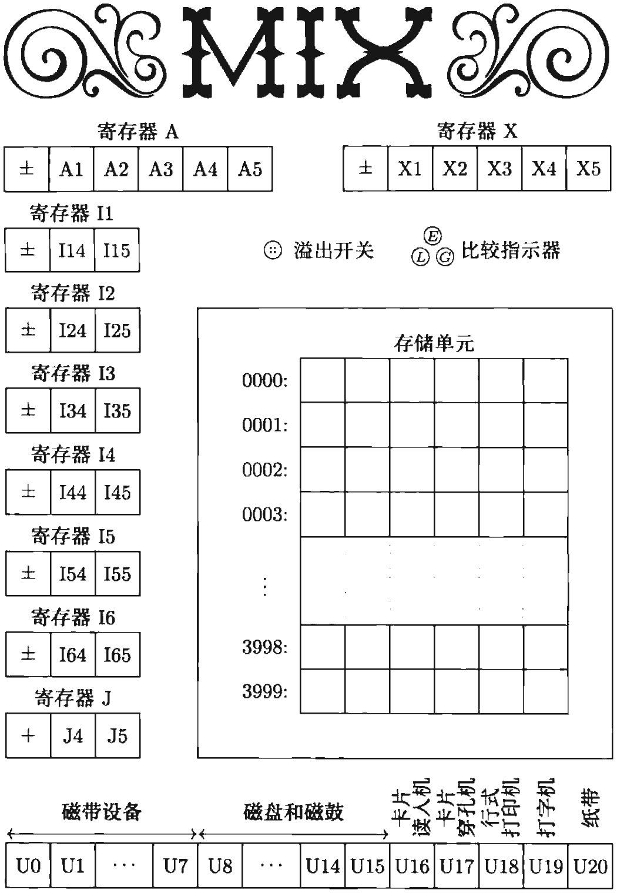

*图 13　MIX 计算机*

寄存器. MIX 有 9 个寄存器 (见 [图13](#fig-1-13)):

A 寄存器 (累加器, Accumulator) 包含 5 个字节和 1 个符号位.

X 寄存器 (扩展寄存器, Extension) 同样包含 5 个字节和 1 个符号位.

<a id="pdf-118"></a><a id="p-101"></a>

I 寄存器 (变址寄存器, Indexregister) 有 6 个, 分别称为 I1,I2,I3,I4,I5,I6, 各包含 2 个字节和 1 个符号位.

J 奇仔器 (转址奇存器, Jumpaddress) 包含 2 个字节, 隐含符号默认永远取+. 我们将在寄存器名称前面加写小写字母 $r$ 以标识 MIX 寄存器. 因此 rA 就表示 “A 寄存器”.

A 寄存器具有很多用途, 特别是用在四则运算和数据操作中. X 寄存器是对 A 寄存器的一种 “右侧” 扩展, 它同 rA 结合使用, 保存一个 10 字节的乘积或者被除数, 也可以用来保存从 rA 右端移出的数据. 变址寄存器 rI1,rI2,rI3,rI4,rI5,rI6 主要用于计数和用于引用可变的存储地址. J 寄存器总是用来保存最近一次 “转移” 操作之后一条指令的地址, 主要与子例程配合使用.

除寄存器之外, MIX 还包含

上溢开关 (有 “开”“关” 两种取值的一个二进制位);

比较指示器 (有 3 种取值: LESS 表示小于, EQUAL 表示等于, GREATER 表示大于);

内存储器 (4000 个字的存储空间, 每个字有 5 个字节和 1 个符号位);

输入输出设备 (使用卡片、纸带、磁带、磁盘等).

字的部分字段. 一个计算机字有 5 个字节和 1 个符号位, 编号如下:

| 0 | 1 | 2 | 3 | 4 | 5 |
| --- | --- | --- | --- | --- | --- |
| ± | 字节 | 字节 | 字节 | 字节 | 字节 |

(2)

大多数指令允许程序员仅使用字的一部分. 在这种情况下, 程序员可以给出一个非标准的 “字段说明”. 允许使用的字段是计算机字中的相邻字节, 用 (L:R) 表示, 其中 L 是字段左端字节的编号, R 是字段右端字节的编号. 字段说明的例子有:

(0:0), 只用符号位.

(0:2), 符号位和前两个字节.

(0:5), 整个字; 这是最常见的字段说明.

(1:5), 除了符号位之外的整个字.

(4:4), 只用第 4 个字节.

(4:5), 最后两个字节.

字段说明的用法随指令的不同而略有差异, 下面将对它在各指令中的用法做详细解释. 实际上, 每个字段说明 (L:R) 在计算机内部是用 8L+R 这个数表示的, 请注意此数能轻松存放在一个字节内.

指令格式. 用于保存指令的计算机字具有下列形式:

| 0 | 1 | 2 | 3 | 4 | 5 |
| --- | --- | --- | --- | --- | --- |
| ± | A | A | I | F | C |

(3)

最右边的字节 C 是操作码, 说明执行什么操作. 例如, C=8 指定 “装入 A 寄存器” 的 LDA.

F 字节保存对操作码的限定 (或修改). 它通常是一个字段说明 (L:R)=8L+R. 例如, 如果 C=8,F=11, 操作码代表 “把 (1:3) 字段装入寄存器 A” 的操作. 有时 F 也有其他用途, 例如在输入输出指令中, F 是相关的输入输出设备的设备号.

<a id="pdf-119"></a><a id="p-102"></a>

指令左端部分的±AA 是地址. (注意符号位是地址的一部分.) 地址后面的Ⅰ字段是变址说明, 可以用于改变有效地址. 如果Ⅰ=0, 地址±AA 直接使用; 其他情况下, I 将包含最小取 1 最大取 6 的一个数 $i$, 在指令执行之前, 要把变址寄存器 Ii 中的数同±AA 按代数方式相加, 用结果作为操作地址. 这种改变操作地址的变址过程出现在所有指令中. 我们用字母 M 表示任何指定的变址发生后的新地址. (如果变址寄存器的值加上地址±AA 所得的结果不能容纳在两个字节内, 那么 M 的值无定义.)

在大多数指令中, M 指的是一个存储单元. 在本书中, 术语 “存储单元” 与 “存储位置” 基本可以互换使用. 我们假定内存储器有 4000 个存储单元, 从 0 到 3999 编号, 因此每个存储位置可以用两个字节编址. 在指令中, 只要 M 是指一个存储单元, 必须有 $0\le\mathrm M\le3999$, 而且此时我们用 CONTENTS(M) 表示存放在存储位置 M 的值.

在某些指令中, “地址”M 具有另外一种意义, 甚至可以取负值因此, 用一条指令把 M 加到一个变址寄存器上, 其操作要考虑 M 的符号.

记号. 为了用一种便于阅读的方式讨论指令, 我们将使用记号

$$
\mathtt{OP}\qquad\mathtt{ADDRESS,I(F)}
\qquad \text{(4)}
$$

表示像 (3) 那样的指令.

此处 OP 是指令操作码 (C 部分) 的符号名称, 即操作符; ADDRESS 是±AA 部分; I 和 F 分别代表 I 字段和 F 字段.

如果 I 为 0, 那么省略 “,I”. 如果 F 是这个特定操作符的标准 F 字段说明, 就不需写出 “(F)”. 几乎所有操作符的标准 F 字段说明都是 (0:5), 代表一个完整的字. 如果某种操作符的标准 F 字段说明不是整个字, 我们会在讨论它的时候明确指出它的 F 字段说明.

例如, 把一个数装入累加器的指令称为 LDA, 操作码为 8. 对于这条指令, 我们有

| 约定的表示 | 符号 | 地址 | I | F | C |
| --- | --- | --- | --- | --- | --- |
| `LDA 2000,2(0:3)` | + | 2000 | 2 | 3 | 8 |
| `LDA 2000,2(1:3)` | + | 2000 | 2 | 11 | 8 |
| `LDA 2000(1:3)` | + | 2000 | 0 | 11 | 8 |
| `LDA 2000` | + | 2000 | 0 | 5 | 8 |
| `LDA -2000,4` | − | 2000 | 4 | 5 | 8 |

(5)

上面 “LDA2000,2(0:3)” 这条指令可以读作 “向 A 寄存器装入单元 2000 按 2 变址后的 0 至 3 字段内容”.

为了表示一个 MIX 字的数值内容, 我们将始终使用像上面那样的方框记号. 注意在字


|  |  |  |
| --- | --- | --- |
| 2000 |  | 3 |
|  | 2 | 8 |


中, 数字+2000 填在符号位和两个相邻的字节内; 但是字节 (1:1) 和字节 (2:2) 的实际内容因 MIX 计算机而异, 因为字节的大小是可变的. 再给出 MIX 字的这种记号的另外一个例子, 方格图


|  |  |  |
| --- | --- | --- |
|  |  |  |
|  | 10000 | 3000 |


表示的字有两个字段, 其中一个字段是 3 字节加符号位, 存放-10000; 另一个 2 字节字段存放 3000. 一个字如果分成不止一个字段, 就称为 “组装” 字.

每条指令的操作规则. 前面格式 (3) 之后的说明已经定义了每个指令字的 M,F,C 这三个量. 现在我们逐一定义每条指令对应的操作.

<a id="pdf-120"></a><a id="p-103"></a>

装入操作符.

● LDA (装入 A). C = 8;F = 字段.

由 CONTENTS(M) 的指定字段取代寄存器 A 原来的内容.

对于所有用部分字段作为输入的操作, 符号如果是字段的一部分则应使用, 否则默认为“+”号. 当装入寄存器时, 该字段会移到寄存器的右侧.

例: 如果 F 是标准的字段说明 (0:5), 指令把单元 M 的全部内容复制到 rA 中. 如果 F 是 (1:5), 指令装入正号和 CONTENTS(M) 的绝对值. 如果 M 包含一个指令字, F 为 (0:2), 则装入 “±AA” 字段, 形式为

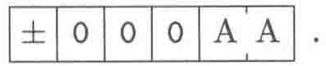

假定位置 2000 包含字


那么我们装入不同的部分字段, 可分别得到下列结果:

<table><tr><td></td><td>指令</td><td colspan="5">执行后的 rA 内容</td><td colspan="2"></td></tr><tr><td>LDA</td><td>2000</td><td>一</td><td colspan="2">80</td><td>3</td><td>5</td><td>4</td></tr><tr><td>LDA</td><td>2000(1:5)</td><td>+</td><td colspan="2">80</td><td>3</td><td>5</td><td>4</td></tr><tr><td>LDA</td><td>2000(3:5)</td><td>+</td><td>0</td><td>0</td><td>3</td><td>5</td><td>4</td></tr><tr><td>LDA</td><td>2000(0:3)</td><td>-</td><td>0</td><td>0</td><td colspan="2">80</td><td>3</td></tr><tr><td>LDA</td><td>2000(4:4)</td><td>+</td><td>0</td><td>0</td><td>0</td><td>0</td><td>5</td></tr><tr><td>LDA</td><td>2000(0:0)</td><td>-</td><td>0</td><td>0</td><td>0</td><td>0</td><td>0</td></tr><tr><td>LDA</td><td>2000(1:1)</td><td>+</td><td>0</td><td>0</td><td>0</td><td>0</td><td>?</td></tr></table>

(最后一条指令产生部分不确定的结果, 因为字节大小是可变的.)

● LDX (装入 X). C = 15; F = 字段.

和 LDA 一样, 唯一区别是装入 rX 而不是 rA.

● LDi (装入 $i$). C = 8 + i; F = 字段.

和 LDA 一样, 唯一区别是装入 rIi 而不是 rA. 一个变址寄存器只有两个字节 (而不是五个字节) 和一个符号位; 始终假定 1,2,3 字节为零. 如果一条 LDi 指令将置 1,2,3 字节为非零值, 那么这条指令无定义.

在所有指令的描述中, “$i$” 始终代表满足 $1 \leq i \leq 6$ 的整数. 所以 LDi 就代表 6 条不同的指令: LD1,LD2,...,LD6.

● LDAN (反号装入 A). C = 16;F = 字段.

●LDXN (反号装入 X). C = 23;F = 字段.

● LDiN (反号装入 $i$). $C = 16 + i$; F = 字段.

这 8 条指令分别和 LDA、LDX、LDi 一样, 唯一区别是装入带相反符号的值.

存储操作符.

● STA (存储 A). C = 24;F = 字段.

用 rA 的部分内容取代由 F 指定的 CONTENTS(M) 的字段. CONTENTS(M) 的其他部分保持不变.

<a id="pdf-121"></a><a id="p-104"></a>

在存储操作中, F 字段的意义同装入操作相反: 从寄存器右侧取出字段的若干个字节, 在需要时向左移位, 然后插入到 CONTENTS(M) 的相应字段. 符号位不会改变, 除非它是字段的一部分. 寄存器的内容不受影响.

例: 假定位置 2000 包含

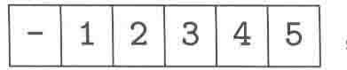

寄存器 A 包含

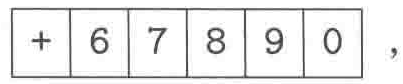

那么:

执行后的位置 2000 内容


|  |  |  |
| --- | --- | --- |
|  | 指令 |  |
| STA | 2000 |  |
| STA | 2000(1:5) |  |
| STA | 2000(5:5) |  |
| STA | 2000(2:2) |  |
| STA | 2000(2:3) |  |
| STA | 2000(0:1) |  |


|  |  |  |  |  |  |
| --- | --- | --- | --- | --- | --- |
| + | 6 | 7 | 8 | 9 | 0 |
| - | 6 | 7 | 8 | 9 | 0 |
| 一 | 1 | 2 | 3 | 4 | 0 |
| - | 1 | 0 | 3 | 4 | 5 |
| 一 | 1 | 9 | 0 | 4 | 5 |
| + | 0 | 2 | 3 | 4 | 5 |


● STX (存储 X). C = 31; F = 字段.

和 STA 一样, 唯一区别是存储 rX 而不是 rA.

● STi (存储 $i$ ). C = 24 + i; F = 字段.

和 STA 一样, 唯一区别是存储 rIi 而不是 rA. 变址寄存器的 1,2,3 字节均为零, 因此如果 rI1 包含

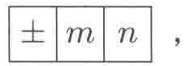

它在操作时相当于

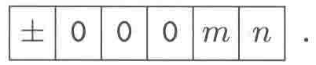

● STJ (存储 J). C = 32;F = 字段.

和 STi 一样, 唯一区别是存储 rJ, 而且符号恒为+.

对于 STJ 指令, F 的标准字段说明是 (0:2) 而不是 (0:5). 这是很自然的, 因为 STJ 几乎总是用于指令的地址字段.

● STZ (存储零). C = 33; F = 字段.

和 STA 一样, 唯一区别是存储正零. 换句话说, 它把 CONTENTS(M) 的指定字段清零.

算术运算符. 加法、减法、乘法和除法运算都允许附有字段说明. 可以用字段说明 “(0:6)” 表示运算是 “浮点” 运算 (见 4.2 节), 但是我们为 MIX 编写的程序很少会利用这个特性, 因为我们主要关注对于整数的算法.

标准字段说明照例是 (0:5). 其他字段的处理同 LDA 中的处理一样. 我们将用字母 V 表示 CONTENTS(M) 的指定字段. 因此, 假如操作码换成 LDA,V 就是装入寄存器 A 中的值.

● ADD (加法). C = 1; F = 字段.

把 V 加进 rA. 如果所得结果数值太大, 寄存器 A 容纳不下, 那么上溢开关就会打开, 仿佛把一个 “1” 进位到 rA 左边的另一个假想的寄存器中, 和的剩余部分出现在 rA 中. (其他时候, 上溢开关的状态不改变.) 如果结果为零, rA 的符号不改变.

<a id="pdf-122"></a><a id="p-105"></a>

例: 下面的指令序列计算寄存器 A 的 5 个字节之和.


|  |  |  |
| --- | --- | --- |
| STA | 2000 |  |
| LDA | 2000(5:5) |  |
| ADD | 2000(4:4) |  |
| ADD | 2000(3:3) |  |
| ADD | 2000(2:2) |  |
| ADD | 2000(1:1) |  |


有时把这样的相加称为 “横向加法”.

在不同的 MIX 计算机中, 上溢可能出现, 也可能不出现, 这是因为字节大小的定义是可变的. 我们不能说, 如果值大于 1073741823 就一定发生上溢. 上溢只出现在结果值超出 5 个字节容量的时候, 具体阈值与字节大小有关. 不过, 人们依旧能够编写出合适的程序, 它们无论字节大小如何, 都能正确运行, 并给出一致的最终结果.

● SUB (减法). C = 2;F = 字段.

从 rA 中减去 V. (等价于在 ADD 中用-V 代替 V.)

● MUL (乘法). C = 3;F = 字段.

以 V 与 rA 的 10 字节乘积替换寄存器 A 和 X 的值. rA 和 rX 的符号均设置为乘积的代数符号 (若 V 和 rA 原先同号则取+, 异号则取-).

● DIV (除法). C = 4; F = 字段.

把 rA 和 rX 的值合起来当作一个 10 字节数 rAX (与 rA 同号), 并除以 V 值. 如果 V=0, 或者商的值超出 5 个字节 (这与条件 $| \mathrm{r} \tilde{\mathrm{A}} | \geq | \mathrm{V} |$ 等价), 那么对寄存器 A 和 X 填入无定义的信息, 并打开上溢开关. 在其他情况下, 把商 $\pm\left\lfloor\left|\mathrm{rAX}/\mathrm V\right|\right\rfloor$ 存入 rA, 余数 $\pm \big ( | \mathrm { r } \hat { \mathrm { A } } \hat { \mathrm { X } } | \bmod | \hat { \mathrm { V } } | \big )$ 存入 rX. 运算后, rA 的符号是商的代数符号 (若 V 和 rA 原先同号则取+, 异号则取-), rX 的符号是 rA 原来的符号.

算术指令示例: 在多数情况下, 进行算术运算的 MIX 字都是 5 个字节组成的单个数, 不包括由若干字段组装而成的数. 然而如果小心谨慎, 也能对组装的 MIX 字进行算术运算. 下面的例子应仔细研究. (像前面的例子一样, 问号? 表示不确定的值.)


|  |  |  |  |
| --- | --- | --- | --- |
| + | 1234 | 1 | 150 |
| + | 100 | 5 | 50 |
| + | 1334 | 6 | 200 |


运算前的 rA 单元 1000 运算后的 rA


|  |  |  |  |
| --- | --- | --- | --- |
| 一 | 1234 | 0 0 | 9 |
| - | 2000 | 150 | 0 |
| + | 766 | 149 | ? |


运算前的 rA 单元 1000 运算后的 rA

MUL 1000


|  |  |  |  |  |  |
| --- | --- | --- | --- | --- | --- |
| 十 | 1 | 1 | 1 | 1 | 1 |
| + | 1 | 1 | 1 | 1 | 1 |
| + | 0 | 1 | 2 | 3 | 4 |
| + | 5 | 4 | 3 | 2 | 1 |


运算前的 rA 单元 1000 运算后的 rA 运算后的 rX

<a id="pdf-123"></a><a id="p-106"></a>

<table><tr><td rowspan="3"></td><td rowspan="3"></td><td></td><td colspan="3"></td><td colspan="3">112</td><td>运算前的 rA</td></tr><tr><td>?</td><td>2</td><td>?</td><td>?</td><td>?</td><td></td><td>?</td><td>单元 1000</td></tr><tr><td>一</td><td colspan="3"></td><td colspan="3">0 224</td><td>运算后的 rA 运算后的 rX</td></tr><tr><td rowspan="9">MUL 1000</td><td rowspan="9"></td><td rowspan="9"></td><td colspan="3"></td><td colspan="3"></td><td></td></tr><tr><td>一</td><td>50 2</td><td>0</td><td></td><td>112</td><td>4</td><td>运算前的 rA 单元 1000</td></tr><tr><td>一</td><td></td><td>0</td><td>0 0</td><td>0</td><td>0</td><td></td></tr><tr><td>+</td><td colspan="3">100</td><td colspan="2">224</td><td>运算后的 rA</td></tr><tr><td>+</td><td>8</td><td>0</td><td>0</td><td>0</td><td>0</td><td>运算后的 rX</td></tr><tr><td></td><td></td><td></td><td></td><td></td><td></td><td>运算前的 rA</td></tr><tr><td>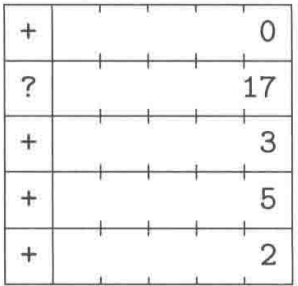</td><td></td><td></td><td></td><td></td><td></td><td>运算前的 rX</td></tr><tr><td></td><td></td><td></td><td></td><td></td><td></td><td></td></tr><tr><td></td><td></td><td></td><td></td><td></td><td></td><td>单元 1000</td></tr><tr><td rowspan="7">DIV 1000</td><td rowspan="7"></td><td rowspan="7"></td><td rowspan="7"></td><td colspan="5"></td><td>运算后的 rA</td></tr><tr><td></td><td></td><td></td><td></td><td></td><td></td></tr><tr><td></td><td></td><td></td><td></td><td></td><td>运算后的 rX</td></tr><tr><td>一</td><td colspan="4"></td><td>0 运算前的 rA</td></tr><tr><td colspan="3">1235 +</td><td>3</td><td>1</td><td>运算前的 rX</td></tr><tr><td>一</td><td>0 0</td><td>0</td><td>2</td><td>0</td><td>单元 1000</td></tr><tr><td></td><td></td><td>617</td><td>?</td><td>?</td><td>运算后的 rA</td></tr><tr><td rowspan="2"></td><td rowspan="2">DIV 1000</td><td>+</td><td>0</td><td colspan="3"></td><td></td><td></td><td></td></tr><tr><td>一</td><td>0</td><td>0</td><td>0</td><td></td><td>?</td><td>1</td><td>运算后的 rX</td></tr></table>

(选择这些例子的原则是: 与其给出不完全的简单说明, 不如给出完全但有难度的说明.)

地址传送操作符. 在下面的操作中, “地址”M (可能经过变址) 在使用时当成一个带符号的数, 而不是作为存储器中的单元地址.

● ENTA (送入 A). C = 48; F = 2.

把数值 M 装入 rA. 这个操作等价于从包含带符号值 M 的存储字执行 “LDA” 操作. 如果 M=0, 装入这条指令的符号.

例: “ENTA0” 置 rA 为+0 (正零). $\text{“}\mathtt{ENTA\ 0,1}\text{”}$ 置 rA 为变址寄存器 1 的当前值, 不过把-0 变为 $+0$. “`ENTA -0,1`” 是类似的, 不过把+0 变为-0.

● ENTX (送入 X). $C =55 ;  F =2.$

ENTi (送入 $i$). $\mathrm{C}=48+i;\;\mathrm{F}=2.$

类似于 ENTA, 装入相应的寄存器.

● ENNA (反号送入 A). C = 48;F = 3.

● ENNX (反号送入 X). C = 55; F = 3.

● ENNi (反号送入 $i$ ). C = 48 + i; F = 3.

和 ENTA、ENTX、ENTi 一样, 唯一区别是装入相反的符号.

例: $ENN 3 0,3$ 把 rI3 的值替换为其相反数, 不过-0 仍然保留为-0.

● INCA (增加 A ). C = 48; F = 0.

<a id="pdf-124"></a><a id="p-107"></a>

把值 M 加进 rA. 这个操作等价于从包含 M 值的存储字执行 “ADD”. 可能出现上溢, 处理方法与 ADD 完全一样.

例: $\mathrm{TNCA}\ 1$ 对 rA 的值加 1.

●INCX (增加 X ). C = 55; F = 0.

把值 M 加进 rX. 如果出现上溢, 这个操作等价于 ADD, 不过是用 rX 而不是 rA. 寄存器 A 不会受这条指令的影响.

● INCi (增加 $i$ ). C = 48 + i; F = 0.

把 M 加进 rIi. 一定不出现上溢; 如果 M+rIi 不能容纳在 2 个字节中, 这条指令的结果是未定义的.

● DECA (减少 A ). C = 48; F = 1.

● DECX (减少 X ). C = 55; F = 1.

● DECi (减少 $i$ ). C = 48 + i; F = 1.

这 8 条指令分别和 INCA、INCX、INCi 一样, 唯一区别是对寄存器减 M 而不是加 M.  
注意 ENTA、ENNA、INCA、DECA 的操作码 C 是相同的, 用 F 字段区分不同的操作.

比较操作符. MIX 的所有比较操作符用来比较的两个值, 都是一个在寄存器中, 一个在存储器中. 依据寄存器中的值小于、等于、大于存储单元的值, 相应将比较指示器设置为 LESS、EQUAL、GREATER. 负零与正零相等.

● CMPA (比较 A). C = 56; F = 字段.

用 rA 的指定字段与 CONTENTS(M) 的相同字段做比较. 如果 F 不包括符号位, 两者的字段都认为是非负的; 不然, 也要比较符号. (当 F 为 (0:0) 时, 结果总是相等的, 因为负零等于正零.)

● CMPX (比较 X). C = 63; F = 字段.

类似于 CMPA.

● CMPi (比较 $i$). C = 56 + i; F = 字段.

类似于 CMPA. 在这种比较中, 变址寄存器的 1,2,3 字节当成 0. (因此, 如果 F=(1:2), 比较结果不会是 GREATER.)

转移操作符. 指令通常是按顺序依次执行的, 也就是说, 在执行单元 P 中的指令后, 一般是执行单元 P+1 中的指令. 但是几种 “转移” 指令会中断这种执行顺序. 一般当出现转移时, 寄存器 J 被设置为原顺序的下一条指令的地址 (即假如没有转移的下一条指令). 于是, 程序员如果愿意的话, 可以用一条 “存储 J” 指令, 以便设置以后将要用于返回程序原处的另一条指令的地址字段. 每当程序中实际出现一次转移时, J 寄存器都会改变, 除非转移操作符是 JSJ; 同时, J 寄存器是不会被非转移指令改变的.

● JMP (转移). C = 39; F = 0.

无条件转移: 下一条指令是从位置 M 取出的指令.

● JSJ (转移, 保留 J). $C =39;\  F =1.$

和 JMP 一样, 但是 rJ 内容不改变.

● JOV (上溢时转移). $C =39 ;  F =2.$

如果上溢开关置于 “开” 状态, 则关闭之并出现 JMP; 否则不产生任何操作.

● JNOV (无上溢时转移). C = 39; F = 3.

<a id="pdf-125"></a><a id="p-108"></a>

如果上溢开关置于 “关” 状态, 则出现 JMP; 否则关闭之.

●JL,JE,JG,JGE,JNE,JLE (比较出现小于、等于、大于、大于等于、不等于、小于等于时转移). C = 39; 相应有 F = 4,5, 6,7,8,9.

当比较指示器置于指定的条件时转移. 例如, 如果比较指示器为 LESS 或 GREATER, 那么 JNE 将发生转移. 这些转移指令不改变比较指示器.

●JAN,JAZ,JAP,JANN,JANZ,JANP(A 寄存器为负数、零、正数、非负数、非零、非正数 时转移). C =40; 相应有 F = 0,1,2,3,4,5.

如果 rA 中的数满足指定的条件, 出现一次 JMP; 不满足则不产生任何操作. “正数” 是指大于零 (不等于零) 的数; “非正数” 是指不是正数的数, 即零或者负数.

●JXN,JXZ,JXP,JXNN,JXNZ,JXNP(X 寄存器为负数、零、正数、非负数、非零、非正数 时转移). C = 47; 相应有 F = 0,1,2, 3,4,5.

●JiN,JiZ,JiP,JiNN,JiNZ,JiNP($i$ 寄存器为负数、零、正数、非负数、非零、非正数时 转移). C=40+i; 相应有 F =0,1,2,3,4,5. 这 42 个转移指令类似于对 rA 的相应操作.

其他操作符.

●SLA,SRA,SLAX,SRAX,SLC,SRC (左移 A, 右移 A, 左移 AX, 右移 AX, 循环左移 AX, 循环右移 AX). C = 6; 相应有 F =0,1,2,3,4,5.

这些是 “移位” 指令, 其中 M 指定左移或者右移的 MIX 字节数, 因此 M 必须是非负的. SLA 和 SRA 不影响 rX; 其他移位同时影响寄存器 A 和 X, 把它们视为一个 10 字节寄存器. 在执行 SLA、SRA、SLAX、SRAX 时, 一些 0 移进寄存器的一端, 而一些字节在另一端消失. 指令 SLC 和 SRC 调用 “循环” 移位, 也就是说, 从寄存器一端移出的字节在另一端移进寄存器. 在循环移位中, rA 和 rX 同时参与移位. 任何一种移位指令都绝对不会影响寄存器 A 和 X 的符号位.

<table><tr><td></td><td>寄存器 A</td><td colspan="5"></td><td colspan="9">寄存器 X</td></tr><tr><td>初始内容</td><td></td><td>+</td><td>1</td><td>2</td><td>3</td><td>4</td><td>5</td><td>-</td><td>6</td><td>7</td><td>8</td><td>9</td><td>10</td></tr><tr><td>SRAX 1</td><td></td><td>+</td><td>0</td><td>1</td><td>2</td><td>3</td><td>4</td><td>-</td><td>5</td><td>6</td><td>7</td><td>8</td><td>9</td></tr><tr><td>SLA</td><td>2</td><td>十</td><td>2</td><td>3</td><td>4</td><td>0</td><td>0</td><td>一</td><td>5</td><td>6</td><td>7</td><td>8</td><td>9</td></tr><tr><td>SRC</td><td>4</td><td>+</td><td>6</td><td>7</td><td>8</td><td>9</td><td>2</td><td>-</td><td>3</td><td>4</td><td>0</td><td>0</td><td>5</td></tr><tr><td>SRA</td><td>2</td><td>+</td><td>0</td><td>0</td><td>6</td><td>7</td><td>8</td><td>-</td><td>3</td><td>4</td><td>0</td><td>0</td><td>5</td></tr><tr><td>SLC</td><td>501</td><td>+</td><td>0</td><td>6</td><td>7</td><td>8</td><td>3</td><td>-</td><td>4</td><td>0</td><td>0</td><td>5</td><td>0</td></tr></table>

●MOVE (传送或移动). C=7;F =数字, 正常情况下为 1.

传送由 F 指定数量的字, 原位置的起始单元是 M, 新位置的起始单元由变址寄存器 1 的值指定. 一次传送一个字, 当操作结束时, rI1 的值增加 F. 如果 F=0, 不发生任何操作.

如果在两组单元之间出现重叠, 务必当心例如, 假定 F=3,M=1000. 那么, 如果 rI1 = 999, 我们把 CONTENTS(1000) 传送到 CONTENTS(999), 把 CONTENTS(1001) 传送到 CONTENTS(1000), 把 CONTENTS(1002) 传送到 CONTENTS(1001); 没有出现任何异常现象. 但是如果把 rI1 改为 1001, 我们就会把 CONTENTS(1000) 传送到 CONTENTS(1001), 然后把 CONTENTS(1001) 传送到 CONTENTS(1002), 然后把 CONTENTS(1002) 传送到 CONTENTS(1003); 所以会把同一个字 CONTENTS(1000) 传送到三个地方.

●NOP (无操作). C = 0.

不出现操作, 略过这条指令. 省略 F 和 M.

<a id="pdf-126"></a><a id="p-109"></a>

●HLT (停机). $C =5 ;  F =2.$

机器停止操作. 当计算机操作员重新启动机器时, 最终净效果等价于 NOP.

输入输出操作符. MIX 有不少输入输出设备 (都是另付费用选用的). 如下所示, 每一种设备都给定一个号码:


|  |  |  |
| --- | --- | --- |
| 设备号 | 外围设备 | 信息块大小 |
| t | 磁带设备号 $t ( 0 \leq t \leq 7 )$ | 100 字 |
| d | 磁盘或磁鼓设备号 $d ( 8 \leq d \leq 1 5 )$ | 100 字 |
| 16 | 卡片读入机 | 16 字 |
| 17 | 卡片穿孔机 | 16 字 |
| 18 | 行式打印机 | 24 字 |
| 19 | 打字机终端 | 14 字 |
| 20 | 纸带 (机) | 14 字 |


并非每台 MIX 计算机都配有上述所有设备, 我们有时会对是否拥有某种设备做适当的假定. 有些设备不兼具输入和输出功能. 上表中列出的字数是每台设备固有的信息块大小.

用磁带、磁盘或磁鼓设备输入或者输出时, 读入或者写出的是完整的字 (5 个字节和 1 位符号位). 但是 16 到 20 号设备总是用字符代码输入或者输出, 其中每个字节表示一个字母数字字符. 因此, 每个 MIX 机器字传输 5 个字符. 字符代码在本小节后面表 1 的顶部给出. 代码 00 对应于 “”, 这个符号表示一个空格. 代码 01-29 表示字母 A 至 Z 和额外的 3 个希腊字母; 代码 30-39 代表数字 $0 , 1 , \ldots , 9$; 接着的代码 40,41,... 代表标点符号和其他特殊字符. (MIX 的字符集令我们回想起计算机尚无法处理小写字母的那段日子.) 我们不能用字符代码输入或者输出一个字节的全部可能取值, 因为某些组合是未定义的. 此外某些输入输出设备也可能无法处理字符集中的所有符号, 例如出现在字母中间的希腊字母∑和Ⅱ或许不能被卡片读入机接受. 当进行字符代码输入时, 所有字的符号位设置为+; 输出时则忽略符号位. 如果用打字机作为输入设备, 在每一行末尾输入 “回车” 后, 就会用空格填满那一行余下部分.

磁盘和磁鼓设备是外部存储装置, 每台设备包含 100 个字的信息块. 在下面定义的每一条 IN、OUT、IOC 指令中, 针对的 100 个字信息块由 rX 的当前值指定, 该值不应超出相应磁盘或磁鼓的容量.

$$
\bullet \mathbb{IN}  (输入) .  C =36;  F = 设备.
$$

这条指令启动信息传输, 从指定的输入设备传到从 M 开始的连续存储单元. 传输的单元个数是这个设备的信息块大小 (见前面的设备表). 如果此前对同一台设备进行的操作尚未完成, 计算机在此等待. 由这条指令启动的信息传输将持续一段未知的时间才能完成, 具体时间取决于输入设备的速度, 所以程序务必不要在信息传完之前访问存储器中的相应数据. 不应试图读取位于最后写进磁带的信息块之后的任何信息块.

$$
\bullet\ \mathtt{OUT}\ \text{(输出)}.\quad\mathtt C=37;\ \mathtt F=\text{设备}.
$$

这条指令启动信息传输, 从自 M 开始的存储单元传输到指定的输出设备上. 如果设备一开始尚未就绪, 那么机器等待, 直到设备就绪才开始. 传输将持续一段未知的时间才能完成, 具体时间取决于输出设备的速度, 所以程序务必不要在信息传完之前改变存储器中的相应数据.

● `IOC` (输入输出控制). $C=35$; $F=$ 设备.

如果设备忙碌, 那么机器等待, 直到指定设备处于不忙碌状态. 然后执行一个控制操作, 具体操作取决于使用的特定设备. 下面的几个例子将在本书的不同部分使用.

<a id="pdf-127"></a><a id="p-110"></a>

磁带: 如果 M=0, 那么反绕磁带. 如果 M<0, 则磁带向回跳过-M 个信息块, 也有可能在跳完之前已退回到磁带的起点. 如果 $\mathtt M>0$, 则磁带向前跳过 M 个信息块, 但不应向前跳过最后写进磁带的信息块之后的任何块.

例如, 指令序列 “0UT1000(3); I0C -1(3); IN2000(3)” 把 100 个字输出到磁带 3 上, 然后再把它重新读进存储器. 只要磁带可靠, 这个序列的后面两条指令无非是把 100 个字从单元 1000-1099 传送到单元 2000-2099 的一种慢速方式. 指令序列 “0UT1000(3); $\mathtt{IOC\ +1(3)}\text{”}$ 不应采用.

磁盘或磁鼓: M 应当为 0. 作用是依据 rX 定位设备, 使得下一次在这台设备上执行 IN 或 OUT 指令时, 在使用相同 rX 设置值的情况下节省一些时间.

行式打印机: M 应当为 0. “IOC0(18)” 使打印机跳到下一页的顶端.

纸带 (机): M 应当为 0. “I0C 0(20)” 反绕纸带.

●JRED (就绪时转移). $\mathrm{C}=38;\mathrm{F}= 设备$

如果指定的设备就绪, 也就是此前由 IN 或者 OUT 或者 IOC 启动的操作结束, 那么出现转移.

● JBUS (忙碌时转移). C = 34;F = 设备.

类似于 JRED, 但是当指定的设备没有就绪时出现转移.

例: 在位置 1000, 指令 $\text{" JBUS } \quad 1000(16) \text{" }$ 将反复执行, 直到设备 16 (卡片读入机) 就绪.

上述简单操作是 MIX 的全部输入输出指令. MIX 没有用来处理外围设备异常状态的 “带检验” 指示器等. 出现异常 (如纸带机卡带、设备关闭、带用尽等) 时, 设备会始终处于忙碌状态, 发出铃声, 然后由熟练的计算机操作员采用常规维护步骤手工排除故障. 我们将在 5.4.6 节和 5.4.9 节讨论某些更复杂的外围设备, 它们比这里描述的块大小固定的磁带、磁鼓和磁盘更昂贵, 也更能代表如今的现代化设备.

转换操作符.

●NUM (转换为数字). $C =5 ;  F =0.$

这个操作用于把字符代码转换成数字代码. 省略 M. 寄存器 A 和 X 看作合起来包含一个字符代码形式的 10 字节数字; NUM 指令把 rA 的值设置为这个数 (当作十进制数) 的数字值. rX 的值与 rA 的符号不变. 字节 00,10,20,30,40,... 转换为数字 0; 字节 01,11,21,... 转换为数字 1; 等等. 转换时可能产生上溢, 此时保留对 $b ^ { 5 }$ 取模的余数, 其中 $b$ 是字节大小.

● CHAR (转换为字符). C = 5; F = 1.

这个操作用于把数字代码转换为适合对卡片穿孔机、纸带机或行式打印机输出的字符代码. 指令把 rA 中的数值转换为一个 10 字节的十进制数, 并以字符代码形式置于寄存器 A 和 X 中. rA 和 rX 的符号不变. 省略 M.

寄存器 A

<table><tr><td>初始内容</td><td></td><td>- 00</td><td>00</td><td>31</td><td>32</td><td>39</td></tr><tr><td>NUM 0</td><td></td><td>-</td><td></td><td></td><td>12977700</td><td></td></tr><tr><td>INCA 1</td><td></td><td>一</td><td colspan="5"></td></tr><tr><td>CHAR O</td><td></td><td>-</td><td>30</td><td>30</td><td>31</td><td>32</td><td>39</td></tr></table>

寄存器 X


|  |  |  |  |  |  |
| --- | --- | --- | --- | --- | --- |
| + | 37 | 57 | 47 | 30 | 30 |
| + | 37 | 57 | 47 | 30 | 30 |
| 十 | 37 | 57 | 47 | 30 | 30 |
| + | 37 | 37 | 36 | 39 | 39 |


计时. 为了对 MIX 程序的性能给出定量信息, MIX 的每个操作都赋有执行时间. 时间长短代表了 20 世纪 70 年代古董计算机的典型特性.

<a id="pdf-128"></a><a id="p-111"></a>

ADD 和 SUB, 以及所有 LOAD 操作和 STORE 操作 (包括 STZ), 还有所有移位指令和比较操作, 都花费 2 单位时间. MOVE 需要 1 单位时间加上传送每个字的 2 单位时间. MUL、NUM、CHAR 这三个操作都需要 10 单位时间, 而 DIV 需要 12 单位时间. 浮点运算的执行时间在 4.2.1 节说明. 其余操作都花费 1 单位时间, 再加上计算机可能用在 IN、OUT、IOC、HLT 指令上的空闲时间.

特别注意, ENTA 花费 1 单位时间, 而 LDA 花费 2 单位时间. 计时规则很好记, 因为事实上除了移位和转换指令以及 MUL 和 DIV 指令之外, 其他指令花费的单位时间的数量都等于访问存储器 (包括访问指令本身) 的次数.

MIX 的基本时间单位是一个相对度量, 我们简单地用 $u$ 表示. 可以把它看成比如说 10 微秒 (比较廉价的计算机), 或者 10 纳秒 (比较昂贵的计算机).

例: 指令序列 `LDA 1000; INCA 1; STA 1000` 花费时间正好为 $5u$.

如今我以沉静的目光

察觉机器的真正脉动.

—威廉·华兹华斯[^cn128-1], 《她是欢乐的幻影》(1804)

小结. 至此, 除了 “GO 按钮” 之外, 我们讨论了 MIX 的全部特性. GO 按钮在习题 26 讨论. 尽管 MIX 有将近 150 种不同的操作, 但是它们可以归并为少数几种简单类型, 很容易记住. 表 1 汇总每个操作码 (C 值) 对应的操作. 每个操作符后面的括号内标明了默认的 F 字段.

通过下面的习题可以快速回顾本小节的内容. 大多数习题是很简单的, 读者应力求做完绝大部分习题.

#### 习题

1\. [00] <a id="ex-1-3-1-1"></a>[答案](./answers/1-3-1.md#ans-1-3-1-1) 如果 MIX 是三进制 (以 3 为基数) 的计算机, 每个字节应该有多少个三进制位 (trit)?

2\. [02] <a id="ex-1-3-1-2"></a>[答案](./answers/1-3-1.md#ans-1-3-1-2) 如果一个数值要在 MIX 内表示, 它可能大到 99999999, 那么应该用多少相邻的字节存放它?

3\. [02] <a id="ex-1-3-1-3"></a>[答案](./answers/1-3-1.md#ans-1-3-1-3) 对于 MIX 指令的下列部分字段给出字段说明 (L:R): (a) 地址字段; (b) 变址字段; (c) 字段说 明字段; (d) 操作码字段.

4\. [00] <a id="ex-1-3-1-4"></a>[答案](./answers/1-3-1.md#ans-1-3-1-4) 装入指令例 (5) 中最后一个例子是 $\angle D A = 2 0 0 0 , 4$. 考虑到存储器地址不应为负数的事实, 这怎么可能是合法的?

5\. [10] <a id="ex-1-3-1-5"></a>[答案](./answers/1-3-1.md#ans-1-3-1-5) 如果把 (6) 看成一条 MIX 指令, 那么同 (6) 对应的类似于 (4) 的符号表示是什么?

6\. [10] <a id="ex-1-3-1-6"></a>[答案](./answers/1-3-1.md#ans-1-3-1-6) 假定位置 3000 包含


|  |  |  |  |
| --- | --- | --- | --- |
|  | 1 | 200 | 15 |
| + | 5 |  |  |
|  |  |  |  |
|  |  |  |  |


下列指令的结果是什么?(如果某个指令无定义或者不完全定义，请指出.)($a$)LDAN3000;  
(b) LD2N 3000(3:4); (c) LDX 3000(1:3); (d) LD6 3000; (e) LDXN 3000(0:0).

7\. [M15] <a id="ex-1-3-1-7"></a>[答案](./answers/1-3-1.md#ans-1-3-1-7) 对于 DIV 指令不产生上溢的全部情形, 用代数运算 $X\bmod Y$ 和 $\lfloor X/Y\rfloor$ 给出指令结果的确切 定义.

8\. [15] <a id="ex-1-3-1-8"></a>[答案](./answers/1-3-1.md#ans-1-3-1-8) 在前面 133 页 “算术指令示例” 的最后一条 DIV 指令中, “运算前的 rX” 等于+ 1235 0 3 1 假如把它改成 - 1234 0 3 1 而例中其他部分不变, 那么寄存器 A 和 X 在 DIV 指令执行后将包含什么值?

9\. [15] <a id="ex-1-3-1-9"></a>[答案](./answers/1-3-1.md#ans-1-3-1-9) 列出可能改变上溢开关的设置值的全部 MIX 操作符. (不包括浮点运算操作符.)


<a id="pdf-129"></a><a id="p-112"></a>

**表 1**

**字符代码**

| 编码 | 字符 | 编码 | 字符 | 编码 | 字符 | 编码 | 字符 |
| ---: | :---: | ---: | :---: | ---: | :---: | ---: | :---: |
| 00 | `␣` | 01 | `A` | 02 | `B` | 03 | `C` |
| 04 | `D` | 05 | `E` | 06 | `F` | 07 | `G` |
| 08 | `H` | 09 | `I` | 10 | `Δ` | 11 | `J` |
| 12 | `K` | 13 | `L` | 14 | `M` | 15 | `N` |
| 16 | `O` | 17 | `P` | 18 | `Q` | 19 | `R` |
| 20 | `Σ` | 21 | `Π` | 22 | `S` | 23 | `T` |
| 24 | `U` |  |  |  |  |  |  |

| $C$ | $t$ | 描述 | 操作及 $F$ 设置 |
| ---: | ---: | :--- | :--- |
| 00 | $1$ | 无操作 | `NOP(0)` |
| 01 | $2$ | $\mathrm{rA}\leftarrow\mathrm{rA}+V$ | `ADD(0:5)`, `FADD(6)` |
| 02 | $2$ | $\mathrm{rA}\leftarrow\mathrm{rA}-V$ | `SUB(0:5)`, `FSUB(6)` |
| 03 | $10$ | $\mathrm{rAX}\leftarrow\mathrm{rA}\times V$ | `MUL(0:5)`, `FMUL(6)` |
| 08 | $2$ | $\mathrm{rA}\leftarrow V$ | `LDA(0:5)` |
| 09 | $2$ | $\mathrm{rI1}\leftarrow V$ | `LD1(0:5)` |
| 10 | $2$ | $\mathrm{rI2}\leftarrow V$ | `LD2(0:5)` |
| 11 | $2$ | $\mathrm{rI3}\leftarrow V$ | `LD3(0:5)` |
| 16 | $2$ | $\mathrm{rA}\leftarrow -V$ | `LDAN(0:5)` |
| 17 | $2$ | $\mathrm{rI1}\leftarrow -V$ | `LD1N(0:5)` |
| 18 | $2$ | $\mathrm{rI2}\leftarrow -V$ | `LD2N(0:5)` |
| 19 | $2$ | $\mathrm{rI3}\leftarrow -V$ | `LD3N(0:5)` |
| 24 | $2$ | $\mathrm{M}(\mathrm F)\leftarrow \mathrm{rA}$ | `STA(0:5)` |
| 25 | $2$ | $\mathrm{M}(\mathrm F)\leftarrow \mathrm{rI1}$ | `ST1(0:5)` |
| 26 | $2$ | $\mathrm{M}(\mathrm F)\leftarrow \mathrm{rI2}$ | `ST2(0:5)` |
| 27 | $2$ | $\mathrm{M}(\mathrm F)\leftarrow \mathrm{rI3}$ | `ST3(0:5)` |
| 32 | $2$ | $\mathrm{M}(\mathrm F)\leftarrow\mathrm{rJ}$ | `STJ(0:2)` |
| 33 | $2$ | $\mathrm{M}(\mathrm F)\leftarrow0$ | `STZ(0:5)` |
| 34 | $1$ | 设备 $F$ 忙吗? | `JBUS(0)` |
| 35 | $1+T$ | 控制, 设备 $F$ | `IOC(0)` |
| 40 | $1$ | rA 与 0 比较, 转移 | `JA[+]` |
| 41 | $1$ | rI1 与 0 比较, 转移 | `J1[+]` |
| 42 | $1$ | rI2 与 0 比较, 转移 | `J2[+]` |
| 43 | $1$ | rI3 与 0 比较, 转移 | `J3[+]` |
| 48 | $1$ | $\mathrm{rA}\leftarrow [\mathrm{rA}]?\pm M$ | `INCA(0)`, `DECA(1)`, `ENTA(2)`, `ENNA(3)` |
| 49 | $1$ | $\mathrm{rI1}\leftarrow [\mathrm{rI1}]?\pm M$ | `INC1(0)`，`DEC1(1)`，`ENT1(2)`，`ENN1(3)` |
| 50 | $1$ | $\mathrm{rI2}\leftarrow [\mathrm{rI2}]?\pm M$ | `INC2(0)`，`DEC2(1)`，`ENT2(2)`，`ENN2(3)` |
| 51 | $1$ | $\mathrm{rI3}\leftarrow [\mathrm{rI3}]?\pm M$ | `INC3(0)`，`DEC3(1)`，`ENT3(2)`，`ENN3(3)` |
| 56 | $2$ | $\mathrm{CI}\leftarrow \mathrm{rA}(\mathrm F):V$ | `CMPA(0:5)`, `FCMP(6)` |
| 57 | $2$ | $\mathrm{CI}\leftarrow \mathrm{rI1}(\mathrm F):V$ | `CMP1(0:5)` |
| 58 | $2$ | $\mathrm{CI}\leftarrow \mathrm{rI2}(\mathrm F):V$ | `CMP2(0:5)` |
| 59 | $2$ | $\mathrm{CI}\leftarrow \mathrm{rI3}(\mathrm F):V$ | `CMP3(0:5)` |

**一般形式**

| 记号 | 含义 |
| :--- | :--- |
| $C$ | 操作码, 指令的 (5:5) 字段 |
| $F$ | 操作码的变形, 指令的 (4:4) 字段 |
| $M$ | 变址后的指令地址 |
| $V=M(F)$ | 位置 $M$ 的字段 $F$ 的内容 |
| OP | 操作的符号名 |
| (F) | 标准 $F$ 设置 |
| $t$ | 执行时间 |
| $T$ | 互锁时间 |

<a id="pdf-130"></a><a id="p-113"></a>

**表 1 (续)**

**字符代码**

| 编码 | 字符 | 编码 | 字符 | 编码 | 字符 | 编码 | 字符 |
| ---: | :---: | ---: | :---: | ---: | :---: | ---: | :---: |
| 25 | `V` | 26 | `W` | 27 | `X` | 28 | `Y` |
| 29 | `Z` | 30 | `0` | 31 | `1` | 32 | `2` |
| 33 | `3` | 34 | `4` | 35 | `5` | 36 | `6` |
| 37 | `7` | 38 | `8` | 39 | `9` | 40 | `.` |
| 41 | `,` | 42 | `(` | 43 | `)` | 44 | `+` |
| 45 | `-` | 46 | `*` | 47 | `/` | 48 | `=` |
| 49 | `$` | 50 | `<` | 51 | `>` | 52 | `@` |
| 53 | `;` | 54 | `:` | 55 | `'` |  |  |

| $C$ | $t$ | 描述 | 操作及 $F$ 设置 |
| ---: | ---: | :--- | :--- |
| 04 | $12$ | $\mathrm{rA}\leftarrow\mathrm{rAX}/V$, $\mathrm{rX}\leftarrow$ 余数 | `DIV(0:5)`, `FDIV(6)` |
| 05 | $10$ | 特殊 | `NUM(0)`, `CHAR(1)`, `HLT(2)` |
| 06 | $2$ | 移位 $M$ 字节 | `SLA(0)`, `SRA(1)`, `SLAX(2)`, `SRAX(3)`, `SLC(4)`, `SRC(5)` |
| 07 | $1+2F$ | 从 $M$ 到 rI1 移动 $F$ 字 | `MOVE(1)` |
| 12 | $2$ | $\mathrm{rI4}\leftarrow V$ | `LD4(0:5)` |
| 13 | $2$ | $\mathrm{rI5}\leftarrow V$ | `LD5(0:5)` |
| 14 | $2$ | $\mathrm{rI6}\leftarrow V$ | `LD6(0:5)` |
| 15 | $2$ | $\mathrm{rX}\leftarrow V$ | `LDX(0:5)` |
| 20 | $2$ | $\mathrm{rI4}\leftarrow -V$ | `LD4N(0:5)` |
| 21 | $2$ | $\mathrm{rI5}\leftarrow -V$ | `LD5N(0:5)` |
| 22 | $2$ | $\mathrm{rI6}\leftarrow -V$ | `LD6N(0:5)` |
| 23 | $2$ | $\mathrm{rX}\leftarrow -V$ | `LDXN(0:5)` |
| 28 | $2$ | $\mathrm{M}(\mathrm F)\leftarrow \mathrm{rI4}$ | `ST4(0:5)` |
| 29 | $2$ | $\mathrm{M}(\mathrm F)\leftarrow \mathrm{rI5}$ | `ST5(0:5)` |
| 30 | $2$ | $\mathrm{M}(\mathrm F)\leftarrow \mathrm{rI6}$ | `ST6(0:5)` |
| 31 | $2$ | $\mathrm{M}(\mathrm F)\leftarrow \mathrm{rX}$ | `STX(0:5)` |
| 36 | $1+T$ | 输入, 设备 $F$ | `IN(0)` |
| 37 | $1+T$ | 输出, 设备 $F$ | `OUT(0)` |
| 38 | $1$ | 设备 $F$ 就绪? | `JRED(0)` |
| 39 | $1$ | 转移；还有下面的 `[*]` | `JMP(0)`，`JSJ(1)`，`JOV(2)`，`JNOV(3)` |
| 44 | $1$ | rI4 与 0 比较, 转移 | `J4[+]` |
| 45 | $1$ | rI5 与 0 比较, 转移 | `J5[+]` |
| 46 | $1$ | rI6 与 0 比较, 转移 | `J6[+]` |
| 47 | $1$ | rX 与 0 比较, 转移 | `JX[+]` |
| 52 | $1$ | $\mathrm{rI4}\leftarrow [\mathrm{rI4}]?\pm M$ | `INC4(0)`，`DEC4(1)`，`ENT4(2)`，`ENN4(3)` |
| 53 | $1$ | $\mathrm{rI5}\leftarrow [\mathrm{rI5}]?\pm M$ | `INC5(0)`，`DEC5(1)`，`ENT5(2)`，`ENN5(3)` |
| 54 | $1$ | $\mathrm{rI6}\leftarrow [\mathrm{rI6}]?\pm M$ | `INC6(0)`，`DEC6(1)`，`ENT6(2)`，`ENN6(3)` |
| 55 | $1$ | $\mathrm{rX}\leftarrow [\mathrm{rX}]?\pm M$ | `INCX(0)`, `DECX(1)`, `ENTX(2)`, `ENNX(3)` |
| 60 | $2$ | $\mathrm{CI}\leftarrow \mathrm{rI4}(\mathrm F):V$ | `CMP4(0:5)` |
| 61 | $2$ | $\mathrm{CI}\leftarrow \mathrm{rI5}(\mathrm F):V$ | `CMP5(0:5)` |
| 62 | $2$ | $\mathrm{CI}\leftarrow \mathrm{rI6}(\mathrm F):V$ | `CMP6(0:5)` |
| 63 | $2$ | $\mathrm{CI}\leftarrow \mathrm{rX}(\mathrm F):V$ | `CMPX(0:5)` |

| 记号 | 含义 |
| :--- | :--- |
| rA | 寄存器 A |
| rX | 寄存器 X |
| rAX | 寄存器 A 和 X 视作一个 |
| rI$i$ | 变址寄存器 $i$, $1\le i\le6$ |
| rJ | 寄存器 J |
| CI | 比较指示器 |

| 操作码 39 的 `[*]` | 比较关系 | 操作码 40–47 的 `[+]` |
| :--- | :---: | :--- |
| `JL(4)` | $<$ | `N(0)` |
| `JE(5)` | $=$ | `Z(1)` |
| `JG(6)` | $>$ | `P(2)` |
| `JGE(7)` | $\ge$ | `NN(3)` |
| `JNE(8)` | $\ne$ | `NZ(4)` |
| `JLE(9)` | $\le$ | `NP(5)` |

<a id="pdf-131"></a><a id="p-114"></a>

10\. [15] <a id="ex-1-3-1-10"></a>[答案](./answers/1-3-1.md#ans-1-3-1-10) 列出可能改变比较指示器的设置值的全部 MIX 操作符.

▶ 11. [15] <a id="ex-1-3-1-11"></a>[答案](./answers/1-3-1.md#ans-1-3-1-11)  列出可能改变 rI1 的设置值的全部 MIX 操作符.

12\. [10] <a id="ex-1-3-1-12"></a>[答案](./answers/1-3-1.md#ans-1-3-1-12) 找出一条指令, 它的作用是用 2 乘 rI3 的当前值, 并且把结果保留在 rI3 中.

▶ 13. [10] <a id="ex-1-3-1-13"></a>[答案](./answers/1-3-1.md#ans-1-3-1-13) 假定位置 1000 包含指令 “J0V1001”. 这条指令在溢出开关打开的时候, 将其关闭 (无论开关状态如何, 都接着执行位置 1001 的指令). 如果把这条指令改成 “ $\mathtt{JNOV\ 1001}\text{”}$, 会有差别吗? 如果改成 $\sqrt[3]{0V} 1000$ 或者 “JNOV1000” 呢?

14\. [20] <a id="ex-1-3-1-14"></a>[答案](./answers/1-3-1.md#ans-1-3-1-14) 对于 MIX 的每个操作, 考虑能否设置±AA,I,F 这几部分, 使指令的结果完全等价于 NOP (只不过执行时间可能更长). 假定不知道任何寄存器或者任何存储单元的值. 如果能产生 NOP, 说明怎样实现. 例: 如果 INCA 的地址部分和变址部分均为 0, 那么它相当于无操作. JMP 不可能是无操作, 因为它改变 rJ.

15\. [10] <a id="ex-1-3-1-15"></a>[答案](./answers/1-3-1.md#ans-1-3-1-15) 在打字机或者纸带机的信息块中有多少个字母数字字符? 在卡片读入机或者卡片穿孔机的信息块中有多少个这种字符? 在行式打印机的信息块中有多少个这种字符?

16\. [20] <a id="ex-1-3-1-16"></a>[答案](./answers/1-3-1.md#ans-1-3-1-16) 编写一则程序, 把存储位置 0000-0099 全部设置为零, 并且要求 (a) 程序尽量短; (b) 程序运行尽量快. [提示: 考虑使用 MOVE 指令.]

17\. [26] <a id="ex-1-3-1-17"></a>[答案](./answers/1-3-1.md#ans-1-3-1-17) 同上题一样, 不过要把位置 0000-N 设置为零, 其中 N 是 rI2 的当前值. 你的程序 (a) 和 (b) 应该能用于任何满足 $0\le N\le2999$ 的值 N; 应从位置 3000 开始.

18\. [22] <a id="ex-1-3-1-18"></a>[答案](./answers/1-3-1.md#ans-1-3-1-18) 在下述 “数字一号” 程序执行后, 各个寄存器、开关和存储器会发生什么变化? (例如, rI1 和 rX 最终的设置值是什么? 溢出开关和比较指示器最终的设置值是什么?)

```csv
STZ1
ENNX1
STX1(0:1)
SLAX1
ENNA1
INCX1
ENT11
SRC1
ADD1
DEC1-1
STZ1
CMPA1
MOVE -1,1(1)
NUM1
CHAR1
HLT1
```

19\. [14] <a id="ex-1-3-1-19"></a>[答案](./answers/1-3-1.md#ans-1-3-1-19) 在上题中, 不计 HLT 指令, 程序的执行时间是多少?

20\. [20] <a id="ex-1-3-1-20"></a>[答案](./answers/1-3-1.md#ans-1-3-1-20) 编写一则程序, 把全部 4000 个存储单元设置为 “HLT” 指令, 然后停止.

▶ 21. [24] <a id="ex-1-3-1-21"></a>[答案](./answers/1-3-1.md#ans-1-3-1-21) (a) 可能使 J 寄存器变成 0 吗? (b) 编写一则程序, 给定 rI4 中的一个数 N, 设置 J 寄存器等于 N, 假定 $0 < N \leq \underline { { 3 0 0 0 } } ;$ 你的程序应从位置 3000 开始. 当程序执行终结后, 所有存储单元的内容一定不能改变.

▶ 22. [28] <a id="ex-1-3-1-22"></a>[答案](./answers/1-3-1.md#ans-1-3-1-22) 假定位置 2000 包含一个整数 X. 编写两则计算 $X^{13}$ 的程序, 要求把结果存入 A 寄存器后停机. 第一个程序应当使用最少的 MIX 存储单元; 第二个程序应当花费最短的执行时间. 假定 $X ^ { 1 3 }$ 可以容纳在一个字中.

23\. [27] <a id="ex-1-3-1-23"></a>[答案](./answers/1-3-1.md#ans-1-3-1-23) 假定位置 0200 包含一个字


|  |  |  |
| --- | --- | --- |
| 十 | b | d |
| a | c |  |

<a id="pdf-132"></a><a id="p-115"></a>

编写两则计算 “反射” 字

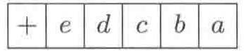

的程序, 要求把结果存入 A 寄存器后停机. 第一个程序在完成这项任务时不应使用 MIX 装入和存储字的部分字段的功能. 两个程序都应当在所述条件下占用最少的存储位置 (包括储存程序本身以及临时存储中间结果的所有位置).

24\. [21] <a id="ex-1-3-1-24"></a>[答案](./answers/1-3-1.md#ans-1-3-1-24) 假定寄存器 A 和 X 分别包含

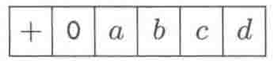

和

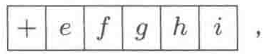

编写两则程序, 把这两个寄存器中的字符分别改变为


|  |  |  |  |
| --- | --- | --- | --- |
|  | b |  | d |
| 十 |  | C | e |


和

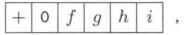

要求 (a) 使用最小存储空间; (b) 使用最短执行时间.

25\. [30] <a id="ex-1-3-1-25"></a>[答案](./answers/1-3-1.md#ans-1-3-1-25) 假定 MIX 的制造商希望生产一种功能更强的计算机 (“超级 MIX”?), 并且想要向尽可能多的老客户 (当前拥有一台 MIX 计算机的人) 购买更昂贵的新计算机. 他打算把这种新计算机硬件设计成 MIX 的扩充: 为 MIX 编写的所有正确程序, 不加修改就能在新机器上运行. 请对扩充加进的功能提出建议. (例如能否使一条指令的 I 字段得到更好利用?)

26\. [32] <a id="ex-1-3-1-26"></a>[答案](./answers/1-3-1.md#ans-1-3-1-26) 这道问题是编写一则卡片装入程序. 每台计算机为了开始读入信息以及正确地启动作业, 都有自身特殊的 “自举” (或引导) 问题. 对 MIX 来说, 卡片的内容仅能用字符代码读入, 包含装入程序本身的卡片也必须满足这个限制. 并非字节的所有可能值都能从卡片读入; 从卡片读入的每个字都是正值.

MIX 具有在正文中未加说明的一个特征: “GO 按钮”, 用来在存储器包含随意信息的起始状态下启动计算机. 当计算机操作员按下这个按钮时, 发生下列动作.

(1) 一张卡片被读入 0000-0015 位置; 这在实质上等价于执行指令 “IN0(16)”.

(2) 当这张卡片已经完全读入, 卡片读入机不再忙碌时, 发生转移到单元 0000 的 JMP.J 寄存器同时被设置为 0, 上溢开关也归零.

(3) 计算机此时开始执行已从卡片读入的程序.

注记: 没有卡片读入机的 MIX 计算机把 GO 按钮连在其他输入设备上. 但是在本题中我们假定有一台卡片读入机, 设备号为 16.

要编写的装入程序必须满足下列条件.

($i$) 输入卡片叠首先应当是装入例程, 然后是包含要装入的数字的若干信息卡片, 再后面是一张 “转移卡片”, 它关闭装入例程, 并且转移到主程序的开头. 装入例程应当能容纳在两张卡片上.

(ii) 信息卡片具有下述格式:

第 1-5 列, 装入例程予以忽略.

第 6 列, 在这张卡片上要装人的连续的字数 (最小是 1, 最大是 7).

第 7-10 列, 字 1 的位置, 它总是大于 100 (以免覆盖装入例程).

第 11-20 列, 字 1.

第 21-30 列, 字 2 (如果第 6 列的数字 $\geq 2 )$ 4

第 71-80 列, 字 7 (如果第 6 列的数字=7).

字 1,2,... 中的内容穿孔为十进制数值形式. 如果一个字是负数, 那么在末位上方附加穿孔一个负号 (“顶部穿孔 11”), 例如穿在第 20 列上. 假定这样使得输入的字符代码是 10,11,12,...,19 而不是 30,31,32, ...,39. 例如, 一张在 1-40 列穿孔成

ABCDE31000012345678900000000010000000100

的卡片, 应当引导装入下列数据:

1000:+0123456789;1001:+0000000001;1002: -0000000100.

<a id="pdf-133"></a><a id="p-116"></a>

(iii) 转移卡片在 1–10 列的格式为 `TRANS0nnnn`, 其中 `nnnn` 是程序开始执行的地址.

(iv) 装入例程应能在各种字节大小的机器上运行, 对于存放装入例程的卡片不需做任何改变. 卡片不应包含与字节代码 $20,21,48,49,50,\ldots$ 对应的字符 (即 $\Sigma,\Pi,=,\text{\$},<,\ldots$), 因为不是所有卡片读入机都能接受这些字符. 特别是不能使用 `ENT`、`INC`、`CMP` 指令, 它们未必能穿孔到卡片上.

[^p99-2]: 在罗马字母记数系统中, M 代表 1000, IX 代表 9, 所以 MIX 表示 1009, MMIX 表示 2009. ——译者注


[^p99-3]: 大致自 1975 年以来, “字节” 一词的含义已演变为恰有 8 位的二进制序列, 足以表示 0 到 255. 因此, 假想的 `MIX` 计算机的字节小于实际的字节, 甚至比实际的半字节大不了多少. 我们讨论 `MIX` 的字节时, 将穿越回字节尚未标准化定义的时期, 把这个词限制在上述的传统意义上.


[^cn128-1]: 英国诗人 (1770—1850).——译者注
