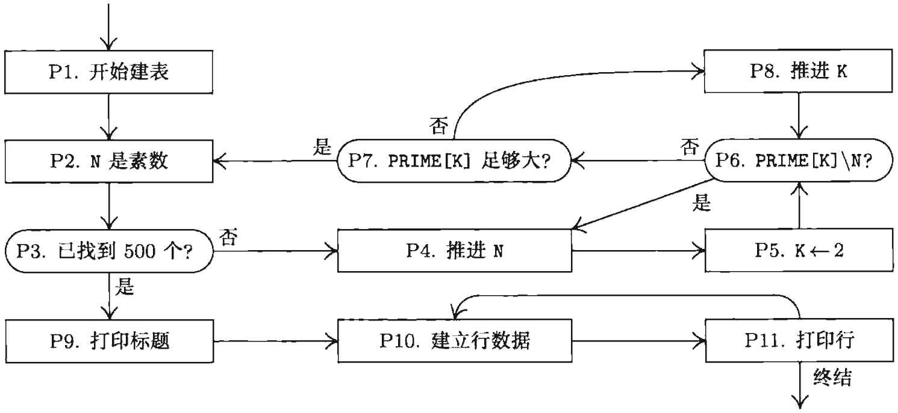
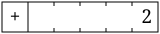
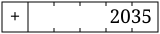
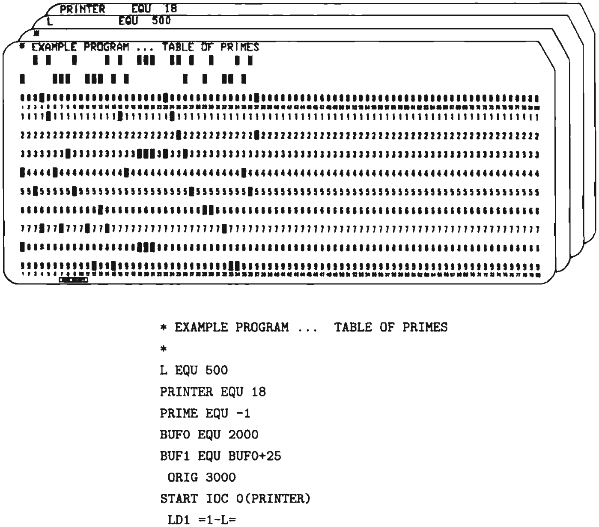
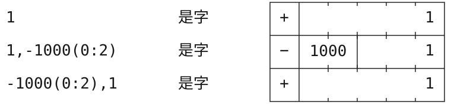
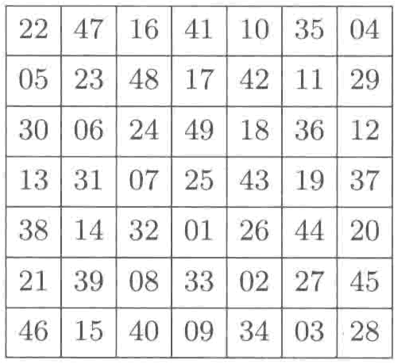
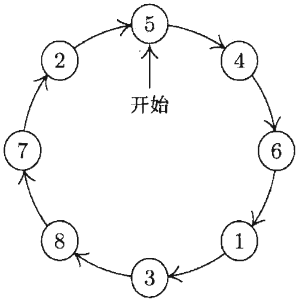
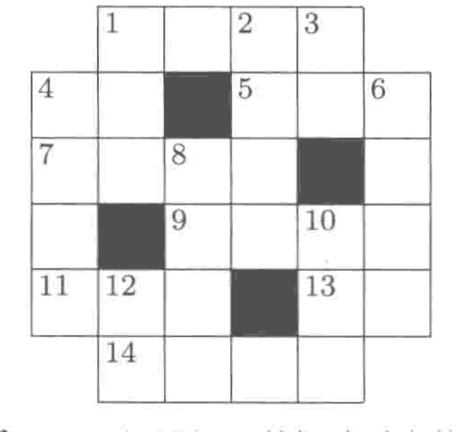
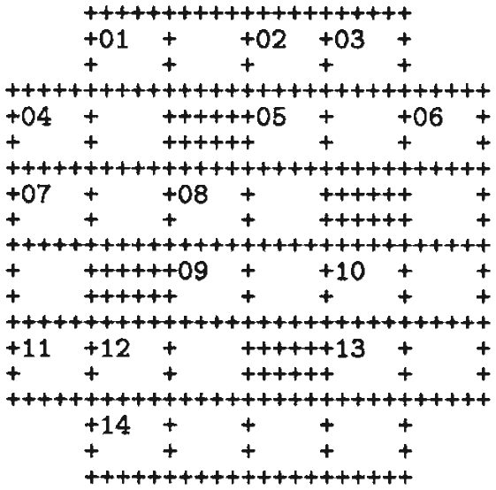

<a id="sec-1-3-2"></a>

#### 1.3.2　MIX 汇编语言

我们用一种符号语言编写 MIX 程序, 使程序读起来、写起来都相当轻松, 程序员不必忧虑烦人的书写细节, 从而避免这类细节经常导致的无谓错误. 这种 MIX 汇编语言 MIXAL(MIX Assembly Language) 是前一小节使用的指令记号的扩充. 它的主要特征是选用字母符号名代表数字, 并且用单元字段 (位置字段) 把存储单元与符号名关联起来.

我们首先讲解一个简单的例子, 让读者毫不费力地理解 MIXAL. 下面的代码是一则较长程序的片段, 其目的是依据算法 1.2.10M 求 $n$ 个元素 $X[1],\ldots,X[n]$ 的最大值.

**程序 M**(找出最大值). 寄存器赋值: $\mathrm{rA}\equiv m$, $\mathrm{rI1}\equiv n$, $\mathrm{rI2}\equiv j$, $\mathrm{rI3}\equiv k$, $X[i]\equiv\mathrm{CONTENTS}(\mathrm{X}+i)$.

| 汇编后的指令 | 行号 | LOC | OP | ADDRESS | 次数 | 注释 |
| :--- | ---: | :--- | :--- | :--- | :---: | :--- |
| | 01 | `X` | `EQU` | `1000` | | |
| | 02 | | `ORIG` | `3000` | | |
| `3000: + 3009 0 2 32` | 03 | `MAXIMUM` | `STJ` | `EXIT` | $1$ | 子程序连接 |
| `3001: +    0 1 2 51` | 04 | `INIT` | `ENT3` | `0,1` | $1$ | <u>M1. 初始化. </u> $k\leftarrow n$. |
| `3002: + 3005 0 0 39` | 05 | | `JMP` | `CHANGEM` | $1$ | $j\leftarrow n$，$m\leftarrow X[n]$，$k\leftarrow n-1$。 |
| `3003: + 1000 3 5 56` | 06 | `LOOP` | `CMPA` | `X,3` | $n-1$ | <u>M3. 比较. </u> |
| `3004: + 3007 0 7 39` | 07 | | `JGE` | `*+3` | $n-1$ | 如果 $m\geq X[k]$, 转到 M5. |
| `3005: +    0 3 2 50` | 08 | `CHANGEM` | `ENT2` | `0,3` | $A+1$ | <u>M4. 改变 $m$. </u> $j\leftarrow k$. |
| `3006: + 1000 3 5 08` | 09 | | `LDA` | `X,3` | $A+1$ | $m\leftarrow X[k]$。 |
| `3007: +    1 0 1 51` | 10 | | `DEC3` | `1` | $n$ | <u>M5. 减小 $k$。</u> |
| `3008: + 3003 0 2 43` | 11 | | `J3P` | `LOOP` | $n$ | <u>M2. 是否检验完毕? </u> 如果 $k>0$, 转到 M3. |
| `3009: + 3009 0 0 39` | 12 | `EXIT` | `JMP` | `*` | $1$ | 返回主程序。　▮ |

<details>
<summary>MIXAL 等宽清单</summary>

```text
X         EQU   1000
          ORIG  3000
MAXIMUM   STJ   EXIT
INIT      ENT3  0,1
          JMP   CHANGEM
LOOP      CMPA  X,3
          JGE   *+3
CHANGEM   ENT2  0,3
          LDA   X,3
          DEC3  1
          J3P   LOOP
EXIT      JMP   *
```

</details>

这个程序示例同时说明了下面若干事项.

(a) 我们主要关心的是 “LOC”“OP”“ADDRESS” 几列. 这几列包含用 MIXAL 这种符号机器语言编写的一个程序, 我们将在下面详细解释这个程序.

(b)“汇编指令” 列显示对应于这个 MIXAL 程序的实际的数字编码机器语言. MIXAL 的设计旨在保证任何 MIXAL 程序都能轻而易举地翻译成数字形式的机器语言. 这种翻译工作通常由另外一个称为汇编程序或者汇编器的计算机程序完成. 这样一来, 程序员可以用 MIXAL 这种符号机器语言完成全部的程序设计, 而不必费心费力地人工确定等价的数字代码. 本书中几乎所有 MIX 程序都是用 MIXAL 编写的.

(c)“行号” 列不是 MIXAL 程序的实际组成部分. 本书的 MIXAL 程序示例之所以包含行号, 只是为了方便指明程序的各个部分.

(d)“注释” 列给出关于程序的附加说明, 与算法 1.2.10M 的步骤互相参照. 读者应当比较该程序与原算法 (第 76 页). 请注意, 在把算法转换成 MIX 代码的过程中, 利用了少许 “程序员的特许权限”, 例如把算法步骤 M2 放在程序的最后. 在程序 M 开始处的 “寄存器赋值” 说明 MIX 的各部件如何同算法中的变量相互对应.

(e) 在本书将要考察的许多程序中, “次数” 列具有启示性. 它表示程序的轮廓, 即执行过程中那一行指令将要执行多少次. 由此看出, 06 行将要执行 $n-1$ 次, 等等. 依照这个数据, 我们可以确定, 执行该子程序所需的时间为 $(5+5n+3A)u$, 其中 $A$ 已经在 1.2.10 节仔细分析过.

<a id="pdf-134"></a><a id="p-117"></a>

现在让我们来讨论程序 M 的 MIXAL 代码. 01 行

X EQU 1000

说明符号 $x$ 与数字 1000 是等价的. 这条指令的作用可以从 06 行看出, 那里的指令 “CMPAX,3” 在汇编后的等价数字形式为


|  |  |  |  |
| --- | --- | --- | --- |
|  | 1000 | 5 | 56 |
| + |  | 3 |  |


也就是 “CMPA 1000,3”.

02 行说明, 应当从位置 3000 开始依次选取随后各行的单元. 所以, 在 03 行的 L0C (位置) 字段中出现的符号 MAXIMUM 同数字 3000 等价, 其后的 INIT 同 3001 等价, L00P 同 3003 等价, 等等.

在 03-12 行, OP (操作码) 字段包含 MIX 指令的符号名 STJ,ENT3 等等. 但是 01 行和 02 行的符号名 EQU 和 ORIG 有所不同, 它们称为伪操作, 因为它们只是 MIXAL 的操作符, 却不是 MIX 的操作符. 伪操作符不是程序本身的指令, 它们提供关于符号程序的特殊信息. 于是

#### X EQU 1000

这一行只说明程序 M 的有关事项, 并不表示程序运行时要设置任何变量为 1000. 请注意, 在汇编的时候, 01 行和 02 行不产生指令.

03 行是 “存储 J” 指令, 它把 J 寄存器的内容存入 EXIT 位置的 (0:2) 字段. 换句话说, 它把 rJ 存入 12 行指令的地址部分.

早先提到过, 程序 M 本来是一则较长程序的一部分. 在大程序的其他地方会有指令序列, 例如

ENT1 100

JMP MAXIMUM

STA MAX

负责转移到程序 M 并把 $n$ 设置为 100. 然后, 程序 M 找到元素 $X$[1],...,X[100] 中的最大值, 把这个最大值保存在 rA 中, 把它所在的位置 $j$ 保存在 rI2 中, 再返回到指令 “STAMAX” 处 (见习题 3).

05 行把控制转移到 08 行. 对于 04,05,06 三行, 不需做进一步解释. 07 行引进一个新记号: 星号\*(读作 “自身”), 指它所在行的位置单元. 因此, “\*+3”(“自身加 3”) 就是指从当前行往后数三个单元. 由于 07 行与单元 3004 对应, 所以该行的 “\*+3” 是指单元 3007.

其余的符号代码毋需解释. 注意 12 行再次出现一个星号 (见习题 2).

我们借助一个例子, 介绍汇编语言的其他几个特征. 程序的目标是计算前 500 个素数, 并把它们打印成一张 10 列的表, 每列 50 个素数. 这张表在行式打印机上如下所示:

FIRST FIVE HUNDRED PRIMES


|  |  |  |  |  |  |  |  |  |  |
| --- | --- | --- | --- | --- | --- | --- | --- | --- | --- |
|  |  |  |  | 0002 0233 0547 08771229 |  |  | 1597 19932371 2749 3187 |  |  |
|  |  | 0003 0239 0557 |  |  |  |  |  | 0881 1231 1601 1997 2377 2753 3191 |  |
|  |  | 0005 0241 0563 0883 1237 |  |  |  |  |  | 1607 1999 2381 2767 3203 |  |
|  |  | 0007 0251 0569 0887 1249 |  |  |  | 16092003 2383 |  | 327773209 |  |
| 0011 0257 0571 0907 1259 |  |  |  |  |  | 1613 2011 2389 |  | 27893217 |  |


0229 0541 0863 1223 1583 1987 2357 2741 3181 3571

我们将采用下述方法.

<a id="pdf-135"></a><a id="p-118"></a>

算法 P (打印前 500 个素数的表). 这个算法包含两个不同的部分: P1-P8 步为第一部分, 在机器内部准备 500 个素数的表; P9-P11 步为第二部分, 按照上面显示的格式打印结果. 后一部分利用两个 “缓冲区”, 在其中建立每一行的显示图象; 在打印一个缓冲区内容的同时, 对另一个缓冲区填入数据.

P1.[开始建表.] 置 PRIME[1]←2,N←3,J←1. (在下面的步骤中, N 将遍历可能是素数的奇数, J 记录当前已经找到多少个素数.)

P2. [N 是素数.] 置 J←J+1,PRIME[J]←N.

P3.[已找到 500 个?] 如果 J=500, 转到步骤 P9.

P4. [推进 N.] 置 N←N + 2.

P5. [K←2.] 置 K←2. (PRIME[K] 将遍历可能是 N 素因数的数.)

P6.[PRIME[K]\N?]用PRIME[K]除N;令Q为商，R为余数。如果R=0（因此N不是素数)，转到P4.

P7.[PRIME[K] 足够大?] 如果 Q≤PRIME[K], 转到 P2. (此时 N 必定是素数. 证明这个论断是很有趣的, 而且有一点异乎寻常, 参见习题 6.)

P8.[推进 K.]K 增加 1, 然后转到 P6.

P9.[打印标题.] 至此我们做好了打印表的准备. 把打印机推进到下一页, 设置 BUFFER[0] 为标题行, 并且打印这一行. 置 B←1, M←1.

P10.[建立行数据.] 按相应格式把 PRIME[M],PRIME[50+M],...,PRIME[450+M] 填入 BUFFER[B].

P11.[打印行.] 打印 BUFFER[B]; 置 B←1—B (即切换到另一个缓冲区); M 增加 1. 如果 $\mathtt M\le50$, 返回 P10; 否则, 算法终结.

<a id="fig-1-14"></a>



*图 14　算法 P*

程序 P (打印前 500 个素数的表). 为了只用一个程序演示 MIXAL 的大部分特征, 这个程序特意编写得略显笨拙. rI1≡J-500,rI2≡N,rI3≡K,rI4 指示 B,rI5 是 M 与 50 的倍数之和.

<a id="pdf-136"></a><a id="p-119"></a>

| 行号 | LOC | OP | ADDRESS | 说明 |
| ---: | :--- | :--- | :--- | :--- |
| 01 | `*` | | | 演示程序　...　素数表 |
| 02 | `*` | | | |
| 03 | `L` | `EQU` | `500` | 欲求素数的个数 |
| 04 | `PRINTER` | `EQU` | `18` | 行式打印机的设备号 |
| 05 | `PRIME` | `EQU` | `-1` | 素数表的存储区域 |
| 06 | `BUF0` | `EQU` | `2000` | `BUFFER[0]` 的存储区域 |
| 07 | `BUF1` | `EQU` | `BUF0+25` | `BUFFER[1]` 的存储区域 |
| 08 | | `ORIG` | `3000` | |
| 09 | `START` | `IOC` | `0(PRINTER)` | 跳到新页. |
| 10 | | `LD1` | `=1-L=` | <u>P1. 开始建表. </u> $J \leftarrow 1$. |
| 11 | | `LD2` | `=3=` | $N \leftarrow 3$. |
| 12 | `2H` | `INC1` | `1` | <u>P2. $N$ 是素数。</u> $J \leftarrow J + 1$。 |
| 13 | | `ST2` | `PRIME+L,1` | $\mathrm{PRIME}[J] \leftarrow N$. |
| 14 | | `J1Z` | `2F` | <u>P3. 已找到 500 个? </u> |
| 15 | `4H` | `INC2` | `2` | <u>P4. 推进 $N$。</u> |
| 16 | | `ENT3` | `2` | <u>P5. $K \leftarrow 2$. </u> |
| 17 | `6H` | `ENTA` | `0` | <u>P6. $\mathrm{PRIME}[K]\mathbin{\backslash} N$? </u> |
| 18 | | `ENTX` | `0,2` | $\mathrm{rAX} \leftarrow N$. |
| 19 | | `DIV` | `PRIME,3` | $\mathrm{rA} \leftarrow Q$, $\mathrm{rX} \leftarrow R$. |
| 20 | | `JXZ` | `4B` | 如果 $R = 0$, 转到 P4. |
| 21 | | `CMPA` | `PRIME,3` | <u>P7. $\mathrm{PRIME}[K]$ 是否足够大? </u> |
| 22 | | `INC3` | `1` | <u>P8. 推进 $K$。</u> |
| 23 | | `JG` | `6B` | 如果 $Q > \mathrm{PRIME}[K]$, 转到 P6. |
| 24 | | `JMP` | `2B` | 否则 $N$ 是素数。 |
| 25 | `2H` | `OUT` | `TITLE(PRINTER)` | <u>P9. 打印标题. </u> |
| 26 | | `ENT4` | `BUF1+10` | 置 $B \leftarrow 1$. |
| 27 | | `ENT5` | `-50` | 置 $M \leftarrow 0$. |
| 28 | `2H` | `INC5` | `L+1` | 推进 $M$。 |
| 29 | `4H` | `LDA` | `PRIME,5` | <u>P10. 建立行数据。</u>（从右到左） |
| 30 | | `CHAR` | | 转换 $\mathrm{PRIME}[M]$ 为十进制数. |
| 31 | | `STX` | `0,4(1:4)` | |
| 32 | | `DEC4` | `1` | |
| 33 | | `DEC5` | `50` | （$\mathrm{rI5}$ 每次减少 50 直到 |
| 34 | | `J5P` | `4B` | 它变成非正数) |
| 35 | | `OUT` | `0,4(PRINTER)` | <u>P11. 打印行. </u> |
| 36 | | `LD4` | `24,4` | 切换缓冲区. |
| 37 | | `J5N` | `2B` | 如果 $\mathrm{rI5} = 0$, 我们已经完成任务. |
| 38 | | `HLT` | | |
| 39 | `*` | | | 初始化表和缓冲区的内容 |
| 40 | | `ORIG` | `PRIME+1` | |
| 41 | | `CON` | `2` | 第一个素数为 2. |
| 42 | | `ORIG` | `BUF0-5` | |
| 43 | `TITLE` | `ALF` | `FIRST` | 标题行的 |
| 44 | | `ALF` | <code style="white-space:pre"> FIVE</code> | 字母信息 |
| 45 | | `ALF` | <code style="white-space:pre"> HUND</code> | |
| 46 | | `ALF` | `RED P` | |
| <a id="pdf-137"></a><a id="p-120"></a>47 | | `ALF` | `RIMES` | |
| 48 | | `ORIG` | `BUF0+24` | |
| 49 | | `CON` | `BUF1+10` | 每个缓冲区都指向另一个缓冲区. |
| 50 | | `ORIG` | `BUF1+24` | |
| 51 | | `CON` | `BUF0+10` | |
| 52 | | `END` | `START` | 例程结束.　▮ |

<details>
<summary>MIXAL 等宽清单</summary>

```text
* 演示程序　...　素数表
*
L         EQU   500
PRINTER   EQU   18
PRIME     EQU   -1
BUF0      EQU   2000
BUF1      EQU   BUF0+25
          ORIG  3000
START     IOC   0(PRINTER)
          LD1   =1-L=
          LD2   =3=
2H        INC1  1
          ST2   PRIME+L,1
          J1Z   2F
4H        INC2  2
          ENT3  2
6H        ENTA  0
          ENTX  0,2
          DIV   PRIME,3
          JXZ   4B
          CMPA  PRIME,3
          INC3  1
          JG    6B
          JMP   2B
2H        OUT   TITLE(PRINTER)
          ENT4  BUF1+10
          ENT5  -50
2H        INC5  L+1
4H        LDA   PRIME,5
          CHAR
          STX   0,4(1:4)
          DEC4  1
          DEC5  50
          J5P   4B
          OUT   0,4(PRINTER)
          LD4   24,4
          J5N   2B
          HLT
* 初始化表和缓冲区的内容
          ORIG  PRIME+1
          CON   2
          ORIG  BUF0-5
TITLE     ALF   FIRST
          ALF    FIVE
          ALF    HUND
          ALF   RED P
          ALF   RIMES
          ORIG  BUF0+24
          CON   BUF1+10
          ORIG  BUF1+24
          CON   BUF0+10
          END   START
```

</details>

关于这个程序, 下面几点是值得注意的:

1\. 01, 02, 39 行由星号开始: 这表示该行是仅限于提供说明的 “注释” 行, 对汇编后的程序没有实际影响.

2\. 和程序 M 一样, 03 行中的伪操作符 `EQU` 设置一个符号的等价值. 本例是把 `L` 的等价值设置为 500. (在程序的 10–24 行中, `L` 代表待计算的素数的个数.) 注意, 在 05 行中符号 `PRIME` 获得一个负的等价值; 一个符号的等价值可以是任何带符号的 5 字节数. 在 07 行中 `BUF1` 的等价值按 `BUF0+25` 计算, 即 2025. MIXAL 对数字提供数量有限的算术运算, 另外一个例子出现在 13 行, 此处 `PRIME+L` 的值由汇编程序计算 (本例结果为 499).

3\. 在 09, 25, 35 行的 F 部分, 使用了符号 `PRINTER`. 正如 ADDRESS 字段的其他部分一样, 这个总是置于括号内的 F 部分可以是数字, 也可以是符号. 31 行的部分字段说明 “`(1:4)`” 用到了冒号.

4\. MIXAL 编程可用多种方式说明非指令的字. 41 行用伪操作符 `CON` 指明普通的常量 (constant)“2”, 汇编结果是字

   .

   49 行有一个略微复杂一些的常量 “`BUF1+10`”, 它被汇编成字

   .

   一个常量可以置于两个等号之间, 此时它称为字面常量 (见 10 行和 11 行). 对于字面常量, 汇编程序自动建立内部常量名, 并且插入 “`CON`” 行. 例如, 程序 P 的 10 行和 11 行事实上被转变成

   ```text
   10        LD1  con1
   11        LD2  con2
   ```

   在程序结束时, 汇编过程实际把

   ```text
   51a  con1 CON  1-L
   51b  con2 CON  3
   ```

   这两行插入到 51 行和 52 行之间 (两行顺序可能颠倒). 51a 行将汇编成字

   .

   使用字面常量无疑是很方便的, 因为这意味着程序员不必再为寻常的常量建立符号名, 也不必记住一定要在每个程序的结尾插进这些常量. 程序员可以专心关注核心问题, 不需为这样无聊的细节操心. (不过, 程序 P 中的字面常量并不是非常合适的例子, 因为如果使用更高效的指令 “`ENT1 1-L`” 和 “`ENT2 3`” 取代 10 行和 11 行, 程序会稍好一些.)

<a id="pdf-138"></a><a id="p-121"></a>

5\. 一种好的汇编语言应当模仿程序员对于计算机程序的思考方式. 我们刚才提到的使用字面常量就是这一原则的实例. 另外一个例子是使用 “\*”, 这在程序 M 中已经说明, 还有一例是引进局部符号的思想, 例如 12,25,28 行的单元字段中出现的符号 2H.

局部符号是特殊的符号, 它们的等价值可以反复重新定义, 定义次数视需要而定. 像 PRIME 这样的全局符号在整个程序中只具备一种含义, 因此如果它出现在不止一行的单元字段中, 汇编程序将会报错. 然而, 局部符号的特质不同. 例如, 我们可以在一行 MIXAL 代码的单元字段写上 2H(“此处的 2”), 而在另一行的地址字段写上 2F(“此后的 2”) 或者 2B(“此前的 2”):

2B 系指此前最近的位置 2H;

2F 系指此后最近的位置 2H.

因此, 14 行的 “2F” 是指后面的 25 行; 24 行的 “2B” 是指前面的 12 行; 37 行的 “2B” 是指前面的 28 行. 2F 或者 2B 的地址不可能指它自身所在的行, 例如

这三行 MIXAL 代码实际上等价于单行代码

MOVE \*-3(10).

绝对不能把符号 2F 和 2B 用在单元字段中, 也不能把符号 2H 用在地址字段中. 总共有 10 种局部符号, 把上面例子中的 “2” 换成从 0 到 9 的任何一个数字就得到它们.

局部符号的思想是梅尔文·康威于 1958 年提出的, 它的发明与 UNIVACI 计算机的汇编程序有关. 当程序员想要在程序中访问仅在几行之外的一条指令时, 局部符号可以减轻他们的负担, 使他们不必为每个地址选取符号名. 对于附近的位置, 程序员经常找不到适当的名称, 所以往往会使用像 X1,X2,X3 这样没有具体含义的符号名, 导致重复命名的潜在危险. 所以在汇编语言中, 局部符号是非常有用的, 同时也是很自然的.

6.30 行和 38 行的地址部分是空的, 这表示汇编后的地址将为 0. 我们在 17 行也可以用空地址, 但是加上这个累赘的 0 可以提高程序的可读性.

7.43-47 行使用 “ALF” 操作, 建立一个用 MIX 字母数字字符代码表示的 5 字节常量. 例如, 45 行将被汇编成字


|  |  |  |  |
| --- | --- | --- | --- |
| 00 | 08 | 24 | 15 |
|  |  |  | 04 |


代表 “HUND”—这是程序 P 输出的标题行的一部分.

在 MIXAL 程序中, 所有没有说明存储内容的单元通常都置为正零 (由装入例程占用的位置不包括在内, 一般是 3700-3999). 因此在 47 行之后不需要把标题行的其他字置为空格字符.

8\. 算术运算可以与 0RIG 一同使用, 见 40,42,48,50 行.

9\. 一个完整的 MIXAL 程序最后一行的 OP 代码总是 “END”. 这一行上的地址是程序装入内存储器后的起始单元.

10\. 这是对程序 P 的最后一条注记. 我们指出, 该程序的指令经过了合理的组织, 使得变址寄存器的计数递减至零, 并且只要可能就检验它们是否已经归零. 例如, 我们在 rI1 中存入数值 J-500 而不是 J.26-34 行特别值得注意, 尽管或许有点不好理解.

观察程序 P 在某次实际运行中的统计数据, 也许是很有意味的. 当时, 19 行中的除法指令执行了 9538 次, 10-24 行的执行时间为 182144u.

<a id="pdf-139"></a><a id="p-122"></a>

编写输入 MIXAL 程序可在卡片上穿孔, 也可在计算机终端设备上输入, 如 [图15](#fig-1-15) 所示. 下面的格式是在穿孔卡片上使用的:

1-10 列 LOC (单元) 字段;

12-15 列 OP (操作符) 字段;

17-80 列 ADDRESS (地址) 字段和可选的注释;

11,16 列 空.

但是, 如果 1 列出现一个星号, 那么整张卡片就视为一段注释. ADDRESS 字段以 16 列后面遇到的第 1 个空列结束. 任何注释信息都可以穿孔写在这个空列的右边, 对汇编程序不产生影响. (例外: 当 OP 字段是 ALF 时, 注释总是从 22 列开始.)

<a id="fig-1-15"></a>



*图 15　程序 P 的前面几行, 上图为穿孔卡片, 下图为终端设备上的输入*

当输入来自终端时, 格式的限制较少: LOC 字段以第 1 个空格结束, 而 OP 字段和 ADDRESS 字段 (如果有) 以非空格字符开始, 延续到下一个空格结束. 但是 ALF 这个特殊的 OP 代码后面要么接着 2 个空格字符和 5 个字母数字字符, 要么接着 1 个空格字符和 5 个字母数字字符 (第一个不是空格字符). 每一行的其余部分可以加入注释.

MIX 汇编程序接受以这种形式准备的输入文件, 然后把它们转换为可装入形式的机器语言程序. 读者如果有条件, 可以使用 MIX 汇编器和 MIX 模拟器, 借助它们求解本书中的各种习题.

至此, 我们已经知道用 MIXAL 可以做什么. 在本小节的最后, 我们更仔细地描述一下 MIXAL 语言的规则, 特别说明在 MIXAL 中什么是不允许的. 我们用数目相对不多的下述规则定义 MIXAL 语言.

<a id="pdf-140"></a><a id="p-123"></a>

1\. 一个符号是包含 1 至 10 个字母或数字的字符串, 其中至少有一个字母. 例: PRIME,TEMP,20BY20, 为了明确定义, 在前面描述的 “局部符号” 约定中介绍的特殊符号 dH,dF,dB (其中 $d$ 是一位数字) 要改成其他的唯一的符号.

2\. 一个数是包含 1 至 10 个数字的字符串. 例: 00052.

3\. 在一则 MIXAL 程序中出现的每个符号, 或者是一个 “有定义符号”, 或者是一个 “待定义引用”. 有定义符号是在该 MIXAL 程序前面某一行的 LOC 字段中已经出现过的符号. 待定义引用则是尚未用这种方式定义过的符号.

4\. 一个原子表达式是下列三者之一:

(a) 一个数,

(b) 一个有定义符号 (表示那个符号的等价数值, 见规则 13),

(c) 一个星号 (表示 $\circledast$ 的值, 见规则 10 和 11).

5\. 一个表达式是下列三者之一:

(a) 一个原子表达式,

(b) 一个+号或-号后面接一个原子表达式,

(c) 一个表达式后面接一个双目运算符, 再接一个原子表达式.

允许使用的 6 种双目运算符 (二元运算符) 是+,-,\*,/,//,:, 它们对于 MIX 的数值字的定义如下:

$$
\mathbb { C } = \mathbb { A } { + } \mathbb { B } \quad \mathbb { L } \mathbb { D } \mathbb { A } \mathbb { A } \quad \mathbb { A } \mathbb { D } \mathbb { D } \quad \mathbb { B } \mathbb { B } \quad \mathbb { S } \mathbb { T } \mathbb { A } \mathbb { C } \mathbb { C } \quad .
$$

$$
\mathbb { C } = \mathbb { A } \mathtt { - B } \qquad \quad \mathtt { L D A } \quad \mathbb { A A } \quad ; \quad \mathbb { S U B } \quad \mathbb { B B } \quad ; \quad \mathbb { S T A } \quad \mathbb { C C } \quad .
$$

$$
\mathtt{C=A*B}\qquad\mathtt{LDA\ AA;\ MUL\ BB;\ STX\ CC.}
$$

$$
\mathbb { C } = \mathbb { A } / \mathbb { B } \quad \mathbb { L D A } \mathbb { A A }   ; \quad \mathbb { S R A X } \mathbb { S }   ; \quad \mathbb { D I V } \mathbb { B B }   ; \quad \mathbb { S T A } \mathbb { C C }   .
$$

$$
\mathbb { C } = \mathbb { A } /  / \mathbb { B } \qquad \mathtt { L D A } \mathbb { A A } \quad \mathtt { E N T X } \quad \mathtt { O } \quad ; \quad \mathtt { D I V } \quad \mathtt { B B } \quad ; \quad \mathtt { S T A } \quad \mathbb { C C } \quad .
$$

$$
\mathtt { C } = \mathtt { A } \mathbin { : } \mathtt { B } \qquad \mathtt { L D A } \mathtt { A A } \mathbin { ; } \mathtt { M U L } = \mathrel { \mathtt { B } } = \mathbin { ; } \mathtt { S L A X } \mathbin { 5 } \mathbin { ; } \mathtt { A D D } \mathtt { B B } \mathbin { ; } \mathtt { S T A } \mathtt { C C } \mathbin { . }
$$

这里, AA,BB,CC 分别表示包含符号 A,B,C 的值的单元. 一个表达式内的运算是从左到右执行的. 例:

```txt
-1+5等于4
-1+5*20/6 等于4*20/6,等于80/6,等于13(从左到右进行)
1//3等于一个MIX字，它的值近似等于b5/3，其中b是字节大小;
即表示分数$\frac{1}{3}$的字，假定小数点在左边
1:3等于11(通常用于部分字段说明）
*-3等于减3
***等于乘
```

6\. 一个 A 部分 (用于描述 MIX 指令的地址字段) 是下列四者之一:

(a) 空 (表示值为 0),

(b) 一个表达式,

(c) 一个待定义引用 (表示该符号的最后等价值, 见规则 13),

(d) 一个字面常量 (表示对一个内部创建的符号的引用, 见规则 12).

<a id="pdf-141"></a><a id="p-124"></a>

7\. 一个变址部分 (用于描述 MIX 指令的变址字段) 是下列二者之一:

(a) 空 (表示值为 0),

(b) 一个逗号后面接一个表达式 (表示该表达式的值).

8\. 一个 F 部分 (用于描述 MIX 指令的 F 字段) 是下列二者之一:

(a) 空 (表示标准的 F 设置值, 以表 1.3.1-1 中所示 0P 字段为基准),

(b) 一个左括号后面接一个表达式, 再接一个右括号 (表示该表达式的值).

9\. 一个 W 值 (用于描述一个 MIX 全字常量) 是下列二者之一:

(a) 一个表达式后面接一个 F 部分 (这种情况下的空白 F 部分表示 (0:5)),

(b) 一个 W 值后面接一个逗号, 再接一个 (a) 形式的 W 值.

一个 W 值表示由下述方式确定的一个 MIX 数值字的值: 令该 W 值形如 “$E_1(F_1),E_2(F_2),\ldots,E_n(F_n)$”, 其中 $n \geq 1$, 各个 E 是表达式, F 是字段. 所求的结果是假如执行假想程序

$$
\mathtt{STZ\ WVAL;\ LDA}\ C_1;\ \mathtt{STA\ WVAL}(F_1);\ \ldots;\ \mathtt{LDA}\ C_n;\ \mathtt{STA\ WVAL}(F_n)
$$

后将会出现在存储单元 WVAL 中的终值. 程序中的 $\mathbb { C } _ { 1 } , \ldots , \; \mathbb { C } _ { n }$ 表示包含表达式 $\operatorname { E } _ { 1 } , \; \ldots , \; \operatorname { E } _ { n }$ 之值的单元. 每个 $\mathrm{F}_{i}$ 必须取 $\mathrm { 8 L } _ { i } + \mathrm { R } _ { i }$ 的形式, 其中 $0 \leq \mathtt { L } _ { i } \leq \mathtt { R } _ { i } \leq 5 .$ 例:



10\. 汇编过程要用到由 (称为单元计数器或位置计数器) 表示的值, 初值为零. 的值始终应当是能够容纳在两个字节内的非负整数. 当一行的单元字段非空时, 该行必然包含一个此前尚未定义的符号. 该符号的等价值就定义为的当前值.

11\. 按规则 10 的描述处理 LOC 字段后, 汇编过程取决于 OP 字段的值. OP 有 6 种可能情况:

(a)OP是MIX的一个操作符（见1.3.1节末尾的表1).表1对于MIX的每个操作符定义了标准的C值和F值。在这种情况下，ADDRESS应当是一个A部分(规则6）后面接一个变址部分(规则7),再接一个F部分(规则8).我们由此得到4个值:C,F,A,I. 结果是把由指令序列“LDA C;STA WORD;LDA F;STA WORD(4:4);LDA I;STA WORD(3:3);LDA A;STAWORD(0:2)”确定的字汇编到由指定的单元，并且对加1.

(b)OP 是 “EQU”. ADDRESS 应当是一个 W 值 (见规则 9). 如果 $: \square C ^ { \prime }$ 字段非空, 就把出现在那里的符号的等价值设置为在 ADDRESS 中说明的值. 这条规则优先于规则 10. 的值保持不变. (举一个不平凡的例子, 代码行

$$
\mathtt { B Y T E S I Z E } \quad \mathtt { E Q U } \quad \mathtt { 1 } \left( \mathtt { 4 } ; \mathtt { 4 } \right)
$$

允许程序员使用一个取值依赖于字节大小的符号. 这种情况是可以接受的, 前提是得到的程序对于每一种可能的字节大小都具有意义.)

(c)OP 是 “ORIG”. ADDRESS 应当是一个 W 值 (见规则 9). 单元计数器设置为这个值. (请注意, 由于规则 10, 出现在某 ORIG 行 LOC 字段的符号取在改变之前的值作为它的等价值. 例如<a id="pdf-142"></a><a id="p-125"></a>把 TABLE 的等价值设置为 100 个单元的第一个单元.)

(d)OP 是 “CON”. ADDRESS 应当是一个 W 值. 结果是把取这个值的一个字汇编到由指定的单元, 并且对加 1.

(e)OP 是 “ALF”. 结果是汇编由地址字段前 5 个字符组成的字符代码字, 其他方面同 CON 一样.

(f)OP 是 “END”. ADDRESS 应当是一个 W 值, 在其 (4:5) 字段指定程序开始指令的单元. END 行标志 MIXAL 程序终结. 实际上, 汇编器把对应于所有未定义符号以及字面常量的补充行以任意顺序恰好插入在 END 行之前 (见规则 12 和 13). 因此 END 行 LOC 字段中的符号将表示位于那些插入字之后的第一个单元.

12\. 字面常量: 长度小于 10 个字符的 W 值可以置于两个“=”号之间, 用作待定义引用. 结果是创建一个新的内部符号, 并且恰好在 END 行之前插入定义该符号的 CON 行 (见程序 P 之后的注释 4).

13\. 每个符号都有唯一的等价值. 这是 MIX 的一个全字数值, 正常情况下由该符号出现在 LOC 字段的情况, 按照规则 10 或者规则 11(b) 确定. 如果这个符号没有出现在 LOC 字段, 那么实际上在 END 行前面插入一个新行, 这一行有 OP=“CON”, ADDRESS=“0”, LOC 字段写明该符号名.

注记: 上列规则最重要的推论是对于待定义引用的限制. 尚未在先前某行的 LOC 字段中定义的符号, 只允许用作指令的 A 部分, 不允许用在其他地方, 尤其不能用在: (a) 含有算术运算符的算式中; (b)EQU,ORIG,CON 的 ADDRESS 字段中. 例如,

$$
\mathtt{LDA\ 2F+1}\qquad\text{和}\qquad\mathtt{CON\ 3F}
$$

都是不合法的指令. 施加这种限制是为了能对程序进行更有效的汇编, 而且编写这套书籍取得的经验表明, 这种限制程度适中, 基本没有太大影响.

实际上, MIX 有两种底层编程的符号语言: MIXAL[^cn142-1] 是面向机器的语言, 它的设计是为了便于用一个非常简单的汇编程序通过一遍扫描对程序进行编译; PL/MIX 是一种更充分反映数据结构和控制结构的语言, 它看起来更像是 MIXAL 程序的注释字段.

#### 习题（第一组）

1\. [00] <a id="ex-1-3-2-1"></a>[答案](./answers/1-3-2.md#ans-1-3-2-1) 正文中提到, “XEQU1000” 不汇编成任何设置变量值的指令. 假定你正在编写一则 MIX 程序, 要把某个存储单元 (它的符号名为 X) 包含的值设置为 1000. 你怎样用 MIXAL 编写出该语句?

2\. [10] <a id="ex-1-3-2-2"></a>[答案](./answers/1-3-2.md#ans-1-3-2-2) 程序 M 的 12 行写有 “JMP \*”, 其中\*表示那一行的地址. 这个程序为什么不会无休止地重复执行这条指令而陷入无限循环?

▶ 3. [23] <a id="ex-1-3-2-3"></a>[答案](./answers/1-3-2.md#ans-1-3-2-3)  如果把下述程序同程序 M 连接起来, 它的结果是什么?

START IN x+1(0) JBUS \*(0) ENT1 100   
1H JMP MAXIMUM LDX x,1 STA x,1

[^cn142-1]: 我在 1971 年惊奇地获悉, 在南斯拉夫有一种用于自动装置的清洗剂的名称也是 MIXAL.

<a id="pdf-143"></a><a id="p-126"></a>

```csv
STXx,2
DEC11
J1P1B
OUTx+1(1)
HLT
ENDSTART1
```

4\. [25] <a id="ex-1-3-2-4"></a>[答案](./answers/1-3-2.md#ans-1-3-2-4) 手工汇编程序 P. (花费的时间不会像你想象的那样长.) 存储器各单元中, 同符号形式的程序对应的真实数值内容是什么?

5\. [11] <a id="ex-1-3-2-5"></a>[答案](./answers/1-3-2.md#ans-1-3-2-5) 在程序 P 中为什么不需要用一条 JBUS 指令确定行式打印机何时就绪?

6\. [HM20] <a id="ex-1-3-2-6"></a>[答案](./answers/1-3-2.md#ans-1-3-2-6) (a) 证明: 如果 $n$ 不是素数, 那么 $n$ 有一个因子 $d$ 满足 $1 < d \leq \sqrt { n } .$ (b) 利用这个事实说明, 算法 P 的 P7 步中的检验证明了 N 是素数.

7\. [10] <a id="ex-1-3-2-7"></a>[答案](./answers/1-3-2.md#ans-1-3-2-7) (a) 在程序 P 的 34 行中 “4B” 的含义是什么? (b) 如果把 15 行的单元改为 “2H”, 而且把 20 行的地址改为 “2B”, 那么会产生什么结果?

8\. [24] <a id="ex-1-3-2-8"></a>[答案](./answers/1-3-2.md#ans-1-3-2-8) 下述程序具有什么功能? (不要在计算机上运行程序, 要手工确定它的作用!)

```csv
*MYSTERY PROGRAM
BUF ORIG *+3000
1HENT11
ENT20
LDX4F
2HENT3 0,1
3HSTZBUF,2
INC21
DEC31
J3P3B
STXBUF,2
INC2 1
INC1 1
CMP1=75=
JL2B
ENN2 2400
OUTBUF+2400,2(18)
INC224
J2N*-2
HLT
4HALFAAAAA
END1B
```

#### 习题（第二组）

这组习题是一些短小的程序设计问题, 代表若干典型的计算机应用, 涉及广泛的编程技术. 我们鼓励每位读者选做其中几道, 以便熟悉使用 MIX, 并充分复习基本程序设计技巧. 如果愿意的话, 可以一边阅读第 1 章其余部分, 一边并行完成这些习题.

下述列表指出习题中涉及的几类程序设计技术:

使用多路判定开关表: 习题 9,13,23

使用二维数组变址寄存器: 习题 10,21,23

解封装字符: 习题 13,23

<a id="pdf-144"></a><a id="p-127"></a>

整数和十进制小数的算术运算: 习题 14,16,18

使用子程序: 习题 14,20

输入缓冲: 习题 13

输出缓冲: 习题 21,23

表处理: 习题 22

实时控制: 习题 20

图形显示: 习题 23

在本书中, 如果习题要求 “编写一个 MIX 程序” 或者 “编写一个 MIX 子程序”, 你仅需针对题目要求编写符号形式的 MIXAL 代码. 代码本身不是完整的程序, 它不过是一个 (假想的) 完整程序的片段. 在代码片段中, 如果数据是外部提供的, 不需要进行输入或输出, 仅仅需要编写 MIXAL 语句行的 LOC,OP,ADDRESS 字段以及适当的注释. 除非特别指明, 否则不要求写出汇编后的数值机器指令、行号和 “次数” 这三个列 (见程序 M); 此外也不用写 END 行.

另一方面, 如果一道习题要求 “编写一个完整的 MIX 程序”, 那就意味着应当用 MIXAL 写出一个可执行的程序, 特别是需要包含最后的 END 行. 有许多汇编器和 MIX 模拟器可以用来检验这种完整的程序.

9\. [25] <a id="ex-1-3-2-9"></a>[答案](./answers/1-3-2.md#ans-1-3-2-9) 单元 INST 包含一个 MIX 字, 据称它是一条 MIX 指令. 编写一个 MIX 程序: 如果这个字的 C 字段、±AA 字段、I 字段和 F 字段按照表 1.3.1-1 均是有效的, 程序转移到单元 G0OD; 否则, 程序应转移到单元 BAD. 记住 F 字段的有效性检验同 C 字段有关. 例如, 如果 $\mathrm{C}=7\ (\mathrm{MOVE})$, 任何 F 字段都是可以接受的, 但是如果 C=8(LDA), F 字段必须形如 $8\mathrm L+\mathrm R$, 其中 $0\le\mathtt L\le\mathtt R\le5.\quad\text{“}\pm\mathtt{AA}\text{”}$ 字段一般认为是有效的, 除非 C 说明一条需要存储器地址的指令, 而且 $\mathrm{I}=0,\ \pm \mathrm{AA}$ 不是有效的存储器地址.

注记: 缺乏经验的程序员在处理这样的问题时, 往往愿意写出一长串对于 C 字段的检验, 例如 “LDA $\mathtt { C } ; \: \mathtt { J } \mathtt { A } \mathtt { Z } \: \mathtt { ~ 1 } \mathtt { F } ; \: \mathtt { D } \mathtt { E } \mathtt { C } \mathtt { A } \: \mathtt { ~ 5 } ; \: \mathtt { J } \mathtt { A } \mathtt { N } \: \mathtt { ~ 2 } \mathtt { F } ; \: \mathtt { J } \mathtt { A } \mathtt { Z } \: \mathtt { ~ 3 } \mathtt { F } ; \: \mathtt { D } \mathtt { E } \mathtt { C } \mathtt { A } \: \mathtt { ~ 2 } ; \: \mathtt { J } \mathtt { A } \mathtt { N } \: \mathtt { ~ 4 } \mathtt { F } ; \: \dots  .$ 这不是一种好做法! 实现多路判定的最好方式是准备一张辅助表, 所求的逻辑过程封装在表中. 例如, 如果用一张有 64 个条目的表, 我们可以写 $\text{" } \texttt{LD1 } \texttt{C}; \texttt{LD1 } \texttt{TABLE}, \texttt{1}; \texttt{JMP } \texttt{O}, \texttt{1}  \text{" }$, 由此非常快速地转移到期望的例程. 这样的表也可以保存其他有用的信息. 就本题而论, 用表格仅仅使程序稍微长一些 (包括表在内), 却能大大提高它的速度和灵活性.

▶ 10. [31] <a id="ex-1-3-2-10"></a>[答案](./answers/1-3-2.md#ans-1-3-2-10) 假定我们把一个 $9\times 8$ 矩阵

$$
\left( \begin{matrix} { a _ { 1 1 } } & { a _ { 1 2 } } & { a _ { 1 3 } } & { \dots } & { a _ { 1 8 } } \\ { a _ { 2 1 } } & { a _ { 2 2 } } & { a _ { 2 3 } } & { \dots } & { a _ { 2 8 } } \\ { \vdots } & { } & { } & { } & { \vdots } \\ { a _ { 9 1 } } & { a _ { 9 2 } } & { a _ { 9 3 } } & { \dots } & { a _ { 9 8 } } \\ \end{matrix} \right)
$$

存入存储器, 把 $a_{ij}$ 存储到单元 1000+8i+$j$. 所以, 该矩阵在存储器中呈现为

$$
\begin{pmatrix}(1009)&(1010)&(1011)&\cdots&(1016)\\(1017)&(1018)&(1019)&\cdots&(1024)\\\vdots&\vdots&\vdots&&\vdots\\(1073)&(1074)&(1075)&\cdots&(1080)\end{pmatrix}.
$$

如果矩阵中某个位置的值是所在行的最小值和所在列的最大值, 就说该矩阵有一个 “鞍点”. 用符号表示, $a _ { i j }$ 是一个鞍点, 如果

$$
a _ { i j } = \operatorname* { m i n } _ { 1 \leq k \leq 8 } a _ { i k } = \operatorname* { m a x } _ { 1 \leq k \leq 9 } a _ { k j } .
$$

编写一个 MIX 程序, 计算一个鞍点所在的单元 (如果至少有一个鞍点), 或者得到 0 (如果不存在鞍点), 并且把得到的值存入 rI1, 然后停机.

11\. [M29] <a id="ex-1-3-2-11"></a>[答案](./answers/1-3-2.md#ans-1-3-2-11) 假定上题矩阵中的 72 个元素是两两不同的, 并且假定所有 72! 种排列是等可能的, 那么存在一个鞍点的概率是多大? 如果我们假定矩阵的元素都为 0 或 1, 并且所有 $2 ^ { 7 2 }$ 个这样的矩阵是等可能的, 那么对应的概率是多大?

<a id="pdf-145"></a><a id="p-128"></a>

12\. [HM42] <a id="ex-1-3-2-12"></a>[答案](./answers/1-3-2.md#ans-1-3-2-12) 书后的习题答案对习题 10 给出两种解法, 并且提示还有第三种解法. 不清楚它们当中哪个解法更好. 利用习题 11 的两种假定, 分析答案给出的两种算法, 判别哪个方法更好.

13\. [28] <a id="ex-1-3-2-13"></a>[答案](./answers/1-3-2.md#ans-1-3-2-13) 一位密码分析师需要计算各个字母在某种密码中出现的频率计数. 他已经把密码穿孔到纸带上, 用一个星号作为结束标志. 编写一个完整的 MIX 程序, 读入纸带, 计算第一个星号之前出现的每个字符的频率, 然后以

A 0010257   
B 0000179   
D 0794301

的形式打印结果, 每行输出一个字符. 不必计算空格数, 也不用打印频率计数为 0 的字符 (像上面的 C). 为了提高效率, 用 “缓冲区” 方式输入: 可以一边在存储器的一个区域读入一个数据块, 一边在存储器的另一个区域计算字符. 可以假定在输入纸带上有一个额外的信息块 (接在包含星号结束标志的信息块之后).

14\. [31] <a id="ex-1-3-2-14"></a>[答案](./answers/1-3-2.md#ans-1-3-2-14) 下述算法是由意大利那不勒斯天文学家阿洛伊修斯·里利乌斯和德国耶稣会数学家克里斯托佛·克拉维约在 16 世纪末提出的. 西方大多数教会用它来确定 1582 年之后任何一年的复活节[^cn145-1] 日期.

算法 E (计算复活节日期). 令 $Y$ 为欲求复活节日期的年份.

E1.[黄金数.] 置 $G \leftarrow ( Y \bmod 1 9 ) + 1 .$ (G 是 19 年默冬章[^cn145-2] 中这一年的所谓 “黄金数”.)

E2.[世纪数.] 置 $\overline { { C } } \leftarrow \lfloor Y / 1 0 0 \rfloor + 1 .$ (当 Y 不是 100 的倍数时, C 为世纪数, 例如 1984 年是在 20 世纪.)

E3.[修正量.] 置 $X\leftarrow\lfloor3C/4\rfloor-12,\quad Z\leftarrow\lfloor(8C+5)/25\rfloor-5.$ (此处 X 是 1582 年以后像 1900 这样年份是 4 的倍数的平年数目, 这种年份不置闰是为了与地球公转保持同步. Z 是用来使复活节与月球轨道同步的特别修正量.)

E4. [求星期日.] 置 $D \leftarrow \left \lfloor 5Y/4 \right \rfloor - X - 10.$ (3 月 $((-D)\bmod7)$ 日将是星期日.)

E5.[求闰余.] 置 $E\leftarrow(11G+20+Z-X)\bmod30$. 如果 $E=25$ 且黄金数 G>11, 或者 $E=24$ 那么 E 增加 1. (这个数 E 就是闰余[^cn145-3], 它说明何时出现一次满月.)

E6.[求满月.] 置 $N\leftarrow 44-E$. 如果 $N<21$, 那么置 $N \leftarrow N + 3 0 .$ (复活节应该是在 3 月 21 日当日或之后首次出现满月以后的第一个星期日. 实际上, 月球轨道的摄动使得这个日期不是准确无误的, 但是我们在这里关心的是 “历法月亮” 而不是实际月亮. 3 月的第 N 天是历法的满月日.)

E7.[推进到星期日.] 置 $N\gets N+7-((D+N)\bmod7)$.

E8. 求月份.] 如果 $N>31$, 复活节日期是 4 月 ($N-31$) 日 (表示为 ($N-31$)APRIL); 否则, 日期是 3 月 N 日 (表示为 NMARCH).

编写一个计算并打印给定年份的复活节日期的子程序, 假定年份小于 100000. 输出需采用 “ddMONTH,yyyyy” 的形式, 其中 dd 是日子, MONTH 是月份, yyyyy 是年份. 编写一个完整的 MIX 程序, 利用上面这个子程序打印一张从 1950 年到 2000 年的复活节日期表.

15\. [M30] <a id="ex-1-3-2-15"></a>[答案](./answers/1-3-2.md#ans-1-3-2-15)  在上题的编码中, 一个相当常见的错误是未认识到步骤 E5 用到的量 (11G+20+Z-X) 可能取负值, 因此可能没有正确计算出 mod 30 的正余数. (见 CACM5(1962), 556.) 例如, 在 14250 年, 我们将求出 G=1,X=95,Z=40; 所以, 如果我们得到 E=-24 而不是 E=+6, 将会得到荒谬的答案 “42APRIL”(4 月 42 日). 编写一个完整的 MIX 程序, 求这个错误最早会导致在哪一年算出错误的复活节日期.

[^cn145-1]: 基督教纪念耶稣复活的节日, 定为每年春分后第一次月圆后的第一个星期日. ——译者注

[^cn145-2]: 古希腊天文学家默冬于公元前 432 年提出的置闰周期. 在 19 个阴历年中安插 7 个闰月, 即可与 19 个回归年相协调. ——编者注

[^cn145-3]: 阳历一年超过阴历一年的天数. ——编者注

<a id="pdf-146"></a><a id="p-129"></a>

16\. [31] <a id="ex-1-3-2-16"></a>[答案](./answers/1-3-2.md#ans-1-3-2-16) 我们在 1.2.7 节曾经证明, 和 $1 + \frac{1}{2} + \frac{1}{3} + \cdots$ ·会变成无穷大. 但是如果用一台精度有限的计算机进行计算, 这个和在某种意义下其实是存在的, 因为只要一项一项地加, 后面的项最终就会小到完全不会改变和. 例如, 假定在计算上面的和时舍入到 1 位小数, 那么我们有 $1+0.5+0.3+0.3+0.2+0.2+0.1+0.1+0.1+0.1+0.1+0.1+0.1+0.1+0.1+0.1+0.1+0.1+0.1+0.1=3.9.$ 更确切地说, 令 $r _ { n } ( x )$ 是 $x$ 舍入到 $n$ 位小数的结果, 我们定义 $r_{n}(x)=\left[10^{n}x+\frac{1}{2}\right]/10^{n}$. 于是, 我们希望求

$$
S_n=r_n(1)+r_n\!\left(\tfrac12\right)+r_n\!\left(\tfrac13\right)+\cdots.
$$

我们知道 $S_{1} = 3.9$, 问题是编写一个完整的 MIX 程序, 对于 $n = 2,   3,   4,   5$ 计算 $S _ { n }$ 并且打印结果.

注记: 对于这个求和, 比起一次加一个数 $r _ { n } ( 1 / m )$ 直到 $r _ { n } ( 1 / m )$ 变成 0 的简单过程来, 有一种快得  
多的方法. 例如, 对于从 66667 到 200000 的所有 $m$ 值, 都有 $r_{5}(1/m)=0.00001$, 因此避免计算全部  
133334 次 $1/m$ 是明智的! 算法应当大致采用下列步骤. A. 从 $m _ { h } = 1$ 和 $S = 1$ 开始. B. 置 $m _ { e } = m _ { h } + 1$, 计算 $r _ { n } ( 1 / m _ { e } ) = r .$ C. 求 $m _ { h }$, 它是使 $r _ { n } ( 1 / m ) = r$ 的最大 $m$. D. 把 $( m _ { h } - m _ { e } + 1 ) r$ 加到 S 上, 然后返回步骤 B.

17\. [HM30] <a id="ex-1-3-2-17"></a>[答案](./answers/1-3-2.md#ans-1-3-2-17) 利用上题的记号, 证明或证伪

$$
\lim_{n\to\infty}(S_{n+1}-S_n)=\ln10.
$$

18\. [25] <a id="ex-1-3-2-18"></a>[答案](./answers/1-3-2.md#ans-1-3-2-18) 0 与 1 之间的分母 $\leq n$ 的所有既约分数 (最简分数) 的递增序列称为 $\text{“}n$ 阶法里序列”. 例如  
7 阶法里序列是

$$
\frac01,\frac17,\frac16,\frac15,\frac14,\frac27,\frac13,\frac25,\frac37,\frac12,\frac47,\frac35,\frac23,\frac57,\frac34,\frac45,\frac56,\frac67,\frac11
$$

如果我们用 $\quad x _ { {  } 0 } {  } / {  } y _ { {  } 0 } {  } , {  } x _ { {  } 1 } {  } / {  } y _ { {  } 1 } {  } , {  } x _ { {  } 2 } {  } / {  } y _ { {  } 2 } {  } , {  } \ldots$ 表示这个序列, 习题 19 将证明

$$
x_0=0,\quad y_0=1;\qquad x_1=1,\quad y_1=n;
$$

$$
x_{k+2}=\lfloor(y_k+n)/y_{k+1}\rfloor x_{k+1}-x_k;
$$

$$
y_{k+2}=\lfloor(y_k+n)/y_{k+1}\rfloor y_{k+1}-y_k.
$$

编写一个 MIX 子程序, 通过把 $x _ { k }$ 和 $y_k$ 分别存入单元 $\mathtt X+k,\quad\mathtt Y+k$, 计算 $n$ 阶法里序列. (这个序列的总项数大约为 $3n^2/\pi^2$, 所以你可以假定 $n$ 是一个相当小的数.)

19\. [M30] <a id="ex-1-3-2-19"></a>[答案](./answers/1-3-2.md#ans-1-3-2-19) (a) 证明上题中通过递推方式定义的数 $x_{k}$ 和 $y _ { k }$ 满足关系 $x _ { k + 1 } y _ { k } - x _ { k } y _ { k + 1 } = 1$. (b) 利用 (a) 的结论, 证明分数 $x _ { k } / y _ { k }$ 的序列确实是 $n$ 阶法里序列.

▶ 20. [33] <a id="ex-1-3-2-20"></a>[答案](./answers/1-3-2.md#ans-1-3-2-20) 假定已经按照下面的方式, 把 MIX 的上溢开关和 X 寄存器连接到德尔马大道和伯克利大街[^cn146-1] 交叉路口的交通信号灯上:

| 寄存器字段 | 信号灯 | 取值 |
|---|---|---|
| `rX(2:2)` | 德尔马大道交通信号灯 | 0 关闭, 1 绿灯, 2 黄灯, 3 红灯 |
| `rX(3:3)` | 伯克利大街交通信号灯 | 0 关闭, 1 绿灯, 2 黄灯, 3 红灯 |
| `rX(4:4)` | 德尔马大道行人信号灯 | 0 关闭, 1 “WALK”, 2 “DON’T WALK” |
| `rX(5:5)` | 伯克利大街行人信号灯 | 0 关闭, 1 “WALK”, 2 “DON’T WALK” |

沿伯克利大街前行的汽车或行人要想通过路口, 必须按下一个使 MIX 上溢开关接通的开关. 如果不出现这个条件, 德尔马大道的信号灯将保持绿色.

信号灯周期如下:

$$
\begin{aligned}&\text{德尔马大道交通信号灯呈绿色 }\ge30\text{ 秒, 呈黄色 8 秒};\\&\text{伯克利大街交通信号灯呈绿色 20 秒, 呈黄色 5 秒}.\end{aligned}
$$

[^cn146-1]: 这两条街道位于美国加州理工学院附近, 作者高德纳毕业于此并曾在此执教. ——编者注

<a id="pdf-147"></a><a id="p-130"></a>

当一个方向的交通信号灯为绿色或者黄色时, 另一个方向的交通信号灯为红色. 当交通信号灯为绿色时, 对应的行人信号灯显示 WALK (通行); 不过在绿灯转变为黄灯之前, 行人信号灯闪亮 DON’TWALK (禁止通行), 闪灯时长 12 秒, 显示如下:

$$
\begin{gathered}\left.\begin{aligned}\text{DON'T WALK}&\quad\tfrac12\text{ 秒}\\\text{关闭}&\quad\tfrac12\text{ 秒}\end{aligned}\right\}\quad\text{重复 8 次};\\\text{DON'T WALK}\quad4\text{ 秒 (并在相应交通信号灯呈黄色和红色期间保持显示)}.\end{gathered}
$$

如果上溢开关是在伯克利大街的交通信号灯呈绿色时接通的, 汽车或者行人将在那个周期通过; 但是如果是在呈黄色或者红色时接通的, 那么必须等待德尔马大道的汽车或行人通过之后的下一个周期.

假定 MIX 的一个时间单位等于 10 微秒. 编写一个完整的 MIX 程序, 按照由上溢开关给定的输入值, 通过操纵 rX 控制这些灯. 所述的时间必须严格遵守, 除非不可能做到. 注记: rX 的值正好在一条 LDX 指令或 INCX 指令结束时改变.

21\. [28] 一个 $n$ 阶幻方是由 1 至 $n^{2}$ 的数排列成的一个方阵, 其中每一行、每一列还有两条主对角线上的和都是 $n(n^{2}+1)/2!$. [图16](#fig-1-16) 显示一个 7 阶幻方. 产生幻方的规则是很容易看出的: 从方阵正中央下方一格开始, 沿对角线方向向右下依次填入从 1 到 $n^{2}$ 的数 (越过边界时, 把整个平面想象成是由这种方阵铺成的), 直至达到一个已填有数字的方格; 然后从最新填入数字的方格下方两格开始, 继续如此填数. 只要 $n$ 是奇数, 这个方法就是行之有效的.

采用像习题 10 那样的存储器分配方式, 编写一个完整的 MIX 程序, 通过上面提供的方法生成 $2 3 \times 2 3$ 的幻方, 并且打印结果. [这个方法是由伊本·海萨姆提出的, 他于公元 965 年前后生于伊拉克的巴士拉, 1040 年前后死于埃及开罗. 许多其他幻方构造方式也是很好的程序设计习题, 参阅由劳斯·鲍尔撰写, 哈罗德·考克斯特改编的 Mathematical Recreations and Essays (New York: Macmillan,1939) 第 7 章.]

22\. [31] <a id="ex-1-3-2-22"></a>[答案](./answers/1-3-2.md#ans-1-3-2-22) (约瑟夫问题)$n$ 位男士围坐成一个圆圈. 假定我们从某个指定的位置开始, 环绕圆圈数数, 残忍地处死每次数到的第 $m$ 位男士并合拢圆圈. 例如, 如 [图17](#fig-1-17) 所示, 当 $n = 8, m = 4$ 时, 处死顺序是 54613872:1 号男士是第 5 个处死的, 2 号男士是第 4 次处死的, 依此类推. 编写一个完整的 MIX 程序, 打印出当 $n=24$, $m=11$ 时的处死顺序. 力求设计一个聪明的算法, 当 $n$ 和 $m$ 是很大的数时能快速执行 (这个算法或许能拯救你的生命). 参考文献: 威廉·阿伦斯, MathematischeUnterhaltungenund Spiele 2 (Leipzig: Teubner, 1918), 第 15 章.

<a id="fig-1-16"></a>



*图 16　一个幻方*

<a id="fig-1-17"></a>



*图 17　约瑟夫问题, $n=8$, $m=4$*

23, [37] 本题旨在为许多以图形显示而不是表格作为输出的计算机应用提供一定经验. 这里的目标是 “画” 一幅纵横填字的字谜图.

<a id="pdf-148"></a><a id="p-131"></a>

给定一个以 0 和 1 为元素的矩阵作为输入. 项 0 表示一个白方格, 项 1 表示一个黑方格. 输出应当是一张字谜图, 在恰当的方格上对横向和纵向词语标明编号.

例如, 给定矩阵

$$
\begin{pmatrix}1&0&0&0&0&1\\0&0&1&0&0&0\\0&0&0&0&1&0\\0&1&0&0&0&0\\0&0&0&1&0&0\\1&0&0&0&0&1\end{pmatrix},
$$

<a id="fig-1-18"></a>



*图 18　同习题 23 的矩阵对应的字谜图*

对应的字谜图如 [图18](#fig-1-18) 所示. 如果一个方格是白方格, 并且 (a) 它的下面是白方格, 且上面不是白方格; 或者 (b) 它的右侧是白方格, 且左侧不是白方格, 那么对这个方格编号. 如果黑方格出现在边上, 那么把它从图中删除. 这在 [图18](#fig-1-18) 中有所体现, 图中去掉了四个角上的黑方格. 完成这项任务的一种简单方法, 是在给定的输入矩阵的上下左右人为地插入包含-1 的行和列, 然后把每个同-1 相邻的+1 改变成-1, 直到不再有+1 同任何-1 邻接.

应当用下述方法在行式打印机上打印最后的字谜图: 字谜图的每格应当对应于输出页面的 5 列和 3 行, 其中的 15 个位置应如下填入字符


“-1” 方格, 取决于右侧或下方是否有-1:


于是 [图18](#fig-1-18) 显示的字谜图将打印出如 [图19](#fig-1-19) 所示的结果.

行式打印机每行宽度为 120 个字符, 足够打印最多可达 23 列的字谜图. 提供的输入数据是以 0 和 1 为元素的 23×23 矩阵, 每一行穿孔在一张输入卡片的 1-23 列上. 例如, 对应于上面矩阵第一行的卡片将穿孔成 “10000111111111111111111”. 字谜图不一定是对称的, 可能出现一长串连续的黑格路径, 以奇特的方式通向图的外部.

<a id="fig-1-19"></a>



*图 19　行式打印机上图 18 的图像*
