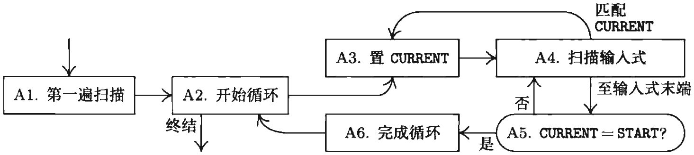
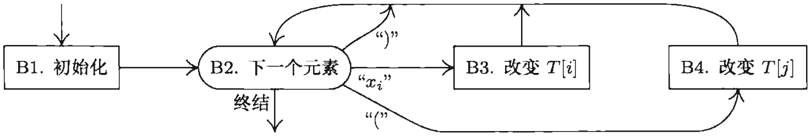

<a id="sec-1-3-3"></a>

#### 1.3.3排列的应用

在这一小节, 我们将给出其他几个 MIX 程序的例子, 同时介绍排列的若干重要性质. 这些探讨也会引出计算机程序设计中某些有趣的一般性问题.


此前在 1.2.5 节讨论过排列. 我们把排列 $c \: d f \: b \: e \: a$ 当作 6 个对象 $a$, $b$, $c$, $d$, $e$, $f$ 在一条直线上的一种位置排布方式. 也可以采用另外一种观点: 把一个排列想象成这些对象的重排或者重新命名. 对于这种解释, 习惯上用一种两行记号表示排列. 例如,

$$
\begin{pmatrix}a&b&c&d&e&f\\c&d&f&b&e&a\end{pmatrix}
\qquad \text{(1)}
$$

表示 $a _ { \bar { a } }$ 变为 $c$, $b$ 变为 $d$, $c$ 变为 $f ,$ $d$ 变为 $b$, $e$ 变为 $e$, $f$ 变为 $a^{\prime \prime}$. 把排列看成重排, 就意味着把对象 $c$ 移动到从前由对象 $a$ 占据的位置; 把排列看成重新命名, 则是指把对象 $a$ 改名为<a id="pdf-149"></a><a id="p-132"></a>$c$. 这种两行记号不受两行中列的次序变化的影响, 例如排列 (1) 也可以写成

$$
\begin{pmatrix}c&d&f&b&a&e\\f&b&a&d&c&e\end{pmatrix}
$$

以及其他 718 种形式.

通常用一种循环记号表示这种解释. 排列 (1) 可以写成

$$
(a\,c\,f)(b\,d),
\qquad \text{(2)}
$$

这也表示 $\text{“}a$ 变为 $c$, $c$ 变为 $f$, $f$ 变为 $a$, $b$ 变为 $d$, $d$ 变为 $b\text{”}$. 循环 $(x_1\,x_2\ldots x_n)$ 意味着 ${ } ^ { \ast } \mathcal { X } _ { 1 }$ 变为 $x _ { 2 } , \ldots , x _ { n - 1 }$ 变为 $x _ { n } ,  ;  ; x_ { n }$ 变为 $x_{1}$.” 由于 $e$ 在这个排列中是固定不变的, 因而它不出现在循环记号中; 就是说, 习惯上不写出像 $\text{“}(e)\text{”}$ 这样的单元素循环. 如果一个排列固定所有元素, 于是仅出现单元素循环, 我们就称它为恒等排列, 用 “()” 表示.

循环记号的表示方法不是唯一的. 例如,

$$
(b\,d)(a\,c\,f),\qquad(c\,f\,a)(b\,d),\qquad(d\,b)(f\,a\,c)
\qquad \text{(3)}
$$

等等记号都是同 (2) 等价的. 但是 $(a f c)(b d)$ 不是这同一个循环, 因为它说明 $a$ 变为 $f.$

容易看出为什么循环记号总是可以使用的. 从任意元素 $x_{1}$ 开始, 假如排列把 $x _ { 1 }$ 变为 $x _ { 2 }$ 把 x2 变为 $x_{3}$, 等等, 直到最后 (因为只有有限个元素) 我们得到某个已经在 $x _ { 1 } , \ldots , x _ { n }$ 中间出现过的元素 $x_{n + 1}$, 那么 $x_{n + 1}$ 必须等于 $x _ { 1 }$. 因为假如它不等于 $x_{1}$ 而是等于 $x _ { 3 }$, 而我们已经知道 $x_{2}$ 变为 $x _ { 3 }$; 但是按照假设, $x _ { n } \neq x _ { 2 }$ 变为 $x_{n + 1}$. 所以 $x_{n+1}=x_1$. 并且对于 $n \geq 1$, 循环 $(x_1x_2\ldots x_n)$ 是这个排列的一部分. 如果这不是全部排列, 那么我们能够找到另外一个元素 $y_{1}$, 并且用同样的方法得到另外一个循环 $\left( y _ { 1 } \: y _ { 2 } \: \cdots \: y _ { m } \right)$. 任何一个 $y$ 都不可能同任何一个 $x$ 相等, 因为 $x _ { i } = y _ { j }$ 意味着 $x _ { i + 1 } = y _ { j + 1 }$ 等等, 因此最终将有某个 $k$ 使得 $x _ { k } = y _ { 1 }$, 同 $y_{1}$ 的选择矛盾. 最后, 我们将找到所有的循环.

在程序设计中, 我们只要把某个 $n$ 元集合按照一种不同的次序排列, 就会应用这些概念. 如果我们不想移动对象, 想对它们原地重排, 那么实际上必须采用循环结构. 例如, 为了完成重排 (1), 即置

$$
( a ,   b ,   c ,   d ,   e ,   f ) \leftarrow ( c ,   d ,   f ,   b ,   e ,   a ) .
$$

实际上我们将采用循环结构 (2), 依次置

$$
t \leftarrow a , \quad a \leftarrow c , \quad c \leftarrow f , \quad f \leftarrow t ; \quad t \leftarrow b , \quad b \leftarrow d , \quad d \leftarrow t .
$$

任何这样的变换以不相交的循环形式出现, 认识这一点常常是有帮助的.

排列的乘积. 我们可以把两个排列乘在一起, 这种乘法应该理解成先应用一个排列, 再应用另一个排列. 例如, 如果在排列 (1) 后面接着用排列

$$
\begin{pmatrix}a&b&c&d&e&f\\b&d&c&a&f&e\end{pmatrix},
$$

那么 $a$ 变为 $c$, 接着仍为 $c$; $b$ 变为 $d$, 接着变为 $a$; 以此类推, 得到

$$
\begin{aligned}\begin{pmatrix}a&b&c&d&e&f\\c&d&f&b&e&a\end{pmatrix}\times\begin{pmatrix}a&b&c&d&e&f\\b&d&c&a&f&e\end{pmatrix}&=\begin{pmatrix}a&b&c&d&e&f\\c&d&f&b&e&a\end{pmatrix}\times\begin{pmatrix}c&d&f&b&e&a\\c&a&e&d&f&b\end{pmatrix}\\&=\begin{pmatrix}a&b&c&d&e&f\\c&a&e&d&f&b\end{pmatrix}.\end{aligned}
\qquad \text{(4)}
$$

<a id="pdf-150"></a><a id="p-133"></a>

应当清楚, 排列的乘法是不可交换的; 换句话说, 如果 $\pi_{1}$ 和 $\pi_{2}$ 是两个排列, 那么 $\pi_{1} \times \pi_{2}$ 不一定等于 $\pi_{2} \times \pi_{1}$. 读者可以验证, 如果交换 $( 4 )$ 中的两个因子, 将会得出不同的乘积 (见习题 3).

有人在做排列的乘法时采用从右到左的顺序, 而不是像 $(4)$ 中那样更自然的从左到右的顺序. 事实上, 数学家在这个问题上分成两派. 那么, 在应用变换 $T_1$ 后再应用 $T _ { 2 }$ 的结果, 究竟应该采用 $T _ { 1 } T _ { 2 }$ 还是 $T _ { 2 } T _ { 1 }$ 表示呢? 我们在本书中采用 $T _ { 1 } T _ { 2 } .$

利用循环记号, 等式 (4) 将写成

$$
(a\,c\,f)(b\,d)(a\,b\,d)(e\,f)=(a\,c\,e\,f\,b).
\qquad \text{(5)}
$$

注意习惯上省略乘法符号 $\text{" } \times  \text{" }$. 这样做同循环记号不冲突, 因为不难看出, 排列 $(a c f)(b d)$ 确实是排列 $(a\,c\,f)$ 和 $(b\,d)$ 的乘积.

排列的乘法可以直接用循环记号进行. 例如为了计算几个排列

$$
(a\,c\,f\,g)(b\,c\,d)(a\,e\,d)(f\,a\,d\,e)(b\,g\,f\,a\,e)
\qquad \text{(6)}
$$

的乘积, 我们发现 (从左到右进行) $a _ { \vec { a } }$ 变为 $c _ { s }$ 然后 $c$ 变为 $d$, 然后 $d$ 变为 $a$, 然后 $a$ 变为 $d,$ 然后 $d$ 不变”; 所以式 (6) 的最后结果是 $a$ 变为 $d$, 我们写成 $\text{" }(a\ d \text{" }$ 作为部分答案. 现在我们考虑关于 $d$ 的结果: “$d$ 变为 $b$ 变为 $g^{\prime 9}$, 于是得到部分结果 $\text{“}(a\,d\,g\text{”}$. 考虑 $g$, 我们发现 $\text{“}g$ 变为 $a$ $a$ 变为 $e ; e$ 变为 $f ,$ 再变为 $a^{\prime \prime}$, 所以第一个循环完成: $\text{“}(a\,d\,g)\text{”}$. 现在我们挑选尚未出现过的一个新元素, 比如 $c :$, 发现 $c$ 变为 $e .$ 读者可以验证 “ $(a\,d\,g)(c\,e\,b)\text{”}$ 是从式 (6) 得到的最终答案.

现在让我们尝试用计算机来实现这个处理过程. 下述算法使用前段描述的方法, 使之具备适用于机器计算的形式.

<a id="fig-1-20"></a>



*图 20　计算排列乘法的算法 A*

算法 A (循环形式排列的乘法). 这个算法接受像式 (6) 那样表为循环形式的排列的乘积, 计算以不相交循环的乘积表示的结果排列. 为简单起见, 这里不叙述单元素循环的消去问题, 那只是这个算法的一种非常简单的扩充. 当算法执行时, 我们依次 “标记” 输入式中的元素, 即对于输入式中已经处理的符号做出某种标记.

A1.[第一遍扫描.] 标记所有左括号, 并且对于同每个左括号匹配的右括号, 用左括号后面第一个输入符号的带标记的副本代替. (见表 1 的例子.)

A2.[开始循环.] 从左到右搜索输入式中第一个未标记的元素. (如果所有元素都做了标记, 算法终结.) 置 START 等于它; 输出一个左括号; 输出这个元素; 标记这个元素.

A3.[置 CURRENT.] 置 CURRENT 等于输入式中下一个元素.

A4.[扫描输入式.] 向右扫描, 直至达到输入式末端, 或者找到一个等于 CURRENT 的元素; 在后面一种情况, 对它做标记, 然后返回 A3.

<a id="pdf-151"></a><a id="p-134"></a>

**表 1　对式 (6) 应用算法 A**

| 经过步骤 | START | CURRENT | (acfg)(bcd)(aed)(fade)(bgfae) | 输出 |
| :--- | :---: | :---: | :--- | :--- |
| A1 |  |  | <code><span style="color:#999" title="已标记">(</span>acfg<span style="color:#999" title="已标记">a(</span>bcd<span style="color:#999" title="已标记">b(</span>aed<span style="color:#999" title="已标记">a(</span>fade<span style="color:#999" title="已标记">f(</span>bgfae<span style="color:#999" title="已标记">b</span></code> |  |
| A2 | a |  | <code><span style="color:#999" title="已标记">(a</span><b title="游标">⌶</b>cfg<span style="color:#999" title="已标记">a(</span>bcd<span style="color:#999" title="已标记">b(</span>aed<span style="color:#999" title="已标记">a(</span>fade<span style="color:#999" title="已标记">f(</span>bgfae<span style="color:#999" title="已标记">b</span></code> | (a |
| A3 | a | c | <code><span style="color:#999" title="已标记">(a</span>c<b title="游标">⌶</b>fg<span style="color:#999" title="已标记">a(</span>bcd<span style="color:#999" title="已标记">b(</span>aed<span style="color:#999" title="已标记">a(</span>fade<span style="color:#999" title="已标记">f(</span>bgfae<span style="color:#999" title="已标记">b</span></code> |  |
| A4 | a | c | <code><span style="color:#999" title="已标记">(a</span>cfg<span style="color:#999" title="已标记">a(</span>b<span style="color:#999" title="已标记">c</span><b title="游标">⌶</b>d<span style="color:#999" title="已标记">b(</span>aed<span style="color:#999" title="已标记">a(</span>fade<span style="color:#999" title="已标记">f(</span>bgfae<span style="color:#999" title="已标记">b</span></code> |  |
| ⋮ | | | | |
| A4 | a | d | <code><span style="color:#999" title="已标记">(a</span>cfg<span style="color:#999" title="已标记">a(</span>b<span style="color:#999" title="已标记">c</span>d<span style="color:#999" title="已标记">b(</span>ae<span style="color:#999" title="已标记">d</span><b title="游标">⌶</b><span style="color:#999" title="已标记">a(</span>fade<span style="color:#999" title="已标记">f(</span>bgfae<span style="color:#999" title="已标记">b</span></code> |  |
| ⋮ | | | | |
| A4 | a | a | <code><span style="color:#999" title="已标记">(a</span>cfg<span style="color:#999" title="已标记">a(</span>b<span style="color:#999" title="已标记">c</span>d<span style="color:#999" title="已标记">b(</span>ae<span style="color:#999" title="已标记">da(</span>f<span style="color:#999" title="已标记">a</span><b title="游标">⌶</b>de<span style="color:#999" title="已标记">f(</span>bgfae<span style="color:#999" title="已标记">b</span></code> |  |
| ⋮ | | | | |
| A5 | a | d | <code><span style="color:#999" title="已标记">(a</span>cfg<span style="color:#999" title="已标记">a(</span>b<span style="color:#999" title="已标记">c</span>d<span style="color:#999" title="已标记">b(</span>ae<span style="color:#999" title="已标记">da(</span>f<span style="color:#999" title="已标记">a</span>de<span style="color:#999" title="已标记">f(</span>bgfae<span style="color:#999" title="已标记">b</span><b title="游标">⌶</b></code> | d |
| ⋮ | | | | |
| A5 | a | g | <code><span style="color:#999" title="已标记">(a</span>cfg<span style="color:#999" title="已标记">a(</span>b<span style="color:#999" title="已标记">cdb(</span>ae<span style="color:#999" title="已标记">da(</span>f<span style="color:#999" title="已标记">a</span>de<span style="color:#999" title="已标记">f(b</span>gfae<span style="color:#999" title="已标记">b</span><b title="游标">⌶</b></code> | g |
| ⋮ | | | | |
| A5 | a | a | <code><span style="color:#999" title="已标记">(a</span>cf<span style="color:#999" title="已标记">ga(</span>b<span style="color:#999" title="已标记">cdb(a</span>e<span style="color:#999" title="已标记">da(</span>f<span style="color:#999" title="已标记">a</span>d<span style="color:#999" title="已标记">ef(b</span>g<span style="color:#999" title="已标记">f</span>ae<span style="color:#999" title="已标记">b</span><b title="游标">⌶</b></code> |  |
| A6 | a | a | <code><span style="color:#999" title="已标记">(a</span>cf<span style="color:#999" title="已标记">ga(</span>b<span style="color:#999" title="已标记">cdb(a</span>e<span style="color:#999" title="已标记">da(</span>f<span style="color:#999" title="已标记">a</span>d<span style="color:#999" title="已标记">ef(b</span>g<span style="color:#999" title="已标记">f</span>ae<span style="color:#999" title="已标记">b</span><b title="游标">⌶</b></code> | ) |
| ⋮ | | | | |
| A2 | c | a | <code><span style="color:#999" title="已标记">(ac</span><b title="游标">⌶</b>f<span style="color:#999" title="已标记">ga(</span>b<span style="color:#999" title="已标记">cdb(a</span>e<span style="color:#999" title="已标记">da(</span>f<span style="color:#999" title="已标记">a</span>d<span style="color:#999" title="已标记">ef(b</span>g<span style="color:#999" title="已标记">f</span>ae<span style="color:#999" title="已标记">b</span></code> | (c |
| ⋮ | | | | |
| A5 | c | e | <code><span style="color:#999" title="已标记">(ac</span>f<span style="color:#999" title="已标记">ga(</span>b<span style="color:#999" title="已标记">cdb(a</span>e<span style="color:#999" title="已标记">da(fa</span>d<span style="color:#999" title="已标记">ef(b</span>g<span style="color:#999" title="已标记">fa</span>e<span style="color:#999" title="已标记">b</span><b title="游标">⌶</b></code> | e |
| ⋮ | | | | |
| A5 | c | b | <code><span style="color:#999" title="已标记">(ac</span>f<span style="color:#999" title="已标记">ga(</span>b<span style="color:#999" title="已标记">cdb(aeda(fadef(b</span>g<span style="color:#999" title="已标记">faeb</span><b title="游标">⌶</b></code> | b |
| ⋮ | | | | |
| A6 | c | c | <code><span style="color:#999" title="已标记">(ac</span>f<span style="color:#999" title="已标记">ga(bcdb(aeda(fadef(b</span>g<span style="color:#999" title="已标记">faeb</span><b title="游标">⌶</b></code> | ) |
| ⋮ | | | | |
| A6 | f | f | <code><span style="color:#999" title="已标记">(acfga(bcdb(aeda(fadef(bgfaeb</span><b title="游标">⌶</b></code> | (f) |

此处 ⌶ 代表刚扫描的元素之后的游标, 已标记的元素呈浅灰色.

**A5.** [$\mathit{CURRENT}=\mathit{START}$?] 如果 $\mathrm{CURRENT}\ne\mathrm{START}$, 输出 $\mathrm{CURRENT}$, 返回 A4, 再从输入式的左边开始扫描 (由此继续寻找并输出一个循环).

**A6.** [完成循环.] (已经输出一个完整的循环.) 输出一个右括号, 返回 A2.　▮

以式 (6) 为例, 表 1 逐步显示它的处理步骤. 表的第一行显示各个右括号用相应循环的第一个元素代替后的输入式; 随后各行显示对越来越多元素做标记的进展情况. 用一个游标指示输入式中当前的处理位点. 输出为 “$(a\,d\,g)(c\,e\,b)(f)$”. 注意单元素循环会出现在输出中.

**MIX 程序.** 为了在 MIX 上实现上述算法, 可以用一个字的符号位作为 “标记”. 假定把输入按下列格式穿孔到卡片上: 一张 80 列的卡片分成 16 个 5 字符字段, 每个字段可能为下列四者之一: (a)“`␣␣␣␣(`”, 表示一个循环开始的左括号; (b)“`)␣␣␣␣`”, 表示一个循环终结的右括号; (c)“`␣␣␣␣␣`”, 全部空格, 可以插入任何位置, 以填充空间; (d) 其他形式的 5 个字符, 代表进行排列的元素. 输入的最后一张卡片的 76–80 列为 “`␣␣␣␣=`”, 这是它的识别标志. 例如, 式 (6) 可以穿孔成下面两张卡片:

```text
    (  A    C    F    G  )        (  B    C    D  )        (  A    E    D  )    
    (  F    A    D    E  )        (  B    G    F    A    E  )                  =
```

我们的程序首先输出所给输入的完整副本, 其后以相同格式输出答案.

**程序 A**(循环形式排列的乘法). 这个程序实现算法 A, 同时它也预先安排了输入和输出, 以及消除单元素循环. 但是, 它不检查输入中的错误.

| 行号 | LOC | OP | ADDRESS | 次数 | 注释 |
| ---: | :--- | :--- | :--- | :---: | :--- |
| 01 | `MAXWDS` | `EQU` | `1200` |  | 输入的最大长度 |
| 02 | `PERM` | `ORIG` | `*+MAXWDS` |  | 输入排列 |
| 03 | `ANS` | `ORIG` | `*+MAXWDS` |  | 答案的区域 |
| 04 | `OUTBUF` | `ORIG` | `*+24` |  | 打印的区域 |
| <a id="pdf-152"></a><a id="p-135"></a>05 | `CARDS` | `EQU` | `16` |  | 卡片读入机设备号 |
| 06 | `PRINTER` | `EQU` | `18` |  | 打印机设备号 |
| 07 | `BEGIN` | `IN` | `PERM(CARDS)` |  | 读第一张卡片 |
| 08 |  | `ENT2` | `0` |  |  |
| 09 |  | `LDA` | `EQUALS` |  |  |
| 10 | `1H` | `JBUS` | `*(CARDS)` |  | 等待循环结束. |
| 11 |  | `CMPA` | `PERM+15,2` |  |  |
| 12 |  | `JE` | `*+2` |  | 是最后一张卡片吗? |
| 13 |  | `IN` | `PERM+16,2(CARDS)` |  | 否, 再读一张卡片. |
| 14 |  | `ENT1` | `OUTBUF` |  |  |
| 15 |  | `JBUS` | `*(PRINTER)` |  | 打印输入卡片 |
| 16 |  | `MOVE` | `PERM,2(16)` |  | 的一份副本. |
| 17 |  | `OUT` | `OUTBUF(PRINTER)` |  |  |
| 18 |  | `JE` | `1F` |  |  |
| 19 |  | `INC2` | `16` |  |  |
| 20 |  | `CMP2` | `=MAXWDS-16=` |  |  |
| 21 |  | `JLE` | `1B` |  | 重复进行直到输入完结. |
| 22 |  | `HLT` | `666` |  | 输入过长! |
| 23 | `1H` | `INC2` | `15` | $1$ | 此时，输入的 $\mathrm{rI2}$ 个字 |
| 24 |  | `ST2` | `SIZE` | $1$ | 保存在 $\mathrm{PERM},\mathrm{PERM}+1,\ldots$. |
| 25 |  | `ENT3` | `0` | $1$ | <u>A1. 第一遍扫描. </u> |
| 26 | `2H` | `LDAN` | `PERM,3` | $A$ | 取下一个输入元素. |
| 27 |  | `CMPA` | `LPREN(1:5)` | $A$ | 是“(”吗? |
| 28 |  | `JNE` | `1F` | $A$ |  |
| 29 |  | `STA` | `PERM,3` | $B$ | 如果是，标记它。 |
| 30 |  | `INC3` | `1` | $B$ | 把下一个非空格输入符号 |
| 31 |  | `LDXN` | `PERM,3` | $B$ | 置于 $\mathrm{rX}$. |
| 32 |  | `JXZ` | `*-2` | $B$ |  |
| 33 | `1H` | `CMPA` | `RPREN(1:5)` | $C$ |  |
| 34 |  | `JNE` | `*+2` | $C$ |  |
| 35 |  | `STX` | `PERM,3` | $D$ | 用带标记的 $\mathrm{rX}$ 代替“)”. |
| 36 |  | `INC3` | `1` | $C$ |  |
| 37 |  | `CMP3` | `SIZE` | $C$ | 已经处理完所有元素吗? |
| 38 |  | `JL` | `2B` | $C$ |  |
| 39 |  | `LDA` | `LPREN` | $1$ | 为主程序做准备。 |
| 40 |  | `ENT1` | `ANS` | $1$ | $\mathrm{rI1}={}$ 存储下一个答案的区域 |
| 41 | `OPEN` | `ENT3` | `0` | $E$ | <u>A2. 开始循环. </u> |
| 42 | `1H` | `LDXN` | `PERM,3` | $F$ | 寻找未标记的元素. |
| 43 |  | `JXN` | `GO` | $F$ |  |
| 44 |  | `INC3` | `1` | $G$ |  |
| 45 |  | `CMP3` | `SIZE` | $G$ |  |
| 46 |  | `JL` | `1B` | $G$ |  |
| 47 | `*` |  |  |  | 所有元素已作标记, 现在转向输出. |
| 48 | `DONE` | `CMP1` | `=ANS=` |  |  |
| 49 |  | `JNE` | `*+2` |  | 答案是恒等排列吗? |
| 50 |  | `MOVE` | `LPREN(2)` |  | 如果是, 改变为 “()”. |
| <a id="pdf-153"></a><a id="p-136"></a>51 |  | `MOVE` | `=0=` |  | 在答案后置放 23 个空格字. |
| 52 |  | `MOVE` | `-1,1(22)` |  |  |
| 53 |  | `ENT3` | `0` |  |  |
| 54 |  | `OUT` | `ANS,3(PRINTER)` |  |  |
| 55 |  | `INC3` | `24` |  |  |
| 56 |  | `LDX` | `ANS,3` |  | 打印所需数目的行。 |
| 57 |  | `JXNZ` | `*-3` |  |  |
| 58 |  | `HLT` |  |  |  |
| 59 | `*` |  |  |  |  |
| 60 | `LPREN` | `ALF` | <code style="white-space:pre">    (</code> |  | 程序中使用的常量 |
| 61 | `RPREN` | `ALF` | <code style="white-space:pre">)    </code> |  |  |
| 62 | `EQUALS` | `ALF` | <code style="white-space:pre">    =</code> |  |  |
| 63 | `*` |  |  |  |  |
| 64 | `GO` | `MOVE` | `LPREN` | $H$ | 开始输出中的一个循环. |
| 65 |  | `MOVE` | `PERM,3` | $H$ |  |
| 66 |  | `STX` | `START` | $H$ |  |
| 67 | `SUCC` | `STX` | `PERM,3` | $J$ | 标记一个元素. |
| 68 |  | `INC3` | `1` | $J$ | 右移一步。 |
| 69 |  | `LDXN` | `PERM,3(1:5)` | $J$ | <u>A3. 置 $\mathit{CURRENT}$</u>(即 $\mathrm{rX}$). |
| 70 |  | `JXN` | `1F` | $J$ | 跳过空格. |
| 71 |  | `JMP` | `*-3` | $0$ |  |
| 72 | `5H` | `STX` | `0,1` | $Q$ | 输出 $\mathrm{CURRENT}$. |
| 73 |  | `INC1` | `1` | $Q$ |  |
| 74 |  | `ENT3` | `0` | $Q$ | 再扫描输入式. |
| 75 | `4H` | `CMPX` | `PERM,3(1:5)` | $K$ | <u>A4. 扫描输入式。</u> |
| 76 |  | `JE` | `SUCC` | $K$ | 元素 $=\mathrm{CURRENT}$? |
| 77 | `1H` | `INC3` | `1` | $L$ | 右移一步。 |
| 78 |  | `CMP3` | `SIZE` | $L$ | 是输入式的结束吗? |
| 79 |  | `JL` | `4B` | $L$ |  |
| 80 |  | `CMPX` | `START(1:5)` | $P$ | <u>A5. $\mathit{CURRENT}=\mathit{START}$？</u> |
| 81 |  | `JNE` | `5B` | $P$ |  |
| 82 | `CLOSE` | `MOVE` | `RPREN` | $R$ | <u>A6. 完成循环. </u> |
| 83 |  | `CMPA` | `-3,1` | $R$ | 注记: $\mathrm{rA}={}$ “(”. |
| 84 |  | `JNE` | `OPEN` | $R$ |  |
| 85 |  | `INC1` | `-3` | $S$ | 删去单元素循环。 |
| 86 |  | `JMP` | `OPEN` | $S$ |  |
| 87 |  | `END` | `BEGIN` |  | ▮ |

<details>
<summary>MIXAL 等宽清单</summary>

```text
MAXWDS    EQU   1200
PERM      ORIG  *+MAXWDS
ANS       ORIG  *+MAXWDS
OUTBUF    ORIG  *+24
CARDS     EQU   16
PRINTER   EQU   18
BEGIN     IN    PERM(CARDS)
          ENT2  0
          LDA   EQUALS
1H        JBUS  *(CARDS)
          CMPA  PERM+15,2
          JE    *+2
          IN    PERM+16,2(CARDS)
          ENT1  OUTBUF
          JBUS  *(PRINTER)
          MOVE  PERM,2(16)
          OUT   OUTBUF(PRINTER)
          JE    1F
          INC2  16
          CMP2  =MAXWDS-16=
          JLE   1B
          HLT   666
1H        INC2  15
          ST2   SIZE
          ENT3  0
2H        LDAN  PERM,3
          CMPA  LPREN(1:5)
          JNE   1F
          STA   PERM,3
          INC3  1
          LDXN  PERM,3
          JXZ   *-2
1H        CMPA  RPREN(1:5)
          JNE   *+2
          STX   PERM,3
          INC3  1
          CMP3  SIZE
          JL    2B
          LDA   LPREN
          ENT1  ANS
OPEN      ENT3  0
1H        LDXN  PERM,3
          JXN   GO
          INC3  1
          CMP3  SIZE
          JL    1B
* 所有元素已作标记，现在转向输出。
DONE      CMP1  =ANS=
          JNE   *+2
          MOVE  LPREN(2)
          MOVE  =0=
          MOVE  -1,1(22)
          ENT3  0
          OUT   ANS,3(PRINTER)
          INC3  24
          LDX   ANS,3
          JXNZ  *-3
          HLT
*
LPREN     ALF       (
RPREN     ALF   )    
EQUALS    ALF       =
*
GO        MOVE  LPREN
          MOVE  PERM,3
          STX   START
SUCC      STX   PERM,3
          INC3  1
          LDXN  PERM,3(1:5)
          JXN   1F
          JMP   *-3
5H        STX   0,1
          INC1  1
          ENT3  0
4H        CMPX  PERM,3(1:5)
          JE    SUCC
1H        INC3  1
          CMP3  SIZE
          JL    4B
          CMPX  START(1:5)
          JNE   5B
CLOSE     MOVE  RPREN
          CMPA  -3,1
          JNE   OPEN
          INC1  -3
          JMP   OPEN
          END   BEGIN
```

</details>

这个大约有 75 条指令的程序比前一小节的几个程序长得多, 其实比本书中我们将要见到的大多数程序也要长. 不过它的长度并不吓人, 因为它分为几个完全独立的小部分. 07–22 行读入输入卡片, 并且打印每张卡片的一份副本; 23–38 行完成算法的步骤 A1, 对输入做预处理; 39–46 行和 64–86 行执行算法的主要任务; 48–57 行输出答案.

读者将会发现, 尽可能多地研究本书中给出的 MIX 程序是有教益的. 通过阅读别人的计算机程序, 获取程序设计技巧, 是极为重要的能力, 可是这样的训练不幸在很多计算机课程中遭到忽视, 导致有时出现效率低得可怕的计算机用法.

<a id="pdf-154"></a><a id="p-137"></a>

计时. 对于程序 A 中同输入输出无关的部分, 我们已经给出频率计数, 就像在程序 1.3.2M 所做的那样. 例如, 30 行应该执行 B 次. 为方便起见, 我们假定在输入中的空格字只能出现在最右端. 在这个假设下, 71 行实际不会执行, 32 行也不会出现转移.

通过简单的加法, 可知程序执行的总时间为

$$
(7+5A+6B+7C+2D+E+3F+4G+8H+6J+3K+4L+3P+4Q+6R+2S)u
\qquad \text{(7)}
$$

加上输入和输出的时间. 为了理解式 (7) 的含义, 我们需要研究 A,B,C,D,E,F,G,H,J,K, $L ,   P ,   Q ,   R ,   S$ 这 15 个未知量, 并且必须把它们同输入的相应特征联系起来. 现在我们来说明处理这类问题的一般原则.

首先, 我们应用电路理论中的 “基尔霍夫第一定律”: 一条指令执行的次数必须等于转移到这条指令的次数. 这条看起来很明显的法则时常以一种不明显的方式把若干量联系在一起. 分析程序 A 的流程, 我们得出下列等式:

$$
\text{从程序行}\qquad\text{我们推出}
$$

$$
26,38\qquad A=1+(C-1)
$$

$$
33,28\qquad C=B+(A-B)
$$

$$
41, 84, 86 \qquad E = 1 + R
$$

$$
42,46\qquad F=E+(G-1)
$$

$$
64,43\qquad H=F-G
$$

$$
\begin{aligned}& 67,   70,   76 \quad & J = H + (K - (L - J))\end{aligned}
$$

$$
75,79\qquad K=Q+(L-P)
$$

$$
8 2 ,   7 2 \quad R = P - Q
$$

由基尔霍夫第一定律给出的等式不都是独立的. 例如在当前例子中, 我们看出第一个等式与第二个等式显然是等价的. 此外, 最后一个等式可以从其他等式推出, 因为第三、第四和第五个等式蕴涵 $H=R$, 于是第六个等式表明 $K=L-R.$ 总之, 我们已经消去了 15 个未知量中的 6 个未知量:

$$
A=C,\quad E=R+1,\quad F=R+G,\quad H=R,\quad K=L-R,\quad Q=P-R.
\qquad \text{(8)}
$$

基尔霍夫第一定律是一个有用的工具, 我们将在 2.3.4.1 节对它作更仔细的分析.

下一步是把变量与数据的重要特征进行配对. 我们由 24,25,30,36 行发现

$$
B+C=\text{输入的字数}=16X-1,
\qquad \text{(9)}
$$

其中 X 是输入卡片的数目. 由 28 行,

$$
B=\text{输入中“(”的数目}=\text{输入中循环的数目};
\qquad \text{(10)}
$$

同样, 由 34 行,

$$
D=\text{输入中“)”的数目}=\text{输入中循环的数目}.
\qquad \text{(11)}
$$

现在 (10) 和 (11) 给出一个不能由基尔霍夫第一定律推出的结论:

$$
B=D.
\qquad \text{(12)}
$$

<a id="pdf-155"></a><a id="p-138"></a>

由 64 行,

$$
H=\text{输出中循环的数目 (包括单元素循环)}.
\qquad \text{(13)}
$$

82 行说明 R 也等于这个量. 不过, 这里 $H=R$ 的结论是可以由基尔霍夫第一定律推出的, 因为它已经出现在式 (8) 中.

利用每个非空格字最后都会得到标记的这个事实, 由 29,35,67 行, 我们求出

$$
J=Y-2B,
\qquad \text{(14)}
$$

其中是在输入排列中出现的非空格字的数目. 在输入排列中出现的每个不同的元素恰好写到输出中一次, 或者在 65 行, 或者在 72 行. 从这个事实, 我们得到

$$
P=H+Q=\text{输入中不同元素的数目}.
\qquad \text{(15)}
$$

(见式 (8).) 稍加思索, 这个结果也能从 80 行得出. 最后我们从 85 行看出

$$
S=\text{输出中单元素循环的数目}.
\qquad \text{(16)}
$$

显然, 至今我们已经解释的 B,C,H,J,P,S 这几个量实际上是独立的参量, 可能会列入程序 A 的计时中.

到目前为止, 我们已经获得多数结果, 只剩下未知量 G 和 L 有待分析. 对于这两个量, 我们必须用一点巧劲. 从 41 行和 74 行开始的输入扫描, 总是在 47 行 (最后一次) 或者在 80 行终结. 在这 P+1 个循环的每一个循环期间, 指令 “INC31” 执行 $B+C$ 次. 该指令仅出现在 44,68,77 行, 所以我们得到把未知量 G 和 L 联系起来的重要关系

$$
G+J+L=(B+C)(P+1).
\qquad \text{(17)}
$$

幸好运行时间 $( 7 )$ 是 $G+L$ 的函数 (它包含 $\cdots+3F+4G+\cdots+3K+4L+\cdots=\cdots+7G+7L+\cdots)$ 所以我们无需特意对 G 和 L 这两个量再做任何分析.

综合所有结果, 我们求出, 不计输入输出在内的程序执行总时间为

$$
(112NX+304X-2M-Y+11U+2V-11)u.
\qquad \text{(18)}
$$

上式中用到的数据特性的新名称如下:

$$
\begin{aligned}X&=\text{输入卡片的数目},\\Y&=\text{输入中非空字段的数目（不包括最后的“=”）},\\M&=\text{输入中循环的数目},\\N&=\text{输入中不同元素名的数目},\\U&=\text{输出中循环的数目 (包括单元素循环)},\\V&=\text{输出中单元素循环的数目}.\end{aligned}
\qquad \text{(19)}
$$

我们发现, 用这种方法分析程序 A 这样的问题, 在许多方面类似于求解有趣的谜题

我们在下面将要证明, 如果假定输出排列是随机的, 那么输出中循环的数目 U 和单元素循环的数目 V 的平均值将分别等于 $H _ { N }$ 和 1.

另外一种方法. 算法 A 计算排列乘积的做法就是人们平常完成该任务的做法. 我们经常发现, 用计算机求解的问题同人类多年来面对的问题非常相似. 因此, 有些历史悠久的求解方法已经在世人的不断使用中得到改进, 它们同样适合作为计算机算法.

但是我们也经常遇到一些新方法, 它们尽管非常不适合人们使用, 却很适合用在计算机上. 根本原因在于计算机的 “思考方式” 是不同的, 它对于事实具有另外一种记忆方式. 这种差异<a id="pdf-156"></a><a id="p-139"></a>的一个例子就是我们的排列乘法问题: 使用下面的算法, 计算机可以通过对输入式的一遍扫描完成排列乘法, 它一面进行排列的循环相乘, 一面记住整个排列的当前状态. 面向人的算法 A 扫描输入式许多次, 一次对应于一个输出元素. 新的算法 B 在一遍扫描中就能处理一切事项, 这是我们这些智人无法切实做到的伟大技能.

这种面向计算机的排列乘法计算方法究竟是什么? 表 2 用图解说明了方法的基本思想. 表中, 循环式每个字符下面的列说明右侧的部分循环表示的排列是什么. 例如, 部分输入式 “$\cdots\,d\,e)(b\,g\,f\,a\,e)$” 表示排列

$$
\begin{pmatrix}a&b&c&d&e&f&g\\ e&g&c&b&?&a&f\end{pmatrix},
$$

它出现在表中最右边的 $d$ 的下方, 其中 $e$ 的未知值使用了“)”而非“?”表示.

**表 2　用一遍扫描的排列乘法**

| 输入 | ( | a | c | f | g | ) | ( | b | c | d | ) | ( | a | e | d | ) | ( | f | a | d | e | ) | ( | b | g | f | a | e | ) |
| :--- | :---: | :---: | :---: | :---: | :---: | :---: | :---: | :---: | :---: | :---: | :---: | :---: | :---: | :---: | :---: | :---: | :---: | :---: | :---: | :---: | :---: | :---: | :---: | :---: | :---: | :---: | :---: | :---: | :---: |
| $a$ | `d` | `d` | `a` | `a` | `a` | `a` | `a` | `a` | `a` | `a` | `a` | `a` | `a` | `d` | `d` | `d` | `d` | `d` | `d` | `e` | `e` | `e` | `e` | `e` | `e` | `e` | `e` | `a` | `a` |
| $b$ | `c` | `c` | `c` | `c` | `c` | `c` | `c` | `c` | `g` | `g` | `g` | `g` | `g` | `g` | `g` | `g` | `g` | `g` | `g` | `g` | `g` | `g` | `g` | `g` | `b` | `b` | `b` | `b` | `b` |
| $c$ | `e` | `e` | `e` | `d` | `d` | `d` | `d` | `d` | `d` | `c` | `c` | `c` | `c` | `c` | `c` | `c` | `c` | `c` | `c` | `c` | `c` | `c` | `c` | `c` | `c` | `c` | `c` | `c` | `c` |
| $d$ | `g` | `g` | `g` | `g` | `g` | `g` | `g` | `)` | `)` | `)` | `d` | `d` | `)` | `)` | `)` | `b` | `b` | `b` | `b` | `b` | `d` | `d` | `d` | `d` | `d` | `d` | `d` | `d` | `d` |
| $e$ | `b` | `b` | `b` | `b` | `b` | `b` | `b` | `b` | `b` | `b` | `b` | `b` | `b` | `b` | `a` | `a` | `a` | `)` | `)` | `)` | `)` | `b` | `b` | `)` | `)` | `)` | `)` | `)` | `e` |
| $f$ | `f` | `f` | `f` | `f` | `e` | `e` | `e` | `e` | `e` | `e` | `e` | `e` | `e` | `e` | `e` | `e` | `e` | `e` | `a` | `a` | `a` | `a` | `a` | `a` | `a` | `a` | `f` | `f` | `f` |
| $g$ | `a` | `)` | `)` | `)` | `)` | `f` | `f` | `f` | `f` | `f` | `f` | `f` | `f` | `f` | `f` | `f` | `f` | `f` | `f` | `f` | `f` | `f` | `f` | `f` | `f` | `g` | `g` | `g` | `g` |

对表 2 的观察表明, 如果我们从右边的恒等变换开始, 从右到左反向处理, 就可以有条不紊地自动建立这个表. 在字母 $x$ 下面的列同它右边的列 (这一列记录重排之前的状态) 差别仅在于 $x$ 行, 并且 $x$ 行中的新值就是在之前一步变换中消失的值. 更确切地说, 我们有下述算法.

**算法 B (循环形式排列的乘法)**. 这个算法实际得到同算法 A 一样的结果. 假定把排列的元素命名为 $x_1,x_2,\ldots,x_n$. 我们采用一张辅助表 $T[1],T[2],\ldots,T[n]$; 在算法终结时, 输入排列中的 $x_i$ 变为 $x_j$ 当且仅当 $T[i]=j$.

**B1.[初始化.]** 对 $1\le k\le n$ 置 $T[k]\leftarrow k$. 同时, 准备从右到左扫描输入.

**B2.[下一个元素.]** 检验输入的下一个元素 (从右到左). 如果输入已经取尽, 算法终结. 如果元素是“)” , 置 $Z\leftarrow0$, 重复 B2 步; 如果元素是“(” , 转到 B4. 在其他情况下, 元素是对于某个 $i$ 的 $x_i$, 因此转到 B3.

**B3.[改变 $T[i]$.]** 交换 $Z\leftrightarrow T[i]$. 如果这使 $T[i]=0$, 置 $j\leftarrow i$. 返回 B2.

**B4.[改变 $T[j]$.]** 置 $T[j]\leftarrow Z$. (这时, $j$ 是表 2 记号中显示“)”项的行, 对应于同刚扫描的左括号匹配的右括号.) 返回 B2. ▮

<a id="fig-1-21"></a>

<span></span>

*图 21　计算排列乘法的算法 B*

<a id="pdf-157"></a><a id="p-140"></a>

当然在这个算法执行后, 我们还必须用循环形式输出表 $T$ 的内容. 我们将会看到, 这很容易通过一种 “标记” 方法实现.

现在让我们根据这个新算法编写一个 MIX 程序. 我们打算使用和程序 A 同样的基本规则, 采用一样的输入和输出格式. 有一个来自算法本身的小问题, 就是在事先不知道元素 $x_1,x_2,\ldots,x_n$ 是什么的情况下, 我们怎么可能执行算法 B? 我们不知道 $n$, 也不知道名为 $b$ 的元素是 $x_1$ 还是 $x_2$, 等等. 解决这个问题, 有一种简单办法: 维护元素名称表, 在其中保存迄今为止遇到的元素, 并且每次搜索查找当前元素名 (参见下面程序中的 35–44 行).

**程序 B**(同程序 A 的结果一样). $\mathrm{rX}\equiv Z$, $\mathrm{rI4}\equiv i$, $\mathrm{rI1}\equiv j$, $\mathrm{rI3}=n$ (见到的不同元素名称的数目).

| 行号 | LOC | OP | ADDRESS | 次数 | 注释 |
| ---: | :--- | :--- | :--- | :---: | :--- |
| 01 | `MAXWDS` | `EQU` | `1200` |  | 输入的最大长度 |
| 02 | `X` | `ORIG` | `*+MAXWDS` |  | 元素名称表 |
| 03 | `T` | `ORIG` | `*+MAXWDS` |  | 辅助状态表 |
| 04 | `PERM` | `ORIG` | `*+MAXWDS` |  | 输入排列 |
| 05 | `ANS` | `EQU` | `PERM` |  | 答案的区域 |
| 06 | `OUTBUF` | `ORIG` | `*+24` |  | 打印的区域 |
| 07 | `CARDS` | `EQU` | `16` |  |  |
| … | | | | | 07–24 行与程序 A 的 05–22 行相同. |
| 24 |  | `HLT` | `666` |  | 此时, 输入的 $\mathrm{rI2}$ 个字 |
| 25 | `1H` | `INC2` | `15` | $1$ | 保存在 $\mathrm{PERM},\mathrm{PERM}+1,\ldots$ |
| 26 |  | `ENT3` | `0` | $1$ | 且尚未见到任何元素名. |
| 27 | `RIGHT` | `ENTX` | `0` | $A$ | 置 $Z\leftarrow0$. |
| 28 | `SCAN` | `DEC2` | `1` | $B$ | <u>B2. 下一个元素。</u> |
| 29 |  | `LDA` | `PERM,2` | $B$ |  |
| 30 |  | `JAZ` | `CYCLE` | $B$ | 跳过空格. |
| 31 |  | `CMPA` | `RPREN` | $C$ |  |
| 32 |  | `JE` | `RIGHT` | $C$ | 下一个元素是“)”吗? |
| 33 |  | `CMPA` | `LPREN` | $D$ |  |
| 34 |  | `JE` | `LEFT` | $D$ | 是“(”吗? |
| 35 |  | `ENT4` | `1,3` | $E$ | 准备搜索. |
| 36 |  | `STA` | `X` | $E$ | 存储在表的开头。 |
| 37 | `2H` | `DEC4` | `1` | $F$ | 搜索元素名表。 |
| 38 |  | `CMPA` | `X,4` | $F$ |  |
| 39 |  | `JNE` | `2B` | $F$ | 重复进行, 直至找到匹配的元素名. |
| 40 |  | `J4P` | `FOUND` | $G$ | 前面是否出现过这个元素名? |
| 41 |  | `INC3` | `1` | $H$ | 否；表的大小加 1。 |
| 42 |  | `STA` | `X,3` | $H$ | 插入新元素名 $x_n$。 |
| 43 |  | `ST3` | `T,3` | $H$ | 置 $T[n]\leftarrow n$. |
| 44 |  | `ENT4` | `0,3` | $H$ | $i\leftarrow n$. |
| 45 | `FOUND` | `LDA` | `T,4` | $J$ | <u>B3. 改变 $T[i]$。</u> |
| 46 |  | `STX` | `T,4` | $J$ | 存储 $Z$. |
| 47 |  | `SRC` | `5` | $J$ | 置 $Z$. |
| 48 |  | `JANZ` | `SCAN` | $J$ |  |
| 49 |  | `ENT1` | `0,4` | $K$ | 如果 $Z$ 为 0, 置 $j\leftarrow i$. |
| 50 |  | `JMP` | `SCAN` | $K$ |  |
| 51 | `LEFT` | `STX` | `T,1` | $L$ | <u>B4. 改变 $T[j]$. </u> |
| <a id="pdf-158"></a><a id="p-141"></a>52 | `CYCLE` | `J2P` | `SCAN` | $P$ | 返回 B2，除非已经结束。 |
| 53 | `*` |  |  |  |  |
| 54 | `OUTPUT` | `ENT1` | `ANS` | $1$ | 全部输入已经扫描. |
| 55 |  | `J3Z` | `DONE` | $1$ | $x$ 表和 $T$ 表包含答案. |
| 56 | `1H` | `LDAN` | `X,3` | $Q$ | 现在我们构造循环记号. |
| 57 |  | `JAP` | `SKIP` | $Q$ | 元素名已经标记吗? |
| 58 |  | `CMP3` | `T,3` | $R$ | 有单元素循环吗? |
| 59 |  | `JE` | `SKIP` | $R$ |  |
| 60 |  | `MOVE` | `LPREN` | $S$ | 开始一个循环. |
| 61 | `2H` | `MOVE` | `X,3` | $T$ |  |
| 62 |  | `STA` | `X,3` | $T$ | 标记元素名。 |
| 63 |  | `LD3` | `T,3` | $T$ | 寻找元素的后继. |
| 64 |  | `LDAN` | `X,3` | $T$ |  |
| 65 |  | `JAN` | `2B` | $T$ | 是否已经标记? |
| 66 |  | `MOVE` | `RPREN` | $W$ | 是, 完成循环. |
| 67 | `SKIP` | `DEC3` | `1` | $Z$ | 移到下一个元素名。 |
| 68 |  | `J3P` | `1B` | $Z$ |  |
| 69 | `*` |  |  |  |  |
| 70 | `DONE` | `CMP1` | `=ANS=` |  |  |
| … | | | | | 70–84 行与程序 A 的 48–62 行相同. |
| 84 | `EQUALS` | `ALF` | <code style="white-space:pre">    =</code> |  |  |
| 85 |  | `END` | `BEGIN` |  | ▮ |

<details>
<summary>MIXAL 等宽清单</summary>

```text
MAXWDS    EQU   1200
X         ORIG  *+MAXWDS
T         ORIG  *+MAXWDS
PERM      ORIG  *+MAXWDS
ANS       EQU   PERM
OUTBUF    ORIG  *+24
CARDS     EQU   16
          HLT   666
1H        INC2  15
          ENT3  0
RIGHT     ENTX  0
SCAN      DEC2  1
          LDA   PERM,2
          JAZ   CYCLE
          CMPA  RPREN
          JE    RIGHT
          CMPA  LPREN
          JE    LEFT
          ENT4  1,3
          STA   X
2H        DEC4  1
          CMPA  X,4
          JNE   2B
          J4P   FOUND
          INC3  1
          STA   X,3
          ST3   T,3
          ENT4  0,3
FOUND     LDA   T,4
          STX   T,4
          SRC   5
          JANZ  SCAN
          ENT1  0,4
          JMP   SCAN
LEFT      STX   T,1
CYCLE     J2P   SCAN
*
OUTPUT    ENT1  ANS
          J3Z   DONE
1H        LDAN  X,3
          JAP   SKIP
          CMP3  T,3
          JE    SKIP
          MOVE  LPREN
2H        MOVE  X,3
          STA   X,3
          LD3   T,3
          LDAN  X,3
          JAN   2B
          MOVE  RPREN
SKIP      DEC3  1
          J3P   1B
*
DONE      CMP1  =ANS=
EQUALS    ALF       =
          END   BEGIN
```

</details>

54–68 行从 $T$ 表和元素名称表构造循环记号, 这十余行的小算法相当精致, 值得研究. 当然, 纳入程序 B 计时的量 $A,B,\ldots,R,S,T,W,Z$ 与程序 A 分析中的同名量并不相同. 读者将会发现, 分析这些时间做练习是饶有趣味的 (见习题 10).

经验表明, 程序 B 的执行时间主要用在搜索元素名称表上——这就是计时中的量 $F$. 对于搜索和构建元素名称字典, 可以使用更好的算法, 通称为符号表算法. 它们在计算机应用中是非常重要的. 第 6 章包含对高效符号表算法的详尽讨论.

**逆排列.** 逆排列 $\pi^-$ 是抵消 $\pi$ 的作用的排列. 如果在 $\pi$ 的作用下, $i$ 变为 $j$, 那么在 $\pi^-$ 的作用下, $j$ 变为 $i$. 因此乘积 $\pi\pi^-$ 等于恒等排列, 乘积 $\pi^-\pi$ 也是如此. 人们通常用 $\pi^{-1}$ 而不用 $\pi^-$ 表示逆排列, 但是这个上标 1 是多余的 (理由与 $x^1=x$ 相同).

每个排列都有一个逆排列. 例如, 排列

$$
\begin{pmatrix}a&b&c&d&e&f\\c&d&f&b&e&a\end{pmatrix}
\quad\text{的逆排列是}\quad
\begin{pmatrix}c&d&f&b&e&a\\a&b&c&d&e&f\end{pmatrix}
=\begin{pmatrix}a&b&c&d&e&f\\f&d&a&b&e&c\end{pmatrix}.
$$

现在我们来考察计算一个排列之逆排列的几种简单算法.

在这一小节的余下部分, 我们假定处理的是数字 $\{1,2,\ldots,n\}$ 的排列. 如果 $X[1]X[2]\ldots X[n]$ 是这样的一个排列, 那么存在一种计算它的逆排列的简单方法: 对于 $1\le k\le n$ 置 $Y[X[k]]\leftarrow k$, 那么 $Y[1]Y[2]\ldots Y[n]$ 是所求的逆排列. 这个方法使用 $2n$ 个存储单元, 其中 $n$ 个用于 $X$, $n$ 个用于 $Y$.

但是为了让求解充满乐趣, 我们不妨假定 $n$ 是很大的数, 同时还假定在计算 $X[1]X[2]\ldots X[n]$ 的逆排列时不想使用那么大的额外存储空间. 我们打算 “原地” 计算逆排列, 使得在算法结束后, 数组 $X[1]X[2]\ldots X[n]$ 将是原排列之逆排列. 要是仅仅依靠对于 $1\le k\le n$ 置 $Y[X[k]]\leftarrow k$, 无疑不满足要求. 通过考虑循环结构, 我们可以得到下面的简单算法.

<a id="pdf-159"></a><a id="p-142"></a>

**算法 I**(原地求逆排列). 把 $\{1,2,\ldots,n\}$ 的一个排列 $X[1]X[2]\ldots X[n]$ 变成它的逆排列. 这个算法的作者是黄秉超 [*Inf. Proc. Letters* **12** (1981), 237–238].

**I1.** [初始化.] 置 $m\leftarrow n$, $j\leftarrow -1$.

**I2.** [下一个元素.] 置 $i\leftarrow X[m]$. 如果 $i<0$, 转到 I5 (这个元素已经处理).

**I3.** [求一个元素之逆.] (这时 $j<0$, $i=X[m]$. 如果 $m$ 不是所在循环中最大的元素, 那么原来排列具有 $X[-j]=m$.) 置 $X[m]\leftarrow j$, $j\leftarrow-m$, $m\leftarrow i$, $i\leftarrow X[m]$.

**I4.** [循环是否结束?] 如果 $i>0$, 返回 I3 (循环尚未结束); 否则, 置 $i\leftarrow j$. (在后面一种情况, 原来排列具有 $X[-j]=m$, $m$ 是所在循环中最大的元素.)

**I5.** [存储终值.] 置 $X[m]\leftarrow-i$. ($X[-i]$ 原来等于 $m$.)

**I6.** [对 $m$ 循环.] $m$ 减少 1. 如果 $m>0$, 返回 I2; 否则, 算法终结.　▮

这个算法的一个例子见表 3. 该方法的基础是依次对排列的循环求逆, 做法是将求逆的元素变为负值来标记它, 然后再恢复正确的符号.

**表 3　用算法 I 计算 $6\,2\,1\,5\,4\,3$ 之逆排列**

| 经过步骤 | I2 | I3 | I3 | I3 | I5* | I2 | I3 | I3 | I5 | I2 | I5 | I5 | I3 | I5 | I5 |
| :--- | ---: | ---: | ---: | ---: | ---: | ---: | ---: | ---: | ---: | ---: | ---: | ---: | ---: | ---: | ---: |
| $X[1]$ | 6 | 6 | 6 | −3 | −3 | −3 | −3 | −3 | −3 | −3 | −3 | −3 | −3 | −3 | 3 |
| $X[2]$ | 2 | 2 | 2 | 2 | 2 | 2 | 2 | 2 | 2 | 2 | 2 | 2 | −4 | 2 | 2 |
| $X[3]$ | 1 | 1 | −6 | −6 | −6 | −6 | −6 | −6 | −6 | −6 | −6 | 6 | 6 | 6 | 6 |
| $X[4]$ | 5 | 5 | 5 | 5 | 5 | 5 | 5 | −5 | −5 | −5 | 5 | 5 | 5 | 5 | 5 |
| $X[5]$ | 4 | 4 | 4 | 4 | 4 | 4 | −1 | −1 | 4 | 4 | 4 | 4 | 4 | 4 | 4 |
| $X[6]$ | 3 | −1 | −1 | −1 | 1 | 1 | 1 | 1 | 1 | 1 | 1 | 1 | 1 | 1 | 1 |
| $m$ | 6 | 3 | 1 | 6 | 6 | 5 | 4 | 5 | 5 | 4 | 4 | 3 | 2 | 2 | 1 |
| $j$ | −1 | −6 | −3 | −1 | −1 | −1 | −5 | −4 | −4 | −4 | −4 | −4 | −2 | −2 | −2 |
| $i$ | 3 | 1 | 6 | −1 | −1 | 4 | 5 | −1 | −4 | −5 | −5 | −6 | −4 | −2 | −3 |

从左到右阅读表中的列. 在 * 处已经求出循环 $(1\,6\,3)$ 的逆排列.

算法 I 与算法 A 的一些部分相似, 而且同程序 B 中寻找循环的算法 (54–68 行) 极其相似. 因此, 它是一类涉及重排的算法中的典型代表. 当准备一个 MIX 实现时, 我们发现, 最方便的做法是在一个寄存器中保存 $-i$ 的值, 而不是 $i$.

**程序 I**(原地求逆排列). $\mathrm{rI1}\equiv m$, $\mathrm{rI2}\equiv -i$, $\mathrm{rI3}\equiv j$, $n=\mathrm N$, 该符号留待本程序作为更大程序的一部分汇编时定义.

| 行号 | LOC | OP | ADDRESS | 次数 | 注释 |
| ---: | :--- | :--- | :--- | :---: | :--- |
| 01 | `INVERT` | `ENT1` | `N` | $1$ | <u>I1. 初始化. </u> $m\leftarrow n$. |
| 02 |  | `ENT3` | `-1` | $1$ | $j\leftarrow-1$ |
| 03 | `2H` | `LD2N` | `X,1` | $N$ | <u>I2. 下一个元素. </u> $i\leftarrow X[m]$. |
| 04 |  | `J2P` | `5F` | $N$ | 如果 $i<0$，转到 I5。 |
| 05 | `3H` | `ST3` | `X,1` | $N$ | <u>I3. 求一个元素之逆. </u> $X[m]\leftarrow j$. |
| 06 |  | `ENN3` | `0,1` | $N$ | $j\leftarrow-m$. |
| 07 |  | `ENN1` | `0,2` | $N$ | $m\leftarrow i$. |
| 08 |  | `LD2N` | `X,1` | $N$ | $i\leftarrow X[m]$. |
| 09 | `4H` | `J2N` | `3B` | $N$ | <u>I4. 循环是否结束? </u> 如果 $i>0$, 转到 I3. |
| 10 |  | `ENN2` | `0,3` | $C$ | 否则置 $i\leftarrow j$. |
| <a id="pdf-160"></a><a id="p-143"></a>11 | `5H` | `ST2` | `X,1` | $N$ | <u>I5. 存储终值. </u> $X[m]\leftarrow-i$. |
| 12 | `6H` | `DEC1` | `1` | $N$ | <u>I6. 对 $m$ 循环。</u> |
| 13 |  | `J1P` | `2B` | $N$ | 如果 $m>0$, 转到 I2.　▮ |

<details>
<summary>MIXAL 等宽清单</summary>

```text
INVERT    ENT1  N
          ENT3  -1
2H        LD2N  X,1
          J2P   5F
3H        ST3   X,1
          ENN3  0,1
          ENN1  0,2
          LD2N  X,1
4H        J2N   3B
          ENN2  0,3
5H        ST2   X,1
6H        DEC1  1
          J1P   2B
```

</details>

这个程序的计时问题很容易按照前面说明的方式解决. 每个元素 $X[m]$ 都是首先在步骤 I3 设置为一个负值, 后面在步骤 I5 设置为一个正值. 程序执行的总时间等于 $(14N+C+2)u$, 其中 $N$ 是数组的大小, $C$ 是循环的总数. 对于一个随机排列中的 $C$ 的特性, 在下面进行分析.

对于完成任何给定的任务, 几乎总是存在不止一种方法, 所以我们猜测, 求逆排列大概也会有别的方法. 没错, 下面这个巧妙的算法是由约翰·布思罗伊德提出的.

**算法 J**(原地求逆排列). 这个算法的结果同算法 I 一样, 但是方法不同.

**J1.** [所有元素置为负值.] 对于 $1\le k\le n$, 置 $X[k]\leftarrow-X[k]$. 此外, 置 $m\leftarrow n$.

**J2.** [初始化 $j$.] 置 $j\leftarrow m$.

**J3.** [找负值项.] 置 $i\leftarrow X[j]$. 如果 $i>0$, 置 $j\leftarrow i$, 并重复这一步.

**J4.** [求逆.] 置 $X[j]\leftarrow X[-i]$, $X[-i]\leftarrow m$.

**J5.** [对 $m$ 循环.] $m$ 减少 1; 如果 $m>0$, 返回 J2. 否则, 算法终结.　▮

布思罗伊德算法的一个例子见表 4. 这个方法实际上也是以循环结构为基础的, 但是它的有效性并不显而易见! 我们把算法有效性的验证留给读者 (见习题 13).

**表 4　用算法 J 计算 $6\,2\,1\,5\,4\,3$ 之逆排列**

| 经过步骤 | J2 | J3 | J5 | J3 | J5 | J3 | J5 | J3 | J5 | J3 | J5 | J3 | J5 |
| :--- | ---: | ---: | ---: | ---: | ---: | ---: | ---: | ---: | ---: | ---: | ---: | ---: | ---: |
| $X[1]$ | −6 | −6 | −6 | −6 | −6 | −6 | −6 | −6 | 3 | 3 | 3 | 3 | 3 |
| $X[2]$ | −2 | −2 | −2 | −2 | −2 | −2 | −2 | −2 | −2 | −2 | 2 | 2 | 2 |
| $X[3]$ | −1 | −1 | 6 | 6 | 6 | 6 | 6 | 6 | 6 | 6 | 6 | 6 | 6 |
| $X[4]$ | −5 | −5 | −5 | −5 | 5 | 5 | 5 | 5 | 5 | 5 | 5 | 5 | 5 |
| $X[5]$ | −4 | −4 | −4 | −4 | −5 | −5 | 4 | 4 | 4 | 4 | 4 | 4 | 4 |
| $X[6]$ | −3 | −3 | −1 | −1 | −1 | −1 | −1 | −1 | −6 | −6 | −6 | −6 | 1 |
| $m$ | 6 | 6 | 5 | 5 | 4 | 4 | 3 | 3 | 2 | 2 | 1 | 1 | 0 |
| $i$ |  | −3 | −3 | −4 | −4 | −5 | −5 | −1 | −1 | −2 | −2 | −6 | −6 |
| $j$ | 6 | 6 | 6 | 5 | 5 | 5 | 5 | 6 | 6 | 2 | 2 | 6 | 6 |

**程序 J**(类似于程序 I). $\mathrm{rI1}\equiv m$, $\mathrm{rI2}\equiv j$, $\mathrm{rI3}\equiv -i$.

| 行号 | LOC | OP | ADDRESS | 次数 | 注释 |
| ---: | :--- | :--- | :--- | :---: | :--- |
| 01 | `INVERT` | `ENN1` | `N` | $1$ | <u>J1. 所有元素置为负值. </u> |
| 02 |  | `ST1` | `X+N+1,1(0:0)` | $N$ | 置符号为负号. |
| 03 |  | `INC1` | `1` | $N$ |  |
| 04 |  | `J1N` | `*-2` | $N$ | 还有元素吗? |
| 05 |  | `ENT1` | `N` | $1$ | $m\leftarrow n$. |
| 06 | `2H` | `ENN3` | `0,1` | $N$ | <u>J2. 初始化 $j$. </u> $i\leftarrow m$. |
| 07 |  | `ENN2` | `0,3` | $A$ | $j\leftarrow i$. |
| 08 |  | `LD3N` | `X,2` | $A$ | <u>J3. 找负值项. </u> |
| 09 |  | `J3N` | `*-2` | $A$ | $i>0$? |
| 10 |  | `LDA` | `X,3` | $N$ | <u>J4. 求逆。</u> |
| 11 |  | `STA` | `X,2` | $N$ | $X[j]\leftarrow X[-i]$。 |
| 12 |  | `ST1` | `X,3` | $N$ | $X[-i]\leftarrow m$. |
| <a id="pdf-161"></a><a id="p-144"></a>13 |  | `DEC1` | `1` | $N$ | <u>J5. 对 $m$ 循环。</u> |
| 14 |  | `J1P` | `2B` | $N$ | 如果 $m>0$, 转到 J2.　▮ |

<details>
<summary>MIXAL 等宽清单</summary>

```text
INVERT    ENN1  N
          ST1   X+N+1,1(0:0)
          INC1  1
          J1N   *-2
          ENT1  N
2H        ENN3  0,1
          ENN2  0,3
          LD3N  X,2
          J3N   *-2
          LDA   X,3
          STA   X,2
          ST1   X,3
          DEC1  1
          J1P   2B
```

</details>

为了确定这个程序的运行速度, 我们需要知道量 $A$ 的值. 这个量很有意义, 富有启示性, 因此这里把它的计算留作习题 (见习题 14).

尽管算法 J 是非常巧妙的, 但是分析表明, 算法 I 更胜一筹. 事实上, 算法 J 的平均运行时间基本上同 $n\ln n$ 成正比, 而算法 I 的平均运行时间则基本上同 $n$ 成正比. 也许将来有一天会有人用到算法 J (或者相关修改版), 毕竟它实在是相当优美, 若完全被人遗忘就太可惜了.

**一种不寻常的对应.** 我们已经指出, 一个排列的循环表示不是唯一的. 例如, 6 个元素的排列 $(1\,6\,3)(4\,5)$ 可以写成 $(5\,4)(3\,1\,6)$, 等等. 对于循环记号, 考虑一种标准形式将是很有用的, 这种标准形式是唯一的. 为了获得循环记号的标准形式, 我们采取下述步骤:

(a) 显式写出所有单元素循环;

(b) 在每个循环内部, 把最小的数字置于第一位;

(c) 按照循环内第一位数的降序, 对循环排序.

例如从 $(3\,1\,6)(5\,4)$ 开始, 我们将得到

$$
\begin{aligned}
\text{(a)}\;&(3\,1\,6)(5\,4)(2);\\
\text{(b)}\;&(1\,6\,3)(4\,5)(2);\\
\text{(c)}\;&(4\,5)(2)(1\,6\,3).
\end{aligned}\qquad \text{(20)}
$$

这种标准形式的一个重要特性是可以去掉括号, 然后可由唯一的方式补全括号, 重新构造循环. 因此, 仅有一种方法在 “$4\,5\,2\,1\,6\,3$” 中插入括号获得一个标准的循环形式: 我们必须恰在每个右向最小值之前插进左括号 (即把左括号紧接着前面没有更小元素的每个元素之前插入).

这种插进括号与消去括号的方法, 在用循环形式表示的所有排列的集合与用线性形式表示的所有排列的集合之间, 给出一种异乎寻常的一一对应. 例如, 排列 $6\,2\,1\,5\,4\,3$ 的标准循环形式是 $(4\,5)(2)(1\,6\,3)$; 去掉括号, 得到 $4\,5\,2\,1\,6\,3$, 它的循环形式是 $(2\,5\,6\,3)(1\,4)$; 去掉括号, 得到 $2\,5\,6\,3\,1\,4$, 它的循环形式是 $(3\,6\,4)(1\,2\,5)$; 等等.

这种对应在研究不同类型的排列中有多种应用. 例如, 我们可以提出这样一个问题: “$n$ 元排列平均含有多少个循环?” 为了回答这个问题, 我们考察用标准形式表示的所有 $n!$ 个排列的集合, 取消括号, 得到按某种顺序列出的所有 $n!$ 个排列的集合. 因此, 原来的问题等价于 “$n$ 元排列平均有多少个右向最小值元素?” 对于后面这个问题, 我们已经在 1.2.10 节给出了回答, 那就是算法 1.2.10M 的分析中所得的 $(A+1)$ 这个数值. 它的统计量为

$$
\min\;1,\qquad \operatorname{ave}\;H_n,\qquad \max\;n,\qquad
\operatorname{dev}\;\sqrt{H_n-H_n^{(2)}}.\qquad \text{(21)}
$$

(实际上, 我们当时讨论的是左向最大值的平均个数, 但是那个数与右向最小值的平均个数显然相同.) 此外, 我们实际上证明了, 一个 $n$ 元排列具有 $k$ 个右向最小值的概率为 $\genfrac{[}{]}{0pt}{}{n}{k}/n!$. 因此, 一个 $n$ 元排列具有 $k$ 个循环的概率为 $\genfrac{[}{]}{0pt}{}{n}{k}/n!$.

我们还可以提出另一个问题: 右向最小值元素之间的平均距离是多少? 这个问题等价于循环的平均长度问题. 根据 (21) 中的统计量, 对于全部 $n!$ 个排列, 循环的总数为 $n!\,H_n$, 因为这是 $n!$ 乘以循环的平均个数. 如果我们从这些循环中随机地取出一个循环, 那么它的平均长度是多少?

设想用循环记号写出 $\{1,2,\ldots,n\}$ 的全部 $n!$ 个排列, 那么出现多少个三元循环 (有 3 个元素的循环)? 为了回答这个问题, 让我们考虑一个特殊的三元循环 $(x\,y\,z)$ 出现多少次. 显而易见, 它恰好出现在 $(n-3)!$ 个排列中, 因为这是剩余的 $n-3$ 个元素的排列方式的数目. 可能出现的不同的三元循环 $(x\,y\,z)$ 有 $n(n-1)(n-2)/3$ 个, 因为对于 $x$ 有 $n$ 种选择, 对于 $y$ 有 $(n-1)$ 种选择, 对于 $z$ 有 $(n-2)$ 种选择. 而在这 $n(n-1)(n-2)$ 种选择之中, 每个特定的三<a id="pdf-162"></a><a id="p-145"></a>元循环又以 (xyz), (yzx), (zxy) 这三种形式出现. 所以, 在全部 $n$! 个排列中, 三元循环的总数为 $n ( n - 1 ) ( n - 2 ) / 3$ 乘 $(n - 3)!$, 即 $n ! / 3 .$ 同理可得, 对于 $1 \leq m \leq n$, $m$ 元循环的总数为 $n ! / m .$ (这对于循环总数为 $n$! $H _ { n }$ 的结论提供另外一种简单的证明, 因此随机选取一个排列, 它具有的循环的平均数是 $H _ { n }$, 这正是我们已经知道的结果.) 习题 17 证明, 如果我们把这 $n$! $H_{n}$ 个循环看成是等可能的, 那么随机选取一个循环, 它的平均长度为 $\tilde { n } / \tilde { H } _ { n }$. 但是, 如果我们随机选取一个排列, 再从中随机选择一个元素, 那么包含这个元素的循环的平均长度要比 $n / H _ { \underline { { n } } }$ 大一些.

为了完成对算法 A 和算法 B 的分析, 我们希望知道在一个随机排列中单元素循环的平均数. 这是一个有趣的问题. 假设我们写出所有的 $n$! 个排列, 首先列举那些不包含单元素循环的排列, 然后列举那些只包含一个单元素循环的排列, 等等. 例如如果 $n=4$, 写出

无固定元素: 21432341 2413 3142 3412 3421 4123 4312 4321

1 个固定元素: 1342 1423 3241 4213 2431 4132 2314 3124

2 个固定元素: 1243 1432 1324 4231 32142134

3 个固定元素:

4 个固定元素: 1234

(单元素循环也就是在排列中保持不变的元素, 在上面的表中特别划线标记.) 不包含固定元素的排列称为更列排列, 也称为全错位排列. 更列排列的数目等于当把 $n$ 封信装入 $n$ 个信封时全部装错的装法数目.

$P_{nk}$ 是恰好有 $k$ 个固定元素的 $n$ 元排列数, 例如

$$
P _ { 4 0 } = 9 , \quad P _ { 4 1 } = 8 , \quad P _ { 4 2 } = 6 , \quad P _ { 4 3 } = 0 , \quad P _ { 4 4 } = 1 .
$$

通过考察上面的列表, 可以揭示出这些数字之间的主要关系: 为获得有 $k$ 个固定元素的所有排列, 首先选择固定的 $k$ 个元素, 这有 $\binom nk$ 种方式; 然后排列剩余 $n-k$ 个元素, 总共有 $P_{(n - k)0}$ 种方式使得这些元素都不是固定的. 因此,

$$
P_{nk}=\binom nk P_{(n-k)0}.
\qquad \text{(22)}
$$

此外, 我们有 “整体等于部分之和” 的规则:

$$
n!=P_{nn}+P_{n(n-1)}+P_{n(n-2)}+P_{n(n-3)}+\cdots.
\qquad \text{(23)}
$$

把式 (22) 和 (23) 结合起来, 对结果略作改写, 我们求出

$$
n!=\frac{P_{00}}{0!}+n\frac{P_{10}}{1!}+n(n-1)\frac{P_{20}}{2!}+n(n-1)(n-2)\frac{P_{30}}{3!}+\cdots.
\qquad \text{(24)}
$$

这是对于所有正整数 $n$ 必定成立的一个等式. 以前我们已经遇见过这个等式, 它出现在 1.2.5 节, 同斯特林试图推广阶乘函数有关. 我们也已经在 1.2.6 节 (例 5) 简单推导过它的系数. 我们推出

$$
\frac{P_{m0}}{m!}=1-\frac1{1!}+\frac1{2!}-\cdots+(-1)^m\frac1{m!}.
\qquad \text{(25)}
$$

现在令 $p_{n k}$ 是一个 $n$ 元排列恰好有 $k$ 个单元素循环的概率, 由于 $p _ { n k } = P _ { n k } / n !$, 我们从等式 (22) 和 (25) 得到

$$
p_{nk}=\frac1{k!}\left(1-\frac1{1!}+\frac1{2!}-\cdots+(-1)^{n-k}\frac1{(n-k)!}\right).
\qquad \text{(26)}
$$

<a id="pdf-163"></a><a id="p-146"></a>


所以, 生成函数 $G _ { n } ( z ) = p _ { n 0 } + p _ { n 1 } z + p _ { n 2 } z ^ { 2 } + \cdots$ ·为

$$
G_n(z)=1+\frac1{1!}(z-1)+\cdots+\frac1{n!}(z-1)^n=\sum_{0\le j\le n}\frac1{j!}(z-1)^j.
\qquad \text{(27)}
$$

从这个公式推出 $G_{n}^{\prime}(z) = G_{n - 1}(z)$, 用 1.2.10 节的方法得到单元素循环数目的下列统计量:

$$
(\min\,0,\quad\operatorname{ave}1,\quad\max\,n,\quad\operatorname{dev}1),\qquad\text{其中 }n\ge2.
\qquad \text{(28)}
$$

对于计算不含单元素循环的排列的数目, 更直接一些的方法来自容斥原理. 这是解决许多计数问题的一种重要的方法. 一般的容斥原理可以表述如下: 给定 N 个元素和这些元素的 M 个子集 $S _ { 1 } , S _ { 2 } , \ldots , S _ { M }$, 目标是计算有多少个元素不属于上述任何一个集合. 令|S|表示集合 $S$ 中的元素的数目, 于是所求的不属于任何集合 $S_{j}$ 的对象数目为

$$
N-\sum_{1\le j\le M}|S_j|+\sum_{1\le j<k\le M}|S_j\cap S_k|-\sum_{1\le i<j<k\le M}|S_i\cap S_j\cap S_k|+\cdots+(-1)^M|S_1\cap\cdots\cap S_M|.
\qquad \text{(29)}
$$

(这样, 我们首先从总数 N 减去 $S _ { 1 } , \ldots , S _ { M }$ 中的元素的数目, 但是这就过低估计了所求的总数. 所以我们把每对集合 $S_{j}$ 和 $S_{k}$ 的公共元素 $S _ { j } \cap S _ { k }$ 的数目加回去, 然而这又给出一个过高的估计. 所以我们再减去每三个集合的公共元素的数目, 以此类推.) 证明这个公式有几种方法, 我们要求读者寻找其中一种方法 (见习题 25).

为了计算不包含单元素循环的 $n$ 元排列数目, 我们考虑全部 $N=n$! 个排列, 令 $S_{j}$ 是元素 $j$ 构成单元素循环的排列的集合. 如果 $1 \leq j _ { 1 } < j _ { 2 } < \cdots < j _ { k } \leq n$, 那么 $S _ { j _ { 1 } } \cap S _ { j _ { 2 } } \cap \cdots \cap S _ { j _ { k } }$ 中的元素的数目就是元素 $j _ { 1 } , \ldots , j _ { k }$ 构成单元素循环的排列的数目, 它显然等于 ($n$—$k$)!. 于是和式 (29) 变成

$$
n!-\binom n1(n-1)!+\binom n2(n-2)!-\binom n3(n-3)!+\cdots+(-1)^n\binom nn0!,
$$

与公式 (25) 一致.

容斥原理是由棣莫弗提出的 [ Doctrine of Chances(London:1718), 61–63; 3rd ed. (1756, 另有 Chelsea 重印版, 1957), 110-112]. 但是, 直到艾萨克·吐德哈特的《代数学》[Algebra(2nded.,1860),§762] 以及威廉·惠特沃思的名著《选择与机会》[Choice andChance(Cambridge:1867) 做了进一步的推介和发展之后, 容斥原理的重要意义才真正得到普遍认识.

关于排列的组合性质, 我们将在 5.1 节进一步探讨.

#### 习题

1\. [02] <a id="ex-1-3-3-1"></a>[答案](./answers/1-3-3.md#ans-1-3-3-1) 考虑{0,1,2,3,4,5,6}的变换, 其中 $x$ 用 $2x\bmod 7$ 替换. 证明这个变换是一个排列, 并且把它写成循环形式.

2\. [10] <a id="ex-1-3-3-2"></a>[答案](./answers/1-3-3.md#ans-1-3-3-2) 正文中说明, 通过一连串替换操作 $(x \leftarrow y)$ 和一个辅助变量 $t$, 我们可以置 $( a , b , c , d , e , f ) \leftarrow$ (c, $d$, $f$, $b$, $e$, $a$). 试说明如何通过一连串交换操作 $(x \leftrightarrow y)$ 而不用辅助变量, 完成这个任务.

3\. [03] <a id="ex-1-3-3-3"></a>[答案](./answers/1-3-3.md#ans-1-3-3-3)  计算乘积 $\begin{pmatrix}a&b&c&d&e&f\\b&d&c&a&f&e\end{pmatrix}\times\begin{pmatrix}a&b&c&d&e&f\\c&d&f&b&e&a\end{pmatrix}$, 用两行记号表示答案. (同等式 (4) 做比较.)

4\. [10] <a id="ex-1-3-3-4"></a>[答案](./answers/1-3-3.md#ans-1-3-3-4) 把 $(a\,b\,d)(e\,f)(a\,c\,f)(b\,d)$ 表示成不相交循环的乘积.

5\. [M10] <a id="ex-1-3-3-5"></a>[答案](./answers/1-3-3.md#ans-1-3-3-5) 式 (3) 显示, 同一个排列有几种等价的循环表示形式. 如果所有单元素循环都不写出, 该排列有多少种不同的书写方式?

6\. [M28] <a id="ex-1-3-3-6"></a>[答案](./answers/1-3-3.md#ans-1-3-3-6) 如果在程序 A 中删去所有空格字出现在最右端的假定, 程序计时会出现什么变化?

<a id="pdf-164"></a><a id="p-147"></a>

7\. [10] <a id="ex-1-3-3-7"></a>[答案](./answers/1-3-3.md#ans-1-3-3-7)  如果程序 A 以式 (6) 作为输入, 式 (19) 中的 X,Y,M,N,U,V 这几个量是什么? 输入和输出时间不计在内, 程序 A 所需的执行时间是多少?

8\. [23] <a id="ex-1-3-3-8"></a>[答案](./answers/1-3-3.md#ans-1-3-3-8) 能否修改程序 B, 使它从左到右而不是从右到左扫描输入?

9\. [10] <a id="ex-1-3-3-9"></a>[答案](./answers/1-3-3.md#ans-1-3-3-9)  程序 A 和程序 B 接受同样的输入, 而且实际上给出相同形式的结果. 在两个程序中输出是完全一样的吗?

▶ 10. [M28] <a id="ex-1-3-3-10"></a>[答案](./answers/1-3-3.md#ans-1-3-3-10) 考察程序 B 的计时特性, 即其中显示的量 $A , \: B , \: \ldots , \: Z$ 的特性. 通过 F 和式 (19) 中定义的 X,Y,M,N,U,V 表示总时间. 比较程序 A 和程序 B 对于输入 (6) 的总时间, 前者见习题 7.

11\. [15] <a id="ex-1-3-3-11"></a>[答案](./answers/1-3-3.md#ans-1-3-3-11)  如果排列 $\pi$ 是用循环形式给出的, 寻找用循环形式书写 $\pi ^ { - }$ 的一种简单规则.

12\. [M27] <a id="ex-1-3-3-12"></a>[答案](./answers/1-3-3.md#ans-1-3-3-12) (矩阵转置) 假定一个 $m\times n$ 矩阵 $(a_{ij}) (m \neq n)$ 按照习题 1.3.2-10 的方式存储在存储器中, $a_{ij}$ 的值出现在单元 $L + n ( i - 1 ) + ( j - 1 )$, 其中 L 是 $a_{11}$ 所在位置. 问题是寻找一种方法转置这个矩阵, 获得一个 $n\times m$ 矩阵 $\left( b_{ij} \right)$, 其中 $b _ { i j } = a _ { j i }$ 存储在单元 $L + m(i - 1) + (j - 1)$. 这样, 矩阵是 “基本原地” 转置的. (a) 说明对于范围 $0 \leq x < N = mn - 1$ 内的所有 $x$, 该转置变换把出现在单元 $L + x$ 中的值移动到单元 $L+(mx\bmod N)$. (b) 讨论用计算机实现该转置的方法.

13\. [M24] <a id="ex-1-3-3-13"></a>[答案](./answers/1-3-3.md#ans-1-3-3-13) 证明算法 J 是有效的.

▶ 14. [M34] <a id="ex-1-3-3-14"></a>[答案](./answers/1-3-3.md#ans-1-3-3-14) 求算法 J 计时中的量 A 的平均值.

15\. [M12] <a id="ex-1-3-3-15"></a>[答案](./answers/1-3-3.md#ans-1-3-3-15) 是否存在一个排列, 按照无括号的标准循环形式和线性形式, 它都代表完全相同的变换?

16\. [M15] <a id="ex-1-3-3-16"></a>[答案](./answers/1-3-3.md#ans-1-3-3-16) 从排列 1324 的线性记号开始; 把它转换成标准循环形式, 然后去掉括号; 重复这个过程, 直到达到原来的排列. 在这个过程中, 会出现哪些排列?

17\. [M24] <a id="ex-1-3-3-17"></a>[答案](./answers/1-3-3.md#ans-1-3-3-17) (a) 正文中证明, 在所有 $n$ 元排列中共有 $n ! H _ { n }$ 个循环. 如果把这些循环 (包括单元素循环) 分别写在 $n ! \; H _ { n }$ 张纸条上, 随机地选择其中一张纸条, 由此挑选出的循环的平均长度是多少? (b) 如果我们在 $n$! 张纸条上写出所有 $n$! 个排列, 并且随机选择一个数 $k$, 另外再选择其中一张纸条, 那么那张纸条上包含 $k$ 的循环是一个 $m$ 元循环的概率是什么? 包含 $k$ 的循环的平均长度是多少?

▶ 18. [M27] <a id="ex-1-3-3-18"></a>[答案](./answers/1-3-3.md#ans-1-3-3-18) 在一个 $n$ 元排列中, 恰有 $k$ 个 $m$ 元循环的概率 $p _ { n k m }$ 是什么? 对应的生成函数 $G _ { n m } ( z )$ 是什么? $m$ 元循环的平均数目和标准差是什么? (正文仅讨论了 $m=1$ 的情况.)

19\. [HM21] <a id="ex-1-3-3-19"></a>[答案](./answers/1-3-3.md#ans-1-3-3-19)  用等式 (25) 中的记号证明: 对于所有 $n \geq 1$, 更列排列的数目 $P_{n0}$ 恰好等于 $n ! / e$ 舍入到最近的整数.

20\. [M20] <a id="ex-1-3-3-20"></a>[答案](./answers/1-3-3.md#ans-1-3-3-20) 假定显式写出所有单元素循环, 那么对于一个具有 $\alpha_{1}$ 个一元循环, $\alpha _ { 2 }$ 个二元循环, ... 的排列写出循环记号, 有多少种不同的方式? (见习题 5.)

21\. [M22] <a id="ex-1-3-3-21"></a>[答案](./answers/1-3-3.md#ans-1-3-3-21) 一个 $n$ 元排列恰具有 $\alpha_{1}$ 个一元循环, $\alpha _ { 2 }$ 个二元循环, ... 的概率 $P ( n ; \alpha _ { 1 } , \alpha _ { 2 } , \dots )$ 是什么?

22\. [HM34] <a id="ex-1-3-3-22"></a>[答案](./answers/1-3-3.md#ans-1-3-3-22) (下述方法由劳伦斯·薛普和斯图尔特·劳埃德提出, 可以方便有力地求解同随机排列的循环结构有关的问题) 我们不再认为对象数目 $n$ 固定, 排列可变, 而是假定按照某种概率分布, 独立选择出现在习题 20 和 21 中的量 $\alpha _ { 1 } , \alpha _ { 2 } , \alpha _ { 3 } \ldots .$ 令 $w$ 是介于 0 与 1 之间的任意实数.

(a) 假定我们依据某个函数 $f(w,m,k)$, 按照 $\text{“}\alpha_m=k$ 的概率是 $f(w,m,k)$ 的规则选择随机变量 $\alpha _ { 1 } , \alpha _ { 2 } , \alpha _ { 3 } , \ldots$. 确定 $f ( w , m , k )$ 的值, 使下面两个条件成立: ($i$) $\textstyle \sum _ { k \geq 0 } f ( w , m , k ) = 1$ 对于 $0 < w < 1$ 和 $m \geq 1$ 成立; (ii) $\alpha_{1} + 2\alpha_{2} + 3\alpha_{3} + \cdots = n$ 且 $\alpha_1=k_1,\alpha_2=k_2,\alpha_3=k_3,\ldots$. 的概率等于 $( 1 - w ) w ^ { n } P ( n ; k _ { 1 } , k _ { 2 } , k _ { 3 } , \dots )$, 其中 $P ( n ; k _ { 1 } , k _ { 2 } , k _ { 3 } , \dots )$ 的定义见习题 21.

(b) 一个循环结构为 $\alpha _ { 1 } , \alpha _ { 2 } , \alpha _ { 3 } , \ldots$. 的排列显然恰好排列 $\alpha _ { 1 } + 2 \alpha _ { 2 } + 3 \alpha _ { 3 } + \cdots$ 个对象. 证明: 如果这些 $\alpha$ 是按照 (a) 中的概率分布随机选择的, 那么 $\alpha _ { 1 } + 2 \alpha _ { 2 } + 3 \alpha _ { 3 } + \cdots = n$ 的概率是 $(1 - w)w^{n}$ $\alpha _ { 1 } + 2 \alpha _ { 2 } + 3 \alpha _ { 3 } + \cdots$ 为无穷大的概率是 0.

(c) 令 $\phi ( \alpha _ { 1 } , \alpha _ { 2 } , . . . . )$ 是关于无穷多个数 $\alpha _ { 1 } , \alpha _ { 2 } , \ldots$ 的函数. 证明: 如果这些 $\alpha$ 是按照 (a) 中的概率分布随机选择的, 那么 $\phi$ 的平均值是 $\textstyle ( 1 - w ) \sum _ { n \geq 0 } w ^ { n } \phi _ { n }$, 这里 $\phi _ { n }$ 表示 $\phi$ 遍取所有 $n$ 元排列的平均值, 其中变量 $\alpha _ { j }$ 代表一个排列中的 $j$ 元循环的个数. 例如, 如果 $\phi ( \alpha _ { 1 } , \alpha _ { 2 } , \dots ) = \alpha _ { 1 }$, 那么 $\phi _ { n }$ 的值是随机选取一个 $n$ 元排列中单元素循环的平均数目. 我们在式 (28) 中已经证明, 对于所有的 $n$ 有 $\phi _ { n } = 1 .$ ]

<a id="pdf-165"></a><a id="p-148"></a>

(d) 利用这个方法, 求解随机选取一个 $n$ 元排列中, 长度为偶数的循环的平均数目.

(e) 利用这个方法, 求解习题 18.

23\. <a id="ex-1-3-3-23"></a>[答案](./answers/1-3-3.md#ans-1-3-3-23)  $\left[ H M 4 2 \right]$ (戈洛姆, 薛普, 劳埃德) 如果 $l_{n}$ 表示 $n$ 元排列中最长循环的平均长度, 证明 $l_{n} \approx \lambda n + \frac{1}{2}\lambda$ 其中 $\lambda \approx 0.62433$ 是常数. 事实上, 证明 $\begin{array} { l } { \lim _ { n \rightarrow \infty } ( l _ { n } - \lambda n - \frac { 1 } { 2 } \lambda ) = 0 . } \end{array}$

24\. [M41] <a id="ex-1-3-3-24"></a>[答案](./answers/1-3-3.md#ans-1-3-3-24) 求算法 J 计时中的量 A 的方差 (见习题 14).

25\. [M22] <a id="ex-1-3-3-25"></a>[答案](./answers/1-3-3.md#ans-1-3-3-25) 证明式 (29).

26\. [M24] <a id="ex-1-3-3-26"></a>[答案](./answers/1-3-3.md#ans-1-3-3-26) 扩充容斥原理, 获得恰好属于子集 $S _ { 1 } , S _ { 2 } , \ldots , S _ { M }$ 中的 $r$ 个子集的元素数目公式. (正文中仅考虑 $r=0$ 的情况.)

27\. [M20] <a id="ex-1-3-3-27"></a>[答案](./answers/1-3-3.md#ans-1-3-3-27) 利用容斥原理, 计算在 $0 \leq n < a m _ { 1 } m _ { 2 } \ldots m _ { t }$ 范围内不能被 $m _ { 1 } , m _ { 2 } , \ldots , m _ { t }$ 中任一个数整除的整数 $n$ 的数目. 这里 $m _ { 1 } , m _ { 2 } , \ldots , m _ { t }$ 和 $a$ 是正整数, 当 $j \neq k$ 时有 $m _ { j } \perp m _ { k } .$

28\. [M21] <a id="ex-1-3-3-28"></a>[答案](./answers/1-3-3.md#ans-1-3-3-28) (欧文·卡普兰斯基) 若习题 1.3.2-22 定义的 “约瑟夫排列” 是用循环形式表示的, 则当 $n=8$ 和 $m=4$ 时, 我们得到 (1536824) (7). 证明这个排列的通式是乘积 $( n n { - } 1 \ldots 2 1 ) ^ { m - 1 } \times$ $( n \; n { - } 1 \; \ldots \; 2 ) ^ { m - 1 } \ldots ( n \; n { - } 1 ) ^ { m - 1 } .$

29\. [M25] <a id="ex-1-3-3-29"></a>[答案](./answers/1-3-3.md#ans-1-3-3-29)  证明当 $m=2$ 时, 约瑟夫排列的循环形式可以如下获得: 首先用循环形式写出 $\{ 1 , 2 , \ldots , \overline { { 2 } } n \}$ 的 “全混洗” 排列, 即把 $( \hat { 1 } , \hat { 2 } , \dots , \hat { 2 } n )$ 变为 $( \hat { 2 } , \hat { 4 } , \dots , \hat { 2 } n , \hat { 1 } , \hat { 3 } , \dots , \hat { 2 } n - 1 )$; 然后左右翻转, 删去所有大于 $n$ 的数. 例如, 当 $n = 11$ 时, 全混洗排列是 (124816918133612) (51020171122211915714), 约瑟夫排列是 (711105) (6398421).

30\. [M24] 利用习题 29 证明: 当 $m = 2$ 时, 约瑟夫排列的固定元素恰为所有形如 $(2^d-1)(2n+1)/(2^{d+1}-1)$ 的整数, 其中 $d$ 为正整数.

31\. [HM38] <a id="ex-1-3-3-31"></a>[答案](./answers/1-3-3.md#ans-1-3-3-31) 推广习题 29 和 30, 证明对于一般的 $m$ 和 $n$, 第 $k$ 位处死的男士所处的位置 $x$ 可以如下计算: 置 $x$←km; 然后如果 $x > n$, 反复置 $x \leftarrow \left[ \left( m(x - n) - 1 \right) / (m - 1) \right]$, 直到 $x \leq n ,$ 所以当 $N \to \infty$ 时, 对于 $1 \leq n \leq N$ 和固定的 $m > 1$, 固定元素的平均数目趋近 $\sum_{k \geq 1} (m - 1)^k / (m^{k+1} - (m - 1)^k)$. [由于这个值介于 $(m - 1) / m$ 与 1 之间, 约瑟夫排列具有的固定元素略少于随机排列的固定元素.]

32\. [M25] <a id="ex-1-3-3-32"></a>[答案](./answers/1-3-3.md#ans-1-3-3-32) (a) 证明任何排列 $\pi = \pi _ { 1 } \pi _ { 2 } \ldots \pi _ { 2 m + 1 }$ 如果形如

$$
\pi=(2\,3)^{e_2}(4\,5)^{e_4}\ldots(2m\;\,2m{+}1)^{e_{2m}}(1\,2)^{e_1}(3\,4)^{e_3}\ldots(2m{-}1\;\,2m)^{e_{2m-1}},
$$

其中每个 $e _ { k }$ 都是 0 或 1, 那么它对于 $1 \leq k \leq 2m + 1$ 有 $| \pi _ { k } - k | \leq 2 .$

(b) 给定 $\{ 1 , 2 , \ldots , n \}$ 的任何一个排列 $\rho$, 构造一个上述形式的排列 $\pi$ 使得 $\rho \pi$ 只有一个循环. 因此, 每个排列都 “接近” 一个循环.

33\. [M33] <a id="ex-1-3-3-33"></a>[答案](./answers/1-3-3.md#ans-1-3-3-33)  如果 $m=2^{2^l},\quad n=2^{2l+1}$, 说明如何构造排列 $( \alpha _ { j 1 } , \alpha _ { j 2 } , . . . . , \alpha _ { j n } ; \beta _ { j 1 } , \beta _ { j 2 } , . . . . , \beta _ { j n } )$, 其中 $0 \leq j < m$, 使其具有下述 “正交性” 性质.

$$
\alpha_{i1}\beta_{j1}\alpha_{i2}\beta_{j2}\ldots\alpha_{in}\beta_{jn}=\begin{cases}(1\,2\,3\,4\,5),&\text{如果 }i=j;\\(\,),&\text{如果 }i\ne j.\end{cases}
$$

每个 $\alpha_{jk}$ 和 $\beta_{j k}$ 应当是{1,2,3,4,5}的一个排列.

34\. [M25] <a id="ex-1-3-3-34"></a>[答案](./answers/1-3-3.md#ans-1-3-3-34) (转置数据块) 实际应用中最常用的一种排列是把 $\alpha \beta$ 变成 $\beta \alpha$, 其中 $\alpha$ 和 $\beta$ 是一个数组的子串. 换句话说, 如果 $x_0x_1\ldots x_{m-1}=\alpha,\quad x_mx_{m+1}\ldots x_{m+n-1}=\beta$, 我们要把数组 $x_{0}x_{1}\cdots x_{m+n-1}=\alpha\beta$ 变成数组 $x _ { m } x _ { m + 1 } \ldots x _ { m + n - 1 } x _ { 0 } x _ { 1 } \ldots x _ { m - 1 } = \beta \alpha$; 对于 $0 \leq k < m + n$, 每个元素 $x_{k}$ 应当用 $x_{p(k)}$ 替换, 其中 $p(k) = (k + m) \bmod (m + n)$. 证明每个这样的 “循环一移位” 排列具有一种简单的循环结构, 并且利用这种结构对于要求的重排设计一个简单的算法.

35\. [M30] <a id="ex-1-3-3-35"></a>[答案](./answers/1-3-3.md#ans-1-3-3-35) 接上题, 令 $x _ { 0 } x _ { 1 } \ldots x _ { l + m + n - 1 } = \alpha \beta \gamma$, 其中 $\alpha , \beta , \gamma$ 是长度分别为 $l , \: m , \: n$ 的串. 假设我们要把 $\alpha \beta \gamma$ 变成 $\gamma \beta \alpha .$ 证明对应的排列具有一个简便的循环结构, 这个结构引出一个高效的算法. [习题 34 考虑了 $m=0$ 的特例.] 提示: 考虑把 $( \alpha \beta ) ( \gamma \beta )$ 变为 $( \gamma \beta ) ( \alpha \beta )$.

<a id="pdf-166"></a><a id="p-149"></a>

36\. [27] 对于习题 35 答案中的算法编写一个 MIX 子程序, 并分析它的运行时间. 将它同把 $\alpha\beta\gamma$ 变成 $( \alpha \beta \gamma ) ^ { R } = \gamma ^ { R } \beta ^ { R } \alpha ^ { R }$ 再变成 $\gamma\beta\alpha$ 的简单方法做比较, 其中 $\sigma^{R}$ 表示数字串 $\sigma$ 的左右倒置.

37\. [M26] <a id="ex-1-3-3-37"></a>[答案](./answers/1-3-3.md#ans-1-3-3-37) (奇排列) 令 $\pi$ 是 $1,\ldots,n$ 的一个排列. 证明 $\pi$ 可以写成奇数个二元循环之积当且仅当它可以写成两个 $n$ 元循环之积.
