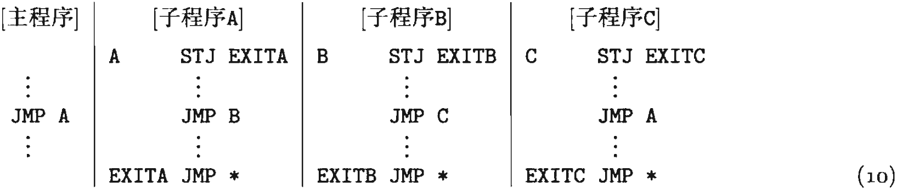

<a id="sec-1-4-1"></a>

# 1.4.1　子程序

当某个任务要在一个程序的多处执行时, 通常不应在每处重复编码. 为此, 可以把这段代码 (称为子程序) 仅存放在一个地方, 并且附加几条额外的指令, 以在子程序结束后重新正常地启动外层程序. 子程序与主程序之间转移控制的过程称为子程序连接.

为了高效完成子程序连接, 每一种计算机有其自身固有的特殊方式, 通常使用一些特别的指令. 在 MIX 中, J 寄存器就用于这个目的. 我们将基于 MIX 机器语言展开讨论, 但是类似的说明也适用于其他计算机的子程序连接.

利用程序是为了节省程序空间, 它不会节省任何时间, 不过可以通过占用较少空间而间接地节省时间. 例如, 装入程序花费时间更少, 或者程序需要扫描的遍数更少, 或者在具有多级存储器的计算机上更充分利用高速存储器. 进入及退出子程序的额外时间通常是微不足道的, 可以忽略不计.

子程序还具有其他诸多优点. 它使一个庞大而又复杂的程序具有更清晰的结构. 它构成问题整体的逻辑分割, 而这种框架通常使程序的调试更加容易. 许多子程序还具有额外的价值, 因为可以供子程序原始设计者以外的其他程序员使用.

大多数计算机装置建立了包含许许多多有用子程序的大型程序库, 极大地方便了常规计算机应用的程序设计. 然而, 程序员不应把这一点视为子程序的唯一目的. 子程序不仅包括公众均可使用的通用程序, 专用子程序同样是重要的, 即使它仅会在一个程序中出现. 1.4.3.1 节举例介绍了几个典型的子程序.

最简单的子程序要数那些仅有一个入口和一个出口的程序, 如我们已经讲述过的 MAXIMUM 子程序 (见 1.3.2 节的程序 M). 为了方便参考, 我们在这里重新写出该程序, 把它修改成搜索 100 个固定单元中的最大值.

```text
* MAXIMUM OF X[1..100]
MAX100 STJ  EXIT     子程序连接
       ENT3 100      M1. 初始化。
       JMP  2F
1H     CMPA X,3      M3. 比较。
       JGE  *+3
2H     ENT2 0,3      M4. 改变 m。
       LDA  X,3      找到新的最大值。
       DEC3 1        M5. 减小 k。
       J3P  1B       M2. 是否检验完毕？
EXIT   JMP  *        返回主程序。 ▮
```

(1)

在包含这段子程序的更大程序中, 指令 “`JMP MAX100`” 将把 A 寄存器设置为单元 X+1 到 X+100 的当前最大值, 而这个最大值的地址将出现在 rI2 中. 在这种情况下, 子程序连接是通过 “`MAX100 STJ EXIT`” 以及后面的 “`EXIT JMP *`” 这两条指令实现的. 由于 J 寄存器的操作方式, 退出子程序的出口指令随后将转移到引用 MAX100 的原指令后面一个单元.

 像 `MMIX` 这种必将取代 `MIX` 的新型计算机, 对返回地址有更好的记忆方式. 主要差别在于程序不用再修改存储器中的指令, 相关信息将保存在寄存器或者特殊的数组内, 而不是存放在程序本身中 (参见习题 7). 本书下一版将采用现代的观点, 不过我们暂时仍然沿用自修改代码这种老式作法.

<a id="pdf-168"></a><a id="p-151"></a>

利用子程序节省的代码空间和损失的时间都不难定量确定. 假定一段代码需要使用 $k$ 个单元, 它会重复出现在程序的 $m$ 处. 把这段代码改写成子程序, 我们需要一条额外的指令 STJ 以及一行出口语句, 再加上在 $m$ 处调用子程序时每次都用一条 JMP 指令. 这样给出的单元总数为 $m+k+2$ 而不是之前的 mk, 所以节省的空间总量为

$$
(m-1)(k-1)-3.
\qquad \text{(2)}
$$

如果 $k$ 为 1 或者 $m$ 为 1, 利用子程序不可能节省任何空间, 这自然是显而易见的. 如果 $k$ 为 2, $m$ 必须大于 4 才能节省空间, 等等.

损失的时间总量是花费在执行额外的 JMP、STJ 和 JMP 指令上的时间, 因为不用子程序时不会出现这 3 条指令. 因此, 如果程序在一轮运行期间调用 $t$ 次子程序, 那么需要 4t 个额外的时间周期.

这两条估计都得再打点折扣, 因为这只是理想情况. 许多子程序不能只用一条 JMP 指令调用. 此外, 如果不用子程序, 而是在程序内多处重复编码, 那么可以利用程序特定部分的具体特征, 对每一处进行定制编码. 另一方面, 如果用子程序, 那么编写代码必须考虑最一般情况而不是针对某种特殊情况, 这样通常会增加几条附加指令.

处理一般情况的子程序通常是通过参数表示的. 参数是支配子程序操作的值, 每次调用子程序, 参数取值都可能不同.

在外部程序中, 把控制转移到子程序并且使其正常启动的代码称为调用序列. 在调用子程序时提供的参数特定值称为变元 (argument). 单就我们的 MAX100 子程序而言, 调用序列只是一行 “JMPMAX100”. 但是如果必须提供变元, 一般就需要更长的调用序列. 例如, 程序 1.3.2M 是 MAX100 子程序的扩展, 它的功能是找出数值表前面 $n$ 个元素中的最大值. 参数 $n$ 出现在变址寄存器 1 中, 它的调用序列

```text
LD1  =n=          ENT1 n
JMP  MAXIMUM  或  JMP  MAXIMUM
```

包含两步操作.

如果调用序列占用 $c$ 个存储单元, 那么节省空间总量的式 (2) 变成

$$
(m-1)(k-c)-\text{常数}.
\qquad \text{(3)}
$$

子程序连接过程损失的时间也略有增加.

对于上面的节省空间和损失时间的公式, 可能需要进一步修正, 因为某些寄存器的值可能需要保留和恢复. 例如在 MAX100 子程序中, 我们必须记住, 指令 “JMPMAX100” 不仅获得寄存器 A 中最大值以及它在寄存器 I2 中的位置, 同时也把寄存器 I3 置为 0. 子程序可能破坏寄存器的内容, 这是必须牢记的. 为了防止 MAX100 改变 rI3 的值, 需要用额外的指令. 在 MIX 中最简单最快捷的方法是紧随 MAX100 之后插进指令 “ST33F(0:2)”, 然后在紧靠 EXIT 之前插进指令 “3HENT3\*”. 这样的净损失是两行额外的代码, 再加每次调用子程序时多耗用三个机器周期.

可以把子程序视为计算机的机器语言的一种扩充. 存储器中保存了 MAX100 子程序之后, 我们就有一条指令 (即 “JMPMAX100”) 用来查找最大值. 要精心地定义每个子程序的功能, 就像定义机器语言的操作符本身那样严谨. 所以, 即使没有旁人使用子程序或其说明, 程序员也务必写出每个子程序的特征. 以 1.3.2 节给出的 MAXIMUM 为例, 它的特征如下:

<a id="pdf-169"></a><a id="p-152"></a>

$$
\left.\begin{aligned}\text{调用序列:}&\quad\mathtt{JMP\ MAXIMUM}.\\\text{入口条件:}&\quad\mathrm{rI1}=n;\quad\text{假定 }n\ge1.\\\text{出口条件:}&\quad\mathrm{rA}=\max_{1\le k\le n}\mathtt{CONTENTS}(\mathtt X+k)=\mathtt{CONTENTS}(\mathtt X+\mathrm{rI2});\\&\quad\mathrm{rI3}=0;\quad\mathrm{rJ}\text{ 和 }\mathrm{CI}\text{ 也受到影响}.\end{aligned}\right\}
\qquad \text{(4)}
$$

(我们习惯上不提寄存器 J 和比较指示器 CI 会受到子程序影响的事实, 在这里提出仅仅是为了完整性.) 注意, rX 和 rI1 这两个寄存器不会受子程序操作的影响, 因为在出口条件中没有提到它们. 子程序的特征说明还应当提及可能受它影响的所有外部存储单元. 本例的特征说明使我们能够断定, 没有在存储器保存别的数据, 因为在 (4) 中没有指出关于存储器的任何改变.

现在让我们来考虑子程序的多重入口问题. 假定有一个程序, 它需要调用通用子程序 MAXIMUM, 但是时常是要用到 MAX100 这个 $n=100$ 的特例. 那么, 这两个子程序可以结合如下:

```text
MAX100 ENT3 100     第一个入口
MAXN   STJ  EXIT    第二个入口
       JMP  2F      继续，类似 (1)。
...
EXIT   JMP  *       返回主程序。
```

(5)

子程序 (5) 实际上与 (1) 相同, 只是交换了前面两条指令. 这里利用了 “ENT3” 不改变 J 寄存器中的值的事实. 如果我们还想对这个子程序添加第三个入口 MAX50, 可以在开始处插入代码

```text
MAX50  ENT3 50
       JSJ  MAXN
```

(6)

(回忆一下, “JSJ” 是指不改变 J 寄存器的转移.)

当参数的数目不多时, 为了把它们传送给子程序, 我们通常希望将它们要么放进方便的寄存器 (如 MAXN 用 rI3 保存参数 $n$, MAXIMUM 用 rI1 保存参数 $n$), 要么存入固定存储单元.

另外一种提供变元的简便方法, 是把它们罗列在 JMP 指令的后面. 由于子程序知道 J 寄存器中的地址值, 它能够正确访问参数. 例如, 如果我们打算把

```text
       JMP  MAXN
       CON  n
```

(7)

作为 MAXN 的调用序列, 那么可以把这个子程序写成下述形式:

```text
MAXN   STJ  *+1
       ENT1 *       rI1 ← rJ。
       LD3  0,1     rI3 ← n。
       JMP  2F      继续，同 (1)。
...
       J3P  1B
       JMP  1,1     返回。
```

(8)

对于像 System/360 那样的计算机, 子程序连接一般通过把出口地址存入变址寄存器来实现, 因此这种约定是特别方便的, 如果子程序需要很多变元, 或者程序由编译器写成, 这种方法也是很有用的. 不过, 上面使用的多重入口方法在这种情况经常失效. 我们可以编写 “伪装” 代码

$$
\begin{aligned}& MAX 100 \  STJ  & & \quad \downarrow  F  \\& & \quad  JMP  & & \quad  MAXN  \\& & \quad  CON  & & \quad 100 \\& CH  & & \quad  JMP  & & \quad * & \quad  H \end{aligned}
$$

但是这不如子程序 (5) 那么有吸引力.

<a id="pdf-170"></a><a id="p-153"></a>

有一种类似于在转移指令后面列出变元的方法, 通常用于多重出口子程序. 多重出口意味着子程序要依据检测到的条件, 返回到若干不同的单元之一. 在最严格的意义下, 子程序退出后返回的单元是一个参数, 所以如果它要在多个单元中根据情况选择一个出口, 那么应当把这些单元作为变元提供. 我们的最后一版 “最大值” 子程序, 将有两个入口和两个出口. 调用序列为:

| 对于一般的 $n$ | 对于 $n=100$ |
| :--- | :--- |
| `ENT3 n` | |
| `JMP MAXN` | `JMP MAX100` |
| 如果 $\max\le0$ 或 $\max\ge\mathrm{rX}$, 在此退出. | 如果 $\max\le0$ 或 $\max\ge\mathrm{rX}$, 在此退出. |
| 如果 $0<\max<\mathrm{rX}$, 在此退出. | 如果 $0<\max<\mathrm{rX}$, 在此退出. |

(换句话说, 当最大值是正数而且小于寄存器 X 中的值时, 出口是在转移指令之后数两个单元的位置.) 具有这些条件的子程序是很容易编写的:

```text
MAX100 ENT3 100     n = 100 的入口
MAXN   STJ  EXIT    一般的 n 的入口
       JMP  2F      继续，同 (1)。
...
       J3P  1B
       JANP EXIT    如果最大值 ≤ 0，正常退出。
       STX  TEMP
       CMPA TEMP
       JGE  EXIT    如果最大值 ≥ rX，正常退出。
       ENT3 1       否则从第二个出口退出。
EXIT   JMP  *,3     返回到合适的位置。
```

(9)

子程序可以调用其他子程序. 在复杂的程序中, 子程序嵌套调用 5 层以上并不是罕事. 在使用这里描述的子程序连接方式时, 必须遵守的唯一限制是子程序不能对调用它的其他子程序反过来 (直接或间接地) 调用. 例如, 考虑下面的情况:



如果主程序调用子程序 A, A 调用子程序 B, B 调用子程序 C, 而 C 又调用子程序 A, 就会破坏原来保存在 EXITA 的访问主程序的地址引用, 于是无法再返回主程序. 同样的说明也适用于每个子程序使用的所有临时存储单元和寄存器. 不难设计子程序连接的约定, 使之能够正确处理这类递归调用情况. 第 8 章将详细考察递归问题.

最后, 我们简要讨论一下怎样编写非常长的复杂程序. 怎样判断需要什么类型的子程序? 如何确定应当使用何种调用序列? 一个行之有效的解决方法是利用迭代过程.

第 0 步 (初步想法). 首先大致确定编写这个程序采用的总体解决方案.

第 1 步 (程序的粗略方案). 现在我们开始用任何一种方便的语言编写程序的若干 “外层” 结构. 这一步有一定的系统化方法可循, 戴克斯特拉 [StructuredProgramming(AcademicPress,1972), Chapter1] 和尼古拉斯·沃斯 [CACM14(1971), 221-227] 都有非常精彩的描<a id="pdf-171"></a><a id="p-154"></a>述. 我们可以先把整个程序分割成为数不多的代码段, 不妨暂时把它们理解为子程序, 尽管它们仅被调用一次. 随后逐步把这些代码段细分为越来越小的部分, 相应执行越来越简单的任务. 每当某个计算任务看上去很可能或确实已经在别的地方出现时, 我们就真正定义一个执行该任务的子程序. 我们暂时不编写这个子程序, 而是假定它能执行任务, 继续编写主程序. 最后, 写出主程序的初稿之后, 我们再依次处理每个子程序, 并且力求首先编写最复杂的子程序, 然后处理子程序的子程序, 等等. 通过这种方式, 我们将获得一系列子程序. 每个子程序的功能或许已经经过多次改动, 所以程序初稿的开始部分可能会不太正确, 但是没关系, 因为那仅仅是粗略方案. 到这一步, 对于每个子程序应该怎么调用, 应当有多么通用, 我们都有了比较成熟的想法. 通常最好对每个子程序的通用性稍稍放宽一些.

第 2 步 (第一个可用程序). 这一步跟第一步的方向相反. 现在我们用计算机语言编写程序, 例如用 MIXAL 或 PL/MIX, 或者一种高级语言. 这次从最底层的子程序开始, 到最后才编写主程序. 在一个子程序完成编码之前, 尽量不写调用它的任何指令. (第 1 步的做法恰恰相反, 是直到一个子程序的所有调用都写出以后才考虑它的编码.)

在这个过程中, 我们编写出越来越多的子程序, 信心也逐步增强, 因为计算机的能力在不断拓展扩充. 当写出一个独立的子程序的代码后, 我们应该立即为它提供完备的描述, 像 (4) 那样列出它的功能和调用序列. 不要覆盖程序中的临时存储单元, 这也是很重要的. 如果每个程序都要访问 TEMP 单元, 很可能造成灾难性的后果, 虽然在第 1 步准备方案时完全可以不考虑这样的问题. 为了排除覆盖存储单元的隐患, 明显可以让每个子程序只使用单独的临时存储空间. 如果这种作法过于浪费空间, 那么可以采用另外一种可取的方案, 就是把临时存储单元命名为 TEMP1,TEMP2, 等等. 在一个子程序内, 存储单元的编号从 TEMPj 开始, 其中 $j$ 等于这个子程序所调用的所有次级子程序使用的最大号码再加 1.

第 3 步 (重新检验). 第 2 步的结果应当是一个基本可用的程序, 或许还有改进空间. 一个好的办法是再度反过来研究对每个子程序的所有调用. 可能应当扩充子程序的功能, 使其能够执行外层程序常常在调用它前后完成的一般任务. 或许应当把几个子程序合并成一个; 或许有的子程序仅被调用一次, 完全不应作为子程序. (或许有的子程序完全不被调用, 可以整个删除.)

在这一阶段, 舍弃一切并回到第 1 步从头开始常常是明智的! 这并非戏言. 之前的工夫不会白费, 因为我们已经借此加深了对于待解决问题的理解. 写完程序之后, 我们或许发现可以对程序的总体结构做出若干改进. 没有理由害怕回到第 1 步, 再次通过第 2 步和第 3 步变得容易多了, 因为已经编写了一个类似的程序. 此外, 重写程序所有代码花的时间很可能不亚于以后节省的调试时间. 历史上某些最出色的计算机程序之所以成功, 在很大程度上应归功于意外: 大约在这一阶段, 全部作品无意间付之东流, 导致作者不得不重新开始.

另一方面, 也许无论怎么改进复杂的计算机程序, 总是还有改进的余地, 所以第 1 步和第 2 步不要无休止地重复下去. 在明显可以做出重大改进的时候, 是值得再花时间重新开始的. 但是终究要到达收益转为递减的时刻, 那时就不必费力从头再来了.

第 4 步 (调试). 在程序的最后加工 (可能包括存储分配之类的细节收尾处理) 之后, 我们应该换个角度, 从不同于前三步的新方向进行检查—研究程序在计算机中的实际执行顺序. 自然, 这可以人工进行, 也可以通过机器进行. 我发现, 这时使用系统例程追踪每条指令的头两次执行情况是非常有帮助的. 重要的是重新思考程序的基本思想, 确认一切事项都符合预期效果.

调试程序是一门技艺, 它需要进行很深入的研究, 而且采用的方法高度依赖于具体的计算机装置可以使用的工具. 进行有效调试的良好开端通常是准备适宜的检验数据. 最有效的调试方法大概是在程序内部精心设计构建的方法, 当今许多顶尖程序员几乎会把程序的一半代码用<a id="pdf-172"></a><a id="p-155"></a>于辅助另外一半代码的调试进程. 前面这一半代码通常是以可读格式显示相关信息的简单例程, 它们最终将被删掉, 但是最终结果是在生产效率上获得意想不到的增益.

另外一种良好的调试习惯是把每次产生的错误都记录下来. 虽然记录自己的错误可能是非常难堪的事情, 但是对于任何研究调试问题的人而言, 这样的信息是很有价值的, 而且它还会帮助你学习如何减少将来的错误.

注记: 我于 1964 年写好了上面的大部分评述, 其时我虽已圆满完成多个中型软件项目, 尚未建立成熟的程序设计风格. 随后, 我在 20 世纪 80 年代认识到, 另外一种称为结构化文档编制或者文化程序设计 (literateprogramming)[^cn172-1] 的技术可能更为重要. 在初版于 1992 年的《文化程序设计》[Literate Programming(Cambridge Univ. Press)] 一书中, 我概述了自己最推崇的这一程序设计方法的最新观点. 顺便说一下, 该书的第 11 章详细记录了 1978 年至 1991 年期间从 TEX 程序中排除的所有错误.

在一定程度上, 最好让错误留在程序里, 而不是

耗费大量时间设计完全无误的程序.

(完成这样的设计要用多少年?)

—图灵, ProposalsforACE (关于自动计算机的建议, 1945)

#### 习题

1\. [10] <a id="ex-1-4-1-1"></a>[答案](./answers/1-4-1.md#ans-1-4-1-1) (4) 给出了子程序 1.3.2M 的特征. 请同样说明子程序 (5) 的特征.

2\. [10] <a id="ex-1-4-1-2"></a>[答案](./answers/1-4-1.md#ans-1-4-1-2) 提出代替 (6) 的代码, 其中不使用 JSJ 指令.

3\. [M15] <a id="ex-1-4-1-3"></a>[答案](./answers/1-4-1.md#ans-1-4-1-3) 补充 (4) 中的信息, 确切说明子程序 MAXIMUM 导致寄存器 J 和比较指示器 CI 发生什么变化, 并说明当寄存器 I1 不取正值时发生什么变化.

▶ 4. [21] <a id="ex-1-4-1-4"></a>[答案](./answers/1-4-1.md#ans-1-4-1-4) 编写一个子程序, 找出 x[$a$], X[a+r],X[$a$+2r],...,X[$n$] 的最大值, 推广 MAXN, 其中 $r$ 和 $n$ 是参数, 而 $a$ 是满足 $a \equiv n \;( \mathrm { m o d u l o } \; r )$ 的最小正数, 即 $a=1+(n-1)\bmod r$. 对于 $r= 1$ 的情况, 给出一个特别的入口. 像 (4) 那样列出你的子程序的特征.

5\. [21] <a id="ex-1-4-1-5"></a>[答案](./answers/1-4-1.md#ans-1-4-1-5) 假设 MIX 没有 J 寄存器. 创造一种不用 J 寄存器的子程序连接方法, 并且通过编写与 (1) 等效的 MAX100 子程序, 举例说明这种新方法. 用类似于 (4) 的方式说明这个子程序的特征. (保留 MIX 关于自修改代码的约定.)

▶ 6. [26] <a id="ex-1-4-1-6"></a>[答案](./answers/1-4-1.md#ans-1-4-1-6) 假设 MIX 没有 MOVE 操作符. 编写一个名为 MOVE 的子程序, 要求调用序列 “JMP MOVE;NOP A,I(F)” 等效于原本的指令 “MOVEA,I(F)”. 两者之间的差别仅在于寄存器 J 的结果, 以及子程序自然会比机器 指令耗费更多时间和空间的事实.

7\. [20] <a id="ex-1-4-1-7"></a>[答案](./answers/1-4-1.md#ans-1-4-1-7) 为什么现在不建议用自修改代码?

[^cn172-1]: 又译为文艺编程或文学化编程, 指的是将编程过程视为文艺创作, 像作家一样为读者编写清晰优美易读的文档. —— 编者注
