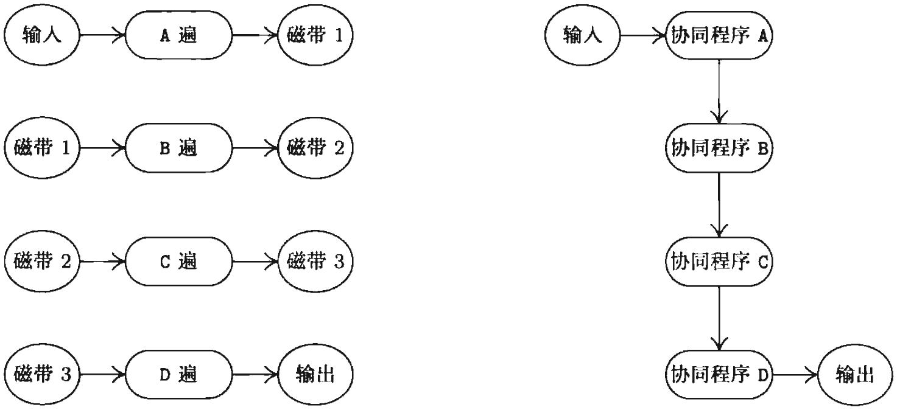

<a id="sec-1-4-2"></a>

# 1.4.2 协同程序

子例程属于一类更一般的程序组件—协同程序, 简称协程. 主程序与子程序之间的关系是非对称的; 与此相反, 协同程序彼此之间的关系是完全对称的, 因为它们相互调用.

为了理解协同程序的概念, 让我们考虑另外一种理解子程序的方式. 在前一小节, 我们把它当作计算机硬件的一种扩充, 仅仅用来节省代码行. 事实或许如此, 但是我们也可以采纳另外一种观点, 把主程序和子程序视为一个程序组, 这组程序中的每个成员要完成一项特定的作业. 主程序在完成作业的过程中需要激活子程序; 子程序将执行它自己的任务, 然后激活主程序. 我们可以充分想象, 从子程序的角度来看, 不妨认为当它退出时, 它也在调用主程序; 主程序继续履行自己的责任, 然后 “退出” 到子程序. 子程序接着执行任务, 然后再调用主程序.


<a id="pdf-173"></a><a id="p-156"></a>

这种带有几分牵强的观点其实表达了协同程序的关系, 因为在两个协同程序之间, 不可能区分哪个是哪个的子程序. 假定我们有两个协同程序 A 和 B, 当设计 A 时, 我们可以把 B 看成子程序; 而在设计 B 时, 可以把 A 看成子程序. 就是说, 协同程序 A 用指令 “JMPB” 激活协同程序 B, 协同程序 B 用指令 “JMPA” 激活协同程序 A. 每当一个协同程序被激活时, 它就在上次操作中断的位置恢复程序执行.

例如, 协同程序 A 和 B 可以是两个下国际象棋的程序. 我们可以把两个程序结合起来, 使它们相互对弈.

对于 MIX 计算机, 协同程序 A 和 B 之间的这种连接是通过在程序中写进下面 4 条指令实现的:

```text
A   STJ  BX        B   STJ  AX
AX  JMP  A1        BX  JMP  B1
```

(1)

这种情况下, 每次控制转移需要 4 个机器周期. 开始时 AX 和 BX 被设置为转移到相应协同程序的起始位置 A1 和 B1. 假定我们首先在单元 A1 启动协同程序 A, 比如说当它在单元 A2 执行 “JMPB” 时, 在单元 B1 的指令把 rJ 存入 AX, 然后执行 “JMPA2+1”. BX 中的指令使我们转移到单元 B1, 然后协同程序 B 开始执行, 最终会在某个单元 B2 到达指令 “JMPA2”. 我们把 rJ 存入 BX, 并且转移到单元 A2+1, 继续执行协同程序 A, 直到它再次转移到 B, B 把 rJ 存入 AX, 并且转移到 B2+1, 如此重复.

通过研究上面的例子可以看出, 主程序与子程序之间的连接同协同程序与协同程序之间的连接的本质差别在于: 子程序始终从头启动, 通常有固定的起始位置; 主程序和协同程序则始终在它上次终止处的下一个位置启动.

在实际应用中, 协同程序最自然地出现在它们同输入和输出算法相联系的时候. 例如, 假定协同程序 A 的功能是读入一些穿孔卡片, 并且对输入数据执行某种变换, 把它转化为一连串数据项. 另外一个我们称之为 B 的协同程序对这些数据项做进一步处理, 并且打印答案. B 将周而复始地请求由 A 获得的相继输入项. 于是, 协同程序 B 每当需要下一个输入项时就转移到 A, 而协同程序 A 每当获得一个输入项时就转移到 B. 读者也许会说: “啊, B 就是主程序, 而 A 只不过是执行输入任务的一个子程序而已.” 但是, 假如处理过程 A 非常复杂, 这种看法就不太合适了. 实际上, 我们也可以把 A 想象成主程序, 而 B 则是执行输出任务的一个子程序, 这时上面的描述仍然是有效的. 如果介于两种极端情况之间, 也就是说 A 和 B 都是很复杂的程序, 而且每个程序都在多处地方调用另外一个程序, 那么协同程序的概念就显得很有用了. 要想用简单例子说明协同程序概念的重要性是颇为困难的, 因为最有用的协同程序的应用通常都非常冗长.

为了研究协同程序的实际执行过程, 我们考察一个假想的例子. 假定我们需要编写一个程序, 把一种代码转换成另一种代码; 待转换的输入代码是一串字母数字字符, 最后是一个半角英文句点, 如

```text
A2B5E3426FG0ZYW3210PQ89R.
```

(2)

这个字符序列已经穿孔到卡片上, 应忽略卡片上出现的空格列. 应该按照下述方式从左到右理解输入: 如果下一个字符是 0,1,...,9 之中的一个数字, 比如说是 $n$, 那么它表示其后的字符重复 ($n+1$) 次, 不管后面那个字符是数字还是字母. 一个非数字字符就表示它自己. 程序的输出是按这种方式产生的字符序列, 要求每 3 个字符分隔成一组, 直到出现句点. 最后一组可能不足 3 个字符. 例如, 程序应当把字符序列 (2) 转换成

```text
ABB BEE EEE E44 446 66F GZY W22 220 0PQ 999 999 999 R.
```

(3)

<a id="pdf-174"></a><a id="p-157"></a>

注意序列中的 `3426F` 并不意味着字母 F 重复 3427 次. 它的含义是 4 个 4 后面接 3 个 6, 后面再接 1 个 F. 如果输入序列为 “`1.`”, 那么输出就是简单的 “`.`” 而不是 “`..`”, 因为第一个句点终结输出. 我们的程序应当把输出穿孔到卡片上, 每张卡片上包含 16 组三个一组的字符, 最后一张卡片可能例外.

为了完成这种转换, 我们要编写两个协同程序和一个子程序. 这个子程序称为 `NEXTCHAR`, 用来寻找输入中的非空格字符, 并且把下一个这样的字符存入寄存器 A 中:

| 行号 | LOC | OP | ADDRESS | 注释 |
| ---: | :--- | :--- | :--- | :--- |
| 01 | `*` |  |  | SUBROUTINE FOR CHARACTER INPUT |
| 02 | `READER` | `EQU` | `16` | 卡片阅读机的设备号 |
| 03 | `INPUT` | `ORIG` | `*+16` | 输入卡片的位置 |
| 04 | `NEXTCHAR` | `STJ` | `9F` | 子例程入口 |
| 05 |  | `JXNZ` | `3F` | 初始 $\mathrm{rX}=0$ |
| 06 | `1H` | `J6N` | `2F` | 初始 $\mathrm{rI6}=0$ |
| 07 |  | `IN` | `INPUT(READER)` | 读下一张卡片. |
| 08 |  | `JBUS` | `*(READER)` | 等待完成. |
| 09 |  | `ENN6` | `16` | 令 $\mathrm{rI6}$ 指向第一个字. |
| 10 | `2H` | `LDX` | `INPUT+16,6` | 取输入的下一个字。 |
| 11 |  | `INC6` | `1` | 指针推进。 |
| 12 | `3H` | `ENTA` | `0` |  |
| 13 |  | `SLAX` | `1` | 下一个字符 $\to\mathrm{rA}$. |
| 14 | `9H` | `JANZ` | `*` | 跳过空格字符. |
| 15 |  | `JMP` | `NEXTCHAR+1` | ▮ |

<details>
<summary>MIXAL 等宽清单</summary>

```text
* SUBROUTINE FOR CHARACTER INPUT
READER    EQU   16
INPUT     ORIG  *+16
NEXTCHAR  STJ   9F
          JXNZ  3F
1H        J6N   2F
          IN    INPUT(READER)
          JBUS  *(READER)
          ENN6  16
2H        LDX   INPUT+16,6
          INC6  1
3H        ENTA  0
          SLAX  1
9H        JANZ  *
          JMP   NEXTCHAR+1
```

</details>

这个子程序具有下述特征:

| | |
| :--- | :--- |
| 调用序列 | `JMP NEXTCHAR`。 |
| 入口条件 | $\mathrm{rX}={}$ 待处理的字符; $\mathrm{rI6}$ 指向下一个字, 若 $\mathrm{rI6}=0$ 指示必须读入一张新卡片. |
| 出口条件 | $\mathrm{rA}={}$ 输入的下一个非空格字符; $\mathrm{rX}$ 和 $\mathrm{rI6}$ 被设置为 `NEXTCHAR` 的下一个入口. |

我们的第一个协同程序称为 `IN`, 它寻找输入代码中具有特定重复数的字符. 它最初从单元 `IN1` 开始:

| 行号 | LOC | OP | ADDRESS | 注释 |
| ---: | :--- | :--- | :--- | :--- |
| 16 | `*` |  |  | FIRST COROUTINE |
| 17 | `2H` | `INCA` | `30` | 找到非数字字符. |
| 18 |  | `JMP` | `OUT` | 把它送到 `OUT` 协同程序。 |
| 19 | `IN1` | `JMP` | `NEXTCHAR` | 获取字符。 |
| 20 |  | `DECA` | `30` |  |
| 21 |  | `JAN` | `2B` | 是字母吗? |
| 22 |  | `CMPA` | `=10=` |  |
| 23 |  | `JGE` | `2B` | 是特殊字符吗? |
| 24 |  | `STA` | `*+1(0:2)` | 找到数字 $n$。 |
| 25 |  | `ENT5` | `*` | $\mathrm{rI5}\leftarrow n$. |
| 26 |  | `JMP` | `NEXTCHAR` | 获取下一个字符。 |
| 27 |  | `JMP` | `OUT` | 把它送到 `OUT` 协同程序。 |
| 28 |  | `DEC5` | `1` | $n$ 减少 1。 |
| 29 |  | `J5NN` | `*-2` | 在需要时重复. |
| 30 |  | `JMP` | `IN1` | 开始新的循环。　▮ |

<details>
<summary>MIXAL 等宽清单</summary>

```text
* FIRST COROUTINE
2H        INCA  30
          JMP   OUT
IN1       JMP   NEXTCHAR
          DECA  30
          JAN   2B
          CMPA  =10=
          JGE   2B
          STA   *+1(0:2)
          ENT5  *
          JMP   NEXTCHAR
          JMP   OUT
          DEC5  1
          J5NN  *-2
          JMP   IN1
```

</details>

<a id="pdf-175"></a><a id="p-158"></a>

(回忆 MIX 的字符代码, 数字 0–9 的代码为 30–39.) 这个协同程序具有下述特征:

| | |
| :--- | :--- |
| 调用序列 | `JMP IN`。 |
| 出口条件 (当转移到 `OUT` 时) | $\mathrm{rA}={}$ 输入中具有特定重复数的下一个字符; $\mathrm{rI4}$ 在进入时的值保持不变. |
| 入口条件 (当返回时) | $\mathrm{rA}$、$\mathrm{rX}$、$\mathrm{rI5}$、$\mathrm{rI6}$ 在上次退出时的值应该保持不变. |

对应的另一个协同程序称为 `OUT`, 它把代码分成三个一组的字符组, 并且穿孔到卡片上. 这个程序最初从 `OUT1` 开始:

| 行号 | LOC | OP | ADDRESS | 注释 |
| ---: | :--- | :--- | :--- | :--- |
| 31 | `*` |  |  | SECOND COROUTINE |
| 32 |  | `ALF` | <code style="white-space:pre">     </code> | 用于填空格的常数 |
| 33 | `OUTPUT` | `ORIG` | `*+16` | 保存答案的缓冲区 |
| 34 | `PUNCH` | `EQU` | `17` | 卡片穿孔机的设备号 |
| 35 | `OUT1` | `ENT4` | `-16` | 开始新的输出卡片. |
| 36 |  | `ENT1` | `OUTPUT` |  |
| 37 |  | `MOVE` | `-1,1(16)` | 输出区域填入空格. |
| 38 | `1H` | `JMP` | `IN` | 取下一个转换的字符。 |
| 39 |  | `STA` | `OUTPUT+16,4(1:1)` | 把它存入 `(1:1)` 字段。 |
| 40 |  | `CMPA` | `PERIOD` | 是“.”吗? |
| 41 |  | `JE` | `9F` |  |
| 42 |  | `JMP` | `IN` | 如果不是，取下一个字符。 |
| 43 |  | `STA` | `OUTPUT+16,4(2:2)` | 把它存入 `(2:2)` 字段。 |
| 44 |  | `CMPA` | `PERIOD` | 是“.”吗? |
| 45 |  | `JE` | `9F` |  |
| 46 |  | `JMP` | `IN` | 如果不是，取下一个字符。 |
| 47 |  | `STA` | `OUTPUT+16,4(3:3)` | 把它存入 `(3:3)` 字段。 |
| 48 |  | `CMPA` | `PERIOD` | 是“.”吗? |
| 49 |  | `JE` | `9F` |  |
| 50 |  | `INC4` | `1` | 移动到输出缓冲区的下一个字。 |
| 51 |  | `J4N` | `1B` | 卡片是否结束? |
| 52 | `9H` | `OUT` | `OUTPUT(PUNCH)` | 如果结束, 对它穿孔. |
| 53 |  | `JBUS` | `*(PUNCH)` | 等待完成. |
| 54 |  | `JNE` | `OUT1` | 返回取其余字符, 除非 |
| 55 |  | `HLT` |  | 检测到“.”. |
| 56 | `PERIOD` | `ALF` | <code style="white-space:pre">    .</code> | ▮ |

<details>
<summary>MIXAL 等宽清单</summary>

```text
* SECOND COROUTINE
          ALF        
OUTPUT    ORIG  *+16
PUNCH     EQU   17
OUT1      ENT4  -16
          ENT1  OUTPUT
          MOVE  -1,1(16)
1H        JMP   IN
          STA   OUTPUT+16,4(1:1)
          CMPA  PERIOD
          JE    9F
          JMP   IN
          STA   OUTPUT+16,4(2:2)
          CMPA  PERIOD
          JE    9F
          JMP   IN
          STA   OUTPUT+16,4(3:3)
          CMPA  PERIOD
          JE    9F
          INC4  1
          J4N   1B
9H        OUT   OUTPUT(PUNCH)
          JBUS  *(PUNCH)
          JNE   OUT1
          HLT
PERIOD    ALF       .
```

</details>

这个协同程序具有下述特征:

| | |
| :--- | :--- |
| 调用序列 | `JMP OUT`。 |
| 出口条件 (当转移到 `IN` 时) | $\mathrm{rA}$、$\mathrm{rX}$、$\mathrm{rI5}$、$\mathrm{rI6}$ 在进入时的值保持不变; $\mathrm{rI1}$ 可能受到影响; 前面一个字符记录在输出中. |
| 入口条件 (当返回时) | $\mathrm{rA}={}$ 输入中具有特定重复数的下一个字符; $\mathrm{rI4}$ 在上次退出时的值应该保持不变. |

<a id="pdf-176"></a><a id="p-159"></a>

为了完成程序, 我们需编写协同程序链接的代码 (见 (1)), 并且提供合适的初始值. 协同程序的初始化并不困难, 但是多半需要一些技巧.

| 行号 | LOC | OP | ADDRESS | 注释 |
| ---: | :--- | :--- | :--- | :--- |
| 57 | `*` |  |  | INITIALIZATION AND LINKAGE |
| 58 | `START` | `ENT6` | `0` | 为 `NEXTCHAR` 初始化 $\mathrm{rI6}$. |
| 59 |  | `ENTX` | `0` | 为 `NEXTCHAR` 初始化 $\mathrm{rX}$. |
| 60 |  | `JMP` | `OUT1` | 从 `OUT` 开始（见习题 2）。 |
| 61 | `OUT` | `STJ` | `INX` | 子程序连接 |
| 62 | `OUTX` | `JMP` | `OUT1` |  |
| 63 | `IN` | `STJ` | `OUTX` |  |
| 64 | `INX` | `JMP` | `IN1` |  |
| 65 |  | `END` | `START` | ▮ |

<details>
<summary>MIXAL 等宽清单</summary>

```text
* INITIALIZATION AND LINKAGE
START     ENT6  0
          ENTX  0
          JMP   OUT1
OUT       STJ   INX
OUTX      JMP   OUT1
IN        STJ   OUTX
INX       JMP   IN1
          END   START
```

</details>

这样程序就编写完了. 读者对这个程序应当仔细研究, 特别是注意每个协同程序都能够独立地编写, 仿佛另一个协同程序是它的子程序.

在上述程序中, 协同程序 `IN` 和 `OUT` 的入口条件和出口条件彼此完全吻合. 但是在一般情况下, 我们不会有这么幸运, 协同程序链接还要包含用于装入和存储特定寄存器的指令. 例如, 如果 `OUT` 会破坏寄存器 A 的内容, 那么要把协同程序链接改变为

```text
OUT   STJ  INX
      STA  HOLDA   当离开 IN 时存储 A。
OUTX  JMP  OUT1
IN    STJ  OUTX
      LDA  HOLDA   当离开 OUT 时恢复 A。
INX   JMP  IN1     ▮
```

(4)

在协同程序与多遍算法之间存在一种重要的关联. 例如我们刚描述的转换过程可以分成两遍处理完成: 第一遍仅执行 `IN` 协同程序, 把它用于整个输入, 并且把每个字符按照相应的重复数写到磁带上. 结束后倒带, 接着在第二遍仅执行 `OUT` 协同程序, 从磁带读入那些三个一组的字符组. 这种作法称为 “两遍” 过程. (从直观上看, 所谓一 “遍” 表示对输入的一次完整的扫描. 这个定义并不是精确的, 在很多算法中需用的遍数也不是完全明确的. 但是 “遍” 的直观概念虽然含糊, 却很有用.)

[图 22](#fig-1-22) (a) 说明一个 4 遍过程. 我们经常会发现, 如果用 4 个协同程序 A, B, C, D 分别取代 A, B, C, D 这 4 遍程序, 那么仅用一遍就可以完成同样的过程, 如 [图 22](#fig-1-22) (b) 所示. 当 A 遍把输出的一项写到磁带 1 时, 协同程序 A 在将对应的时刻转移到 B; 当 B 遍要从磁带 1 读入输入的一项时, 协同程序 B 将在此时转移到 A; 当 B 遍要把输出的一项写到磁带 2 时, 协同程序 B 将转移到 C; 等等. 使用 UNIX<sup>®</sup> 操作系统的用户会认出, 这就像是一个 “管道”(pipe), 可以用 “`PassA | PassB | PassC | PassD`” 表示. B, C, D 这三遍的对应程序有时称为 “过滤器”(filter).

反过来, 由 $n$ 个协同程序完成的过程通常能够转换成一个 $n$ 遍过程. 由于这种对应关系, 很值得对多遍算法与一遍算法进行比较.

(a)**心理差别.** 就同一问题而言, 多遍算法通常比一遍算法更容易建立, 也更好理解. 把一个过程分解成一系列更小的一个接一个的处理步骤, 比很多转换同时发生的复杂过程更容易领会.

此外, 如果要处理的是一个非常大的问题, 或者是由许多人合作编写一个计算机程序, 那么一个多遍算法对于作业的划分提供一种自然的方式.

<a id="pdf-177"></a><a id="p-160"></a>

<a id="fig-1-22"></a>



*图 22　遍数: (a) 4 遍算法; (b) 1 遍算法*

多遍算法的这些优点在协同程序中也是存在的, 因为每个协同程序实际上可以单独编写, 而协同程序链接使表面上的多遍算法变成了一遍过程.

(b) 时间差别. 多遍算法处理流动的中间数据 (例如 [图22](#fig-1-22) 中磁带上的信息) 需要组装、写、读和分拆的时间, 而一遍算法不需要这些时间, 因此速度更快.

(c) 空间差别. 一遍算法需要把所有程序同时保存在存储器中, 而多遍算法仅需一次保存一个程序. 这种需求对于速度的影响甚至比 (b) 中所述的影响更大. 例如, 许多计算机有一个较小的 “快速存储器” 和一个很大的 “慢速存储器”. 如果每遍程序刚好能够完全容纳在快速存储器中, 那么多遍算法比我们在一遍算法中使用协同程序的结果会快得多 (因为使用协同程序可能迫使程序的大部分出现在慢速存储器中, 或者不断地在快速和慢速存储器之间交换).

有时需要同时为多种计算机配置设计算法, 而不同的配置拥有不同大小的存储容量. 在这样的情况下, 可以采用协同程序的方式编写程序, 以存储器的大小决定遍数: 同时装入的协同程序应该尽量多, 并且对于剩下的部分提供输入或输出子程序.

尽管协同程序同遍数之间的这种关系是很重要的, 但是我们仍然应该牢记: 协同程序的应用有时无法分割成多遍算法. 如果协同程序 B 从协同程序 A 获得输入, 再把关键信息传送回 A, 如前面提到的国际象棋对弈, 那么不可能把这个操作序列转换成 A 遍后面跟着 B 遍的算法.

反过来, 某些多遍算法显然不能转换成协同程序. 有的算法是固有的多遍算法, 例如第二遍可能需要从第一遍累积信息 (如某个字在输入中出现的总次数). 关于这一点, 值得提到一则古老的笑话.

搭公交车的老太太: “小朋友, 能告诉我去帕萨迪纳大街该在哪站下车吗?”

小男孩: “看着我就行, 在我下车前两站你就下车.”

(好笑之处在于小男孩给出一个两遍算法.)

关于多遍算法就谈到这里. 我们会在本书的许多地方见到协同程序的其他例子, 例如在 1.4.4 节中作为输入和输出缓冲方案的一部分. 协同程序在离散系统模拟中也起到重要作用, 参见 2.2.5 节. 复制协同程序的重要思想在第 8 章讨论, 而这种思想的某些有趣的应用可以从第 10 章找到.

#### 习题

1\. [10] <a id="ex-1-4-2-1"></a>[答案](./answers/1-4-2.md#ans-1-4-2-1) 说明为什么教科书作者很难找到简短的协同程序的例子.

<a id="pdf-178"></a><a id="p-161"></a>

▶ 2. [20] <a id="ex-1-4-2-2"></a>[答案](./answers/1-4-2.md#ans-1-4-2-2)  正文中的程序首先启动协同程序 OUT. 假如首先执行协同程序 IN, 也就是把第 60 行的指令 “JMPOUT1” 改成 “JMPIN1”, 那么会发生什么情况?

3\. [20] <a id="ex-1-4-2-3"></a>[答案](./answers/1-4-2.md#ans-1-4-2-3) 判断真假: OUT 内的三条 “CMPAPERIOD” 指令可以全部省略, 程序照样可以正常执行. (仔细观 察.)

4\. [20] <a id="ex-1-4-2-4"></a>[答案](./answers/1-4-2.md#ans-1-4-2-4) 对于你所熟悉的实际计算机, 说明怎样给出类似于 (1) 的协同程序链接.

5\. [15] <a id="ex-1-4-2-5"></a>[答案](./answers/1-4-2.md#ans-1-4-2-5) 假定协同程序 IN 和 OUT 都要求寄存器 A 的内容在进入和退出之间原封不动; 换句话说, 假定无论 “JMPIN” 指令出现在例程 OUT 内的什么地方, 当控制返回到下一行时寄存器 A 的内容都仍然不变, 并且对于程序 IN 中的 “JMPOUT” 指令做同样的假定. 在这种情况下需要什么样的协同程序链接? (同 (4) 做比较.)

6\. [22] <a id="ex-1-4-2-6"></a>[答案](./answers/1-4-2.md#ans-1-4-2-6) 对于三个协同程序 A,B,C 的情况, 给出与 (1) 类似的协同程序链接, 每个例程都可以转移到其他两个例程中的任何一个. (每当一个协同程序被启动时, 它从上次退出的地方开始执行.)

7\. [30] 编写一个 MIX 程序, 完成正文中程序所做字符串转换的逆转换, 也就是把 (3) 那样的穿孔卡片转换成像 (2) 那样的穿孔卡片. 输出应当是一个尽可能短的字符串, 因此在 (2) 中 Z 之前的 0 实际不会由 (3) 产生.
