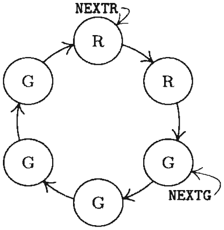
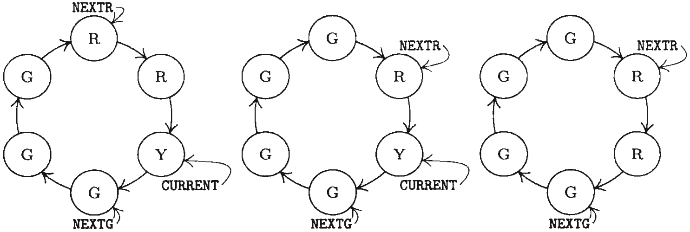
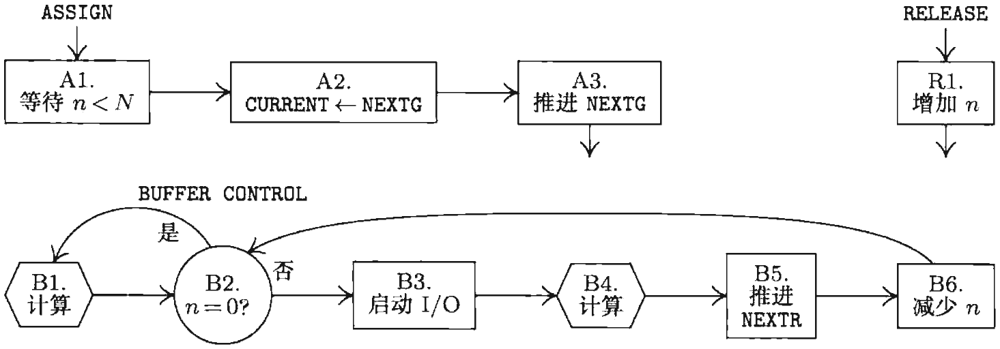
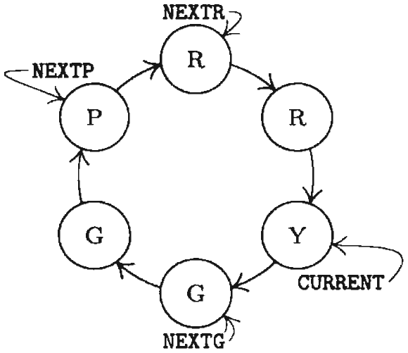

<a id="sec-1-4-4"></a>

# 1.4.4 输入与输出

两台计算机之间最显著的差异或许会是可用的输入与输出设备, 以及控制这些外围设备的计算机指令. 我们不能指望只用一本书就讲完这个领域的所有问题和方法, 所以我们将仅限于研究适用于大多数计算机的典型输入输出方法. MIX 的输入输出操作符代表着实际计算机可以使用的千差万别的设备之间的一种折中. 为了举例说明如何看待输入输出, 让我们在这一小节讨论获得 MIX 的最佳输入输出的问题.

金 再次请求以宽容的态度对的要的计等外设, 种式计算机, 教学效果肯定会更好.

很多计算机用户以为, 输入和输出不能算是 “真正的” 程序设计的组成部分. 在他们眼里, 这些任务冗长乏味, 人们之所以要完成它们, 仅仅是因为需要把信息输入计算机以及从计算机<a id="pdf-191"></a><a id="p-174"></a>输出信息. 由于这种心态, 人们往往要等到考察计算机的其他所有特性之后, 才来学习如何使用输入和输出设备, 这就导致对于一台特定的计算机, 经常只有少数程序员比较了解输入和输出的细节. 这种想法或多或少是自然的, 因为计算机的输入输出设备一直不太精巧. 然而只有让更多的人严肃思考这个主题, 才有希望改善这种现状. 在这一小节以及其他章节 (例如 5.4.6 节), 我们将会看到某些与输入和输出有关的问题非常有趣, 某些算法也很优美.

这里或许应该对于英文术语说几句题外话. 虽然过去的英文字典仅仅把 “input” (输入) 和 “output” (输出) 作为名词列出, 例句: “What kind of input arewe getting?” (我们得到什么类型的输入?) 但是现在习惯上把它们用作形容词, 例句: “Don'tdroptheinputtaple.” (不要卸下输入磁带.) 或者用作及物动词, 例句: “Why did the program output this garbage?” (程序为什么输出这种无用信息?) 合词 “input-output” (输入输出) 常用缩写 “I/O” 表示. 人们也经常把输入操作称为 reading (读), 把输出操作称为 writing (写). 输入或者输出的东西一般称为 “data” (数据)——严格地说, “data” 是 “datum” 的复数形式, 但是把它作为集合名词使用, 就像是单数名词一样, 例句: “The data has not beenread.” (还没有读数据.) 正如 “information” (信息) 一词既指单数又指复数一样. 好了, 今天的英语课就上到这里.

假定现在我们打算从磁带读数据. 按 1.3.1 节中的定义, MIX 的 IN 操作符仅仅启动输入过程, 而当输入进行时, 计算机继续执行后续指令. 因此, 指令 “IN1000(5)” 将开始从设备号 5 的磁带读 100 个字到存储单元 1000-1099, 但是程序接下来务必不要在输入完成以前访问这些存储单元. 仅当 (a) 另一个访问设备 5 的 I/O 操作 (IN, 或 OUT 或 IOC) 启动之后, 或者 (b) 条件转移指令 JBUS(5) 或 JRED(5) 指示设备 5 不再 “忙碌” 之后, 程序才可以认为输入已经完成.

因此, 要把一个磁带信息块读到单元 1000-1099 并且作为信息提供, 最简单方式是用两条指令的序列

```text
IN 1000(5); JBUS *(5).
```

(1)

我们已经在 1.4.2 节的程序采用过这种基本方法 (见 07-08 行和 52-53 行). 但是这个方法一般是要浪费计算机时间的, 因为可能要把大量宝贵的计算时间, 例如 1000u 乃至 10000u, 消耗在 “JBUS” 指令的重复执行上. 如果把这种额外的时间用于计算, 那么程序运行的速度可能成倍地增加 (见习题 4 和习题 5).

为了避免这样的 “忙时等待”, 一种办法是在输入中使用两个存储区域, 一边对一个区域读入数据, 一边用另一个区域的数据进行计算. 例如, 程序可以首先使用指令

```text
IN    2000(5)    开始读第一个数据块。
```

(2)

随后每当需要输入一个磁带数据块时, 我们可以给出下列 5 条指令:

```text
ENT1  1000        为 MOVE 操作作准备。
JBUS  *(5)        等待直到设备 5 就绪。
MOVE  2000(50)    (2000–2049) → (1000–1049)。
MOVE  2050(50)    (2050–2099) → (1050–1099)。
IN    2000(5)     开始读下一个数据块。
```

(3)

这样做与 (1) 的总体效果相同, 但是让输入设备保持忙碌, 同时对单元 1000-1099 中的数据进行处理.

在分析前面一块数据之前, (3) 中最后一条指令已经开始把后一个数据块读到单元 2000-2099. 这种作法称为 “提前读” 或者预输入, 它的前提是相信最终将需要用到后一个数据块. 然而, 在开始分析单元 1000-1099 中的数据块之后, 我们可能发现其实并不需要继续输入. 例如, 考<a id="pdf-192"></a><a id="p-175"></a>虑 1.4.2 节的协同程序中的类似情况, 那里的输入来自穿孔卡片而非磁带: 出现在卡片任何地方的一个圆点“.”意味着这张卡片是这叠卡片的最后一张. 遇到这种情况, 预输入不可能实现, 除非我们假定: (a) 在输入卡片叠后面接着有一张空白卡片或者某种其他类型的特殊尾卡片, 或者 (b) 有一个标识记号 (例如“.”) 将出现在卡片叠中最后一张固定位置, 比如 80 列. 只要用到预输入, 始终必须在程序最后提供正常终止输入的某种手段.

让计算时间与 I/O 时间重叠的技术称为*缓冲*, 而基本方法 (1) 称为*非缓冲*(或者*无缓冲*) 输入. 用于保存 (3) 中的预输入的存储区域 2000–2099, 以及输入后来传送到的区域 1000–1099, 通称为*缓冲区*(buffer). 《韦氏新世界词典》(*Webster’s New World Dictionary*) 把 “buffer” 定义为 “为减少冲击提供支持的任何人或物”. 用这个术语是恰当的, 因为缓冲技术有助于使 I/O 设备保持平稳运行. (计算机工程师通常使用 “缓冲区” 一词的另一种意义, 用它表示数据传输过程中存储信息的 I/O 设备部分. 但是在本书中, “缓冲区” 表示由程序员用来保存 I/O 数据的存储器区域.)

序列 (3) 并非总是优于序列 (1), 虽然例外情况很少见. 让我们比较一下执行时间: 假定 $T$ 是输入 100 个字需要的时间, $C$ 是介于两次输入请求之间的计算时间. 在方法 (1) 中, 读入每个磁带数据块需要的实际时间为 $T+C$, 而在方法 (3) 中, 需要的实际读入时间为 $\max(C,T)+202u$. ($202u$ 这个值是执行那两条 `MOVE` 指令所需的时间.) 这个运行时间的一种评价方法是考虑 “关键路径时间”——在这种情况下就是 I/O 设备两次使用之间处于空闲状态的时间. 方法 (1) 使设备空闲 $C$ 个单位时间, 而方法 (3) 使它空闲 202 个单位时间 (假定 $C<T$).

方法 (3) 中相对慢的 `MOVE` 指令很讨厌, 尤其是因为磁带设备必然会处于非使用状态而耗费关键路径时间. 利用一种几乎显然的改进, 可以避免使用这些 `MOVE` 指令: 把外层程序修改为交替地访问单元 1000–1099 和 2000–2099. 我们把数据读入到一个缓冲区时, 可以用另一个缓冲区的信息进行计算; 然后当用第一个缓冲区的信息进行计算时, 开始对第二个缓冲区读入数据. 这就是重要的*缓冲区交换*(切换) 技术. 我们把当前用到的缓冲区的单元保存在一个寄存器中 (如果没有可以使用的变址寄存器, 就保存在一个存储单元中). 我们在算法 1.3.2P 及相应程序中, 已经见过把缓冲区交换用于输出的例子 (见 P9–P11 步).

为了举例说明关于输入的缓冲区交换, 我们假定有一个计算机应用, 其中每个磁带数据块包含 100 个独立的单字条目. 下面的程序是一个子程序, 它获取输入中的下一个字, 并且在当前缓冲区用尽时开始读入一个新的数据块.

| 行号 | LOC | OP | ADDRESS | 注释 |
| ---: | :--- | :--- | :--- | :--- |
| 01 | `WORDIN` | `STJ` | `1F` | 存储退出单元. |
| 02 |  | `INC6` | `1` | 推进到下一个字。 |
| 03 | `2H` | `LDA` | `0,6` | 是缓冲区的 |
| 04 |  | `CMPA` | `=SENTINEL=` | 末端吗? |
| 05 | `1H` | `JNE` | `*` | 如果不是, 退出. |
| 06 |  | `IN` | `-100,6(U)` | 重填这个缓冲区. |
| 07 |  | `LD6` | `1,6` | 切换到另一个缓冲区 |
| 08 |  | `JMP` | `2B` | 并且返回。 |
| 09 | `INBUF1` | `ORIG` | `*+100` | 第一个缓冲区 |
| 10 |  | `CON` | `SENTINEL` | 缓冲区末端的终结标志 |
| 11 |  | `CON` | `*+1` | 另一个缓冲区的地址 |
| 12 | `INBUF2` | `ORIG` | `*+100` | 第二个缓冲区 |
| 13 |  | `CON` | `SENTINEL` | 缓冲区末端的终结标志 |
| 14 |  | `CON` | `INBUF1` | 另一个缓冲区的地址　▮ |

<details>
<summary>MIXAL 等宽清单</summary>

```text
WORDIN    STJ   1F
          INC6  1
2H        LDA   0,6
          CMPA  =SENTINEL=
1H        JNE   *
          IN    -100,6(U)
          LD6   1,6
          JMP   2B
INBUF1    ORIG  *+100
          CON   SENTINEL
          CON   *+1
INBUF2    ORIG  *+100
          CON   SENTINEL
          CON   INBUF1
```

</details>

(4)

<a id="pdf-193"></a><a id="p-176"></a>

这个程序利用变址寄存器 6 存放输入的最后一个字的地址, 我们假定调用它的程序对这个寄存器不产生影响. 符号 U 指一台磁带设备, 而符号 SENTINEL 指一个已经 (根据程序的特性) 知道不会出现在磁带块中的值.

关于这个子程序, 需要注意下面几个事项.

(1) 终结标志常量 SENTINEL 作为每个缓冲区的第 101 个字出现, 它为检验缓冲区到达末端提供便利. 但是这种标志技术在许多应用中是不可靠的, 因为任何字都可能出现在磁带上. 如果是进行卡片输入, 我们始终可以使用类似的方法 (用缓冲区的第 17 个字作为终结标志) 而不用担心失效用任何带有负号的字作为终结标志都可以, 因为来自卡片的 MIX 输入总是给出非负的字.

(2) 每个缓冲区包含另外一个缓冲区的地址 (见 07,11,14 行). 这种 “相互连接” 有利于交换过程.

(3) 无需使用 JBUS 指令, 因为下一次输入是在前一个数据块的任何字被访问之前启动的. 如果 C 和 T 这两个量同前指代计算时间和磁带读入时间, 那么每个磁带数据块的执行时间是 max(C,T). 因此, 如果 $C \leq T$, 那么可保持磁带读入以全速进行. (注记: 但是在输入输出方面, MIX 是一台理想化计算机, 因为不存在必须要由程序处理的 $\mathrm{I/O}$ 错误. 对于大部分计算机, 在此处的 “IN” 指令之前, 需要用一些指令检验前面的操作是否已经顺利完成.)

(4) 为使子程序 (4) 正常运行, 当程序开始时必须做好正确起动的准备. 细节留给读者作为习题 (见习题 6).

(5) 在子程序 WORDIN 中, 磁带设备的数据块长度仿佛为 1, 而不像程序其余部分那样长度为 100. 用若干面向程序的记录填入一个实际磁带数据块的思想称为记录组块.

我们所说明的适用于输入的种种技术, 稍加修改后也适用于输出 (见习题 2 和习题 3).

多重缓冲区. 缓冲区交换只不过是包含 N 个缓冲区的一般交换方法在 $N=2$ 时的特例. 在某些应用中, 需要使用两个以上的缓冲区. 例如, 考虑下述类型的算法:

第 1 步. 接连快速读入 5 个数据块.

第 2 步. 依据这些数据进行相当长的计算.

第 3 步. 返回第 1 步.

这种情况需要用 5 个或者 6 个缓冲区, 使第 2 步执行期间能够同时读入下一批的 5 个数据块.  
这种 “成组”I/O 操作的趋势使多重缓冲技术成为对缓冲区交换的一种改进.

假定我们对于使用单独一台 I/O 设备的某个输入过程或输出过程准备 N 个缓冲区, 设想把这些缓冲区排列成环状, 如 [图23](#fig-1-23) 所示. 可以假定缓冲处理过程的外部程序对于涉及的 I/O 设备具有下述一般形式:


<a id="pdf-194"></a><a id="p-177"></a>

<a id="fig-1-23"></a>



*图 23　缓冲区环 ($N=6$)*


换句话说, 我们可以假定程序交替执行一个称为 ASSIGN (指定) 的操作与一个称为 RELEASE (释放) 的操作, 这两种操作之间插入某些不影响缓冲区分配的其他计算.

ASSIGN 指定或赋值, 意味着程序获得下一个缓冲区的地址, 这个地址被指定为某个程序变量的值 (给变量赋值).

RELEASE 释放, 意味着程序已经处理完毕当前缓冲区的数据.

在 ASSIGN 和 RELEASE 之间, 程序同称为当前缓冲区的一个缓冲区交换数据; 在 RELEASE 和 ASSIGN 之间, 程序不访问任何缓冲区.

可以想象, ASSIGN 可以直接置于 RELEASE 的后面. 对于缓冲技术的讨论通常就是以这个假设为基础. 但是, 如果 RELEASE 尽可能快地执行, 那么缓冲处理就有更大的自由度, 也会更加有效. 通过把 ASSIGN 和 RELEASE 这两种截然不同的功能分隔开来, 我们会发现缓冲技术依然是容易理解的, 而且我们的讨论即使在 $N=1$ 的情况下也是有意义的.

为了理解得更加清楚, 我们分别考虑输入与输出的情况. 对于输入, 假定我们使用卡片读入机. 操作 ASSIGN 意味着程序需要查看一张新卡片上的信息, 我们准备把一个变址寄存器设置为定位下一张卡片映象的存储地址. 操作 RELEASE 出现在不再需要当前卡片映象中的信息的时候, 此时这些信息或者已经由程序按某种方式处理过, 或者已经复制到存储器的另一部分, 等等. 因此, 可以在当前缓冲区填入后续的预输入.

对于输出, 假定使用行式打印机. 操作 ASSIGN 出现在需要一个空闲缓冲区的时候, 这时要在缓冲区中填入用于打印的一个行映象. 我们准备把一个变址寄存器设置为这样一个区域的存储地址. 操作 RELEASE 出现在缓冲区中的行映象已经以适宜打印的形式完全准备好的时候.

例: 为了打印单元 0800-0823 的内容, 我们可以编写

```text
JMP   ASSIGNP    （置 rI5 为缓冲区单元）
ENT1  0,5
MOVE  800(24)    传送 24 个字到输出缓冲区。
JMP   RELEASEP
```

(5)

其中 ASSIGNP 和 RELEASEP 代表实现行式打印机的两种缓冲功能的子程序.

从计算机的角度看, ASSIGN 操作在理想情况下实际上不需要执行时间. 对于输入, 这意味着每张卡片映象都要预输入, 所以程序做好准备时, 数据已经事先准备好; 对于输出, 这意味着在存储器中总是会有一块空闲区域用来记录行映象. 无论是哪一种情况, 都不需要花费时间等待 I/O 设备.

为了有助于描述缓冲算法, 使它更加丰富多彩, 我们会说缓冲区或者是绿色的, 或者是黄色的, 或者是红色的 (在 [图24](#fig-1-24) 中分别用缩写 G,Y,R 表示).

绿色表示缓冲区已经为 ASSIGN 做好准备, 这意味着已经用预输入的信息填入缓冲区 (在输入的情况下), 或者它是一个空闲缓冲区 (在输出的情况下).

<a id="pdf-195"></a><a id="p-178"></a>

黄色表示对缓冲区已经执行 ASSIGN 操作, 尚未执行 RELEASE 操作, 这意味着它是当前缓冲区, 程序正在同它交换信息.

红色表示对缓冲区已经执行 RELEASE 操作, 因此它是一个空闲缓冲区 (在输入的情况下), 或者对它已经填入信息 (在输出的情况下).

<a id="fig-1-24"></a>



*图 24　缓冲区转换. (a) 执行 ASSIGN 之后, (b) I/O 完结后, (c) 执行 RELEASE 之后*

[图23](#fig-1-23) 显示与缓冲区环相关的两个 “指针”. 在程序中, 这两个指针的概念是变址寄存器. NEXTG 和 NEXTR 分别指向 “下一个绿色” 缓冲区和 “下一个红色” 缓冲区. 黄色缓冲区出现时, 用第三个指针 CURRENT 指示 (如 [图24](#fig-1-24) 所示).

下面的算法同样适用于输入和输出, 但是为了明确起见, 我们首先考虑从卡片读入机输入的情况. 假定一个程序已经达到 [图23](#fig-1-23) 所示的状态, 这表明 4 张卡片的映象已经通过缓冲处理预先输入, 驻留在绿色缓冲区. 在这个时刻, 有两件事情同时发生: (a) 程序执行过一个 RELEASE 操作, 现在正在计算; (b) 一张卡片正在被读入由 NEXTR 指示的缓冲区中. 这种状态将持续下去, 直到这个输入周期完结 (然后设备会从 “忙碌” 改变为 “就绪”), 或者直到程序执行一个 ASSIGN 操作. 假定首先出现后面一种情况, 那么由 NEXTG 指示的缓冲区从绿色改变为黄色 (指定为当前缓冲区), NEXTG 顺时针移动到 [图24](#fig-1-24) (a) 中所示的位置. 如果现在输入完结, 那么出现另外一个预先输入的数据块, 所以这个缓冲区从红色改变为绿色, NEXTR 如 [图24](#fig-1-24) (b) 所示移动. 如果后面跟随着 RELEASE 操作, 我们得到 [图24](#fig-1-24) (c).

有关输出的一个例子, 参见习题 9 中的图 27. 那幅图把缓冲区的 “颜色” 显示为时间的函数, 相应的程序先产生 4 个快速输出, 然后产生 4 个慢速输出, 最后接连产生两个快速输出作为程序的结束. 在那个例子中出现 3 个缓冲区.

指针 NEXTR 和 NEXTG 各自以独立的速度围绕圆环按顺时针方向遛弯. 程序 (它把缓冲区从绿色转变为红色) 与 I/O 缓冲处理 (它把缓冲区从红色转变为绿色) 之间正在进行一场竞赛. 可能出现两种冲突:

(a) 如果 NEXTG 试图超越 NEXTR, 这时程序已经走在 I/O 设备的前面, 因此必须等待, 直到 I/O 设备就绪;

(b) 如果 NEXTR 试图超越 NEXTG, 这时 I/O 设备已经走在程序的前面, 因此我们必须把它关闭, 直到给出下一个 RLELASE.

[图27](#fig-1-27) 描绘了这两种情况 (参见习题 9).

<a id="pdf-196"></a><a id="p-179"></a>

尽管刚才对缓冲区环隐含的思想所做的解释相当冗长, 但是幸好处理它的算法是非常简单的. 在下面的描述中,

$$
\begin{aligned}N&=\text{缓冲区的总数};\\n&=\text{当前红色缓冲区的数目}.\end{aligned}
\qquad \text{(6)}
$$

在下面的算法中, 变量 $n$ 用于防止 NEXTG 与 NEXTR 相互干扰.

算法 A(ASSIGN). 这个算法包括前述的一个计算程序内由 ASSIGN 隐含的操作步骤.

A1.[等待 $n <N$.] 如果 $n =N$, 停止程序执行, 直到 $n<N.$ (如果 $n = N$, 没有缓冲区为 ASSIGN 准备就绪, 但是下面的算法 B 与本算法并行运行, 最终将成功产生一个绿色缓冲区.)

A2. [CURRENT←NEXTG. ] 置 CURRENT ← NEXTG (由此指定当前缓冲区).

A3.[推进 NEXTG.] 把 NEXTG 顺时针方向推进到下一个缓冲区.

算法 R(RELEASE). 这个算法包括前述的一个计算程序内由 RELEASE 隐含的操作步骤.

R1. [增加 $n$. ] $n$ 增加 1.

算法 B (缓冲区控制). 这个算法执行计算机内的 I/O 操作符的实际启动. 在下面描述的意义下, 它与主程序是 “同时” 执行的.

B1.[计算.] 让主程序执行短时间的计算; 在一定时间延迟后, 步骤 B2 将在 I/O 设备为另一次操作做好准备时执行.

B2.[$n=0$ 吗?] 如果 $n=0$, 转移到步骤 B1. (因此, 如果没有红色缓冲区, 那么不能执行 I/O 操作.)

B3. 启动 I/O.] 启动由 NEXTR 指定的缓冲区与 I/O 设备之间的数据传输.

B4.[计算.] 让主程序运行一段时间; 然后当 I/O 操作结束时转到步骤 B5.

B5.[推进 NEXTR.] 把 NEXTR 顺时针方向推进到下一个缓冲区.

B6.[减少 $n$.]$n$ 减少 1, 转到步骤 B2.

<a id="fig-1-25"></a>



*图 25　多重缓冲算法*

在这些算法中, 我们有两个 “同时” 执行的独立过程——缓冲区控制程序与计算程序. 事实上, 它们是两个协同程序, 分别称为 CONTROL 和 COMPUTE. 协同程序 CONTROL 在步骤 B1 和 B4 转移到 COMPUTE; 协同程序 COMPUTE 由散布在其程序分散区间的 “就绪转移” 指令转移到 CONTROL.

<a id="pdf-197"></a><a id="p-180"></a>

这个算法的 MIX 编码是极其简单的. 为方便起见, 假定缓冲区前后连接, 每个缓冲区之前的字是下一个缓冲区的地址; 例如对于个数 $N=3$ 的缓冲区, 我们有 $\mathrm{CONTENTS}(\mathrm{BUF1}-1)=\mathrm{BUF2}$, $\mathrm{CONTENTS}(\mathrm{BUF2}-1)=\mathrm{BUF3}$, $\mathrm{CONTENTS}(\mathrm{BUF3}-1)=\mathrm{BUF1}$.

**程序 A**(`ASSIGN`, 协同程序 `COMPUTE` 内部的子程序). $\mathrm{rI4}\equiv\mathrm{CURRENT}$; $\mathrm{rI6}\equiv n$; 调用序列为 `JMP ASSIGN`; 退出时 $\mathrm{rX}$ 包含 `NEXTG`.

| LOC | OP | ADDRESS | 注释 |
| :--- | :--- | :--- | :--- |
| `ASSIGN` | `STJ` | `9F` | 子程序连接 |
| `1H` | `JRED` | `CONTROL(U)` | <u>A1. 等待 $n<N$. </u> |
| | `CMP6` | `=N=` | |
| | `JE` | `1B` | |
| | `LD4` | `NEXTG` | <u>A2. $\mathit{CURRENT}\leftarrow\mathit{NEXTG}$. </u> |
| | `LDX` | `-1,4` | <u>A3. 推进 $\mathit{NEXTG}$。</u> |
| | `STX` | `NEXTG` | |
| `9H` | `JMP` | `*` | 退出。　▮ |

<details>
<summary>MIXAL 等宽清单</summary>

```text
ASSIGN    STJ   9F
1H        JRED  CONTROL(U)
          CMP6  =N=
          JE    1B
          LD4   NEXTG
          LDX   -1,4
          STX   NEXTG
9H        JMP   *
```

</details>

**程序 R**(`RELEASE`, 协同程序 `COMPUTE` 内部的代码). $\mathrm{rI6}\equiv n$. 这段短代码插入到凡是需要 `RELEASE` 的地方.

| OP | ADDRESS | 注释 |
| :--- | :--- | :--- |
| `INC6` | `1` | <u>R1. 增加 $n$。</u> |
| `JRED` | `CONTROL(U)` | 可能转移到协同程序 `CONTROL`.　▮ |

**程序 B**(协同程序 `CONTROL`). $\mathrm{rI6}\equiv n$, $\mathrm{rI5}\equiv\mathrm{NEXTR}$.

| LOC | OP | ADDRESS | 注释 |
| :--- | :--- | :--- | :--- |
| `CONT1` | `JMP` | `COMPUTE` | <u>B1. 计算。</u> |
| `1H` | `J6Z` | `*-1` | <u>B2. $n=0$ 吗? </u> |
| | `IN` | `0,5(U)` | <u>B3. 启动 I/O. </u> |
| | `JMP` | `COMPUTE` | <u>B4. 计算。</u> |
| | `LD5` | `-1,5` | <u>B5. 推进 $\mathit{NEXTR}$. </u> |
| | `DEC6` | `1` | <u>B6. 减少 $n$。</u> |
| | `JMP` | `1B` | ▮ |

<details>
<summary>MIXAL 等宽清单</summary>

```text
CONT1     JMP   COMPUTE
1H        J6Z   *-1
          IN    0,5(U)
          JMP   COMPUTE
          LD5   -1,5
          DEC6  1
          JMP   1B
```

</details>

除了上面的代码以外, 我们还有常用的协同程序链接

```text
CONTROL  STJ  COMPUTEX      COMPUTE  STJ  CONTROLX
CONTROLX JMP  CONT1         COMPUTEX JMP  COMP1
```

在 `COMPUTE` 内大约每 50 条指令后应置放一条指令 “`JRED CONTROL(U)`”.

因此, 多重缓冲算法用到的几个程序实际上都很短, `CONTROL` 只有 7 条指令, `ASSIGN` 只有 8 条指令, `RELEASE` 只有 2 条指令.

或许值得注意, 同一个算法同时执行输入和输出. 那么差别在哪里? 控制程序如何知道该预处理 (输入) 还是延后处理 (输出)? 答案在于初始条件: 对于输入, 我们从 $n=N$ 开始 (所有缓冲区为红色); 而对于输出, 我们从 $n=0$ 开始 (所有缓冲区为绿色). 一旦程序正确启动, 它就相应地要么作为输入过程、要么作为输出过程继续运行. 另外一个初始条件是两个指针 $\mathrm{NEXTR}=\mathrm{NEXTG}$ 同时指向一个缓冲区.

程序最后必须停止 I/O 过程 (如果是输入), 或者等待直到过程结束 (如果是输出). 处理细节作为习题留给读者 (见习题 12 和习题 13).

重要的问题是: 缓冲区数目 $N$ 的最佳值是什么? 无疑, 当 $N$ 取值越来越大, 程序的速度不会随之降低, 但是它也不会无限制地增加, 所以 $N$ 增加到一定程度后, 收益就开始递减. 我们再考虑 $C$ 和 $T$ 这两个变量, 它们分别代表 I/O 操作符之间的计算时间和 I/O 本身的时间.

<a id="pdf-198"></a><a id="p-181"></a>

更确切地说, 令 $C$ 为相继的 ASSIGN 操作之间的时间, T 为传输一个数据块需要的时间. 如果 C 始终大于 T, 那么取 $N=2$ 是适当的, 因为不难看出, 用两个缓冲区能使计算机始终保持忙碌状态. 如果 C 始终小于 T, 那么 $N=2$ 同样是适当的, 因为 I/O 设备始终保持忙碌状态 (除非像在习题 19 那样, 设备带有特别的定时约束条件). 所以当 C 的取值在很小和很大之间大幅变化时, 取较大的值尤其是有益的. 如果很大的 C 值显著大于 T 值, 那么对于 N 取相继小值的平均值加 1 可能是正确的. (但是如果所有输入出现在程序的开头, 而所有输出出现在程序的结尾, 那么缓冲的优点实际上会荡然无存.) 如果操作 ASSIGN 与 RELEAS 之间的执行时间总是很小的, 那么上述整个讨论中的 N 值可以减少 1, 这对于程序运行时间影响甚微.

这种缓冲方法可以从多方面改进, 我们将简要讨论其中几种改进方法. 迄今为止, 我们一直假定仅使用一种 I/O 设备, 在实际应用中, 当然会同时使用几种设备.

有几种处理多重设备问题的方法. 在最简单的情况下, 我们可以对每台设备使用一个单独的缓冲区环, 每台设备将有它自己的 $n$, N,NEXTR,NEXTG,CURRENT 的值, 以及它自己的 CONTROL 协同程序. 这样将同时对每台 I/O 设备提供高效的缓冲处理.

我们也可以用大小相同的多个缓冲区构成 “共用” 缓冲区组, 使得两台或者多台设备共享一个公用表中的缓冲区. 这种作法可以采用第 2 章的连接存储技术处理: 在一个表中把所有红色的输入缓冲区连接在一起, 而在另一个表中把所有绿色的输出缓冲区连接在一起. 在这种情况下, 必须区分输入与输出, 而且需要重写出不使用 $n$ 和 N 的算法. 如果缓冲区组中所有缓冲区都填满预输入, 那么算法可能发生不可挽回的堵塞, 所以应该加入一项检查, 确认始终有至少一个缓冲区不是绿色的输入缓冲区 (最好是每台设备都有一个这样的缓冲区). 对于某个输入设备, 仅当 COMPUTE 程序在 A1 步停滞不前时, 我们才允许输入到那个设备的缓冲区组中的最后一个缓冲区.

某些计算机对于使用输入和输出设备有额外的限制, 不可能在同一时刻从某些成对的设备上传输数据. (例如, 若干外接设备可能通过同一个 “通道” 与计算机连接). 这种限制也影响我们的缓冲处理程序. 有时我们必须选择下一次启动哪一种 I/O 设备, 那么应该如何选择呢? 这就是所谓的 “预报” 问题. 一般情况下, 假定我们对于圆环中的缓冲区的数目已经作过合理的选择, 那么最佳的预报规则看来是优先选择缓冲区圆环中具有最大的 $n / N$ 值的设备.

讨论的最后, 我们来说明一种在某些条件下很有用的方法, 它用同一个缓冲区环同时进行输入和输出. [图26](#fig-1-26) 用到一种新的紫色缓冲区. 在这种情况下, 绿色缓冲区代表预输入; 执行程序 ASSIGN 时, 绿色缓冲区变为黄色, 然后执行 RELEASE 时, 它又改变为红色, 代表一个用于输出的数据块. 输入和输出过程像前面那样独立地绕环进行, 只不过这时把输出完成后的红色缓冲区改变为紫色, 输入完成后的紫色缓冲区改变为绿色. 必须保证指针 NEXTG,NEXTR,NEXTP (指向紫色缓冲区) 彼此之间不会超越. 在 [图26](#fig-1-26) 所示的时刻, 程序一方面访问黄色缓冲区, 一方面进行 ASSIGN 与 RELEASE 之间的计算; 同时, 对 NEXTP 指示的缓冲区进行输入, 并从 NEXTR 指示的缓冲区执行输出.

<a id="fig-1-26"></a>



*图 26　使用同一个缓冲区环进行输入和输出*

#### 习题

1\. [05] <a id="ex-1-4-4-1"></a>[答案](./answers/1-4-4.md#ans-1-4-4-1) (a) 如果 MOVE 指令位于 JBUS 指令之前而不是之后, 用来避免忙时等待的指令序列 (3) 是否仍然正确? (b) 如果把 MOVE 指令置于 IN 指令之后, 会出现什么情况?

<a id="pdf-199"></a><a id="p-182"></a>

2\. [10] <a id="ex-1-4-4-2"></a>[答案](./answers/1-4-4.md#ans-1-4-4-2)  可以用两条指令 “0UT 1000(6); JBUS\*(6)” 以非缓冲方式输出一个磁带数据块, 正如 (1) 用两条指令完成非缓冲输入一样. 给出一种类似于 (2) 和 (3) 的方法, 通过使用 MOVE 指令和在单元 2000-2099 的一个辅助缓冲区, 以缓冲方式实现这个输出.

▶ 3. [22] <a id="ex-1-4-4-3"></a>[答案](./answers/1-4-4.md#ans-1-4-4-3) 编写一个类似于 (4) 的缓冲区交换输出子程序. 这个称为 WORDOUT 的子程序应当把 rA 中的字存储到缓冲区作为输出的下一个字, 并且当一个缓冲区填满时把 100 个字写到磁带设备 V 中. 需要用变址寄存器 5 指示当前缓冲区的位置. 说明两个缓冲区的布局, 解释为了保证对磁带正确地写入第一个数据块和最后一个数据块, 在程序的开头和结尾必须用什么指令 (如有必要). 最后的数据块在需要时应当用 0 填满.

4\. [M20] <a id="ex-1-4-4-4"></a>[答案](./answers/1-4-4.md#ans-1-4-4-4) 证明: 如果程序使用一个 I/O 设备, 在有利的情况下, 缓冲 I/O 可以把运行时间减少一半, 但是无法减少到非缓冲 I/O 所需时间的一半以下.

5\. [M21] <a id="ex-1-4-4-5"></a>[答案](./answers/1-4-4.md#ans-1-4-4-5) 把上题推广到程序使用 $n$ 个 I/O 设备而不是仅使用一个 I/O 设备的情形.

6\. [12] <a id="ex-1-4-4-6"></a>[答案](./answers/1-4-4.md#ans-1-4-4-6) 在一个程序的开头应该使用哪些指令才能使 WORDIN 子程序 (4) 达成正确的启动? (例如, 对寄存器 6 必须进行某种设置.)

7\. [22] <a id="ex-1-4-4-7"></a>[答案](./answers/1-4-4.md#ans-1-4-4-7) 编写一个称为 WORDIN 的子程序, 除了不使用缓冲区终结标志之外, 它实质上同程序 (4) 是一样的.

8\. [11] <a id="ex-1-4-4-8"></a>[答案](./answers/1-4-4.md#ans-1-4-4-8) 正文从 [图23](#fig-1-23) 到 [图24](#fig-1-24) 的 (a)(b)(c) 三个部分描述了一种假想的输入情形. 假如图中的假定是行式打印机正在输出, 而不是卡片读入机正在输入, 请解释图示情形. (例如在 [图23](#fig-1-23) 所示的时刻会发生什么事情?)

<a id="ex-1-4-4-9"></a>[答案](./answers/1-4-4.md#ans-1-4-4-9)

[21] 一个导致缓冲区内容如 [图27](#fig-1-27) 所示的程序, 其特征可以通过下述时间表来表示: A, 1000, R, 1000, A, 1000, R, 1000, A, 1000, R, 1000, A, 1000, R, 1000,A,7000,R, 5000, A, 7000, R, 5000, A,7000, R, 5000, A, 7000, R, 5000,A,1000, R, 1000, A, 2000, R, 1000.

这个表的含义是 “指定, 计算 1000u, 释放, 计算 1000u, 指定, ..., 计算 2000u, 释放, 计算 1000u.” 给出的计算时间不包括计算机可能必须等待输出设备的任何时间间隔 (如 [图27](#fig-1-27) 中的第 4 个 ASSIGN). 输出设备的运行速度是每数据块 7500u.

<a id="fig-1-27"></a>


*图 27　使用三个缓冲区进行输出 (见习题 9)*

<a id="pdf-200"></a><a id="p-183"></a>

下表说明 [图27](#fig-1-27) 中所示的操作随时间推移的情形:


|  |  |  |  |
| --- | --- | --- | --- |
| 时间 | 操作 | 时间 | 操作 |
| 0 | ASSIGN(BUF1) | 38500 | OUT BUF3 |
| 1000 | RELEASE,OUT BUF1 | 40000 | ASSIGN(BUF1) |
| 2000 | ASSIGN(BUF2) | 46000 | 输出停止. |
| 3000 | RELEASE | 47000 | RELEASE, OUT BUF1 |
| 4000 | ASSIGN(BUF3) | 52000 | ASSIGN(BUF2) |
| 5000 | RELEASE | 54500 | 输出停止. |
| 6000 | ASSIGN (等待) | 59000 | RELEASE, OUT |
| 8500 | BUF1 指定, OUT BUF2 | 64000 | ASSIGN(BUF3) |
| 9500 | RELEASE | 65000 | RELEASE |
| 10500 | ASSIGN (等待) | 66000 | ASSIGN(BUF1) |
| 16000 | BUF2 指定, OUT BUF3 | 66500 | OUT BUF3 |
| 23000 | RELEASE | 68000 | RELEASE |
| 23500 | OUT BUF1 | 69000 | 计算停止. |
| 28000 | ASSIGN(BUF3) | 74000 | OUT BUF1 |
| 31000 | OUT BUF2 | 81500 | 输出停止. |
| 35000 | RELEASE |  |  |


因此需要的总时间为 81500u. 计算机的空闲时间出现在 6000-8500、10500-16000 和 69000-81500, 总空闲时间为 20500u. 输出设备的空闲时间出现在 0-1000、46000-47000 和 54500-59000, 总空闲时间为 6500u.

假定仅使用两个缓冲区, 对于同一个程序制作一张像上面那样的 “时间一操作” 表.

10\. [21] <a id="ex-1-4-4-10"></a>[答案](./answers/1-4-4.md#ans-1-4-4-10) 重做习题 9, 改用四个缓冲区.

11\. [21] <a id="ex-1-4-4-11"></a>[答案](./answers/1-4-4.md#ans-1-4-4-11) 重做习题 9, 仅用一个缓冲区.

12\. [24] <a id="ex-1-4-4-12"></a>[答案](./answers/1-4-4.md#ans-1-4-4-12) 假定把正文中的多重缓冲算法用于卡片输入, 并且假定每当读到一张卡片 80 列上的“.”就终止输入. 说明应如何修改协同程序 CONTROL (算法 B 和程序 B), 以使输入按这种方式停止.

13\. [20] <a id="ex-1-4-4-13"></a>[答案](./answers/1-4-4.md#ans-1-4-4-13) 如果把正文中的缓冲算法应用到输出上, 那么为了保证所有信息从缓冲区输出, 在协同程序 COMPUTE 的结尾应该加入什么指令?

▶ 14. [20] <a id="ex-1-4-4-14"></a>[答案](./answers/1-4-4.md#ans-1-4-4-14) 假定计算程序不是交替执行操作 ASSIGN 与 RELEASE, 而是以...ASSIGN...ASSIGN...RELEASE... RELEASE 执行操作序列. 这会对正文中描述的算法产生什么影响? 有没有可能有用处?

15\. [22] <a id="ex-1-4-4-15"></a>[答案](./answers/1-4-4.md#ans-1-4-4-15) 编写一个完整的 MIX 程序, 仅使用三个缓冲区, 把 100 个数据块从磁带设备 0 复制到磁带设备 1. 程序应当尽可能快地执行.

16\. [29] 按照正文中给出的多重缓冲算法的方式, 完整写出 [图26](#fig-1-26) 所示的 “绿一黄—红一紫” 算法, 使用  
3 个协同例程 (一个控制输入设备, 一个控制输出设备, 一个执行计算).

17\. [40] 把多重缓冲算法改写成组合缓冲算法, 使用共用缓冲区组, 在算法加入避免由于预输入过多而拖慢处理速度的方法. 力求使算法尽可能简洁. 应用你的方法解决实际问题, 并与不共用缓冲区组的缓冲方法作比较.

18\. [30] <a id="ex-1-4-4-18"></a>[答案](./answers/1-4-4.md#ans-1-4-4-18) 一种 MIX 扩充草案允许发生如下的计算中断. 在本题中, 你的任务是修改正文中的算法 A、算法 R 和算法 B, 以及程序 A、程序 R 和程序 B, 使它们利用中断功能代替 “JRED” 指令.

新的 MIX 的特征包括从单元-3999 到—0001 的 3999 个新增存储单元. 机器具有两种内部 “状态”——正常状态和控制状态. 在正常状态下, 位置—3999 至-0001 不允许用作存储单元, MIX 计算机按照常态运行. 当由于后面说明的条件发生 “中断” 时, 单元-0009 至-0001 被设置成与 MIX 的寄存器相同的内容: rA 在-0009 中; rI1 至 rI6 在-0008 至-0003 中; rX 在-0002 中; 此外, rJ、溢出<a id="pdf-201"></a><a id="p-184"></a>开关、比较指示器以及下一条指令的单元均存储在-0001 中, 形式为


|  |  |  |  |  |
| --- | --- | --- | --- | --- |
|  | $\text{next}$ | $\bigoplus _ { c \mathbb { T } }$ |  |  |
| + |  |  | rJ | i |
|  |  |  |  |  |
|  | inst. | CI |  |  |


机器进入控制状态, 进入的单元取决于中断的类型.

单元-0010 充当一个 “时钟”: 每经过 1000u 时间, 出现在这个单元中的数值减少 1, 而且当结果为 0 时出现一次转移到单元-0011 的中断.

新 MIX 指令 “`INT`”($C=5$, $F=9$) 的功能如下. (a) 在正常状态下, 出现一次转移到单元-0012 的中断. (于是程序员可以通过这条指令强加一次中断, 以便同一个控制例程传递信息; INT 的地址没有影响, 虽然控制程序可以利用它作为区分中断类型的信息.)(b) 在控制状态下, 从单元-0009 到-0001 装入 MIX 所有的寄存器, 计算机转入正常状态并恢复执行. INT 在每种情况下的执行时间为 2u.

在控制状态下给出一条 IN 或 OUT 或 IOC 指令会导致在 I/O 操作完成时立即出现一次中断. 这个中断转移到单元-(0020+设备号).

在控制状态下不会产生中断. 任何中断条件 “保留” 到下一条 INT 指令出现, 中断将出现在正常状态下程序执行一条指令之后.

19\. [M28] <a id="ex-1-4-4-19"></a>[答案](./answers/1-4-4.md#ans-1-4-4-19) 当输入或者输出的是磁盘这类旋转设备上的少量数据块时, 有一些问题需要特别考虑. 假定一个程序按下述方式处理 $n \geq 2$ 个连续的信息块: 信息块 k 在时间 $t _ { k }$ 开始输入, 其中 $t _ { 1 } = 0 .$ 它在时间 $u _ { k } \geq t _ { k } + T$ 指定用于处理的缓冲区, 在时间 $v _ { k } = u _ { k } + C$ 释放它的缓冲区. 磁盘每 P 个时间单位旋转一周, 而读盘磁头每过 L 个时间单位通过一个新信息块的起点, 所以我们必须有 $t _ { k } \equiv ( k - 1 ) L\ (\text{modulo }P)$. 由于处理是顺序进行的, 因此对于 $1 < k \leq n$, 我们还必须有 $u _ { k } \geq v _ { k - 1 }$. 假定有 N 个缓冲区, 因此对于 $N < k \leq n$, 有 $t _ { k } \geq v _ { k - N } ,$

N 必须取多大的值, 才能使完成时间 $v _ { n }$ 取到可能的最小值 $T + C + ( n - 1 ) \operatorname* { m a x } ( L , C ) ?$ 给出对于确定这样 N 的最小值的一般规则. 就下列例子说明你的规则: 已知 L=1,P=100,T=.5,n=100. (a) $C = .5 ; (b) C = 1.0 ; (c) C = 1.01 ;$ (d) $C = 1.5;$ (e) $C = 2.0;$ (f) C = 2.5; (g) $C = 10.0;$ $\text{(h) }C=50.0;\quad\text{(i) }C=200.0.$
