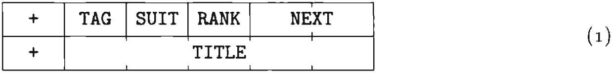
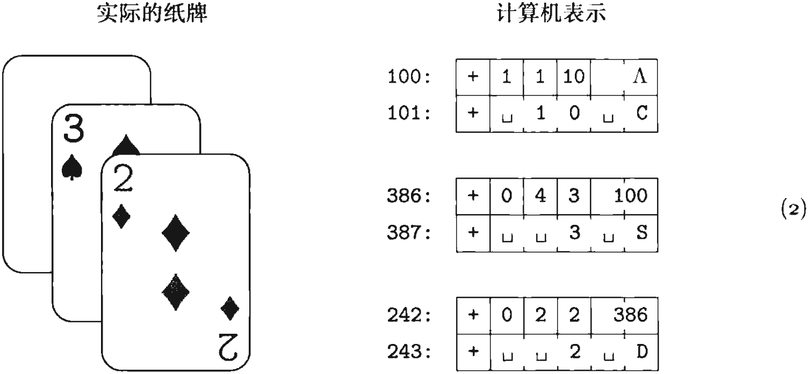
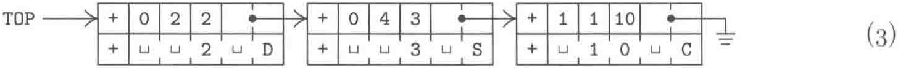

<a id="sec-2-1"></a>

# 2.1 引论

计算机程序通常对信息表进行操作. 在大部分情况下, 这些表并非一团杂乱无章的数值, 而是包含了数据元素之间的重要结构关系.

在最简单的情况下, 表可以是元素的线性表, 相关的结构性质可能回答如下这些问题: 哪个元素是表的第一个元素? 哪个是最后一个? 给定的元素的前后分别是哪个元素? 表中有多少个元素? 即便在这种看似简单的情况下, 关于结构仍有不少话可说 (见 2.2 节).

在较复杂的情况下, 表可以是二维数组 (矩阵或网格, 具有行和列结构) 或更高维的 $n$ 维数组; 也可以是树结构, 表示层次和分支关系; 还可以是具有大量内部链接的复杂多链结构, 正如人脑的结构.

为了正确地使用计算机, 必须了解数据内部的结构关系, 必须了解计算机内部表示和处理这种结构的基本技术.

本章概述信息结构的重点知识: 不同类型的结构的静态和动态性质, 结构化数据的存储分配和表示方法, 创建、修改、访问和销毁结构化信息的有效算法. 在学习过程中, 我们还设计了一些重要的例子, 解释如何使用这些方法解决各种各样的问题. 这些例子包括拓扑排序、多项式算术、离散系统模拟、稀疏矩阵变换、代数公式处理, 以及在编写编译程序和操作系统中的应用. 我们基本上只关注结构在计算机内部如何表示, 从外部表示到内部表示的转换是第 9 章和第 10 章的主题.

我们将要讨论的大部分内容通常称为 “表处理”. 人们设计了一些诸如 LISP 这样的程序设计系统, 帮助处理所谓表 (List) 之类的一般结构类型. (本章中, “表”[^cn204-1] 专指将在 2.3.5 节着重讨论的一类特殊结构.) 虽然表处理系统在许多情况下都很有用, 但是它们却对程序员施加了一些往往并不必要的限制. 读者最好直接在自己的程序中使用本章的方法, 根据具体应用对数据格式和处理算法进行定制. 然而, 许多人仍然觉得表处理技术相当复杂 (因此有必要使用他人精心编写的解释系统或预先编写好的子程序), 认为表处理必须按某种固定的方式来做. 我们将会看到, 处理复杂的结构的方法没有什么神奇、神秘或困难之处. 这些技术是每个程序员的必备技能, 无论使用汇编语言, 还是使用 FORTRAN、C 或 Java 之类的代数语言编程, 我们都能很容易地使用它们.

我们将使用 MIX 计算机解释处理信息结构的方法. 不想关注 MIX 程序细节的读者至少应该了解一下结构化信息在 MIX 内存中的表示方式.

现在, 先定义此后将频繁使用的术语和记号. 表中的信息由一组结点 (node) 组成 (结点又被某些作者称为 “记录”“实体” 或 “珠子”), 我们偶尔也称之为 “项” 或 “元素”. 每个结


<a id="pdf-205"></a><a id="p-188"></a>

点由计算机内存中的一个或多个连续字构成, 并划分成若干称作字段 (field) 的特定部分. 最简单的结点只是一个内存字, 只有一个包含整个内存字的字段. 举一个更加有趣的例子, 假设表元素表示纸牌, 可能有两个字的结点, 划分成 5 个字段, 分别是 TAG、SUIT、RANK、NEXT 和 TITLE:



(这种格式反映两个 MIX 字的内容. 1.3.1 节讲过, 一个 MIX 字包含五个字节和一个符号. 本例中, 我们假设每个字的符号都是+.) 结点的地址 (address) 又称指向结点的链 (link)、指针 (pointer) 或引用 (reference), 是结点的第一个字在内存中的位置. 地址通常是相对于某个基址来取. 但是, 为了简单起见, 本章取地址为绝对内存位置.

结点中的字段内容可以是数、字母字符、链或程序员想要表示的任何东西. 在此例中, 我们希望表示可能在纸牌游戏中出现的一叠牌: TAG=1 表示牌面朝下, 而 TAG=0 表示牌面朝上; SUIT=1,2,3 或 4 分别表示梅花、方块、红桃和黑桃; RANK=1,2,...,13 分别表示 A,2,..., K;NEXT 是指向本叠牌中下一张牌的链; TITLE 是这张牌的字母名, 最长五个字符, 用于打印输出. 一叠牌可能像下面这样:



这里显示的计算机表示的内存位置是 100、386 和 242. 就该例而言, 它们可以是任何其他数, 因为每张牌都链接到它下面的牌. 注意结点 100 中的特殊链 “Λ”, 我们用大写希腊字母Λ表示空链—不指向任何结点的链. 空链Λ出现在结点 100 中, 是因为梅花 10 是这叠牌中最下面一张. 在机器内部, 我们用一个不可能是结点位置的、容易识别的值表示 A. 通常, 我们假定结点都不在位置 0 出现. 因此, 在 MIX 程序中, Λ几乎总是用链值 0 表示.

在计算机程序设计中, 指向其他数据元素的链是一种极其重要的思想, 是表示复杂数据结构的关键. 绘图表示结点的计算机表示时, 用箭头表示链比较方便. 这样, 例 (2) 可以表示为:



实际位置 242、386 和 100 (具体位置无关紧要) 不再出现在表示 (3) 中. 我们借用电子线路的 “接地” 符号来指示空链, 显示在图的右端. 还要注意, (3) 用一个从 “TOP” 出来的箭头指向最上面的那张牌, 这里 TOP 是一个链变量 (linkvariable), 通常称作指针变量, 这种变量的值为<a id="pdf-206"></a><a id="p-189"></a>链. 程序中但凡引用结点, 或者直接地通过链变量 (或链常量) 实现, 或者间接地通过其他结点中的链字段来实现.

现在, 我们来看记号的最重要部分: 引用结点内部字段的方法. 做法很简单: 给出字段的名字, 随后在括号中给出指向期望访问的结点的链. 例如, 在具有 (1) 的字段的 (2) 和 (3) 中, 我们有

$$
\begin{aligned}\mathtt{RANK}(100)&=10;&\mathtt{SUIT}(\mathtt{TOP})&=2;\\\mathtt{TITLE}(\mathtt{TOP})&=\text{“}\mathtt{\sqcup\sqcup2\sqcup D}\text{”};&\mathtt{RANK}(\mathtt{NEXT}(\mathtt{TOP}))&=3.\end{aligned}
\qquad \text{(4)}
$$

读者应该仔细研究这个例子, 因为这些字段记号将在本章和其后各章的许多算法中使用. 为了更清晰地阐明这一思想, 我们现在给出一个简单的算法, 用于将一张新纸牌面朝上放置在一叠牌的顶部. 假设 NEWCARD 是一个链变量, 其值是指向这张新牌的链, 该算法如下.

A1. 置 NEXT(NEWCARD)←TOP. (这把适当的链放入新牌结点中.)

A2. 置 TOP←NEWCARD. (这保持 TOP 指向这叠牌的顶部.)

A3. 置 TAG(TOP)←0. (这标记该牌 “面朝上”.)

另一个例子是下面的算法, 它统计当前一叠牌的张数.

B1. 置 N←0,X←TOP. (这里, N 是一个整型变量, X 是一个链变量.)

B2. 如果 X=Λ, 则停止, N 是这叠牌的张数.

B3. 置 N←N+1,X←NEXT(X), 转回步骤 B2.

注意, 在这些算法中, 我们使用符号名来表示两种截然不同的对象: 变量名用来表示变量 (TOP、NEWCARD、N、X), 字段名用来表示字段 (TAG、NEXT). 请不要混淆这两种用法. 如果 F 是一个字段名, 而 $\mathbb { L } \neq \Lambda$ 是一个链, 则 F(L) 是一个变量. 但是 F 本身不是变量, 除非 F 被一个非空链所限定, 否则它没有值.

当我们讨论底层机器细节时, 还需要使用两个记号, 在地址和存储在该地址的值之间进行转换.

(a)CONTENTS 总是表示一个一字结点的整个字的字段. 这样, CONTENTS(1000) 表示存放在内存位置 1000 中的值, 是一个取该值的变量. 如果 V 是一个链变量, 则 CONTENTS(V) 表示 V 指向的值 (不是值 V 本身).

(b) 如果 V 是存放在某内存单元中的值的名字, 则 LOC(V) 表示该单元的地址. 因此, 如果 V 是一个变量, 其值存放在一个完整的内存字中, 则 CONTENTS(LOC(V))=V.

很容易把这种记号转换成 MIXAL 汇编语言的代码, 不过 MIXAL 的记号是反过来的: 链变量的值放在变址寄存器中, 利用 MIX 访问部分字段 (partial-field) 的功能, 引用想要访问的字段. 例如, 上面的算法 A 可以写成:

```text
NEXT EQU 4:5       为汇编程序定义 NEXT
TAG  EQU 1:1         和 TAG 字段
     LD1 NEWCARD   A1. rI1 ← NEWCARD。
     LDA TOP           rA ← TOP。
     STA 0,1(NEXT)     NEXT(rI1) ← rA。
     ST1 TOP       A2. TOP ← rI1。
     STZ 0,1(TAG)  A3. TAG(rI1) ← 0。
```

(5)

<a id="pdf-207"></a><a id="p-190"></a>

“链接存储” 的概念之所以重要, 主要原因是使用它可以在计算机内部轻松高效地执行这些操作.

有时, 我们用单个变量表示整个结点, 它的值是字段的序列, 而不仅仅是一个字段. 因此, 我们可以写

$$
\mathtt{CARD}\leftarrow\mathtt{NODE}(\mathtt{TOP}),
\qquad \text{(6)}
$$

其中 NODE 是字段说明, 除引用整个结点之外, 与 CONTENTS 类似; CARD 是一个变量, 具有 (1) 那样的结构化值. 如果结点中有 $c$ 个字, 则 (6) 是如下 $c$ 个低层赋值的缩写形式:

$$
\mathtt{CONTENTS}(\mathtt{LOC}(\mathtt{CARD})+j)\leftarrow\mathtt{CONTENTS}(\mathtt{TOP}+j),\qquad0\le j<c.
\qquad \text{(7)}
$$

汇编语言和算法使用的记号之间存在一个重要差别. 由于汇编语言接近于机器的内部语言, 因此 MIXAL 程序中使用的符号代表地址而不是值. 这样, 在 (5) 的第三列中, 符号 TOP 实际代表指向顶部纸牌的指针所在的内存地址. 但是, 在 $(6)(7)$ 以及 (5) 右边的注释中, 它代表 TOP 的值, 即顶部纸牌结点的地址. 汇编语言与高级语言之间的这种差别经常使编程新手困惑不已, 因此读者应当做一做习题 7. 其他习题也能有效帮助读者练习本节介绍的记号约定.

#### 习题

1\. [04] <a id="ex-2-1-1"></a>[答案](./answers/2-1.md#ans-2-1-1) 在 (3) 的情形下, 下列表示的值是什么? (a)SUIT(NEXT(TOP)); (b)NEXT(NEXT(NEXT(TOP))).

2\. [10] <a id="ex-2-1-2"></a>[答案](./answers/2-1.md#ans-2-1-2)  正文指出, 在许多情况下, CONTENTS(LOC(V))=V. 在什么条件下, 有 LOC(CONTENTS(V))= V?

3\. [11] <a id="ex-2-1-3"></a>[答案](./answers/2-1.md#ans-2-1-3) 给出一个算法, 本质上撤销算法 A 的效果: 它从一叠纸牌中取走顶部的牌 (如果牌叠非空), 并置 NEWCARD 为该牌的地址.

4\. [18] <a id="ex-2-1-4"></a>[答案](./answers/2-1.md#ans-2-1-4) 给出一个类似于算法 A 的算法, 把新牌面朝下放置在一叠牌的底部. (牌叠可能为空.)

5\. [21] <a id="ex-2-1-5"></a>[答案](./answers/2-1.md#ans-2-1-5) 给出一个算法, 本质上撤销习题 4 算法的效果: 假定一叠纸牌非空, 并且底部的牌面朝下, 你的算法应该取走底部的牌, 并使 NEWCARD 链接到它. (在纸牌游戏中, 这个算法有时称作 “抽老千”.)

6\. [06] <a id="ex-2-1-6"></a>[答案](./answers/2-1.md#ans-2-1-6) 在纸牌游戏的例子中, 假设 CARD 是变量名, 它的值像 (6) 中一样, 是整个结点. 操作 CARD←NODE(TOP) 设置 CARD 的诸字段分别等于顶部牌的对应字段. 该操作之后, 如下哪种记号表示顶 部牌的花色? (a) SUIT(CARD); (b) SUIT(LOC(CARD)); (c) SUIT(CONTENTS(CARD)); (d) SUIT(TOP)?

7\. [04] <a id="ex-2-1-7"></a>[答案](./answers/2-1.md#ans-2-1-7) 在正文的 MIX 程序例子 (5) 中, 链变量 TOP 存放在汇编语言名为 TOP 的 MIX 计算机字中. 给定字段结构 (1), 下面哪个代码序列把量 NEXT(TOP) 送到寄存器 A 中? 解释为什么另一个代码序列不正确.

8\. [18] <a id="ex-2-1-8"></a>[答案](./answers/2-1.md#ans-2-1-8) 编写一个对应于步骤 B1-B3 的 MIX 程序.

9\. [23] <a id="ex-2-1-9"></a>[答案](./answers/2-1.md#ans-2-1-9) 写一个 MIX 程序, 从一叠纸牌的顶部开始, 打印当前牌叠内容的字母名, 每行打印一张牌, 并用括号括住面朝下的纸牌.

[^cn204-1]: 作者用 List 表示诸如 LISP 这样的表处理系统处理的表; 而用 list 表示一般的表, 如线性表. 本段中, “表” 一词均指 List. ——译者注
