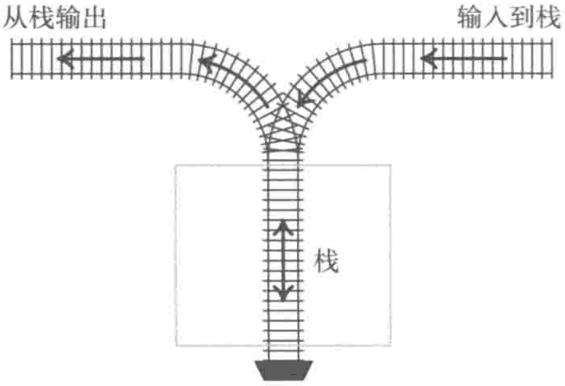
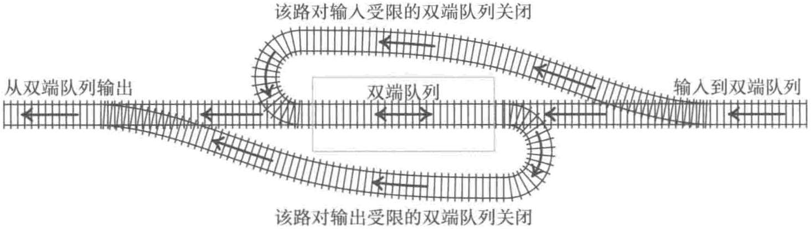

#### 2.2.1 栈、队列和双端队列

数据通常具有许多结构信息, 比我们实际想要在计算机中直接表示的还多很多. 例如, 在上一节的纸牌游戏中, 每个结点都有一个 NEXT 字段, 指出什么牌在它下面. 但是, 我们并未提供直接的方法, 找出什么牌在给定牌的上方, 或找出给定的纸牌在哪一叠牌中. 当然, 我们还完全无视了实际纸牌的大部分特征: 牌背面图案的细节, 纸牌与所在房间里其他对象之间的关系, 纸牌内的分子, 等等. 可以想象, 对于某些计算机应用, 这些结构信息可能是相关的, 但是我们显然绝不希望存储出现于每种情况的所有结构. 事实上, 对于大部分纸牌游戏而言, 我们并不需要前面例子中保留的所有信息, 比如用来表示牌面朝上还是朝下的 TAG 字段常常不是必要的.

我们必须针对每种情况, 确定应该在表格中提供多少结构, 每一部分信息是否需要方便访问. 为了做出这样的决定, 我们需要知道要对数据执行什么操作. 因此, 对于本章考虑的每个问题, 我们不但考虑数据结构, 而且考虑在数据上执行的操作类型. 计算机表示的设计形式, 依赖于数据的期望功能和它的内在性质. 事实上, 对于一般的设计问题来说, 功能和形式都是必须重视的.

为了进一步解释这一点, 我们考虑计算机硬件的一处类似设计. 计算机的存储器通常分为 “随机访问存储器”, 如 MIX 的主存储器; “只读存储器”, 用于存放基本的常量信息; “辅助块存储器”, 如 MIX 的磁盘设备, 可以存储大量信息但不能高速访问; “联想存储器”, 更准确地称作 “按内容寻址的存储器”, 按照信息的值而不是位置寻址; 等等. 每种类型的存储器都有极其重要的预期功能, 因此就按照功能命名. 所有这些设备都是 “存储” 部件, 但是它们的不同用途大大影响了它们的设计和价格.

线性表 (linearlist) 是 $n\ge 0$ 个结点的序列 X[1],X[2],...,X[$n$], 它的基本结构性质仅是各项排成一行时的相对位置. 在这种结构中, 我们只关心一个事实: 如果 $n>0$, 则 $x$[1] 是第一个结点, 而 X[$n$] 是最后一个; 如果 $1 < k < n$, 则第 $k$ 个结点 X[$k$] 之前为 X[$k$—1], 之后为 X[k+1].

对于线性表, 我们可能要执行下列操作:

(i) 访问表的第 $k$ 个结点, 查看或改变其字段内容;

(ii) 紧接在第 $k$ 个结点之前或之后插入一个新结点;

(iii) 删除第 $k$ 个结点;

(iv) 把两个或多个线性表合并成一个表;

(v) 把一个线性表划分成两个或多个表;

(vi) 复制一个线性表;

(vii) 确定表中的结点数;

(viii) 根据结点的特定字段, 把表的结点按递增序排序;

(ix) 搜索线性表, 找出一个在某字段上具有特定值的结点.

在操作 (i)(ii)(iii) 中, 特殊情况 $k=1$ 和 $k=n$ 尤为重要, 因为线性表的第一项和最后一项可能比一般元素更容易用得到. 本章中, 我们不讨论操作 (viii) 和 (ix), 它们分别是第 5 章和第 6 章的主题.

一个计算机应用很少同时用到所有 9 种操作最一般的形式, 因此我们发现, 取决于最频繁执行的操作类型, 线性表有多种表示方法. 很难为线性表设计一种表示方法, 使得这些操作都能高效地执行. 例如, 在表中间插入和删除项的同时, 对于随机的 $k$, 访问长表的第 $k$ 个结点就比较困难. 因此, 就像计算机存储器按照预期应用而分类一样, 线性表也按照用到的主要操作而分成几类.

经常会遇到只对第一个或最后一个结点插入、删除和访问值的线性表, 我们给它们以特殊的名称:

栈 (stack) 是一种线性表, 所有的插入和删除 (通常还有所有的访问) 都在表的一端进行.

队列 (queue) 是一种线性表, 所有的插入都在表的一端进行, 所有删除 (通常还有所有的访问) 都在表的另一端进行.

双端队列 (deque) 是一种线性表, 又称为双向队列, 所有的插入和删除 (通常还有所有的访问) 都在表的两端进行.

因此, 双端队列比栈和队列更一般. 它的一些性质与牌叠相同, 两者的英文发音也相同[^cn209-1]. 我们也区分输出受限 (output-restricted) 和输入受限 (input-restricted) 的双端队列, 前者仅允许在一端删除, 后者则仅允许在一端插入.

在某些学科, “队列” 一词具有更广泛的意义和用法, 泛指需要进行插入和删除的任意类型的表. 于是, 上面定义的几种特殊情况称作各种 “排队秩序”. 然而, 本书只打算在受限的情况下使用术语 “队列”, 只表示像人们排队等待服务那样的有序队列.

*图 1　用铁路切换网络表示的栈*

戴克斯特拉建议, 把栈与火车车厢切换类比, 这种比喻有时有助于理解栈机制 (参见 [图1](#fig-2-1)). 双端队列的对应图示见图 2.

*图 2　用铁路切换网络表示的双端队列*

使用栈时, 我们总是移走表中当前 “最新的” 项, 即比其他项都晚插入的项. 使用队列时恰好相反, 总是移走 “最老的” 项; 也就是说, 结点离开表的次序与进入的次序相同.

许多人都独立地意识到栈和队列的重要性, 给它们起了不同的名字: 栈也称为下推表、反转存储器、地窖、嵌套存储器、堆叠、后进先出 (LIFO) 表, 甚至称作溜溜球表; 队列有时称

[^cn209-1]: 这里指 deck (牌叠) 与 deque (双端队列) 发音相同. ——译者注

为循环存储器或先进先出 (FIFO) 表. 术语 LIFO 和 FIFO 在会计行业已经使用多年, 表示两种存货计价方法. 此外, 输出受限的双端队列也称作 “货架”, 而输入受限的双端队列称作 “卷轴”(scroll 或 roll). 名称的多样性本身很有意思, 因为它是这些概念重要性的证据. “栈” 和 “队列” 逐渐成为标准术语, 而上面列举的其他词, 只有 “下推表” 仍然很常用, 特别是在自动机理论领域.

栈在实践中经常出现. 例如, 我们可能检查一组数据, 并记录异常条件或稍后要做的事情的列表. 检查完原始数据集后, 我们可以回到该表来做其余处理, 移走表中的项, 直到它为空. (习题 1.3.2-10 的 “鞍点” 问题就是这种情况的一个例子.) 栈或队列都适合充当这样的表, 栈通常更方便. 在我们解决问题时, 我们心目中都有一个 “栈”: 一个问题导致另一个, 而这个问题又导致另一个; 我们把问题和子问题累积起来, 并随着它们的解决而移走. 同样, 计算机程序执行期间进入和离开子程序的过程也类似于栈. 对于处理具有嵌套结构的语言, 如程序设计语言、算术表达式和德文 “套句” (从句套从句的表达), 栈特别有用. 一般来说, 在涉及显式或隐式递归算法时, 栈的出现最为频繁. 我们将在第 8 章全面讨论这种联系.

*图 3　线性表的三种重要类型*

当算法涉及这些结构时, 通常使用一些专门术语: 我们把一个项放到栈顶 (top), 或取出栈顶项 (见 [图3](#fig-2-3)a); 栈底 (bottom) 是最难访问的项, 在其他项删除之后才能移走它. (人们常说把一个项向下推进栈, 或在删除栈顶项时说它向上弹出栈. 这种术语源于对餐厅中经常看到的盘子堆叠的类比. 术语 “推进” 和 “弹出” 胜在简洁, 但是容易误导人, 暗示整个表在计算机内存中上下移动. 其实栈完全没有下推, 项添加在顶部, 就像堆干草或摞盒子一样.) 对于队列, 我们把首末项称为队列的头 (front) 和尾 (rear), 项从队尾进入, 最终到达队头位置时移出 (见 [图3](#fig-2-3)b). 当谈及双端队列时, 我们说左端 (left) 和右端 (right)(见 [图3](#fig-2-3)c). 有时, 如果双端队列用作栈或队列, 我们也会使用顶、底、头、尾这些概念, 但是顶、头应该在左边还是在右边并无标准约定.

这样, 我们发现很容易在算法中使用丰富的描述性词汇: 对栈用术语 “上下”, 对队列用术语 “排队等待”, 而对双端队列用术语 “左右”.

业已证明, 处理栈和队列时, 增加少量记号是方便的. 我们用

$$
A\Leftarrow x
\qquad \text{(1)}
$$

表示把值 $x$ 插入栈 A 的顶部 (当 A 是栈时), 或表示把 $x$ 插入队列 A 的尾部 (当 A 是队列时). 同理, 记号

$$
x\Leftarrow A
\qquad \text{(2)}
$$

用来表示设置变量 $x$ 等于栈 A 顶部或队列 A 头部的值, 并且从 A 中删除该值. 当 A 为空时, 即当 A 不包含值时, 记号 (2) 没有意义.

如果 A 是一个非空栈, 则我们可以用

$$
\operatorname{top}(A)
\qquad \text{(3)}
$$

表示其栈顶元素.

#### 习题

1\. [06] [答案](./answers/2-2-1.md#ans-2-2-1-1) 一个输入受限的双端队列是一个线性表, 项可以从一端插入, 但可以从两端删除. 显然, 如果我们始终如一地从两端中的一端删除所有的项, 则输入受限的双端队列既可以充当栈, 也可以充当队列. 输出受限的双端队列也可以既充当栈, 又充当队列吗?

2\. [15] [答案](./answers/2-2-1.md#ans-2-2-1-2) 想象四节火车车厢位于 [图1](#fig-2-1) 轨道的输入端, 从左到右依次编号为 1,2,3,4. 假设我们执行如下操作序列 (与图中箭头方向一致, 并且不让车厢 “越过” 其他车厢): (i) 把车厢 1 移到栈中; (ii) 把车厢 2 移到栈中; (iii) 把车厢 2 移到输出端; (iv) 把车厢 3 移到栈中; (v) 把车厢 4 移到栈中; (vi) 把车厢 4 移到输出端; (vii) 把车厢 3 移到输出端; (viii) 把车厢 1 移到输出端.

这些操作导致原来的车厢次序 1234 变成 2431. 本题和下面习题的目的是: 考察用这种方法从栈、队列或双端队列能够得到何种排列.

如果有六节火车车厢, 编号 123456, 它们能排列成 325641 吗? 它们能排列成 154623 吗? (如果能, 给出做法.)

3\. [25] [答案](./answers/2-2-1.md#ans-2-2-1-3)  上一题中的步骤 (i) 到 (viii) 可以更简洁地用编码 SSXSSXXX 表示, 其中 S 表示 “从输入端移动一辆车厢到栈中”, 而 X 表示 “从栈中移动一辆车厢到输出端”. S 和 X 的某些序列代表无意义的操作, 因为在指定的铁轨上可能没有可用的车厢. 例如, 序列 SXXSSXXS 不可能实现, 因为我们假设栈初始为空.

如果一个 S 和 X 的序列包含 $n$ 个 S 和 $n$ 个 X, 并且其中没有出现不可能执行的操作, 那么我们称这个序列是容许的 (admissible). 给出一个规则, 方便识别容许的序列和不容许的序列. 进一步证明: 两个不同的容许的序列不会产生相同的输出排列.

4\. [M34] [答案](./answers/2-2-1.md#ans-2-2-1-4) 设 $a _ { n }$ 是使用习题 2 的栈可以得到的 $n$ 个元素的排列数. 找出 $a_{n}$ 的简单公式.

5\. [M28] [答案](./answers/2-2-1.md#ans-2-2-1-5) 证明: 用栈从 $p _ { 1 } p _ { 2 } \ldots p _ { n }$ 可以得到排列 12... $n$, 当且仅当不存在下标 $i< j < k$ 使得 $p _ { j } < p _ { k } < p _ { i }$

6\. [00] [答案](./answers/2-2-1.md#ans-2-2-1-6) 用队列取代栈, 考虑习题 2 中的问题. 用队列可以得到 12... $n$ 的何种排列?

7\. [25] [答案](./answers/2-2-1.md#ans-2-2-1-7) 用双端队列取代栈, 考虑习题 2 中的问题. (a) 找出 1234 的一个排列, 它可以用输入受限的双端队列得到, 但不能用输出受限的双端队列得到. (b) 找出 1234 的一个排列, 它可以用输出受限的双端队列得到, 但不能用输入受限的端双端队列得到. [由 (a) 和 (b) 推知, 输入受限与输出受限的双端队列之间肯定存在差别. \](c) 找出 1234 的一个排列, 它用输入受限或输出受限的双端队列都无法得到.

8\. [22] [答案](./answers/2-2-1.md#ans-2-2-1-8) 是否存在 $1 2 \ldots n$ 的排列, 不能用输入、输出均不受限的双端队列得到?

9\. [M20] [答案](./answers/2-2-1.md#ans-2-2-1-9)  设 $b _ { n }$ 为使用输入受限的双端队列可以得到的 $n$ 元排列数. (注意, 如习题 7 所示, $b_4=22.\ )$ _证明: $b_{n}$ 也是使用输出受限的双端队列可以得到的 $n$ 元排列数.

10\. [M25] [答案](./answers/2-2-1.md#ans-2-2-1-10) (参见习题 3) 对于输出受限的双端队列, 令 S、Q 和 X 分别代表在左端插入一个元素、在右端插入一个元素和从左端删除一个元素. 例如, 序列 QQXSXSXX 将把输入序列 1234 变换成 1342. 序列 SXQSXSXX 产生相同的变换.

试定义符号 S、Q 和 X 的容许序列概念, 使得如下性质成立: 可以用输出受限的双端队列得到的每种 $n$ 元排列, 都正好对应于一种容许的序列.

▶ 11. [答案](./answers/2-2-1.md#ans-2-2-1-11)  $[ M _ { 4 } \bar { 0 } ]$ 作为习题 9 和 10 的推论, $b _ { n }$ 是长度为 $2 \hat { n }$ 的容许序列数. 找出生成函数 $\sum _ { n \geq 0 } b _ { n } z ^ { n }$ 的闭合式.

12\. [HM34] [答案](./answers/2-2-1.md#ans-2-2-1-12) 计算习题 4 和 11 中 $a _ { n }$ 和 $b _ { n }$ 的近似值.

13\. [答案](./answers/2-2-1.md#ans-2-2-1-13)  $[ M _ { 4 } 8 ]$ 使用一般的双端队列, 能够得到多少种 $n$ 元排列? (关于在 $O(n)$ 步内判定一个给定的排列能否得到的算法, 见皮埃尔·罗森斯泰和罗伯特·塔扬, J.Algorithms5(1984), 389-390.)

14\. [26] [答案](./answers/2-2-1.md#ans-2-2-1-14) 假设只允许使用栈作为数据结构. 如何用两个栈有效地实现一个队列?
