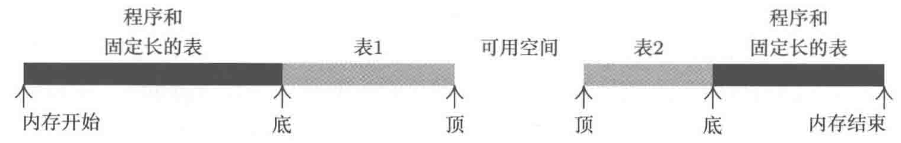
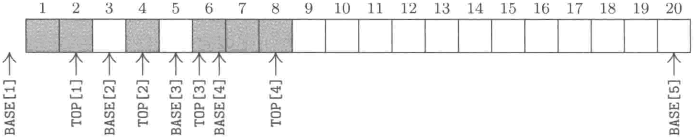

<a id="sec-2-2-2"></a>

#### 2.2.2 顺序分配

在计算机中维护线性表, 最简单、最自然的方法是把表项存放在连续位置, 一个结点挨一个结点. 这样有

$$
\mathtt{LOC}(\mathtt X[j+1])=\mathtt{LOC}(\mathtt X[j])+c,
$$

其中 $c$ 是每个结点的字数. (通常 $c = 1 .$ 当 $c > 1$ 时, 有时更方便的做法是把单个表划分成 $c$ 个 “平行的” 表, 使得结点 X[$j$ 的第 $k$ 个字的存放位置与 $\boldsymbol{X}[j]$ 的第一个字保持依赖于 $k$ 的固定距离. 不过我们将继续假定一组 $c$ 个相邻的字形成一个结点.) 一般地,

$$
\mathtt{LOC}(\mathtt{X}[j])=L_0+cj,
\qquad \text{(1)}
$$

其中 $且 _{0}$ 是常量, 称作基址 (baseaddress), 是人为假定的结点 X[0] 的位置.

这种表示线性表的技术一目了然而又众所周知, 似乎毫无必要再费笔墨详述. 本章稍后将介绍许多 “更复杂的” 表示方法, 但是我们不妨首先考察这种简单情况, 看看使用它能做些什么. 有必要理解顺序分配有什么能力, 有什么局限.

对于栈处理, 顺序分配相当方便. 我们只需要一个称作栈指针 (stackpointer) 的变量 T. 当栈为空时, 我们令 $\mathtt T=0$. 为了把一个新元素 Y 放到栈顶, 我们置

$$
\mathtt T\leftarrow\mathtt T+1;\qquad\mathtt X[\mathtt T]\leftarrow\mathtt Y.
\qquad \text{(2)}
$$

而当栈非空时, 我们可以通过 (2) 的逆动作, 置 Y 等于栈顶结点, 并删除栈顶结点:

$$
\mathtt Y\leftarrow\mathtt X[\mathtt T];\qquad\mathtt T\leftarrow\mathtt T-1.
\qquad \text{(3)}
$$

(由 (1), 在计算机内部, 通常最有效的办法是维护 $c\mathtt T$ 而不是维护 $于 .$ 因为这种调整很简单, 所以我们将继续按 $c = 1$ 讨论.)

队列或更一般的双端队列的表示需要一点技巧. 一种显而易见的解决方案是维持两个指针 F 和 R (用于队列的头和尾), 当队列为空时, $\mathtt { F } = \mathtt { R } = 0 .$ 于是, 在队列尾部插入一个元素的操作是

$$
\mathtt R\leftarrow\mathtt R+1;\qquad\mathtt X[\mathtt R]\leftarrow\mathtt Y.
\qquad \text{(4)}
$$

而取走队列头部结点 (F 恰好指向队列头部的前一个结点) 的操作是

$$
\mathtt F\leftarrow\mathtt F+1;\quad\mathtt Y\leftarrow\mathtt X[\mathtt F];\quad\text{如果 }\mathtt F=\mathtt R,\text{ 则置 }\mathtt F\leftarrow\mathtt R\leftarrow0.
\qquad \text{(5)}
$$

但是, 应当注意: 如果 R 总在 F 之前 (从而队列中总是至少有一个结点), 则所使用的表项为 X[1],X[2],...,X[1000],... 直至无穷, 造成惊人的内存浪费. 因此, (4) 和 (5) 的简单方法只有在知道 F 经常追上 R 时才能用, 例如一下子有很多删除操作清空队列的情形.

<a id="pdf-213"></a><a id="p-196"></a>

为了避免队列过度使用内存, 我们可以预留 M 个结点 X[1],...,X[M], 隐式安排成一个环, 让 X[1] 跟在 X[M] 之后. 则上面的过程 (4) 和 (5) 变成

$$
\text{如果 }\mathtt R=\mathtt M,\text{ 则 }\mathtt R\leftarrow1,\text{ 否则 }\mathtt R\leftarrow\mathtt R+1;\qquad\mathtt X[\mathtt R]\leftarrow\mathtt Y.
\qquad \text{(6)}
$$

$$
\text{如果 }\mathtt F=\mathtt M,\text{ 则 }\mathtt F\leftarrow1,\text{ 否则 }\mathtt F\leftarrow\mathtt F+1;\qquad\mathtt Y\leftarrow\mathtt X[\mathtt F].
\qquad \text{(7)}
$$

事实上, 在 1.4.4 节考察输入输出缓冲时, 我们已经看到过这样的循环排队操作.

迄今为止, 我们的讨论都太不现实, 因为暗中假定不会出错. 我们从栈或队列删除一个结点时, 都假定原本至少有一个结点; 把一个结点插入栈或队列中时, 又假定内存中有存放它的空间. 但是, 方法 (6) 和 (7) 显然只允许队列中至多有 M 个结点, 而在给定的计算机程序中, 方法 (2) (3) (4) (5) 只允许 T 和 R 达到某个最大量. 对于并不假定这些限制自动满足的一般情况, 下面说明如何改写这些动作:

$$
\mathtt X\Leftarrow\mathtt Y\ \text{(插入到栈):}\quad\begin{cases}\mathtt T\leftarrow\mathtt T+1;\\\text{如果 }\mathtt T>\mathtt M,\text{ 则 }\mathtt{OVERFLOW};\\\mathtt X[\mathtt T]\leftarrow\mathtt Y.\end{cases}
\qquad \text{(2a)}
$$

$$
\mathtt Y\Leftarrow\mathtt X\ \text{(从栈删除):}\quad\begin{cases}\text{如果 }\mathtt T=0,\text{ 则 }\mathtt{UNDERFLOW};\\\mathtt Y\leftarrow\mathtt X[\mathtt T];\\\mathtt T\leftarrow\mathtt T-1.\end{cases}
\qquad \text{(3a)}
$$

$$
\mathtt X\Leftarrow\mathtt Y\ \text{(插入到队列):}\quad\begin{cases}\text{如果 }\mathtt R=\mathtt M,\text{ 则 }\mathtt R\leftarrow1,\text{ 否则 }\mathtt R\leftarrow\mathtt R+1;\\\text{如果 }\mathtt R=\mathtt F,\text{ 则 }\mathtt{OVERFLOW};\\\mathtt X[\mathtt R]\leftarrow\mathtt Y.\end{cases}
\qquad \text{(6a)}
$$

$$
\mathtt Y\Leftarrow\mathtt X\ \text{(从队列删除):}\quad\begin{cases}\text{如果 }\mathtt F=\mathtt R,\text{ 则 }\mathtt{UNDERFLOW};\\\text{如果 }\mathtt F=\mathtt M,\text{ 则 }\mathtt F\leftarrow1,\text{ 否则 }\mathtt F\leftarrow\mathtt F+1;\\\mathtt Y\leftarrow\mathtt X[\mathtt F].\end{cases}
\qquad \text{(7a)}
$$

这里, 我们假定 $\mathtt X[1],\ldots,\mathtt X[\mathtt M]$ 是允许表使用的全部空间; OVERFLOW (上溢) 和 UNDERFLOW (下溢) 意味项超出或不足. 使用 (6a) 和 (7a) 时, 队列指针的初始设置 F=R=0 不再正确, 因为当 F=0 时, 将不检测上溢, 所以应该改动, 比如说以 F=R=1 开始.

建议读者做习题 1. 该题讨论这种简单排队机制的一些重要特点.

下一个问题是: “OVERFLOW 或 UNDERFLOW 发生时, 应该怎么办?” 发生 UNDERFLOW 时, 我们试图删除一个并不存在的项. 通常, 这是一个有意义的条件而非错误, 可以用来控制程序流程. 例如, 我们可能想反复删除项, 直到出现下溢. 然而, OVERFLOW 通常是错误. 这意味着表已经满了, 但是仍然有更多的信息等待插入. 对于 OVERFLOW, 通常的策略是不得不报告因为超过存储容量限制, 程序不能运行, 然后程序终止.

当然, 如果仅仅一个表变得太大, 而同一程序的其他表可能还有充足的剩余空间, 我们自然不愿因一个表出现上溢而放弃. 上面主要考虑只有一个表的程序. 然而, 我们经常遇到涉及多个大小动态变化的栈的程序. 在这种情况下, 我们不想对每个栈的容量设定最大值, 因为该值通常难以预测; 即便对每个栈都设定最大容量, 也很难遇到所有的栈都同时填满的情况.

当恰有两个变长表时, 如果我们让这两个表迎面增长, 则它们可以很好地共存:



<a id="pdf-214"></a><a id="p-197"></a>

这里, 表 1 向右扩展, 而表 2 (以相反次序存放) 向左扩展. 除非两个表的总容量耗尽了所有存储空间, 否则不会出现 OVERFLOW. 各个表可以独立地扩展和收缩, 使得每个表的最大有效容量显著大于可用空间的一半. 这种内存空间布局使用非常频繁.

然而, 容易发现, 没有办法在内存中存放三个或更多长度可变的顺序表, 使得下面两点都满足: (a) 仅当所有表的总容量超过总空间时, 才出现 OVERFLOW; (b) 每个表的 “底” 元素都有固定的位置. 如果有多个变长表, 比如说有十个 (这很常见), 则存储分配问题就变得非常有意义. 如果希望满足条件 (a), 则必须放弃条件 (b), 即必须允许表的 “底” 元素改变位置. 这意味 (1) 中位置 $上 _{0}$ 不再是常数, 对该表的引用不能通过内存的绝对地址进行, 因为所有的引用必须相对于基址 $\underline{\underline{\mathrm{L}}}_{0}$ 做出. 在 MIX 机中, 把第 I 个一字结点取到寄存器 A 的代码便由

```text
LD1  I               LD1  I
LDA  L₀,1    变成，如  LDA  BASE(0:2)
                     STA  *+1(0:2)
                     LDA  *,1
```

(8)

其中 BASE 包含 $\boxed{L_{0} \quad 0 \quad 0 \quad 0}$. 这种相对寻址花费的时间显然比固定基址寻址长. 不过如果 MIX 具有 “间接寻址” 特征的话, 它只会稍微慢一点 (见习题 3).

一个重要的特例是, 每个变长表都是栈. 这样, 由于任何时候都只关心栈顶元素, 因此几乎可以像以前一样高效地处理. 假设有 $n$ 个栈. 如果 BASE[$i$] 和 TOP[$i$] 是第 $i$ 个栈的链变量, 并且每个结点的长度为一个字, 则上面的插入和删除算法变成如下形式,

$$
\begin{aligned}\text{插入:}\quad&\mathtt{TOP}[i]\leftarrow\mathtt{TOP}[i]+1;\ \text{如果 }\mathtt{TOP}[i]>\mathtt{BASE}[i+1],\text{ 则}\\&\mathtt{OVERFLOW};\ \text{否则置 }\mathtt{CONTENTS}(\mathtt{TOP}[i])\leftarrow\mathtt Y.\end{aligned}
\qquad \text{(9)}
$$

$$
\begin{aligned}\text{删除:}\quad&\text{如果 }\mathtt{TOP}[i]=\mathtt{BASE}[i],\text{ 则 }\mathtt{UNDERFLOW};\ \text{否则}\\&\text{置 }\mathtt Y\leftarrow\mathtt{CONTENTS}(\mathtt{TOP}[i]),\quad\mathtt{TOP}[i]\leftarrow\mathtt{TOP}[i]-1.\end{aligned}
\qquad \text{(10)}
$$

这里, BASE[i+1] 是第 (i+1) 个栈的基位置. 条件 TOP[$i$]=BASE[$i$] 表示第 $i$ 个栈为空.

在 (9) 中, 上溢的问题没有以前那么严重了, 因为我们可以 “重新分配内存”, 从其他尚未装满的表为发生上溢的表腾出一些空间. 多种重新分配的方法显而易见, 我们现在详细考察其中的一些, 因为当线性表顺序分配存储时, 这些方法相当重要. 我们首先给出最简单的方法, 然后介绍其他方法.

假定有 $n$ 个栈, 值 BASE[$i$] 和 TOP[$i$] 按 (9) 和 (1o) 中的方法进行操作. 假设所有这些栈都共享一个公共存储区, 共有 L 个位置, $\mathtt { L } _ { 0 } < \mathtt { L } \leq \mathtt { L } _ { \infty }$. (这里, $\mathtt L_0$ 和 $\mathrm{L}_{\infty}$ 是常数, 确定总的可用字数.) 我们可以从所有栈均为空开始, 置

$$
\mathtt{BASE}[j]=\mathtt{TOP}[j]=L_0\qquad\text{对于 }1\le j\le n.
\qquad \text{(11)}
$$

还置 $\mathrm{BASE} \left[ n + 1 \right] = \mathrm{L}_{\infty}$, 以便 $i = n$ 时 (9) 可以正确执行.

当栈 $i$ 发生 OVERFLOW 时, 存在三种可能性.

(a) 如果存在 $k$ 满足 $i < k \leq n$ 和 TOP [$k$] $< \mathtt { B A S E } \left[ k + 1 \right]$, 找出最小的 $k$, 然后把一切统统上移一格:

$$
\text{对于 }\mathtt{TOP}[k]\ge\mathtt L>\mathtt{BASE}[i+1],\quad\text{置 }\mathtt{CONTENTS}(\mathtt L+1)\leftarrow\mathtt{CONTENTS}(\mathtt L).
$$

(为了避免丢失信息, 这里的 L 值必须递减而不是递增. 可能有 $\mathtt { T O P } \left[ k \right] = \mathtt { B A S E } \left[ i + 1 \right]$, 此时什么都不需要移动.) 最后, 我们对 $i < j \leq k$, 置 $\mathtt{BASE}[j]\leftarrow\mathtt{BASE}[j]+1,\quad\mathtt{TOP}[j]\leftarrow\mathtt{TOP}[j]+1.$

<a id="pdf-215"></a><a id="p-198"></a>

(b) 找不到 (a) 中的 $k$, 但是可以找到同时满足 $1 \leq k < i$ 和 $\mathtt { T O P } \left[ { k } \right] \: < \: \mathtt { B A S E } \left[ { k + 1 } \right]$ 的最大的 $k$. 现在, 我们把一切统统下移一格:

$$
\text{对于 }\mathtt{BASE}[k+1]<\mathtt L<\mathtt{TOP}[i],\quad\text{置 }\mathtt{CONTENTS}(\mathtt L-1)\leftarrow\mathtt{CONTENTS}(\mathtt L).
$$

(这里的 L 值必须是递增的.) 然后, 对于 $k < j \leq i$, 置 $\operatorname { \mathbb { B A S E } } \left[ j \right] \leftarrow \operatorname { \mathbb { B A S E } } \left[ j \right] - 1$ $\mathtt { T O P } \left[ j \right] \leftarrow \mathtt { T O P } \left[ j \right] - 1 .$

(c) 对于所有的 $k$ $\neq i$, 我们有 TOP[$k$] $=\mathtt{BASE}[k+1]$. 显然, 我们不能为新的栈元素找到空间, 因此必须放弃.

对于 $n=4,\quad L_0=0,\quad L_\infty=20$, 经历相继动作

$$
\mathrm I_1^\ast\,\mathrm I_1^\ast\,\mathrm I_4\,\mathrm I_2^\ast\,\mathrm D_1\,\mathrm I_3^\ast\,\mathrm I_1\,\mathrm I_1^\ast\,\mathrm I_2^\ast\,\mathrm I_4\,\mathrm D_2\,\mathrm D_1
\qquad \text{(12)}
$$

之后, 存储格局如 [图4](#fig-2-4) 所示. (这里, $\mathrm { I } _ { j }$ 和 $\mathrm { D } _ { j }$ 分别表示插入到栈 $j$ 和从栈 $j$ 删除, 而星号表示出现上溢, 假定初始不为栈 1、2、3 分配空间.)

<a id="fig-2-4"></a>

<span></span>

*图 4　多次插入和删除后的存储格局示例*

显然, 如果我们明智地选择初始化条件, 而不是像 (11) 所示, 一开始把所有栈空间都分配给第 $n$ 个栈, 这种方法前期出现的许多栈上溢都可以避免. 例如, 如果期望每个栈开始都具有相同的容量, 则可以用下式初始化

$$
\mathtt{BASE}[j]=\mathtt{TOP}[j]=\left\lfloor\left(\frac{j-1}{n}\right)(L_\infty-L_0)\right\rfloor+L_0,\qquad\text{对于 }1\le j\le n.
\qquad \text{(13)}
$$

根据具体程序的运行经验, 我们可以选择更合适的初值. 然而, 无论初始分配多么好, 它至多只能减少固定数目的上溢, 并且其效果仅在程序运行的早期阶段才是显著的. (见习题 17.)

另一种改进方法是, 每次重新分配内存时为多个新项腾出空间. 扬·加威克研讨了这一思想, 他建议发生上溢时, 根据自上一次内存重新分配以来每个栈的大小改变情况, 进行全面内存重新分配. 他的算法使用了一个附加数组 OLDTOP[$j$] $( 1 \leq j \leq n )$, 保留上一次内存分配之后的 $\mathtt{TOP}[j]$ 值. 表的初始设置与先前一样, 并且 $\mathtt{OLDTOP}[j]=\mathtt{TOP}[j]$. 该算法的处理过程如下. 算法 G (重新为顺序表分配内存). 假定按照 (9), 栈 $i$ 出现 OVERFLOW. 算法 G 执行后, 我们会发现, 或者内存需求已经超出内存容量, 或者已经重新分配内存, 使得 CONTENTS(TOP[$i$])←Y 可以执行. (注意, 在算法 G 执行前, TOP[$i$ 已经在 (9) 中增加 1.)

G1. [初始化.] 置 $\mathtt{SUM}\leftarrow L_\infty-L_0,\quad\mathtt{INC}\leftarrow0.$ 然后, 对于 $1 \leq j \leq n$, 执行步骤 G2. (其效果是使 SUM 等于剩余空间总量, INC 等于自上一次重新分配以来表长度增加的总量.) 之后, 进入步骤 G3.

G2.[收集统计量.] 置 $\mathtt{SUM}\leftarrow\mathtt{SUM}-(\mathtt{TOP}[j]-\mathtt{BASE}[j])$. 如果 $\mathtt { T O P } \left[ j \right] > \mathtt { O L D T O P } \left[ j \right]$, 则置 $\mathtt D[j]\leftarrow\mathtt{TOP}[j]-\mathtt{OLDTOP}[j],\quad\mathtt{INC}\leftarrow\mathtt{INC}+\mathtt D[j]$; 否则置 D[$j$]←0.

G3.[内存是否已满?] 如果 SUM<0, 则不能继续.

<a id="pdf-216"></a><a id="p-199"></a>

G4. [计算分配因子.] 置 $\alpha \leftarrow 0 . 1 \times \mathtt { S U M } / n , \quad \beta \leftarrow 0 . 9 \times \mathtt { S U M } / \mathtt { I N C } .$ (这里, $\alpha$ 和 $\beta$ 都是小数而不是整数, 需要计算到合理精度. 下面的步骤按如下方法为每个表确定可用空间: 大约 10%的可用空间被 $n$ 个表平分, 其余 90%将根据自上次分配以来表长度的增加量, 按比例划分.)

G5. [计算新基址.] 置 NEWBASE[1]←BASE[1], $\sigma \leftarrow 0$; 然后, 对于 $j = 2 , 3 , \ldots , n$, 置 $\tau\leftarrow$ $\sigma + \alpha + \mathbb{D} \left[ j - 1 \right] \beta$ $\mathtt { N E W B A S E } \left[ j \right] \leftarrow \mathtt { N E W B A S E } \left[ j - 1 \right] + \mathtt { T O P } \left[ j - 1 \right] - \mathtt { B A S E } \left[ j - 1 \right] + \lfloor \tau \rfloor - \lfloor \sigma \rfloor$ $\sigma \leftarrow \tau .$

G6.[重新分配.] 置 TOP[$i$]←TOP[$i$]-1. (这反映第 $i$ 个表的真实长度, 从而下面不会试图从表的边界之外移动信息.) 执行下面的算法 R, 然后重置 TOP[$i$] $\leftarrow\mathtt{TOP}[i]+1.$ 最后, 对于 $1 \leq j \leq n$, 置 $\mathtt { O L D T O P } [ j ] \leftarrow \mathtt { T O P } [ j ]$. 1

也许, 整个算法最有趣的部分是一般重新分配的过程, 现在介绍如下. 重新分配是非平凡的, 因为内存各部分有的上移, 有的下移. 显然, 在移动时应当注意, 不能覆盖内存中的任何有用信息.

算法 R (顺序表重定位). 对于 $1 \leq j \leq n$, 按照以上所述的约定, 把由 BASE[$j$] 和 TOP[$j$] 指定的信息移动到 NEWBASE[$j$] 指定的位置, 并对 BASE[$j$] 和 TOP[$j$] 进行相应的调整. 这个算法的原理是容易验证的: 向下移动的数据既不可能覆盖任何需要向上移动的数据, 也不可能覆盖任何将要原地不动的数据.

R1.[初始化.] 置 $j \leftarrow 1 ,$

R2.[找移动起始点. \](现在, 从表 1 到表 j, 需要向下移动的表已经移动到期望的位置.) 以步长 1 增加 $j$, 直到发现下面任一个条件满足为止. $a    E E W B  A  5 [ j ] < \tilde { B A   E } [ j ]$: 转到 R3;b) $j > n$: 转到 R4.

R3.[表下移.] 置 $\delta \leftarrow \mathtt { B A S E } \left[ j \right] - \mathtt { N E W B A S E } \left[ j \right]$. 对于 $\mathtt L=\mathtt{BASE}[j]+1,\ \mathtt{BASE}[j]+2,$ ...,TOP[$j$], 置 CONTENTS(L — δ)←CONTENTS(L). (可能有 BASE[$j$] 等于 TOP[$j$]. 此时, 什么都不需要做.) 置 $\mathtt{BASE}[j]\leftarrow\mathtt{NEWBASE}[j],\quad\mathtt{TOP}[j]\leftarrow\mathtt{TOP}[j]-\delta.$ 转回 R2.

R4.[找移动起始点. \](现在, 从表 j 到表 n, 需要向上移动的表已经移动到期望的位置.) 以步长 1 减少 $j$, 直到发现下面任一个条件满足为止. $a ) N E W B A S E [ j ] > B A S E [ j ]$: 转到 R5;b) $j = 1$: 算法终止.

R5.[表上移.] 置 $\delta \leftarrow \mathtt { N E W B A S E } \left[ j \right] - \mathtt { B A S E } \left[ j \right]$. 对于 $\mathtt { L } = \mathtt { T O P } \left[ j \right] , \mathtt { T O P } \left[ j \right] \mathtt { - } 1 , \dots , \mathtt { B A S E } \left[ j \right] \mathtt { + } 1$ 置 $\mathtt { C O N T E N T S } \left( \mathtt { L } + \delta \right) \leftarrow \mathtt { C O N T E N T S } \left( \mathtt { L } \right)$, (与步骤 R3 类似, 这一步可能什么都不做.) 置 $\mathtt{BASE}[j]\leftarrow\mathtt{NEWBASE}[j],\quad\mathtt{TOP}[j]\leftarrow\mathtt{TOP}[j]+\delta.$ 转回 R4. 注意: 栈 1 永远不需要移动. 因此, 如果我们知道哪个栈最大, 就应该把它放在第一个. 在算法 G 和 R 中, 我们故意允许对于 $1 \leq j \leq n$, 可能有

$$
\mathtt { O L D T O P } \left[ j \right] \equiv \mathtt { D } \left[ j \right] \equiv \mathtt { N E W B A S E } \left[ j + 1 \right] ,
$$

使得这三个表可以共享公共存储, 因为不会在冲突的情况下使用它们的值.

我们介绍了几种用于栈的重新分配的算法. 显然, 它们也都可以用于当前信息包含在 BASE[$j$] 和 TOP[$j$] 之间的任何相对寻址的表. 可以在表上附上其他指针 (例如 FRONT[$j$] 和 REAR[$j$]), 使得表成为队列或双端队列. 习题 8 将详细考察队列的情况.

<a id="pdf-217"></a><a id="p-200"></a>

上面这样的动态存储分配算法, 从数学角度分析是非常困难的. 下面的习题给出一些有趣的结果, 不过它们只触及了一般特性的皮毛.

对于确实能推导出来的理论, 试举一个例子. 考虑表仅因插入而增长的情况, 忽略掉删除和其后抵消其影响的插入. 进一步, 假定每个表以相同的速率填入信息. 这种情况可以用如下方法建模: 想象 $m$ 个插入操作的序列 $a _ { 1 } , a _ { 2 } , \ldots , a _ { m }$, 其中每个 $a _ { i }$ 都是 1 和 $n$ 之间的整数 (代表在栈 $a _ { i }$ 顶部的插入). 例如, 序列 1,1,2,2,1 表示两次插入栈 1, 后接两次插入栈 2, 再后接另一次插入栈 1. 重新分配操作期间有时必须移动字的位置. 把 $n ^ { m }$ 种可能的 $a _ { 1 } , a _ { 2 } , \ldots , a _ { m }$ 看作等可能的, 则可以求整个表构建时, 必须移动字所在位置的平均移动次数. 对于第一个算法, 开始时把所有空间都分配给第 $n$ 个栈, 分析见习题 9. 我们求得所需要的平均移动次数为

$$
\frac12\left(1-\frac1n\right)\binom m2.
\qquad \text{(14)}
$$

这样, 可以预料到, 移动次数基本上正比于表增长次数的平方. 如果栈不是等可能的, 这一结论仍然成立 (见习题 10).

这似乎启示我们, 如果相当多的项插入到表中, 则需要进行大量移动. 为了把大量顺序表紧密地放置在一起, 这是我们必须付出的代价. 人们还没有建立起理论, 无法分析算法 G 的平均性能. 看来在这种环境下, 也不太可能用简单的模型刻画实际的表的特征. 然而, 习题 18 仍然提供了一种最坏情况的保证: 如果内存不是太满的话, 运行时间不会太长.

经验表明, 当存储只有半满载时 (也就是说, 当可用空间等于整个空间的一半时), 我们很少需要用算法 G 来重新安排这些表. 或许重点在于, 在半满载的情况下, 算法运行良好; 在几乎满载的情况下, 算法至少能给出正确的答案.

让我们更仔细地考察几乎满载的情况. 当这些表几乎充满内存时, 算法 R 要用相当长的时间执行任务. 更糟糕的是, 在内存耗尽之前, 上溢必然更频繁. 程序如果接近填满内存, 多半会在其后不久就完全上溢; 而此类程序在内存上溢之前, 很可能会在算法 G 和 R 上浪费大量时间. 不幸的是, 未调试的程序经常溢出内存容量. 为了避免浪费这些时间, 可建议: 如果 SUM 小于 $S_{\min}$, 则在步骤 G3 停止算法 G, 其中 $S_{\min}$ 由程序员指定, 用来避免过分重新分配. 当存在许多可变长度的顺序表时, 我们不能指望利用 100%的存储空间而不使内存溢出.

戴维·怀斯和丹·沃森 [BIT16(1976), 442-450] 对算法 G 做了进一步研究. 阿维泽里·弗兰克尔 [Inf. Proc. Letters 8(1979), 9-10] 建议使用一对迎面增长的栈.

#### 习题

1\. [15] <a id="ex-2-2-2-1"></a>[答案](./answers/2-2-2.md#ans-2-2-2-1) 在 (6a) 和 (7a) 给定的队列操作中, 一次可以向队列插入多少个项而不会出现上溢?

2\. [22] <a id="ex-2-2-2-2"></a>[答案](./answers/2-2-2.md#ans-2-2-2-2) 推广 (6a) 和 $(7\mathrm a)$ 的方法, 使之可以用于少于 M 个元素的任意双端队列. 换句话说, 给出另两个操作 “从尾部删除” 和 “插入到头部”.

3\. [21] <a id="ex-2-2-2-3"></a>[答案](./answers/2-2-2.md#ans-2-2-2-3) 假设对 MIX 扩充如下: 每条指令的 I 字段形如 $8 \mathbb { I } _ { 1 } + \mathbb { I } _ { 2 }$, 其中 $0 \leq \mathtt { I } _ { 1 } < 8 , \quad 0 \leq \mathtt { I } _ { 2 } < 8 .$ 在汇编语言中, 我们写 “OPADDRESS, $\mathtt I_1\mathbin{:}\mathtt I_2\text{”}$, 或 (现在写)“OPADDRESS, $;  \mathbb{I}_{2}  \text{" }$, 如果 $\mathtt I_1=0$ 这意味先在 ADDRESS 上执行 “地址修改” $互 _1$, 然后在结果地址上执行 “地址修改” $互 _2$, 最后在新地址上执行 OP. 地址<a id="pdf-218"></a><a id="p-201"></a>修改定义如下:

```python
0: M = A
1: M = A + rI1
2: M = A + rI2
.
6: M = A + rI6
```

7:M = 在位置 A 找到的、由 “ADDRESS, $, \mathsf { { I } }  _ { 1 } ; \mathsf { { I } }  _ { 2 } \hat {  }$ 字段定义的结果地址. 地址 A 中不允许出现 $\mathtt { I } _ { 1 } = \mathtt { I } _ { 2 } = 7$ 的情况. (做此限制的原因在习题 5 讨论.)

这里, A 表示操作执行前的地址, 而 M 表示地址修改后的结果地址. 在所有情况下, 如果 M 的值不能放入两个字节和一个符号位内, 则结果无定义. 每次执行 “间接寻址” (修改 7) 操作, 执行时间都增加一个单位时间.

举一个非平凡的例子, 假设位置 1000 包含 “NOP1000,1:7”, 位置 1001 包含 “NOP1000,2”, 而变址寄存器 1 和 2 分别包含 1 和 2, 则命令 “LDA1000,7:2” 等价于 “LDA1004”, 因为

$$
\mathtt{1000,7:2}=\mathtt{(1000,1:7),2}=\mathtt{(1001,7),2}=\mathtt{(1000,2),2}=\mathtt{1002,2}=\mathtt{1004}.
$$

(a)(如果有必要) 使用间接寻址特征, 说明如何简化 (8) 右部的编码使得每次表引用都能节省两条指令. 你的编码比 (8) 快多少?

(b) 假设有多个表, 它们的基址分别存放在 BASE+1,BASE+2,BASE+3,.... 假定 I 在 rI1,J 在 rI2, 如何使用间接寻址特征把第 J 个表的第 I 个元素取到寄存器 A?

(c) 假定位置 X 的 (3:3) 字段为 0, 指令 `ENT4 X,7` 的效果是什么?

4\. [25] <a id="ex-2-2-2-4"></a>[答案](./answers/2-2-2.md#ans-2-2-2-4) 假定 MIX 已按习题 3 扩充. 说明如何使用单条指令 (加上辅助常量) 实现如下动作:

(a) 由于间接寻址永不终止而无限循环.

(b) 把值 LINK(LINK($x$)) 取到寄存器 A, 其中链变量 $x$ 的值存放在符号地址为 X 的位置的 (0:2) 字段, 值 LINK($x$) 存放在位置 $x$ 的 (0:2) 字段, 等等. 假定这些位置的 (3:3) 字段为 0.

(c) 在与 (b) 相同的假定下, 把值 LINK(LINK(LINK($x$))) 取到寄存器 A.

(d) 把位置 rI1 + rI2 + rI3 + rI4 + rI5 + rI6 的内容取到寄存器 A.

(e) 把 rI6 的当前值变为其四倍.

▶ 5. [35] <a id="ex-2-2-2-5"></a>[答案](./answers/2-2-2.md#ans-2-2-2-5) 习题 3 提出的 MIX 扩充有一处令人遗憾的限制: 间接寻址位置中不允许 “7:7”.

(a) 举例说明, 如果没有这一限制, MIX 硬件可能需要有能力在内部维护一个 3 位项的长栈. (即便对于 MIX 这样的虚构的计算机, 这也是令人望而却步的昂贵硬件.)

(b) 解释在当前的限制下, 为什么不需要这样的栈. 换言之, 设计一个算法, 要求无须增加很多寄存器容量, 计算机硬件也可以进行期望的地址修改.

(c) 对 7:7 的使用, 给出一个比习题 3 更宽松的限制, 既能缓解习题 4(c) 的困难, 又能用计算机硬件廉价地实现.

6\. [10] <a id="ex-2-2-2-6"></a>[答案](./answers/2-2-2.md#ans-2-2-2-6)  从 [图4](#fig-2-4) 所示的内存格局开始, 确定如下哪些操作序列导致上溢或下溢 (a) I1; (b) I2; (c) I3; (d) $\mathrm{I}_{4}\mathrm{I}_{4}\mathrm{I}_{4}\mathrm{I}_{4}\mathrm{I}_{4}$; (e) $\mathrm { D } _ { 2 } \mathrm { D } _ { 2 } \mathrm { I } _ { 2 } \mathrm { I } _ { 2 } \mathrm { I } _ { 2 } .$

7\. [12] <a id="ex-2-2-2-7"></a>[答案](./answers/2-2-2.md#ans-2-2-2-7) 算法 G 的步骤 G4 出现用 INC 作除数的除法. 在程序的该处, INC 可能为 0 吗?

8\. [26] <a id="ex-2-2-2-8"></a>[答案](./answers/2-2-2.md#ans-2-2-2-8) 解释对于一个或多个像 (6a) 和 (7a) 中那样的循环处理的队列的表, 如何修改 (9) 和 (10) 以及重新分配算法.

9\. [M27] <a id="ex-2-2-2-9"></a>[答案](./answers/2-2-2.md#ans-2-2-2-9) 使用本节正文尾部介绍的数学模型, 证明 (14) 式是期望移动次数. (注意, 序列 1,1,4,2,3,1,2,4,2,1 表明 0+0+0+1+1+3+2+0+3+6=16 次移动.)

10\. [M28] <a id="ex-2-2-2-10"></a>[答案](./answers/2-2-2.md#ans-2-2-2-10) 修改习题 9 的数学模型, 使得某些表会比其他表大: 对于 $1 \leq j \leq m , 1 \leq k \leq n$, 令 $p_k$ 为 $a _ { j } = k$ 的概率. 这样, $p _ { 1 } + p _ { 2 } + \cdots + p _ { n } = 1$. 上一题考虑的是对于所有的 $k$, $p _ { k } = 1 / n$ 的特殊情况. 对<a id="pdf-219"></a><a id="p-202"></a>于这种更一般的情况, 确定像 (14) 式一样的期望移动次数. 可以重新安排 $n$ 个表的相对次序, 使得预计较长的表放在预计较短的表的右边 (或左边). 根据 $p _ { 1 } , \: p _ { 2 } , \ldots , p _ { n }$, 这 $n$ 个表的何种相对次序使期望移动次数最小?

11\. [M30] <a id="ex-2-2-2-11"></a>[答案](./answers/2-2-2.md#ans-2-2-2-11) 推广习题 9 的论证, 使得任何栈的前 $t$ 次插入都不导致移动, 而其后的插入与以前一样. 这样, 如果 $t=2$, 则习题 9 的序列指定 $0+0+0+0+0+3+0+0+3+6=12$ 次移动. 在这种假设下, 移动的平均总次数是多少? (这能近似给出, 当每个栈开始有 $t$ 个可用空间时, 前述算法的大致行为.)

12\. [M28] <a id="ex-2-2-2-12"></a>[答案](./answers/2-2-2.md#ans-2-2-2-12) 让两个表共存并迎面增长, 而不是把它们分别放在独立的有界区域中, 其优点可以 (在某种程度) 定量地估计如下: 令 $n = 2$, 使用习题 9 的模型; 对于 $2 ^ { m }$ 个等可能序列 $a _ { 1 } , a _ { 2 } , \ldots , a _ { m }$ 中的每一个, 设其中有 $k _ { 1 }$ 个 1 和 $k _ { 2 }$ 个 2. (这里, $k_{1}$ 和 $k _ { 2 }$ 分别是内存满之后两个表的长度. 当两个表毗邻时, 我们能够使用 $\underline { { m } } = k _ { 1 } + k _ { 2 }$ 个位置, 而不是 $2 \operatorname* { m a x } ( k _ { 1 } , k _ { 2 } )$ 个位置运行该算法, 得到与分离的表相同的效果.)$\operatorname* { m a x } ( k _ { 1 } , k _ { 2 } )$ 的平均值是多少?

13\. <a id="ex-2-2-2-13"></a>[答案](./answers/2-2-2.md#ans-2-2-2-13)  $[\mathrm{HM}42]$ 如果允许随机删除和随机插入, 导致表的更大波动, 则习题 12 考察的 $\operatorname* { m a x } ( k _ { 1 } , k _ { 2 } )$ 的值甚至会更大. 假设我们修改该模型, 使得序列值 $a _ { j }$ 以概率 $p$ 解释为删除而不是插入. 过程继续, 直到 $k _ { 1 } + k _ { 2 }$ (使用的表位置的总数) 等于 $m .$ 从空表删除无效.

例如, 如果 $m = 4$, 可以证明过程停止时我们得到如下概率分布:

$$
\begin{array}{c|ccccc}(k_1,k_2)=&(0,4)&(1,3)&(2,2)&(3,1)&(4,0)\\\text{概率}&\frac1{16-12p+4p^2},&\frac14,&\frac{6-6p+2p^2}{16-12p+4p^2},&\frac14,&\frac1{16-12p+4p^2}.\end{array}
$$

这样, 随着 $p$ 增加, $k _ { 1 }$ 和 $k _ { 2 }$ 之差趋向于增加. 不难证明, 随着 $p$ 趋向于单位 1, $k_{1}$ 的分布基本上变成均匀的, 并且 $\operatorname* { m a x } ( k _ { 1 } , k _ { 2 } )$ 的极限期望值恰为 $\textstyle \frac { 3 } { 4 } m + \frac { 1 } { 4 m } [ m$ 为奇数]. 这一行为与上一题 (当 $p = 0$ 时) 很不相同. 然而, 差异可能并不显著, 因为当 $p$ 趋向于单位 1 时, 终止过程所需时间迅速趋向于无穷. 这个习题提出的问题是考察 $\operatorname* { m a x } ( k _ { 1 } , k _ { 2 } )$ 对 $p$ 和 $m$ 的依赖性, 并对固定的 $p$ (如 $p=\tfrac13)$, 随着 $m$ 趋向于无穷大, 确定近似公式. $p=\tfrac12$ 时特别有意义.

14\. [HM43] <a id="ex-2-2-2-14"></a>[答案](./answers/2-2-2.md#ans-2-2-2-14) 通过证明当 $n$ 固定, 而 $m$ 趋向于无穷时, 量

$$
\frac{m!}{n^m}\sum_{\substack{k_1+k_2+\cdots+k_n=m\\k_1,k_2,\ldots,k_n\ge0}}\frac{\max(k_1,k_2,\ldots,k_n)}{k_1!\,k_2!\ldots k_n!}
$$

具有渐近形式 $m / n + c_n \sqrt{m} + O(1)$, 把习题 12 的结果推广到任意 $n \geq 2 .$ 确定常量 $c_{2}, \; c_{3}, \; c_{4}, \; c_{5}.$

15\. [40] 使用蒙特卡罗方法, 模拟算法 G 在具有各种分布的插入和删除下的行为. 你的实验表明算法 G 的效率如何? 把它的性能与前面每次上移或下移一个结点的算法进行比较.

16\. [20] <a id="ex-2-2-2-16"></a>[答案](./answers/2-2-2.md#ans-2-2-2-16) 正文介绍了如何安放两个栈使得它们迎面增长, 从而有效地使用公共内存区域. 如果使用两个队列, 或一个栈和一个队列, 能够同样有效地使用公共存储区域吗?

17\. [30] <a id="ex-2-2-2-17"></a>[答案](./answers/2-2-2.md#ans-2-2-2-17) 如果 $\sigma$ 是像 (12) 那样的任意插入和删除序列, 设 $\bar { s } _ { 0 } ( \sigma )$ 为以 (11) 为初始条件、对 $\sigma$ 使用 [图4](#fig-2-4) 的简单方法时出现的栈上溢次数, $s_1(\sigma)$ 为关于另一初始条件 (如 (13)) 的对应的上溢次数. 证明 $s _ { 0 } ( \sigma ) \leq s _ { 1 } ( \sigma ) + \mathtt { L } _ { \infty } - \mathtt { L } _ { 0 } .$

▶ 18. <a id="ex-2-2-2-18"></a>[答案](./answers/2-2-2.md#ans-2-2-2-18)  $[\mathrm M30]$ 证明对于任意 $m$ 次插入和/或删除序列, 算法 G 和算法 R 的运行总时间为 $\hat { O } ( m +$ $n \textstyle \sum _ { k = 1 } ^ { m } \alpha _ { k } / ( 1 - \alpha _ { k } ) )$, 其中 $\alpha_{k}$ 为第 $k$ 次操作之前最近一次重新分配时, 占用的存储所占的比例, 第一次重新分配之前 $\alpha_k=0.$ (这样, 如果存储不超过一定比例, 例如 90%满, 则无论整个存储容量多大, 每个操作平均情况下最多需要 $\mathcal { O } ( n )$ 单位时间.) 假设 $\mathtt { L } _ { \infty } - \mathtt { L } _ { 0 } \geq n ^ { 2 } .$

▶ 19. [16] <a id="ex-2-2-2-19"></a>[答案](./answers/2-2-2.md#ans-2-2-2-19) (0 起始下标) 有经验的程序员都知道, 为表示线性表的元素, 通常明智的做法是用 X[0],X[1], $\ldots , \mathtt { X } [ n - 1 ]$, 而不是用 $x$[1],X[2],...,X[$n$]. 这样, 以 (1) 的基址 $上 _{0}$ 为例, 它指向数组的最小单元. 对于栈和队列, 改写插入和删除方法 (2a)(3a)(6a)(7a), 使之与这一约定一致. 换言之, 改写它们, 使得表元素出现在数组 $\mathtt { X } \left[ 0 \right] , \mathtt { X } \left[ 1 \right] , \ldots , \mathtt { X } \left[ \mathtt { M } = 1 \right]$ 中, 而不出现在 X[1], X[2],..., X[M] 中.
