<a id="pdf-220"></a><a id="p-203"></a>

<a id="sec-2-2-3"></a>

#### 2.2.3　链接分配

我们可以不把线性表放在顺序存储位置中, 而是使用更加灵活的策略, 每个结点包含一个指向表中下一个结点的链.

<table>
<thead>
<tr><th colspan="2">顺序分配</th><th colspan="3">链接分配</th></tr>
<tr><th>地址</th><th>内容</th><th>地址</th><th colspan="2">内容</th></tr>
</thead>
<tbody>
<tr><td><i>L</i><sub>0</sub> + <i>c</i></td><td>项 1</td><td>A</td><td>项 1</td><td>B</td></tr>
<tr><td><i>L</i><sub>0</sub> + 2<i>c</i></td><td>项 2</td><td>B</td><td>项 2</td><td>C</td></tr>
<tr><td><i>L</i><sub>0</sub> + 3<i>c</i></td><td>项 3</td><td>C</td><td>项 3</td><td>D</td></tr>
<tr><td><i>L</i><sub>0</sub> + 4<i>c</i></td><td>项 4</td><td>D</td><td>项 4</td><td>E</td></tr>
<tr><td><i>L</i><sub>0</sub> + 5<i>c</i></td><td>项 5</td><td>E</td><td>项 5</td><td>Λ</td></tr>
</tbody>
</table>

这里, A、B、C、D 和 E 是内存的任意位置, 而 $\Lambda$ 是空链 (见 2.1 节). 在顺序分配的情况下, 使用该表的程序应该有一个附加的变量或常量, 其值指示表的长度为 5 个项. 否则, 这一信息应在项 5 或其后的位置中用一个结束码指示. 使用链接分配的程序将有一个指向 A 的链变量或链常量, 表的其他项都可以从地址 A 出发找到.

回忆 2.1 节, 链常常简单地用箭头表示, 因为结点占据的实际存储位置通常并不相干. 因此, 上面的链表可以表示为:

[](../../assets/figures/p220-chain-before.svg)

这里, `FIRST` 是指向该表第一个结点的链变量.

我们可以对两种基本存储形式进行一些明显的比较.

(1) 链接分配需要附加的空间存放链. 在某些情况下, 这可能是决定性因素. 然而, 我们经常看到结点中的信息并未占满整个字, 因此本来就有存放链字段的空间. 此外, 许多应用都能把多个项组合在一个结点中, 使得多个信息项仅用一个链字段 (见习题 2.5–2). 但更重要的是, 采用链接存储方法无疑会在存储上获益, 因为表可以交叠, 共享公共部分; 在许多情况下, 除非本来就有相当多的附加空间空置, 否则顺序分配没有链接分配有效. 例如, 上一节结尾处的讨论解释了, 当存储密集装载时, 那里所描述的系统必然是低效的.

(2) 很容易从链表中删除一个项. 例如, 为了删除项 3, 我们只需要改变与项 2 相关联的链. 但是, 使用顺序分配, 这样的删除通常意味着把表的大部分向上移动到不同的位置.

(3) 使用链接方案时, 也很容易把一个项插入到表中间. 例如, 为了把项 $2\tfrac12$ 插入到 (1) 中, 我们只需要改变两处链:

[](../../assets/figures/p220-chain-insert.svg)

相比之下, 在长顺序表中, 这一操作将非常耗时.

(4) 在顺序分配情况下, 表的随机访问快得多. 当 $k$ 是一个变量时, 为了访问表的第 $k$ 项, 对于顺序表需要固定的时间, 而对于链表则需要 $k$ 次迭代前进到正确位置. 因此, 链接存储有用的前提是, 大部分应用需要顺序地遍历表, 而不是随机地访问各项. 如果需要表中间或底部的项, 我们将使用一个或一组附加的链变量, 指向适当位置.

(5) 链接方案方便把两个表合并在一起, 或者把一个表拆分成两个独立增长的表.

<a id="pdf-221"></a><a id="p-204"></a>

(6) 链接方案本身就直接导致了比简单线性表更加错综复杂的结构. 我们可以有可变数目的变长表; 表的任何结点都可以是另一个表的起点; 结点可以同时以多种次序链接在一起, 每种次序对应于不同表, 等等.

(7) 在许多计算机上, 像顺序遍历表这样的简单操作在顺序表上稍微快一点. 对于 MIX, 差别在于 “INC1 $c\text{”}$ 和 “LD10,1(LINK)”, 它们只差一个周期. 但是, 许多机器都没有这么好的性质, 不能从变址位置装入变址寄存器. 如果链表的诸元素隶属于一大块内存的不同页, 则存储访问的时间可能显著较长.

由此可见, 链接技术使我们摆脱了计算机存储器的连续性带来的限制, 在某些操作上更加高效, 而同时在另外一些操作上损失部分性能. 在给定的情况下, 哪种分配技术最合适通常是清楚的, 并且这两种方法常常在同一程序的不同表上使用.

为方便起见, 在下面的诸例中, 我们假定一个结点占一个字, 并划分成两个字段 INF0 和 LINK:


使用链接分配一般意味存在某种机制, 当我们希望把新创建的信息插入到表中时, 该机制为新结点找到可用空间. 这件事通常用一个称作可用空间表 (list ofavailablespace) 的特殊表来实现. 该表称为 AVAIL 表 (或 AVAIL 栈, 因为它通常按后进先出方式处理). 当前未使用的所有结点链接在一张表中, 和其他表一样, 链变量 AVAIL 指向该表的顶部元素. 这样, 如果想置链变量 X 为新结点的地址, 并保留该结点以便将来使用, 则可以按如下步骤处理:

$$
\mathtt X\leftarrow\mathtt{AVAIL},\qquad\mathtt{AVAIL}\leftarrow\mathtt{LINK}(\mathtt{AVAIL}).
\qquad \text{(4)}
$$

这实际上移走 AVAIL 栈顶, 并使 X 指向刚移走的结点. 操作 (4) 经常出现, 因此我们用一个特殊的记号表示它: $\text{“}\mathtt X\Leftarrow\mathtt{AVAIL}\text{”}$ 将意味着置 X 指向一个新结点.

当删除一个结点并且不再需要它时, 可以翻转过程 (4):

$$
\mathtt{LINK}(\mathtt X)\leftarrow\mathtt{AVAIL},\qquad\mathtt{AVAIL}\leftarrow\mathtt X.
\qquad \text{(5)}
$$

该操作把 $x$ 寻址的结点放回 “原始材料” 表中. 我们把 (5) 记作 $\text{“}\mathtt{AVAIL}\Leftarrow\mathtt X\text{”}$

在 AVAIL 栈的讨论中, 我们省略了一些重要的事情. 首先, 没有说明程序开始时如何建立它. 显然, 这件事可以按如下步骤来做: (a) 把将要用于链接存储的所有结点链接在一起, (b) 置 AVAIL 为这些结点的第一个结点的地址, (c) 把最后一个结点链接到Λ. 可供分配的所有结点的集合称为存储池 (storage pool).

在我们省略的事项中, 检测上溢更为重要: 我们在 (4) 中忘记检查是否所有可用空间都被占用. 实际上, 操作 $\mathtt { X } \Leftarrow \mathtt { A V A I L }$ 应该定义如下:

$$
\begin{aligned}&\text{如果 }\mathtt{AVAIL}=\Lambda,\text{ 则 }\mathtt{OVERFLOW};\\&\qquad\text{否则 }\mathtt X\leftarrow\mathtt{AVAIL},\quad\mathtt{AVAIL}\leftarrow\mathtt{LINK}(\mathtt{AVAIL}).\end{aligned}
\qquad \text{(6)}
$$

必须始终考虑 OVERFLOW 的可能性. 这里, 上溢一般意味我们不得不终止程序的运行; 也可以启动 “垃圾回收” 例程, 试图找到更多可用空间. 垃圾回收将在 2.3.5 节讨论.

还有一个处理 AVAIL 栈的重要技术: 通常, 我们预先不知道存储池要用多少存储空间, 可能有一个变长的顺序表需要与这些链表共存, 此时我们希望链接存储区域只占用绝对需要的最少空间. 于是, 假设希望把链接存储区域安排在从 $且  0$ 开始的递增位置, 并且该区域绝不超过变量 SEQMIN 的值 (代表顺序表的当前下界), 则可以使用新变量 POOLMAX, 按如下步骤处理:

(a) 初始: 置 $\mathtt{AVAIL}\leftarrow\Lambda,\quad\mathtt{POOLMAX}\leftarrow L_0.$

<a id="pdf-222"></a><a id="p-205"></a>

(b) 操作 $\mathtt { X } \Leftarrow \mathtt { A V A I L }$ 变成如下形式:

$$
\begin{aligned}&\text{“如果 }\mathtt{AVAIL}\ne\Lambda,\text{ 则 }\mathtt X\leftarrow\mathtt{AVAIL},\quad\mathtt{AVAIL}\leftarrow\mathtt{LINK}(\mathtt{AVAIL}).\\&\text{否则置 }\mathtt X\leftarrow\mathtt{POOLMAX},\quad\mathtt{POOLMAX}\leftarrow\mathtt X+c,\text{ 其中 }c\text{ 是结点长度};\\&\qquad\text{如果 }\mathtt{POOLMAX}>\mathtt{SEQMIN},\text{ 则出现 }\mathtt{OVERFLOW}.\text{”}\end{aligned}
\qquad \text{(7)}
$$

(c) 当程序的其他部分试图减少 SEQMIN 的值时, 如果 $\mathtt { S E Q M I N } < \mathtt { P O O L M A X }$ 则拉响 OVERFLOW 警报.

(d) 操作 $\mathtt { A V A I L } \Leftarrow \mathtt { X }$ 仍为 (5) 不变.

这一思想实际上与前面的方法差别不大, 只是用一个特殊的恢复过程替换了 (6) 中的 OVERFLOW 情况. 总效果是保持存储池尽可能小. 许多人都喜欢使用这种做法, 甚至当所有的表都占据存

储池区域时 (因此 SEQMIN 为常数) 也如此, 因为它避免了把所有可用单元链接到一起的相当费时的初始化操作, 并且有利于排错. 当然, 我们也可以把顺序表放在底部, 而把池放在顶部, 用 POOLMIN 和 SEQMAX, 而不是用 POOLMAX 和 SEQMIN.

这样, 很容易维护一个可用结点池, 用于有效地找到自由结点并在稍后送回. 这些方法提供了用于链表的原料源. 我们的讨论隐含前提假定: 所有的结点都具有相同的长度 $c$. 结点具有不同的长度的情况非常重要, 但是我们将推迟到 2.5 节再讨论. 现在考虑在涉及栈和队列的特殊情况下最常用的表操作.

<a id="fig-2-5"></a>

<span>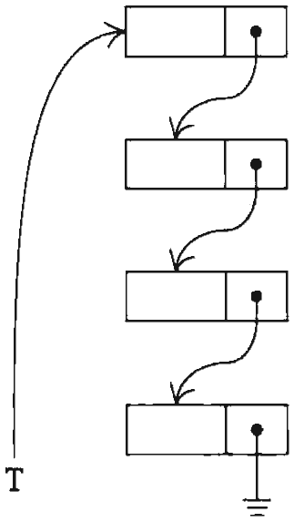</span>

*图 5　一个链接的栈*

最简单的链表是栈. [图5](#fig-2-5) 显示了一个典型的栈, 指针 T 指向栈顶.

当栈为空时, 该指针的值为Λ.

使用一个附加的指针变量 P, 如何把新信息 Y 插入 (“下推”) 到这种栈的顶部是显然的:

$$
\mathtt P\Leftarrow\mathtt{AVAIL},\quad\mathtt{INFO}(\mathtt P)\leftarrow\mathtt Y,\quad\mathtt{LINK}(\mathtt P)\leftarrow\mathtt T,\quad\mathtt T\leftarrow\mathtt P.
\qquad \text{(8)}
$$

反过来, 置 Y 等于栈顶信息并 “弹出” 栈, 可以用:

$$
\begin{aligned}&\text{如果 }\mathtt T=\Lambda,\text{ 则 }\mathtt{UNDERFLOW};\\&\quad\text{否则置 }\mathtt P\leftarrow\mathtt T,\quad\mathtt T\leftarrow\mathtt{LINK}(\mathtt P),\quad\mathtt Y\leftarrow\mathtt{INFO}(\mathtt P),\quad\mathtt{AVAIL}\Leftarrow\mathtt P.\end{aligned}
\qquad \text{(9)}
$$

应该将这些操作与 2.2.2 节中关于顺序分配的栈的类似机制 (2a) 和 (3a) 进行比较. 建议读者仔细研究 (8) 和 (9), 因为它们是非常重要的操作.

在考察队列之前, 我们先看看如何用 MIX 程序方便地表示这些栈操作. 设 PrI1, 插入程序可以写成如下形式:

```text
INFO EQU 0:3        INFO 字段的定义
LINK EQU 4:5        LINK 字段的定义
     LD1 AVAIL      P ← AVAIL。       ┐
     J1Z OVERFLOW   AVAIL = Λ 吗？     │ P ⇐ AVAIL
     LDA 0,1(LINK)                    │
     STA AVAIL      AVAIL ← LINK(P)。 ┘
     LDA Y
     STA 0,1(INFO)  INFO(P) ← Y。
     LDA T
     STA 0,1(LINK)  LINK(P) ← T。
     ST1 T          T ← P。
```

(10)

<a id="pdf-223"></a><a id="p-206"></a>

这需要 17 个单位时间. 相比之下, 顺序表的对应操作需要 12 个单位时间 (尽管在顺序分配情况下, OVERFLOW 处理多半需要显著更长的时间). 在这个程序以及本章其后的其他程序中, OVERFLOW (上溢) 或者表示一个终止例程, 或者表示一个找出更多空间并返回位置 rJ-2 的子例程.

删除程序同样简单:

```text
LD1  T          P ← T。
J1Z  UNDERFLOW  T = Λ 吗？
LDA  0,1(LINK)
STA  T          T ← LINK(P)。
LDA  0,1(INFO)
STA  Y          Y ← INFO(P)。
LDA  AVAIL                         ┐
STA  0,1(LINK)  LINK(P) ← AVAIL。  │ AVAIL ⇐ P
ST1  AVAIL      AVAIL ← P。        ┘
```

(11)

注意, 这些操作都涉及三个链变量的循环置换. 例如, 在插入操作中, 设插入前 P 为 AVAIL 的值. 如果 $\mathrm{P} \neq \Lambda$, 插入操作之后,

AVAIL 的值变成 LINK(P) 的先前值,

LINK(P) 的值变成 T 的先前值, T 的值变成 AVAIL 的先前值.

因此, 插入操作 (除了置 $\mathrm{INF0}(\mathrm{P}) \leftarrow \mathrm{Y}$ 之外) 是循环置换

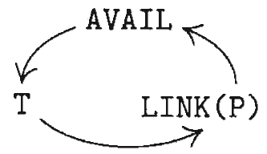

类似地, 对于删除, 假设操作前 P 的值为 T 的值, 假设 $\mathbb{P} \neq \Lambda$, 则我们有 $\mathrm{Y} \leftarrow \mathrm{INF0}(\mathrm{P})$, 并且

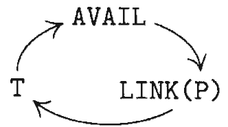

实际上, 置换是循环的这一事实与本问题无关, 因为移动每个元素的所有三元置换都是循环的.  
重要的是, 在这些操作中恰有三个链变量被置换.

插入和删除算法 (8) 和 (9) 是对栈给出的, 但是它们可以更一般地用于任何线性表的插入和删除. 例如, 插入恰在链变量 T 指向的结点之前进行. 令 $\mathtt { T } = \mathtt { L I N K } ( \mathtt { L I N K } ( \mathtt { F I R S T } ) )$, 上面 (2) 中项 $2 \frac{1}{2}$ 的插入可以用操作 (8) 实现.

队列使用链接分配方式特别方便. 在这种情况下, 容易看出诸链应该一路由队列的头部指向尾部, 以便当一个结点从头部取走后, 能够直接确定新的头部结点. 我们将使用指针 F 和 R 分别指向队列的头和尾:

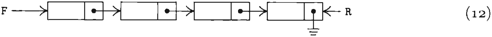

除了 R 之外, 该图抽象地等价于前面的图 5.

设计好表的布局之后, 要仔细说明所有的条件, 特别是表为空的情况. 与链接分配有关的程序设计错误有两种最为常见, 一是不能正确地处理空表, 二是在处理结构时忘记改变某些链. 为了避免第一种错误, 我们应该总是仔细地检查 “边界条件”. 为了避免第二种错误, 要看出哪些链需要改变, 绘制 “前后对比” 图示是有帮助的.

<a id="pdf-224"></a><a id="p-207"></a>

让我们通过队列解释上一段的评论. 首先考虑插入操作. 如果 (12) 是插入前的状况, 则在队列尾部插入后的布局应该是:

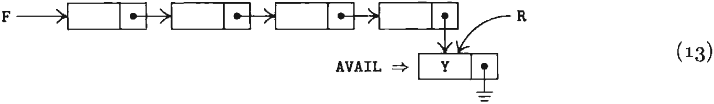

(这里使用的记号意味从 AVAIL 表得到一个新结点.) 比较 (12) 和 (13) 可见, 当信息 Y 插入到该队列的尾部时, 操作为:

$$
\mathtt P\Leftarrow\mathtt{AVAIL},\quad\mathtt{INFO}(\mathtt P)\leftarrow\mathtt Y,\quad\mathtt{LINK}(\mathtt P)\leftarrow\Lambda,\quad\mathtt{LINK}(\mathtt R)\leftarrow\mathtt P,\quad\mathtt R\leftarrow\mathtt P.
\qquad \text{(14)}
$$

现在考虑队列为空的 “边界” 情况: 在这种情况下, 插入前的状况待定, 而插入后的状况为:

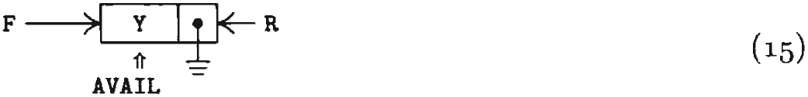

我们希望操作 (14) 也能用于这种情况, 即使插入到空队列意味必须同时改变 F 和 R, 而不仅仅是改变 R. 我们发现, 假定 $\mathtt F\equiv\mathtt{LINK}(\mathtt{LOC}(\mathtt F))$, 如果当队列为空时 $\mathtt R=\mathtt{LOC}(\mathtt F)$, 则 $(14)$ 将正确有效. 如果按这种想法来做, 则变量 F 的值必须存放在其位置的 LINK 字段中. 为了尽可能有效地检查空队列, 此时将令 $\mathtt F=\Lambda$. 这样, 我们的策略是:

$$
\text{空队列用 }\mathtt F=\Lambda\text{ 和 }\mathtt R=\mathtt{LOC}(\mathtt F).
$$

如果在这些情况下使用 $\left(14\right)$, 则们得到 $\left(15\right)$

队列的删除操作用类似的方式导出. 如果 (12) 是删除前的状况, 则删除后的状况为

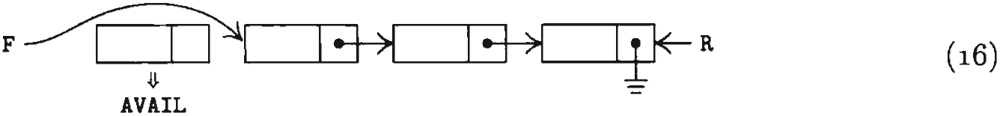

对于边界条件, 必须确保删除前或删除后队列为空时删除操作都能进行. 鉴于这些考虑, 我们通常用以下方法进行队列删除:

$$
\begin{aligned}&\text{如果 }\mathtt F=\Lambda,\text{ 则 }\mathtt{UNDERFLOW};\\&\text{否则置 }\mathtt P\leftarrow\mathtt F,\quad\mathtt F\leftarrow\mathtt{LINK}(\mathtt P),\quad\mathtt Y\leftarrow\mathtt{INFO}(\mathtt P),\quad\mathtt{AVAIL}\Leftarrow\mathtt P,\\&\qquad\text{并且如果 }\mathtt F=\Lambda,\text{ 则置 }\mathtt R\leftarrow\mathtt{LOC}(\mathtt F).\end{aligned}
\qquad \text{(17)}
$$

注意, 当队列变空时, 必须改变 R. 这正是我们始终需要注意的 “边界条件”.

这些建议并非用线性链接方式表示队列的唯一方法. 习题 30 描述了另一种稍微自然一点的方法, 并且本章稍后将给出其他方法. 实际上, 上面的操作都不是唯一方法, 而只是打算作为操纵链表的基本手段的例子. 对这些技术只有不多经验的读者将会发现, 在继续阅读之前, 重读本节前面的内容是有益的.

本章到目前为止, 已经讨论了如何在表上执行某些操作, 但是我们的讨论始终是 “抽象的”, 未给出表明特定技术有用的实际程序. 人们在看到足够多的问题特例, 激发起兴趣之前, 通常缺乏研究抽象问题的动力. 迄今为止所讨论的操作 (通过插入和删除操纵变长的信息表, 以及表用作栈和队列) 有广泛的应用, 读者大概已经足够频繁地遇见它们, 知道了它们的重要性. 我们现在将离开抽象王国, 开始研究本章技术的一系列有意义的实例.

第一个例子是拓扑排序 (topologicalsorting) 问题, 这是一个重要过程, 网络问题、所谓的 PERT 图甚至语言学都需要它. 事实上, 只要问题涉及偏序, 它就可能有用. 集合 $S$ 的一个<a id="pdf-225"></a><a id="p-208"></a>偏序 (partial ordering) 是 $S$ 的对象之间的一个关系, 可以记作 $\text{" } \leq  \text{" }$, 对于 S 中的任意对象 $x$, $y$ 和 $z$ (可以相同), 满足如下性质:

(i) 如果 $x \preceq y$, 且 $y\preceq z$, 则 $x\preceq z.$ (传递性.)

(ii) 如果 $x \preceq y$, 且 $y\preceq x$, 则 $x = y .$ (反对称性.)

(iii) $x \preceq x .$ (自反性.)

记号 $x \preceq y$ 可以读作 “$x$ 先于或等于 $y ^ { \prime \prime }$. 如果 $x \preceq y$ 并且 $x \ne y$, 则记作 $x \prec y$ 并说 $\text{“}x$ 先于 $y ^ { \prime \prime }$. 由 (i)(ii)(iii) 容易看出我们有

(i') 如果 $x \prec y$, 且 $y \prec z$, 则 $x \prec z .$ (传递性.)

(ii') 如果 $x \prec y$, 则 $y\nprec x.$ (非对称性.)

(ii) $x\nprec x.$ (非自反性.)

用 $y \ne x$ 标记的关系意指 “$y$ 不先于 $x\text{”}$. 如果从满足条件 $( \mathrm { i } ^ { \prime } ) ( \mathrm { i i } ^ { \prime } )$ 和 $\left( \widetilde{1} \widetilde{1} \widetilde{1}' \right)$ 的关系人开始, 则可以把上述定义过程颠倒过来, 并定义如果 xy 或 $x = y$ 则 $x \preceq y$, 于是, 性质 (i)(i)(iii) 为真. 因此, 偏序的定义既可以取性质 (i)(ii)(iii), 也可以取性质 $\mathrm{(i')(ii')(iii')}$, 注意, 性质 (ii') 实际上是性质 (i') 和 (iii') 的推论, 尽管 (ii) 不能由 (i) 和 (iii) 推出.

偏序频繁地出现在日常生活和数学中. 数学的例子有实数 $x$ 和 $y$ 之间的关系 $x \leq y$, 对象集合之间的关系 $x \subseteq y$, 正整数之间的关系 $x \backslash y$ ($x$ 整除 $y )$. 在 PERT 网中, S 是必须完成的作业的集合, 而关系 $\text{“}x\prec y\text{”}$ 意指 “$x$ 必须先于 $y$ 完成”.

<a id="fig-2-6"></a>

<span>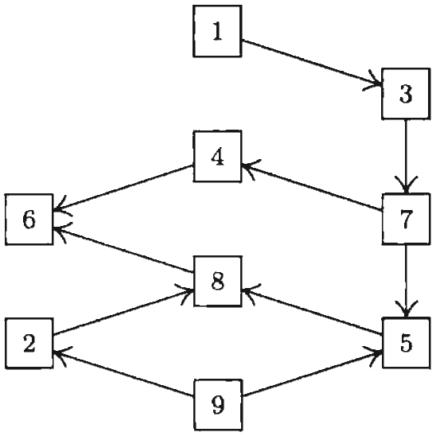</span>

*图 6　一个偏序*

我们将自然地假定 S 是有穷集, 因为要在计算机内使用 S. 有穷集上的偏序总可以绘制像 [图6](#fig-2-6) 这样的图来表示, 其中对象用小方框表示, 而关系用方框之间的箭头表示, 因此 $x \prec y$ 意味着有一条从标记为 $x$ 的方框沿着箭头方向到标记为 $y$ 的方框的路径. 偏序的性质 (ii) 意味着图中不存在闭回路 (没有封闭成环的路径). 如果在 [图6](#fig-2-6) 中从 4 到 1 画一个箭头, 就不再有偏序.

拓扑排序问题就是把偏序嵌入到线性序, 即把诸对象排列成一个线性序列 $a _ { 1 } a _ { 2 } \ldots a _ { n }$, 使得只要 $a _ { j } \prec a _ { k }$, 就有 $j < k .$ 从图形上看, 这意味着把这些方框重新排成一行, 使得所有的箭头都指向右方 (见 [图7](#fig-2-7)). 如果存在回路, 这种重排肯定做不到. 在一般情况下, 不容易看出这种重排是否可能. 因此, 我们将要给出的算法很有意义, 这不仅因为它实现了一个有用的操作, 而且因为它证明了, 这个操作对于每个偏序都能实现的.

作为拓扑排序的例子, 考虑一个包含科技术语定义的大型术语表. 如果词 $w_1$ 的定义直接或间接地依赖 $w _ { 2 }$, 则称 $w _ { 2 } \prec w _ { 1 }$. 只要不存在 “循环” 定义, 这个关系就是偏序关系. 在这种情况下, 拓扑排序问题是: 找出一种排列术语表中词汇的方法, 使得所有术语在定义之前都不使

<a id="pdf-226"></a><a id="p-209"></a>

<a id="fig-2-7"></a>

<span>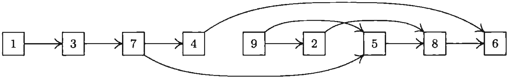</span>

*图 7　拓扑排序后, 图 6 的序关系*

用. 类似的问题出现在编写程序处理某些汇编和编译语言的说明时, 出现在编写介绍计算机语言的用户手册时, 也出现在编写关于信息结构的教科书时.

有一种非常简单的拓扑排序方法. 开始, 取一个对象, 要求在该偏序下, 任何其他对象都不先于该对象. 这个对象可以放在输出的第一个位置上. 现在, 我们从集合 $S$ 中移走该对象, 余下的集合仍然是偏序集, 并且可以重复该过程, 直到整个集合被排序. 例如在 [图6](#fig-2-6), 我们可以从移走 1 或 9 开始, 1 移走后可以取 3, 如此下去. 这个算法可能失败的唯一情况是, 如果存在一个非空偏序集, 其中每个元素都有另一个元素先于它, 算法将无事可做. 但是, 如果每个元素都有另一个元素先于它, 则我们可以构造一个任意长的序列 $b _ { 1 } , b _ { 2 } , b _ { 3 } , \ldots$, 其中 $b_{j+1}\prec b_j$ 由于 S 是有穷的, 因此对于某个 $b _ { j } = b _ { k }$, 我们必然有 $j < k .$ 但是, $j < k$ 意味 $b _ { k } \preceq b _ { j + 1 }$, 因此 $b _ { j } = b _ { k }$ 与 (ii) 矛盾.

为了用计算机有效地实现这一过程, 我们需要准备好实施上面所描述的动作, 即确定不被任何其他对象居先的对象的位置, 并且从集合中删除它们. 实现也受到期望的输入和输出特征的影响. 最一般的程序将接受对象的字符名, 并能对大量对象 (比可以一次装入内存的还要多) 排序. 然而, 这种复杂性会模糊我们试图解释的要点. 字符数据的处理可以用第 6 章的方法有效地实现, 而大型网络的处理作为一个有趣的课题留给读者.

因此, 我们假定待排序的对象按任意次序从 1 到 $n$ 编号. 程序的输入在带设备 1 上, 每个带记录包含 50 个数对, 其中数对 ($j$, $k$) 表示对象 $j$ 先于对象 $k$. 然而, 第一个数对是 $( 0 , n )$ 其中 $n$ 是对象的个数. 数对 (0,0) 终止输入. 我们假定 $n$ 加上关系数对的个数完全可以放在内存中, 还假定不必检查输入的合法性. 输出是排定序下的对象编号, 后随一个数 0, 输出到带设备 2 上.

例如, 输入可能有如下关系:

$$
9\prec2,\quad3\prec7,\quad7\prec5,\quad5\prec8,\quad8\prec6,\quad4\prec6,\quad1\prec3,\quad7\prec4,\quad9\prec5,\quad2\prec8.
\qquad \text{(18)}
$$

没有必要给出更多关系, 只要能够刻画期望的偏序就可以了. 因此, 像 9 人 8 (它可以由 $9\prec5$ 和 $5 \prec 8$ 推导出来) 这样的附加关系可以忽略, 或者添加到输入中也无妨. 一般而言, 仅需给出对应于 [图6](#fig-2-6) 中的箭头的关系.

下面的算法使用一个顺序表 X[1],X[2],...,X[$n$], 每个 X[$k$] 形式为

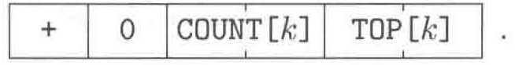

这里, COUNT[$k$] 是对象 $k$ 的直接前驱的个数 (出现在输入中的关系 $j<k$ 的个数), 而 TOP[$k$] 是一个到对象 $k$ 的直接后继表开始处的链. 该表各项的格式为

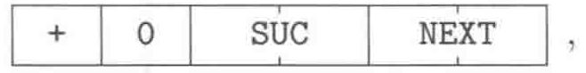

其中 SUC 是 $k$ 的一个直接后继, 而 NEXT 是该表的下一个项. [图8](#fig-2-8) 是这些约定的一个例子, 显示了对应于输入 (18) 的存储内容的示意图.

<a id="pdf-227"></a><a id="p-210"></a>

<a id="fig-2-8"></a>

<span>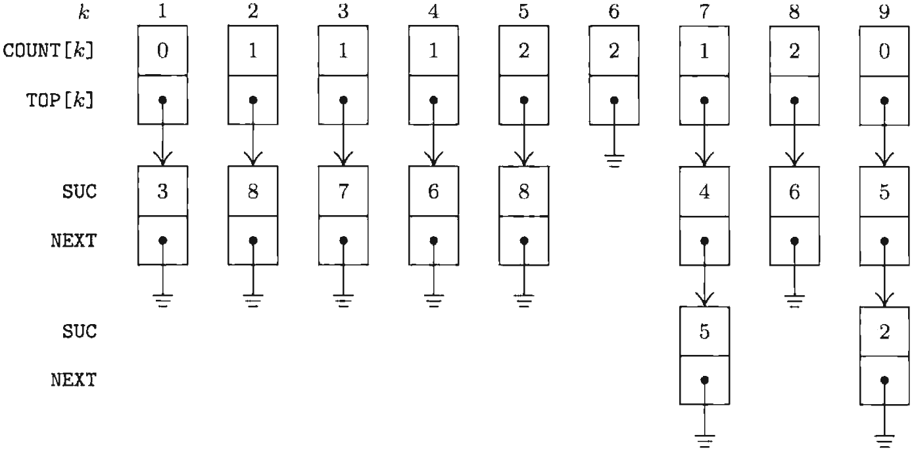</span>

*图 8　对应于关系 (18) 的图 6 的计算机表示*

使用这种存储布局, 不难设计该算法. 我们想输出 COUNT 字段为 0 的结点, 然后把这些结点所有后继的 COUNT 字段的值减去 1. 技巧是避免 “搜索”COUNT 字段为 0 的结点, 而这可以用一个包含这些结点的队列来实现. 这个队列的链保存在 COUNT 字段, 该字段现在已经完成了先前的使命. 为了使下面的算法更加清晰, 当 COUNT[$k$] 字段不再用于计数时, 改用记号 QLINK[$k$] 表示.

算法 T (拓扑排序). 该算法的输入是关系 $j \prec k$ 的序列, 指出在某种偏序下, 对象 $j$ 先于对象 $k$ (假定 $1\le j,\ k\le n)$. 输出是嵌入到一个线性序中的 $n$ 个对象的集合. 使用的内部表是: QLINK[0], COUNT[1] = QLINK[1],COUNT[2] = QLINK[2],..., COUNT[n] = QLINK[n];TOP[1],TOP[2],...,TOP[$n$]; 一个存储池, 每个输入关系对应一个结点, 每个结点都包含 SUC 和 NEXT 字段, 如 [图8](#fig-2-8) 所示; R 是一个链变量, 用来引用存储池中的结点; F 和 P 是整数值变量, 用来引用其链接在 QLINK 表中的队列的头和尾; N 是一个变量, 统计尚未输出的对象个数计数.

T1.[初始化.] 输入值 $n$. 对于 $1 \leq k \leq n$, 置 COUNT[$k$]←0,TOP[$k$] ←Λ; 置 N ← n.

T2.[下一个关系.] 从输入得到下一个关系 $\text{“}j\prec k\text{”}$. 如果输入已经处理完毕, 则转到 T4.

T3.[记录该关系.]COUNT[$k$] 增加 1; 置

$$
\mathtt P\Leftarrow\mathtt{AVAIL},\quad\mathtt{SUC}(\mathtt P)\leftarrow k,\quad\mathtt{NEXT}(\mathtt P)\leftarrow\mathtt{TOP}[j],\quad\mathtt{TOP}[j]\leftarrow\mathtt P.
$$

(这是操作 (8).) 转回 T2.

T4.[扫描 0.\](此时, 输入阶段已经完成, 输入 (18) 已经转换成 [图8](#fig-2-8) 所示的计算机表示. 下一步工作是初始化输出队列, 它通过 QLINK 字段链接.) 置 $\tilde { \mathtt { R } } \leftarrow 0$, QLINK[0] ← 0. 对于 1 $\leq k \leq n$, 考察 COUNT[$k$], 如果它为 0, 则置 QLINK[R]←$k$, R←k. 对所有的 $k$ 完成后, 置 F←QLINK[0] (它将包含遇到的第一个 COUNT[$k$] 为 0 的 $k$ 值).

T5.[输出队列头部.] 输出 F 的值. 如果 F=0, 则转到 T8; 否则置 N←N-1, 并置 $\mathtt P\leftarrow\mathtt{TOP}[\mathtt F]$. (由于 QLINK 表和 COUNT 表重叠, 我们有 $\mathtt { Q L I N K } \left[ \mathtt { R } \right] = 0$, 因此, 当该队列为空时, 条件 F=0 出现.)

T6.[删除关系.] 如果 P=Λ, 则转到 T7. 否则 COUNT[SUC(P)] 减 1; 如果减 1 后为 0, 则置 QLINK[R]← SUC(P), R←SUC(P). 置 P ←NEXT(P) 并重复这一步骤. (对于某个 $k$, <a id="pdf-228"></a><a id="p-211"></a>我们从系统取走所有形如 “F 人 $k$” 的关系, 并当新结点的所有前驱都已经输出时, 把它放进队列中.)

T7.[从队列删除.] 置 F←QLINK[F] 并转回 T5.

T8.[过程结束.] 算法终止. 如果 N=0, 则我们已经按期望的 “拓扑序” 输出了所有对象编号, 后随一个 0. 否则, 尚未输出的 N 个对象包含一个回路, 与偏序假设相违背. (关于打印这种回路内容的算法, 见习题 23.)

<a id="fig-2-9"></a>

<span>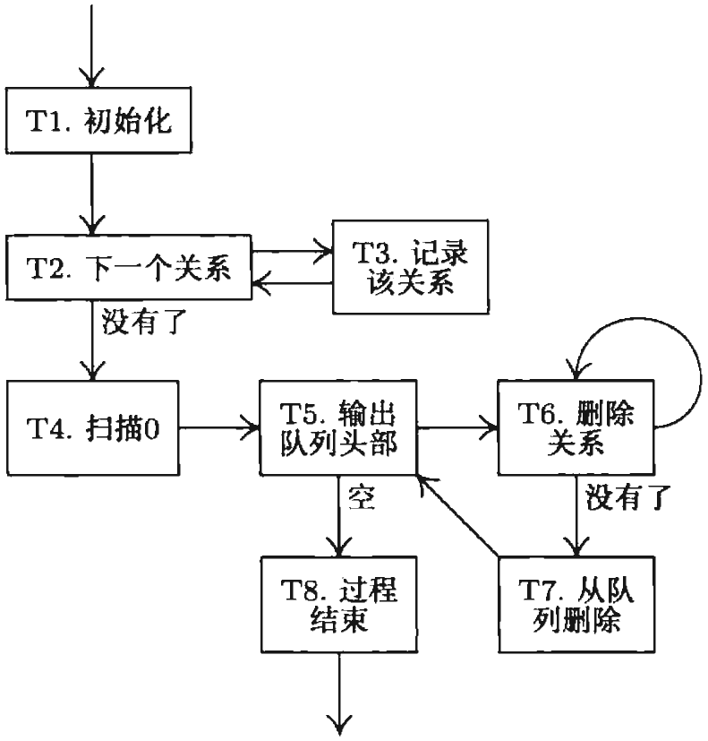</span>

*图 9　拓扑排序*

读者会发现, 以输入 (18) 为例, 人工试试该算法是有益的. 算法 T 展示了顺序存储和链接存储技术的优雅结合. 主表 X[1],X[2],...,X[$n$] 使用顺序存储, 它包含 COUNT[$k$] 和 TOP[$k$] 项, 因为步骤 T3 要引用这个表的 “随机” 部分. (如果输入是字符, 则为了更快地搜索, 将使用另一种类型的表, 见第 6 章.)“直接后继” 表使用链接存储, 因为这些表的项在输入中没有特定的次序. 按输出序把结点链接在一起, 得到等待输出的结点队列, 驻留在顺序表中. 这种链接通过表下标, 而不是通过地址实现. 换言之, 当队列头部为 X[$k$] 时, 我们有 F=k, 而不是 F =LOC(X[$k$])). 步骤 T4、T6 和 T7 中使用的队列操作并不等价于 (14) 和 (17) 中的操作, 因为我们利用了这个系统中该队列特殊性质: 在算法的这一部分, 不需要创建结点, 也不需要把结点送还可用空间.

算法 T 的 MIX 汇编语言程序还有几点有趣之处. 由于在该算法中并不从表中删除 (因为不必释放存储供以后使用), 操作 P⇐AVAIL 可以用非常简单的方法实现, 如程序第 19 和 32 行所示. 不需要保持任何链接的存储池, 可以连续地选取新结点. 该程序包括完整的磁带输入和输出 (按照上面提到的约定), 但是为简单起见, 省略了缓冲. 读者将会发现不难理解该程序的编码细节, 因为它直接对应于算法 T, 只是为了效率做了少许改变. 这里阐明了变址寄存器的有效使用, 它是链接存储处理的重要方面.

程序 T (拓扑排序). 在这个程序中, 应该注意如下等价性: rI6N,rI5 缓冲区指针, rI4 ≡ $k$, rI3 ≡ $j$ 和 R, rI2 ≡ AVAIL 和 P, rI1 ≡ F, TOP[$j$] ≡ X + j(4:5), COUNT[k] ≡QLINK[k] ≡ X + k(2:3).

<a id="pdf-229"></a><a id="p-212"></a>

| 行号 | LOC | OP | ADDRESS | 次数 | 注释 |
| ---: | :--- | :--- | :--- | :---: | :--- |
| 01 | `*` |  |  |  | 缓冲区和字段定义 |
| 02 | `COUNT` | `EQU` | `2:3` |  | 字段的 |
| 03 | `QLINK` | `EQU` | `2:3` |  | 符号名定义 |
| 04 | `TOP` | `EQU` | `4:5` |  |  |
| 05 | `SUC` | `EQU` | `2:3` |  |  |
| 06 | `NEXT` | `EQU` | `4:5` |  |  |
| 07 | `TAPEIN` | `EQU` | `1` |  | 输入在带设备 1 上 |
| 08 | `TAPEOUT` | `EQU` | `2` |  | 输出在带设备 2 上 |
| 09 | `BUFFER` | `ORIG` | `*+100` |  | 带缓冲区 |
| 10 |  | `CON` | `-1` |  | 缓冲区结束标记 |
| 11 | `*` |  |  |  | 输入阶段 |
| 12 | `TOPSORT` | `IN` | `BUFFER(TAPEIN)` | $1$ | <u>T1. 初始化. </u> 读入第一个磁带块. |
| 13 |  | `JBUS` | `*(TAPEIN)` |  | 等待完成. |
| 14 | `1H` | `LD6` | `BUFFER+1` | $1$ | $\mathrm N\leftarrow n$. |
| 15 |  | `ENT4` | `0,6` | $1$ |  |
| 16 |  | `STZ` | `X,4` | $n+1$ | 对于 $0\le k\le n$, |
| 17 |  | `DEC4` | `1` | $n+1$ | 置 $\mathrm{COUNT}[k]\leftarrow0$，$\mathrm{TOP}[k]\leftarrow\Lambda$ |
| 18 |  | `J4NN` | `*-2` | $n+1$ | (预置步骤 T4 中的 $\mathrm{QLINK}[0]\leftarrow0$.) |
| 19 |  | `ENT2` | `X,6` | $1$ | 可用空间从 $\mathrm X[n]$ 之后开始. |
| 20 |  | `ENT5` | `BUFFER+2` | $1$ | 准备读第一个数对 $(j,k)$. |
| 21 | `2H` | `LD3` | `0,5` | $m+b$ | <u>T2. 下一个关系. </u> |
| 22 |  | `J3P` | `3F` | $m+b$ | $j>0$ 吗? |
| 23 |  | `J3Z` | `4F` | $b$ | 输入耗尽了吗? |
| 24 |  | `IN` | `BUFFER(TAPEIN)` | $b-1$ | 遇到结束标记; 读另一个磁带块, |
| 25 |  | `JBUS` | `*(TAPEIN)` |  | 等待完成. |
| 26 |  | `ENT5` | `BUFFER` | $b-1$ | 重置缓冲区指针. |
| 27 |  | `JMP` | `2B` | $b-1$ |  |
| 28 | `3H` | `LD4` | `1,5` | $m$ | <u>T3. 记录该关系. </u> |
| 29 |  | `LDA` | `X,4(COUNT)` | $m$ | $\mathrm{COUNT}[k]$ |
| 30 |  | `INCA` | `1` | $m$ | $+1$ |
| 31 |  | `STA` | `X,4(COUNT)` | $m$ | $\to\mathrm{COUNT}[k]$。 |
| 32 |  | `INC2` | `1` | $m$ | $\mathrm{AVAIL}\leftarrow\mathrm{AVAIL}+1$。 |
| 33 |  | `LDA` | `X,3(TOP)` | $m$ | $\mathrm{TOP}[j]$ |
| 34 |  | `STA` | `0,2(NEXT)` | $m$ | $\to\mathrm{NEXT}(\mathrm P)$。 |
| 35 |  | `ST4` | `0,2(SUC)` | $m$ | $k\to\mathrm{SUC}(\mathrm P)$. |
| 36 |  | `ST2` | `X,3(TOP)` | $m$ | $\mathrm P\to\mathrm{TOP}[j]$. |
| 37 |  | `INC5` | `2` | $m$ | 缓冲区指针增值。 |
| 38 |  | `JMP` | `2B` | $m$ |  |
| 39 | `4H` | `IOC` | `0(TAPEIN)` | $1$ | 重绕输入带. |
| 40 |  | `ENT4` | `0,6` | $1$ | <u>T4. 扫描. </u> $k\leftarrow n$. |
| 41 |  | `ENT5` | `-100` | $1$ | 重新设置输出缓冲区指针. |
| 42 |  | `ENT3` | `0` | $1$ | $\mathrm R\leftarrow0$. |
| 43 | `4H` | `LDA` | `X,4(COUNT)` | $n$ | 检查 $\mathrm{COUNT}[k]$。 |
| 44 |  | `JAP` | `*+3` | $n$ | 非 0 吗? |
| 45 |  | `ST4` | `X,3(QLINK)` | $a$ | $\mathrm{QLINK}[\mathrm R]\leftarrow k$. |
| 46 |  | `ENT3` | `0,4` | $a$ | $\mathrm R\leftarrow k$. |
| <a id="pdf-230"></a><a id="p-213"></a>47 |  | `DEC4` | `1` | $n$ |  |
| 48 |  | `J4P` | `4B` | $n$ | $n\ge k\ge1$. |
| 49 | `*` |  |  |  | 排序阶段 |
| 50 |  | `LD1` | `X(QLINK)` | $1$ | $\mathrm F\leftarrow\mathrm{QLINK}[0]$. |
| 51 | `5H` | `JBUS` | `*(TAPEOUT)` |  | <u>T5. 输出队列头部. </u> |
| 52 |  | `ST1` | `BUFFER+100,5` | $n+1$ | 存放 $\mathrm F$ 到缓冲区. |
| 53 |  | `J1Z` | `8F` | $n+1$ | $\mathrm F$ 为 0 吗? |
| 54 |  | `INC5` | `1` | $n$ | 推进缓冲区指针。 |
| 55 |  | `J5N` | `*+3` | $n$ | 检测缓冲区是否满. |
| 56 |  | `OUT` | `BUFFER(TAPEOUT)` | $c-1$ | 如果满, 则输出一个磁带块. |
| 57 |  | `ENT5` | `-100` | $c-1$ | 重置缓冲区指针. |
| 58 |  | `DEC6` | `1` | $n$ | $\mathrm N\leftarrow\mathrm N-1$。 |
| 59 |  | `LD2` | `X,1(TOP)` | $n$ | $\mathrm P\leftarrow\mathrm{TOP}[\mathrm F]$. |
| 60 |  | `J2Z` | `7F` | $n$ | <u>T6. 删除关系. </u> |
| 61 | `6H` | `LD4` | `0,2(SUC)` | $m$ | $\mathrm{rI4}\leftarrow\mathrm{SUC}(\mathrm P)$. |
| 62 |  | `LDA` | `X,4(COUNT)` | $m$ | $\mathrm{COUNT}[\mathrm{rI4}]$ |
| 63 |  | `DECA` | `1` | $m$ | $-1$ |
| 64 |  | `STA` | `X,4(COUNT)` | $m$ | $\to\mathrm{COUNT}[\mathrm{rI4}]$。 |
| 65 |  | `JAP` | `*+3` | $m$ | 已经到 0? |
| 66 |  | `ST4` | `X,3(QLINK)` | $n-a$ | 如果到, 则置 $\mathrm{QLINK}[\mathrm R]\leftarrow\mathrm{rI4}$. |
| 67 |  | `ENT3` | `0,4` | $n-a$ | $\mathrm R\leftarrow\mathrm{rI4}$. |
| 68 |  | `LD2` | `0,2(NEXT)` | $m$ | $\mathrm P\leftarrow\mathrm{NEXT}(\mathrm P)$. |
| 69 |  | `J2P` | `6B` | $m$ | 如果 $\mathrm P\ne\Lambda$，则重复。 |
| 70 | `7H` | `LD1` | `X,1(QLINK)` | $n$ | <u>T7. 从队列删除. </u> |
| 71 |  | `JMP` | `5B` | $n$ | $\mathrm F\leftarrow\mathrm{QLINK}[\mathrm F]$，转到 T5。 |
| 72 | `8H` | `OUT` | `BUFFER(TAPEOUT)` | $1$ | <u>T8. 过程结束. </u> |
| 73 |  | `IOC` | `0(TAPEOUT)` | $1$ | 输出最后一块并重绕. |
| 74 |  | `HLT` | `0,6` | $1$ | 停止, 在控制台上显示 $\mathrm N$. |
| 75 | `X` | `END` | `TOPSORT` |  | 表区域开始.　▮ |

<details>
<summary>MIXAL 等宽清单</summary>

```text
* 缓冲区和字段定义
COUNT     EQU   2:3
QLINK     EQU   2:3
TOP       EQU   4:5
SUC       EQU   2:3
NEXT      EQU   4:5
TAPEIN    EQU   1
TAPEOUT   EQU   2
BUFFER    ORIG  *+100
          CON   -1
* 输入阶段
TOPSORT   IN    BUFFER(TAPEIN)
          JBUS  *(TAPEIN)
1H        LD6   BUFFER+1
          ENT4  0,6
          STZ   X,4
          DEC4  1
          J4NN  *-2
          ENT2  X,6
          ENT5  BUFFER+2
2H        LD3   0,5
          J3P   3F
          J3Z   4F
          IN    BUFFER(TAPEIN)
          JBUS  *(TAPEIN)
          ENT5  BUFFER
          JMP   2B
3H        LD4   1,5
          LDA   X,4(COUNT)
          INCA  1
          STA   X,4(COUNT)
          INC2  1
          LDA   X,3(TOP)
          STA   0,2(NEXT)
          ST4   0,2(SUC)
          ST2   X,3(TOP)
          INC5  2
          JMP   2B
4H        IOC   0(TAPEIN)
          ENT4  0,6
          ENT5  -100
          ENT3  0
4H        LDA   X,4(COUNT)
          JAP   *+3
          ST4   X,3(QLINK)
          ENT3  0,4
          DEC4  1
          J4P   4B
* 排序阶段
          LD1   X(QLINK)
5H        JBUS  *(TAPEOUT)
          ST1   BUFFER+100,5
          J1Z   8F
          INC5  1
          J5N   *+3
          OUT   BUFFER(TAPEOUT)
          ENT5  -100
          DEC6  1
          LD2   X,1(TOP)
          J2Z   7F
6H        LD4   0,2(SUC)
          LDA   X,4(COUNT)
          DECA  1
          STA   X,4(COUNT)
          JAP   *+3
          ST4   X,3(QLINK)
          ENT3  0,4
          LD2   0,2(NEXT)
          J2P   6B
7H        LD1   X,1(QLINK)
          JMP   5B
8H        OUT   BUFFER(TAPEOUT)
          IOC   0(TAPEOUT)
          HLT   0,6
X         END   TOPSORT
```

</details>

借助基尔霍夫定律, 算法 T 的分析相当简单. 运行时间近似于 $c_1m+c_2n$, 其中 $m$ 是输入关系数, $n$ 是对象数, $c_1$ 和 $c_2$ 是常量. 对于这个问题, 很难想象有更快的算法! 上面的程序 T 中, 精确给出分析中的各个量, 其中 $a={}$ 无前驱的对象数, $b={}$ 输入的带记录数 $=\lceil(m+2)/50\rceil$, $c={}$ 输出的带记录数 $=\lceil(n+1)/100\rceil$. 排除输入输出操作, 在这种情况下, 整个运行时间仅为 $(32m+24n+7b+2c+16)u$.

阿瑟·卡恩首先发表一种类似于算法 T 的拓扑排序技术 (但缺乏队列链的重要特征)[*CACM* **5** (1962), 558–562]. 爱德华·苏比尔拉首先发表了偏序总能拓扑排序这一结论的证明 [*Fundamenta Mathematica* **16** (1930), 386–389], 他对无穷集和有穷集均作了证明, 并且提到他的一些同事已经知道这一结果.

虽然算法 T 非常有效, 我们还将在 7.4.1 节研究一种更好的拓扑排序算法.

#### 习题

▶ 1. [10] <a id="ex-2-2-3-1"></a>[答案](./answers/2-2-3.md#ans-2-2-3-1)  由栈弹出的操作 (9) 提到 `UNDERFLOW` 的可能性. 为什么下推到栈的操作 (8) 不提 `OVERFLOW` 的可能性?

<a id="pdf-231"></a><a id="p-214"></a>

2\. [22] <a id="ex-2-2-3-2"></a>[答案](./answers/2-2-3.md#ans-2-2-3-2) 写一个做插入操作 (10) 的 “通用”MIX 子程序. 该子程序应该具有如下说明 (与 1.4.1 节一样):

调用序列: JMP INSERT 转向子程序.

$$
NOP  \quad  T  \quad  指针变量的位置
$$

入口条件: rA=欲放入新结点 INFO 字段的信息.

出口条件: 以链变量 T 为指针的栈的顶部为新结点; rI1=T;rI2 和 rI3 被修改.

3\. [22] <a id="ex-2-2-3-3"></a>[答案](./answers/2-2-3.md#ans-2-2-3-3) 写一个做删除操作 (11) 的 “通用”MIX 子程序. 该子程序应该具有如下说明:

调用序列: JMPDELETE 转向子程序. NOP T 指针变量的位置 JMP UNDERFLOW 第一出口, 如果检测到 UNDERFLOW 的话.

入口条件: 无

出口条件: 如果以链变量 T 为指针的栈为空, 则取第一出口; 否则删除该栈的顶部结点, 并且出口为 “JMPDELETE” 指令往后数的第三个位置. 在后一种情况下, rI1=T, 而 rA 是被删除结点的 INFO 字段的内容. 在两种情况下, 子程序都使用 rI2 和 rI3.

4\. [22] <a id="ex-2-2-3-4"></a>[答案](./answers/2-2-3.md#ans-2-2-3-4) (10) 中的程序基于 (6) 给出的操作 $\mathtt { P } \Leftarrow \mathtt { A V A I L }$. 说明如何写一个 OVERFLOW (上溢) 子程序, 使得不对程序 (1o) 做任何改变, 操作 P←AVAIL 使用 SEQMIN, 即实现 (7). 为了通用, 除 rJ 和比较指示器外, 你的子程序不应该改变任何寄存器的内容. 它应该退出到位置 rJ-2, 而不是通常的 rJ.

5\. [24] <a id="ex-2-2-3-5"></a>[答案](./answers/2-2-3.md#ans-2-2-3-5) 操作 (14) 和 (17) 给出了队列的效果. 说明如何进一步定义 “在头部插入” 操作, 以便得到输出受限的双端队列的所有操作. 如何定义 “从尾部删除” 操作 (得到一般的双端队列)?

6\. [21] <a id="ex-2-2-3-6"></a>[答案](./answers/2-2-3.md#ans-2-2-3-6) 在操作 (14) 中, 我们置 LINK(P)←Λ, 而每次队尾插入都将改变这个链字段的值. 试说明, 如果改变 (17) 中 $\text{“}\mathtt F=\Lambda\text{”}$ 的检测, 有办法避免 (14) 中的 LINK(P) 的设置.

7\. [23] <a id="ex-2-2-3-7"></a>[答案](./answers/2-2-3.md#ans-2-2-3-7) 设计一个算法, “反转” 一个形如 (1) 的链接的线性表, 即改变它的诸链, 使得诸项以相反次序出现. (例如, 如果反转表 (1), 则 FIRST 将指向包含项 5 的结点; 该结点将链接到包含项 4 的结点; 如此下去.) 假定结点具有形式 (3).

8\. [24] <a id="ex-2-2-3-8"></a>[答案](./answers/2-2-3.md#ans-2-2-3-8) 对习题 7 的问题, 写一个 MIX 程序. 试图使你的程序尽可能快地运行.

9\. [20] <a id="ex-2-2-3-9"></a>[答案](./answers/2-2-3.md#ans-2-2-3-9) 在指定的集合 $S$ 上, 下列关系哪些是偏序关系? (注意: 如果下文定义了关系 $\text{" }x\prec y \text{" }$, 则其意图是定义关系 $\text{“}x\preceq y\equiv(x\prec y\text{ 或 }x=y)\text{”}$, 然后确定是否为偏序.)(a)S=所有有理数, $x \prec y$ 意指 $x > y .$ (b)S=所有的人, $x<y$ 意指 $x$ 是 $y$ 的一个祖先. (c)S=所有整数, $\bar{x} \preceq \bar{y}$ 意指 $x$ 是 $y$ 的倍数 (即 $x\bmod y=0$). (d) S = 本书证明的所有数学结论, $\bar{x} \prec y$ 意指 $y$ 的证明依赖于 $x$ 的成立. (e)S =所有正整数, $x\preceq y$ 意指 $x+y$ 为偶数. (f)S=所有子程序的集合, $x$ 人 $y$ 意指 “$x$ 调用 $y ^ { \prime }$; 即在 $x$ 运行期间, $y$ 可能运行, 不允许递归.

10\. [M21] <a id="ex-2-2-3-10"></a>[答案](./answers/2-2-3.md#ans-2-2-3-10) 设关系 “⊂” 满足偏序性质 (i) 和 (ii), 关系 “” 用规则 $\text{“}x\preceq y$ 当且仅当 $x=y$ 或 $x \subset y ^ { \prime \prime }$ 定义. 证明 “” 满足偏序的所有三个性质.

▶ 11. [24] <a id="ex-2-2-3-11"></a>[答案](./answers/2-2-3.md#ans-2-2-3-11) 拓扑排序的结果并非总是完全确定的, 因为可能存在多种方法排列结点, 都满足拓扑序条件. 找出把 [图6](#fig-2-6) 的结点排列成拓扑序的所有可能的方法.

12\. [M20] <a id="ex-2-2-3-12"></a>[答案](./answers/2-2-3.md#ans-2-2-3-12) $n$ 个元素的集合有 2 个子集, 并且这些子集按照集合包含关系是偏序的. 给出两种按拓扑序排列这些子集的方法.

13\. [M48] <a id="ex-2-2-3-13"></a>[答案](./answers/2-2-3.md#ans-2-2-3-13)  把习题 12 的 $2 ^ { n }$ 个子集排列成拓扑序有多少种方法? (答案是 $n$ 的函数.)

14\. [M21] <a id="ex-2-2-3-14"></a>[答案](./answers/2-2-3.md#ans-2-2-3-14) 集合 $S$ 的线性序 (linear ordering) 又称全序 (total ordering), 这种偏序满足附加的 “可比 较性” 条件:

$$
\text{(iv)　对于 }S\text{ 中任意两个对象 }x\text{ 和 }y,\quad\text{或者 }x\preceq y\text{ 或者 }y\preceq x.
$$

直接由定义证明: 拓扑排序只有一种输出, 当且仅当关系是线性序. (可以假定 S 是有穷集.)

15\. [M25] <a id="ex-2-2-3-15"></a>[答案](./answers/2-2-3.md#ans-2-2-3-15) 证明: 对于有限集 S 上的任意偏序, 都存在唯一一组刻画该偏序的无冗余的关系, 像 (18) 和 [图6](#fig-2-6) 一样. 当 S 为无穷集时, 同样的结论成立吗?

<a id="pdf-232"></a><a id="p-215"></a>

16\. [M22] <a id="ex-2-2-3-16"></a>[答案](./answers/2-2-3.md#ans-2-2-3-16) 给定集合 $S = \{ x _ { 1 } , \ldots , x _ { n } \}$ 上的任意偏序, 我们可以构造它的关联矩阵 $\left( a _ { i j } \right)$, 其中如果 xi  xj 则 $a _ { i j } = 1$, 否则 $a _ { i j } = 0 .$ 证明存在一种方法置换该矩阵的行和列, 使得对角线下方的元素均为 0.

▶ 17. [21] <a id="ex-2-2-3-17"></a>[答案](./answers/2-2-3.md#ans-2-2-3-17) 如果提供输入 (18), 算法 T 的输出是什么?

18\. [20] <a id="ex-2-2-3-18"></a>[答案](./answers/2-2-3.md#ans-2-2-3-18) 当算法 T 终止时, QLINK[0],QLINK[1],...,QLINK[$n$] 的值 (如果有的话) 的意义是什么?

19\. [18] <a id="ex-2-2-3-19"></a>[答案](./answers/2-2-3.md#ans-2-2-3-19) 在算法 T 中, 我们在步骤 T5 检查队列的头部元素, 但是直到步骤 T7 才移走该元素. 如果我们在步骤 T5 的结尾而不是在步骤 T7 置 F←QLINK[F], 会发生什么?

▶ 20. [24] <a id="ex-2-2-3-20"></a>[答案](./answers/2-2-3.md#ans-2-2-3-20) 算法 T 使用 F、R 和 QLINK 表获得队列效果, 该队列中结点的 COUNT 字段已经变成 0, 但是其后继关系尚未移走. 为此目的, 可以使用栈而不是使用队列吗? 如果可以, 把所得算法与算法 T 进行比较.

21\. [21] <a id="ex-2-2-3-21"></a>[答案](./answers/2-2-3.md#ans-2-2-3-21) 如果一个关系 “$j<k$” 在输入中重复多次, 算法 T 还能有效完成拓扑排序吗? 如果输入包含形如 $\text{" }j\prec j \text{" }$ 的关系, 又会怎样?

22\. [23] <a id="ex-2-2-3-22"></a>[答案](./answers/2-2-3.md#ans-2-2-3-22) 程序 T 假定它的输入带包含正确的信息, 但是旨在通用的程序总是应该小心地检查它的输入, 使得明显的错误可以被查出, 从而程序不可能 “自毁”. 例如, 如果关于 $k$ 的一个输入关系是负的, 则当存放到 X[$k$] 中时, 程序 T 可能错误地改变它自己的一条指令. 提出一种修改程序 T 的方法, 使它能够通用.

▶ 23. [27] <a id="ex-2-2-3-23"></a>[答案](./answers/2-2-3.md#ans-2-2-3-23) 当拓扑排序算法因检测到输入中的回路而不能继续进行时 (步骤 T8), 停下来并报告 “存在回路” 一般没有用. 打印回路, 指出输入出错的部位, 才是有用的. 扩充算法 T, 使得它在必要时进行这种打印. [提示: 正文中给出了在步骤 T8, 当 N>0 时存在回路的证明, 这一证明暗示了一种算法.]

24\. [24] <a id="ex-2-2-3-24"></a>[答案](./answers/2-2-3.md#ans-2-2-3-24) 把习题 23 所做的算法 T 的扩充合并到程序 T 中.

25\. [47] 设计一个尽可能高效的算法, 对非常大的集 S 进行拓扑排序. S 具有相当多的结点, 远远超出计算机的内存容量. 假定输入、输出和临时工作空间都使用磁带. [可能的提示: 常规的输入排序允许我们假定给定结点的所有关系一起出现. 但是下一步能够做什么? 我们必须特别考虑最坏情况, 即给定的序已经是线性序, 但经过胡乱置换. 第 5 章引言中的习题 24 解释如何用 $O ( \operatorname { l o g } n ) ^ { 2 }$ 次数据扫描来处理这种情况.]

26\. [29] <a id="ex-2-2-3-26"></a>[答案](./answers/2-2-3.md#ans-2-2-3-26) (子程序分配) 假设我们有一条磁带, 包含主要的子程序库. 对于 20 世纪 60 年代风格的计算机, 这些子程序是可重定位的. 装入程序要确定所使用的每个子程序的重定位量, 以便一次扫描磁带就能装入必要的程序. 问题是某些子程序要求其他子程序也在内存中. 不经常使用的子程序 (出现在磁带的末端) 可能调用频繁使用的子程序 (出现在磁带的前端), 而我们想在扫描磁带前就知道所有需要的子程序.

处理该问题的一种方法是创建一个可放入内存的 “带目录”. 装入程序要访问两个表.

(a) 带目录. 这个表由具有如下形式的变长结点组成

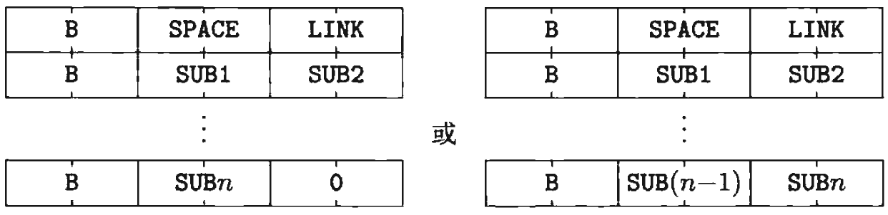

其中 SPACE 是该子程序需要的内存字数; LINK 是一个链, 指向磁带上紧随该子程序出现的子程序; SUB1,SUB2,...,SUBn(n≥0) 都是链, 指向该子程序需要的其他子程序的目录项; 除结点的最后一个字上 B =-1 外, 结点的所有字上均有 B =0. 链变量 FIRST 指定库带上第一个子程序的目录项的地址.

(b) 由待装入的程序直接引用的子程序的列表. 这个表存放在连续位置 X[1],X[2],...,X[N], 其中 $\mathbb { N } \geq 0$ 是装入程序知道的变量. 该表的每项都是一个链, 指向所需要的子程序的目录项.

装入程序也知道用于第一个被装入的子程序的重定位量 MLOC.

<a id="pdf-233"></a><a id="p-216"></a>

作为一个小例子, 考虑如下配置:

<table><tr><td colspan="4">带目录</td><td>需要的子程序列表</td></tr><tr><td></td><td>B</td><td>SPACE</td><td>LINK</td><td>X[1] = 1003</td></tr><tr><td>1000:</td><td>0</td><td>20</td><td>1005</td><td>X[2] 二</td></tr><tr><td>1001:</td><td>-1</td><td>1002</td><td>0</td><td></td></tr><tr><td>1002:</td><td>-1</td><td>30</td><td>1010</td><td>N = 2</td></tr><tr><td>1003:</td><td>0</td><td>200</td><td>1007</td><td>FIRST =</td></tr><tr><td>1004:</td><td>-1</td><td>1000</td><td>1006</td><td>MLOC 二</td></tr><tr><td>1005:</td><td>-1</td><td>100</td><td>1003</td><td></td></tr><tr><td>1006:</td><td>-1</td><td>60</td><td>1000</td><td></td></tr><tr><td>1007:</td><td>0</td><td>200</td><td>0</td><td></td></tr><tr><td>1008:</td><td>0</td><td>1005</td><td>1002</td><td></td></tr><tr><td>1009:</td><td>-1</td><td>1006</td><td>0</td><td></td></tr><tr><td>1010:</td><td>-1</td><td>20</td><td>1006</td><td></td></tr></table>

在这个例子中, 带目录表明, 带上的子程序依次为 1002、1010、1006、1000、1005、1003 和 1007. 子程序 1007 占 200 个位置, 并且必须使用子程序 1005、1002 和 1006; 等等. 待装入的程序需要子程序 1003 和 1010, 它们将放在位置 2400 之后. 这些子程序依次还必须装入 1000、1006 和 1002.

子程序分配程序将改变 X 表, 使得除最后一项外 (将在下面解释), 表中各项 X[1],X[2],X[3],... 都具有如下形式

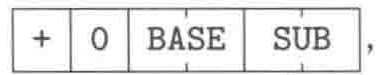

其中 SUB 是一个待装入的子程序, 而 BASE 是重定位量. 这些项将按照子程序在磁带上出现的次序排列. 上面例子的一个可能的答案是


|  |  |  |  |  |  |
| --- | --- | --- | --- | --- | --- |
|  | BASE | SUB |  | BASE | SUB |
| X&#91;1&#93;: | 2400 | 1002 | X&#91;4&#93;: | 2510 | 1000 |
| X&#91;2&#93;: | 2430 | 1010 | X&#91;5&#93;: | 2530 | 1003 |
| X&#91;3&#93;: | 2450 | 1006 | X&#91;6&#93;: | 2730 | 0 |


最后一项包含未使用内存的首地址.

(显然, 这不是处理子程序库的唯一方法. 设计子程序库的合适方法高度依赖于所使用的计算机和待处理的应用. 大型现代计算机需要一种完全不同的处理子程序库的方法. 但是, 这毕竟是一道好的练习题, 因为它同时涉及顺序和链接数据上的有趣操作.)

本题的问题是: 为所描述的任务设计一个算法. 在准备答案时, 分配程序可以用任何方法变换带目录, 因为子程序分配程序可以在下一次任务重新读入带目录, 并且装入程序的其他部分也不需要带目录.

27\. [25] <a id="ex-2-2-3-27"></a>[答案](./answers/2-2-3.md#ans-2-2-3-27) 为习题 26 的子程序分配算法编写一个 MIX 程序.

28\. [40] <a id="ex-2-2-3-28"></a>[答案](./answers/2-2-3.md#ans-2-2-3-28) 下面的构造展示如何 “求解” 一类相当一般的双人游戏, 包括国际象棋、拿子游戏, 以及许多比较简单的游戏. 考虑结点的一个有限集, 其中每个结点表示游戏的一个可能棋局. 对于每个棋局, 存在零或多种移动, 把该棋局变换成某个其他棋局. 如果存在一步移动把棋局 $x$ 变成棋局 $y$, 就说 $x$ 是 $y$ 的一个前驱 ($y$ 是 $x$ 的一个后继). 没有后继的某些棋局分成 “赢” 或 “输” 棋局. 在棋局 $x$ 移动的游戏者是在棋局 $x$ 的后继棋局移动的游戏者的对手.

给定这样的棋局配置, 通过重复以下操作, 直到不再发生改变, 我们可以计算赢棋局 (下一次移动的游戏者必胜) 的完全集和输棋局 (当前移动的游戏者与高手对弈必败) 的完全集: 如果一个棋局的所有后继都被标记为 “赢”, 则标记该棋局为 “输”; 如果一个棋局的后继至少有一个被标记 “输”, 则标记该棋局为 “赢”.

这种操作尽可能多次重复之后, 可能还有一些棋局没有标记. 在这种棋局下, 游戏者既不是必胜, 也不是必败.

<a id="pdf-234"></a><a id="p-217"></a>

可以把这种得到赢棋局和输棋局的完全集的过程改写成一个有效的计算机算法, 它非常类似于算法 T. 我们可以为每个棋局保存计数, 记录它的尚未标记为 “赢” 的后继个数, 并为每个棋局保存一个表, 存放它的所有前驱.

本题的问题是: 详细设计上面粗略描述的算法, 并把它用于某些不涉及太多可能棋局的有趣游戏. [如 “军事游戏”, 卢卡斯, RécréationsMathématiques3(Paris:1893), 105-116; 埃尔温·伯利坎普、康威和盖伊, Winning Ways 3 (A. K. Peters, 2003), Chapter 21. ]

▶ 29. [21] <a id="ex-2-2-3-29"></a>[答案](./answers/2-2-3.md#ans-2-2-3-29) (a) 仅给定 FIRST 的值, 给出一个算法, 把像 (1) 那样的表的所有结点放进 AVAIL 栈中, “删除” 整个表. 算法应该尽可能地快. (b) 给定 F 和 R 的值, 对于像 (12) 那样的表, 重做 (a).

30\. [17] <a id="ex-2-2-3-30"></a>[答案](./answers/2-2-3.md#ans-2-2-3-30) 假设队列用 (12) 的形式表示, 但空队列用 $\text{“}\mathtt F=\Lambda$, 而 R 无定义” 表示, 应该用什么样的插入和删除过程替换 (14) 和 (17)?
