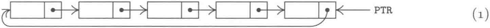
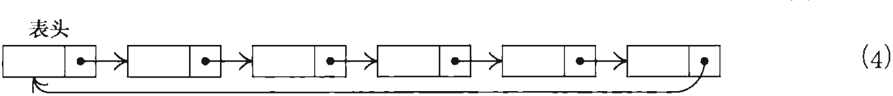
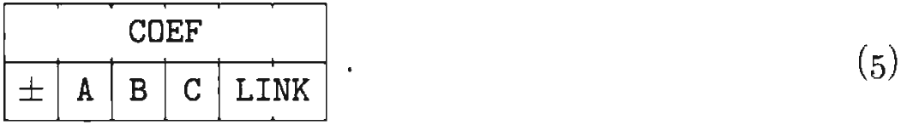
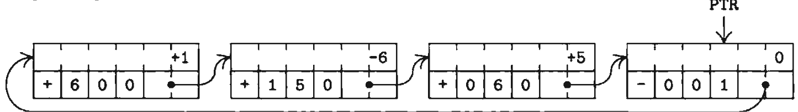
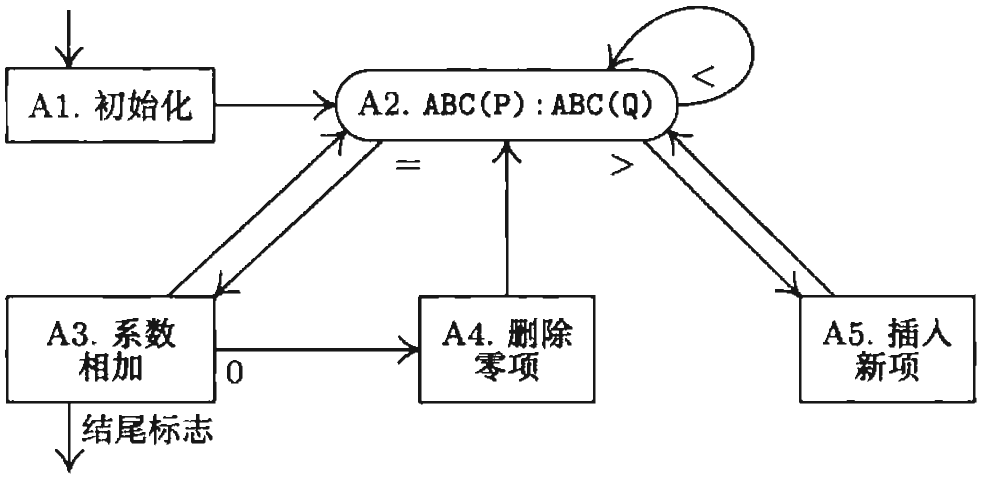

<a id="sec-2-2-4"></a>

# 2.2.4循环链表

链接方式稍作改动, 可得到上一节方法的一种重要替代方案.

循环链表 (circularly linked list, 简称循环表, circular list) 具有这样的性质, 它的最后一个结点链接回第一个结点, 而不是Λ. 于是, 从任意给定的位置出发, 可以访问表的所有结点. 如果我们决意不考虑表有最后一个或第一个结点的话, 还能得到额外的对称性.

下面的情况是典型的:



与上一节一样, 假定结点包含两个字段 INFO 和 LINK. 有一个链变量 PTR, 指向表的最右结点, 并且 LINK(PTR) 是最左结点的地址. 下面是最重要的基本操作:

(a) 在左端插入 $\mathtt Y:\quad\mathtt P\Leftarrow\mathtt{AVAIL},\quad\mathtt{INFO}(\mathtt P)\leftarrow\mathtt Y,\quad\mathtt{LINK}(\mathtt P)\leftarrow\mathtt{LINK}(\mathtt{PTR}),\quad\mathtt{LINK}(\mathtt{PTR})\leftarrow\mathtt P$;

(b) 在右端插入 Y: 在左端插入 Y, 然后 $\mathrm{PTR} \leftarrow \mathrm{P}$

(c) 置 Y 为左结点并删除: $\mathtt P\leftarrow\mathtt{LINK}(\mathtt{PTR})$ $\mathrm{Y} \leftarrow \mathrm{INF0}(\mathrm{P})$ $\mathtt{LINK}(\mathtt{PTR})\leftarrow\mathtt{LINK}(\mathtt P)$ $\mathtt{AVAIL}\Leftarrow\mathtt P$

乍一看, 操作 (b) 有点让人吃惊: 操作 $\mathrm{PTR} \leftarrow \mathrm{LINK}(\mathrm{PTR})$ 有效地把图 (1) 的最左结点移动到右端, 并且如果我们把该表看作圆, 而不是看作两端相连接的直线的话, 这一点相当容易理解.

思维敏捷的读者会看出操作 (a)、(b) 和 (c) 中存在一系列错误. “什么错误?” 答案是: 我们忘记了考虑空表的可能性. 例如, 如果对表 (1) 执行 5 次操作 (c), 则 PTR 将指向 AVAIL 表中的结点, 并且这可能导致严重问题. 例如, 想象再做一次操作 (c)! 如果表为空时, 令 PTR 等于Λ, 则我们可以用如下方法修补这些操作: 在 (a) 的 $\text{“}\mathtt{INFO}(\mathtt P)\leftarrow\mathtt Y\text{”}$ 之后添加指令 “如果 $\mathtt { P T R } = \Lambda$ 9 则 $\mathtt{PTR}\leftarrow\mathtt{LINK}(\mathtt P)\leftarrow\mathtt P;$ 否则 $\cdots \cdots ^ { \prime \prime }$; 在 (c) 的前面做测试 “如果 $\mathtt { P T R } = \Lambda$, 则 $\mathtt{UNDERFLOW}\text{”}$; 并在 (c) 后随 “如果 PTR = P, 则 $\mathtt{PTR}\leftarrow\Lambda\text{”}$

注意: 操作 (a)、(b) 和 (c) 为我们提供了 2.2.1 节的输出受限的双端队列的操作. 因此, 我们特别发现循环表既可以当作栈, 也可以当作队列使用. 操作 (a) 和 (c) 结合为我们提供栈, 操作 (b) 和 (c) 提供队列. 与上一节的对应操作相比, 这些操作稍微有点不够直接. 在上一节, 我们看到操作 (a)、(b) 和 (c) 可以使用两个指针 F 和 R, 在线性表上进行.

使用循环表, 其他重要操作变得更加有效. 例如, 可以很方便地 “删除” 整个表, 即一次将整个循环表放到 AVAIL 栈中:

$$
\text{如果 }\mathtt{PTR}\ne\Lambda,\text{ 则 }\mathtt{AVAIL}\leftrightarrow\mathtt{LINK}(\mathtt{PTR}).
\qquad \text{(2)}
$$

<a id="pdf-235"></a><a id="p-218"></a>

(回忆一下, $七$ 操作表示交换: $\mathtt P\leftarrow\mathtt{AVAIL}$, AVAIL ← LINK(PTR), $\mathtt{LINK}(\mathtt{PTR})\leftarrow\mathtt P.\ )$ 倘若 PTR 指向循环表的任意位置, 操作 (2) 显然是正确的. 当然, 之后我们应该置 PTR←Λ.

如果 $PTR _{1}$ 和 $PTR _2$ 分别指向两个不相交的循环表 $\mathtt L_1$ 和 $\mathrm { L } _ { 2 }$, 则使用类似的方法, 我们可以把整个表 $\mathtt L_2$ 插入到 $\mathtt L_1$ 的右端:

$$
\begin{aligned}&\text{如果 }\mathtt{PTR}_2\ne\Lambda,\text{ 则}\\&\quad(\text{如果 }\mathtt{PTR}_1\ne\Lambda,\text{ 则 }\mathtt{LINK}(\mathtt{PTR}_1)\leftrightarrow\mathtt{LINK}(\mathtt{PTR}_2);\\&\qquad\text{置 }\mathtt{PTR}_1\leftarrow\mathtt{PTR}_2,\quad\mathtt{PTR}_2\leftarrow\Lambda).\end{aligned}
\qquad \text{(3)}
$$

另一种可以做的简单操作是用各种方法把一个循环表分裂成两个. 这些操作对应于串的拼接和拆分.

由此可见, 循环表不仅可以用来表示固有的循环结构, 而且也可以表示线性结构. 具有一个指向尾部结点指针的循环表基本等价于具有一个头指针和一个尾指针的直线线性表. 与这一结论有关, 一个自然的问题是: “当循环对称时, 如何找出表的端点在哪儿 $1 2$ 因为没有Λ链接到端点! 答案是: 在整个表上操作时, 我们从一个结点移动到下一个, 如果回到开始位置, 就应该停止 (当然, 假定开始位置还在表中).

对于刚才提出的问题, 另一种解决方案是在每个循环表中放置一个可识别的特殊结点, 作为方便的停止位置. 这个特殊结点称为表头 (listhead). 在应用中, 如果每个循环表都恰有一个表头结点, 往往会非常方便. 这样的一个好处是循环表永远非空. 使用表头, 图示 (1) 变成



像 (4) 这样的表一般通过表头来访问. 表头通常在固定的存储位置. 表头的缺点是没有指针指向右端, 因此我们必须牺牲上面的操作 (b).

可以把图示 $( 4 )$ 与上一节开始处的 (1) 做比较. 那里与项 5 相关联的链现在指向 LOC(FIRST), 而不是 $\Lambda;$ 变量 FIRST 现在看作结点中的一个链, 即 NODE(LOC(FIRST)) 中的链. (4) 与 2.2.3-(1) 的主要区别是, $( 4 )$ 使得有可能 (但未必高效) 从表中任意点出发, 访问任何其他点.

作为一个使用循环表的例子, 我们将讨论变量 $x , y$ 和 $z$ 的整系数多项式的算术运算. 在许多问题中, 科学家都想处理多项式, 而不仅仅是数. 我们考虑的操作类似于

$$
( x ^ { 4 } + 2 x ^ { 3 } y + 3 x ^ { 2 } y ^ { 2 } + 4 x y ^ { 3 } + 5 y ^ { 4 } ) \qquad \mathfrak { R } \sqcup \qquad ( x ^ { 2 } - 2 x y + y ^ { 2 } )
$$

得到

$$
( x ^ { 6 } - 6 x y ^ { 5 } + 5 y ^ { 6 } ) .
$$

由于多项式可能扩展到不可预知的长度, 我们又可能想把多个多项式同时放在内存中, 因此链接分配是一种自然的选择.

这里, 我们将考虑加法和乘法两种操作. 假设多项式用表来表示, 其中每个结点表示一个非零项, 并具有双字形式:



这里, COEF 是项 $x^{ A }y^{ B }z^{ C }$ 的系数. 假定系数和指数都总是在这种格式所允许的值域内, 并且计算时不必检查值域. 记号 ABC 用来表示结点 $(5)$ 的±ABC 字段, 将看作一个整体. ABC 的符号, 即 (5) 的第二个字的符号将总是为正, 但是每个多项式结尾处的特殊结点除外. 在该特殊<a id="pdf-236"></a><a id="p-219"></a>结点, ABC=-1,COEF=0. 类似于上面关于表头的讨论, 这个特殊结点非常便利, 因为它提供了一个方便的结尾标志, 并避免了空表问题 (对应于零多项式). 如果我们沿着链方向前进, 则除特殊结点 (其 ABC=-1) 外, 表的结点总是以 ABC 字段的递减序出现. 例如, 多项式 $x^{6}-6xy^{5}+5y^{6}$ 将表示成: nmn



算法 A (多项式加法). 假定 P 和 Q 是指针变量, 指向以上形式的多项式, 该算法将多项式 (P) 加到多项式 (Q) 上. 表 P 将不变, 而表 Q 将保存和. 在算法结束处, 指针变量 P 和 Q 都恢复到它们的开始位置. 算法还使用了两个附加的指针变量 Q1 和 Q2.

A1.[初始化.] 置 $\mathtt P\leftarrow\mathtt{LINK}(\mathtt P),\quad\mathtt{Q1}\leftarrow\mathtt Q,\quad\mathtt Q\leftarrow\mathtt{LINK}(\mathtt Q)$. (现在 P 和 Q 都指向其多项式的首项. 贯穿该算法的大部分时刻, 变量 Q1 总是滞后 Q 一步, 即 Q=LINK(Q1).)

A2. [ABC(P):ABC(Q).] 如果 $\mathrm{ABC}(\mathrm{P}) < \mathrm{ABC}(\mathrm{Q})$, 则置 Q1←Q, Q←LINK(Q), 并重复该步骤. 如果 ABC(P) =ABC(Q), 则转到步骤 A3. 如果 ABC(P)>ABC(Q), 则转到步骤 A5.

A3.[系数相加. \](我们已经找到了指数相等的项.) 如果 ABC(P)<0, 则算法终止; 否则, 置 $\mathtt{COEF}(\mathtt Q)\leftarrow\mathtt{COEF}(\mathtt Q)+\mathtt{COEF}(\mathtt P)$. 现在, 如果 COEF(Q)=0, 则转到步骤 A4; 否则置 P←LINK(P), Q1←Q,Q←LINK(Q), 并转到 A2. (奇怪, 后面的操作与步骤 A1 相同.)

A4.[删除零项.] 置 Q2←Q, LINK(Q1)← Q ←LINK(Q), $\mathtt { A V A I L } \Leftarrow \mathtt { Q 2 }$. (步骤 A3 产生的零项已经从多项式 (Q) 移出.) 置 P←LINK(P), 并转回 A2.

A5.[插入新项.] (多项式 (P) 包含一个不在多项式 (Q) 中出现的项, 因此我们把它插入多项式 (Q).) 置 $\mathtt{Q2}\Leftarrow\mathtt{AVAIL}$, COEF(Q2) ← COEF(P), ABC(Q2)← ABC(P), $\mathtt{LINK}(\mathtt{Q2})\leftarrow\mathtt Q$ LINK(Q1)←Q2, Q1←Q2,P←LINK(P), 并返回步骤 A2.

<a id="fig-2-10"></a>

<span></span>

*图 10　多项式加法*

算法 A 最值得关注的一大特征是, 指针变量 Q1 始终紧随指针 Q 在表内移动. 这是表处理算法的典型特征, 我们还将看到十几个具有该特征的算法. 读者能够看出来算法 A 为什么使用这种思想吗?

不熟悉链接表处理的读者有必要仔细研究算法 A. 作为一个检验实例, 试着把 $x+y+z$ 加到 $x^{2}-2y-z$ 上.

<a id="pdf-237"></a><a id="p-220"></a>

有了算法 A, 乘法操作容易极了.

**算法 M**(多项式乘法). 这个算法类似于算法 A, 只是把多项式 (Q) 换成

$$
\text{多项式}(\mathrm Q)+\text{多项式}(\mathrm M)\times\text{多项式}(\mathrm P).
$$

**M1.** [下一个乘式.] 置 $\mathrm M\leftarrow\mathrm{LINK}(\mathrm M)$. 如果 $\mathrm{ABC}(\mathrm M)<0$, 则算法终止.

**M2.** [乘法循环.] 执行算法 A, 但是其中的记号 “`ABC(P)`” 都改为 “(如果 $\mathrm{ABC}(\mathrm P)<0$, 则 $-1$; 否则 $\mathrm{ABC}(\mathrm P)+\mathrm{ABC}(\mathrm M)$)”; 记号 “`COEF(P)`” 都改为 “$\mathrm{COEF}(\mathrm P)\times\mathrm{COEF}(\mathrm M)$”. 然后, 转回步骤 M1.　▮

算法 A 的 MIX 语言程序设计再次表明, 很容易操纵计算机中的链表. 在如下程序中, 我们假定 `OVERFLOW` 是一个子程序, 它或者终止程序的运行 (由于缺乏内存空间), 或者进一步找出可用空间, 并转出到 $\mathrm{rJ}-2$.

**程序 A**(多项式加法). 这个子程序经过设计, 可以与乘法子程序一起使用 (见习题 15).

| | |
| :--- | :--- |
| 调用序列 | `JMP ADD` |
| 入口条件 | $\mathrm{rI1}=\mathrm P$, $\mathrm{rI2}=\mathrm Q$. |
| 出口条件 | 多项式 (Q) 已经被多项式 (Q) $+{}$ 多项式 (P) 取代; $\mathrm{rI1}$ 和 $\mathrm{rI2}$ 保持不变; 所有其他寄存器的内容不确定. |

在下面的程序中, 寄存器与算法 A 中的指针变量对应如下: $\mathrm P\equiv\mathrm{rI1}$, $\mathrm Q\equiv\mathrm{rI2}$, $\mathrm{Q1}\equiv\mathrm{rI3}$, $\mathrm{Q2}\equiv\mathrm{rI6}$.

| 行号 | LOC | OP | ADDRESS | 次数 | 注释 |
| ---: | :--- | :--- | :--- | :---: | :--- |
| 01 | `LINK` | `EQU` | `4:5` |  | `LINK` 字段的定义 |
| 02 | `ABC` | `EQU` | `0:3` |  | `ABC` 字段的定义 |
| 03 | `ADD` | `STJ` | `3F` | $1$ | 子程序入口 |
| 04 | `1H` | `ENT3` | `0,2` | $1+m''$ | <u>A1. 初始化. </u> 置 $\mathrm{Q1}\leftarrow\mathrm Q$. |
| 05 |  | `LD2` | `1,3(LINK)` | $1+m''$ | $\mathrm Q\leftarrow\mathrm{LINK}(\mathrm{Q1})$. |
| 06 | `0H` | `LD1` | `1,1(LINK)` | $1+p$ | $\mathrm P\leftarrow\mathrm{LINK}(\mathrm P)$. |
| 07 | `SW1` | `LDA` | `1,1` | $1+p$ | $\mathrm{rA}(0\mathbin{:}3)\leftarrow\mathrm{ABC}(\mathrm P)$。 |
| 08 | `2H` | `CMPA` | `1,2(ABC)` | $x$ | <u>A2. $\mathit{ABC}(P):\mathit{ABC}(Q)$. </u> |
| 09 |  | `JE` | `3F` | $x$ | 如果相等, 则转到 A3. |
| 10 |  | `JG` | `5F` | $p'+q'$ | 如果大于, 则转到 A5. |
| 11 |  | `ENT3` | `0,2` | $q'$ | 如果小于, 则置 $\mathrm{Q1}\leftarrow\mathrm Q$. |
| 12 |  | `LD2` | `1,3(LINK)` | $q'$ | $\mathrm Q\leftarrow\mathrm{LINK}(\mathrm{Q1})$. |
| 13 |  | `JMP` | `2B` | $q'$ | 重复。 |
| 14 | `3H` | `JAN` | `*` | $m+1$ | <u>A3. 系数相加. </u> |
| 15 | `SW2` | `LDA` | `0,1` | $m$ | $\mathrm{COEF}(\mathrm P)$ |
| 16 |  | `ADD` | `0,2` | $m$ | $+\mathrm{COEF}(\mathrm Q)$ |
| 17 |  | `STA` | `0,2` | $m$ | $\to\mathrm{COEF}(\mathrm Q)$。 |
| 18 |  | `JANZ` | `1B` | $m$ | 如果非零则转移. |
| 19 |  | `ENT6` | `0,2` | $m'$ | <u>A4. 删除零项. </u> $\mathrm{Q2}\leftarrow\mathrm Q$. |
| 20 |  | `LD2` | `1,2(LINK)` | $m'$ | $\mathrm Q\leftarrow\mathrm{LINK}(\mathrm Q)$. |
| 21 |  | `LDX` | `AVAIL` | $m'$ |  |
| 22 |  | `STX` | `1,6(LINK)` | $m'$ | 21–23 行: $\mathrm{AVAIL}\Leftarrow\mathrm{Q2}$. |
| 23 |  | `ST6` | `AVAIL` | $m'$ |  |
| 24 |  | `ST2` | `1,3(LINK)` | $m'$ | $\mathrm{LINK}(\mathrm{Q1})\leftarrow\mathrm Q$. |
| <a id="pdf-238"></a><a id="p-221"></a>25 |  | `JMP` | `0B` | $m'$ | 转去推进 $\mathrm P$。 |
| 26 | `5H` | `LD6` | `AVAIL` | $p'$ | <u>A5. 插入新项. </u> |
| 27 |  | `J6Z` | `OVERFLOW` | $p'$ |  |
| 28 |  | `LDX` | `1,6(LINK)` | $p'$ | 26–29 行：$\mathrm{Q2}\Leftarrow\mathrm{AVAIL}$。 |
| 29 |  | `STX` | `AVAIL` | $p'$ |  |
| 30 |  | `STA` | `1,6` | $p'$ | $\mathrm{ABC}(\mathrm{Q2})\leftarrow\mathrm{ABC}(\mathrm P)$。 |
| 31 | `SW3` | `LDA` | `0,1` | $p'$ | $\mathrm{rA}\leftarrow\mathrm{COEF}(\mathrm P)$。 |
| 32 |  | `STA` | `0,6` | $p'$ | $\mathrm{COEF}(\mathrm{Q2})\leftarrow\mathrm{rA}$。 |
| 33 |  | `ST2` | `1,6(LINK)` | $p'$ | $\mathrm{LINK}(\mathrm{Q2})\leftarrow\mathrm Q$. |
| 34 |  | `ST6` | `1,3(LINK)` | $p'$ | $\mathrm{LINK}(\mathrm{Q1})\leftarrow\mathrm{Q2}$. |
| 35 |  | `ENT3` | `0,6` | $p'$ | $\mathrm{Q1}\leftarrow\mathrm{Q2}$. |
| 36 |  | `JMP` | `0B` | $p'$ | 转去推进 $\mathrm P$。　▮ |

<details>
<summary>MIXAL 等宽清单</summary>

```text
LINK      EQU   4:5
ABC       EQU   0:3
ADD       STJ   3F
1H        ENT3  0,2
          LD2   1,3(LINK)
0H        LD1   1,1(LINK)
SW1       LDA   1,1
2H        CMPA  1,2(ABC)
          JE    3F
          JG    5F
          ENT3  0,2
          LD2   1,3(LINK)
          JMP   2B
3H        JAN   *
SW2       LDA   0,1
          ADD   0,2
          STA   0,2
          JANZ  1B
          ENT6  0,2
          LD2   1,2(LINK)
          LDX   AVAIL
          STX   1,6(LINK)
          ST6   AVAIL
          ST2   1,3(LINK)
          JMP   0B
5H        LD6   AVAIL
          J6Z   OVERFLOW
          LDX   1,6(LINK)
          STX   AVAIL
          STA   1,6
SW3       LDA   0,1
          STA   0,6
          ST2   1,6(LINK)
          ST6   1,3(LINK)
          ENT3  0,6
          JMP   0B
```

</details>

注意, 算法 A 只遍历两个表一次, 不必循环多次. 使用基尔霍夫定律, 不难做出指令计数分析. 算法 A 的执行时间依赖于 4 个量:

$$
\begin{aligned}
 m' &= \text{相互抵消的匹配项数目}\\
 m'' &= \text{不相互抵消的匹配项数目}\\
 p' &= \text{多项式(P)中未匹配的项数目}\\
 q' &= \text{多项式(Q)中未匹配的项数目}。
\end{aligned}
$$

程序 A 的分析使用如下缩略记号:

$$
m=m'+m'',\quad p=m+p',\quad q=m+q',\quad x=1+m+p'+q'.
$$

对于 MIX, 程序 A 的运行时间为 $(27m'+18m''+27p'+8q'+13)u$. 该算法执行期间, 所需要的存储池结点总数至少为 $2+p+q$, 至多为 $2+p+q+p'$.

#### 习题

1\. [21] <a id="ex-2-2-4-1"></a>[答案](./answers/2-2-4.md#ans-2-2-4-1)  在本节开始处, 正文中建议用 $\mathrm{PTR}=\Lambda$ 表示空循环表. 考虑到循环表结构的原理, 用 $\mathrm{PTR}=\mathrm{LOC}(\mathrm{PTR})$ 指示空表可能更协调. 这种约定方便本节开始介绍的操作 (a)(b)(c) 吗?

2\. [20] <a id="ex-2-2-4-2"></a>[答案](./answers/2-2-4.md#ans-2-2-4-2)  假定 $\mathrm{PTR}_1$ 和 $\mathrm{PTR}_2$ 都不为 $\Lambda$, 绘制 “前后对比” 图, 解释拼接操作 (3) 的效果.

▶ 3. [20] <a id="ex-2-2-4-3"></a>[答案](./answers/2-2-4.md#ans-2-2-4-3)  如果 $\mathrm{PTR}_1$ 和 $\mathrm{PTR}_2$ 都指向同一个循环表的结点, 操作 (3) 做什么?

4\. [20] <a id="ex-2-2-4-4"></a>[答案](./answers/2-2-4.md#ans-2-2-4-4)  使用表示 (4), 给出产生栈效果的插入和删除操作.

▶ 5. [21] <a id="ex-2-2-4-5"></a>[答案](./answers/2-2-4.md#ans-2-2-4-5)  设计一个算法, 它取像 (1) 那样的循环表为输入, 并反转所有箭头的方向.

6\. [18] <a id="ex-2-2-4-6"></a>[答案](./answers/2-2-4.md#ans-2-2-4-6)  给出如下多项式的表表示图示: (a)$xz-3$; (b)0.

7\. [10] <a id="ex-2-2-4-7"></a>[答案](./answers/2-2-4.md#ans-2-2-4-7)  假定多项式表的 `ABC` 字段以递减序出现有什么用?

▶ 8. [10] <a id="ex-2-2-4-8"></a>[答案](./answers/2-2-4.md#ans-2-2-4-8)  在算法 A 中, 让 `Q1` 紧紧尾随在 `Q` 之后有什么用?

▶ 9. [23] <a id="ex-2-2-4-9"></a>[答案](./answers/2-2-4.md#ans-2-2-4-9)  如果 $\mathrm P=\mathrm Q$ (即两个指针变量都指向相同的多项式), 算法 A 能正确运行吗? 如果 $\mathrm P=\mathrm M$, 或如果 $\mathrm P=\mathrm Q$, 或如果 $\mathrm M=\mathrm Q$, 算法 M 能正确运行吗?

▶ 10. [20] <a id="ex-2-2-4-10"></a>[答案](./answers/2-2-4.md#ans-2-2-4-10)  本节的算法假定我们在多项式中使用三个变量 $x$、$y$ 和 $z$, 并且它们的指数都不超过 $b-1$ (其中 $b$ 是 MIX 的字节大小). 假设我们想改做只有一个变量 $x$ 的多项式加法和乘法, 并令其指数取值高达 $b^3-1$. 应该对算法 A 和 M 做什么改变?

11\. [24] <a id="ex-2-2-4-11"></a>[答案](./answers/2-2-4.md#ans-2-2-4-11) (本题和下面的一些习题的目的是与程序 A 结合, 创建一个有用的多项式算术运算子程序包.) 由于算法 A 和 M 改变多项式 (Q) 的值, 因此有时希望有一个制作多项式副本的子程序. 写一个具有如下说明的 MIX 子程序:

<a id="pdf-239"></a><a id="p-222"></a>

调用序列: JMP COPY

入口条件: $\mathrm{rI1} = \mathrm{P}$

出口条件: rI2 指向新创建的多项式, 它等于多项式 (P); rI1 不变, 其他寄存器也不变.

12\. [21] <a id="ex-2-2-4-12"></a>[答案](./answers/2-2-4.md#ans-2-2-4-12) 当多项式 (Q)=0 时, 把习题 11 的程序的运行时间与程序 A 进行比较.

13\. [20] <a id="ex-2-2-4-13"></a>[答案](./answers/2-2-4.md#ans-2-2-4-13) 写一个具有如下说明的 MIX 子程序:

调用序列: JMP ERASE

入口条件: $\mathrm{rI1} = \mathbb{P}$

出口条件: 多项式 (P) 已经被添加到 AVAIL 表; 所有寄存器的内容不变.

[注记：可以用序列“LD1 Q;JMP ERASE;LD1 P;JMP COPY; $ST2\ \mathbb{Q}^{\prime \prime}$ 把这个子程序与习题11的子程序结合使用，达到“多项式(Q)←多项式(P)”的效果.]

14\. [22] <a id="ex-2-2-4-14"></a>[答案](./answers/2-2-4.md#ans-2-2-4-14) 写一个具有如下说明的 MIX 子程序:

调用序列: JMP ZERO

入口条件: 无

出口条件: rI2 指向新创建的零多项式; 其他寄存器内容没有定义.

15\. [24] <a id="ex-2-2-4-15"></a>[答案](./answers/2-2-4.md#ans-2-2-4-15) 写一个执行算法 M 的 MIX 子程序, 它具有如下说明:

调用序列: $\mathtt { J M P } \quad \mathtt { M U L T }$

入口条件: $\mathrm{rI1}=\mathtt P,\quad\mathrm{rI2}=\mathtt Q,\quad\mathrm{rI4}=\mathtt M.$

出口条件: $(\mathtt Q)\leftarrow(\mathtt Q)+(\mathtt M)\times(\mathtt P);$ rI1,rI2 和 rI4 不变; 其他寄存器的内容没有定义.

[注记: 使用程序 A 作为子程序, 改变 SW1、SW2 和 SW3 的设置.]

16\. [M28] <a id="ex-2-2-4-16"></a>[答案](./answers/2-2-4.md#ans-2-2-4-16) 用某些相关参数, 估计习题 15 的子程序的运行时间.

17\. [22] <a id="ex-2-2-4-17"></a>[答案](./answers/2-2-4.md#ans-2-2-4-17) 用本节的循环表, 而不是用上一节的以Λ终止的平直线性链表表示多项式, 有什么优点?

18\. [25] <a id="ex-2-2-4-18"></a>[答案](./answers/2-2-4.md#ans-2-2-4-18) 设计一种在计算机内表示循环表的方法, 使得表可以高效地双向遍历, 但每个结点仍然只用一个链接字段. [提示: 如果给定两个指针, 指向两个相继的结点 $x_{i - 1}$ 和 xi, 则应该能够对 $x_{i + 1}$ 和 $x_{i - 2}$ 定位.]
