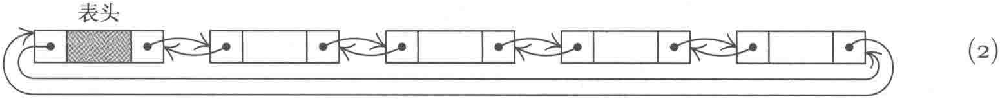
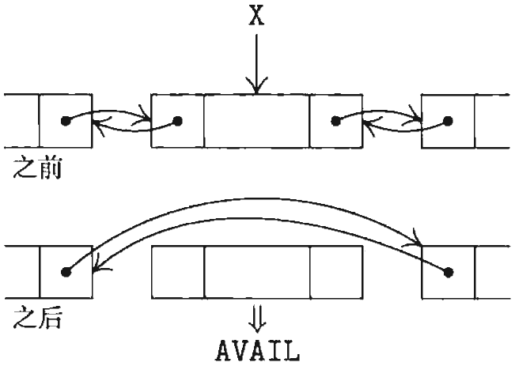
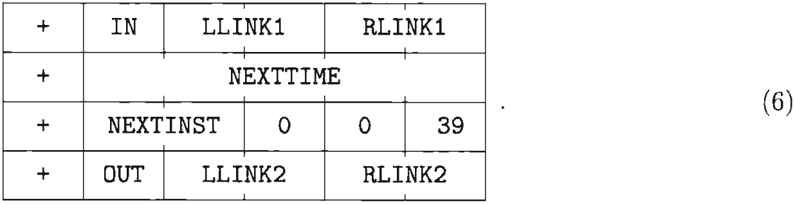

<a id="sec-2-2-5"></a>

# 2.2.5 双链表

为了更灵活地操纵线性表, 我们可以让每个结点包含两个链, 指向该结点两边的项:


这里, LEFT 和 RIGHT 是指针变量, 分别指向表的左边和右边. 该表的每个结点包含两个链, 例如叫做 LLINK 和 RLINK.

使用这种表示, 一般的双端队列操作容易进行 (见习题 1). 然而, 正如上一节所述, 如果每个表都有一个表头结点, 则双链表的操作往往变得非常容易. 在有表头时, 双链表具有如下典型结构:



表头的 RLINK 和 LLINK 字段取代了 (1) 中的 LEFT 和 RIGHT. 左右之间完全对称, 表头原本也可以放在 (2) 的右边. 如果表为空, 表头的两个链字段都指向表头本身.

如果 X 是任意结点 (包括表头) 的位置, 则表的表示 (2) 显然满足条件

$$
\mathtt{RLINK}(\mathtt{LLINK}(\mathtt X))=\mathtt{LLINK}(\mathtt{RLINK}(\mathtt X))=\mathtt X.
\qquad \text{(3)}
$$

这一事实是表示 (2) 比 (1) 更可取的主要原因.

<a id="pdf-240"></a><a id="p-223"></a>

双链表通常比单链表占用更多空间 (尽管有时在未填满的计算机字中, 已经有供另一个链使用的空间). 使用双向链接虽然需要额外的空间, 但它使更多操作可以执行得更高效, 所以非常划算. 双链表除了具备可以随意向前或向后扫描这一明显的优点之外, 还有一种重要的新能力: 仅给出 X 的值, 我们就可以从 NODE(X) 所在的表中删除它. 这种删除操作容易从 “前后对比” 图 ([图11](#fig-2-11)) 导出, 并且非常简单:

$$
\begin{aligned}&\mathtt{RLINK}(\mathtt{LLINK}(\mathtt X))\leftarrow\mathtt{RLINK}(\mathtt X),\quad\mathtt{LLINK}(\mathtt{RLINK}(\mathtt X))\leftarrow\mathtt{LLINK}(\mathtt X),\\&\mathtt{AVAIL}\Leftarrow\mathtt X.\end{aligned}
\qquad \text{(4)}
$$

<a id="fig-2-11"></a>

<span></span>

*图 11　从双链表中删除*


在一个仅有单向链接的表中, 不知道哪一个结点在 NODE(X) 之前, 我们就不能删除 NODE(X), 因为 NODE(X) 删除后, 需要改变其前驱结点的链. 在 2.2.3 节和 2.2.4 节考虑的所有算法中, 每当删除结点时, 都知道这种附加的位置信息. 特别是算法 2.2.4A, 那里我们让指针 Q1 紧随 Q 的目的就在于此. 但是, 我们将会看到, 有些算法需要在表的中间随机删除结点, 使用双链表常常就是因为这个原因. (应该指出, 在循环表中, 给定 X, 如果绕一整圈找到 X 的前驱的话, 可以删除 NODE(X). 但是, 如果表很长, 则这种操作显然效率很低, 因此很难作为双链表的满意替代方案. 又见习题 2.2.4-8 的答案.)

类似地, 使用双链表, 很容易在 NODE(X) 的左边或右边紧接着插入一个结点. 步骤

$$
\begin{aligned}&\mathtt P\Leftarrow\mathtt{AVAIL},\quad\mathtt{LLINK}(\mathtt P)\leftarrow\mathtt X,\quad\mathtt{RLINK}(\mathtt P)\leftarrow\mathtt{RLINK}(\mathtt X),\\&\mathtt{LLINK}(\mathtt{RLINK}(\mathtt X))\leftarrow\mathtt P,\quad\mathtt{RLINK}(\mathtt X)\leftarrow\mathtt P.\end{aligned}
\qquad \text{(5)}
$$

在 NODE(X) 右边插入; 交换左右, 就得到在左边插入的对应算法. 操作 (5) 改变了 5 个链的设置, 因此它比单向链接表的插入操作稍微慢一点, 后者只需要改变 3 个链.

为了举例说明双链表的用法, 我们现在考虑写一个离散模拟 (discretesimulation) 程序. 在 “离散模拟” 所模拟的系统中, 可以假定系统状态的所有改变都发生在离散的时间瞬间. 被模拟的 “系统” 一般是个体活动的集合, 各活动相互作用, 同时在很大程度上相互独立. 离散模拟的例子有商店里的顾客、港口里的船只、公司里的人. 在离散模拟中, 系统按以下方式井然有序地前进: 在特定模拟时间瞬间做该做的事, 然后把模拟时钟向前拨动到下一次有动作预定发生的时刻.

相比之下, “连续模拟” 是模拟连续变化的活动, 如高速公路上的车辆移动, 宇宙飞船从一个行星飞往另一个行星, 等等. 通常, 步骤之间的时间间隔取非常小的值, 可以令人满意地用离散模拟来近似连续模拟. 然而, 这种情况通常是 “同步” 的离散模拟, 在每个离散时间间隔, 系统的许多部分同时都稍微改变, 而这样的应用一般要求程序组织结构与这里考虑的类型稍有不同.

下面开发的程序模拟加州理工学院数学楼的电梯. 或许, 这样的模拟结果只对常去加州理工学院的人有用. 即便对于他们, 多试乘几次电梯也比写计算机程序省事. 但是, 像通常的模<a id="pdf-241"></a><a id="p-224"></a>拟研究一样, 我们使用的方法比程序给出的答案更有意义. 下面将要讨论的方法揭示了离散模拟所使用的典型实现技术.

数学楼有 5 层: 地下第二层、地下第一层、第一层、第二层和第三层. 有一部自动控制的电梯, 可以停在每一层. 为方便起见, 我们把各层用 0、1、2、3 和 4 重新编号.

在每一层, 有两个呼叫按钮, 一个是 UP (上), 另一个是 DOWN (下). (实际上, 第 0 层只有 UP, 而第 4 层只有 DOWN. 但是, 我们将忽略这种异常, 因为永远没人使用多出来的两个按钮.) 对应于这些按钮, 有 10 个变量 CALLUP[$j$] 和 CALLDOWN[$j$], $0 \leq j \leq 4 .$ 还有 5 个变量 CALLCAR[$j$], $0 \leq j \leq 4$, 对应于电梯间内的按钮, 向电梯指示目的楼层. 当一个人按下按钮时, 相应的变量设置为 1; 请求满足之后, 电梯将该变量清 0.

迄今为止, 我们从用户角度描述了电梯. 从电梯的角度来看, 情况更有趣. 电梯处于三种状态之一: GOINGUP (上行)、GOINGDOWN (下行) 或 NEUTRAL (空挡). (用电梯内的发亮箭头向乘客指示当前状态.) 如果电梯处于 NEUTRAL 状态, 并且不在第 2 层, 则机器将关门, 并且 (如果关门时没有接到命令的话) 改变为 GOINGUP 或 GOINGDOWN 状态, 向第 2 层进发. (这是 “驻停楼层”, 因为大部分乘客都从那里进入.) 在第 2 层处于 NEUTRAL 状态, 电梯门将最终关闭, 机器将静侯另一个命令. 收到的第一个到另一层的命令设置机器为相应的 GOINGUP 或 GOINGDOWN. 电梯一直处于该状态, 直到同一方向没有等待执行的命令为止. 然后, 视 CALL 变量中的其他命令而定, 电梯或切换方向, 或在开门之前切换到 NEUTRAL 状态. 电梯用一定的时间开门和关门, 加速和减速, 从一层到另一层. 下面的算法指明了所有这些量, 比非形式的描述精确得多. 写作本节时, 我做了数小时实验, 观察电梯的运行. 此算法可能并不反映真实的电梯运行原理, 但是我相信, 要想解释我观察到的所有现象, 这组规则是最简单的.

电梯系统用两个协同程序来模拟, 一个模拟乘客, 另一个模拟电梯. 这两个例程明确说明了有待实施的所有动作, 以及用于模拟的所有时间延迟. 在下面的描述中, 变量 TIME 表示模拟时钟的当前值. 所有时间单位均为十分之一秒. 还有如下一些其他变量.

FLOOR: 电梯的当前位置.

D1: 变量, 除有人进出电梯期间之外, 其值为 0.

D2: 变量, 如果电梯停在某一层不动长达 30 秒或更久, 则其值变为 0.

D3: 变量, 除电梯门打开但无人进出电梯时之外, 其值为 0.

STATE: 电梯的当前状态 (GOINGUP,GOINGDOWN, 或 NEUTRAL).

初始, FLOOR = 2,D1 = D2 = D3 = 0, STATE = NEUTRAL.

协同程序 U (乘客). 每个进入系统的人从步骤 U1 开始, 执行如下动作.

U1.[进入, 为后继作准备.] 以某种此处未指明的方式确定如下量.

IN: 新乘客进入系统的楼层.

OUT: 该乘客想要去的楼层 ( $\mathtt{OUT}\ne\mathtt{IN})$

GIVEUPTIME: 该乘客失去耐心并决定爬楼梯之前, 等待电梯的时间.

INTERTIME: 另一个乘客进入系统前的时间量.

在计算这些量之后, 模拟程序设置一些事项, 使得下一位乘客在时刻 TIME+INTERTIME 进入系统.

U2.[发信号并等待. \](这一步的目的是呼叫电梯. 如果电梯已经在正确的楼层, 则出现某些特殊情况.) 如果 FLOOR=IN, 并且电梯的下一个动作是下面的步骤 E6 (即电梯的门正<a id="pdf-242"></a><a id="p-225"></a>在关闭), 则立即让电梯转移到其步骤 E3, 并且取消活动 E6. (这意味着在电梯移动之前, 电梯门将重新打开.) 如果 FLOOR=IN, 并且 $\mathtt{D3}\ne0$, 则置 D3←0, 置 D1 为非零值, 重新开始电梯的活动 E4. (这意味着在这一层, 电梯门是开的, 其他人已经进出完毕. 电梯步骤 E4 是一个先后顺序步, 它允许人们按照常理先后进入电梯, 因此, 重新开始步骤 E4 让该乘客有机会在关门之前进入电梯.) 在其他情况下, 根据 OUT>IN 或 OUT <IN, 该乘客置 CALLUP[IN]←1 或 CALLDOWN[IN]←1; 如果 D2 = 0, 电梯处于 “休眠” 状态 E1, 则执行后面的 DECISION 子程序. (DECISION 子程序用来在某些临界时间点解除 NEUTRAL 状态.)

U3.[进入队列.] 把该乘客插入队列 QUEUE[IN] 的尾部. 该队列是一个线性表, 表示在该楼层等待的人. 现在, 乘客耐心地等待 GIVEUPTIME 个时间单位, 除非电梯提前到达; 更准确地说, 除非下面的电梯例程的步骤 E4 将该乘客送到步骤 U5, 并取消预定的活动 U4.

U4.[放弃.] 如果 FLOOR≠IN 或 D1=0, 则从 QUEUE[IN] 和模拟系统删除该乘客. (该乘客认为电梯太慢, 或认为爬楼梯锻炼一下比乘电梯更好.) 如果 FLOOR=IN 并且 $D 1 \neq 0$ 则乘客停留并等待 (知道不会久等).

U5.[进入.] 现在, 该乘客离开 QUEUE[IN], 并进入 ELEVATOR, 这是一个类似于栈的表, 表示现在在电梯中的人. 置 CALLCAR[OUT]←1. 现在, 如果 STATE = NEUTRAL, 则视情况相应置 STATE ← GOINGUP 或 GOINGDOWN, 并置电梯的活动 E5 在 25 个时间单位之后执行. (这是该电梯的一个特点, 当该乘客选择目的楼层时, 如果电梯的状态是 NEUTRAL, 则允许电梯门比通常更快关闭. 25 个单位时间间隔使得步骤 E4 可以确保在步骤 E5 (关门动作) 之前就设置好 D1.) 现在, 乘客等待, 直到电梯到达期望的楼层后, 被下面的步骤 E4 送到步骤 U6.

U6.[离开.] 从 ELEVATOR 表和模拟系统删除该乘客.

协同程序 E (电梯). 该协同程序表示电梯的动作; 步骤 E4 也处理乘客进出时间的控制.

E1.[等待呼叫.] (此时, 电梯停在 2 层, 电梯门关闭, 正等待事件发生.) 如果有人按下按钮, 则 DECISION 子程序决定是进入步骤 E3 还是 E6. 其间, 等待.

E2. [改变状态?] 如果 STATE=GOINGUP, 并且对于所有的 $j>\mathtt{FLOOR}$ 有 CALLUP[$j$] = CALLDOWN[j] = CALLCAR[$j$] = 0, 则根据是否对于所有的 $j < \mathrm { F L O O R }$ 有 CALLCAR[$j$] = 0, 置 STATE ← NEUTRAL 或 STATE← GOINGDOWN, 然后置当前层的所有 CALL 变量的值为 0. 如果 STATE= GOINGDOWN, 则以相反的方向做类似的动作.

E3.[开门.] 置 D1 和 D2 为任意非零值. 置电梯活动 E9 在 300 个时间单位之后独立地开始. (这一活动出现之前可能被步骤 E6 取消. 如果此时它已经被调度并且未被取消, 则我们取消并重新调度它.) 还置电梯活动 E5 在 76 个时间单位之后独立地开始. 然后, 等待 20 个时间单位 (模拟开门) 并转到 E4.

E4. [让乘客出入.] 如果 ELEVATOR 表中有人 OUT=FLOOR, 则把最近进入的这类乘客立即转移到步骤 U6, 等待 25 个时间单位, 重复步骤 E4. 如果没有这样的乘客, 但是 QUEUE[FLOOR] 非空, 则把该队列头部的人立即转移到步骤 U5 而不是 U4, 等待 25 个时间单位, 重复步骤 E4. 但是, 如果 QUEUE[FLOOR] 为空, 则置 D1←0, 置 D3 为非零, 并等待其他活动来启动进一步的动作. (步骤 E5 将转移到 E6, 或者步骤 U2 将重新开始 E4.)

<a id="pdf-243"></a><a id="p-226"></a>

E5.[关门.] 如果 $D 1 \neq 0$, 则等待 40 个单位时间, 重复该步骤 (门稍有振动, 但再次弹开, 因为仍然有人进出). 否则, 置 D3←0, 并且置电梯在 20 个时间单位之后开始 E6. (这模拟乘客进出电梯之后关闭电梯门; 但是, 如果门关闭时新乘客进入该楼层, 则如步骤 U2 所述, 门重新打开.)

E6.[准备移动.] 置 CALLCAR[FLOOR] 为 0; 如果 STATE≠GOINGDOWN, 还置 CALLUP[FLOOR] 为 0; 如果 $\mathtt { S T A T E } \neq \mathtt { G O I N G U P }$, 还置 CALLDOWN[FLOOR] 为 0. (注记: 如果 STATE =GOINGUP, 则电梯并不清除 CALLDOWN, 因为它假定想要下楼的乘客此时不进入, 见习题 6.) 现在, 执行 DECISION 子程序.

如果 STATE=NEUTRAL, 则即使已经执行 DECISION 子程序也要转到 E1. 否则, 如 $\mathbb{D}2 \neq 0$, 则取消电梯活动 E9. 最后, 如果 STATE=GOINGUP, 则等待 15 个单位时间电梯加速), 转到 E7; 如果 STATE=GOINGDOWN, 等待 15 个单位时间, 转到 E8.

E7.[上升一层.] 置 FLOOR←FLOOR+1 并等待 51 个单位时间. 如果现在 CALLCAR[FLOOR] =1 或 $\mathtt{CALLUP}[\mathtt{FLOOR}]=1$, 或如果 ((FLOOR =2 或 CALLDOWN[FLOOR] =1), 并且对于所有 的 $j > \mathtt { F L O O R } , \enspace \mathtt { C A L L U P } [ j ] = \mathtt { C A L L D O W N } [ j ] = \mathtt { C A L L C A R } [ j ] = 0 )$, 则等待 14 个时间单位 (电梯减速), 转到 E2. 否则重复该步骤.

E8.[下降一层.] 这一步类似于 E7, 但方向相反, 并且时间 51 和 14 分别变成 61 和 23. (电梯下降比上升花更多时间.)

E9.[置不活动指示器] 置 D2←0, 并执行 DECISION 子程序. (这个独立的动作是在步骤 E3 启动的, 但是几乎总是在步骤 E6 被取消. 见习题 4.)

子程序 D(DECISION 子程序). 如在上述协同程序中所述, 当需要决定电梯方向的临界时间点, 执行这个子程序.

D1. [决策必要吗?] 如果 STATE≠NEUTRAL, 则跳出该子程序.

D2.[应该开门吗?] 如果电梯处于 E1, 并且 CALLUP[2]、CALLCAR[2] 和 CALLDOWN[2] 均非零, 则电梯在 20 个时间单位之后开始活动 E3, 并跳出该子程序. (如果子程序 DECISION 当前被独立的活动 E9 调用, 则电梯协同程序可能位于 E1.)

D3. [有呼叫吗?] 找出最小的 $j \neq \mathrm { F L O O R }$, 使得 CALLUP[$j$]、CALLCAR[$j$] 或 CALLDOWN[$j$] 非零, 并转到步骤 D4. 但是, 如果不存在这样的 $j$, 则如果 DECISION 子程序当前被步骤 E6 调用, 则置 $j\leftarrow 2$; 否则跳出该子程序.

D4. [置 STATE. ] 如果 FLOOR > $j$, 则置 STATE ← GOINGDOWN; 如果 FLOOR < $j$, 则置 STATE ← GOINGUP.

D5.[电梯在休眠吗?] 如果电梯协同程序在步骤 E1, 并且 $j \neq 2$, 则置电梯在 20 个时间单位后执行步骤 E6. 跳出该子程序. 1

与本书之前介绍的算法相比, 上面介绍的电梯系统相当复杂. 但是要想说明模拟问题的典型特征, 任何杜撰的 “书本例子” 都比不上现实生活的系统.

为了帮助理解这个系统, 考虑表 1. 该表给出了一次模拟的部分记录. 或许最好是从考察开始于时刻 4257 的最简单情况入手: 当一个乘客到达时 (时刻 4384), 电梯正停在 2 层, 电梯门关闭. 设该乘客的名字为 Don. 两秒钟后门打开, 又过两秒钟 Don 进入电梯. 他按下按钮 “3”, 启动电梯上行. 最终, 他在 3 楼下电梯, 而电梯返回 2 楼.

<a id="pdf-244"></a><a id="p-227"></a>

**表 1　电梯系统的部分动作**

| 时刻 | 状态 | 楼层 | D1 | D2 | D3 | 步骤 | 动作 |
| :--- | :---: | ---: | :---: | :---: | :---: | :---: | :--- |
| 0000 | N | 2 | 0 | 0 | 0 | U1 | 乘客 1 到达第 0 层, 目的地是第 2 层 |
| 0035 | D | 2 | 0 | 0 | 0 | E8 | 电梯下降 |
| 0038 | D | 1 | 0 | 0 | 0 | U1 | 乘客 2 到达第 4 层, 目的地是第 1 层 |
| 0096 | D | 1 | 0 | 0 | 0 | E8 | 电梯下降 |
| 0136 | D | 0 | 0 | 0 | 0 | U1 | 乘客 3 到达第 2 层, 目的地是第 1 层 |
| 0141 | D | 0 | 0 | 0 | 0 | U1 | 乘客 4 到达第 2 层, 目的地是第 1 层 |
| 0152 | D | 0 | 0 | 0 | 0 | U4 | 乘客 1 决定放弃, 离开系统 |
| 0180 | D | 0 | 0 | 0 | 0 | E2 | 电梯停 |
| 0180 | N | 0 | 0 | X | 0 | E3 | 电梯门开始打开 |
| 0200 | N | 0 | X | X | 0 | E4 | 电梯门打开, 没有人在外面 |
| 0256 | N | 0 | 0 | X | X | E5 | 电梯门开始关闭 |
| 0291 | U | 0 | 0 | X | 0 | U1 | 乘客 5 到达第 3 层, 目的地是第 1 层 |
| 0291 | U | 0 | 0 | X | 0 | E7 | 电梯上升 |
| 0342 | U | 1 | 0 | X | 0 | E7 | 电梯上升 |
| 0364 | U | 2 | 0 | X | 0 | U1 | 乘客 6 到达第 2 层, 目的地是第 1 层 |
| 0393 | U | 2 | 0 | X | 0 | E7 | 电梯上升 |
| 0444 | U | 3 | 0 | X | 0 | E7 | 电梯上升 |
| 0509 | U | 4 | 0 | X | 0 | E2 | 电梯停 |
| 0509 | N | 4 | 0 | X | 0 | E3 | 电梯门开始打开 |
| 0529 | N | 4 | X | X | 0 | U5 | 乘客 2 进入 |
| 0540 | D | 4 | X | X | 0 | U4 | 乘客 6 决定放弃, 离开系统 |
| 0554 | D | 4 | 0 | X | X | E5 | 电梯门开始关闭 |
| 0589 | D | 4 | 0 | X | 0 | E8 | 电梯下降 |
| 0602 | D | 3 | 0 | X | 0 | U1 | 乘客 7 到达第 1 层, 目的地是第 2 层 |
| 0673 | D | 3 | 0 | X | 0 | E2 | 电梯停 |
| 0673 | D | 3 | 0 | X | 0 | E3 | 电梯门开始打开 |
| 0693 | D | 3 | X | X | 0 | U5 | 乘客 5 进入 |
| 0749 | D | 3 | 0 | X | X | E5 | 电梯门开始关闭 |
| 0784 | D | 3 | 0 | X | 0 | E8 | 电梯下降 |
| 0827 | D | 2 | 0 | X | 0 | U1 | 乘客 8 到达第 1 层, 目的地是第 0 层 |
| 0868 | D | 2 | 0 | X | 0 | E2 | 电梯停 |
| 0868 | D | 2 | 0 | X | 0 | E3 | 电梯门开始打开 |
| 0876 | D | 2 | X | X | 0 | U1 | 乘客 9 到达第 1 层, 目的地是第 3 层 |
| 0888 | D | 2 | X | X | 0 | U5 | 乘客 3 进入 |
| 0913 | D | 2 | X | X | 0 | U5 | 乘客 4 进入 |
| 0944 | D | 2 | 0 | X | X | E5 | 电梯门开始关闭 |
| 0979 | D | 2 | 0 | X | 0 | E8 | 电梯下降 |
| 1048 | D | 1 | 0 | X | 0 | U1 | 乘客 10 到达第 0 层, 目的地是第 4 层 |
| 1063 | D | 1 | 0 | X | 0 | E2 | 电梯停 |
| 1063 | D | 1 | 0 | X | 0 | E3 | 电梯门开始打开 |
| 1083 | D | 1 | X | X | 0 | U6 | 乘客 4 出去, 离开系统 |
| 1108 | D | 1 | X | X | 0 | U6 | 乘客 3 出去, 离开系统 |
| 1133 | D | 1 | X | X | 0 | U6 | 乘客 5 出去, 离开系统 |
| 1139 | D | 1 | X | X | 0 | E5 | 电梯门振动 |
| 1158 | D | 1 | X | X | 0 | U6 | 乘客 2 出去, 离开系统 |
| 1179 | D | 1 | X | X | 0 | E5 | 电梯门振动 |
| 1183 | D | 1 | X | X | 0 | U5 | 乘客 7 进入 |
| 1208 | D | 1 | X | X | 0 | U5 | 乘客 8 进入 |
| 1219 | D | 1 | X | X | 0 | E5 | 电梯门振动 |
| 1233 | D | 1 | X | X | 0 | U5 | 乘客 9 进入 |
| 1259 | D | 1 | 0 | X | X | E5 | 电梯门开始关闭 |
| 1294 | D | 1 | 0 | X | 0 | E8 | 电梯下降 |
| 1378 | D | 0 | 0 | X | 0 | E2 | 电梯停 |
| 1378 | U | 0 | 0 | X | 0 | E3 | 电梯门开始打开 |
| 1398 | U | 0 | X | X | 0 | U6 | 乘客 8 出去, 离开系统 |
| 1423 | U | 0 | X | X | 0 | U5 | 乘客 10 进入 |
| 1454 | U | 0 | 0 | X | X | E5 | 电梯门开始关闭 |
| 1489 | U | 0 | 0 | X | 0 | E7 | 电梯上升 |
| 1554 | U | 1 | 0 | X | 0 | E2 | 电梯停 |
| 1554 | U | 1 | 0 | X | 0 | E3 | 电梯门开始打开 |
| 1630 | U | 1 | 0 | X | X | E5 | 电梯门开始关闭 |
| 1665 | U | 1 | 0 | X | 0 | E7 | 电梯上升 |
| … | | | | | | | |
| 4257 | N | 2 | 0 | X | 0 | E1 | 电梯休眠 |
| 4384 | N | 2 | 0 | X | 0 | U1 | 乘客 17 到达第 2 层, 目的地是第 3 层 |
| 4404 | N | 2 | 0 | X | 0 | E3 | 电梯门开始打开 |
| 4424 | N | 2 | X | X | 0 | U5 | 乘客 17 进入 |
| 4449 | U | 2 | 0 | X | X | E5 | 电梯门开始关闭 |
| 4484 | U | 2 | 0 | X | 0 | E7 | 电梯上升 |
| 4549 | U | 3 | 0 | X | 0 | E2 | 电梯停 |
| 4549 | N | 3 | 0 | X | 0 | E3 | 电梯门开始打开 |
| 4569 | N | 3 | X | X | 0 | U6 | 乘客 17 出去, 离开系统 |
| 4625 | N | 3 | 0 | X | X | E5 | 电梯门开始关闭 |
| 4660 | D | 3 | 0 | X | 0 | E8 | 电梯下降 |
| 4744 | D | 2 | 0 | X | 0 | E2 | 电梯停 |
| 4744 | N | 2 | 0 | X | 0 | E3 | 电梯门开始打开 |
| 4764 | N | 2 | X | X | 0 | E4 | 电梯门打开, 没有人在外面 |
| 4820 | N | 2 | 0 | X | 0 | E5 | 电梯门开始关闭 |
| 4840 | N | 2 | 0 | X | 0 | E1 | 电梯休眠 |
| … | | | | | | | |

<a id="pdf-245"></a><a id="p-228"></a>

表 1 的前面几行显示了一个更生动的场景: 一位乘客呼叫电梯到第 0 层, 但是 15.2 秒之后, 他失去耐心, 放弃等待; 稍后, 电梯来到第 0 层, 但没有人在那里; 然后, 电梯又上升到 4 楼, 因为那里有想要下楼的呼叫; 等等.

这个系统的计算机 (我们用 MIX) 编程值得仔细研究. 在模拟期间的任意给定时刻, 系统中可能有许多被模拟的乘客 (他们处于各种队列中, 准备在不同的时刻 “放弃”). 如果当电梯正试图关门时, 许多人都正要出去, 则步骤 E4、E5 和 E9 还有可能本质上同时执行. 模拟时间的流逝和 “同时发生” 的处理可以通过如下方法编程: 每个实体用一个结点表示, 该结点包含一个 NEXTTIME 字段 (表示该实体下一个动作发生的时间) 和一个 NEXTINST 字段 (指示该实体开始执行的指令的内存地址, 类似于一般的协同程序的连接). 每个等待时间流逝的实体都放在一个称作 WAIT 的双链表中, 表的 “日程” 按结点的 NEXTTIME 字段排序, 使得动作可以按照正确的模拟时间次序处理. 程序还用双链表表示 ELEVATOR 和 QUEUE 表.

每个代表活动 (无论是乘客行为还是电梯动作) 的结点都具有如下形式:



这里, LLINK1 和 RLINK1 是用于表 WAIT 的链; LLINK2 和 RLINK2 是用于表 QUEUE 或 ELEVATOR 的链. 当结点 (6) 表示乘客时, 后两个字段以及 IN 和 OUT 字段是相关的, 但是对于表示电梯动作的结点, 它们是不相关的. 结点的第三个字实际上是 MIX 的 “JMP” 指令.

[图12](#fig-2-12) 显示了典型的 WAIT 表、ELEVATOR 表和一个 QUEUE 表的内容. QUEUE 表中的每个结点同时在 WAIT 表中, 其 NEXTINST=U4, 但是未在图中指出, 因为复杂的链接将干扰基本思想.

<a id="fig-2-12"></a>

<span></span>

*图 12　电梯模拟程序中使用的一些表 (表头在左部)*

现在, 我们考虑程序本身. 程序相当长, 不过它像所有的长程序一样, 划分成一些小段, 每个小段本身都很简单. 最前面的代码行只是用来设置表的初始内容. 这里有若干有趣之处.

<a id="pdf-246"></a><a id="p-229"></a>

`WAIT` 表 (010–011 行)、`QUEUE` 表 (026–031 行) 和 `ELEVATOR` 表 (032–033 行) 的表头都是形如 (6) 的结点, 但删除了一些不重要的字: `WAIT` 的表头只包含结点的前两个字, 而 `QUEUE` 和 `ELEVATOR` 的表头只需要结点的最后一个字. 系统中始终还有另外 4 个结点 (012–023 行): 结点 `USER1` 总是在步骤 U1, 为新进入系统的乘客做准备; 结点 `ELEV1` 在步骤 E1、E2、E3、E4、E6、E7 和 E8 支配电梯的主要动作; 结点 `ELEV2` 和 `ELEV3` 用于电梯的动作 E5 和 E9, 这些动作发生的模拟时间独立于其他电梯动作. 这些结点都只包含 3 个字, 因为它们绝对不在 `QUEUE` 或 `ELEVATOR` 表中出现. 代表系统中每个实际乘客的结点将出现在主程序之后的存储池中.

| 行号 | LOC | OP | ADDRESS | 注释 |
| ---: | :--- | :--- | :--- | :--- |
| 001 | `*` |  |  | 电梯模拟 |
| 002 | `IN` | `EQU` | `1:1` | 结点内的字段的定义 |
| 003 | `LLINK1` | `EQU` | `2:3` |  |
| 004 | `RLINK1` | `EQU` | `4:5` |  |
| 005 | `NEXTINST` | `EQU` | `0:2` |  |
| 006 | `OUT` | `EQU` | `1:1` |  |
| 007 | `LLINK2` | `EQU` | `2:3` |  |
| 008 | `RLINK2` | `EQU` | `4:5` |  |
| 009 | `*` |  |  | 定长表和表头 |
| 010 | `WAIT` | `CON` | `*+2(LLINK1),*+2(RLINK1)` | `WAIT` 表的表头 |
| 011 |  | `CON` | `0` | 总是有 $\mathrm{NEXTTIME}=0$ |
| 012 | `USER1` | `CON` | `*-2(LLINK1),*-2(RLINK1)` | 这个结点代表动作 U1 |
| 013 |  | `CON` | `0` | 并且它初始时是 `WAIT` 表的 |
| 014 |  | `JMP` | `U1` | 唯一一项。 |
| 015 | `ELEV1` | `CON` | `0` | 这个结点代表 |
| 016 |  | `CON` | `0` | 除 E5 和 E9 之外的 |
| 017 |  | `JMP` | `E1` | 电梯动作。 |
| 018 | `ELEV2` | `CON` | `0` | 这个结点代表 |
| 019 |  | `CON` | `0` | E5 处的 |
| 020 |  | `JMP` | `E5` | 独立的电梯动作。 |
| 021 | `ELEV3` | `CON` | `0` | 这个结点代表 |
| 022 |  | `CON` | `0` | E9 处的 |
| 023 |  | `JMP` | `E9` | 独立的电梯动作。 |
| 024 | `AVAIL` | `CON` | `0` | 链接到可用结点 |
| 025 | `TIME` | `CON` | `0` | 当前的模拟时间 |
| 026 | `QUEUE` | `EQU` | `*-3` |  |
| 027 |  | `CON` | `*-3(LLINK2),*-3(RLINK2)` | `QUEUE[0]` 的表头 |
| 028 |  | `CON` | `*-3(LLINK2),*-3(RLINK2)` | `QUEUE[1]` 的表头 |
| 029 |  | `CON` | `*-3(LLINK2),*-3(RLINK2)` | 所有的队列初始化 |
| 030 |  | `CON` | `*-3(LLINK2),*-3(RLINK2)` | 为空 |
| 031 |  | `CON` | `*-3(LLINK2),*-3(RLINK2)` | `QUEUE[4]` 的表头 |
| 032 | `ELEVATOR` | `EQU` | `*-3` |  |
| 033 |  | `CON` | `*-3(LLINK2),*-3(RLINK2)` | `ELEVATOR` 的表头 |
| 034 |  | `CON` | `0` |  |
| 035 |  | `CON` | `0` | 034–037 行: `CALL` 表的 “填料” (见 183–186 行). |
| 036 |  | `CON` | `0` |  |
| 037 |  | `CON` | `0` |  |
| 038 | `CALL` | `CON` | `0` | `CALLUP[0], CALLCAR[0], CALLDOWN[0]` |
| <a id="pdf-247"></a><a id="p-230"></a>039 |  | `CON` | `0` | `CALLUP[1], CALLCAR[1], CALLDOWN[1]` |
| 040 |  | `CON` | `0` | `CALLUP[2], CALLCAR[2], CALLDOWN[2]` |
| 041 |  | `CON` | `0` | `CALLUP[3], CALLCAR[3], CALLDOWN[3]` |
| 042 |  | `CON` | `0` | `CALLUP[4], CALLCAR[4], CALLDOWN[4]` |
| 043 |  | `CON` | `0` |  |
| 044 |  | `CON` | `0` | 043–046 行: `CALL` 表的 “填料” (见 178–181 行). |
| 045 |  | `CON` | `0` |  |
| 046 |  | `CON` | `0` |  |
| 047 | `D1` | `CON` | `0` | 指示门开, 活跃 |
| 048 | `D2` | `CON` | `0` | 指示没有延长的停顿 |
| 049 | `D3` | `CON` | `0` | 指示门开, 不活跃　▮ |

<details>
<summary>MIXAL 等宽清单</summary>

```text
* 电梯模拟
IN        EQU   1:1
LLINK1    EQU   2:3
RLINK1    EQU   4:5
NEXTINST  EQU   0:2
OUT       EQU   1:1
LLINK2    EQU   2:3
RLINK2    EQU   4:5
* 定长表和表头
WAIT      CON   *+2(LLINK1),*+2(RLINK1)
          CON   0
USER1     CON   *-2(LLINK1),*-2(RLINK1)
          CON   0
          JMP   U1
ELEV1     CON   0
          CON   0
          JMP   E1
ELEV2     CON   0
          CON   0
          JMP   E5
ELEV3     CON   0
          CON   0
          JMP   E9
AVAIL     CON   0
TIME      CON   0
QUEUE     EQU   *-3
          CON   *-3(LLINK2),*-3(RLINK2)
          CON   *-3(LLINK2),*-3(RLINK2)
          CON   *-3(LLINK2),*-3(RLINK2)
          CON   *-3(LLINK2),*-3(RLINK2)
          CON   *-3(LLINK2),*-3(RLINK2)
ELEVATOR  EQU   *-3
          CON   *-3(LLINK2),*-3(RLINK2)
          CON   0
          CON   0
          CON   0
          CON   0
CALL      CON   0
          CON   0
          CON   0
          CON   0
          CON   0
          CON   0
          CON   0
          CON   0
          CON   0
D1        CON   0
D2        CON   0
D3        CON   0
```

</details>

程序编码的下一部分包含基本子程序和模拟过程的主控程序. 子程序 `INSERT` 和 `DELETE` 执行双链表上的典型操作, 把当前结点插入 `QUEUE` 或 `ELEVATOR` 表, 或从表中取出. (在该程序中, “当前结点”C 总是用变址寄存器 6 表示.) 还有一些用于 `WAIT` 表的子程序: 子程序 `SORTIN` 把当前结点插入 `WAIT` 表, 按照 `NEXTTIME` 字段排序插入到正确位置. 子程序 `IMMED` 把当前结点插入到 `WAIT` 表的头部. 子程序 `HOLD` 把当前结点插入到 `WAIT` 表中, 置其 `NEXTTIME` 字段为当前时间加上寄存器 A 的值. 子程序 `DELETEW` 从 `WAIT` 表删除当前结点.

程序 `CYCLE` 是模拟控制的核心: 它决定下一次执行哪一项活动 (即 `WAIT` 表的第一个元素, 我们知道它非空), 并转移到它. 有两个进入 `CYCLE` 的特殊入口: `CYCLE1` 首先设置当前结点的 `NEXTINST`, 而 `HOLDC` 等同于一次附加的 `HOLD` 子程序调用. 这样, 当寄存器 A 的值为 $t$ 时, 指令 “`JMP HOLDC`” 的效果是把活动延迟 $t$ 个模拟单位时间, 然后返回到下面的位置.

| 行号 | LOC | OP | ADDRESS | 注释 |
| ---: | :--- | :--- | :--- | :--- |
| 050 | `*` |  |  | 子程序和控制程序 |
| 051 | `INSERT` | `STJ` | `9F` | 把 `NODE(C)` 插入到 `NODE(rI1)` 左边: |
| 052 |  | `LD2` | `3,1(LLINK2)` | $\mathrm{rI2}\leftarrow\mathrm{LLINK2}(\mathrm{rI1})$. |
| 053 |  | `ST2` | `3,6(LLINK2)` | $\mathrm{LLINK2}(\mathrm C)\leftarrow\mathrm{rI2}$. |
| 054 |  | `ST6` | `3,1(LLINK2)` | $\mathrm{LLINK2}(\mathrm{rI1})\leftarrow\mathrm C$. |
| 055 |  | `ST6` | `3,2(RLINK2)` | $\mathrm{RLINK2}(\mathrm{rI2})\leftarrow\mathrm C$. |
| 056 |  | `ST1` | `3,6(RLINK2)` | $\mathrm{RLINK2}(\mathrm C)\leftarrow\mathrm{rI1}$. |
| 057 | `9H` | `JMP` | `*` | 退出子程序。 |
| 058 | `DELETE` | `STJ` | `9F` | 从所在表中删除 `NODE(C)`: |
| 059 |  | `LD1` | `3,6(LLINK2)` | $\mathrm P\leftarrow\mathrm{LLINK2}(\mathrm C)$. |
| 060 |  | `LD2` | `3,6(RLINK2)` | $\mathrm Q\leftarrow\mathrm{RLINK2}(\mathrm C)$. |
| 061 |  | `ST1` | `3,2(LLINK2)` | $\mathrm{LLINK2}(\mathrm Q)\leftarrow\mathrm P$. |
| 062 |  | `ST2` | `3,1(RLINK2)` | $\mathrm{RLINK2}(\mathrm P)\leftarrow\mathrm Q$. |
| 063 | `9H` | `JMP` | `*` | 退出子程序。 |
| 064 | `IMMED` | `STJ` | `9F` | 先把 `NODE(C)` 插入到 `WAIT` 表: |
| 065 |  | `LDA` | `TIME` |  |
| 066 |  | `STA` | `1,6` | 置 $\mathrm{NEXTTIME}(\mathrm C)\leftarrow\mathrm{TIME}$。 |
| 067 |  | `ENT1` | `WAIT` | $\mathrm P\leftarrow\mathrm{LOC}(\mathrm{WAIT})$. |
| 068 |  | `JMP` | `2F` | 把 `NODE(C)` 插入到 `NODE(P)` 右边。 |
| 069 | `HOLD` | `ADD` | `TIME` | $\mathrm{rA}\leftarrow\mathrm{TIME}+\mathrm{rA}$. |
| 070 | `SORTIN` | `STJ` | `9F` | 把 `NODE(C)` 排序插入 `WAIT` 表: |
| 071 |  | `STA` | `1,6` | 置 $\mathrm{NEXTTIME}(\mathrm C)\leftarrow\mathrm{rA}$。 |
| 072 |  | `ENT1` | `WAIT` | $\mathrm P\leftarrow\mathrm{LOC}(\mathrm{WAIT})$. |
| 073 |  | `LD1` | `0,1(LLINK1)` | $\mathrm P\leftarrow\mathrm{LLINK1}(\mathrm P)$. |
| <a id="pdf-248"></a><a id="p-231"></a>074 |  | `CMPA` | `1,1` | 从右到左, 比较 `NEXTTIME` 字段. |
| 075 |  | `JL` | `*-2` | 重复, 直到 $\mathrm{NEXTTIME}(\mathrm C)\ge\mathrm{NEXTTIME}(\mathrm P)$. |
| 076 | `2H` | `LD2` | `0,1(RLINK1)` | $\mathrm Q\leftarrow\mathrm{RLINK1}(\mathrm P)$. |
| 077 |  | `ST2` | `0,6(RLINK1)` | $\mathrm{RLINK1}(\mathrm C)\leftarrow\mathrm Q$. |
| 078 |  | `ST1` | `0,6(LLINK1)` | $\mathrm{LLINK1}(\mathrm C)\leftarrow\mathrm P$. |
| 079 |  | `ST6` | `0,1(RLINK1)` | $\mathrm{RLINK1}(\mathrm P)\leftarrow\mathrm C$. |
| 080 |  | `ST6` | `0,2(LLINK1)` | $\mathrm{LLINK1}(\mathrm Q)\leftarrow\mathrm C$. |
| 081 | `9H` | `JMP` | `*` | 退出子程序。 |
| 082 | `DELETEW` | `STJ` | `9F` | 从 `WAIT` 表删除 `NODE(C)`: |
| 083 |  | `LD1` | `0,6(LLINK1)` | (除使用 `LLINK1`、`RLINK1` |
| 084 |  | `LD2` | `0,6(RLINK1)` | 而不是使用 `LLINK2`、`RLINK2` 外, |
| 085 |  | `ST1` | `0,2(LLINK1)` | 与 058–063 行相同.) |
| 086 |  | `ST2` | `0,1(RLINK1)` |  |
| 087 | `9H` | `JMP` | `*` | ▮ |
| 088 | `CYCLE1` | `STJ` | `2,6(NEXTINST)` | 置 $\mathrm{NEXTINST}(\mathrm C)\leftarrow\mathrm{rJ}$. |
| 089 |  | `JMP` | `CYCLE` |  |
| 090 | `HOLDC` | `STJ` | `2,6(NEXTINST)` | 置 $\mathrm{NEXTINST}(\mathrm C)\leftarrow\mathrm{rJ}$. |
| 091 |  | `JMP` | `HOLD` | 把 `NODE(C)` 插入 `WAIT`，延迟 $\mathrm{rA}$。 |
| 092 | `CYCLE` | `LD6` | `WAIT(RLINK1)` | 设置当前结点 $\mathrm C\leftarrow\mathrm{RLINK1}(\mathrm{LOC}(\mathrm{WAIT}))$. |
| 093 |  | `LDA` | `1,6` |  |
| 094 |  | `STA` | `TIME` | $\mathrm{TIME}\leftarrow\mathrm{NEXTTIME}(\mathrm C)$。 |
| 095 |  | `JMP` | `DELETEW` | 从 `WAIT` 表移出 `NODE(C)`。 |
| 096 |  | `JMP` | `2,6` | 转移到 `NEXTINST(C)`。　▮ |

<details>
<summary>MIXAL 等宽清单</summary>

```text
* 子程序和控制程序
INSERT    STJ   9F
          LD2   3,1(LLINK2)
          ST2   3,6(LLINK2)
          ST6   3,1(LLINK2)
          ST6   3,2(RLINK2)
          ST1   3,6(RLINK2)
9H        JMP   *
DELETE    STJ   9F
          LD1   3,6(LLINK2)
          LD2   3,6(RLINK2)
          ST1   3,2(LLINK2)
          ST2   3,1(RLINK2)
9H        JMP   *
IMMED     STJ   9F
          LDA   TIME
          STA   1,6
          ENT1  WAIT
          JMP   2F
HOLD      ADD   TIME
SORTIN    STJ   9F
          STA   1,6
          ENT1  WAIT
          LD1   0,1(LLINK1)
          CMPA  1,1
          JL    *-2
2H        LD2   0,1(RLINK1)
          ST2   0,6(RLINK1)
          ST1   0,6(LLINK1)
          ST6   0,1(RLINK1)
          ST6   0,2(LLINK1)
9H        JMP   *
DELETEW   STJ   9F
          LD1   0,6(LLINK1)
          LD2   0,6(RLINK1)
          ST1   0,2(LLINK1)
          ST2   0,1(RLINK1)
9H        JMP   *
CYCLE1    STJ   2,6(NEXTINST)
          JMP   CYCLE
HOLDC     STJ   2,6(NEXTINST)
          JMP   HOLD
CYCLE     LD6   WAIT(RLINK1)
          LDA   1,6
          STA   TIME
          JMP   DELETEW
          JMP   2,6
```

</details>

下面是协同程序 U. 在步骤 U1 的开始, 当前结点 C 是 `USER1` (见上面 012–014 行), 该程序的 099–100 行重新把 `USER1` 插入到 `WAIT` 表中, 以便在 `INTERTIME` 个模拟时间单位之后产生下一位乘客. 紧随的 101–114 行负责为新产生的乘客建立结点; 其 `IN` 和 `OUT` 楼层记录在该结点中. `AVAIL` 栈是单链接的, 用每个结点的 `RLINK1` 字段链接. 注意, 101–108 行使用 2.2.3–(7) 的 `POOLMAX` 技术, 执行动作 “$\mathrm C\Leftarrow\mathrm{AVAIL}$”; 这里没有必要检查 `OVERFLOW`, 因为整个存储池的大小 (任意时刻系统中的乘客数) 很少超过 10 个结点 (40 个字). 结点返回 `AVAIL` 栈的代码出现在 156–158 行.

在整个程序中, 变址寄存器 4 等于变量 `FLOOR`, 而变址寄存器 5 为正、负或零, 取决于 `STATE` 等于 `GOINGUP`、`GOINGDOWN` 还是 `NEUTRAL`. 变量 $\mathrm{CALLUP}[j]$、$\mathrm{CALLCAR}[j]$ 和 $\mathrm{CALLDOWN}[j]$ 分别占据位置 $\mathrm{CALL}+j$ 的字段 `(1:1)`、`(3:3)` 和 `(5:5)`.

| 行号 | LOC | OP | ADDRESS | 注释 |
| ---: | :--- | :--- | :--- | :--- |
| 097 | `*` |  |  | 协同程序 U　<u>U1. 进入, 为后继作准备. </u> |
| 098 | `U1` | `JMP` | `VALUES` | 置 `INFLOOR, OUTFLOOR, GIVEUPTIME, INTERTIME`。 |
| 099 |  | `LDA` | `INTERTIME` | `INTERTIME` 由 `VALUES` 子程序计算。 |
| 100 |  | `JMP` | `HOLD` | 把 `NODE(C)` 放入 `WAIT`，延迟 `INTERTIME`。 |
| 101 |  | `LD6` | `AVAIL` | $\mathrm C\Leftarrow\mathrm{AVAIL}$. |
| 102 |  | `J6P` | `1F` | 如果 $\mathrm{AVAIL}\ne\Lambda$, 则转移. |
| 103 |  | `LD6` | `POOLMAX(0:2)` |  |
| 104 |  | `INC6` | `4` | $\mathrm C\leftarrow\mathrm{POOLMAX}+4$。 |
| 105 |  | `ST6` | `POOLMAX(0:2)` | $\mathrm{POOLMAX}\leftarrow\mathrm C$. |
| 106 |  | `JMP` | `*+3` | 假定内存溢出不会发生。 |
| 107 | `1H` | `LDA` | `0,6(RLINK1)` |  |
| 108 |  | `STA` | `AVAIL` | $\mathrm{AVAIL}\leftarrow\mathrm{RLINK1}(\mathrm{AVAIL})$。 |
| <a id="pdf-249"></a><a id="p-232"></a>109 |  | `LD1` | `INFLOOR` | $\mathrm{rI1}\leftarrow\mathrm{INFLOOR}$ (由 `VALUES` 计算). |
| 110 |  | `ST1` | `0,6(IN)` | $\mathrm{IN}(\mathrm C)\leftarrow\mathrm{rI1}$. |
| 111 |  | `LD2` | `OUTFLOOR` | $\mathrm{rI2}\leftarrow\mathrm{OUTFLOOR}$ (由 `VALUES` 计算). |
| 112 |  | `ST2` | `3,6(OUT)` | $\mathrm{OUT}(\mathrm C)\leftarrow\mathrm{rI2}$. |
| 113 |  | `ENTA` | `39` | 把常量 39（`JMP` 操作码）放入 |
| 114 |  | `STA` | `2,6` | 结点格式 (6) 的第三个字。 |
| 115 | `U2` | `ENTA` | `0,4` | <u>U2. 发信号并等待. </u> 置 $\mathrm{rA}\leftarrow\mathrm{FLOOR}$. |
| 116 |  | `DECA` | `0,1` | $\mathrm{FLOOR}-\mathrm{IN}$. |
| 117 |  | `ST6` | `TEMP` | 保存 C 值. |
| 118 |  | `JANZ` | `2F` | 如果 $\mathrm{FLOOR}\ne\mathrm{IN}$, 则转移. |
| 119 |  | `ENT6` | `ELEV1` | 置 $\mathrm C\leftarrow\mathrm{LOC}(\mathrm{ELEV1})$. |
| 120 |  | `LDA` | `2,6(NEXTINST)` | 电梯在位置 E6？ |
| 121 |  | `DECA` | `E6` |  |
| 122 |  | `JANZ` | `3F` |  |
| 123 |  | `ENTA` | `E3` | 如果是, 把它重新放到 E3. |
| 124 |  | `STA` | `2,6(NEXTINST)` |  |
| 125 |  | `JMP` | `DELETEW` | 把它从 `WAIT` 表移出 |
| 126 |  | `JMP` | `4F` | 并把它重新插入到 `WAIT` 表头部。 |
| 127 | `3H` | `LDA` | `D3` |  |
| 128 |  | `JAZ` | `2F` | 如果 $\mathrm{D3}=0$, 则转移. |
| 129 |  | `ST6` | `D1` | 否则置 `D1` 为非零. |
| 130 |  | `STZ` | `D3` | 置 $\mathrm{D3}\leftarrow0$. |
| 131 | `4H` | `JMP` | `IMMED` | 把 `ELEV1` 插入到 `WAIT` 表头部。 |
| 132 |  | `JMP` | `U3` | （$\mathrm{rI1}$ 和 $\mathrm{rI2}$ 已经改变。） |
| 133 | `2H` | `DEC2` | `0,1` | $\mathrm{rI2}\leftarrow\mathrm{OUT}-\mathrm{IN}$。 |
| 134 |  | `ENTA` | `1` |  |
| 135 |  | `J2P` | `*+3` | 如果正在上升，则转移。 |
| 136 |  | `STA` | `CALL,1(5:5)` | 置 $\mathrm{CALLDOWN}[\mathrm{IN}]\leftarrow1$。 |
| 137 |  | `JMP` | `*+2` |  |
| 138 |  | `STA` | `CALL,1(1:1)` | 置 $\mathrm{CALLUP}[\mathrm{IN}]\leftarrow1$。 |
| 139 |  | `LDA` | `D2` |  |
| 140 |  | `JAZ` | `*+3` | 如果 $\mathrm{D2}=0$, 则调用子程序 `DECISION`. |
| 141 |  | `LDA` | `ELEV1+2(NEXTINST)` |  |
| 142 |  | `DECA` | `E1` | 如果电梯在 E1, |
| 143 |  | `JAZ` | `DECISION` | 则调用子程序 `DECISION`. |
| 144 | `U3` | `LD6` | `TEMP` | <u>U3. 进入队列. </u> |
| 145 |  | `LD1` | `0,6(IN)` |  |
| 146 |  | `ENT1` | `QUEUE,1` | $\mathrm{rI1}\leftarrow\mathrm{LOC}(\mathrm{QUEUE}[\mathrm{IN}])$. |
| 147 |  | `JMP` | `INSERT` | 把 `NODE(C)` 插入 `QUEUE[IN]` 右端。 |
| 148 | `U4A` | `LDA` | `GIVEUPTIME` |  |
| 149 |  | `JMP` | `HOLDC` | 等待 `GIVEUPTIME` 个单位时间。 |
| 150 | `U4` | `LDA` | `0,6(IN)` | <u>U4. 放弃。</u> |
| 151 |  | `DECA` | `0,4` | $\mathrm{IN}(\mathrm C)-\mathrm{FLOOR}$. |
| 152 |  | `JANZ` | `*+3` |  |
| 153 |  | `LDA` | `D1` | $\mathrm{FLOOR}=\mathrm{IN}(\mathrm C)$。 |
| 154 |  | `JANZ` | `U4A` | 见习题 7 |
| 155 | `U6` | `JMP` | `DELETE` | <u>U6. 离开。</u> 从 `QUEUE` 或 `ELEVATOR` |
| <a id="pdf-250"></a><a id="p-233"></a>156 |  | `LDA` | `AVAIL` | 删除 `NODE(C)`。 |
| 157 |  | `STA` | `0,6(RLINK1)` | $\mathrm{AVAIL}\Leftarrow\mathrm C$。 |
| 158 |  | `ST6` | `AVAIL` |  |
| 159 |  | `JMP` | `CYCLE` | 继续模拟。 |
| 160 | `U5` | `JMP` | `DELETE` | <u>U5. 进入。</u> 从 `QUEUE` |
| 161 |  | `ENT1` | `ELEVATOR` | 删除 `NODE(C)`. |
| 162 |  | `JMP` | `INSERT` | 把它插入 `ELEVATOR` 右部。 |
| 163 |  | `ENTA` | `1` |  |
| 164 |  | `LD2` | `3,6(OUT)` |  |
| 165 |  | `STA` | `CALL,2(3:3)` | 置 $\mathrm{CALLCAR}[\mathrm{OUT}(\mathrm C)]\leftarrow1$。 |
| 166 |  | `J5NZ` | `CYCLE` | 如果 $\mathrm{STATE}\ne\mathrm{NEUTRAL}$, 则转移. |
| 167 |  | `DEC2` | `0,4` | $\mathrm{rI2}\leftarrow\mathrm{OUT}(\mathrm C)-\mathrm{FLOOR}$。 |
| 168 |  | `ENT5` | `0,2` | 置 `STATE` 为正确的方向. |
| 169 |  | `ENT6` | `ELEV2` | 置 $\mathrm C\leftarrow\mathrm{LOC}(\mathrm{ELEV2})$. |
| 170 |  | `JMP` | `DELETEW` | 从 `WAIT` 表移出动作 E5。 |
| 171 |  | `ENTA` | `25` |  |
| 172 |  | `JMP` | `E5A` | 再过 25 个单位时间，重新开始 E5 动作。　▮ |

<details>
<summary>MIXAL 等宽清单</summary>

```text
* 协同程序 U　U1. 进入，为后继作准备。
U1        JMP   VALUES
          LDA   INTERTIME
          JMP   HOLD
          LD6   AVAIL
          J6P   1F
          LD6   POOLMAX(0:2)
          INC6  4
          ST6   POOLMAX(0:2)
          JMP   *+3
1H        LDA   0,6(RLINK1)
          STA   AVAIL
          LD1   INFLOOR
          ST1   0,6(IN)
          LD2   OUTFLOOR
          ST2   3,6(OUT)
          ENTA  39
          STA   2,6
U2        ENTA  0,4
          DECA  0,1
          ST6   TEMP
          JANZ  2F
          ENT6  ELEV1
          LDA   2,6(NEXTINST)
          DECA  E6
          JANZ  3F
          ENTA  E3
          STA   2,6(NEXTINST)
          JMP   DELETEW
          JMP   4F
3H        LDA   D3
          JAZ   2F
          ST6   D1
          STZ   D3
4H        JMP   IMMED
          JMP   U3
2H        DEC2  0,1
          ENTA  1
          J2P   *+3
          STA   CALL,1(5:5)
          JMP   *+2
          STA   CALL,1(1:1)
          LDA   D2
          JAZ   *+3
          LDA   ELEV1+2(NEXTINST)
          DECA  E1
          JAZ   DECISION
U3        LD6   TEMP
          LD1   0,6(IN)
          ENT1  QUEUE,1
          JMP   INSERT
U4A       LDA   GIVEUPTIME
          JMP   HOLDC
U4        LDA   0,6(IN)
          DECA  0,4
          JANZ  *+3
          LDA   D1
          JANZ  U4A
U6        JMP   DELETE
          LDA   AVAIL
          STA   0,6(RLINK1)
          ST6   AVAIL
          JMP   CYCLE
U5        JMP   DELETE
          ENT1  ELEVATOR
          JMP   INSERT
          ENTA  1
          LD2   3,6(OUT)
          STA   CALL,2(3:3)
          J5NZ  CYCLE
          DEC2  0,4
          ENT5  0,2
          ENT6  ELEV2
          JMP   DELETEW
          ENTA  25
          JMP   E5A
```

</details>

协同程序 E 的程序是上面给出的半形式化描述的直截了当的翻译. 或许, 最有趣的部分是在步骤 E3 为电梯的独立动作做准备, 以及在步骤 E4 搜索 `ELEVATOR` 和 `QUEUE` 表.

| 行号 | LOC | OP | ADDRESS | 注释 |
| ---: | :--- | :--- | :--- | :--- |
| 173 | `*` |  |  | 协同程序 E |
| 174 | `E1A` | `JMP` | `CYCLE1` | 置 $\mathrm{NEXTINST}\leftarrow\mathrm{E1}$，转到 `CYCLE`。 |
| 175 | `E1` | `EQU` | `*` | <u>E1. 等待呼叫. </u>(无动作) |
| 176 | `E2A` | `JMP` | `HOLDC` |  |
| 177 | `E2` | `J5N` | `1F` | <u>E2. 改变状态? </u> |
| 178 |  | `LDA` | `CALL+1,4` | 状态是 `GOINGUP`。 |
| 179 |  | `ADD` | `CALL+2,4` |  |
| 180 |  | `ADD` | `CALL+3,4` |  |
| 181 |  | `ADD` | `CALL+4,4` |  |
| 182 |  | `JAP` | `E3` | 有到更高层的呼叫吗? |
| 183 |  | `LDA` | `CALL-1,4(3:3)` | 如果没有，电梯中的乘客有到较低层的 |
| 184 |  | `ADD` | `CALL-2,4(3:3)` | 呼叫吗? |
| 185 |  | `ADD` | `CALL-3,4(3:3)` |  |
| 186 |  | `ADD` | `CALL-4,4(3:3)` |  |
| 187 |  | `JMP` | `2F` |  |
| 188 | `1H` | `LDA` | `CALL-1,4` | 状态为 `GOINGDOWN`。 |
| 189 |  | `ADD` | `CALL-2,4` | 动作类似于 178–186 行. |
| … | | | |  |
| 196 |  | `ADD` | `CALL+4,4(3:3)` |  |
| 197 | `2H` | `ENN5` | `0,5` | 反转 `STATE` 的方向. |
| 198 |  | `STZ` | `CALL,4` | 置 `CALL` 变量为零. |
| 199 |  | `JANZ` | `E3` | 如果呼叫到相反方向, 则转移; |
| 200 |  | `ENT5` | `0` | 否则置 $\mathrm{STATE}\leftarrow\mathrm{NEUTRAL}$. |
| 201 | `E3` | `ENT6` | `ELEV3` | <u>E3. 开门. </u> |
| 202 |  | `LDA` | `0,6` | 如果活动 E9 已经调度， |
| 203 |  | `JANZ` | `DELETEW` | 则把它从 `WAIT` 表移出. |
| <a id="pdf-251"></a><a id="p-234"></a>204 |  | `ENTA` | `300` |  |
| 205 |  | `JMP` | `HOLD` | 300 个时间单位后调度活动 E9。 |
| 206 |  | `ENT6` | `ELEV2` |  |
| 207 |  | `ENTA` | `76` |  |
| 208 |  | `JMP` | `HOLD` | 76 个时间单位后调度活动 E5。 |
| 209 |  | `ST6` | `D2` | 置 `D2` 非零. |
| 210 |  | `ST6` | `D1` | 置 `D1` 非零. |
| 211 |  | `ENTA` | `20` |  |
| 212 | `E4A` | `ENT6` | `ELEV1` |  |
| 213 |  | `JMP` | `HOLDC` |  |
| 214 | `E4` | `ENTA` | `0,4` | <u>E4. 让乘客出入. </u> |
| 215 |  | `SLA` | `4` | 置 $\mathrm{rA}$ 的 `OUT` 字段为 `FLOOR`. |
| 216 |  | `ENT6` | `ELEVATOR` | $\mathrm C\leftarrow\mathrm{LOC}(\mathrm{ELEVATOR})$. |
| 217 | `1H` | `LD6` | `3,6(LLINK2)` | $\mathrm C\leftarrow\mathrm{LLINK2}(\mathrm C)$. |
| 218 |  | `CMP6` | `=ELEVATOR=` | 自右向左搜索 `ELEVATOR`. |
| 219 |  | `JE` | `1F` | 如果 $\mathrm C=\mathrm{LOC}(\mathrm{ELEVATOR})$, 则搜索完成. |
| 220 |  | `CMPA` | `3,6(OUT)` | `OUT(C)` 与 `FLOOR` 比较. |
| 221 |  | `JNE` | `1B` | 如果不相等, 则继续搜索; |
| 222 |  | `ENTA` | `U6` | 否则, 准备把乘客送到 U6. |
| 223 |  | `JMP` | `2F` |  |
| 224 | `1H` | `LD6` | `QUEUE+3,4(RLINK2)` | 置 $\mathrm C\leftarrow\mathrm{RLINK2}(\mathrm{LOC}(\mathrm{QUEUE}[\mathrm{FLOOR}]))$. |
| 225 |  | `CMP6` | `3,6(RLINK2)` | $\mathrm C=\mathrm{RLINK2}(\mathrm C)$ 吗? |
| 226 |  | `JE` | `1F` | 如果相等, 则该队列为空. |
| 227 |  | `JMP` | `DELETEW` | 如果不等，则对该乘客取消动作 U4。 |
| 228 |  | `ENTA` | `U5` | 准备用 U5 取代 U4. |
| 229 | `2H` | `STA` | `2,6(NEXTINST)` | 置 `NEXTINST(C)`。 |
| 230 |  | `JMP` | `IMMED` | 把乘客放入 `WAIT` 表头部。 |
| 231 |  | `ENTA` | `25` |  |
| 232 |  | `JMP` | `E4A` | 等待 25 个单位时间并重复 E4。 |
| 233 | `1H` | `STZ` | `D1` | 置 $\mathrm{D1}\leftarrow0$. |
| 234 |  | `ST6` | `D3` | 置 `D3` 非零. |
| 235 |  | `JMP` | `CYCLE` | 返回模拟其他事件。 |
| 236 | `E5A` | `JMP` | `HOLDC` |  |
| 237 | `E5` | `LDA` | `D1` | <u>E5. 关门。</u> |
| 238 |  | `JAZ` | `*+3` | $\mathrm{D1}=0$ 吗? |
| 239 |  | `ENTA` | `40` | 如果不等, 则乘客仍然在进出. |
| 240 |  | `JMP` | `E5A` | 等待 40 个单位时间，重复 E5。 |
| 241 |  | `STZ` | `D3` | 如果 $\mathrm{D1}=0$, 则置 $\mathrm{D3}\leftarrow0$. |
| 242 |  | `ENT6` | `ELEV1` |  |
| 243 |  | `ENTA` | `20` |  |
| 244 |  | `JMP` | `HOLDC` |  |
| 245 | `E6` | `J5N` | `*+2` | <u>E6. 准备移动. </u> |
| 246 |  | `STZ` | `CALL,4(1:3)` | 如果 $\mathrm{STATE}\ne\mathrm{GOINGDOWN}$, 则重新设置 |
| 247 |  | `J5P` | `*+2` | `CALLUP` 和 `CALLCAR`. |
| 248 |  | `STZ` | `CALL,4(3:5)` | 如果 $\mathrm{STATE}\ne\mathrm{GOINGUP}$, 则重新设置 `CALLCAR` 和 `CALLDOWN`. |
| 249 |  | `J5Z` | `DECISION` | 执行 `DECISION` 子程序. |
| 250 | `E6B` | `J5Z` | `E1A` | 如果 $\mathrm{STATE}=\mathrm{NEUTRAL}$, 则转到 E1 并等待. |
| <a id="pdf-252"></a><a id="p-235"></a>251 |  | `LDA` | `D2` |  |
| 252 |  | `JAZ` | `*+4` |  |
| 253 |  | `ENT6` | `ELEV3` | 否则, 如果 $\mathrm{D2}\ne0$, |
| 254 |  | `JMP` | `DELETEW` | 则取消行动 E9 |
| 255 |  | `STZ` | `ELEV3` | (见 202 行). |
| 256 |  | `ENT6` | `ELEV1` |  |
| 257 |  | `ENTA` | `15` | 等待 15 个单位时间 |
| 258 |  | `J5N` | `E8A` | 如果 $\mathrm{STATE}=\mathrm{GOINGDOWN}$, 则转到 E8. |
| 259 | `E7A` | `JMP` | `HOLDC` |  |
| 260 | `E7` | `INC4` | `1` | <u>E7. 上升一层。</u> |
| 261 |  | `ENTA` | `51` |  |
| 262 |  | `JMP` | `HOLDC` | 等待 51 个单位时间。 |
| 263 |  | `LDA` | `CALL,4(1:3)` | `CALLCAR[FLOOR]` 或 $\mathrm{CALLUP}[\mathrm{FLOOR}]\ne0$ 吗？ |
| 264 |  | `JAP` | `1F` |  |
| 265 |  | `ENT1` | `-2,4` | 如果否, |
| 266 |  | `J1Z` | `2F` | $\mathrm{FLOOR}=2$ 吗? |
| 267 |  | `LDA` | `CALL,4(5:5)` | 如果否，$\mathrm{CALLDOWN}[\mathrm{FLOOR}]\ne0$ 吗？ |
| 268 |  | `JAZ` | `E7` | 如果否, 重复步骤 E7. |
| 269 | `2H` | `LDA` | `CALL+1,4` |  |
| 270 |  | `ADD` | `CALL+2,4` |  |
| 271 |  | `ADD` | `CALL+3,4` |  |
| 272 |  | `ADD` | `CALL+4,4` |  |
| 273 |  | `JANZ` | `E7` | 有去更高层的呼叫吗? |
| 274 | `1H` | `ENTA` | `14` | 该是停下电梯的时候了. |
| 275 |  | `JMP` | `E2A` | 等待 14 个单位时间，并转到 E2。 |
| 276 | `E8A` | `JMP` | `HOLDC` |  |
| … | | | | (见习题 8) |
| 292 |  | `JMP` | `E2A` |  |
| 293 | `E9` | `STZ` | `0,6` | <u>E9. 置不活动指示器. </u>(见 202 行) |
| 294 |  | `STZ` | `D2` | $\mathrm{D2}\leftarrow0$ |
| 295 |  | `JMP` | `DECISION` | 执行 `DECISION` 子程序。 |
| 296 |  | `JMP` | `CYCLE` | 返回模拟其他事件。　▮ |

<details>
<summary>MIXAL 等宽清单</summary>

```text
* 协同程序 E
E1A       JMP   CYCLE1
E1        EQU   *
E2A       JMP   HOLDC
E2        J5N   1F
          LDA   CALL+1,4
          ADD   CALL+2,4
          ADD   CALL+3,4
          ADD   CALL+4,4
          JAP   E3
          LDA   CALL-1,4(3:3)
          ADD   CALL-2,4(3:3)
          ADD   CALL-3,4(3:3)
          ADD   CALL-4,4(3:3)
          JMP   2F
1H        LDA   CALL-1,4
          ADD   CALL-2,4
          ADD   CALL+4,4(3:3)
2H        ENN5  0,5
          STZ   CALL,4
          JANZ  E3
          ENT5  0
E3        ENT6  ELEV3
          LDA   0,6
          JANZ  DELETEW
          ENTA  300
          JMP   HOLD
          ENT6  ELEV2
          ENTA  76
          JMP   HOLD
          ST6   D2
          ST6   D1
          ENTA  20
E4A       ENT6  ELEV1
          JMP   HOLDC
E4        ENTA  0,4
          SLA   4
          ENT6  ELEVATOR
1H        LD6   3,6(LLINK2)
          CMP6  =ELEVATOR=
          JE    1F
          CMPA  3,6(OUT)
          JNE   1B
          ENTA  U6
          JMP   2F
1H        LD6   QUEUE+3,4(RLINK2)
          CMP6  3,6(RLINK2)
          JE    1F
          JMP   DELETEW
          ENTA  U5
2H        STA   2,6(NEXTINST)
          JMP   IMMED
          ENTA  25
          JMP   E4A
1H        STZ   D1
          ST6   D3
          JMP   CYCLE
E5A       JMP   HOLDC
E5        LDA   D1
          JAZ   *+3
          ENTA  40
          JMP   E5A
          STZ   D3
          ENT6  ELEV1
          ENTA  20
          JMP   HOLDC
E6        J5N   *+2
          STZ   CALL,4(1:3)
          J5P   *+2
          STZ   CALL,4(3:5)
          J5Z   DECISION
E6B       J5Z   E1A
          LDA   D2
          JAZ   *+4
          ENT6  ELEV3
          JMP   DELETEW
          STZ   ELEV3
          ENT6  ELEV1
          ENTA  15
          J5N   E8A
E7A       JMP   HOLDC
E7        INC4  1
          ENTA  51
          JMP   HOLDC
          LDA   CALL,4(1:3)
          JAP   1F
          ENT1  -2,4
          J1Z   2F
          LDA   CALL,4(5:5)
          JAZ   E7
2H        LDA   CALL+1,4
          ADD   CALL+2,4
          ADD   CALL+3,4
          ADD   CALL+4,4
          JANZ  E7
1H        ENTA  14
          JMP   E2A
E8A       JMP   HOLDC
          JMP   E2A
E9        STZ   0,6
          STZ   D2
          JMP   DECISION
          JMP   CYCLE
```

</details>

这里, 我们将不考虑 `DECISION` 子程序 (见习题 9), 也不考虑用来说明乘客对电梯要求的 `VALUES` 子程序. 程序的最后几行代码是

```text
BEGIN   ENT4  2      以 FLOOR = 2，
        ENT5  0        STATE = NEUTRAL 开始。
        JMP   CYCLE  开始模拟。
POOLMAX NOP   POOL
POOL    END   BEGIN  存储池位于文字、临时存储后。 ▮
```

随着各步执行, 上面的程序很好地模拟了电梯系统. 但是, 运行这个程序毫无用处, 因为它没有输出! 实际上, 我曾增加一个 `PRINT` 子程序, 在上面程序的关键步调用, 并用来准备表 1. 我们忽略了这些细节, 因为这些相当简单, 加进来只会扰乱代码.

前人已经设计了一些程序设计语言, 因此我们很容易说明离散模拟系统中的动作, 并使用编译程序把这些说明翻译成机器语言. 当然, 本节使用了汇编语言, 因为我们在这里关心的<a id="pdf-253"></a><a id="p-236"></a>是链表操作的基本技术, 想看看如何使用一台 “一意孤行” 的计算机实际执行离散模拟的细节. 本节使用 WAIT 表或日程表控制协同程序的顺序, 这种做法称作拟并行处理 (quasiparallelprocessing).

很难精确分析这种长程序的运行时间, 因为这涉及错综复杂的交互作用. 但是大程序通常把大部分时间花在做相对简单的事情的较短程序上. 因此, 使用一个称为分析器 (profiler) 的特殊跟踪程序, 通常可以合理得出程序的总体效率. 分析器运行该程序并记录每条指令的执行次数, 因此可以识别程序的 “瓶颈”, 即程序中特别需要注意的地方. [见习题 1.4.3.2-7. 又见 Software Practice & Experience 1(1971), 105-133, 在那篇论文中, 我从斯坦福计算中心废纸篓中随机选择 FORTRAN 程序做研究.] 我用上面的电梯程序做了一个实验, 运行了 10000 个模拟时间单位, 26 位乘客进入了模拟系统. SORTIN 循环中的指令 (073-075 行) 执行最频繁, 执行了 1432 次, 而 SORTIN 程序本身被调用 437 次. CYCLE 程序执行了 407 次, 因此如果不在 095 行调用 DELETEW 子程序, 则可以提高一点速度, 这个子程序的 4 行代码可以全部写出来 (以便每次使用 CYCLE 时节省 4u 个单位时间). 分析器还表明, DECISION 子程序只调用了 32 次, 而 E4 中的循环 (217-219 行) 只运行了 142 次.

我在准备本例时学到许多关于电梯的知识, 希望读者也能够从上面的例子中学到同样多的关于模拟的知识.

#### 习题

1\. [21] <a id="ex-2-2-5-1"></a>[答案](./answers/2-2-5.md#ans-2-2-5-1) 给出在如 (1) 表示的双链表的左端插入和删除信息的说明. (由对称性得到右端的一对操作, 合起来得到一般双端队列的所有操作.)

2\. [22] <a id="ex-2-2-5-2"></a>[答案](./answers/2-2-5.md#ans-2-2-5-2) 解释为什么单链接的表不可能像一般双端队列那样有效地操作, 项的删除只能在单链表的一端高效进行.

▶ 3. [22] <a id="ex-2-2-5-3"></a>[答案](./answers/2-2-5.md#ans-2-2-5-3) 正文中描述的电梯系统对每个楼层使用了三个呼叫变量 CALLUP、CALLCAR 和 CALLDOWN, 表示被系统中的乘客按下的按钮. 可能有人认为, 对于每个楼层的呼叫按钮, 电梯实际上只需要一或两个二元变量, 而不是三个. 解释实验者在这种电梯系统中以何种顺序按动按钮, 可以证明每层 (除顶层和底层之外) 有三个独立的二元变量.

4\. [24] <a id="ex-2-2-5-4"></a>[答案](./answers/2-2-5.md#ans-2-2-5-4) 电梯协同程序中的步骤 E9 通常被步骤 E6 取消, 即使不取消也做不了多少次操作. 解释如果把活动 E9 从系统删除, 在什么环境下, 电梯的行为将不相同. 例如, 它有时会以不同的次序访问楼层吗?

5\. [20] <a id="ex-2-2-5-5"></a>[答案](./answers/2-2-5.md#ans-2-2-5-5) 在表 1 中, 乘客 10 在时刻 1048 到达第 0 层. 如果乘客 10 不是到达第 0 层, 而是到达第 2 层, 证明尽管乘客 8 想要下到第 0 层, 电梯在接纳第 1 层的乘客之后将继续上行, 而不是下行.

6\. [23] <a id="ex-2-2-5-6"></a>[答案](./answers/2-2-5.md#ans-2-2-5-6) 在表 1 中, 在时间 1183-1233 期间, 乘客 7、8 和 9 都在第 1 层进入电梯. 然后, 电梯下行到 0 层, 只有乘客 8 下电梯. 现在, 电梯再次停在第 1 层, 打算接乘客 7 和 9, 但他们已经上了电梯. 事实上, 没有人在第 1 层等待乘电梯. (这种情况在加州理工并不罕见, 如果你登上开往错误方向的电梯, 那么再次经过原来的楼层时, 你必须等待另一次停止.) 在许多电梯系统中, 乘客 7 和 9 将不会在时刻 1183 登上电梯, 因为电梯外的灯显示电梯正在向下, 而不是向上, 所以他们会等待电梯掉头向上停下来. 在这里所描述的系统中, 没有这样的灯, 乘客在进入电梯之前不可能知道电梯正朝哪个方向运行, 因此表 1 反映了这一实际情况.

如果我们模拟相同的电梯系统, 但是有一个指示灯, 使得乘客不会登上反方向的电梯, 那么协同程序 U 和 E 要做哪些改变?

7\. [25] <a id="ex-2-2-5-7"></a>[答案](./answers/2-2-5.md#ans-2-2-5-7) 尽管程序中的错误常常使程序员为难, 但是如果我们想从错误中学习, 就应该把错误记录下来, 告诉其他人, 而不是忘掉它们. 下面的错误是我第一次写本节的程序时所犯下的: 154 行写成 “JANZCYCLE”, 而不是 “JANZU4A”. 理由是, 如果电梯确实到达了乘客所在的楼层, 则没有必要再做 “放弃” 活动 U4, 因此可以直接转到 CYCLE, 继续模拟其他活动. 错在哪里?

<a id="pdf-254"></a><a id="p-237"></a>

8\. [21] <a id="ex-2-2-5-8"></a>[答案](./answers/2-2-5.md#ans-2-2-5-8) 写出步骤 E8 (即 277-292 行) 的代码, 正文省略了这段程序.

9\. [23] <a id="ex-2-2-5-9"></a>[答案](./answers/2-2-5.md#ans-2-2-5-9) 写出 DECISION 子程序的代码, 正文省略了该子程序.

10\. [40] 或许有必要指出以下事实: 尽管我已经使用电梯多年, 自认为很了解它, 但是直到试图写本节时, 我才意识到, 关于电梯系统的方向选择, 自己还有相当多的事实并不知晓. 我又回头做了 6 次实验, 每次都以为终于完全理解了电梯的工作方式. (现在, 我都不愿乘电梯了, 因为担心还会出现新情况, 与所给出的算法相悖.) 若不是试图在计算机上模拟, 我们常常意识不到自己对某事物缺乏了解.

试描述你所熟悉的某电梯的动作. 通过用电梯本身实验, 检验该算法 (不许直接查看电梯线路!), 然后为该系统设计一个离散模拟程序, 并在一台计算机上运行它.

11\. [21] <a id="ex-2-2-5-11"></a>[答案](./answers/2-2-5.md#ans-2-2-5-11) (A 内存稀疏更新) 下面的问题经常在同步模拟中出现: 系统有 $n$ 个变量 V $[ [ \bar { 1 } ] , \ldots , \bar { V } [ n ]$, 并且在每个模拟步, 由旧值计算其中某些变量的新值. 假定这些计算 “同步地” 进行, 即直到所有的赋值都进行之后, 这些变量才改变成其新值. 这样, 出现于相同的模拟时刻的两个语句

$$
\mathbb{V}[1] \leftarrow \mathbb{V}[2] \qquad  和  \qquad \mathbb{V}[2] \leftarrow \mathbb{V}[1]
$$

将交换 V[1] 和 V[2] 的值, 这与顺序计算所发生的情况截然不同.

当然, 所希望的动作可以通过使用一个附加的表 NEWV[1], ...,NEWV[$n$] 来模拟. 在每个模拟步之前, 我们可以对 $1 \leq k \leq n$, 置 NEWV[$k$]←V[$k$], 然后在 NEWV[$k$] 中记录 V[$k$] 的所有改变, 最后, 在模拟步之后, 对 $\underline { { 1 } } \leq k \leq \bar { n }$, 置 V[$k$]←NEWV[$k$]. 但是, 这种 “蛮干” 方法并不完全令人满意, 原因如下: (1)$n$ 通常很大, 但是每步改变的变量数目相当小; (2) 这些变量通常并未很好地排列成表 $\mathtt V[1],\ldots,\mathtt V[n]$ 而是散乱地散布在整个内存; (3) 这种方法并未检测在同一个模拟步给一个变量赋予两个值的情况 (通常是模型错误).

假定每步改变的变量个数相当少, 设计一个有效的算法, 使用两个附加的表 NEWV[$k$] 和 LINK[$k$]$(1\le k\le n)$ 模拟希望的动作. 如果可能在一个模拟步给同一个变量赋予两个不同的值, 则出现这种状况时, 你的程序要报错停止.

▶ 12. [22] <a id="ex-2-2-5-12"></a>[答案](./answers/2-2-5.md#ans-2-2-5-12) 为什么说在本节的程序中, 应该使用双链表而不是单链表或顺序表?
