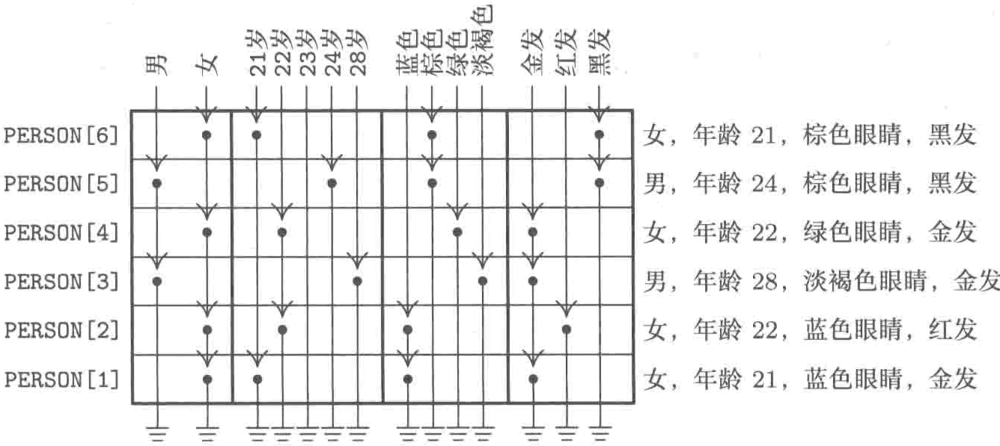
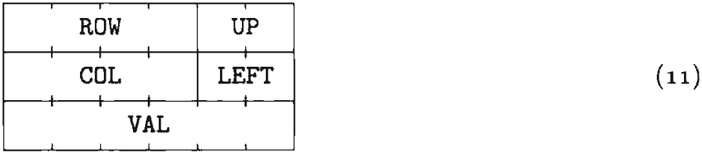
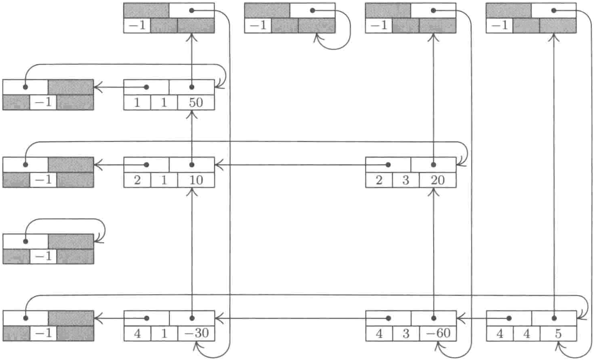
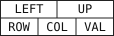
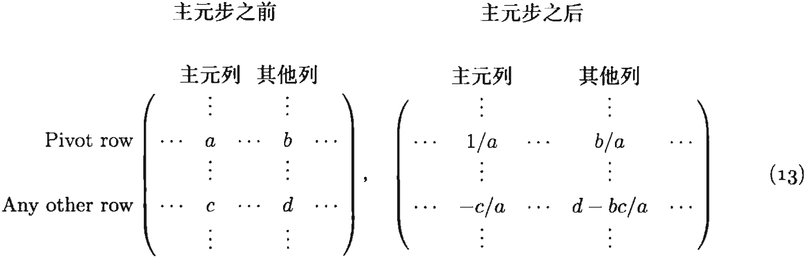

# 2.2.6数组与正交表

线性表最简单的推广之一是信息的二维或更高维数组. 例如, 考虑一个 $m \times n$ 矩阵

$$
\begin{pmatrix}\mathtt A[1,1]&\mathtt A[1,2]&\ldots&\mathtt A[1,n]\\\mathtt A[2,1]&\mathtt A[2,2]&\ldots&\mathtt A[2,n]\\\vdots&\vdots&&\vdots\\\mathtt A[m,1]&\mathtt A[m,2]&\ldots&\mathtt A[m,n]\end{pmatrix}.
\qquad \text{(1)}
$$

在这个二维数组中, 每个结点 A[$j$, $k$] 都属于两个线性表: “行 $j ^ { \prime \prime }$ 表 $\mathtt A[j,1],\mathtt A[j,2],\ldots,\mathtt A[j,n]$ 和 “列 $k ^ { \prime \prime }$ 表 $\mathtt A[1,k],\mathtt A[2,k],\ldots,\mathtt A[m,k]$. 这些正交的行表和列表本质上是源于矩阵的二维结构. 类似的评述也适用于信息的更高维的数组.

顺序分配. 当 (1) 这样的数组存放在顺序存储位置时, 通常分配存储, 使得

$$
\mathtt{LOC}(\mathtt A[\mathtt J,\mathtt K])=a_0+a_1\mathtt J+a_2\mathtt K,
\qquad \text{(2)}
$$

其中, $a _ { 0 } , a _ { 1 }$ 和 $a _ { 2 }$ 是常数. 让我们考虑更一般的情况: 假设我们有一个 4 维数组, 对于 $0 \leq \mathtt { I } \leq 2 , \quad 0 \leq \mathtt { J } \leq 4 , \quad 0 \leq \mathtt { K } \leq 1 0 , \quad 0 \leq \mathtt { L } \leq 2$ 有一个字的元素 Q[I,J,K,L]. 我们想分配存储, 使得这意味

$$
\mathtt{LOC}(\mathtt Q[\mathtt I,\mathtt J,\mathtt K,\mathtt L])=a_0+a_1\mathtt I+a_2\mathtt J+a_3\mathtt K+a_4\mathtt L.
\qquad \text{(3)}
$$

I,J,K 或 L 的改变导致 Q[I,J,K,L] 位置的改变容易计算. 分配存储的最自然的 (和最常用的) 方法是按下标的字典序排列数组元素 (习题 1.2.1-15(d)), 有时称作 “行优先序”:

$$
\begin{aligned}&\mathtt Q[0,0,0,0],\ \mathtt Q[0,0,0,1],\ \mathtt Q[0,0,0,2],\ \mathtt Q[0,0,1,0],\ \mathtt Q[0,0,1,1],\ \ldots,\\&\quad\mathtt Q[0,0,10,2],\ \mathtt Q[0,1,0,0],\ \ldots,\ \mathtt Q[0,4,10,2],\ \mathtt Q[1,0,0,0],\ \ldots,\end{aligned}
\qquad \text{(Q[2,4,10,2].)}
$$

容易看出, 这种序满足 (3) 的要求, 并且我们有:

$$
\mathtt{LOC}(\mathtt Q[\mathtt I,\mathtt J,\mathtt K,\mathtt L])=\mathtt{LOC}(\mathtt Q[0,0,0,0])+165\mathtt I+33\mathtt J+3\mathtt K+\mathtt L.
\qquad \text{(4)}
$$

一般地, 给定一个 $k$ 维数组, 具有 $c$ 个字的元素 $\mathtt A[\mathtt I_1,\mathtt I_2,\ldots,\mathtt I_k]$, 其中

$$
0 \leq \mathtt { I } _ { 1 } \leq d _ { 1 } , \quad 0 \leq \mathtt { I } _ { 2 } \leq d _ { 2 } , \quad \dots , \quad 0 \leq \mathtt { I } _ { k } \leq d _ { k } .
$$

我们可以把它存放在内存, 形式为

$$
\begin{aligned}\mathtt{LOC}(\mathtt A[\mathtt I_1,\mathtt I_2,\ldots,\mathtt I_k])&=\mathtt{LOC}(\mathtt A[0,0,\ldots,0])+c(d_2+1)\ldots(d_k+1)\mathtt I_1+\cdots+c(d_k+1)\mathtt I_{k-1}+c\mathtt I_k\\&=\mathtt{LOC}(\mathtt A[0,0,\ldots,0])+\sum_{1\le r\le k}a_r\mathtt I_r,\end{aligned}
\qquad \text{(5)}
$$

其中

$$
a_r=c\prod_{r<s\le k}(d_s+1).
\qquad \text{(6)}
$$

为了看出这个公式为何行得通, 我们指出, 如果 $\mathtt I_1,\ldots,\mathtt I_r$ 是常量, 而 $\mathsf { J } _ { r + 1 } , \ldots , \mathsf { J } _ { k }$ 遍取 $0 \leq \mathtt { J } _ { r + 1 } \leq d _ { r + 1 } , \ldots , \: 0 \leq \mathtt { J } _ { k } \leq d _ { k }$, 则 $a_r$ 是存放子数组 $\mathrm{A}[\mathrm{I}_{1}, \ldots, \mathrm{I}_{r}, \mathrm{J}_{r+1}, \ldots, \mathrm{J}_{k}]$ 所需要的内存总量. 因此, 根据字典序的性质, 当 $互 _{r}$ 改变 1 时, $\mathtt A[\mathtt I_1,\ldots,\mathtt I_k]$ 的地址应该精确地按这个数量改变.

公式 (5) 和 (6) 对应于混合进制数 $\mathtt { I } _ { 1 } \mathtt { I } _ { 2 } \dots \mathtt { I } _ { k }$ 的值. 例如, 如果有一个数组 TIME[W,D,H,M,S], 其中 $0 \leq \mathtt { W } < 4   , \quad 0 \leq \mathtt { D } < 7   , \quad 0 \leq \mathtt { H } < 2 4   , \quad 0 \leq \mathtt { M } < 6 0   , \quad 0 \leq \mathtt { S } < 6 0$, 则 TIME[0,0,0,0,0] 的位置应该是 TIME[W,D,H,M,S] 的位置, 加上转换成秒的量 “W 周+DD 天+H 小时+M 分+S 秒”. 当然, 如果能用到具有 2,419,200 个元素的数组, 那么应用一定相当有趣而复杂.

若数组具有完整的矩形结构, 使得对于在独立区间变化的下标 $\mathit { l } _ { 1 } \leq \mathtt { I } _ { 1 } \leq u _ { 1 } , \mathit { l } _ { 2 } \leq \mathtt { I } _ { 2 } \leq u _ { 2 } ,$ 7${ \ldots , } l _ { k } \leq \mathtt { I } _ { k } \leq u _ { k }$, 所有元素 $\mathbb { A } \left[ \mathtt { I } _ { 1 } , \mathtt { I } _ { 2 } , \dots , \mathtt { I } _ { k } \right]$ 都出现, 存放数组的常规方法是合适的. 习题 2 显示如何调整 (5) 和 (6), 使之适合下界 $( l _ { 1 } , l _ { 2 } , \ldots , l _ { \underline { { k } } } )$ 不是 (0,0,...,0) 的情况.

但是, 还有许多情况, 数组不是矩形的. 最常见的是三角矩阵, 比如只对 $0 \leq k \leq j \leq n$ 存放元素 A[$j$, $k$]:

$$
\begin{pmatrix}\mathtt A[0,0]&&&\\\mathtt A[1,0]&\mathtt A[1,1]&&\\\vdots&\vdots&\ddots&\\\mathtt A[n,0]&\mathtt A[n,1]&\ldots&\mathtt A[n,n]\end{pmatrix}.
\qquad \text{(7)}
$$

我们可能已经知道其余元素均为 0, 或者 $\mathbb{A}[j,k]=\mathbb{A}[k,j]$, 因此只需要存放一半的值. 如果想在 $\frac{1}{2}(n + 1)(n + 2)$ 个连续的存储位置存放下三角矩阵 $( 7 )$, 则不得不放弃像等式 (2) 所示的线性分配, 改为如下形式的分配安排

$$
\mathtt{LOC}(\mathtt A[\mathtt J,\mathtt K])=a_0+f_1(\mathtt J)+f_2(\mathtt K),
\qquad \text{(8)}
$$

其中 $f _ { 1 }$ 和 $f_{2}$ 是单变量函数. (如果愿意的话, 常量 $a _ { 0 }$ 可以放到 $f_1$ 或 $f_{2}$ 中.) 当寻址具有 (8) 式形式时, 如果我们保存两个附加的 (相当短的) $f_{1}$ 和 $f_{2}$ 的值表, 则可以快速访问随机元素 $\mathrm{A}[j,k]$, 因此, 这些函数只需要计算一次.

结果是, 数组 (7) 的下标的字典序满足条件 (8). 使用一字元素, 事实上有简单的公式

$$
\mathtt{LOC}(\mathtt A[\mathtt J,\mathtt K])=\mathtt{LOC}(\mathtt A[0,0])+\frac{\mathtt J(\mathtt J+1)}2+\mathtt K.
\qquad \text{(9)}
$$

但是, 如果恰好有两个大小相同的三角矩阵, 那么实际上有更好的存放办法. 假设我们想存放 $A [ j ]$, $k$] 和 B[$j$, $k$], $0 \leq k \leq j \leq n$. 于是, 使用如下约定

$$
\mathtt A[j,k]=\mathtt C[j,k],\qquad\mathtt B[j,k]=\mathtt C[k,j+1].
\qquad \text{(10)}
$$

我们可以把它们放入单个矩阵 $\mathtt C[j$, $k$] 中, 其中 $0 \leq j \leq n , \quad 0 \leq k \leq n + 1 .$ 于是

$$
\left( \begin{matrix} { \mathtt { C } [ 0 , 0 ] \mathtt { C } [ 0 , 1 ] \mathtt { C } [ 0 , 2 ] \dots \mathtt { C } [ 0 , n { + } 1 ] } \\ { \mathtt { C } [ 1 , 0 ] \mathtt { C } [ 1 , 1 ] \mathtt { C } [ 1 , 2 ] \dots \mathtt { C } [ 1 , n { + } 1 ] } \\ { \vdots } \\ { \mathtt { C } [ n , 0 ] \mathtt { C } [ n , 1 ] \mathtt { C } [ n , 2 ] \dots \mathtt { C } [ n , n { + } 1 ] } \\ \end{matrix} \right) \equiv \left( \begin{matrix} { \mathtt { A } [ 0 , 0 ] \mathtt { B } [ 0 , 0 ] \mathtt { B } [ 1 , 0 ] \dots \mathtt { B } [ n , 0 ] } \\ { \mathtt { A } [ 1 , 0 ] \mathtt { A } [ 1 , 1 ] \mathtt { B } [ 1 , 1 ] \dots \mathtt { B } [ n , 1 ] } \\ { \vdots } \\ { \mathtt { A } [ n , 0 ] \mathtt { A } [ n , 1 ] \mathtt { A } [ n , 2 ] \dots \mathtt { B } [ n , n ] } \\ \end{matrix} \right) .
$$

两个三角矩阵一起挤进 $(n + 1)(n + 2)$ 个位置的空间内, 而且有像 (2) 一样的线性寻址.

三角矩阵推广到较高维称为四面体数组 (tetrahedralarray). 这个有趣的课题是习题 6 到 8 的主题.

关于使用顺序存储数组的典型程序设计技术范例, 见习题 1.3.2-10 和该题的两个答案. 在那些程序中, 高效地遍历行和列的基本技术以及顺序栈的使用, 都特别有趣.

链接分配. 链接存储分配也能自然用于信息的高维数组. 一般地, 结点可以包含 $k$ 个链字段, 结点所属的每个表对应一个字段. 链接存储一般用于这种情况: 数组在特征上不是严格矩形的.

例如, 假设有一个表, 其中每个结点代表一个人, 每个结点有 4 个链字段: SEX (性别), AGE (年龄), EYES (眼睛) 和 HAIR (头发). 在 EYES 字段, 我们把眼睛颜色相同的所有结点链接在一起, 等等 (见 [图13](#fig-2-13)). 容易构思把新的人插入到表中的高效算法, 然而除非使用双链接, 否则删除将慢得多. 我们还能构思出具有不同效率的算法, 完成 “找出所有 21 到 23 岁的蓝眼金发女人” 之类事情, 见习题 9 和 10. 表的每个结点同时属于多个其他类型的表, 这种问题的出现相当频繁. 确实, 在上一节介绍的电梯系统模拟中, 就有一些结点同时在 QUEUE 和 WAIT 表中.

*图 13　每个结点在 4 个不同的表中*

为详细举例说明正交表使用链接分配的做法, 我们考虑稀疏矩阵 (即大部分元素为零的高阶矩阵). 目标是, 在这些矩阵上操作时, 就像提供了整个矩阵一样, 同时又要节省大量时间和空间, 因为不必提供零元素. 为了随机访问矩阵的元素, 一种做法是使用第 6 章的存储和检索方法, 从键 “[$j$, $k$]” 找 A[$j$, $k$]. 然而, 另一种处理稀疏矩阵的方式更可取, 因为它更好地反映了矩阵结构, 下面就讨论这种方法.

矩阵表示由每行、每列的循环链接的表组成, 每个结点包含 3 个字和 5 个字段:

这里, ROW 和 COL 是结点的行下标和列下标; VAL 是存放在矩阵该处的值; LEFT 和 UP 分别是指向该行左边元素和该列上方元素的链. 对于每一行和每一列, 有一个特殊的表头结点 BASEROW[i] 和 BASECOL[$j$]. 这些结点通过

$$
\mathtt{COL}(\mathtt{LOC}(\mathtt{BASEROW}[i]))<0\quad\text{和}\quad\mathtt{ROW}(\mathtt{LOC}(\mathtt{BASECOL}[j]))<0
$$

来标识. 像通常的循环表一样, BASEROW[i] 中的 LEFT 链是该行最右边的值的位置, 而 BASECOL[$j$] 中的 UP 是该列最底下的值的位置. 例如, 矩阵

$$
\begin{pmatrix}50&0&0&0\\10&0&20&0\\0&0&0&0\\-30&0&-60&5\end{pmatrix}.
\qquad \text{(12)}
$$

将表示成图 14.

图 14　矩阵 (12) 的表示, 其结点格式为 , 表头出现在最左和最上

使用顺序存储分配, 一个 $200\times 200$ 的矩阵将占 40000 个字, 这比许多计算机以往所具有的内存还要多. 但是, 一个相当稀疏的 $200\times 200$ 的矩阵像上面那样, 甚至可以在 MIX 的 4000 个字的内存中表示. (见习题 11.) 如果每行或每列没有几个元素的话, 随机访问元素 A[$j$, $k$] 所花费的时间也相当短. 由于大部分矩阵算法都是顺序遍历矩阵, 而不是随机访问矩阵的元素, 因此这种链接表示比顺序表示快.

处理这种形式的稀疏矩阵, 有一种具有代表性的非平凡算法, 要考虑主元步操作 (pivotstep). 这种操作是解线性方程组、矩阵求逆和用单纯形法解线性规划问题算法的重要部分. 主元步是如下矩阵变换 [见杜立德, Report of the Superintendent of the U. S. Coast and GeodeticSurvey (1878), 115-120 ]:

假定主元素 $a$ 非零. 例如, 对矩阵 (12) 使用主元步, 以第 2 行第 1 列的元素 10 为主元, 得

$$
\begin{pmatrix}-5&0&-100&0\\0.1&0&2&0\\0&0&0&0\\3&0&0&5\end{pmatrix}.
\qquad \text{(14)}
$$

我们的目标是设计一个算法, 在如 [图14](#fig-2-14) 表示的稀疏矩阵上执行主元操作. 显然, 变换 (13) 只影响主元列上具有非零元素的行, 并且只影响主元行上具有非零元素的列.

在许多方面, 主元算法都是前述链接技术的直截了当的应用, 特别是非常类似多项式加法算法 2.2.4A. 然而, 有两件事使得该问题多少需要一点技巧: 在 (13) 式中, 如果有 $b \ne 0, c \ne 0,$ 但是 $d=0$, 则矩阵的稀疏表示中没有表示 $d$ 的项, 必须插入一个新项; 如果 $b \ne 0, c \ne 0,$ $d \neq 0$, 但 $d - b c / a = 0$, 则我们必须删除先前存在的项. 这些二维数组的插入和删除操作比一维数组更有趣. 为了做这些操作, 我们必须知道哪些链受影响. 算法自底向上逐一处理矩阵的行. 插入和删除的高效性需要引入指针变量 PTR[$j$] 的集合. 所考虑的每一列有一个指针变量, 这些指针向上遍历这些列, 使得我们能够更新两个维上的相应链.

算法 S (稀疏矩阵的主元步). 给定如 [图14](#fig-2-14) 所示的矩阵, 执行主元操作 (13). 假定 PIVOT 是一个指向主元元素的链变量. 算法使用存放链变量 PTR[$j$ 的表, 矩阵的每列对应一个链变量. 假定变量 ALPHA 和结点的 VAL 字段是浮点或有理量, 而算法的其他量都具有整数值.

S1.[初始化.] 置 $\mathtt{ALPHA}\leftarrow1.0/\mathtt{VAL}(\mathtt{PIVOT}),\quad\mathtt{VAL}(\mathtt{PIVOT})\leftarrow1.0,$ 并且

$$
\begin{aligned}\mathtt{I0}&\leftarrow\mathtt{ROW}(\mathtt{PIVOT}),&\mathtt{P0}&\leftarrow\mathtt{LOC}(\mathtt{BASEROW}[\mathtt{I0}]);\\\mathtt{J0}&\leftarrow\mathtt{COL}(\mathtt{PIVOT}),&\mathtt{Q0}&\leftarrow\mathtt{LOC}(\mathtt{BASECOL}[\mathtt{J0}]).\end{aligned}
$$

S2. [处理主元行.] 置 PO←LEFT(PO), J ←COL(PO). 如果 J<0, 则继续到步骤 S3 (主元行已经遍历). 否则, 置 PTR[J]←LOC(BASECOL[J]), VAL(PO)← ALPHA×VAL(PO), 并重复步骤 S2.

S3.[找新行.] 置 QO←UP(QO). (算法的其余部分自底向上, 对于主元列存在项的行, 逐一处理每一行.) 置 I←ROW(QO). 如果 I<0, 则算法终止. 如果 I=IO, 则重复步骤 S3 (我们已经处理完主元行). 否则, 置 P←LOC(BASEROW[I]), P1←LEFT(P). (现在, 随着 PO 同步地通过行 IO, 指针 P 和 P1 将自右向左通过行 I. 算法 2.2.4A 类似. 此时, 我们有 PO = LOC(BASEROW[IO])).

S4.[找新列.] 置 PO←LEFT(PO), J←COL(PO). 如果 J <0, 则置 $\mathtt{VAL}(\mathtt{Q0})\leftarrow-\mathtt{ALPHA}\times\mathtt{VAL}(\mathtt{Q0})$, 并回到 S3. 如果 J=JO, 则重复 S4. (这样, 在其他列元素都处理之后, 我们再处理第 I 行的主元列元素, 理由是步骤 S7 中需要 VAL(QO).)

S5.[找出 I,J 元素.] 如果 COL(P1)> J, 则置 P←P1,P1←LEFT(P), 并重复步骤 S5. 如果 COL(P1)=J, 则转到步骤 S7; 否则, 转到步骤 S6 (我们需要在第 I 行的第 J 列插入一个新元素).

S6.[插入 I,J 元素.] 如果 ROW(UP(PTR[J]))>I, 则置 PTR[J]←UP(PTR[J]), 并重复步骤 S6. (否则, 我们有 ROW(UP(PTR[J]))<I; 在垂直维, 新元素恰插入在 NODE(PTR[J]) 的上方; 在水平维, 恰在 NODE(P) 的左边.) 否则, 置 X⇐AVAIL, VAL(X)←0, ROW(X)←I,COL(X) ← J,LEFT(X) ← P1, UP(X) ← UP(PTR[J]), LEFT(P) ← X, UP(PTR[J]) ← X,P1 ←X.

S7. [主元.] 置 $\mathtt{VAL}(\mathtt{P1})\leftarrow\mathtt{VAL}(\mathtt{P1})-\mathtt{VAL}(\mathtt{Q0})\times\mathtt{VAL}(\mathtt{P0})$. 如果现在 VAL(P1) =0, 则转到 S8. (注意: 在使用浮点数算术运算时, 测试 $\text{“}\mathtt{VAL}(\mathtt{P1})=0\text{”}$ 应该代之以 $\text{“}\lvert\mathtt{VAL}(\mathtt{P1})\rvert<$ EPSILON”, 或代之以更好的条件 “VAL(P1) 在减法中丢失大部分有效数字”.) 否则, 置 PTR[J]←P1, P ←P1,P1 ←LEFT(P), 并转回 S4.

S8. [删除 I,J 元素.] 如果 $\mathtt{UP}(\mathtt{PTR}[\mathtt J])\ne\mathtt{P1}$ (或如果 ROW(UP(PTR[J]))> I, 两个条件实质上是等价的), 则置 PTR[J]←UP(PTR[J]), 并重复步骤 S8; 否则, 置 UP(PTR[J])←UP(P1), LEFT(P)← LEFT(P1), AVAIL ⇐P1,P1 ← LEFT(P). 转回步骤 S4. I

这个算法的编程作为一个有益的练习留给读者 (见习题 15). 这里, 值得指出的是, 有必要仅给 BASEROW[i] 和 BASECOL[$j$] 的每个结点分配一个字的内存, 因为它们的大部分字段都是不相关的. (见 [图14](#fig-2-14) 的阴影区域, 并见 2.2.5 节的程序.) 此外, 可以把值—PTR[$j$] 作为 ROW(LOC(BASECOL[$j$])) 存放, 进一步节省存储空间. 算法 S 的运行时间粗略地正比于受主元操作影响的矩阵元素个数.

用正交的循环表表示稀疏矩阵是有启发意义的, 但是数值分析已经开发了更好的方法. 见弗雷德·古斯塔夫森, ACM Trans. on Math. Software4(1978), 250-269; 又见第 7 章的图和网络算法 (如算法 7B).

#### 习题

1\. [17] [答案](./answers/2-2-6.md#ans-2-2-6-1) 如果 A 是 (1) 式的矩阵, 并且数组的每个结点都占两个字, 假定结点按其下标的字典序连续存放, 给出计算 LOC(A[J,K]) 的公式.

2\. [21] [答案](./answers/2-2-6.md#ans-2-2-6-2) 从假设对于 $0 \leq \mathtt { I } _ { r } \leq d _ { r }$ 有 $1 \leq r \leq k$ 出发, 推导出了公式 (5) 和 (6). 给出适用于 $l _ { r } \leq \mathtt { I } _ { r } \leq u _ { r }$ 的一般公式, 其中 $l_r$ 和 $u_r$ 是维上的任意下界和上界.

3\. [21] [答案](./answers/2-2-6.md#ans-2-2-6-3) 正文中对于 $0 \leq k \leq j \leq n$, 考虑了下三角矩阵 A[$j$, $k$]. 如果下标从 1 开始, 而不是从 0 开始, 即 $1 \leq k \leq j \leq n$, 该如何修改这一讨论?

4\. [22] [答案](./answers/2-2-6.md#ans-2-2-6-4) 证明: 如果我们按下标的字典序存放上三角矩阵 A[$j$, $k$] $(0\le j\le k\le n)$, 则分配满足等式 (8) 的条件. 在这种意义下, 找出 LOC(A[J,K]) 的计算公式.

5\. [20] [答案](./answers/2-2-6.md#ans-2-2-6-5) 证明: 即使 A 是像 (9) 一样的三角矩阵, 使用习题 2.2.2-3 的间接寻址特征, 仍然可能用一条 MIX 指令, 把 A[J,K] 的值装入到寄存器 A 中. (假定 J 和 K 的值在变址寄存器中.)

▶ 6. [M24] [答案](./answers/2-2-6.md#ans-2-2-6-6)  考虑 “四面体数组” $\mathrm{A}[i,j,k]$ 和 B[i, $j$, $k$], 其中 A 中有 $0 \leq k \leq j \leq i \leq n$, B 中有 $0 \leq i \leq j \leq k \leq n$. 假设这两个数组都按下标的字典序存放在连续的内存单元中. 证明存在函数 $f_{1} 、 f_{2}$ 和 f3, 使得 $\mathtt{LOC}(\mathtt A[\mathtt I,\mathtt J,\mathtt K])=a_0+f_1(\mathtt I)+f_2(\mathtt J)+f_3(\mathtt K).\quad\mathtt{LOC}(\mathtt B[\mathtt I,\mathtt J,\mathtt K])$ 也可以用类似的方法表示吗?

7\. [M23] [答案](./answers/2-2-6.md#ans-2-2-6-7) 找出为 $k$ 维四面体数组 $\mathtt A[i_1,i_2,\ldots,i_k]$ 分配存储的一般公式, 其中 $0 \leq i _ { k } \leq \cdots \leq i _ { 2 } \leq i _ { 1 } \leq n .$

8\. [33] [答案](./answers/2-2-6.md#ans-2-2-6-8) (彼得·瓦格纳) 假设我们有 6 个四面体数组 A[I,J,K], B[I,J,K], C[I,J,K], D[I,J,K], E[I,J,K] 和 F[I,J,K] 需要存放在内存中, 其中 $0 \leq \mathtt { K } \leq \mathtt { J } \leq \mathtt { I } \leq \mathtt { n } .$ 是否有一种类似于二维情况下的 (10) 式的简洁方法来实现?

9\. [22] [答案](./answers/2-2-6.md#ans-2-2-6-9) 假设已经建立了一张类似于 [图13](#fig-2-13) 但是大得多的表, 所有的链都与 [图13](#fig-2-13) 显示的方向相同 (即对于所有的结点和链, 都有 LINK(X)<X). 设计一个算法, 通过检查各链字段, 找出所有年龄在 21 到 23 岁之间的蓝眼金发女郎的地址, 要求在算法完成时, 对 FEMALE、A21、A22、A23、BLOND 和 BLUE 各表最多扫描一遍.

10\. [26] [答案](./answers/2-2-6.md#ans-2-2-6-10) 你能想出更好的组织人员表的方法, 使得上题所述的检索更高效吗? (不能仅仅回答 “能” 或 “不能”.)

11\. [11] [答案](./answers/2-2-6.md#ans-2-2-6-11) 假设有一个 $200\times 200$ 的矩阵, 其中每行最多有 4 个非零元素. 如果表头用一个字, 每个其他结点用三个字, 像 [图14](#fig-2-14) 那样表示该矩阵需要多少存储?

▶ 12. [20] [答案](./answers/2-2-6.md#ans-2-2-6-12) 按照 (13) 中使用的记号 $a , \; b , \; c , \; d$, 在步骤 S7 开始时, VAL(Q0)、VAL(P0) 和 VAL(P1) 的值是什么?

▶ 13. [22] [答案](./answers/2-2-6.md#ans-2-2-6-13)  为什么 [图 14](#fig-2-14) 中使用循环表, 而不是标准的直线线性表? 可以重写算法 S, 使得它不使用循环链接吗?

14\. [22] [答案](./answers/2-2-6.md#ans-2-2-6-14) 算法 S 实际上节省了稀疏矩阵上的主元步时间, 因为不用考虑主元行上具有零元素的那些列.  
说明在一个顺序存储的大型稀疏矩阵中, 借助附加的表 LINK[$j$] $( 1 \leq j \leq n )$ 也能节省运行时间.

▶ 15. [29] [答案](./answers/2-2-6.md#ans-2-2-6-15) 为算法 S 写一个 MIXAL 程序. 假定 VAL 字段是浮点数, 并且 MIX 的浮点算术运算符 FADD,FSUB, FMUL 和 FDIV 可以用于这个字段上的操作. 为简单起见, 假定相加减的操作数失去大部分有效位时, FADD 和 FSUB 返回结果 0, 使得步骤 S7 可以放心使用测试 $\text{“}\mathtt{VAL}(\mathtt{P1})=0\text{”}$. 浮点操作仅使用 rA, 而不是 rX.

16\. [25] 设计一个复制稀疏矩阵的算法. (换言之, 给定形如 [图14](#fig-2-14) 的矩阵表示, 该算法将在内存中产生矩阵的两个同样的独立的表示.)

17\. [26] [答案](./answers/2-2-6.md#ans-2-2-6-17) 设计一个执行两个稀疏矩阵乘法的算法: 给定矩阵 A 和 B, 形成一个新矩阵 C, 其中 $\mathtt C[i,j]=\sum_k\mathtt A[i,k]\mathtt B[k,j]$. 这两个输入矩阵和一个输出矩阵应该表示成 [图14](#fig-2-14) 的形式.

18\. [22] [答案](./answers/2-2-6.md#ans-2-2-6-18) 假定矩阵的元素是 $A[i,j] (1 \leq i,j \leq n)$, 下面的算法把矩阵替换为矩阵的逆.

(i) 对于 $\underline { { k } } = 1 , 2 , \ldots , n$ 做如下事情: 搜索第 $k$ 行中所有尚未用作主元列的列, 找出绝对值最大的元素; 置 C[$k$] 为找到的元素所在的列, 并以该元素为主元, 做主元步. (如果所有这样的元素均为零, 则矩阵是奇异的, 没有逆矩阵.)

(ii) 置换诸行和诸列, 使得原来的行 $k$ 变成行 C[$k$], 原来的列 $k$ 变成列 C[$k$]].

本习题的问题是: 使用上述算法, 笔算下面矩阵的逆

$$
\begin{pmatrix}1&2&3\\0&1&2\\0&0&1\end{pmatrix}.
$$

19\. [31] 修改习题 18 中的算法, 使之得到用 [图14](#fig-2-14) 形式表示的稀疏矩阵的逆. 特别注意使步骤 (ii) 的行列置换操作高效进行.

20\. [20] [答案](./answers/2-2-6.md#ans-2-2-6-20) 除 $|i-j|\le1\ (1\le i,j\le n)$ 之外, 三对角矩阵的元素 $a_{ij}$ 均为零. 试证明存在一个分配函数, 形如

$$
\mathtt{LOC}(\mathtt A[\mathtt I,\mathtt J])=a_0+a_1\mathtt I+a_2\mathtt J,\qquad\lvert\mathtt I-\mathtt J\rvert\le1,
$$

它用 (3n-2) 个连续位置表示一个三对角矩阵的所有相关元素.

21\. [20] [答案](./answers/2-2-6.md#ans-2-2-6-21) 给出 $n\times n$ 矩阵的存储分配函数, 其中 $n$ 是变量. 无论 $n$ 的值是多少, 对于 $1 \leq \mathtt { I } , \mathtt { J } \leq n$, 元素 A[I,J] 应该占据 $n^{2}$ 个连续位置.

22\. [M25] [答案](./answers/2-2-6.md#ans-2-2-6-22) (帕罗米塔·乔拉, 1961) 找出一个多项式 $p ( i _ { 1 } , \ldots , i _ { k } )$, 要求在下标 $( i _ { 1 } , \ldots , i _ { k } )$ 取遍所有 $k$ 维非负整数向量时, 多项式也不重复地取遍每个非负整数值, 并且满足性质 $i_{1} + \cdots + i_{k} < j_{1} + \cdots + j_{k}$, 蕴涵 $p ( i _ { 1 } , \ldots , i _ { k } ) < p ( j _ { 1 } , \ldots , j _ { k } )$

23\. [23] [答案](./answers/2-2-6.md#ans-2-2-6-23) 可扩展的矩阵初始为 $1\times 1$ 矩阵, 然后通过添加一个新行或新列, 从 $m\times n$ 矩阵扩展为 $(m + 1) \times n$ 或 $m \times (n + 1)$ 矩阵. 证明: 可以给这种矩阵一个简单的分配函数, 使得对于 $0\le\mathtt I<m$ $0 \leq \mathsf { J } < n$, 元素 A[I,J] 占据 mn 个连续位置; 当矩阵增长时, 所有元素都不改变位置.

▶ 24. [25] [答案](./answers/2-2-6.md#ans-2-2-6-24) (稀疏数组技巧) 假设你想对大数组随机访问, 但实际上并不打算引用许多元素. 你想在第一次访问时, A[$k$] 为 0, 但并不想花时间置每个单元为 0. 不对初始存储内容做任何假定, 解释如何只对每次数组访问做少量固定数目的附加操作, 就能对给定的 $k$ 可靠地读写所需元素 A[$k$].
