<a id="pdf-270"></a><a id="p-253"></a>

<a id="sec-2-3-1"></a>

#### 2.3.1遍历二叉树

在对树做进一步考察之前, 有必要充分理解二叉树的性质, 因为在计算机内部, 一般的树通常借助于某种等价的二叉树来表示.

我们已经把二叉树定义为结点的有限集, 它或者为空, 或者由一个根和两棵二叉树组成. 这个定义暗示了一种在计算机内部表示二叉树的方法: 在每个结点中有两个链 LLINK 和 RLINK, 以及一个 “指向该树指针” 的链变量 $T$. 如果树为空, 则 T=Λ; 否则 T 是树的根结点的地址, 并且 LLINK(T) 和 RLINK(T) 分别是指向根的左、右子树的指针. 这些规则递归地定义了任意二叉树的内存表示, 例如

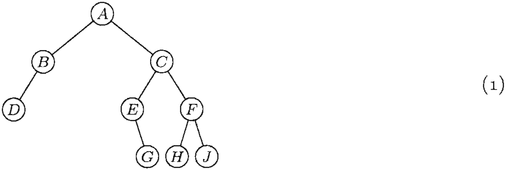

表示为

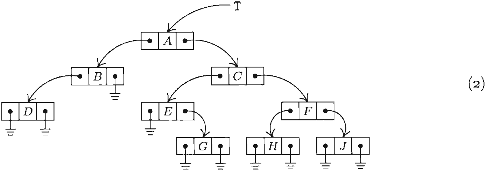

这种简单而自然的内存表示正是二叉树结构具有特殊重要性的原因所在. 在 2.3.2 节, 我们将看到一般的树可以方便地表示成二叉树. 此外, 应用中出现的许多树本身都是二叉的, 因此二叉树理应令人感兴趣.

有许多处理树结构的算法, 其中反复出现的一种思想就是遍历或 “走遍” 一棵树. 遍历是系统地考察树结点, 使得每个结点恰访问一次的方法. 树的完全遍历给出了树结点的一种线性排列, 并且如果我们能够在这种序列中谈论给定结点的 “前一个” 或 “后一个” 结点, 则许多算法都将更容易.

遍历二叉树主要有三种方法: 我们可以按先序 (preorder)、中序 (inorder) 和后序 (postorder) 遍历二叉树. 这三种方法都是递归定义的. 当二叉树为空时, 什么都不做就已经 “遍历”; 非空时, 遍历分三步:

先序遍历 中序遍历 后序遍历访问根 遍历左子树 遍历左子树遍历左子树 访问根 遍历右子树遍历右子树 遍历右子树 访问根

如果我们把这些规则用于 (1) 和 (2) 的二叉树, 那么先序下的结点为:

$$
A\quad B\quad D\quad C\quad E\quad G\quad F\quad H\quad J.
\qquad \text{(3)}
$$

<a id="pdf-271"></a><a id="p-254"></a>

(先到根 A, 然后按先序遍历左子树

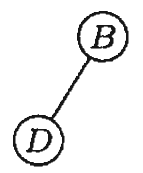

最后按先序遍历右子树.) 对于中序, 我们在访问两棵子树的中间访问根, 基本上就好像把诸结点 “投影” 到一条水平线上, 产生序列

$$
D\quad B\quad A\quad E\quad G\quad C\quad H\quad F\quad J.
\qquad \text{(4)}
$$

类似地, 该二叉树结点的后序是

$$
D\quad B\quad G\quad E\quad H\quad J\quad F\quad C\quad A.
\qquad \text{(5)}
$$

我们将看到, 这三种把二叉树结点排列成序列的方法非常重要, 因为它们与大部分处理树的计算机方法密切相关. 当然, 术语先序、中序和后序源于根和它的子树的相对位置. 在许多二叉树应用中, 左子树与右子树的含义是对称的, 这种情况下, 中序也称为对称序 (symmetricorder). 中序把根放在中间, 基本上是左右对称的: 如果二叉树关于垂直轴反射, 则对称序只需要颠倒次序.

像上面三种序这样递归陈述的定义, 必须再加工才可以直接用计算机实现. 递归定义的一般处理方法将在第 8 章讨论. 通常, 我们使用一个附加的栈, 就像下面的算法那样.

算法 T (中序遍历二叉树). 设 T 是一个指针, 指向一棵如 (2) 所示的二叉树. 算法使用一个附加的栈 A, 按中序访问该二叉树的所有结点.

T1.[初始化.] 置栈 A 为空, 并置链变量 P←T.

T2. $\left[ \mathrm{P} = \Lambda ? \right]$ 如果 P=Λ, 则转到步骤 T4.

T3.[栈⇐P.\](现在, P 指向一棵待遍历的非空二叉树. 指向一棵待遍历的非空二叉树.) 置 A⇐P, 即把 P 的值推入栈 A (见 2.2.1 节). 然后置 $\mathtt P\leftarrow\mathtt{LLINK}(\mathtt P)$, 并返回步骤 T2.

T4.[P⇐栈.] 如果栈 A 为空, 则算法终止; 否则 $\mathtt { P } \Leftarrow \mathtt { A } .$

T5. [P 访问.] 访问 NODE(P). 然后, 置 $\mathrm{P} \leftarrow \mathrm{RLINK}(\mathrm{P})$ 并返回步骤 T2.

<a id="fig-2-23"></a>

<span>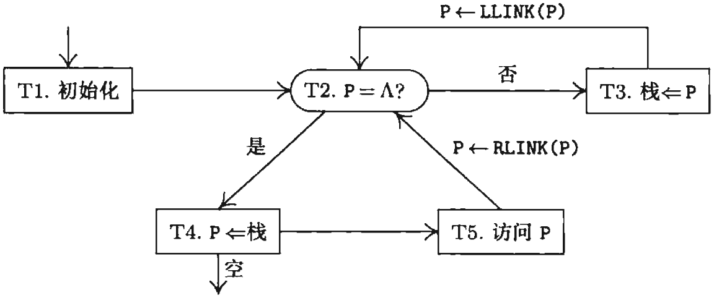</span>

*图 23　中序遍历算法 T*

在算法的最后一步, “访问” 一词是指我们做遍历树打算做的任何活动. 算法 T 就像一个关于其他活动的协同程序: 一旦主程序想让 P 从一个结点移动到其中序下的后继结点, 它就激活这个协同程序. 当然, 由于这个协同程序只在一处调用主程序, 因此它与子程序并无多大差别 (见 1.4.2 节). 算法 T 假定外部活动既不从树中删除 NODE(P), 也不删除它的先辈.

<a id="pdf-272"></a><a id="p-255"></a>

现在, 读者应该使用二叉树 (2) 作为测试实例, 试着运行算法 T, 以便洞悉该过程背后的缘由. 在步骤 T3, 我们想要遍历以 P 指向的结点为根的二叉树, 这里的思想是把 P 保存在栈中, 然后遍历左子树; 做完之后进入步骤 T4, 并从栈顶重新找回 P 的旧值. 在步骤 T5, 访问根 NODE(P) 之后, 剩下的工作就是遍历右子树.

我们稍后将要看到许多其他算法, 算法 T 是它们的典型代表 s, 因此看一看上一段所作评述的形式化证明是有益的. 现在, 对 $n$ 归纳, 证明算法 T 按先序遍历一棵 $n$ 个结点的二叉树. 我们的目标容易实现, 如果能够证明稍微更一般的结果:

设步骤 T2 开始时, P 是指向 $n$ 个结点的二叉树的指针, 并且对于某个 $\bar { m } \geq 0$, 栈 A 包含 A[1]...A[$m$], 从步骤 T2-T5 的过程将按中序遍历所述二叉树, 然后到达步骤 T4, 同时栈 A 恢复到它原先的值 A[1]...A[$m$].

由步骤 (2) 知, 当 $n = 0$ 时, 该命题显然为真. 如果 $n > 0$, 则令 $P _{0}$ 为进入步骤 T2 时 P 的值. 既然 $\mathbb{P}_{0} \neq \Lambda$, 我们将执行步骤 T3, 这意味栈 A 将变成 $\mathbb{A}[1] \cdots \mathbb{A}[m] \mathbb{P}_0$, 并且 P 被置为 $\mathrm{LLINK}(\mathbb{P}_0)$. 现在, 左子树的结点少于 $n$ 个, 因此根据归纳假设, 我们将中序遍历左子树, 并且最终到达步骤 T4,A[1]...A[$m$] $P _{0}$ 在栈中. 步骤 T4 返回 A[1]...A[$m$], 并置 $\mathtt P\leftarrow\mathtt P_0$ 现在, 步骤 T5 访问 $\mathrm{N0DE}(\mathbb{P}_{0})$, 并置 $\mathtt P\leftarrow\mathtt{RLINK}(\mathtt P_0)$. 现在, 右子树的结点少于 $n$ 个, 因此根据归纳假设, 我们将中序遍历右子树, 并如要求的那样到达步骤 T4. 根据中序的定义, 树已经被中序遍历. 这就完成了证明.

可以设计一种几乎相同的先序遍历二叉树的算法 (见习题 12). 实现后序遍历稍微有点难 (见习题 13), 正因为如此, 对于二叉树, 后序遍历不如其他方法重要.

为结点在各种序下的前驱和后继定义新的记号是方便的. 如果 P 指向二叉树的一个结点, 则令

$$
\begin{aligned}\mathtt P\ast&=\text{先序下 }\mathtt{NODE}(\mathtt P)\text{ 的后继的地址};\\\mathtt P\$&=\text{中序下 }\mathtt{NODE}(\mathtt P)\text{ 的后继的地址};\\\mathtt P\sharp&=\text{后序下 }\mathtt{NODE}(\mathtt P)\text{ 的后继的地址};\\\ast\mathtt P&=\text{先序下 }\mathtt{NODE}(\mathtt P)\text{ 的前驱的地址};\\\$\mathtt P&=\text{中序下 }\mathtt{NODE}(\mathtt P)\text{ 的前驱的地址};\\\sharp\mathtt P&=\text{后序下 }\mathtt{NODE}(\mathtt P)\text{ 的前驱的地址}.\end{aligned}
\qquad \text{(6)}
$$

如果 NODE(P) 没有这样的后继或前驱, 则一般使用值 LOC(T), 其中 T 是一个指向所述树的外部指针. 我们有 $\ast(\mathtt P\ast)=(\ast\mathtt P)\ast=\mathtt P,\quad\$(\mathtt P\$)=(\$\mathtt P)\$=\mathtt P,\quad\sharp(\mathtt P\sharp)=(\sharp\mathtt P)\sharp=\mathtt P$. 例如, 设 INFO(P) 为树 (2) 的 NODE(P) 中的字母. 如果 P 指向根, 则我们有 $\mathtt{INFO}(\mathtt P)=A,\quad\mathtt{INFO}(\mathtt P\ast)=B$ $\mathtt { I N F O } ( \mathtt { P s } ) = E , \enspace \mathtt { I N F O } ( \mathtt { s P } ) = B , \enspace \mathtt { I N F O } ( \mathtt { i P } ) = C , \enspace \mathtt { P i } = \mathtt { * P } = \mathtt { L O C } ( \mathtt { T } )$

此刻, 读者或许已经感觉到, $\mathtt P\ast$、$\mathtt P\mathord{\$}$ 等记号的直观意义不太安全. 随着我们继续, 其思想将逐渐明朗, 本节后面的习题 16 可能也有帮助. $\mathtt P\mathord{\$}$ 中的 “\$” 意在暗示字母 S, 表示 “对称序”(symmetric order).

对于 (2) 给出的二叉树内存表示, 有另外一种重要的表示方法, 有点类似于循环表与直线单向表之间的差别. 注意, 树 (2) 中的空链比其他指针还多, 并且用传统的方法表示的任何二叉树都是如此 (见习题 14). 但是我们实际上不必浪费所有这些内存空间. 例如, 我们可以在每个结点存放两个 “标签” 指示器, 只用两个二进位指明 LLINK 和 RLINK 是否为空, 原本用于终端结点链的内存空间则可以用于其他目的.

艾伦·佩利和查尔斯·桑顿提出了一种巧妙地利用额外空间的方法, 他们发明了一种称作线索树 (threadedtree) 的表示方法. 在这种方法中, 终端链被指向树的其他部分的 “线索”

<a id="pdf-273"></a><a id="p-256"></a>

所取代, 以辅助遍历. 等价于 (2) 的线索树是

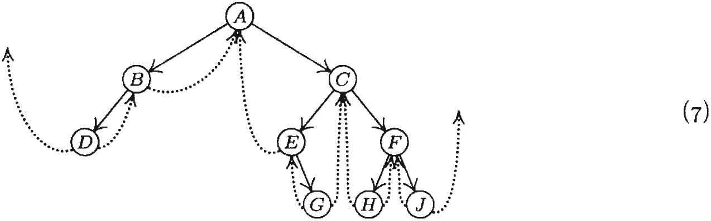

这里, 虚线表示 “线索”, 它总是指向树的较高层结点. 现在, 每个结点都有两个链: 某些结点 (如 C) 有两个指向左、右子树的普通链; 某些结点 (如 H) 有两个线索链; 而某些结点则两种类型的链各有一个. 从 D 和 J 出发的特殊线索将稍后解释. 它们分别出现在 “最左” 和 “最右” 结点.

在线索二叉树的内存表示中, 必须区分虚线和实线链. 像上面提议的一样, 这可以通过在每个结点中附加两个一位字段 LTAG 和 RTAG 来实现. 线索表示可以精确地定义如下:

**非线索表示**　　　　**线索表示**

$$
\begin{array}{ll}\mathtt{LLINK}(\mathtt P)=\Lambda&\mathtt{LTAG}(\mathtt P)=1,\quad\mathtt{LLINK}(\mathtt P)=\$\mathtt P\\\mathtt{LLINK}(\mathtt P)=\mathtt Q\ne\Lambda&\mathtt{LTAG}(\mathtt P)=0,\quad\mathtt{LLINK}(\mathtt P)=\mathtt Q\\\mathtt{RLINK}(\mathtt P)=\Lambda&\mathtt{RTAG}(\mathtt P)=1,\quad\mathtt{RLINK}(\mathtt P)=\mathtt P\$\\\mathtt{RLINK}(\mathtt P)=\mathtt Q\ne\Lambda&\mathtt{RTAG}(\mathtt P)=0,\quad\mathtt{RLINK}(\mathtt P)=\mathtt Q\end{array}
$$

根据该定义, 每个新的线索链直接指向该结点对称序 (中序) 下的前驱或后继. [图24](#fig-2-24) 图示了任意二叉树中线索链的一般走向.

<a id="fig-2-24"></a>

<span>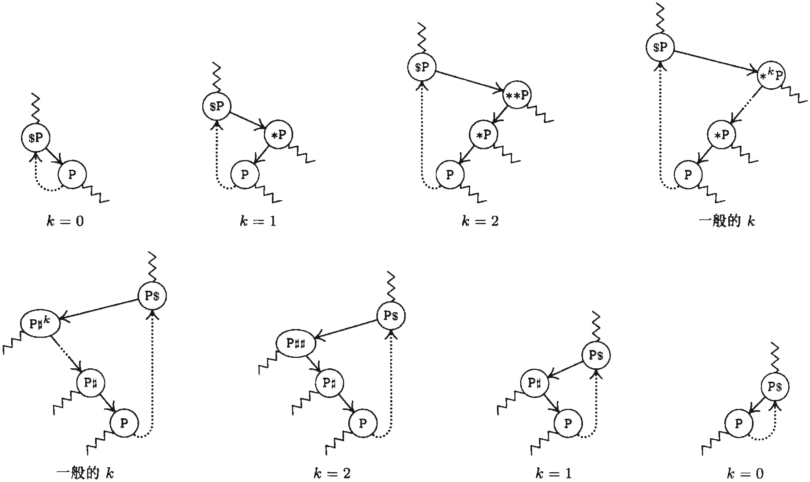</span>

*图 24　线索二叉树中左、右线索链的一般走向. 波浪线表示指向树的其他部分的链或线索*

<a id="pdf-274"></a><a id="p-257"></a>

在某些算法中, 可以保证任何子树的根总是出现在比该子树的其他结点低的内存位置. 这样, LTAG(P) 为 1, 当且仅当 $\mathtt { L L I N K } ( \mathbb { P } ) < \mathbb { P }$. 因此 LTAG 将是多余的. 同理, RTAG 也是多余的. 线索树的最大优点是使遍历算法变得更简单. 例如, 给定 P, 下面的算法计算 $\mathtt P\mathord{\$}$.

算法 S (线索二叉树中的对称 (中序) 后继). 如果 P 指向线索二叉树的一个结点, 则该算法置 $\mathtt Q\leftarrow\mathtt P\$$

S1. [RLINK(P) 是线索吗?] 置 Q←RLINK(P). 如果 $\mathtt{RTAG}(\mathtt P)=1$, 则算法终止.

S2.[搜索左子树.] 如果 $\mathtt { L T A G } ( \mathbb { Q } ) = 0$, 则置 $\widehat { \mathbb { Q } } \leftarrow \mathtt { L L I N K } ( \mathbb { Q } )$, 并重复这一步骤; 否则算法终止. 1

注意, 这里并不需要用栈来实现算法 T 中使用栈所做的事情. 事实上, 仅给出树中一个随机结点 P 的地址, 在一般表示 (2) 中不可能高效地找到 $\mathtt P\mathord{\$}$. 由于非线索的树中没有向上指的链, 因此除非我们保留如何到达该点的历史记载, 否则不知道有什么结点在给定结点上方. 当没有线索时, 算法 T 的栈提供了必要的历史信息.

我们断言算法 S 是 “高效的”, 尽管这一性质并非显而易见, 因为步骤 S2 可能执行任意多次. 鉴于 S2 中的循环, 或许像算法 T 一样使用栈会更快? 为了研究这一问题, 我们考虑如果 P 是树中的一个 “随机” 结点, 步骤 S2 必须执行的平均次数; 或者考虑等价的问题, 确定如果反复执行算法 S 来遍历整棵树, 步骤 S2 执行的总次数.

在进行这一分析的同时, 研究算法 T 和 S 的完整程序是有益的. 像通常一样, 我们将小心地构建算法, 使得它们对空二叉树也能正确地工作; 如果 T 是指向树的指针, 则我们希望 $\mathtt{LOC(T)}\ast$ 和 $\mathtt{LOC(T)}\mathord{\$}$ 分别是先序和对称序下的第一结点. 对于线索树, 我们发现如果 NODE(LOC(T)) 作为树的 “表头”, 使得

$$
\begin{aligned}\mathtt{LLINK}(\mathtt{HEAD})&=\mathtt T,&\mathtt{LTAG}(\mathtt{HEAD})&=0,\\\mathtt{RLINK}(\mathtt{HEAD})&=\mathtt{HEAD},&\mathtt{RTAG}(\mathtt{HEAD})&=0.\end{aligned}
\tag{8}
$$

则一切令人满意. (这里, HEAD 表示表头地址 LOC(T).) 空线索树将满足条件

$$
\mathtt{LLINK}(\mathtt{HEAD})=\mathtt{HEAD},\qquad\mathtt{LTAG}(\mathtt{HEAD})=1.
\tag{9}
$$

该树通过把结点插入表头的左边而生长. (这些初始条件主要是计算 P\*的算法需要, 见习题 17.) 与这些约定一致, 二叉树 (1) 作为线索树的计算机表示为

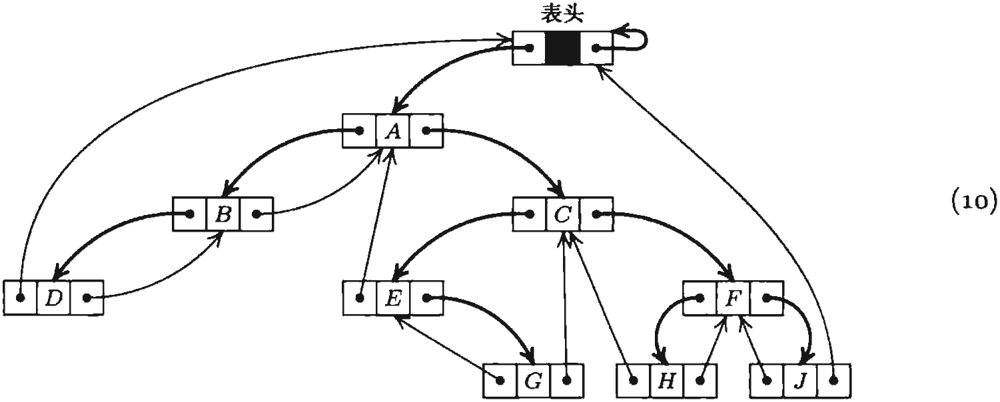

<a id="pdf-275"></a><a id="p-258"></a>

有了这些预备知识, 我们现在可以考虑算法 S 和 T 的 MIX 版本. 下面的程序假定二叉树的结点占两个字, 具有如下形式

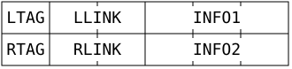.

在非线索的树中, `LTAG` 和 `RTAG` 总是为 “$+$”, 并且终端链总是为零. 在线索树中, 我们将使用 “$+$” 表示标签为 0, “$-$” 表示标签为 1. 缩写 `LLINKT` 和 `RLINKT` 将分别用来表示组合字段 `LTAG–LLINK` 和 `RTAG–RLINK`.

> 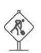 两个标签位占据 MIX 字的未使用的符号位, 因此它们没有内存空间开销. 同样, 使用 MMIX 计算机, 我们可以 “免费” 使用链接字段的最低位作为标签位, 因为指针值一般为偶数, 并且内存寻址时, MMIX 可以方便地忽略低位.

下面的两个程序以对称序 (即中序) 遍历二叉树, 以变址寄存器 5 指向当前感兴趣的结点, 周期性地跳转到位置 `VISIT`.

**程序 T.** 在算法 T 的这个实现中, 栈存放在位置 $\mathrm A+1,\mathrm A+2,\ldots,\mathrm A+\mathrm{MAX}$ 中; $\mathrm{rI6}$ 是栈指针, 而 $\mathrm{rI5}\equiv\mathrm P$. 如果栈变得太大, 则出现 `OVERFLOW`. 该程序在算法 T 基础上稍有改动 (步骤 T2 出现三次), 使得直接从 T3 到 T2 到 T4 时, 不必进行空栈检测.

| 行号 | LOC | OP | ADDRESS | 次数 | 注释 |
| ---: | :--- | :--- | :--- | :---: | :--- |
| 01 | `LLINK` | `EQU` | `1:2` |  |  |
| 02 | `RLINK` | `EQU` | `1:2` |  |  |
| 03 | `T1` | `LD5` | `HEAD(LLINK)` | $1$ | <u>T1. 初始化. </u> 置 $\mathrm P\leftarrow\mathrm T$. |
| 04 | `T2A` | `J5Z` | `DONE` | $1$ | 如果 $\mathrm P=\Lambda$, 则停止. |
| 05 |  | `ENT6` | `0` | $1$ |  |
| 06 | `T3` | `DEC6` | `MAX` | $n$ | <u>T3. 栈 $\Leftarrow P$。</u> |
| 07 |  | `J6NN` | `OVERFLOW` | $n$ | 栈满吗? |
| 08 |  | `INC6` | `MAX+1` | $n$ | 如果不满，则栈指针加 1。 |
| 09 |  | `ST5` | `A,6` | $n$ | 把 $\mathrm P$ 存放在栈中. |
| 10 |  | `LD5` | `0,5(LLINK)` | $n$ | $\mathrm P\leftarrow\mathrm{LLINK}(\mathrm P)$. |
| 11 | `T2B` | `J5NZ` | `T3` | $n$ | 如果 $\mathrm P\ne\Lambda$, 则转到 T3. |
| 12 | `T4` | `LD5` | `A,6` | $n$ | <u>T4. $P\Leftarrow{}$ 栈. </u> |
| 13 |  | `DEC6` | `1` | $n$ | 栈指针减 1。 |
| 14 | `T5` | `JMP` | `VISIT` | $n$ | <u>T5. 访问 $P$。</u> |
| 15 |  | `LD5` | `1,5(RLINK)` | $n$ | $\mathrm P\leftarrow\mathrm{RLINK}(\mathrm P)$. |
| 16 | `T2C` | `J5NZ` | `T3` | $n$ | <u>T2. $P=\Lambda$? </u> |
| 17 |  | `J6NZ` | `T4` | $a$ | 检测栈是否为空. |
| 18 | `DONE` | `…` |  |  | ▮ |

<details>
<summary>MIXAL 等宽清单</summary>

```text
LLINK     EQU   1:2
RLINK     EQU   1:2
T1        LD5   HEAD(LLINK)
T2A       J5Z   DONE
          ENT6  0
T3        DEC6  MAX
          J6NN  OVERFLOW
          INC6  MAX+1
          ST5   A,6
          LD5   0,5(LLINK)
T2B       J5NZ  T3
T4        LD5   A,6
          DEC6  1
T5        JMP   VISIT
          LD5   1,5(RLINK)
T2C       J5NZ  T3
          J6NZ  T4
DONE      …
```

</details>

**程序 S.** 已经用初始化和终止条件对算法 S 进行扩展, 使得该程序可以与程序 T 比较.

| 行号 | LOC | OP | ADDRESS | 次数 | 注释 |
| ---: | :--- | :--- | :--- | :---: | :--- |
| 01 | `LLINKT` | `EQU` | `0:2` |  |  |
| 02 | `RLINKT` | `EQU` | `0:2` |  |  |
| 03 | `S0` | `ENT5` | `HEAD` | $1$ | <u>S0. 初始化. </u> 置 $\mathrm P\leftarrow\mathrm{HEAD}$. |
| 04 |  | `JMP` | `2F` | $1$ |  |
| 05 | `S3` | `JMP` | `VISIT` | $n$ | <u>S3. 访问 $P$。</u> |
| 06 | `S1` | `LD5N` | `1,5(RLINKT)` | $n$ | <u>S1. $\mathit{RLINK}(P)$ 是线索吗? </u> |
| 07 |  | `J5NN` | `1F` | $n$ | 如果 $\mathrm{RTAG}(\mathrm P)=1$, 则跳转. |
| <a id="pdf-276"></a><a id="p-259"></a>08 |  | `ENN6` | `0,5` | $n-a$ | 否则置 $\mathrm Q\leftarrow\mathrm{RLINK}(\mathrm P)$. |
| 09 | `S2` | `ENT5` | `0,6` | $n$ | <u>S2. 搜索左子树. </u> 置 $\mathrm P\leftarrow\mathrm Q$. |
| 10 | `2H` | `LD6` | `0,5(LLINKT)` | $n+1$ | $\mathrm Q\leftarrow\mathrm{LLINK}(\mathrm P)$. |
| 11 |  | `J6P` | `S2` | $n+1$ | 如果 $\mathrm{LTAG}(\mathrm P)=0$, 则重复. |
| 12 | `1H` | `ENT6` | `-HEAD,5` | $n+1$ |  |
| 13 |  | `J6NZ` | `S3` | $n+1$ | 除非 $\mathrm P=\mathrm{HEAD}$, 否则访问.　▮ |

<details>
<summary>MIXAL 等宽清单</summary>

```text
LLINKT    EQU   0:2
RLINKT    EQU   0:2
S0        ENT5  HEAD
          JMP   2F
S3        JMP   VISIT
S1        LD5N  1,5(RLINKT)
          J5NN  1F
          ENN6  0,5
S2        ENT5  0,6
2H        LD6   0,5(LLINKT)
          J6P   S2
1H        ENT6  -HEAD,5
          J6NZ  S3
```

</details>

运行时间分析出现在上面的代码中. 使用基尔霍夫定律和如下事实, 容易确定这些量:

(i) 在程序 T 中, 插入栈的次数必须等于删除的次数;

(ii) 在程序 S 中, 每个结点的 `LLINK` 和 `RLINK` 都恰好被考察一次;

(iii)“访问” 次数等于树的结点数.

该分析告诉我们, 程序 T 用 $15n+a+4$ 个单位时间, 程序 S 用 $11n-a+7$ 个单位时间, 其中 $n$ 是树的结点数, $a$ 是终端右链数 (没有右子树的结点). 假定 $n\ne0$, $a$ 可能低至 1, 高达 $n$. 如果左右对称, 则作为习题 14 证明的事实的推论, $a$ 的平均值为 $(n+1)/2$.

在这一分析的基础上, 我们可能得到如下主要结论.

(i) 如果 P 是树的随机结点, 则每次运行算法 S, 步骤 S2 平均只执行一次.

(ii) 线索树的遍历稍微快一点, 因为它不需要栈操作.

(iii) 算法 T 需要的内存空间比算法 S 多, 因为它需要附加的栈. 在程序 T 中, 我们用连续内存位置存放栈, 因此需要对它的容量施加限制. 如果超过该限制, 则将陷入困境, 因此栈必须设置得相当大 (见习题 10), 故程序 T 的内存需求显著比程序 S 大. 复杂的计算机应用常常同时独立地遍历多棵树. 若使用程序 T, 每棵树需要一个独立的栈. 这暗示程序 T 可能需要对栈使用链接存储分配 (见习题 20). 于是, 它的运行时间变成 $30n+a+4$ 个单位时间, 大约是以前的两倍, 尽管加上其他协同程序的运行时间, 遍历速度可能不是最为重要的. 习题 21 讨论另一种算法, 巧妙地把栈链存放在树本身中.

(iv) 当然, 算法 S 比算法 T 更一般, 因为即使不遍历整棵二叉树, 算法 S 也能从 `P` 找到 `P$`.

因此, 就遍历而言, 线索二叉树绝对优于非线索二叉树. 在某些应用中, 这些优点被二叉树中的结点插入和删除需要稍多时间所抵消. 有时在非线索树中还可通过 “共享” 公共子树来节省内存空间, 而线索树需要保持严格的树结构, 没有重叠的子树.

线索链用来计算 `P*`、`$P` 和 $\sharp\mathrm P$, 效率与算法 S 相当. 无论有无线索, 函数 `*P` 和 $\mathrm P\sharp$ 的计算都要稍难一些. 鼓励读者做习题 17.

如果建立线索链本来就很困难, 则线索树的大部分用途都不复存在. 线索树思想之所以有用, 是因为线索树的生长几乎像通常的树一样容易. 我们有如下算法:

**算法 I**(插入到线索树中). 如果 $\mathrm{NODE}(\mathrm P)$ 的右子树为空, 则该算法插入新结点 $\mathrm{NODE}(\mathrm Q)$, 作为 $\mathrm{NODE}(\mathrm P)$ 的右子树; 否则, 把 $\mathrm{NODE}(\mathrm Q)$ 插入到 $\mathrm{NODE}(\mathrm P)$ 和 $\mathrm{NODE}(\mathrm{RLINK}(\mathrm P))$ 之间, 使得后者成为 $\mathrm{NODE}(\mathrm Q)$ 的右子女. 假定进行插入的二叉树是像 (10) 一样的线索树. 关于本算法的变形, 见习题 23.

**I1.** [调整诸标签和链.] 置 $\mathrm{RLINK}(\mathrm Q)\leftarrow\mathrm{RLINK}(\mathrm P)$, $\mathrm{RTAG}(\mathrm Q)\leftarrow\mathrm{RTAG}(\mathrm P)$, $\mathrm{RLINK}(\mathrm P)\leftarrow\mathrm Q$, $\mathrm{RTAG}(\mathrm P)\leftarrow0$, $\mathrm{LLINK}(\mathrm Q)\leftarrow\mathrm P$, $\mathrm{LTAG}(\mathrm Q)\leftarrow1$.

<a id="pdf-277"></a><a id="p-260"></a>

I2.[RLINK(P) 是线索吗?] 如果 $\mathtt{RTAG}(\mathtt Q)=0$, 则置 $\mathtt{LLINK}(\mathtt Q\mathord{\$})\gets \mathtt Q$. (这里, $\mathtt Q\mathord{\$}$ 由算法 S 确定, 它将正确地执行, 即使 $\mathtt{LLINK}(\mathtt Q\mathord{\$})$ 现在指向 NODE(P), 而不是指向 NODE(Q). 这个步骤仅当插入到线索树的中间, 而不是仅插入一个新树叶时, 才是必要的.)

通过调换左右的角色 (特别是用 $\mathtt Q\mathord{\$}$ 替换步骤 I2 中的 $\mathord{\$}\mathtt Q$), 我们得到用类似的方法把结点插入到左边的算法.

迄今为止, 我们关于线索二叉树的讨论都利用了到左、右两边的线索链. 在完全非线索和完全线索的表示方法之间存在重要的中间地带: 右线索二叉树 (right-threaded binary tree) 结合这两种方法, 使用线索的 RLINK, 而用 LLINK=Λ表示空的右子树. (类似地, 左线索二叉树仅有空的 LLINK 才是线索的.) 算法 S 基本上不用线索的 LLINK; 如果我们把步骤 S2 中的检测 $\text{“}\mathtt{LTAG}=0\text{”}$ 换成 $\text{“}\mathtt{LLINK}\ne\Lambda\text{”}$, 则得到按对称序遍历右线索二叉树的算法. 在右线索的情况下, 程序 S 无须改变就能工作. 二叉树结构的大量应用都只需要使用函数 $\mathtt P\mathord{\$}$ 和/或 $\mathtt P\ast$, 自左向右遍历二叉树, 并且不需要线索诸 LLINK. 我们介绍了左、右两个方向的线索, 以便说明对称性和不同可能性. 但是, 在实践中, 单边线索更普遍.

现在, 让我们考虑二叉树的一个重要性质, 以及它与遍历的联系. 两棵二叉树 T 和 $T ^ { \prime }$ 称为相似的 (similar), 如果它们具有相同的结构. 相似性的形式意味是 (a) 它们都为空, 或者 (b) 它们都非空并且它们的左右子树分别相似. 相似性的非形式意味是 T 和 $T ^ { \prime }$ 的图具有相同的 “形状”. 另一种表达相似性的方法是说, T 和 $T ^ { \prime }$ 的结点之间存在一个保持结构的一一对应: 如果 T 中的结点 $u_1$ 和 $u _ { 2 }$ 分别对应于 $T ^ { \prime }$ 中的结点 $u'_1$ 和 $u_{2}^{\prime}$, 则 $u _ { 1 }$ 在 $u_2$ 的左子树中, 当且仅当 $u_{1}^{\prime}$ 在 $u_{2}^{\prime}$ 的左子树中, 并且对于右子树, 同样的结论成立.

两棵二叉树 $T$ 和 $T ^ { \prime }$ 是等价的 (equivalent), 如果它们是相似的, 并且对应的结点包含相同的信息. 形式说来, 设 info($u$) 表示包含在结点 $u$ 中的信息; 两棵二叉树等价, 当且仅当 (a) 它们都为空, 或者 (b) 它们都非空, 并且 $\operatorname { i n f o } \bigl ( \operatorname { r o o t } ( T ) \bigr ) = \operatorname { i n f o } \bigl ( \operatorname { r o o t } ( T ^ { \prime } ) \bigr )$, 而它们的左右子树分别等价.

举例说明这些定义, 考虑 4 棵二叉树

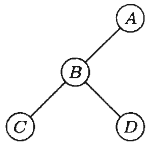


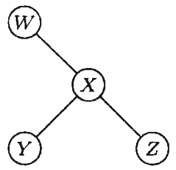

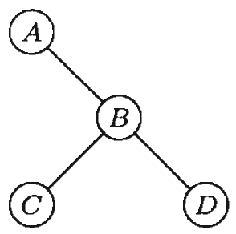

其中, 前两棵不相似, 第二、三、四棵相似, 并且事实上, 第二棵与第四棵等价.

某些涉及树结构的计算机应用需要一个算法, 判定两棵二叉树是否相似或等价. 下面的定理对此是有用的.

定理 A. 设二叉树 T 和 $T ^ { \prime }$ 的结点在先序下分别为

$$
u_1,u_2,\ldots,u_n\qquad\text{和}\qquad u'_1,u'_2,\ldots,u'_{n'}
$$

对于任意结点 $u$, 令

$$
\begin{aligned}l(u)&=1&&\text{如果 }u\text{ 具有非空左子树},&l(u)&=0&&\text{否则};\\r(u)&=1&&\text{如果 }u\text{ 具有非空右子树},&r(u)&=0&&\text{否则}.\end{aligned}
\tag{11}
$$

则 $T$ 和 $T'$ 相似, 当且仅当 $n=n'$, 并且

$$
l(u_j)=l(u'_j),\qquad r(u_j)=r(u'_j)\qquad\text{对于 }1\le j\le n.
\tag{12}
$$

<a id="pdf-278"></a><a id="p-261"></a>

此外, 两树 $T$ 和 $T'$ 等价, 当且仅当在上述相似条件之外还有

$$
\operatorname{info}(u_j)=\operatorname{info}(u'_j)\qquad\text{对于 }1\le j\le n.
\tag{13}
$$

注意, $l$ 和 $r$ 是线索树中 LTAG 和 RTAG 位的补. 该定理借助于两个 0 和 1 的序列, 刻画了任意二叉树的结构.

证明: 显然, 如果我们证明了二叉树的相似性条件, 则将立即得到二叉树的等价性条件; 此外, 条件 $n = n ^ { \prime }$ 和 $\left( 1 2 \right)$ 肯定是必要的, 因为相似的树的对应结点必须在先序下具有相同的位置. 因此, 只需证明条件 (12) 和 $n = n ^ { \prime }$ 足以确保 T 和 $T ^ { \prime }$ 相似性. 证明通过对 $n$ 归纳, 用到以下辅助结果.

引理 P. 设非空二叉树在先序下的结点为 $u _ { 1 } , u _ { 2 } , \ldots , u _ { n }$, 并设 $f ( u ) = l ( u ) + r ( u ) - 1$. 则

$$
f(u_1)+f(u_2)+\cdots+f(u_n)=-1\quad\text{和}\quad f(u_1)+\cdots+f(u_k)\ge0,\quad1\le k<n.
\tag{14}
$$

证明: 对于 $n=1$, 结果是显然的. 如果 $n>1$, 则二叉树由它的根 $u _ { 1 }$ 和其他结点组成. 如果 $f ( u _ { 1 } ) = 0$, 则或者左子树为空, 或者右子树为空, 因此, 根据归纳原理, 条件显然为真. 如果 $f(u_{1}) = 1$, 设左子树有 $n _ { l }$ 个结点, 根据归纳假设, 有

$$
f(u_1)+\cdots+f(u_k)>0\quad\text{对于 }1\le k\le n_l,\qquad f(u_1)+\cdots+f(u_{n_l+1})=0,
\tag{15}
$$

而条件 (14) 又是显然的.

(对于其他类似于引理 P 的定理, 见第 10 章波兰表示的讨论.)

为了完成定理 A 的证明, 我们注意到当 $\bar { n } = 0$ 时定理显然成立. 如果 $\bar{n} > 0$, 则先序的定义蕴涵 $u _ { 1 }$ 和 $\boldsymbol{u}_{1}^{\prime}$ 分别是所在树的根, 并且存在整数 $n _ { l }$ 和 $n_{l}^{\prime}$ (左子树的大小) 使得

$u_{2}, \ldots, u_{n_{l}+1}$ 和 $u _ { 2 } ^ { \prime } , \ldots , u _ { n _ { l } ^ { \prime } + 1 } ^ { \prime }$ 是 T 和 $T ^ { \prime }$ 的左子树;

$u_{n_l+2},\ldots,u_n$ 和 $u _ { n _ { l } ^ { \prime } + 2 } ^ { \prime } , \ldots , u _ { n _ { l } ^ { \prime } } ^ { \prime }$ 是 T 和 $T ^ { \prime }$ 的右子树.

如果我们能够证明 $n_{l} = n_{l}^{\prime}$, 则归纳证明将完成. 存在三种情况:

如果 $l(u_{1}) = 0$, 则 $n_{l}=0=n_{l}^{\prime};$

如果 $l(u_{1}) = 1,\ r(u_{1}) = 0$, 则 $n_{l}=n-1=n_{l}^{\prime};$

如果 $l(u_{1}) = r(u_{1}) = 1$, 则根据引理 P, 我们能够找到最小的 $k>0$, 使得 $f(u_{1}) + \cdots +$ $f ( u _ { k } ) = 0$, 并且 $n_{l}=k-1=n_{l}^{\prime}$ (见 (15)).

由定理 A 推出, 我们只需按先序遍历两棵二叉树并检查它们的 INFO 和 TAG 字段, 即可检查它们是否等价. 定理 A 的一些有意义的推广已经由安德烈·布利克莱得到 [Bull.deI’Acad. Polonaise des Sciences, Série des Sciences Math., Astr., Phys., 14 (1966), 203-208 ]. 他考虑了无限多类可能的遍历次序, 其中只有 6 类 (包括先序) 因其简单的性质而被称为 “无地址的”. 在本节的最后, 我们介绍一个典型而基本的二叉树算法. 该算法把一棵二叉树复制到不同的内存位置.

算法 C (复制二叉树). 设 HEAD 为二叉树 T 的表头的地址. 这样, T 是 HEAD 的左子树, 通过 LLINK(HEAD) 到达. 设 NODE(U) 是一个具有空左子树的结点. 该算法复制 T, 得到的副本成为 NODE(U) 的左子树. 特殊地, 如果 NODE(U) 是一棵空二叉树的表头, 则这个算法把空树变成 T 的一个副本.

C1.[初始化.] 置 P←HEAD, Q←U, 转到 C4.

<a id="pdf-279"></a><a id="p-262"></a>

C2.[右边有什么?] 如果 NODE(P) 具有非空的右子树, 则置 R⇐AVAIL, 并且把 NODE(R) 附加到 NODE(Q) 的右边. (在步骤 C2 开始时, NODE(Q) 的右子树为空.)

C3.[复制 INFO.]INFO(Q)←INFO(P). (这里, INFO 代表结点待复制的所有部分, 不包括诸链.)

C4.[左边有什么?] 如果 NODE(P) 具有非空的左子树, 则置 R⇐AVAIL, 并且把 NODE(R) 附加到 NODE(Q) 的左边. (在步骤 C4 开始时, NODE(Q) 的左子树为空.)

C5. [前进.] 置 P←P\*, Q← Q\*.

C6. 测试是否完成.]P=HEAD (若假定 NODE(U) 具有非空的右子树, 则等价地测试 Q=RLINK(U)), 则算法终止; 否则, 转到步骤 C2.

这个简单的算法展示了树遍历的典型应用. 这里的描述可用于线索的、非线索的或部分线索的树. 步骤 C5 需要计算先序后继 P\*和 Q\*; 对于非线索的树, 这通常使用一个辅助栈来做. 算法 C 的高效性证明见习题 29. 在右线索二叉树情况下, 对应于该算法的 MIX 程序见习题 2.3.2-13. 对于线索树, 步骤 C2 和 C4 的 “附加” 用算法 I 来做.

下面的习题包含了与本节材料相关的若干有趣主题.

二叉或二歧分类系统, 尽管有统一原理, 但仍然是有史以来最不自然的安排之一.

—威廉·斯文森, “关于动物的地理分布和分类的专题论文”(1835)

#### 习题

1. [01] <a id="ex-2-3-1-1"></a>[答案](./answers/2-3-1.md#ans-2-3-1-1) 如果在二叉树 (2) 中设 INFO(P) 表示存放在 NODE(P) 中的字母. 那么, 请问 INFO(LLINK(RLINK(RLINK(T)))) 是什么?

2\. [11] <a id="ex-2-3-1-2"></a>[答案](./answers/2-3-1.md#ans-2-3-1-2) 以 (a) 先序, (b) 对称序, (c) 后序, 列出右边二叉树的结点.

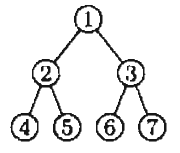

3. [20] <a id="ex-2-3-1-3"></a>[答案](./answers/2-3-1.md#ans-2-3-1-3) 下面的陈述是真还是假? “在先序、中序和后序, 二叉树的终端结点都出现在相同的相对位置?”

4\. [20] <a id="ex-2-3-1-4"></a>[答案](./answers/2-3-1.md#ans-2-3-1-4) 正文中对二叉树遍历定义了三种基本序. 另一种选择是按以下三步处理:

(a) 访问根,

(b) 访问根,

(c) 遍历左子树.

在所有的非空子树上递归地使用相同的规则. 这种新序与已经讨论的三种序有什么简单的关系吗?

5\. [22] <a id="ex-2-3-1-5"></a>[答案](./answers/2-3-1.md#ans-2-3-1-5) 类似于树的 “杜威记数法”, 二叉树的结点可以按如下方法用 0 和 1 的序列标识: 根 (如果有的话) 用序列 “1” 表示. 用 $\alpha$ 表示的结点的左子树和右子树的根 (如果有的话) 分别用α0 和α1 表示. 例如, (1) 中的结点 $H$ 将具有表示 $\text{“}1110\text{”}$. (见习题 2.3-15.)

证明: 用这种记号, 先序、中序和后序都可以方便地描述.

6. [M22] <a id="ex-2-3-1-6"></a>[答案](./answers/2-3-1.md#ans-2-3-1-6) 假设二叉树具有 $n$ 个结点, 在先序下为 $u _ { 1 } u _ { 2 } \ldots u _ { n }$, 在中序下为 $u _ { p _ { 1 } } \: u _ { p _ { 2 } } \ldots u _ { p _ { n } }$ 证明: 排列 $p _ { 1 } p _ { 2 } \ldots p _ { n }$ 可以在习题 2.2.1-2 意义下, 让 12... $n$ 经由一个栈得到. 反之, 证明: 用栈能够得到的任何排列 $p _ { 1 } p _ { 2 } \ldots p _ { n }$ 都以这种方式对应于某棵二叉树.

7\. [22] <a id="ex-2-3-1-7"></a>[答案](./answers/2-3-1.md#ans-2-3-1-7) 证明: 如果给定二叉树结点的先序和中序, 则可以构造该二叉树. (假设结点不同.) 如果给定先序和后序 (而不是中序), 同样的结果为真吗? 如果给定中序和后序呢?

8. [20] <a id="ex-2-3-1-8"></a>[答案](./answers/2-3-1.md#ans-2-3-1-8) 找出所有的二叉树, 其结点在以下两种序下恰好出现在相同的序列中: (a) 先序和中序; (b) 先序和后序; (c) 中序和后序. (如上一题, 我们假设结点不同.)

<a id="pdf-280"></a><a id="p-263"></a>

9. [M20] <a id="ex-2-3-1-9"></a>[答案](./answers/2-3-1.md#ans-2-3-1-9) 当使用算法 T 遍历具有 $n$ 个结点的二叉树时, 指出步骤 T1、T2、T3、T4 和 T5 各执行多少次 (作为 $n$ 的函数).

10\. [20] <a id="ex-2-3-1-10"></a>[答案](./answers/2-3-1.md#ans-2-3-1-10) 如果二叉树有 $n$ 个结点, 在算法 T 执行期间, 在栈中同时最多能有多少个元素? (如果栈用顺序存储, 那么该问题的答案对于存储分配非常重要.)

11. <a id="ex-2-3-1-11"></a>[答案](./answers/2-3-1.md#ans-2-3-1-11)  $\left[ H M _ { 4 } , 1 \right]$ 假定具有 $n$ 个结点的二叉树都等可能地出现, 作为 $n$ 的函数, 分析算法 T 运行期间栈的最大容量的平均值.

12\. [22] <a id="ex-2-3-1-12"></a>[答案](./answers/2-3-1.md#ans-2-3-1-12) 设计一个类似于算法 T 的算法, 以先序遍历任意二叉树, 并证明你的算法是正确的.

13\. [24] <a id="ex-2-3-1-13"></a>[答案](./answers/2-3-1.md#ans-2-3-1-13) 设计一个类似于算法 T 的算法, 以后序遍历二叉树.

14. [22] <a id="ex-2-3-1-14"></a>[答案](./answers/2-3-1.md#ans-2-3-1-14) 证明: 如果具有 $n$ 个结点的二叉树表示成 (2) 的形式, 则可以用 $n$ 的简单函数表示在这种表示下的空链个数, 而且这个量不依赖于树的形状.

15\. [15] <a id="ex-2-3-1-15"></a>[答案](./answers/2-3-1.md#ans-2-3-1-15) 在像 (10) 那样的线索表示中, 除表头外, 每个结点恰有一个从上方指向它的链, 即来自其父母结点的链. 某些结点还有从下方指向它们的链, 例如, 包含 C 的结点有两个从下到上的指针, 而结点 $E$ 只有一个. 在指向一个结点的链数与结点的某种其他基本性质之间存在什么简单的联系吗? (当改变树结构时, 我们需要知道有多少链指向给定的结点.)

▶ 16. [22] <a id="ex-2-3-1-16"></a>[答案](./answers/2-3-1.md#ans-2-3-1-16) [图24](#fig-2-24) 中的图示有助于用 NODE(Q) 附近的结构, 直观刻画 $\mathtt{NODE}(\mathtt Q\mathord{\$})$ 在二叉树中的位置: 如果 NODE(Q) 具有非空右子树, 则在较上的图示考虑 $\mathtt Q=\mathord{\$}\mathtt P$, $\mathtt Q\mathord{\$}=\mathtt P$; $\mathtt{NODE}(\mathtt Q\mathord{\$})$ 是那棵右子树的 “最左” 结点. 如果 NODE(Q) 具有空右子树, 则在较下的图示中考虑 Q=P; 在树中向上, 直到第一个转向右的向上步之后, 便确定了 $\mathtt{NODE}(\mathtt Q\mathord{\$})$ 的位置.

给出一个简单 “直观” 规则, 利用 NODE(Q) 附近的结构, 在二叉树中找到 NODE(Q\*) 的位置.

17\. [22] <a id="ex-2-3-1-17"></a>[答案](./answers/2-3-1.md#ans-2-3-1-17) 给出一个类似于算法 S 的算法, 确定线索二叉树中的 P\*. 假定树具有像 (8) (9) (10) 中那样的表头. 18.[24] <a id="ex-2-3-1-18"></a>[答案](./answers/2-3-1.md#ans-2-3-1-18) 许多处理树的算法都宁愿使用先序和中序的组合 (我们可以称之为双序), 访问每个结点两次而不是一次. 二叉树的双序遍历定义如下: 如果二叉树为空, 则什么也不做; 否则

(a) 第一次访问根结点;

(b) 按双序遍历左子树;

(c) 第二次访问根结点;

(d) 按双序遍历右子树.

例如, 按双序遍历 (1), 产生序列

$$
A _ { 1 } B _ { 1 } D _ { 1 } D _ { 2 } B _ { 2 } A _ { 2 } C _ { 1 } E _ { 1 } E _ { 2 } G _ { 1 } G _ { 2 } C _ { 2 } F _ { 1 } H _ { 1 } H _ { 2 } F _ { 2 } J _ { 1 } J _ { 2 } \: ,
$$

其中 $A_{1}$ 表示第一次访问 A.

设 P 指向树的一个结点, 并且 $d =1$ 或 2. 如果第 $d$ 次访问 NODE(P) 之后, 双序的下一步是第 $e$ 次访问 NODE(Q), 则定义 $( \mathtt { P } , d ) ^ { \Delta } = ( \mathtt { Q } , e )$; 或者, 如果 $(\mathtt P,d)$ 是双序的最后一步, 则记 $( \mathbb{P}, d )^{\Delta} = ( \mathbb{HE} \mathbb{A} \mathbb{D}, 2 )$ 其中 HEAD 是表头的地址. 我们还把 $(\mathtt{HEAD},1)^\triangle$ 定义为双序的第一步.

设计一个类似于算法 T 的算法, 按双序遍历二叉树; 再设计一个类似于算法 S 的算法, 计算 $( \mathbb { P } , d ) ^ { \Delta } .$ 讨论这些算法和习题 12、17 之间的关系.

▶ 19. [27] <a id="ex-2-3-1-19"></a>[答案](./answers/2-3-1.md#ans-2-3-1-19) 设计一个类似于算法 S 的算法, 在 (a) 右线索二叉树, (b) 完全线索二叉树中计算 P#. 如果可能的话, 当 P 是树的一个随机结点时, 你的算法的平均运行时间应当最多是一个小常量.

20. [23] <a id="ex-2-3-1-20"></a>[答案](./answers/2-3-1.md#ans-2-3-1-20) 修改程序 T, 使得它把栈存放在链表, 而不是在连续的存储位置中.

▶ 21. [33] <a id="ex-2-3-1-21"></a>[答案](./answers/2-3-1.md#ans-2-3-1-21) 设计一个算法, 按中序遍历一棵非线索的二叉树, 而不使用任何辅助栈. 在遍历期间, 可以以任何方式改变树结点的 LLINK 和 RLINK 字段, 只要满足如下条件: 在算法遍历树之前和之后, 二叉树都具有 (2) 中所示的通常表示. 树结点中没有其他可以用作临时存储的二进位.

22. [25] <a id="ex-2-3-1-22"></a>[答案](./answers/2-3-1.md#ans-2-3-1-22) 对习题 21 给出的算法, 写一个 MIX 程序, 并将它的运行时间与程序 S 和 T 进行比较.

<a id="pdf-281"></a><a id="p-264"></a>

23\. [22] <a id="ex-2-3-1-23"></a>[答案](./answers/2-3-1.md#ans-2-3-1-23) 设计类似于算法 I 的两个算法, 分别把结点插入到右线索二叉树右边和左边的算法. 假定结点具有 LLINK、RLINK 和 RTAG 字段.

24. [M20] <a id="ex-2-3-1-24"></a>[答案](./answers/2-3-1.md#ans-2-3-1-24)  如果 T 和 $T ^ { \prime }$ 的结点按对称序, 而不是按先序给出, 那么定理 A 是否依然成立?

25. [M24] <a id="ex-2-3-1-25"></a>[答案](./answers/2-3-1.md#ans-2-3-1-25)  设 $\mathcal T$ 是二叉树的集合, 其中每个 $\operatorname{info}$ 字段都属于给定的集合 $S$, 而 $S$ 是按照关系 “$\preceq$” 线性有序的 (见习题 2.2.3-14). 给定 $\mathcal T$ 中的任意两棵树 $T$ 和 $T'$, 我们定义 $T\preceq T'$, 当且仅当它们满足以下条件之一:

(i)$T$ 是空树.

(ii)$T$ 和 $T'$ 非空, 并且 $\operatorname{info}(\operatorname{root}(T))\prec\operatorname{info}(\operatorname{root}(T'))$.

(iii)$T$ 和 $T'$ 非空, $\operatorname{info}(\operatorname{root}(T))=\operatorname{info}(\operatorname{root}(T'))$, $\operatorname{left}(T)\preceq\operatorname{left}(T')$, 并且 $\operatorname{left}(T)$ 不等价于 $\operatorname{left}(T')$.

(iv)$T$ 和 $T'$ 非空, $\operatorname{info}(\operatorname{root}(T))=\operatorname{info}(\operatorname{root}(T'))$, $\operatorname{left}(T)$ 等价于 $\operatorname{left}(T')$, 并且 $\operatorname{right}(T)\preceq\operatorname{right}(T')$.

这里, $\operatorname{left}(T)$ 和 $\operatorname{right}(T)$ 分别表示 $T$ 的左子树和右子树. 证明: (a)$T\preceq T'$ 和 $T'\preceq T''$ 蕴涵 $T\preceq T''$; (b)$T$ 等价于 $T'$, 当且仅当 $T\preceq T'$ 且 $T'\preceq T$; (c) 对于 $\mathcal T$ 中的 $T$ 和 $T'$, 我们有 $T\preceq T'$ 或 $T'\preceq T$. [这样, 如果 $\mathcal T$ 中等价的树被视为相等的, 则关系 $\preceq$ 可推出 $\mathcal T$ 上的线性序. 这个序具有许多应用 (例如, 代数表达式的化简). 当 $S$ 只有一个元素时, 每个结点的 “info” 都相同, 我们有等价性等同于相似性的特殊情况.]

26. [M24] <a id="ex-2-3-1-26"></a>[答案](./answers/2-3-1.md#ans-2-3-1-26) 考虑上一题定义的序 $T\preceq T'$. 证明一个类似于定理 A 的定理, 给出 $T \preceq T ^ { \prime }$ 的必要和充分条件, 使用如习题 18 定义的双序.

▶ 27. [28] <a id="ex-2-3-1-27"></a>[答案](./answers/2-3-1.md#ans-2-3-1-27) 假定两棵二叉树都是右线索的, 设计一个算法, 按照习题 25 定义的关系, 检查两棵给定的树 T 和 $T ^ { \prime }$, 看它们是 $T\prec T',\quad T\succ T'$, 还是 T 与 $T ^ { \prime }$ 等价. 假定每个结点都具有 LLINK、RLINK、RTAG 和 INFO 字段, 不使用辅助栈.

28\. [00] <a id="ex-2-3-1-28"></a>[答案](./answers/2-3-1.md#ans-2-3-1-28) 用算法 C 制作树的一个副本, 新的二叉树与原来的树等价还是相似?

29. [M25] <a id="ex-2-3-1-29"></a>[答案](./answers/2-3-1.md#ans-2-3-1-29) 尽可能严格地证明算法 C 正确.

30\. [22] <a id="ex-2-3-1-30"></a>[答案](./answers/2-3-1.md#ans-2-3-1-30) 设计一个算法, 对一棵非线索的树进行线索化. 例如, 它将把 (2) 转换成 (10). 注意: 尽可能使用像 $\mathrm { P } \mathrm { { * } }$ 和 $\mathtt P\mathord{\$}$ 这样的记号, 而不是重复像算法 T 这样的遍历算法的步骤.

31\. [23] <a id="ex-2-3-1-31"></a>[答案](./answers/2-3-1.md#ans-2-3-1-31) 设计一个算法, “擦除” 一棵右线索二叉树. 你的算法应该把除表头之外的所有树结点都返回到 AVAIL 表, 并使表头表示一棵空二叉树. 假定每个结点都具有 LLINK、RLINK 和 RTAG 字段, 不使用辅助栈.

32. [21] <a id="ex-2-3-1-32"></a>[答案](./answers/2-3-1.md#ans-2-3-1-32)  假设二叉树的每个结点有 4 个链接字段. $\mathtt{LLINK}$ 和 $\mathtt{RLINK}$ 像在非线索树中一样, 分别指向左、右子树, 或为空链 $\Lambda$. $\mathtt{SUC}$ 和 $\mathtt{PRED}$ 分别指向结点在对称序下的后继和前驱. (因此, $\mathtt{SUC}(\mathtt P)=\mathtt P\$$, $\mathtt{PRED}(\mathtt P)=\$\mathtt P$. 这样的树包含的信息比线索树多.) 为这种树设计一个像算法 I 一样的插入算法.

▶ 33. [30] <a id="ex-2-3-1-33"></a>[答案](./answers/2-3-1.md#ans-2-3-1-33) 对树线索化的方法不止一种! 考虑下面的表示, 每个结点使用三个字段 LTAG、LLINK 和 RLINK$\mathrm{LTAG}(\mathbb{P})$: 与线索二叉树中的定义相同;

$\mathrm{LLINK}(\mathbb{P})$: 总是等于 P\*;

$\mathtt{RLINK}(\mathtt P)$: 与非线索二叉树中的定义相同.

对于这样的表示, 讨论插入算法, 并详细写出相应的复制算法 C.

34\. [22] <a id="ex-2-3-1-34"></a>[答案](./answers/2-3-1.md#ans-2-3-1-34) 设 P 指向某二叉树的一个结点, 并设 HEAD 指向一棵空二叉树的表头. 给出一个算法, (i) 删除 NODE(P) 和它的所有子树, 并且 (ii) 把 NODE(P) 和它的所有子树附着在 NODE(HEAD) 上. 假定问题中只考虑右线索二叉树, 每个结点都有 LLINK、RTAG、RLINK 字段.

35\. [40] 仿照定义二叉树的方法, 定义三叉树 (更一般地, 对于任意 $t \geq 2$, 定义 t 叉树). 探讨可以有意义地推广到 t 叉树的本章 (包括上面的习题) 论题.

<a id="pdf-282"></a><a id="p-265"></a>

36\. [M23] <a id="ex-2-3-1-36"></a>[答案](./answers/2-3-1.md#ans-2-3-1-36) 习题 1.2.1-15 表明, 字典序把集合 $S$ 上的一个良序扩展为 S 的元素的 $n$ 元组上的良序. 上面的习题 25 表明, 使用类似的定义, 树中信息的线性序可以扩展为树的线性序. 如果关系<是 S 上的良序, 那么习题 25 的扩展关系是 T 的良序吗?

▶ 37. [24] <a id="ex-2-3-1-37"></a>[答案](./answers/2-3-1.md#ans-2-3-1-37) (弗格森) 如果包含两个链字段和一个 INF0 字段需要两个计算机字, 则对于 $n$ 个结点的树, 表示 (2) 需要 $2 n$ 个字的内存. 假定一个链和一个 INFO 字段可以放在一个计算机字中, 设计一种需要较少内存空间的二叉树表示方案.
