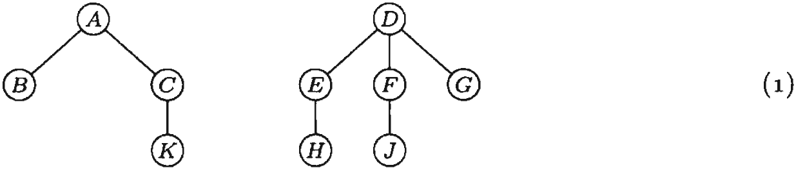
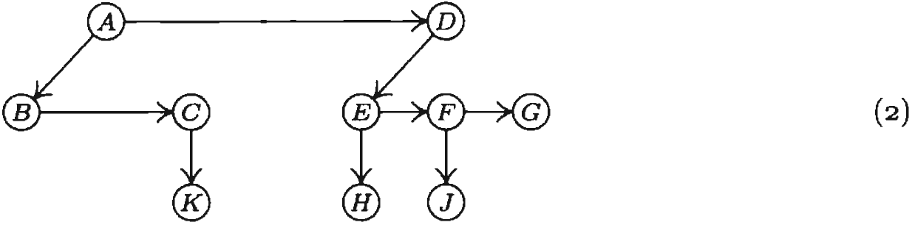
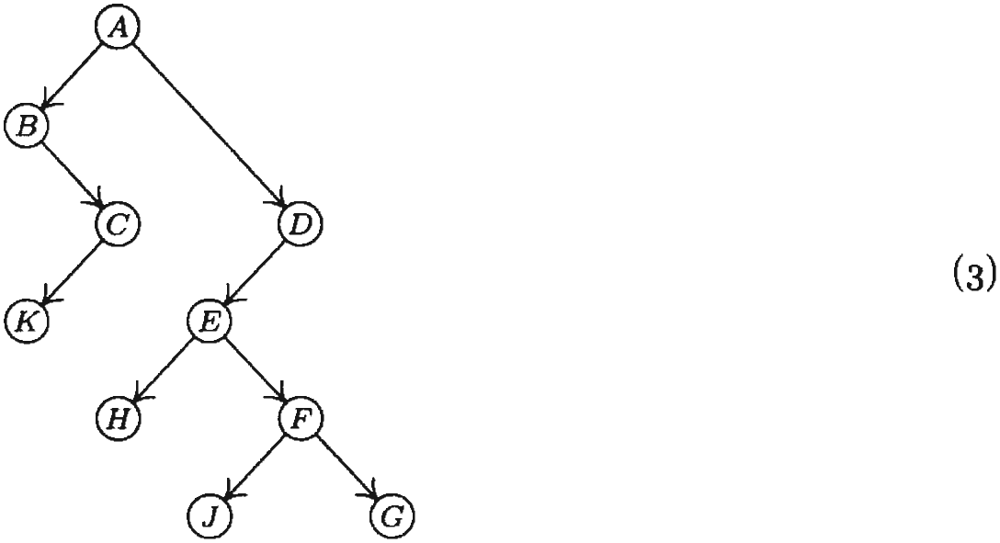
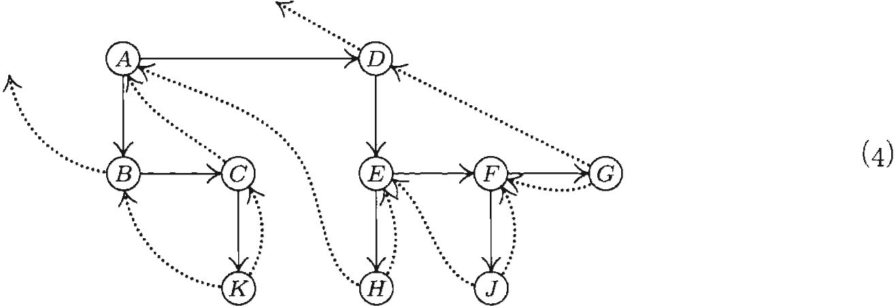
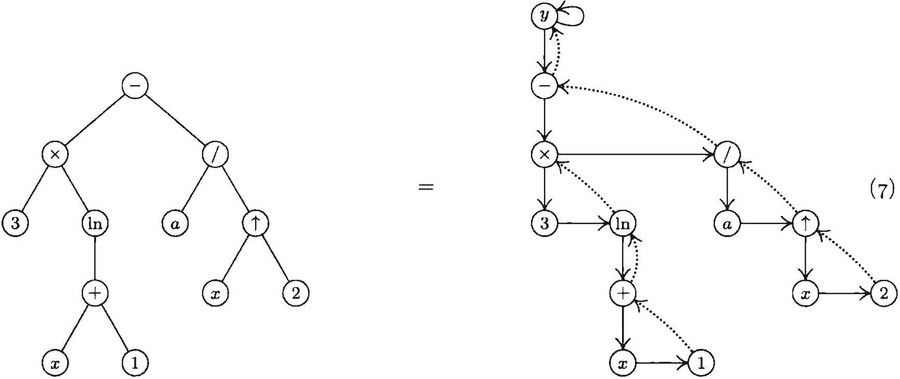
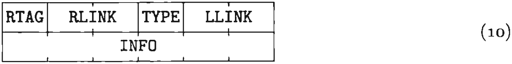
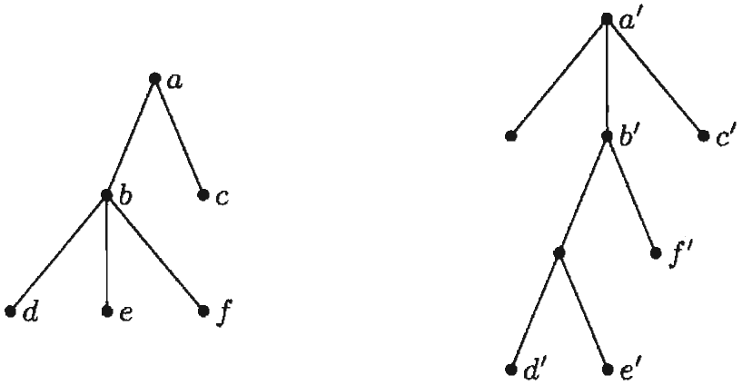

<a id="sec-2-3-2"></a>

#### 2.3.2 树的二叉树表示

现在, 我们从二叉树转到普通的树. 回忆一下, 按照定义, 树与二叉树的基本区别是:

(1) 树总有一个根结点, 所以它绝不为空; 树的每个结点可以有 0,1,2,3,... 个子女.

(2) 二叉树可以为空, 每个结点可以有 0,1 或 2 个子女; 我们对 “左” 子女和 “右” 子女之间加以区别.

还有, 森林是零棵或多棵树的有序集合. 任意结点下面的诸子树形成一个森林.

有一种自然的方法, 把任意森林表示成一棵二叉树. 考虑下面两棵树的森林:



对应的二叉树可以这样得到: 把每家的子女链接在一起, 并删去除父母到第一个子女之外的竖直链:



然后, 把图顺时针转动 $4 5 ^ { \circ }$, 并稍加调整, 得到一棵二叉树:



反过来, 容易看出, 通过逆转这一过程, 任何二叉树都唯一对应于一个树的森林.

从 (1) 到 (3) 的变换非常重要, 它称为森林和二叉树之间的自然对应. 特殊地, 它给出了树与一类特殊的二叉树, 即有根但无右子树的二叉树之间的对应. (我们还可以稍微改变一下视角, 让树的根对应于二叉树的表头, 于是得到具有 n+1 个结点的树与具有 $n$ 个结点的二叉树之间的一一对应.)

<a id="pdf-283"></a><a id="p-266"></a>

设 $F = ( T _ { 1 } , T _ { 2 } , \ldots , T _ { n } )$ 是树的森林. 对应于 F 的二叉树 B(F) 可以严格地定义如下:

(a) 如果 $n=0$, 则 B(F) 为空;

(b) 如果 $n > 0$, 则 $\vec{B}(\vec{F})$ 的根是 $\mathrm { r o o t } ( T _ { 1 } )$; B(F) 的左子树是 $B ( T _ { 1 1 } , T _ { 1 2 } \ldots , T _ { 1 m } )$, 其中 $T _ { 1 1 } , T _ { 1 2 } , \ldots , T _ { 1 m }$ 都是 $\mathrm{root}(T_1)$ 的子树; 而 B(F) 的右子树是 $B ( T _ { 2 } , \ldots , T _ { n } )$ 这些规则精确地确定了从 (1) 到 (3) 的变换.

有时, 把二叉树绘制成像 (2) 那样的图, 而不必转动 $4 5 ^ { \circ }$, 也是方便的. 对应于 (1) 的线索二 叉树为



(旋转 $45^{\circ}$, 与 [图24](./sec-2-3-1.md#fig-2-24) 比较.) 注意, 右线索链从一家的最右子女到父母, 左线索链没有这样的自然解释, 因为左右之间缺乏对称性.

上一节考察的遍历思想可以用森林 (因而也能用树) 重新陈述. 中序序列没有简单的类似物, 因为根应该插入后代中间的什么位置并不明显, 但是, 先序和后序遍历却显然适用于森林. 给定任意非空森林, 遍历它的两种基本方法可以定义如下:

先序遍历 后序遍历访问第一棵树的根; 遍历第一棵树的诸子树; 遍历第一棵树的诸子树; 访问第一棵树的根; 遍历其余的树. 遍历其余的树.

为了理解这两种遍历方法的意义, 考虑下面用嵌套括号表示的树结构:

$$
(A(B,C(K)),\ D(E(H),F(J),G)).
\qquad \text{(5)}
$$

这对应于森林 (1): 我们用根中的信息后随其诸子树的表示, 来表示一棵树; 用逗号隔开各棵树的表示, 两边用括号括住, 来表示非空森林.

如果用先序遍历 (1), 则我们按序列 ABCKDEHFJG 访问诸结点, 这无非就是去掉括号和逗号的 (5). 先序是一种列举树结点的自然方法: 我们先列举根, 然后列举它的后代. 如果用像 [图20](./sec-2-3.md#fig-2-20) (c) 那样的缩进表示树结构, 则诸行按先序出现. 本书的章节号本身 (见 [图22](./sec-2-3.md#fig-2-22)) 就是按先序出现. 这样, 例如 2.3 节后随 2.3.1 节, 然后是 2.3.2,2.3.3, 2.3.4, 2.3.4.1, ..., 2.3.4.6,2.3.5, 2.4 节等.

值得注意, 先序是一个历史悠久的概念, 称它为王朝序 (dynasticorder) 可能是有意义的. 国王、公爵或伯爵去世后, 头衔传给长子, 然后是长子的后裔, 而如果最终这一支的人全部死去, 则以同样的方式传给家族的其他儿子. (英国传统上, 家族的女儿与儿子具有相同的权利, 只不过她们排在所有的儿子之后.) 理论上, 我们可以取所有贵族的直系图, 并按先序列出结点, 然后只考虑现在还活着的人, 将得到王位继承次序 (按让位法而作出的修改除外).

(1) 中结点的后序是 BKCAHEJFGD, 类似于先序. 它对应于括号表示

$$
((B,(K)C)A,\ ((H)E,(J)F,G)D),
\qquad \text{(6)}
$$

<a id="pdf-284"></a><a id="p-267"></a>

其中, 结点恰出现在其后代之后, 而不是像先序一样出现在其后代之前.

先序和后序的定义与树和二叉树之间的自然对应非常一致, 因为第一棵树的子树对应于二叉树的左子树, 而其余的树对应于二叉树的右子树. 把这些定义与 253 页的定义进行比较, 我们发现, 按先序遍历一个森林与按先序遍历对应的二叉树完全相同, 按后序遍历一个森林与按中序遍历对应的二叉树完全相同. 因此, 可以不加改变地使用 2.3.1 节开发的算法. (注意, 树的后序对应于二叉树的中序, 而不是后序. 这很幸运, 因为我们已经看到按后序遍历二叉树相对困难.) 由于这种等价性, 我们使用记号 $\mathtt P\mathord{\$}$ 表示树或森林中结点 P 的后序后继, 也表示二叉树中的中序后继.

作为这些方法用于实际问题的一个例子, 我们将考虑代数式的操作. 代数式最适合看作树结构表示, 而不是看作符号的一或二维结构, 甚至也不是看作二叉树. 例如, 公式 $\bar{y} = 3\ln(x + 1) - a / x^{2}$ 具有树表示



这里, 左边的图是像 [图 21](./sec-2-3.md#fig-2-21) 一样的传统的树, 其中二元运算符 $+, -, \times, /$ 和 $\uparrow$ (表示乘幂) 有两棵子树, 对应于它们的操作数; 一元运算符 $\text{" } \ln  \text{" }$ 有一棵子树. 变量和常量是终端结点. 右边的图显示等价的右线索二叉树, 包括一个附加的节点 $y$, 它是树的表头. 表头具有 2.3.1-(8) 所示的形式.

注意, 即便 (7) 中左边的树表面上也与二叉树相似, 这里我们依然把它处理成树, 并用相当不同的二叉树表示它, 显示在 (7) 的右边. 尽管我们可以直接基于二叉树结构 (代数式的所谓 “三地址码” 表示) 为代数操作开发程序, 但是如果使用像 (7) 中那样的代数式的一般树表示, 则在实践上就会带来一些简化, 因为树的后序遍历比较容易.

(7) 中左边的树的结点是

$$
-\quad\times\quad3\quad\ln\quad+\quad x\quad1\quad/\quad a\quad\uparrow\quad x\quad2\qquad\text{先序};
\qquad \text{(8)}
$$

$$
3\quad x\quad1\quad+\quad\ln\quad\times\quad a\quad x\quad2\quad\uparrow\quad/\quad-\qquad\text{后序}.
\qquad \text{(9)}
$$

像 (8) 和 (9) 这样的代数表达式非常重要, 称为 “波兰表示”, 因为形式 (8) 是波兰逻辑学家扬·卢卡西维茨发明的. 表达式 (8) 是公式 (7) 的前缀表示 (prefixnotation), 而 (9) 是对应的后缀表示 (postfixnotation). 在后面几章, 我们还将回到波兰表示这一有趣的主题, 现在只需要了解波兰表示与树遍历的基本次序直接相关.

我们假定, 在 MIX 程序中, 待处理代数式的树结构的结点具有如下形式:



<a id="pdf-285"></a><a id="p-268"></a>

这里, RLINK 和 LLINK 具有通常的意义, 对于线索链, RTAG 为负 (对应于算法语句中的 RTAG=1). TYPE 字段用于确定结点的不同类型: TYPE=0 意味结点表示一个常量, 而 INFO 是该常量的值; TYPE=1 意味该结点表示一个变量, 而 INFO 是该变量的 5 个字母的名字; TYPE≥2 意味该结点表示一个运算符, 而 INFO 是运算符的字符名称, 并且 TYPE=2,3,4,... 用来区分不同的运算符+, 一, ×,/等. 这里, 我们先不管如何在计算机内存建立树结构, 因为这一主题将在第 10 章详细分析. 现在, 我们只假定树已经在计算机内存中, 把输入和输出问题推迟到稍后解决.

现在, 我们讨论代数操作的经典例子, 求一个代数式关于变量 $x$ 的导数. 代数微分程序属于第一批为计算机编制的符号运算程序, 早在 1952 年就被使用. 微分过程阐明了代数操作的许多基本技术, 并在科学应用中具有重要的实用价值.

不熟悉数学微积分的读者可以把这个问题看作由以下规则定义的抽象公式操作:

$$
D(x)=1
\qquad \text{(11)}
$$

$$
D(a)=0,\qquad\text{如果 }a\text{ 是常量或与 }x\text{ 不同的变量}
\qquad \text{(12)}
$$

$$
D(\ln u)=D(u)/u,\qquad\text{如果 }u\text{ 是一个代数式}
\qquad \text{(13)}
$$

$$
D(-u)=-D(u)
\qquad \text{(14)}
$$

$$
D(u+v)=D(u)+D(v)
\qquad \text{(15)}
$$

$$
D(u-v)=D(u)-D(v)
\qquad \text{(16)}
$$

$$
D(u\times v)=D(u)\times v+u\times D(v)
\qquad \text{(17)}
$$

$$
D(u/v)=D(u)/v-(u\times D(v))/(v\uparrow2)
\qquad \text{(18)}
$$

$$
D(u\uparrow v)=D(u)\times(v\times(u\uparrow(v-1)))+((\ln u)\times D(v))\times(u\uparrow v)
\qquad \text{(19)}
$$

根据这些规则, 我们可以对由所列举的运算符组成的任意代数式 $y$, 计算导数 $D(y)$. 规则 (14) 中的符号 “” 是一元运算符, 不同于 (16) 中的二元 “-”. 在下面的树结点中, 我们将使用 “neg” 表示一元取反运算.

不幸的是, 规则 (11) 到 (19) 还不够. 如果我们盲目地把它们用于像

$$
y = 3 \ln(x + 1) - a / x^2
$$

这样的简单公式, 则得到

$$
\begin{aligned}D(y)={}&0\cdot\ln(x+1)+3((1+0)/(x+1))\\&-\bigl(0/x^2-(a(1(2x^{2-1})+((\ln x)\cdot0)x^2))/(x^2)^2\bigr),\end{aligned}
\qquad \text{(20)}
$$

这是正确的, 但是完全不能令人满意. 为了避免答案中有如此之多的冗余操作, 我们必须识别加 0 或被 0 乘、被 1 乘或 1 次幂这样的特殊情况. 这些化简把 (20) 归约为

$$
D(y)=3(1/(x+1))-(-(a(2x))/(x^2)^2),
\qquad \text{(21)}
$$

这比较可以接受, 但是仍然不理想. 真正满意的答案的概念不是明确定义的, 因为不同的数学家愿意用不同的方法表示公式. 然而, (21) 显然可以更简单. 为了对式 (21) 做出实质性化简, 有必要开发代数化简程序 (见习题 17), 例如把 (21) 化简为

$$
D(y)=3(x+1)^{-1}+2ax^{-3}.
\qquad \text{(22)}
$$

这里, 我们只满足于可以产生 (21) 式而不是 (22) 式的程序.

<a id="pdf-286"></a><a id="p-269"></a>

像通常一样, 我们对算法的主要兴趣是该过程在计算机内运行的细节. 在大部分计算机装置中, 都有许多高级程序设计语言和专用例程可以利用, 提供了简化代数操作的内置机制. 但是, 提供这个例子的目的是获得基本树操作的更多经验.

下面算法的基本思想是: 按后序遍历树, 随着遍历形成每个结点的导数, 直到最终计算出整个导数. 使用后序意味着我们先对运算符 (如“+”) 的操作数求导, 后到达运算符结点. 规则 (11) 到 (19) 暗示原式的每个子式或早或晚都要求微分, 因此我们也可以按后序求微分.

通过使用右线索树, 可避免在算法运行期间使用栈. 另一方面, 线索树表示也有缺点, 我们需要做子树的副本, 例如, 在 D($u$↑$v$) 的规则中, 可能需要复制 $u$ 和 $v$ 各 3 次. 如果我们选择像 2.3.5 节中的表而不是树表示, 则可以避免这种复制.

算法 D (微分). 如果 Y 是指向按上述表示的公式的表头的地址, DY 是空树表头的地址, 则该算法使得 NODE(DY) 指向代表 Y 关于变量 $X$ 的解析导数的树.

D1.[初始化.] 置 $\mathtt P\gets\mathtt Y\mathord{\$}$ (即树在后序下的第一个结点, 它是对应的二叉树在中序下的第一个结点).

D2. [微分. ] 置 $\mathrm{P1} \leftarrow \mathrm{LLINK}(\mathrm{P})$; 并且如果 $\mathbb{P}1 \neq \Lambda$, 则还置 Q1←RLINK(P1). 然后执行下面所描述的程序 DIFF[TYPE(P)]. (程序 DIFF[0]、DIFF[1] 等将形成以 P 为根的树的导数, 并设置指针变量 Q 为该导数树的根的地址. 先建立变量 P1 和 Q1, 以便简化 DIFF 程序的说明.)

D3.[链复位.] 如果 TYPE(P) 表示一个二元运算符, 则置 RLINK(P1)←P2. (解释见下一步.)

D4.[前进到 PS.] 置 P2←P,P←Ps. 现在, 如果 RTAG(P2)=0 (即是, 如果 NODE(P2) 右边有一个兄妹), 则置 RLINK(P2)←Q (这是算法的技巧部分: 我们临时破坏了树 Y 的结构, 使得指向 P2 的导数的链得以保存, 以便以后使用. 缺失的链稍后将在步骤 D3 恢复. 对于这一技巧的进一步讨论, 见习题 21.)

D5. [完成?] 如果 $P \neq Y$, 则返回步骤 D2; 否则, 置 $\mathtt{LLINK}(\mathtt{DY})\leftarrow\mathtt Q,\quad\mathtt{RLINK}(\mathtt Q)\leftarrow\mathtt{DY}$ RTAG(Q) ← 1.

算法 D 中描述的过程只是求导操作的基础程序, 求导由在步骤 D2 调用的处理程序 DIFF[0], DIFF[1],... 来实现. 在许多方面, 算法 D 都很像 1.4.3 节讨论的解释系统或机器模拟器的控制程序, 但是它遍历一棵树, 而不是简单的指令序列.

为了元成算法 D, 我们必须定义实际求微分的程序. 在下面的讨论中, 语句 “P 指向一棵树” 意味 NODE(P) 是一棵以右线索二叉树形式存放的树的根, 尽管就这棵树而言, RLINK(P) 和 RTAG(P) 都没有意义. 我们将使用树构造函数, 通过把小树连接在一起, 构造新树: 设 $x$ 代表某种结点, 它或者是常量, 或者是变量, 或者是运算符, 而 U 和 V 代表指向树的指针; 于是

TREE($x$, U,V) 产生一棵新树, 以 $x$ 为根结点, 而 U 和 V 是根的子树: $\mathtt { W } \Leftarrow \mathtt { A V A I L }$

$$
\begin{aligned}&\mathtt{INFO}(\mathtt W)\leftarrow x,\ \mathtt{LLINK}(\mathtt W)\leftarrow\mathtt U,\ \mathtt{RLINK}(\mathtt U)\leftarrow\mathtt V,\ \mathtt{RTAG}(\mathtt U)\leftarrow0,\ \mathtt{RLINK}(\mathtt V)\leftarrow\mathtt W,\\&\mathtt{RTAG}(\mathtt V)\leftarrow1,\end{aligned}
$$

$$
\begin{aligned}&\mathtt{TREE}(x,\mathtt U)\text{ 类似地产生一棵只有一个子树的新树:}\mathtt W\Leftarrow\mathtt{AVAIL},\ \mathtt{INFO}(\mathtt W)\leftarrow x,\ \mathtt{LLINK}(\mathtt W)\leftarrow\mathtt U,\\&\mathtt{RLINK}(\mathtt U)\leftarrow\mathtt W,\quad\mathtt{RTAG}(\mathtt U)\leftarrow1.\end{aligned}
$$

TREE($x$) 产生一棵以 $x$ 为终端根结点的新树: W⇐AVAIL, INFO(W)← $x$, LLINK(W)←Λ. 此外, TYPE(W) 根据 $x$ 而适当设置. 在所有的情况下, TREE 的值是 W, 即指向刚构造的树的指 针. 读者应该仔细研究这三个定义, 因为它们阐明了树的二叉树表示. 另一个函数 COPY(U) 制<a id="pdf-287"></a><a id="p-270"></a>作 U 指向的树的副本, 而其值是指向所创建树的指针. 基本函数 `TREE` 和 `COPY` 使得我们很容易一步步地为一个公式的导数建立起一棵树.

**零元运算符**(常量和变量). 对于这些运算, `NODE(P)` 是一个终端结点, 运算结果与 P1、P2、Q1 和 Q 的原值无关.

`DIFF[0]`: (`NODE(P)` 是一个常量) 置 $\mathrm Q\leftarrow\mathrm{TREE}(0)$.

`DIFF[1]`: (`NODE(P)` 是一个变量) 如果 `INFO(P) = "X"`, 则置 $\mathrm Q\leftarrow\mathrm{TREE}(1)$; 否则置 $\mathrm Q\leftarrow\mathrm{TREE}(0)$.

**一元运算符**(对数和取反). 对于这些运算, `NODE(P)` 具有一个子女 $U$, P1 指向它, 并且 Q 指向 $D(U)$. 运算结果与 P2 和 Q1 的原值无关.

`DIFF[2]`: (`NODE(P)` 是 “ln”) 如果 $\mathrm{INFO}(\mathrm Q)\ne0$, 则置 $\mathrm Q\leftarrow\mathrm{TREE}(\text{“/”},\mathrm Q,\mathrm{COPY}(\mathrm{P1}))$.

`DIFF[3]`: (`NODE(P)` 是 “neg”) 如果 $\mathrm{INFO}(\mathrm Q)\ne0$, 则置 $\mathrm Q\leftarrow\mathrm{TREE}(\text{“neg”},\mathrm Q)$.

**二元运算符**(加、减、乘、除和乘方). 对于这些运算, `NODE(P)` 具有两个子女 $U$ 和 $V$, P1 和 P2 分别指向它们; Q1 和 Q 分别指向 $D(U)$ 和 $D(V)$.

`DIFF[4]`: (“+”运算) 如果 $\mathrm{INFO}(\mathrm{Q1})=0$, 则置 $\mathrm{AVAIL}\Leftarrow\mathrm{Q1}$. 否则, 如果 $\mathrm{INFO}(\mathrm Q)=0$, 则置 $\mathrm{AVAIL}\Leftarrow\mathrm Q$ 且 $\mathrm Q\leftarrow\mathrm{Q1}$; 否则, 置 $\mathrm Q\leftarrow\mathrm{TREE}(\text{“+”},\mathrm{Q1},\mathrm Q)$.

`DIFF[5]`: (“−” 运算) 如果 $\mathrm{INFO}(\mathrm Q)=0$, 则置 $\mathrm{AVAIL}\Leftarrow\mathrm Q$, $\mathrm Q\leftarrow\mathrm{Q1}$. 否则, 如果 $\mathrm{INFO}(\mathrm{Q1})=0$, 则置 $\mathrm{AVAIL}\Leftarrow\mathrm{Q1}$, $\mathrm Q\leftarrow\mathrm{TREE}(\text{“neg”},\mathrm Q)$; 否则, 置 $\mathrm Q\leftarrow\mathrm{TREE}(\text{“−”},\mathrm{Q1},\mathrm Q)$.

`DIFF[6]`: (“×” 运算) 如果 $\mathrm{INFO}(\mathrm{Q1})\ne0$, 则置 $\mathrm{Q1}\leftarrow\mathrm{MULT}(\mathrm{Q1},\mathrm{COPY}(\mathrm{P2}))$. 然后, 如果 $\mathrm{INFO}(\mathrm Q)\ne0$, 则置 $\mathrm Q\leftarrow\mathrm{MULT}(\mathrm{COPY}(\mathrm{P1}),\mathrm Q)$. 然后, 转到 `DIFF[4]`.

这里, `MULT(U,V)` 是一个新函数, 它构造 $U\times V$ 的树, 同时检测 U 或 V 是否等于 1:

如果 $\mathrm{INFO}(\mathrm U)=1$ 并且 $\mathrm{TYPE}(\mathrm U)=0$, 则置 $\mathrm{AVAIL}\Leftarrow\mathrm U$, $\mathrm{MULT}(\mathrm U,\mathrm V)\leftarrow\mathrm V$;

如果 $\mathrm{INFO}(\mathrm V)=1$ 并且 $\mathrm{TYPE}(\mathrm V)=0$, 则置 $\mathrm{AVAIL}\Leftarrow\mathrm V$, $\mathrm{MULT}(\mathrm U,\mathrm V)\leftarrow\mathrm U$;

否则, 置 $\mathrm{MULT}(\mathrm U,\mathrm V)\leftarrow\mathrm{TREE}(\text{“×”},\mathrm U,\mathrm V)$.

`DIFF[7]`: (“/”运算) 如果 $\mathrm{INFO}(\mathrm{Q1})\ne0$, 则置

$$
\mathrm{Q1}\leftarrow\mathrm{TREE}(\text{“/”},\mathrm{Q1},\mathrm{COPY}(\mathrm{P2}))
$$

然后, 如果 $\mathrm{INFO}(\mathrm Q)\ne0$, 则置

$$
\mathrm Q\leftarrow\mathrm{TREE}(\text{“/”},\mathrm{MULT}(\mathrm{COPY}(\mathrm{P1}),\mathrm Q),\mathrm{TREE}(\text{“↑”},\mathrm{COPY}(\mathrm{P2}),\mathrm{TREE}(2)))
$$

然后, 转到 `DIFF[5]`.

`DIFF[8]`: (“↑” 操作) 见习题 12.

在本节的最后, 我们展示如何 “从零开始”, 仅以 MIX 机器语言为基础, 轻松地把上面的所有操作转换成计算机程序.

**程序 D**(微分). 下面的 MIXAL 程序实现算法 D, 其中 $\mathrm{rI2}\equiv\mathrm P$, $\mathrm{rI3}\equiv\mathrm{P2}$, $\mathrm{rI4}\equiv\mathrm{P1}$, $\mathrm{rI5}\equiv\mathrm Q$, $\mathrm{rI6}\equiv\mathrm{Q1}$. 为方便起见, 计算次序稍加重新安排.

| 行号 | LOC | OP | ADDRESS | 注释 |
| ---: | :--- | :--- | :--- | :--- |
| 001 | `*` |  |  | 在右线索树中计算微分 |
| 002 | `LLINK` | `EQU` | `4:5` | 定义字段, 见 (10) |
| 003 | `RLINK` | `EQU` | `1:2` |  |
| 004 | `RLINKT` | `EQU` | `0:2` |  |
| <a id="pdf-288"></a><a id="p-271"></a>005 | `TYPE` | `EQU` | `3:3` |  |
| 006 | `*` |  |  | 主控制程序　<u>D1. 初始化. </u> |
| 007 | `D1` | `STJ` | `9F` | 把整个过程看作一个子程序. |
| 008 |  | `LD4` | `Y(LLINK)` | $\mathrm{P1}\leftarrow\mathrm{LLINK}(\mathrm Y)$, 准备找 `Y$`. |
| 009 | `1H` | `ENT2` | `0,4` | $\mathrm P\leftarrow\mathrm{P1}$. |
| 010 | `2H` | `LD4` | `0,2(LLINK)` | $\mathrm{P1}\leftarrow\mathrm{LLINK}(\mathrm P)$. |
| 011 |  | `J4NZ` | `1B` | 如果 $\mathrm{P1}\ne\Lambda$, 则重复. |
| 012 | `D2` | `LD1` | `0,2(TYPE)` | <u>D2. 微分. </u> |
| 013 |  | `JMP` | `*+1,1` | 跳到 `DIFF[TYPE(P)]`。 |
| 014 |  | `JMP` | `CONSTANT` | 跳转到表项 `DIFF[0]`。 |
| 015 |  | `JMP` | `VARIABLE` | `DIFF[1]`。 |
| 016 |  | `JMP` | `LN` | `DIFF[2]`。 |
| 017 |  | `JMP` | `NEG` | `DIFF[3]`。 |
| 018 |  | `JMP` | `ADD` | `DIFF[4]`。 |
| 019 |  | `JMP` | `SUB` | `DIFF[5]`。 |
| 020 |  | `JMP` | `MUL` | `DIFF[6]`。 |
| 021 |  | `JMP` | `DIV` | `DIFF[7]`。 |
| 022 |  | `JMP` | `PWR` | `DIFF[8]`。 |
| 023 | `D3` | `ST3` | `0,4(RLINK)` | <u>D3. 链复位. </u> $\mathrm{RLINK}(\mathrm{P1})\leftarrow\mathrm{P2}$. |
| 024 | `D4` | `ENT3` | `0,2` | <u>D4. 前进到 `P$`. </u> $\mathrm{P2}\leftarrow\mathrm P$. |
| 025 |  | `LD2` | `0,2(RLINKT)` | $\mathrm P\leftarrow\mathrm{RLINKT}(\mathrm P)$. |
| 026 |  | `J2N` | `1F` | 如果 $\mathrm{RTAG}(\mathrm P)=1$, 则跳转; |
| 027 |  | `ST5` | `0,3(RLINK)` | 否则, 置 $\mathrm{RLINK}(\mathrm{P2})\leftarrow\mathrm Q$. |
| 028 |  | `JMP` | `2B` | 注意，`NODE(P$)` 将是终端结点。 |
| 029 | `1H` | `ENN2` | `0,2` |  |
| 030 | `D5` | `ENT1` | `-Y,2` | <u>D5. 完成? </u> |
| 031 |  | `LD4` | `0,2(LLINK)` | $\mathrm{P1}\leftarrow\mathrm{LLINK}(\mathrm P)$, 为步骤 D2 作准备. |
| 032 |  | `LD6` | `0,4(RLINK)` | $\mathrm{Q1}\leftarrow\mathrm{RLINK}(\mathrm{P1})$. |
| 033 |  | `J1NZ` | `D2` | 如果 $\mathrm P\ne\mathrm Y$, 则跳转到 D2; |
| 034 |  | `ST5` | `DY(LLINK)` | 否则置 $\mathrm{LLINK}(\mathrm{DY})\leftarrow\mathrm Q$. |
| 035 |  | `ENNA` | `DY` |  |
| 036 |  | `STA` | `0,5(RLINKT)` | $\mathrm{RLINK}(\mathrm Q)\leftarrow\mathrm{DY}$，$\mathrm{RTAG}(\mathrm Q)\leftarrow1$。 |
| 037 | `9H` | `JMP` | `*` | 从微分子程序转出。　▮ |

<details>
<summary>MIXAL 等宽清单</summary>

```text
* 在右线索树中计算微分
LLINK     EQU   4:5
RLINK     EQU   1:2
RLINKT    EQU   0:2
TYPE      EQU   3:3
* 主控制程序　D1. 初始化。
D1        STJ   9F
          LD4   Y(LLINK)
1H        ENT2  0,4
2H        LD4   0,2(LLINK)
          J4NZ  1B
D2        LD1   0,2(TYPE)
          JMP   *+1,1
          JMP   CONSTANT
          JMP   VARIABLE
          JMP   LN
          JMP   NEG
          JMP   ADD
          JMP   SUB
          JMP   MUL
          JMP   DIV
          JMP   PWR
D3        ST3   0,4(RLINK)
D4        ENT3  0,2
          LD2   0,2(RLINKT)
          J2N   1F
          ST5   0,3(RLINK)
          JMP   2B
1H        ENN2  0,2
D5        ENT1  -Y,2
          LD4   0,2(LLINK)
          LD6   0,4(RLINK)
          J1NZ  D2
          ST5   DY(LLINK)
          ENNA  DY
          STA   0,5(RLINKT)
9H        JMP   *
```

</details>

程序的下一部分包含基本子程序 `TREE` 和 `COPY`. 前者按照所构造的树的子树数, 有三个入口 `TREE0`、`TREE1` 和 `TREE2`. 无论使用哪个子程序入口, $\mathrm{rA}$ 都将包含一个特殊常量的地址, 指出什么类型的结点形成所构造的树的根. 这些特殊的常量出现在第 105–124 行中.

| 行号 | LOC | OP | ADDRESS | 注释 |
| ---: | :--- | :--- | :--- | :--- |
| 038 | `*` |  |  | 树构造的基本子程序 |
| 039 | `TREE0` | `STJ` | `9F` | `TREE(rA)` 函数: |
| 040 |  | `JMP` | `2F` |  |
| 041 | `TREE1` | `ST1` | `3F(0:2)` | `TREE(rA,rI1)` 函数: |
| 042 |  | `JSJ` | `1F` |  |
| 043 | `TREE2` | `STX` | `3F(0:2)` | `TREE(rA,rX,rI1)` 函数: |
| 044 | `3H` | `ST1` | `*(RLINKT)` | $\mathrm{RLINK}(\mathrm{rX})\leftarrow\mathrm{rI1}$, $\mathrm{RTAG}(\mathrm{rX})\leftarrow0$. |
| 045 | `1H` | `STJ` | `9F` |  |
| 046 |  | `LDXN` | `AVAIL` |  |
| 047 |  | `JXZ` | `OVERFLOW` |  |
| <a id="pdf-289"></a><a id="p-272"></a>048 |  | `STX` | `0,1(RLINKT)` | $\mathrm{RLINK}(\mathrm{rI1})\leftarrow\mathrm{AVAIL}$, $\mathrm{RTAG}(\mathrm{rI1})\leftarrow1$. |
| 049 |  | `LDX` | `3B(0:2)` |  |
| 050 |  | `STA` | `*+1(0:2)` |  |
| 051 |  | `STX` | `*(LLINK)` | 设置下一个根结点的 `LLINK`. |
| 052 | `2H` | `LD1` | `AVAIL` | $\mathrm{rI1}\Leftarrow\mathrm{AVAIL}$. |
| 053 |  | `J1Z` | `OVERFLOW` |  |
| 054 |  | `LDX` | `0,1(LLINK)` |  |
| 055 |  | `STX` | `AVAIL` |  |
| 056 |  | `STA` | `*+1(0:2)` | 复制根信息到新结点。 |
| 057 |  | `MOVE` | `*(2)` |  |
| 058 |  | `DEC1` | `2` | 重置 $\mathrm{rI1}$ 指向新的根。 |
| 059 | `9H` | `JMP` | `*` | 由 `TREE` 转出，$\mathrm{rI1}$ 指向新树。 |
| 060 | `COPYP1` | `ENT1` | `0,4` | `COPY(P1)`, 进入 `COPY` 的特殊入口. |
| 061 |  | `JSJ` | `COPY` |  |
| 062 | `COPYP2` | `ENT1` | `0,3` | `COPY(P2)`, 进入 `COPY` 的特殊入口. |
| 063 | `COPY` | `STJ` | `9F` | `COPY(rI1)` 函数: |
| … | | | | (见习题 13) |
| 104 | `9H` | `JMP` | `*` | 由 `COPY` 转出，$\mathrm{rI1}$ 指向新树 |
| 105 | `CON0` | `CON` | `0` | 表示常量 “0” 的结点 |
| 106 |  | `CON` | `0` |  |
| 107 | `CON1` | `CON` | `0` | 表示常量 “1” 的结点 |
| 108 |  | `CON` | `1` |  |
| 109 | `CON2` | `CON` | `0` | 表示常量 “2” 的结点 |
| 110 |  | `CON` | `2` |  |
| 111 | `LOG` | `CON` | `2(TYPE)` | 表示 “ln” 的结点 |
| 112 |  | `ALF` | <code style="white-space:pre">   LN</code> |  |
| 113 | `NEGOP` | `CON` | `3(TYPE)` | 表示 “neg” 的结点 |
| 114 |  | `ALF` | <code style="white-space:pre">  NEG</code> |  |
| 115 | `PLUS` | `CON` | `4(TYPE)` | 表示“+”的结点 |
| 116 |  | `ALF` | <code style="white-space:pre">   + </code> |  |
| 117 | `MINUS` | `CON` | `5(TYPE)` | 表示 “−” 的结点 |
| 118 |  | `ALF` | <code style="white-space:pre">   - </code> |  |
| 119 | `TIMES` | `CON` | `6(TYPE)` | 表示 “×” 的结点 |
| 120 |  | `ALF` | <code style="white-space:pre">   * </code> |  |
| 121 | `SLASH` | `CON` | `7(TYPE)` | 表示“/”的结点 |
| 122 |  | `ALF` | <code style="white-space:pre">   / </code> |  |
| 123 | `UPARROW` | `CON` | `8(TYPE)` | 表示 “↑” 的结点 |
| 124 |  | `ALF` | <code style="white-space:pre">   **</code> | ▮ |

<details>
<summary>MIXAL 等宽清单</summary>

```text
* 树构造的基本子程序
TREE0     STJ   9F
          JMP   2F
TREE1     ST1   3F(0:2)
          JSJ   1F
TREE2     STX   3F(0:2)
3H        ST1   *(RLINKT)
1H        STJ   9F
          LDXN  AVAIL
          JXZ   OVERFLOW
          STX   0,1(RLINKT)
          LDX   3B(0:2)
          STA   *+1(0:2)
          STX   *(LLINK)
2H        LD1   AVAIL
          J1Z   OVERFLOW
          LDX   0,1(LLINK)
          STX   AVAIL
          STA   *+1(0:2)
          MOVE  *(2)
          DEC1  2
9H        JMP   *
COPYP1    ENT1  0,4
          JSJ   COPY
COPYP2    ENT1  0,3
COPY      STJ   9F
9H        JMP   *
CON0      CON   0
          CON   0
CON1      CON   0
          CON   1
CON2      CON   0
          CON   2
LOG       CON   2(TYPE)
          ALF      LN
NEGOP     CON   3(TYPE)
          ALF     NEG
PLUS      CON   4(TYPE)
          ALF      + 
MINUS     CON   5(TYPE)
          ALF      - 
TIMES     CON   6(TYPE)
          ALF      * 
SLASH     CON   7(TYPE)
          ALF      / 
UPARROW   CON   8(TYPE)
          ALF      **
```

</details>

程序的剩余部分对应于微分程序 `DIFF[0]`、`DIFF[1]`, 等等. 这些程序设计为, 处理完一个二元操作之后把控制返回步骤 D3, 否则返回步骤 D4.

| 行号 | LOC | OP | ADDRESS | 注释 |
| ---: | :--- | :--- | :--- | :--- |
| 125 | `*` |  |  | 微分程序 |
| 126 | `VARIABLE` | `LDX` | `1,2` |  |
| 127 |  | `ENTA` | `CON1` |  |
| 128 |  | `CMPX` | `2F` | `INFO(P)` 是否等于“X”？ |
| 129 |  | `JE` | `*+2` | 如果等于, 则调用 `TREE(1)`. |
| 130 | `CONSTANT` | `ENTA` | `CON0` | 调用 `TREE(0)`. |
| <a id="pdf-290"></a><a id="p-273"></a>131 |  | `JMP` | `TREE0` |  |
| 132 | `1H` | `ENT5` | `0,1` | $\mathrm Q\leftarrow{}$ 新树的位置. |
| 133 |  | `JMP` | `D4` | 返回控制程序 |
| 134 | `2H` | `ALF` | <code style="white-space:pre">    X</code> |  |
| 135 | `LN` | `LDA` | `1,5` |  |
| 136 |  | `JAZ` | `D4` | 如果 $\mathrm{INFO}(\mathrm Q)=0$, 则返回控制程序; |
| 137 |  | `JMP` | `COPYP1` | 否则，置 $\mathrm{rI1}\leftarrow\mathrm{COPY}(\mathrm{P1})$。 |
| 138 |  | `ENTX` | `0,5` |  |
| 139 |  | `ENTA` | `SLASH` |  |
| 140 |  | `JMP` | `TREE2` | $\mathrm{rI1}\leftarrow\mathrm{TREE}(\text{“/”},\mathrm Q,\mathrm{rI1})$。 |
| 141 |  | `JMP` | `1B` | $\mathrm Q\leftarrow\mathrm{rI1}$，返回控制程序。 |
| 142 | `NEG` | `LDA` | `1,5` |  |
| 143 |  | `JAZ` | `D4` | 如果 $\mathrm{INFO}(\mathrm Q)=0$, 则返回. |
| 144 |  | `ENTA` | `NEGOP` |  |
| 145 |  | `ENT1` | `0,5` |  |
| 146 |  | `JMP` | `TREE1` | $\mathrm{rI1}\leftarrow\mathrm{TREE}(\text{“neg”},\mathrm Q)$。 |
| 147 |  | `JMP` | `1B` | $\mathrm Q\leftarrow\mathrm{rI1}$，返回控制程序。 |
| 148 | `ADD` | `LDA` | `1,6` |  |
| 149 |  | `JANZ` | `1F` | 除非 $\mathrm{INFO}(\mathrm{Q1})=0$, 否则跳转. |
| 150 | `3H` | `LDA` | `AVAIL` | $\mathrm{AVAIL}\Leftarrow\mathrm{Q1}$。 |
| 151 |  | `STA` | `0,6(LLINK)` |  |
| 152 |  | `ST6` | `AVAIL` |  |
| 153 |  | `JMP` | `D3` | 返回控制程序，二元运算符。 |
| 154 | `1H` | `LDA` | `1,5` |  |
| 155 |  | `JANZ` | `1F` | 除非 $\mathrm{INFO}(\mathrm Q)=0$, 否则跳转. |
| 156 | `2H` | `LDA` | `AVAIL` | $\mathrm{AVAIL}\Leftarrow\mathrm Q$。 |
| 157 |  | `STA` | `0,5(LLINK)` |  |
| 158 |  | `ST5` | `AVAIL` |  |
| 159 |  | `ENT5` | `0,6` | $\mathrm Q\leftarrow\mathrm{Q1}$. |
| 160 |  | `JMP` | `D3` | 返回控制程序 |
| 161 | `1H` | `ENTA` | `PLUS` | 准备调用 `TREE("+",Q1,Q)`. |
| 162 | `4H` | `ENTX` | `0,6` |  |
| 163 |  | `ENT1` | `0,5` |  |
| 164 |  | `JMP` | `TREE2` |  |
| 165 |  | `ENT5` | `0,1` | $\mathrm Q\leftarrow\mathrm{TREE}(\text{“±”},\mathrm{Q1},\mathrm Q)$. |
| 166 |  | `JMP` | `D3` | 返回控制程序。 |
| 167 | `SUB` | `LDA` | `1,5` |  |
| 168 |  | `JAZ` | `2B` | 如果 $\mathrm{INFO}(\mathrm Q)=0$, 则跳转. |
| 169 |  | `LDA` | `1,6` |  |
| 170 |  | `JANZ` | `1F` | 除非 $\mathrm{INFO}(\mathrm{Q1})=0$, 否则跳转. |
| 171 |  | `ENTA` | `NEGOP` |  |
| 172 |  | `ENT1` | `0,5` |  |
| 173 |  | `JMP` | `TREE1` |  |
| 174 |  | `ENT5` | `0,1` | $\mathrm Q\leftarrow\mathrm{TREE}(\text{“neg”},\mathrm Q)$. |
| 175 |  | `JMP` | `3B` | $\mathrm{AVAIL}\Leftarrow\mathrm{Q1}$，并返回。 |
| 176 | `1H` | `ENTA` | `MINUS` | 准备调用 `TREE("−",Q1,Q)`. |
| 177 |  | `JMP` | `4B` |  |
| <a id="pdf-291"></a><a id="p-274"></a>178 | `MUL` | `LDA` | `1,6` |  |
| 179 |  | `JAZ` | `1F` | 如果 $\mathrm{INFO}(\mathrm{Q1})=0$, 则跳转; |
| 180 |  | `JMP` | `COPYP2` | 否则，置 $\mathrm{rI1}\leftarrow\mathrm{COPY}(\mathrm{P2})$。 |
| 181 |  | `ENTA` | `0,6` |  |
| 182 |  | `JMP` | `MULT` | $\mathrm{rI1}\leftarrow\mathrm{MULT}(\mathrm{Q1},\mathrm{COPY}(\mathrm{P2}))$。 |
| 183 |  | `ENT6` | `0,1` | $\mathrm{Q1}\leftarrow\mathrm{rI1}$. |
| 184 | `1H` | `LDA` | `1,5` |  |
| 185 |  | `JAZ` | `ADD` | 如果 $\mathrm{INFO}(\mathrm Q)=0$, 则跳转; |
| 186 |  | `JMP` | `COPYP1` | 否则，置 $\mathrm{rI1}\leftarrow\mathrm{COPY}(\mathrm{P1})$。 |
| 187 |  | `ENTA` | `0,1` |  |
| 188 |  | `ENT1` | `0,5` |  |
| 189 |  | `JMP` | `MULT` | $\mathrm{rI1}\leftarrow\mathrm{MULT}(\mathrm{COPY}(\mathrm{P1}),\mathrm Q)$。 |
| 190 |  | `ENT5` | `0,1` | $\mathrm Q\leftarrow\mathrm{rI1}$. |
| 191 |  | `JMP` | `ADD` |  |
| 192 | `MULT` | `STJ` | `9F` | `MULT(rA,rI1)` 子程序. |
| 193 |  | `STA` | `1F(0:2)` | 设 $\mathrm{rA}\equiv\mathrm U$，$\mathrm{rI1}\equiv\mathrm V$。 |
| 194 |  | `ST2` | `8F(0:2)` | 保存 $\mathrm{rI2}$. |
| 195 | `1H` | `ENT2` | `*` | $\mathrm{rI2}\leftarrow\mathrm U$. |
| 196 |  | `LDA` | `1,2` | 测试是否 $\mathrm{INFO}(\mathrm U)=1$ |
| 197 |  | `DECA` | `1` |  |
| 198 |  | `JANZ` | `1F` |  |
| 199 |  | `LDA` | `0,2(TYPE)` | 并且是否 $\mathrm{TYPE}(\mathrm U)=0$。 |
| 200 |  | `JAZ` | `2F` |  |
| 201 | `1H` | `LDA` | `1,1` | 如果不是，则测试是否 $\mathrm{INFO}(\mathrm V)=1$ |
| 202 |  | `DECA` | `1` |  |
| 203 |  | `JANZ` | `1F` |  |
| 204 |  | `LDA` | `0,1(TYPE)` | 并且是否 $\mathrm{TYPE}(\mathrm V)=0$。 |
| 205 |  | `JANZ` | `1F` |  |
| 206 |  | `ST1` | `*+2(0:2)` | 如果是, 则交换 $\mathrm U\leftrightarrow\mathrm V$. |
| 207 |  | `ENT1` | `0,2` |  |
| 208 |  | `ENT2` | `*` |  |
| 209 | `2H` | `LDA` | `AVAIL` | $\mathrm{AVAIL}\Leftarrow\mathrm U$。 |
| 210 |  | `STA` | `0,2(LLINK)` |  |
| 211 |  | `ST2` | `AVAIL` |  |
| 212 |  | `JMP` | `8F` | 结果是 V。 |
| 213 | `1H` | `ENTA` | `TIMES` |  |
| 214 |  | `ENTX` | `0,2` |  |
| 215 |  | `JMP` | `TREE2` | 结果是 `TREE("×",U,V)`。 |
| 216 | `8H` | `ENT2` | `*` | 恢复 $\mathrm{rI2}$ 的设置. |
| 217 | `9H` | `JMP` | `*` | 转出 `MULT`，结果在 $\mathrm{rI1}$ 中。　▮ |

<details>
<summary>MIXAL 等宽清单</summary>

```text
* 微分程序
VARIABLE  LDX   1,2
          ENTA  CON1
          CMPX  2F
          JE    *+2
CONSTANT  ENTA  CON0
          JMP   TREE0
1H        ENT5  0,1
          JMP   D4
2H        ALF       X
LN        LDA   1,5
          JAZ   D4
          JMP   COPYP1
          ENTX  0,5
          ENTA  SLASH
          JMP   TREE2
          JMP   1B
NEG       LDA   1,5
          JAZ   D4
          ENTA  NEGOP
          ENT1  0,5
          JMP   TREE1
          JMP   1B
ADD       LDA   1,6
          JANZ  1F
3H        LDA   AVAIL
          STA   0,6(LLINK)
          ST6   AVAIL
          JMP   D3
1H        LDA   1,5
          JANZ  1F
2H        LDA   AVAIL
          STA   0,5(LLINK)
          ST5   AVAIL
          ENT5  0,6
          JMP   D3
1H        ENTA  PLUS
4H        ENTX  0,6
          ENT1  0,5
          JMP   TREE2
          ENT5  0,1
          JMP   D3
SUB       LDA   1,5
          JAZ   2B
          LDA   1,6
          JANZ  1F
          ENTA  NEGOP
          ENT1  0,5
          JMP   TREE1
          ENT5  0,1
          JMP   3B
1H        ENTA  MINUS
          JMP   4B
MUL       LDA   1,6
          JAZ   1F
          JMP   COPYP2
          ENTA  0,6
          JMP   MULT
          ENT6  0,1
1H        LDA   1,5
          JAZ   ADD
          JMP   COPYP1
          ENTA  0,1
          ENT1  0,5
          JMP   MULT
          ENT5  0,1
          JMP   ADD
MULT      STJ   9F
          STA   1F(0:2)
          ST2   8F(0:2)
1H        ENT2  *
          LDA   1,2
          DECA  1
          JANZ  1F
          LDA   0,2(TYPE)
          JAZ   2F
1H        LDA   1,1
          DECA  1
          JANZ  1F
          LDA   0,1(TYPE)
          JANZ  1F
          ST1   *+2(0:2)
          ENT1  0,2
          ENT2  *
2H        LDA   AVAIL
          STA   0,2(LLINK)
          ST2   AVAIL
          JMP   8F
1H        ENTA  TIMES
          ENTX  0,2
          JMP   TREE2
8H        ENT2  *
9H        JMP   *
```

</details>

其他两个程序 `DIV` 和 `PWR` 是类似的, 因此留作习题 (习题 15 和 16).

#### 习题

▶ 1. [20] <a id="ex-2-3-2-1"></a>[答案](./answers/2-3-2.md#ans-2-3-2-1)  正文中给出了对应于森林 $F$ 的二叉树 $B(F)$ 的形式化定义. 给出相反过程的形式化定义; 换言之, 定义对应于二叉树 $B$ 的森林 $F(B)$.

<a id="pdf-292"></a><a id="p-275"></a>

2\. [20] <a id="ex-2-3-2-2"></a>[答案](./answers/2-3-2.md#ans-2-3-2-2) 我们已经在 2.3 节定义了森林的杜威记数法, 在习题 2.3.1-5 中定义了二叉树的杜威记数法. 这样, (1) 中的节点 “J” 用 “2.2.1” 表示, 而在等价的二叉树 (3) 中, 它用 $\text{" }11010 \text{" }$ 表示. 如果可能, 给出一个规则, 直接把树与二叉树之间的自然对应关系表示成杜威记数法之间的对应关系.

3\. [22] <a id="ex-2-3-2-3"></a>[答案](./answers/2-3-2.md#ans-2-3-2-3) 一个森林的结点的杜威记数法与这些结点的先序和后序之间的关系是什么?

4\. [19] <a id="ex-2-3-2-4"></a>[答案](./answers/2-3-2.md#ans-2-3-2-4) 下面的陈述是真还是假? “在先序和后序下, 一棵树的终端结点皆以相同的相对次序出现.”

5\. [23] <a id="ex-2-3-2-5"></a>[答案](./answers/2-3-2.md#ans-2-3-2-5) 森林与二叉树之间的另一种对应关系可以用如下方法定义: 令 RLINK(P) 指向 NODE(P) 的最右子女, 而 LLINK(P) 指向左边最近的兄妹. 设 F 是以这种方式对应于二叉树 B 的森林. B 上结点的什么序对应于 F 上的 (a) 先序, (b) 后序?

6\. [25] <a id="ex-2-3-2-6"></a>[答案](./answers/2-3-2.md#ans-2-3-2-6) 设 T 是一棵非空二叉树, 其中每个结点具有 0 或 2 个子女. 如果我们把 T 看作一棵普通的树, 则它 (通过自然对应) 对应于另一棵二叉树 T.T 的结点的先序、中序和后序 (按照二叉树的定义) 与 T′的结点的同样三种序是否存在简单的关系?

7\. [M20] <a id="ex-2-3-2-7"></a>[答案](./answers/2-3-2.md#ans-2-3-2-7) 如果我们说每个结点都先于它的后代, 则一个森林可以看作一个偏序. 当我们按 (a) 先序, (b) 后序, (c) 逆先序, (d) 逆后序列举结点时, 它们是否已被拓扑排序 (定义见 2.2.3 节)?

8\. [M20] <a id="ex-2-3-2-8"></a>[答案](./answers/2-3-2.md#ans-2-3-2-8) 习题 2.3.1-25 表明如何把存放在一棵二叉树个体结点中的信息之间的序扩充为所有二叉树的线性序. 在自然对应下, 由该构造可得到所有树的一个序. 用树重新陈述该习题的定义.

9\. [M21] <a id="ex-2-3-2-9"></a>[答案](./answers/2-3-2.md#ans-2-3-2-9) 证明: 森林中非终端结点的总数与对应的非线索二叉树中为Λ的右链总数之间存在一个简单关系.

10\. [M23] <a id="ex-2-3-2-10"></a>[答案](./answers/2-3-2.md#ans-2-3-2-10) 设 F 是树的森林, 其结点在先序下为 $u _ { 1 } , u _ { 2 } , \ldots , u _ { n }$; 又设 $F ^ { \prime }$ 是一个森林, 其结点在先序下为 $u _ { 1 } ^ { \prime } , u _ { 2 } ^ { \prime } , \ldots , u _ { n ^ { \prime } } ^ { \prime }$. 令 $d(u)$ 表示结点 $u$ 的度数 (子女数). 用这些概念陈述并证明一个类似于定理 2.3.1A 的定理.

11\. [15] <a id="ex-2-3-2-11"></a>[答案](./answers/2-3-2.md#ans-2-3-2-11) 试绘制类似于 (7)、对应于公式 $y \; = \; e ^ { - x ^ { 2 } }$ 的树.

12\. [M21] <a id="ex-2-3-2-12"></a>[答案](./answers/2-3-2.md#ans-2-3-2-12) 给出程序 DIFF[8\] (“个” 运算) 的说明, 它在正文的程序中被省略.

13\. [26] <a id="ex-2-3-2-13"></a>[答案](./answers/2-3-2.md#ans-2-3-2-13) 为 C0PY 子程序写一个程序 (它填在正文程序的第 064-104 行). [提示: 以适当的初始条件, 对右线性线索树使用算法 2.3.1C. ]

▶ 14. [M21] <a id="ex-2-3-2-14"></a>[答案](./answers/2-3-2.md#ans-2-3-2-14) 习题 13 的程序复制一棵具有 $n$ 个结点的树需要多少时间?

15\. [23] <a id="ex-2-3-2-15"></a>[答案](./answers/2-3-2.md#ans-2-3-2-15) 为对应于文中所述的 DIFF[7] 的 DIV 例程写一个 MIX 程序. (这个程序应该能够添加到正文程序的第 217 行之后.)

16\. [24] <a id="ex-2-3-2-16"></a>[答案](./answers/2-3-2.md#ans-2-3-2-16) 为对应于习题 12 所述的 DIFF[8] 的 PWR 例程写一个 MIX 程序. (这个程序应该能够添加到正文程序的习题 15 的解之后.)

17\. [M40] <a id="ex-2-3-2-17"></a>[答案](./answers/2-3-2.md#ans-2-3-2-17) 写一个做代数式化简的程序, 例如能够把 (20) 或 (21) 归约为 (22). [提示: 每个结点包含一个新字段, 表示它的系数 (对于加数) 或指数 (对于乘积中的因子). 应用代数恒等式, 如用 vlnu 替换 $\ln(u \uparrow v)$; 可能时, 使用等价的加法或乘法运算消除运算符一, /,↑和 neg. 把+和×变成 $n$ 元运算, 而不是二元运算; 对操作数按树的次序排序 (习题 8), 收集同类项; 现在, 某些和与乘积将被约化为 0 或 1, 或许可以进一步化简. 其他调整也很明显, 如用乘积的对数替换对数的和.]

▶ 18. [25] <a id="ex-2-3-2-18"></a>[答案](./answers/2-3-2.md#ans-2-3-2-18) 如果每个家庭的结点按位置定序, 则由 $n$ 个链 $\mathtt { P A R E N T } [ j ] (  ; \; { 1 \leq j \leq n } );$ 确定的定向树隐式地定义了一棵有序树. 设计一个高效的算法, 构造该有序树的结点按先序排列的双向循环链表. 例如, 给定

$$
\begin{aligned} { j } & { { } = 1 2 3 4 5 6 7 8 } \\ { \mathtt { P A R E N T } [ j ] } & { { } = 3 8 4 0 4 8 3 4 } \\ \end{aligned}
$$

你的算法将产生

$$
\begin{aligned} { \mathtt { L L I N K } [ j ] } & { { } = 3 8 4 6 7 2 1 5 } \\ { \mathtt { R L I N K } [ j ] } & { { } = 7 6 1 3 8 4 5 2 } \\ \end{aligned}
$$

并且它还将报告根结点是 4.

<a id="pdf-293"></a><a id="p-276"></a>

19\. [M35] 一个自由格是一个数学系统, (对于本习题) 可以简单地定义为由变量和两个抽象的二元运算 $\text{“}\lor\text{”}$ 和 $\text{“}\land\text{”}$ 组成的所有公式的集合. 自由格中的某些公式 X 和 Y 之间的关系 $\text{“}X\succeq Y\text{”}$ 由以下规则定义:

(i) $X\lor Y\succeq W\land Z$ 当且仅当 $\underline { { X } } \vee Y \succeq W$, 或 $X \vee Y \succeq Z$, 或 $X \succeq W \wedge Z$, 或 $Y \succeq W \wedge Z$

(ii) $X \wedge Y \succeq Z .$, 当且仅当 $X \succeq Z$ 并且 $Y \succeq Z ;$

(iii) $X \succeq Y \vee Z$, 当且仅当 $X \succeq Y$ 并且 $X \succeq Z$;

(iv) $x \succeq Y \wedge Z$, 当且仅当 $x \succeq Y$ 或 $x \succeq Z$, 其中 $x$ 是变量;

(v) $X \vee Y \succeq z$, 当且仅当 $X \succeq z$ 或 $Y \succeq z$, 其中 $z$ 是变量;

(vi) $x \succeq y$, 当且仅当 $x = y$, 其中 $x$ 和 $y$ 是变量.

例如, 我们有 $a \wedge ( b \vee c ) \succeq ( a \wedge b ) \vee ( a \wedge c ) \not \succeq a \wedge ( b \vee c ) .$

设计一个算法, 对于给定的自由格中的两个公式 X 和 Y, 检测是否有 $X \succeq Y .$

▶ 20. [M22] <a id="ex-2-3-2-20"></a>[答案](./answers/2-3-2.md#ans-2-3-2-20) 证明: 如果 $u$ 和 $v$ 是一个森林的结点, 则 $u$ 是 $v$ 的一个真正先辈, 当且仅当在先序下, $u$ 在 $v$ 之前, 且在后序下, $u$ 在 $v$ 之后.

21\. [25] <a id="ex-2-3-2-21"></a>[答案](./answers/2-3-2.md#ans-2-3-2-21) 算法 D 的微分操作适用于二元、一元和零元运算符, 即具有 2 度、1 度和 0 度结点的树; 但是, 它并未明确指出对于三元运算符和具有更高度数结点的树如何处理. (例如, 习题 17 建议把加法和乘法变成具有任意个操作数的运算符.) 能否以简单的方法扩展算法 D, 使之可以处理度数大于 2 的运算符?

▶ 22. [M26] <a id="ex-2-3-2-22"></a>[答案](./answers/2-3-2.md#ans-2-3-2-22) 设 T 和 $T ^ { \prime }$ 都是树. 如果存在从 T 的结点到 $T ^ { \prime }$ 的结点的一对一函数 $f$, 且 $f$ 保持先序和后序 (换言之, 在 T 的先序下, $u$ 在 $v$ 之前, 当且仅当在 $T ^ { \prime }$ 的先序下, $f(u)$ 在 $f(v)$ 之前; 并且同样的结论对于后序也成立. 见 [图25](#fig-2-25)), 就说 T 可以嵌入到 $T ^ { \prime }$ 中, 记作 $T \subseteq T ^ { \prime }$

<a id="fig-2-25"></a>

<span></span>

*图 25　一棵树嵌入到另一棵中 (见习题 22)*

如果 T 的结点多于一个, 则令 l(T) 为 root(T) 的最左子树, $r ( T )$ 为树的其余部分, 即删除 l(T) 的 T. 证明: T 可以嵌入 $T ^ { \prime }$, 如果 (i)T 只有一个结点, 或者 (ii) $T$ 和 $T ^ { \prime }$ 的结点都多于一个, 并且或者 $\widehat { T } \subseteq l ( T ^ { \prime } ) )$, 或者 $T \subseteq r ( T ^ { \prime } )$, 或者 $( l ( T ) \subseteq l ( T ^ { \prime } )$ 并且 $r ( T ) \subseteq r ( T ^ { \prime } ) )$. 其逆成立吗?
