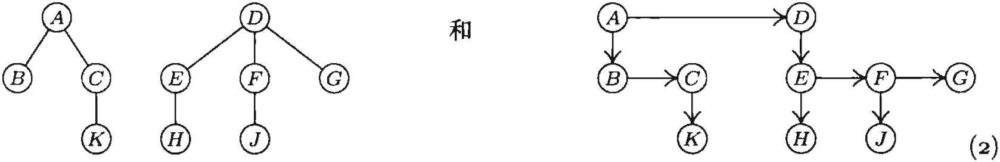
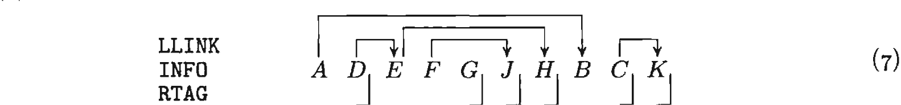
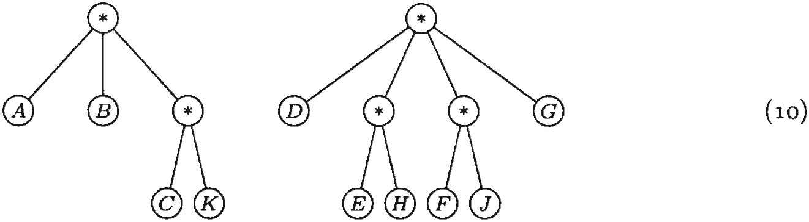
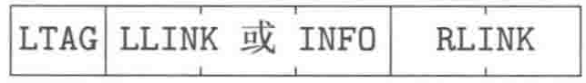
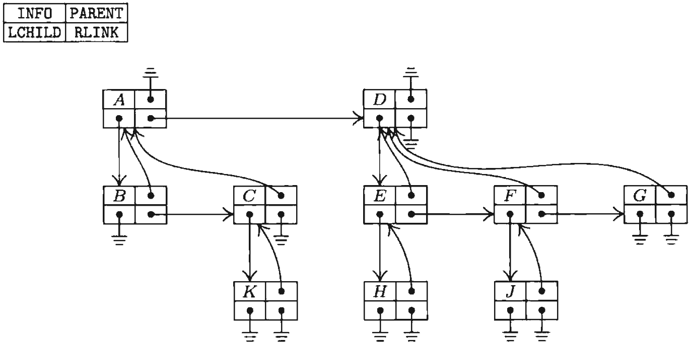
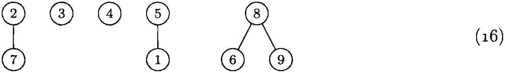
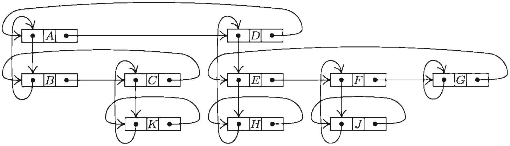
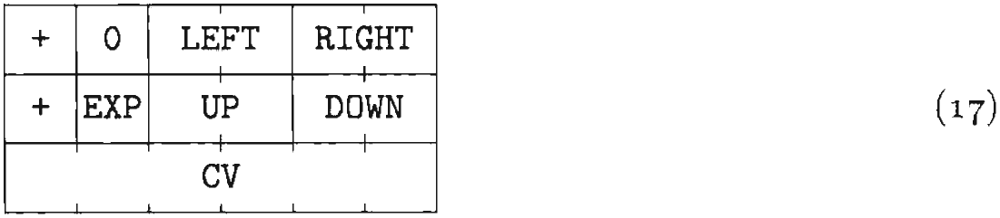
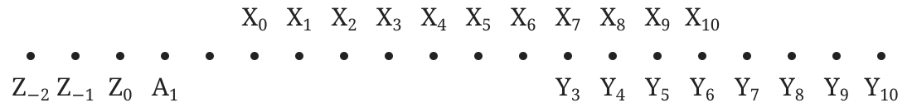

# 2.3.3 树的其他表示

除了上一节给出的 LLINK-RLINK (左子女一右兄妹) 方法外, 还有许多在计算机内表示树结构的方法. 像通常一样, 哪种表示方法最合适, 高度依赖于我们想在树上执行哪些类型的操作. 本节, 我们将考虑树的几种表示方法, 业已证明它们特别有用.

首先, 我们可以使用顺序存储技术. 与线性表的情况一样, 如果我们希望树有紧凑表示, 且在程序运行期间树的大小和形状不会剧烈变化, 这种分配模式最为合适. 在许多情况下, 我们需要在程序内引用基本不变的树结构表, 并且树在内存中的合适形式依赖于对这些表进行考察的方式.

树 (和森林) 最普通的顺序表示本质上对应于省略 LLINK 字段, 代之以连续寻址. 例如, 让我们再次观察上一节考虑的森林

$$
(A(B,C(K)),\,D(E(H),F(J),G))
\qquad \text{(1)}
$$

其树图如下

先序顺序表示的结点以先序出现, 每个节点具有 INFO、RLINK 和 LTAG 字段:

这里, 非空的 RLINK 用箭头指示, 而 LTAG=1 (对于终端结点) 用 “]” 指示. LLINK 不再需要, 因为它或者为空, 或者将指向序列中的下一项. 把 (1) 与 (3) 进行比较是有益的.

这种表示有一些有趣的性质. 首先, 一个结点的所有子树都紧接着该结点后边出现, 使得原森林中的所有子树都出现在连续的块中. [把这与 (1) 和 [图20](./sec-2-3.md#fig-2-20) (b) 中的 “嵌套括号” 加以比较.] 其次, 注意 (3) 中的 RLINK 箭头绝不会彼此交叉, 在一般的二叉树中也是如此, 因为在先序下 X 与 RLINK(X) 之间的所有结点都在 X 的左子树中, 所以没有向外的箭头从树的这部分冒出. 再次, 可以看出, 指示结点是否为终端结点的字段 LTAG 是冗余的, 因为 “]” 仅出现在森林的尾部, 并恰好在每个向下指的箭头之前.

确实, 这些论述表明 RLINK 字段本身几乎也是冗余的. 为了表示该结构, 我们实际需要的只是 RTAG 和 LTAG. 因此, 有可能从更少的数据导出 (3).

随着我们自左向右扫描 (4), $\mathrm{RTAG} \neq$ “]” 的位置对应于必须填入的非空 RLINK. 每当我们扫描过一个 $\mathtt{LTAG}=\text{“}\rfloor\text{”}$ 的项, 我们就应该完成了一个尚未完成的 RLINK 的最近实例. (因此, 未完成的诸 RLINK 可以保存在一个栈中.) 我们实际上再次证明了定理 2.3.1A.

RLINK 或 LTAG 在 (3) 是冗余的, 这一事实对我们帮助不大, 甚至没有帮助, 除非我们顺序地扫描整个森林, 因为要推导出缺失的信息, 就需要附加的计算. 因此, 我们通常需要 (3) 中的所有数据. 然而, 明显存在一些被浪费的空间, 因为对于这个特定的森林, RLINK 字段的值一半以上等于Λ. 有两种常用的方法, 可利用被浪费的空间:

(1) 每个结点的 RLINK 填上该结点下的子树之后的地址. 此时, 该字段常称作 “SCOPE”, 而不是 RLINK, 因为它指出每个结点的 “影响” (子孙) 的右边界. 替代 (3), 我们将有

诸箭头仍然相互不交叉. 此外, LTAG(X)=“” 被条件 SCOPE(X)=X+c 刻画, 其中 $c$ 是每个结点的字数. 使用 SCOPE 思想的一个例子见习题 2.4-12.

(2) 通过取消 RLINK 字段来缩小每个结点, 并在先前具有非空 RLINK 的结点前增加特殊的 “链” 结点:

这里, “\*” 指示特殊的链结点, 其 INF0 字段以某种方式把它们刻画为箭头所示的链. 如果 (3) 的 INFO 和 RLINK 字段大致占据相同数量的空间, 则 (6) 占用较少的内存, 因为 “\*” 结点数总是少于非 “\*” 结点数. 表示 (6) 有点类似于像 MIX 那样的一地址计算机的指令序列, “\*” 结点对应于条件转移指令.

如果忽略 RLINK 而不是 LLINK, 可以设计另一种类似于 (3) 的顺序表示. 在这种情况下, 我们按一种新的序来列出森林的结点. 这种序可以称作家族序 (familyorder), 因为每个家族的成员一起出现. 任意森林的家族序可以递归地定义如下:

访问第一棵树的根;

遍历其余的树 (按家族序);

遍历第一棵树的根的诸子树 (按家族序).

(把这个定义与前一节的先序和后序的定义进行比较. 家族序等价于对应的二叉树中的后序的逆.)

树 (2) 的家族序顺序表示为:

在这种情况下, RTAG 字段用来为家族划界. 家族序首先列出森林中所有树的根, 然后接连选择所在家族尚未列出的、最近出现的结点的家族, 继续列出每个家族. 其结果是诸 LLINK 箭头绝对不会交叉, 并且先序表示的其他性质以类似的方式继续成立.

不使用家族序, 我们也可以简单地自左向右、每次一层列出所有的结点. 这称作 “层次序”(level order)[见杰拉德·索尔顿, CACM5, (1962), 103-114], 而 (2) 的层次序顺序表示为:

这就像 (7), 但是家族按先进先出, 而不是按后进先出方式选择. 无论 (7) 还是 (8), 都可以看作线性表关于树的自然推广.

读者将容易看出如何设计遍历和分析如上顺序表示的树, 因为诸 LLINK 和 RLINK 信息基本上都是可以利用的, 仿佛树结构是完全链接的一样.

另一种顺序方法称作带度数的后序 (postoderwithdegrees), 它多少有点不同于以上技术. 我们按后序列出诸结点, 并给出每个结点的度数而不是链:

$$
\begin{array}{c|cccccccccc}\mathtt{DEGREE}&0&0&1&2&0&1&0&1&0&3\\\mathtt{INFO}&B&K&C&A&H&E&J&F&G&D\end{array}
\qquad \text{(9)}
$$

习题 2.3.2-10 证明这足以刻画树结构. 这种序用于 “自底向上” 计算定义在树结点上的函数, 如下面的算法所示.

算法 F (计算局部定义于树中的函数). 假设 $f$ 是树的诸结点上的函数, 使得 $f$ 在树结点 $x$ 上的值仅依赖于 $x$ 和 $f$ 在 $x$ 的子女上的值. 下面的算法使用一个辅助栈, 在非空森林的每个结点上计算 $f$.

F1.[初始化.] 设置空栈, 并令 P 指向森林在后序下的第一个结点.

F2. [计算 $f$. ] 置 $d\leftarrow\mathtt{DEGREE}(\mathtt P)$. (第一次到达这一步 $d$ 将为零. 一般地, 当我们到达这一步时总有: 从栈顶向下的前 $d$ 个项为 $f ( x _ { d } ) , \ldots , \: f ( x _ { 1 } )$, 其中 $x _ { 1 } , \ldots , x _ { d }$ 是 NODE(P) 的自左向右的子女.) 使用由栈顶得到的 $f ( x _ { d } ) , \ldots , f ( x _ { 1 } )$ 的值, 计算 $f$(NODE(P)).

F3.[更新栈.] 移走栈顶的 $d$ 个项; 然后把 $f$(NODE(P)) 的值放到栈顶.

F4.[前进.] 如果 P 是后序下的最后一个结点, 则算法终止. (于是, 从栈顶到栈底, 栈将包含 $f \bigl ( \operatorname { r o o t } ( \widetilde { T _ { m } } ) \bigr ) , \: \ldots , \: f \bigl ( \operatorname { r o o t } ( T _ { 1 } ) \bigr )$, 其中 $T _ { 1 } , \; \ldots , \; T _ { m }$ 都是给定森林的树.) 否则, 置 P 为它在后序下的后继 (在表示 (9) 中, 这将简单地用 P←P+c 实现), 并返回步骤 F2.

算法 F 的正确性可以对树的大小归纳证明 (见习题 16). 该算法与上一节的微分算法 2.3.2D 有着惊人的相似性, 它计算一个类型密切相关的函数, 见习题 3. 许多解释程序在涉及后缀表示的算术表达式求值时都使用了类似的思想, 我们将在第 8 章继续讨论这一主题. 习题 17 给出了另一个类似于算法 F 的重要过程.

至此, 我们已经看到了树和森林的各种顺序表示. 下面考虑链接形式的表示.

第一种想法与 (3) 到 (6) 的变换有关: 我们从所有非终端结点删去 INF0 字段, 并把这一信息作为新的终端结点放在原结点的下面. 例如, 树 (2) 将变成

这种新形式表明, (不失一般性) 我们可以假定树结构中的所有 INFO 都出现在它的终端结点. 因此, 在 2.3.2 节的自然的二叉树表示中, LLINK 和 INFO 字段是互斥的, 可以共用每个结点中的同一字段. 结点可能具有如下字段

其中, 符号 LTAG 指示第二个字段是否是链. (把这种表示与 2.3.2 节中 (10) 的两字格式进行比较.) 把 INF0 从 5 个字节削减到 3 个字节之后, 每个结点可放进一个字中. 然而, 注意现在有 15 个结点, 不是 10 个结点. 森林 (10) 占 15 个字的内存, 而 (2) 占 20 个字; 但是后者有 50 个字的 INFO, 而前者只有 30 个字的 INFO. 除非过多的 INFO 空间将被浪费掉, 否则 (10) 在内存空间上并未获得实际的收益. (10) 中删去了一些 LLINK, 代价是新结点中增加了大约相同数目的 RLINK. 这两种表示之间的详细差别见习题 4.

在树的标准二叉树表示中, LLINK 字段可以更准确地称作 LCHILD (最左子女) 字段, 因为它从父母结点指向其最左子女. 最左子女通常是树的子女中 “最年轻” 的, 因为把一个结点插入到一个家族的左边比插入到右边容易, 因此 LCHILD 也可以看作 “最后一个子女” 或 “最小子女” 的缩写[^cn296-1].

树结构的许多应用都需要相当频繁地在树中向上和向下访问. 线索树可以向上访问, 但速度不快. 有时如果在每个结点中有第三个链 PARENT, 则效果更好. 这就是三重链接树 (triply

*图 26　三重链接树*

linkedtree), 其中每个结点有三个链 LCHILD、RLINK 和 PARENT. [图26](#fig-2-26) 显示了 (2) 的三重链接树表示. 三重链接树应用实例见 2.4 节.

显然, PARENT 链本身就足以完全确定任何定向树 (或森林). 因为如果知道所有向上的链, 就能绘制这种树的图示. 除根结点外, 每个结点恰有一个父母, 但可能有多个子女, 因此, 给出向上的链比给出向下的链简单. 为什么我们之前讨论时没有考虑向上的链? 当然是因为在大部分情况下, 只有向上的链并不够, 很难迅速判断一个结点是否是终端结点, 或者迅速地对结点的子女定位, 等等. 然而, 有一种重要的应用仅用向上的链就足够了. 现在, 我们开始简略研究由迈克尔·费希尔和伯纳德·加勒提出的处理等价关系的优雅算法.

一个等价关系 “” 是一个对象集 S 的元素之间的关系, 对于任意对象 $x$、$y$ 和 $z$ (不必是不同的), 满足如下三个性质.

(i) 如果 $\tilde{x} \equiv y$ 并且 ${ { y } } \equiv { { z } } ,$ 则 $x \equiv z .$ (传递性)

(ii) 如果 $x \equiv  y$, 则 $y \equiv  x$. (对称性)

(iii) $x \equiv x .$ (自反性)

(把这个定义与 2.2.3 节的偏序关系定义进行比较, 尽管定义中的三个性质中有两个相同, 但是等价关系与偏序关系很不相同.) 等价关系的例子有: 关系“=”, 整数的同余 (模 $m$) 关系, 2.3.1 节中定义的树的相似关系, 等等.

等价性问题是: 读入诸等价元素对, 然后基于这些给定的等价对, 确定能否证明两个具体的元素是否等价. 例如, 假设 S 是集合{1,2,3,4,5,6,7,8,9}, 并假设给定如下等价对

$$
1\equiv5,\quad6\equiv8,\quad7\equiv2,\quad9\equiv8,\quad3\equiv7,\quad4\equiv2,\quad9\equiv3.
\qquad \text{(11)}
$$

由此推出, 例如, $2 \equiv 6$, 因为 $2 \equiv 7 \equiv 3 \equiv 9 \equiv 8 \equiv 6.$ 但是, 我们不可能证明 $1\equiv6$. 事实上, (11) 中的诸对把 S 划分成两个类

$$
\{1,5\}\qquad\text{和}\qquad\{2,3,4,6,7,8,9\},
\qquad \text{(12)}
$$

使得两个元素等价, 当且仅当它们属于相同的类. 不难证明, 任何等价关系都把它的集合划分成不相交的类 (称作等价类), 使得两个元素等价, 当且仅当它们属于相同的类.

因此, 等价类问题的解无非是搞清楚像 (12) 那样的等价类. 我们可以从每个元素自成一类开始, 即

$$
\{1\}\ \{2\}\ \{3\}\ \{4\}\ \{5\}\ \{6\}\ \{7\}\ \{8\}\ \{9\}.
\qquad \text{(13)}
$$

现在, 倘若已知关系 $1\equiv 5$, 我们就把{1,5}一起放到一个类. 处理完前三个关系 $1 \equiv 5,   6 \equiv 8$ $7\equiv 2$ 之后, (13) 变为

$$
\{1,5\}\quad\{2,7\}\quad\{3\}\quad\{4\}\quad\{6,8\}\quad\{9\}.
\qquad \text{(14)}
$$

然后, 根据 $9\equiv 8$ 把{6,8,9}放在一起, 等等.

现在, 问题是找到一个好方法, 在计算机内部表示像 (12) (13) (14) 这样的情况, 使得我们可以高效地进行合并不同的类和检查两个给定元素是否在同一个类的操作. 下面的算法为此目的使用定向树结构: S 的元素是定向森林的结点; 而根据迄今为止读入的等价对, 两个结点是等价的, 当且仅当它们属于同一棵树. 这种检测容易实现, 因为两个元素在同一棵树中, 当且仅当它们在相同的根元素之下. 此外, 只要把一棵树作为另一树根的新子树加入到另一棵树, 就可以轻松把两棵定向树合并到一起.

算法 E (处理等价关系). 设 S 为数的集合 $\{ 1 , 2 , \ldots , n \}$, 并设 PARENT[1], PARENT[2], ...,PARENT[$n$] 为整型变量. 这个算法输入像 (11) 那样的关系集合, 并修改 PARENT 表, 以表示定向树的集合, 使得两个元素按照给定诸关系等价, 当且仅当它们属于同一棵树. (注意: 在更一般的情况下, S 的元素为符号名, 而不是简单的 1 到 $n$ 中的数, 于是第 6 章中的搜索程序将用来定位对应于 S 的元素的结点, 而 PARENT 将是每个结点中的一个字段. 对于这种更一般情况的修改也很明显.)

E1.[初始化.] 对于 $1 \leq k \leq n$, 置 PARENT[$k$]←0. (这意味着, 所有的树初始都仅由根组成, 像 (13) 那样.)

E2.[输入新对.] 从输入得到下一个等价元素对 $\text{" } j \equiv k  \text{" }$. 如果输入耗尽, 则算法终止.

E3.[找根.] 如果 PARENT[$j$]>0, 则置 $j\leftarrow\mathtt{PARENT}[j]$, 并重复此步骤. 如果 $\mathtt { P A R E N T } \left[ k \right] > 0$ 则置 $k$←PARENT[$k$], 并重复此步骤. (这一操作之后, $j$ 和 $k$ 已经移到将使其等价的两棵树的根. 输入 $j \equiv k$ 是冗余的, 当且仅当现在有 $j=k$.)

E4.[合并树.] 如果 $j \neq k$, 则 PARENT [$j$]← $k$. 转回步骤 E2.

读者应该在输入 (11) 上试试这个算法. 在处理 $1\equiv 5$, $6\equiv 8$, $7\equiv 2$ 和 $9\equiv 8$ 之后, 我们将有

$$
\begin{array}{rccccccccc}\mathtt{PARENT}[k]:&5&0&0&0&0&8&2&0&8\\k:&1&2&3&4&5&6&7&8&9\end{array}
\qquad \text{(15)}
$$

这代表树

此后, (11) 中剩下的关系更为有趣, 见习题 9.

等价性问题出现在许多应用中. 在 7.4.1 节研究图的连通性时, 我们将讨论算法 E 的重大改进. 习题 11 讨论这一问题的更一般形式, 编译程序以此处理诸如 FORTRAN 这样的语言中的 “等价声明”.

还有其他方法在计算机内存中表示树. 回忆一下, 2.2 节讨论了表示线性表的三种主要方法: 终端链用Λ的直线表示, 循环链表和双链表. 2.3.1 节介绍的非线索二叉树表示对应于 LLINK 和 RLINK 两个方向上的直线表示. 独立地在 LLINK 和 RLINK 方向上使用这三种方法, 可以得到其他 8 种二叉树表示. 例如, [图27](#fig-2-27) 显示两个方向都使用环链的结果. 如果像该图这样, 从头到尾使用环链, 就得到所谓的环结构 (ringstructure). 业已证明, 在许多应用中, 环结构十分

*图 27　一个环结构*

灵活. 照例, 哪种表示方法合适, 取决于操作这些结构的算法所需要的插入、删除和遍历类型.  
读者如果考察过本章迄今为止提供的例子, 应该不难理解如何处理这些内存表示.

我们用一个例子结束本节. 该例把修改后的双链环结构用于一个我们先前考虑过的问题: 多项式算术. 给定两个用循环表表示的多项式, 算法 2.2.4A 把一个多项式加到另一个上, 2.2.4 节的各种其他算法还给出了多项式上的其他操作. 然而, 当时讨论的多项式最多只有三个变量. 当涉及多变量的多项式时, 通常是用树结构比线性表更合适.

一个多项式或者是常量, 或者具有如下形式:

$$
\sum _ { 0 \leq j \leq n } g _ { j } x ^ { e _ { j } } \: ,
$$

其中, $x$ 是变量, $n > 0,   0 = e_0 < e_1 < \cdots < e_n$, 而 $g _ { 0 } , \ldots , g _ { n }$ 都是多项式, 只涉及字母次序下小于 $x$ 的变量; $g _ { 1 } , \ldots , g _ { n }$ 均非零. 由多项式的这个递归定义, 可得如 [图28](#fig-2-28) 所示的树表示. 结点具有 6 个字段, 可以放入 MIX 的 3 个字中:

这里, LEFT、RIGHT、UP 和 DOWN 都是链, EXP 是代表指数的整数, CV 或者是常量 (系数), 或者是变量的字符名. 根结点有 UP=Λ, EXP=0, $\mathrm{LEFT} = \mathrm{RIGHT} = *$ (自身).

下面的算法解释在这样的 4 路链接树中如何遍历、插入和删除, 因此值得仔细研究.

算法 A (多项式加法). 这个算法把多项式 (P) 加到多项式 (Q), 假定 P 和 Q 都是指针变量, 链接到具有 [图28](#fig-2-28) 所示形式的不同多项式树的根. 算法结束时, 多项式 (P) 不变, 而多项式 (Q) 将包含和.

A1.[检测多项式的类型,] 如果 DOWN(P)=Λ(即如果 P 指向一个常量), 则置 $\mathtt Q\leftarrow\mathtt{DOWN}(\mathtt Q)$ 零次或多次, 直到 DOWN(Q)=Λ, 并转到 A3. 如果 DOWN $( P ) \neq \Lambda$, 则如果 $\mathtt{DOWN}(\mathtt Q)=\Lambda$ 或 $\mathrm{CV}(\mathrm{Q}) < \mathrm{CV}(\mathrm{P})$, 则转到 A2. 否则, 如果 $\mathtt{CV}(\mathtt Q)=\mathtt{CV}(\mathtt P)$, 则置 $\mathtt P\leftarrow\mathtt{DOWN}(\mathtt P)$, $\mathtt Q\leftarrow\mathtt{DOWN}(\mathtt Q)$, 并重复这一步骤; 如果 $\mathrm{CV}(\mathrm{Q})>\mathrm{CV}(\mathrm{P})$, 则置 $\mathtt Q\leftarrow\mathtt{DOWN}(\mathtt Q)$, 并重复这一步骤. (步骤 A1 或者找到两个多项式的匹配项, 或者确定必须把一个新变量插入到多项式 (Q) 的当前部分.)

A2. [向下插入. ] 置 $\mathtt R\Leftarrow\mathtt{AVAIL},\quad\mathtt S\leftarrow\mathtt{DOWN}(\mathtt Q)$. 如果 $\mathtt S\ne\Lambda$, 则置 $\mathtt{UP}(\mathtt S)\leftarrow\mathtt R,\quad\mathtt S\leftarrow\mathtt{RIGHT}(\mathtt S)$, 并且如果 $\mathrm{EXP}(\mathrm{S}) \neq 0$, 则重复这一操作, 直到最终 $\mathrm{EXP}(\mathrm{S}) = 0.$ 置 UP(R) ← Q, DOWN(R) ← DOWN(Q), LEFT(R) ← R, RIGHT(R) ← R, CV(R) ← CV(Q), EXP(R)← 0. 最后, 置 $\mathtt{CV}(\mathtt Q)\leftarrow\mathtt{CV}(\mathtt P)$, DOWN(Q)←R, 并返回到 A1. (我们在 NODE(Q)

*图 28　使用 4 个方向链接的多项式表示. 结点的阴影部分表示与所考虑问题不相关的信息*

之下插入了一个 “哑” 零多项式, 以便与在 P 的树中找到的对应多项式相匹配. 这一步所做的链操作是直截了当的, 很容易用 2.2.3 节介绍的 “前后对比” 图推导出.)

A3.[找到匹配. \](此时, P 和 Q 指向给定多项式的对应项, 因此加法已经准备就绪.) 置 CV(Q) ← CV(Q)+CV(P). 如果该和为零且 $\mathrm{EXP}(Q) \neq 0$, 则转倒步骤 A8. 如果 EXP(Q) = 0, 则转到 A7.

A4.[向左推进. \](在成功地加上一项之后, 我们找下一个待加项.) 置 P←LEFT(P). 如果 EXP(P)=0, 则转到 A6; 否则, 置 $\mathtt Q\leftarrow\mathtt{LEFT}(\mathtt Q)$ 一次或多次, 直到 $\mathrm{EXP}(\mathbb{Q}) \leq \mathrm{EXP}(\mathbb{P})$ 如果这时有 $\mathrm{EXP}(\mathbb{Q}) = \mathrm{EXP}(\mathbb{P})$, 则返回步骤 A1.

A5.[插到右边.] 置 $\mathtt R\Leftarrow\mathtt{AVAIL}$. 置 $\mathtt{UP}(\mathtt R)\leftarrow\mathtt{UP}(\mathtt Q),\ \mathtt{DOWN}(\mathtt R)\leftarrow\Lambda,\ \mathtt{CV}(\mathtt R)\leftarrow0,\ \mathtt{LEFT}(\mathtt R)\leftarrow\mathtt Q$, RIGHT(R) ← RIGHT(Q), LEFT(RIGHT(R)) ← R, RIGHT(Q) ← R, EXP(R) ← EXP(P), Q←R. 返回步骤 A1. (我们需要在当前行中 NODE(Q) 的右边插入一个新项, 以便匹配 多项式 (P) 中对应的指数. 与步骤 A2 中一样, “前后对比” 图使得该操作一目了然.)

A6.[返回向上. \](现在, 多项式 (P) 的一行已经完全遍历.) 置 P←UP(P).

A7.[向上移动 Q 到正确的层.] 如果 UP(P)=Λ, 则转到 A11; 否则置 Q←UP(Q) 零次或多次直到 $\mathtt{CV}(\mathtt{UP}(\mathtt Q))=\mathtt{CV}(\mathtt{UP}(\mathtt P))$. 返回到步骤 A4.

A8. [删除零项. ] 置 R ← Q,Q ← RIGHT(R), S ← LEFT(R), LEFT(Q) ← S,RIGHT(S)← Q,AVAIL⇐R. (出现消去, 因此多项式 (Q) 的一个行元素被删除.) 现在, 如果 EXP(LEFT(P))=0, 并且 Q=S, 则转到 A9; 否则返回 A4.

A9.[删除常数多项式. \](消去导致多项式归约成常量, 因此删除多项式 (Q) 的一行.) 置 R←Q, Q← UP(Q), DOWN(Q) ← DOWN(R), CV(Q) ← CV(R), AVAIL ⇐ R. 置 S ← DOWN(Q); 如果 $\mathbb { S } \neq \Lambda$, 则置 UP(S)←Q,S←RIGHT(S), 并且如果 $\mathrm{EXP}(S) \neq 0$, 则重复这一操作, 直到 EXP(S) = 0.

A10. 检测到零?] 如果 DOWN(Q)=Λ,CV(Q)=0, 并且 $\mathrm{EXP}(Q) \neq 0$, 则置 P←UP(P), 并转到 A8; 否则转到 A6.

A11.[终止.] 置 Q←UP(Q) 零次或多次, 直到 UP(Q)=Λ(把 Q 带到树根).

如果多项式 (P) 的项不多, 而多项式 (Q) 有许多项, 则这个算法的运行实际比算法 2.2.4A 快得多, 因为在做加法时不必扫描整个多项式 (Q). 读者最好尝试手工模拟算法 A, 把多项式 $xy - x^{2} - xyz - z^{3} + 3xz^{3}$ 加到 [图28](#fig-2-28) 所示的多项式上. (这种情况并未展示算法的高效性, 但它要执行算法的所有步骤, 展示必须处理的困难情况.) 关于算法 A 的进一步说明, 见习题 12 和 13.

这里, 我们并未声称对于多变量的多项式, [图28](#fig-2-28) 所示的表示是 “最好的”. 在第 8 章, 我们将考虑多项式表示的另一种形式, 以及使用一个辅助栈的算术算法. 与算法 A 相比, 它具有概念简单的显著优点. 我们对算法 A 的主要兴趣是它在具有多链的树上操作的方式.

#### 习题

1\. [20] [答案](./answers/2-3-3.md#ans-2-3-3-1) 如果在像 (8) 那样的层次序顺序表示中, 只有 LTAG、INFO 和 RTAG 字段 (没有 LLINK), 那么有无可能重构诸 LLINK? (换言之, 是否像 RLINK 在 (3) 中那样, LLINK 在 (8) 中是冗余的?)

2\. [22] [答案](./answers/2-3-3.md#ans-2-3-3-2) (亚瑟·伯克斯、唐·沃伦和杰西·怀特, Math.Comp.8(1954), 53-57) 树 (2) 按带度的先序存放为

DEGREE 2 0 1 0 3 1 0 1 0 0 INFO A B C K D E H F J G

[与使用后序的 (9) 比较.] 设计一个类似于算法 F 的算法, 在这种表示中从右到左, 计算结点的局部定义的函数.

3\. [24] [答案](./answers/2-3-3.md#ans-2-3-3-3) 修改算法 2.3.2D, 使得它按照算法 F 的思想, 把它计算的导数作为中间结果放入栈中, 而不是像步骤 D3 那样, 用不规则的方式记录它们的位置. (见习题 exercise2.3.2-21.) 可以使用每个导数的根中的 RLINK 字段维护这个栈.

4\. [18] [答案](./answers/2-3-3.md#ans-2-3-3-4) (2) 中诸树包含 10 个结点, 其中 5 个是终端结点. 这些树按通常的二叉树形式表示, 用到 10 个 LLINK 字段和 10 个 RLINK 字段 (每个结点一个); 按形式 (10) 表示, 需要 5 个 LLINK 字段和 15 个 RLINK 字段, 其中 LLINK 和 INFO 共享结点内的相同空间. 在两种情况下, 都有 10 个 INFO 字段.

给定具有 $n$ 个结点的森林, 其中 $m$ 个结点是终端结点, 比较使用两种树表示方法必须存放的 LLINK 和 RLINK 总数目.

5\. [16] [答案](./answers/2-3-3.md#ans-2-3-3-5) 如 [图26](#fig-2-26) 所示, 三重链接树的每个结点包含 PARENT、LCHILD 和 RLINK 字段; 当这些字段中没有合适的结点引用时, 可以自由使用Λ链. 像 2.3.1 节那样, 把 “线索” 链放在空 LCHILD 和 PARENT 字段, 把这种表示扩充为线索树, 这样做合适吗?

6\. [答案](./answers/2-3-3.md#ans-2-3-3-6) [24 假设定向森林的结点有三个链字段 PARENT、LCHILD 和 RLINK, 只有 PARENT 用来指示树结构. 每个结点的 LCHILD 字段均为Λ, 而 RLINK 字段被设置为线性表, 简单地按某种序把结点链接在一起. 链变量 FIRST 指向该线性表的第一个结点, 而最后一个结点的 RLINK=Λ.

设计一个算法, 它遍访这些结点, 并填入与 PARENT 链相容的 LCHILD 和 RLINK 字段, 使得我们得到像 [图26](#fig-2-26) 那样的三重链接的树表示. 此外, 重新设置 FIRST, 使它指向这种表示下的第一棵树的根.

7\. [15] [答案](./answers/2-3-3.md#ans-2-3-3-7) 如果在 (11) 中未给定关系 $9\equiv 3$, 那么 (12) 中将出现什么类?

8\. [15] [答案](./answers/2-3-3.md#ans-2-3-3-8)  算法 E 建立了一个树结构, 表示给定的等价元素对, 但是正文中并未明确提到如何使用算法 E 的结果. 假定 $1 \leq j \leq n , 1 \leq k \leq n$, 并且算法 E 已经对某个等价集建立了 PARENT 表, 设计一个算法, 它回答问题: “$j\equiv k$ 成立吗?”

9\. [20] [答案](./answers/2-3-3.md#ans-2-3-3-9) 给出一个类似于 (15) 的表和一个类似于 (16) 的图, 显示算法 E 自左向右处理完 (11) 中所有的等价对之后的树.

10\. [28] [答案](./answers/2-3-3.md#ans-2-3-3-10) 在最坏情况下, 算法 E 处理 $n$ 个等价对可能需要 $\mathcal { O } ( n ^ { 2 } )$ 步. 说明如何修改该算法, 使得最坏情况不至于这么糟.

11\. [24] [答案](./answers/2-3-3.md#ans-2-3-3-11) (等价说明) 许多编译语言, 特别是 FORTRAN, 都提供了用于分配顺序存储表占用重叠内存单元的机制. 程序员向编译程序提供一系列形如 X[$j$]Y[$k$] 的关系, 这意味着对于所有的 $s$, 变量 $\mathbb{X}[j+s]$ 被分配到与变量 Y[k+s] 相同的位置. 程序员还对每个变量都指定了下标的允许范围: $\text{" } ARRAY X[l:u] \text{" }$ 意味着在内存为表项 $x$[l],X[l+1],...,X[$u$] 预留空间. 编译程序为每个变量等价类保留一段连续内存块, 这块内存要足以容纳这些变量允许的下标值对应的所有表项, 同时应当尽可能小.

例如, 假设有 ARRAYX[0:10],ARRAYY[3:10],ARRAYA[1:1] 和 ARRAY Z[-2:0], 以及等价关系 $\mathtt X[7]\equiv\mathtt Y[3],\quad\mathtt Z[0]\equiv\mathtt A[0]$ 和 Y[1]A[8]. 我们必须为这些变量预留 20 个连续位置

(A[1] 之后的位置不是任何变量允许的下标值, 但是无论如何它必须保留.)

这个习题的目标是: 修改算法 E, 使得它可以用于刚才所述的更一般的情况. 假设我们正在为这样的语言写一个编译程序, 并且对于每个数组, 编译程序内部的表都有一个对应结点, 包含字段 NAME、PARENT、DELTA、LBD 和 UBD. 假设编译程序已经事先处理了所有的数组声明, 使得一旦数组 ARRAYX[l: $u$] 出现, 并且 P 指向 X 的结点, 则

$$
\mathtt{NAME}(\mathtt P)=\text{“X”},\quad\mathtt{PARENT}(\mathtt P)=\Lambda,\quad\mathtt{DELTA}(\mathtt P)=0,
$$

$$
\mathtt{LBD}(\mathtt P)=l,\qquad\mathtt{UBD}(\mathtt P)=u.
$$

问题是设计一个处理等价说明的算法, 使得算法执行之后PARENT(P) =Λ意味着位置 X[LBD(P)],...,X[UBD(P)] 要在内存为这个等价类保留;

$\mathtt { P A R E N T ( P ) = Q \neq \Lambda }$ 意味着位置 X[$k$] 等于位置 Y[$k$+DELTA(P)], 其中 $\mathtt{NAME}(\mathtt Q)=\text{“Y”}$ 例如, 在上面列出的等价关系之前, 我们有结点

|  |  |  |  |  |  |
| --- | --- | --- | --- | --- | --- |
| P | NAME(P) | PARENT(P) | DELTA(P) | LBD(P) | UBD(P) |
| α | x | Λ | 0 | 0 | 10 |
| β | Y | Λ | 0 | 3 | 10 |
| γ | A | Λ | 0 | 1 | 1 |
| δ | Z | Λ | 0 | -2 | 0 |

这些等价关系处理完之后, 这些结点变成

|  |  |  |  |  |  |
| --- | --- | --- | --- | --- | --- |
| α | X | Λ | * | -5 | 14 |
| β | Y | α | 4 | * | * |
| γ | A | δ | 0 | * | * |
| δ | Z | α | -3 | * | * |

$(\text{“}\ast\text{”}$ 代表无关信息.)

设计一个算法, 进行这种变换. 假设算法的输入具有格式 (P, $j$, Q, $k$), 表示 $\mathbb{X}[j] \equiv \mathbb{Y}[k]$, 其中 $\mathtt{NAME}(\mathtt P)=\text{“X”},\quad\mathtt{NAME}(\mathtt Q)=\text{“Y”}$ 务必检查诸等价关系是否相互矛盾. 例如, X[1]Y[2] 与 X[2]≡Y[1] 相互矛盾.

12\. [21] [答案](./answers/2-3-3.md#ans-2-3-3-12) 在算法 A 的开始, 变量 P 和 Q 分别指向两棵树的根. 设 $\mathrm{P}_{0}$ 和 $\mathbb { Q } _ { 0 }$ 表示算法执行前 P 和 Q 的值. (a) 算法终止后, $\mathbb { Q } _ { 0 }$ 总是两个给定的多项式之和的根的地址吗? (b) 算法终止后, P 和 Q 都恢复为它们原来的值 $P _{0}$ 和 $\mathbb { Q } _ { 0 }$ 吗?

▶ 13. [M29] [答案](./answers/2-3-3.md#ans-2-3-3-13) 给出下列结论的非形式化证明: 在算法 A 的步骤 A8 开始时, 我们总是有 $\mathrm{EXP}(\mathbb{P}) = \mathrm{EXP}(\mathbb{Q})$ 和 $\mathtt{CV}(\mathtt{UP}(\mathtt P))=\mathtt{CV}(\mathtt{UP}(\mathtt Q))$. (对于真正理解该算法, 这一事实非常重要.)

14\. [40] [答案](./answers/2-3-3.md#ans-2-3-3-14) 给出算法 A 的正确性的形式化证明 (或反证).

15\. [40] [答案](./answers/2-3-3.md#ans-2-3-3-15) 设计一个算法, 计算如 [图28](#fig-2-28) 所示的两个多项式的乘积.

16\. [M24] [答案](./answers/2-3-3.md#ans-2-3-3-16) 证明算法 F 的正确性.

17\. [25] [答案](./answers/2-3-3.md#ans-2-3-3-17) 昇法 F 对一个 “目底向上” 局部定义的函数求值, 这种函数在一个结点上求值之前, 先在该结点的子女上求值. 一个 “自顶向下” 局部定义的函数 $f$ 则相反, $f$ 在结点 $x$ 上的值仅依赖于 $x$ 和 $f$ 在 $x$ 的父母上的值. 设计一个类似于算法 F 的算法, 它使用一个辅助栈, 计算 “自顶向下” 函数 $f$ 在树的每个结点上的值. (像算法 F 一样, 你的算法应该能够高效处理像 (9) 那样带度数按后序存放的树.)

▶ 18. [28] [答案](./answers/2-3-3.md#ans-2-3-3-18) 给定两个表 INF01[$j$] 和 RLINK[$j$] $( 1 \leq j \leq n )$, 对应于先序顺序表示. 设计一个算法, 形成两个表 INF02[$j$] 和 DEGREE[$j$] $( 1 \leq j \leq n )$, 对应于带度的后序表示. 例如, 根据 (3) 和 (9), 你的算法应该把

|  |  |  |  |  |  |  |  |  |  |  |
| --- | --- | --- | --- | --- | --- | --- | --- | --- | --- | --- |
| j | 1 | 2 | 3 | 4 | 5 | 6 | 7 | 8 | 9 | 10 |
| INF01[j] | A | B | C | K | D | E | H | F | J | G |
| RLINK[j] | 5 | 3 | 0 | 0 | 0 | 8 | 0 | 10 | 0 | 0 |
| 变换为 |  |  |  |  |  |  |  |  |  |  |
| INF02[j] | B | K | C | A | H | E | J | F | G | D |
| DEGREE[j] | 0 | 0 | 1 | 2 | 0 | 1 | 0 | 1 | 0 | 3 |

|  |  |  |  |  |  |  |  |  |  |  |  |
| --- | --- | --- | --- | --- | --- | --- | --- | --- | --- | --- | --- |
|  | 19. [M27] [答案](./answers/2-3-3.md#ans-2-3-3-19) 在 (5) 中可以不使用 SCOPE 链, 而是简单地按先序列出每个结点的后代个数: |  |  |  |  |  |  |  |  |  |  |
|  | DESC |  |  |  |  |  |  |  |  | 3 0 1 0 5 1 0 1 0 0 |  |
|  | INFO |  |  |  |  |  |  | A B C K D E H F J G |  |  |  |

设 $d _ { 1 } d _ { 2 } \ldots d _ { n }$ 是用这种方法得到的森林的后代数目的序列. (a) 证明: 对于 $1 \leq k \leq n , \quad k + d _ { k } \leq n$, 并且 $k \leq j \leq k + d _ { k }$ 蕴涵 $j + d _ { j } \leq k + d _ { k }$. (b) 反之, 证明: 如果 $d _ { 1 } d _ { 2 } \ldots d _ { n }$ 是满足 (a) 中条件的非负整数序列, 则它是一个森林的后代数目的序列. (c) 假设 $d _ { 1 } d _ { 2 } \ldots d _ { n }$ 和 $d _ { 1 } ^ { \prime } d _ { 2 } ^ { \prime } \ldots d _ { n } ^ { \prime }$ 是两个森林的后代数目序列. 证明: 存在第三个森林, 其后代数目序列为

$$
\operatorname* { m i n } ( d _ { 1 } , d _ { 1 } ^ { \prime } ) \operatorname* { m i n } ( d _ { 2 } , d _ { 2 } ^ { \prime } ) \ldots \operatorname* { m i n } ( d _ { n } , d _ { n } ^ { \prime } ) .
$$

[^cn296-1]: leftmost (最左)、last (最后) 和 least (最小) 均以字母 “1” 开头. ——译者注
