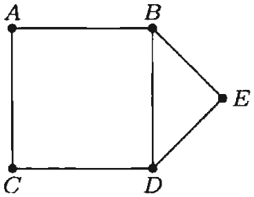
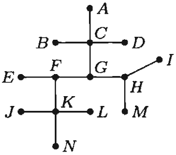
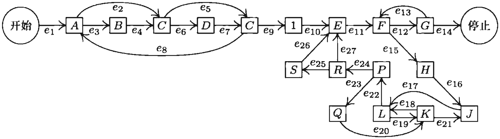
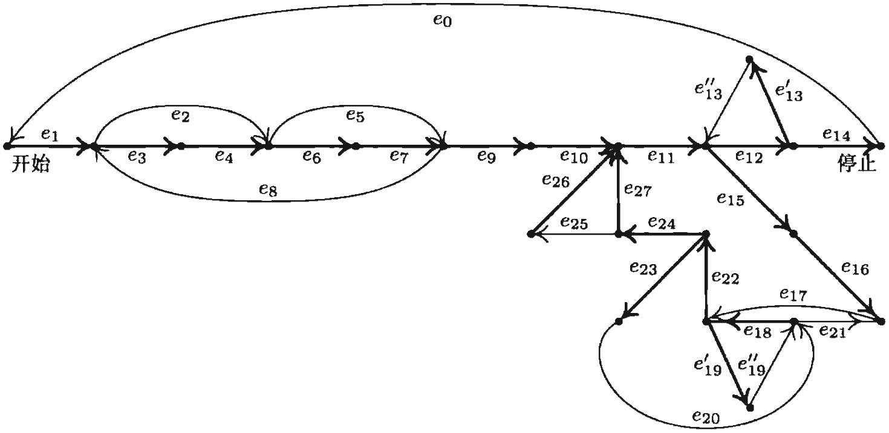
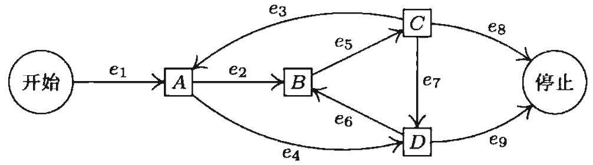
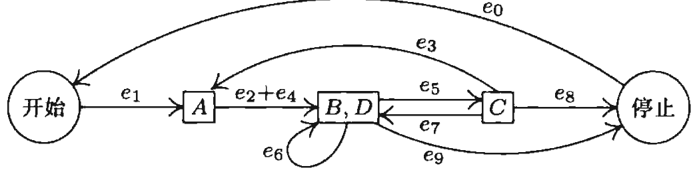
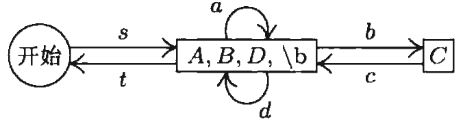
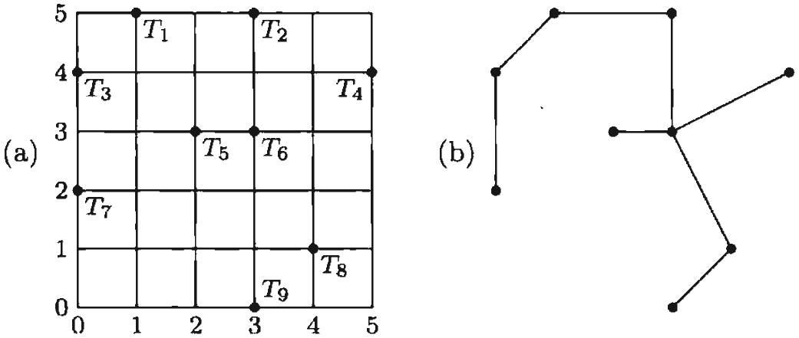

# 2.3.4.1　自由树

图 (graph) 一般地定义为一个点集 (称作顶点) 和一个连接一些不同顶点对的线集 (称作边). 连接任意一对顶点的边最多有一条. 如果存在一条连接两个顶点的边, 那么两个顶点称作相邻的 (adjacent). 如果 V 和 $V ^ { \prime }$ 是顶点, 且 $n \geq 0$, 我们说 $( V _ { 0 } , V _ { 1 } , \ldots , V _ { n } )$ (如果 $V \equiv V _ { 0 } \; )$ 是一条从 V 到 $V ^ { \prime }$ 的长度为 $n$ 的通路 (walk), $V_{k}$ 与 $V_{k + 1} \quad (0 \leq k < n)$ 相邻, 并且 $V _ { n } = V ^ { \prime } .$ 如果顶点 $V _ { 1 } , \ldots , V _ { n - 1 } , V _ { n }$ 互不相同, 该通路是一条路径 (path); 如果 $V_{0}$ 到 $V_{n = 1}$ 互不相同, $V _ { n } = V _ { 0 }$, 并且 $n \geq 3$, 它则是一个回路 (cycle). 有时, 我们不太准确地称回路为 “从一个顶点到自身的路径”. 我们常常说 “简单路径”, 旨在强调我们所指的是路径, 而不是任意的通路. 如果图的任意两个顶点之间都存在一条路径, 那么这个图是连通的 (connected).

这些定义如 [图29](#fig-2-29) 所示, 图中显示了一个具有 5 个顶点和 6 条边的连通图. 顶点 C 与 A 相邻, 但不与 B 相邻; 从 B 到 C 有两条长度为 2 的路径, 即 $( B , A , C )$ 和 $( B , D , C )$. 图中有多个回路, 包括 (B,D,E,B).

*图 29　一个图*

*图 30　一棵自由树*

自由树 (freetree) 也称为 “无根树”([图30](#fig-2-30)), 定义为无回路的连通图. 这个定义既用于无限图, 也用于有限图, 尽管对于计算机应用而言, 我们自然最关注有限树. 有许多定义自由树的等价方法, 其中一些出现在下面的著名定理中.

定理 A. 如果 G 是一个图, 则以下陈述等价:

(a)G 是自由树;

(b)G 是连通的, 但是如果删除任意一条边, 则结果图就不再连通;

(c) 如果 V 和 $V ^ { \prime }$ 是 G 的不同顶点, 则恰有一条从 V 到 $V ^ { \prime }$ 的简单路径.

另外, 如果 G 是包含 $n>0$ 个顶点的有限图, 则以下陈述也与上述定义等价:

(d) G 不包含回路, 并且有 n - 1 条边;

(e) G 是连通的, 并且有 n - 1 条边.

证明: (a) 蕴涵 (b), 因为如果删除边 $V\mathbin{\text{—}}V'$ 但图 G 仍然是连通的, 则一定存在一条长度至少为 2 的简单路径 $( V , V _ { 1 } , \ldots , V ^ { \prime } )$ (见习题 2), 于是 $( V , V _ { 1 } , \ldots , V ^ { \prime } , V )$ 是 G 中的一个回路.

(b) 蕴涵 (c), 因为至少有一条从 V 到 $V ^ { \prime }$ 的简单路径. 并且, 假如有两条这样的路径 $( V , V _ { 1 } , \ldots , V ^ { \prime } )$ 和 $( V , \overline { { V _ { 1 } ^ { \prime } } } , \ldots , \overline { { V ^ { \prime } } } )$, 则我们可以找到使得 $V_{k} \neq V_{k}^{\prime}$ 的最小的 k, 删除边 $V _ { k - 1 } - V _ { k }$ 将不会使图不连通, 因为仍然存在一条从 $V_{k - 1}$ 到 $V_{k}$ 的路径 $( V _ { k - 1 } ^ { } , V _ { k } ^ { \prime } , \ldots , V ^ { \prime } , \ldots , V _ { k } ^ { } )$ 不使用被删除的边.

(c) 蕴涵 (a), 因为如果 G 包含一个回路 $( V , V _ { 1 } , \ldots , V )$, 则存在两条从 V 到 $V _ { 1 }$ 的简单路径.

为了证明 (d) 和 (e) 也等价于 (a)(b)(c), 我们首先证明一个辅助结果: 如果 G 是任意有限图, 没有回路并且至少有一条边, 则至少有一个顶点恰好与一个其他顶点相邻. 这成立, 因为我们可以找到某个顶点 $V_1$ 和一个相邻的顶点 $V_{2}$; 对于 $k \geq 2$, $V _ { k }$ 或者与 $V_{k - 1}$ 相邻但不与其他顶点相邻, 或者与另一个顶点 $V _ { k + 1 } \neq V _ { k - 1 }$ 相邻. 由于没有回路, $V _ { 1 } , V _ { 2 } , \ldots , V _ { k + 1 }$ 一定是不同的顶点, 因而这一过程必然终止.

现在, 假定 G 是具有 $n > 1$ 个顶点的自由树, 其中 $V_{n}$ 是一个顶点, 它仅与一个其他顶点 $V _ { n = 1 }$ 相邻. 如果我们删除 $V _ { n }$ 和边 $V _ { n - 1 } \ - V _ { n }$, 则剩下的图 $G ^ { t }$ 是一棵自由树, 因为除非作为第一或最后一个元素, 否则 $V_{n}$ 不会出现在 G 的简单路径中. 这一论证证明 G 有 n—1 条边 (对 n 作归纳), 因此, (a) 蕴涵 (d).

假定 G 满足 (d), 并令 $V_{n}$ 、 $V_{n - 1}$ 和 $G ^ { \prime }$ 如上一段所述. 于是, G 是连通的, 因为 $V_{n}$ 连通到 $V_{n - 1}$, 而 $V_{n - 1}$ 连通到 $G ^ { \prime }$ 中的所有其他顶点 (对 n 做归纳). 因此, (d) 蕴涵 (e).

最后, 假定 G 满足 (e). 如果 G 包含一个回路, 则删除回路中出现的任意一条边后 G 仍然是连通的. 因此, 我们可以用这种方法继续删除边, 直到得到一个具有 n-1—k 条边并且没有回路的连通图 $G ^ { \prime } ,$ 但是, 由于 (a) 蕴涵 (d), 因此一定有 $k=0$, 即 $\widetilde { G } = \widetilde { G } ^ { \prime } .$

自由树的概念可以直接用于计算机算法分析. 在 1.3.3 节, 我们讨论过基尔霍夫第一定律在统计算法每一步骤执行次数问题上的应用, 它并不能完全确定每一步的执行次数, 但是能减少必须解释的未知量的个数. 树的理论告诉我们将剩下多少独立的未知量, 并提供一种求出它们的系统方法.

研究一个例子有助于理解下面的方法, 因此我们将一边介绍理论, 一边讲解例子. [图31](#fig-2-31) 显示了程序 1.3.3A 的抽象流程图, 1.3.3 节用基尔霍夫定律分析了该程序. [图31](#fig-2-31) 的每个方框都代表计算部分, 方框内的字母或数字使用 1.3.3 节的记号, 表示在程序的一次运行期间该计算执行的次数. 方框之间的箭头表示程序中的可能跳转. 这些箭头被标记为 $e _ { 1 } , e _ { 2 } , \ldots , e _ { 2 7 } .$ 我们的目标是找出量 $A , \: B , \: C , \: D , \: E , \: F , \: G , \: H , \: J , \: K , \: L , \: P , \: Q , \: R , \: S$ 之间被基尔霍夫定律蕴涵的所有关系, 并且希望同时能够获得对一般问题的某些洞察. (注意, [图31](#fig-2-31) 做了一些简化, 例如, C 和 E 之间的方框标记为 “1”, 而这事实上是基尔霍夫定律的推论.)

*图 31　程序 1.3.3A 的抽象的流程图*

设 $E_{j}$ 表示所研究的程序执行期间选取分支 $e _ { j }$ 的次数, 基尔霍夫定律是

$$
\text{进入方框的诸 }E\text{ 之和}=\text{方框中的值}=\text{离开方框的诸 }E\text{ 之和}.
\qquad \text{(1)}
$$

例如, 对于标记为 K 的方框, 我们有

$$
E_{19}+E_{20}=K=E_{18}+E_{21}.
\qquad \text{(2)}
$$

在下面的讨论中, 我们把 $E _ { 1 } , E _ { 2 } , \ldots , E _ { 2 7 }$ 而不是 $A , B , \ldots , S$ 看作未知量.

[图31](#fig-2-31) 中的流程图可以进一步抽象, 变成 [图32](#fig-2-32) 的图 G. 方框收缩成顶点, 而箭头 $e _ { 1 } , e _ { 2 } , \ldots$ 现在表示图的边. (严格地说, 图并不隐含边的方向, 谈及图 G 的图论性质时应该忽略箭头的方向. 然而, 正如我们稍后看到的, 应用基尔霍夫定律要用到箭头.) 为方便起见, 从 “停止” 顶点到 “开始” 顶点画了一条附加的边 $e _ { 0 }$, 以便基尔霍夫定律一致地用于该图的所有部分. [图32](#fig-2-32) 还包含对 [图31](#fig-2-31) 的一些其他稍微修改: 增加一个顶点和一条边把 $e_{13}$ 划分成两部分 $e_{13}^{\prime}$ 和 $e _ { 1 3 } ^ { \prime \prime }$ 使得图的基本定义 (没有两条边连接两个相同的顶点) 仍有效; $e_{19}$ 也以相同的方式划分. 如果顶点有回到自身的箭头, 则也要做类似的修改.

*图 32　对应于图 31 的图, 包含一棵自由子树*

[图32](#fig-2-32) 的某些边画得比较粗, 它们构成一棵自由子树, 连接所有的顶点. 总可以从流程图导出的图中找到自由子树, 因为这种图一定是连通的, 并且根据定理 A 的 (b) 部分, 如果 G 是连通的但不是自由树, 则我们可以删除某些边, 结果图仍然是连通的; 这一过程可以迭代地继续, 直到得到一棵子树. 找自由子树的另一个算法见习题 6. 事实上, 我们总可以先删去边 $e _ { 0 }$ (它从 “停止” 顶点到 “开始” 顶点), 因此可以假定 $e _ { 0 }$ 不在选取的子树中出现.

设 $G ^ { \prime }$ 是用这种方法找出的图 G 的自由子树, 并考虑 G 的不在 $G ^ { \prime }$ 中的任意边 $V \longrightarrow V ^ { \prime } ,$ 现在, 我们可能注意到定理 A 的一个重要推论: $G ^ { \prime }$ 加上这条新边 $V \longrightarrow V ^ { \prime }$ 后, 包含一个回路; 并且事实上恰有一条回路, 形如 $( \widehat { V } , \widehat { V } ^ { \prime } , \ldots , \widehat { V } )$, 因为图 $G ^ { \prime }$ 中从 $V ^ { \prime }$ 到 $V$ 存在唯一简单路径. 例如, 如果 $G ^ { \prime }$ 是 [图32](#fig-2-32) 所示的自由子树, 增加边 $e _ { 2 }$, 则得到一个沿着 $e _ { 2 }$ 、进而 (以与箭头相反的方向) 沿着 $e _ { 3 }$ 和 $e _ { 4 }$ 的回路. 这个回路可以代数地记作 $e _ { 2 } - e _ { 4 } - e _ { 3 }$, 使用加号和减号指示回路是否沿着箭头的方向前进.

对不在自由树中的每条边进行这一过程, 则得到所谓的基本回路. 对于 [图32](#fig-2-32), 它们是:

$$
\begin{aligned}C_0&:\ e_0+e_1+e_3+e_4+e_6+e_7+e_9+e_{10}+e_{11}+e_{12}+e_{14},\\C_2&:\ e_2-e_4-e_3,\\C_5&:\ e_5-e_7-e_6,\\C_8&:\ e_8+e_3+e_4+e_6+e_7,\\C''_{13}&:\ e''_{13}+e_{12}+e'_{13},\\C_{17}&:\ e_{17}+e_{22}+e_{24}+e_{27}+e_{11}+e_{15}+e_{16},\\C''_{19}&:\ e''_{19}+e_{18}+e'_{19},\\C_{20}&:\ e_{20}+e_{18}+e_{22}+e_{23},\\C_{21}&:\ e_{21}-e_{16}-e_{15}-e_{11}-e_{27}-e_{24}-e_{22}-e_{18},\\C_{25}&:\ e_{25}+e_{26}-e_{27}.\end{aligned}
\qquad \text{(3)}
$$

显然, 不在自由树中的边 $e _ { j }$ 只出现在一个基本回路中, 即只出现在 $C _ { j }$ 中.

现在, 我们正在接近这一构造的精彩之处. 每个基本回路代表基尔霍夫方程的一个解. 例如, 对应于 $C _ { 2 }$ 的解是令 $E_{2}=+1,\ E_{4}=-1,\ E_{3}=-1$, 而其他所有的 $E ^ { \prime }$ 均为 0. 显然, 环绕回路的流量总满足基尔霍夫定律的条件 (1). 此外, 基尔霍夫方程是 “齐次的”, 因此 (1) 的解相加或相减产生另一个解. 因此, 我们可以断言 $E _ { 0 } , E _ { 2 } , E _ { 5 } , \ldots , E _ { 2 5 }$ 的值在如下意义下是独立的:

如果 $x_0,x_2,\ldots,x_{25}$ 是任意实数 (每个不在 $G'$ 中的 $e_j$ 对应一个 $x_j$), 则存在一个基尔霍夫方程 (1) 的解, 使得 $E_0=x_0,E_2=x_2,\ldots,E_{25}=x_{25}$.　(4)

这个解通过如下方法得到: 绕回路 $C_{0}$ 走 $x _ { 0 }$ 次, 绕回路 $C _ { 2 }$ 走 $x_{2}$ 次, 如此下去. 此外, 我们发现其余变量 $E_1,E_3,E_4,\ldots$. 完全依赖于 $E_0,E_2,\ldots,E_{25}$ 的值:

(4) 所述的解是唯一的.　(5)

因为, 如果基尔霍夫方程有两个解使得 $E _ { 0 } = x _ { 0 } , \ldots , \: E _ { 2 5 } = x _ { 2 5 }$, 则我们可以从一个解减去另一个, 从而得到一个解, 其中 $E _ { 0 } = E _ { 2 } = E _ { 5 } = \cdots = E _ { 2 5 } = 0 .$ 但是, 现在所有的 $E _ { j }$ 都必须为 0, 因为容易看出, 当图是自由树时, 基尔霍夫方程不可能有非零解 (见习题 4). 因此, 所假定的两个解必定相等. 现在, 我们证明了基尔霍夫方程的所有解都可以作为基本回路的倍数之和得到.

当这些论述用于 [图32](#fig-2-32) 的图时, 我们得到如下用独立变量 $E _ { 0 } , E _ { 2 } , \ldots , E _ { 2 5 }$ 表示的基尔霍夫方程的一般解:

$$
\begin{aligned}E_1&=E_0,&E_{14}&=E_0,\\E_3&=E_0-E_2+E_8,&E_{15}&=E_{17}-E_{21},\\E_4&=E_0-E_2+E_8,&E_{16}&=E_{17}-E_{21},\\E_6&=E_0-E_5+E_8,&E_{18}&=E''_{19}+E_{20}-E_{21},\\E_7&=E_0-E_5+E_8,&E'_{19}&=E''_{19},\\E_9&=E_0,&E_{22}&=E_{17}+E_{20}-E_{21},\\E_{10}&=E_0,&E_{23}&=E_{20},\\E_{11}&=E_0+E_{17}-E_{21},&E_{24}&=E_{17}-E_{21},\\E_{12}&=E_0+E''_{13},&E_{26}&=E_{25},\\E'_{13}&=E''_{13},&E_{27}&=E_{17}-E_{21}-E_{25}.\end{aligned}
\qquad \text{(6)}
$$

为了得到这些方程, 我们只要对于子树中的每条边 $e _ { j }$, 对 $E _ { j }$ 出现的所有回路 $C _ { k }$, 以适当的符号列出 $E_{k}$. 这样, (6) 的系数矩阵恰是 $(3)$ 的系数矩阵的转置.]

严格地说, $C _ { 0 }$ 不能称作基本回路, 因为它涉及一条特殊的边 $e _ { 0 } ,$ 我们可以称 $C _ { 0 }$ 减去边 $e _ { 0 }$ 为从 “开始” 到 “停止” 的基本路径, 我们的边界条件是流程图中 “开始” 和 “停止” 框只执行一次, 等价于关系

$$
E_0=1.
\qquad \text{(7)}
$$

上面的讨论表明如何得到基尔霍夫定律的所有解. 适用于程序流程图的方法也可以 (像基尔霍夫本人所做的那样) 用于电子电路. 至此, 自然会问, 对于程序流程图, 基尔霍夫定律是否就是可能给出的最强的方程组. 可以更进一步问: 一个计算机程序从开始到停止的任何执行都对每条边被遍历的次数给出一组值 $E _ { 1 } , E _ { 2 } , \ldots , E _ { 2 7 }$, 并且这些值遵守基尔霍夫定律, 但是, 是否存在基尔霍夫方程的解, 它不对应于任何计算机程序的执行? (在这个问题中, 我们只知道流程图, 除此之外对程序信息不作任何假定.) 如果存在满足基尔霍夫方程但不对应于实际程序执行的解, 则我们可以给出比基尔霍夫定律更强的条件. 对于电子电路, 基尔霍夫自己就给出了第二定律 [Ann. Physik und Chemie 64(1845), 497-514]: 环绕基本回路的电压降之和必须为零. 第二定律不能用于我们的问题.

如果诸 E 对应于流程图中从 “开始” 到 “停止” 的某条实际通路, 则确实还存在一个诸 E 显然必须满足的条件: 它们必须为整数, 事实上必须是非负整数. 这并不是平凡的条件, 因为我们不能简单地把任意非负整数值赋予独立变量 $E _ { 2 } , E _ { 5 } , \ldots , E _ { 2 5 }$. 例如, 如果我们取 $E _ { 2 } = 2$, $E _ { 8 } \equiv 0$, 则由 (6) 和 $( 7 )$ 式得到 $E _ { 3 } = - 1$. (因此, 流程图 G 的任何执行都不会经过分支 $e _ { 2 }$ 两次, 而不经过分支 $e _ { 8 }$ 至少一次.) 所有的 E 均为非负整数这一条件也还不够. 例如, 考虑 $\tilde { E } _ { 1 9 } ^ { \prime \prime } = 1$, $E _ { 2 } = E _ { 5 } = \cdots = E _ { 1 7 } = E _ { 2 0 } = E _ { 2 1 } = E _ { 2 5 } = 0$ 的解, 除非经过 $e_{15}$, 否则不能经过 $e_{18}$. 下面的条件是充分必要条件, 回答了上一段的问题: 令 $E _ { 2 } , E _ { 5 } , \ldots , E _ { 2 5 }$ 是任意给定的值, 按照 (6) 和 $( 7 )$ 式确定 $E _ { 1 } , E _ { 3 } , \ldots , E _ { 2 7 }$. 假定所有的 E 都是非负整数, 并且假定满足 $E _ { j } > 0$ 的边 $e _ { j }$ 和接触这些 $e _ { j }$ 的顶点构成的图是连通的, 则存在一条从 “开始” 到 “停止” 的通路, 边 $e _ { j }$ 恰遍历 $E_{j}$ 次. 这一事实在下一节证明 (见习题 2.3.4.2-24).

现在, 让我们总结前面的讨论.

定理 K. 如果流程图 (如 [图31](#fig-2-31)) 包含 n 个框 (包括 “开始” 和 “停止”) 和 m 个箭头, 则可能找到 m-n+1 条基本回路和一条从 “开始” 到 “停止” 的基本路径, 使得从 “开始” 到

“停止” 的每条通路 (就每条边被遍历的次数而言) 都等价于该基本路径的一次遍历, 加上每个基本回路的唯一确定次数的遍历. (基本路径和基本回路可能包含某些按与箭头标记的相反方向遍历的边. 习惯上, 我们称这种边被遍历-1 次.)

反之, 对于基本路径和基本回路任意遍历, 如果每条边被遍历的总次数非负, 并且对应于正遍历次数的顶点和边形成一个连通图, 则至少存在一条等价的从 “开始” 到 “停止” 的通路. I

基本回路通过选取一棵像 [图32](#fig-2-32) 中那样的自由树来找出. 一般而言, 如果选取不同的子树, 就得到不同的基本回路集. 存在 m 一 n+1 个基本回路这一事实源于定理 A. 我们增加了 $e _ { 0 }$ 之后, 所做的从 [图31](#fig-2-31) 得到 [图32](#fig-2-32) 的修改并不改变 $\bar{m} - \bar{n} + 1$ 的值, 尽管可能增加了 m 和 $n$ 的值. 这一构造可以推广, 完全避免这些平凡的修改 (见习题 9).

定理 K 是令人鼓舞的, 因为它说明, 基尔霍夫定律 (由 m 个未知量 $E _ { 1 } , E _ { 2 } , \ldots , E _ { m }$ 组成的 n 个方程) 只有一个 “冗余”: 这 n 个方程使得我们可以删除 n-1 个未知量. 然而, 整个讨论过程中, 未知量是边被遍历的次数, 而不是流程图中每个框被进入的次数. 习题 8 展示了如何构造另一种图, 它的边对应于流程图的框, 使得以上理论可以用来导出感兴趣的变量的真正冗余数目.

定理 K 可以用来度量高级语言程序的性能, 见托马斯·保尔和詹姆斯·拉诺斯的讨论 [ ACM Trans. Prog. Languages and Systems 16 (1994), 1319–1360 ].

#### 习题

1\. [14] [答案](./answers/2-3-4-1.md#ans-2-3-4-1-1) 列出 [图29](#fig-2-29) 中出现的从 B 到 B 的所有回路.

2\. [M20] [答案](./answers/2-3-4-1.md#ans-2-3-4-1-2) 证明: 如果 V 和 $V ^ { \prime }$ 是图的顶点, 并且存在一条从 V 到 $V ^ { \prime }$ 的通路, 则存在一条从 V 到 $V ^ { \prime }$ 的 (简单) 路径.

3\. [15] [答案](./answers/2-3-4-1.md#ans-2-3-4-1-3) 在 [图32](#fig-2-32) 中, 从 “开始” 到 “停止” 的什么通路 (在定理 K 的意义下) 等价于遍历基本路径一次加上遍历回路 $C_{2}$ 一次?

4\. [M20] [答案](./answers/2-3-4-1.md#ans-2-3-4-1-4) 令 $G ^ { \prime }$ 是一棵有限的自由树, 在它的边 $e _ { 1 } , \ldots , e _ { n - 1 }$ 上已经画出箭头; 令 $E _ { 1 } , \ldots , E _ { n - 1 }$ 是图 $G ^ { \prime }$ 中满足基尔霍夫定律 (1) 的数. 证明 $E _ { 1 } = \cdots = E _ { n - 1 } = 0 ,$

5\. [20] [答案](./answers/2-3-4-1.md#ans-2-3-4-1-5) 使用 (6) 式, 用独立变量 $E _ { 2 } , E _ { 5 } , \ldots , E _ { 2 5 }$ 表示出现在 [图31](#fig-2-31) 方框中的量 $A , B , \ldots , S .$

▶ 6. [M27] [答案](./answers/2-3-4-1.md#ans-2-3-4-1-6) 假设一个图有 n 个顶点 $V _ { 1 } , \ldots , V _ { n }$ 和 $m$ 条边 $e _ { 1 } , \ldots , e _ { m }$. 连接 $V_{a}$ 和 $V _ { b }$ 的边 e 用整数对 $(a,b)$ 表示. 设计一个算法, 它取 $(a_1,b_1),\ldots,(a_m,b_m)$ 为输入, 并打印形成自由树的边子集; 如果不可能得到自由树, 则该算法报告错误. 力争给出一个高效算法.

7\. [22] [答案](./answers/2-3-4-1.md#ans-2-3-4-1-7) 对如下流程图

使用由边 $e _ { 1 } , \: e _ { 2 } , \: e _ { 3 } , \: e _ { 4 } , \: e _ { 9 }$ 组成的自由树, 实施正文中的构造, 基本回路是什么? 用 $E_5,E_6,E_7$ 和 $E _ { 8 }$ 表示 $E_1,E_2,E_3,E_4,E_9$

8\. [M25] [答案](./answers/2-3-4-1.md#ans-2-3-4-1-8) 对程序流程图应用基尔霍夫第一定律时, 通常我们只对顶点流量 (流程图各框的执行次数) 感兴趣, 而不是对正文中分析的边流量感兴趣. 例如, 在习题 7 的图中, 顶点的流量是 $A = E _ { 2 } + E _ { 4 }$ $B = E _ { 5 } , \quad C = E _ { 3 } + E _ { 7 } + E _ { 8 } , \quad D = E _ { 6 } + E _ { 9 } .$

如果我们把顶点分组, 把一组顶点当作 “超级顶点” 来处理, 则可以组合对应于相同顶点流量的边流量. 例如, 如果把习题 7 的流程图的 B 和 D 放在一起, 则可以组合边 $e _ { 2 }$ 和 $e _ { 4 }$ ..

(这里, 像正文中一样, 从 “开始” 到 “停止” 加上了 $e _ { 0 } .$ ) 继续这一过程, 我们可以组合 $e _ { 3 } + e _ { 7 }$, 然后 $( e _ { 3 } + e _ { 7 } ) + e _ { 8 }$, 然后 $e _ { 6 } + e _ { 9 }$, 直到得到归约后的流程图, 具有边 $s = e _ { 1 }$ $a = e_{2} + e_{4}$, $b = e _ { 5 }$ $c = e _ { 3 } + e _ { 7 } + e _ { 8 }$ $d = e _ { 6 } + e _ { 9 }$, t=eo, 对于原流程图中的每个顶点恰有一条边:

根据构造, 在归约的流程图中, 基尔霍夫定律成立. 新的边流量就是原来的顶点流量. 因此, 正文中的分析用于归约后的流程图, 将显示原图的顶点流量如何相互依赖.

证明: 这一归约过程可以逆向进行, 换言之, 在归约后的流程图中满足基尔霍夫定律的任何一组流量 $\{ a , b , \ldots \}$ 都可以 “划分成” 原流程图中的一组边流量 $\{ e _ { 0 } , e _ { 1 } , \ldots \}$. 这些流量 $e _ { j }$ 满足基尔霍夫定律, 并且组合产生给定的流量 $\{ a , b , \ldots \}$; 然而, 其中某些可能为负. (尽管这里只使用一个特定的例子解释归约过程, 但是你的证明应该一般成立.)

9\. [M22] [答案](./answers/2-3-4-1.md#ans-2-3-4-1-9) 在 [图 32](#fig-2-32) 中, 边 $e_{13}$ 和 $e_{19}$ 都划分成两部分, 因为图不允许两条边连接两个相同的顶点. 然而, 如果我们观察最终的构造结果, 则这种划分就显得很不自然, 因为 $E_{13}^{\prime} = E_{13}^{\prime\prime}, E_{19}^{\prime} = E_{19}^{\prime\prime}$ 是 (6) 式中的两个关系, 而 $E_{13}^{\prime\prime}$ 和 $E_{19}^{\prime\prime}$ 是两个独立变量. 解释如何扩展该构造, 避免这种人为的边划分.

10\. [16] [答案](./answers/2-3-4-1.md#ans-2-3-4-1-10) 一位电子工程师正在为计算机设计电路. 电路的 n 个端点 $T _ { 1 } , T _ { 2 } , \ldots , T _ { n }$ 基本上总是具有相同的电压. 为了实现这一点, 工程师可以在任意端点之间焊接导线, 使用足够的导线连接, 使得任意两个端点之间都有一条经由导线的路径. 证明: 连接所有端点所需要的最少导线数为 $n = 1$ 条, 并且 n-1 条导线实现期望的连接, 当且仅当它们形成一棵自由树 (端点和导线分别代表顶点和边).

11\. [M27] [答案](./answers/2-3-4-1.md#ans-2-3-4-1-11) (罗伯特·普里姆,*Bell System Tech. J.* **36**(1957), 1389-1401) 考虑习题 10 的导线连接问题, 附加条件是对于每个 $i < j$, 给定了代价 $c(i,j)$, 表示用导线连接端点 $T_{i}$ 和 $T _ { j }$ 的代价. 证明如下算法产生最小代价连通树: “如果 $n = 1$, 则什么也不做. 否则, 对端点 $\{ 1 , \ldots , n - 1 \}$ 和它们相关联的代价重新编号, 使得 $c ( n - \bar { 1 } , n ) = \operatorname* { m i n } _ { 1 \leq i < n } c ( i , n )$; 连接端点 $T_{n - 1}$ 和 $T _ { n }$; 然后, 对于 $1 \leq j < n - 1$ 将 $c(j,   n - 1)$ 改变为 $\min(c(j,   n-1),   c(j,n))$, 并对 n-1 个端点 $T _ { 1 } , \ldots , T _ { n - 1 }$, 使用新的代价重复本算法. (算法重复的条件是, 只要随后连接现在称作 $T _ { j }$ 和 $T_{n - 1}$ 的顶点, 而连接 $T _ { j }$ 和 $T_{n}$ 的代价更小, 实际上就是连接 $T _ { j }$ 和 $T _ { n }$. 在算法的其余部分, $T_{n - 1}$ 和 $T _ { n }$ 视为同一个端点.)” 这个算法也可以陈述如下: “首先选择一个特定的端点; 然后, 反复以代价最小的方式, 选取一个未选端点连接到一个已选端点, 直到所有的端点都被选取.”

例如, 图 $33( a )$ 的网格中有 9 个端点, 令连接两个端点的代价为导线长度, 即端点之间的距离. (读者可以不用算法, 凭借直觉手工找出一棵最小代价树.) 该算法将首先把 $T_{8}$ 连接到 $T_{9}$, 然后以此连接 $T_{6}$ 到 $T _ { 8 } , T _ { 5 }$ 到 $T_{6}$ $T_{2}$ 到 $T_{6}$ $T _ { 1 }$ 到 $T _ { 2 } , T _ { 3 }$ 到 $T _ { 1 } , T _ { 7 }$ 到 $T_{3}$, 最后把 $T_{5}$ 连接到 $T _ { 2 }$ 或 $T _ { 6 }$. 一棵最小代价树 (导线长度 $7+2\sqrt2+2\sqrt5)$ 如图 $\mathrm { 3 3 ( b ) }$ 所示.

▶ 12. [29] [答案](./answers/2-3-4-1.md#ans-2-3-4-1-12)  习题 11 的算法的叙述方式并不适合计算机直接实现. 以计算机程序可以相当高效地执行的方式重新严格描述该算法, 详细描述所有操作.

13\. [M24] [答案](./answers/2-3-4-1.md#ans-2-3-4-1-13) 考虑具有 n 个顶点和 m 条边的图, 使用习题 6 的记号. 证明: 可以把整数 $\{ 1 , 2 , \ldots , n \}$ 的任意排列写成对换的乘积 $\left( a _ { k _ { 1 } } b _ { k _ { 1 } } \right) \left( a _ { k _ { 2 } } b _ { k _ { 2 } } \right) \ldots \left( a _ { k _ { t } } b _ { k _ { t } } \right)$, 当且仅当图是连通的. (因此, 存在 n-1 个对换组成的集合, 能产生 n 个元素的所有排列, 但是 n-2 个对换组成的集合都不能.)

*图 33　最小代价自由树 (见习题 11)*
