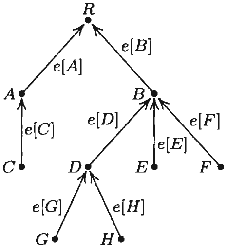
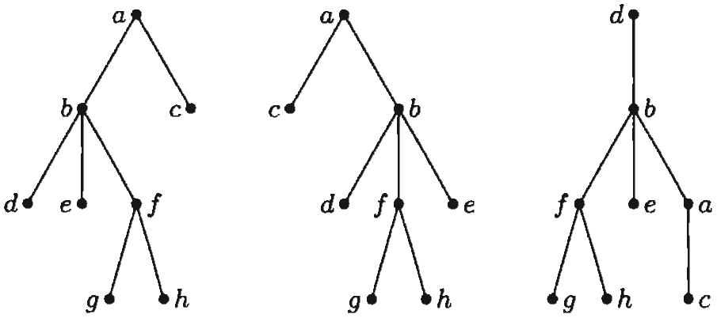
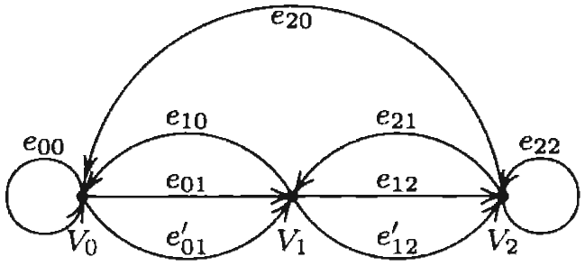
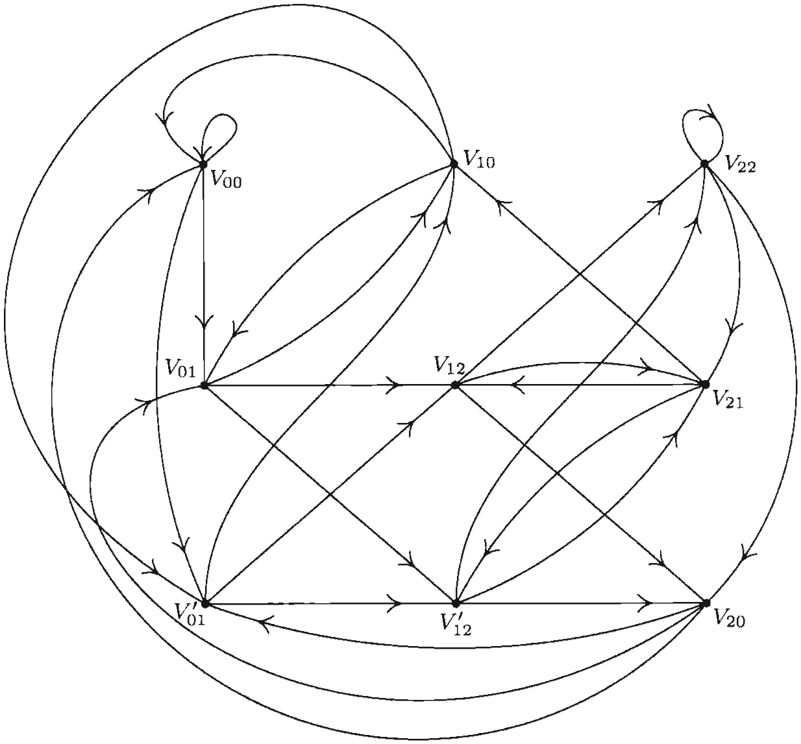

# 2.3.4.2　定向树

在上一节我们看到, 如果忽略各边箭头的方向, 则抽象的流程图可以看作图. 另外, 图论的回路、自由树等思想都与流程图的研究有关. 如果更重视每条边的方向, 结论就更多了, 此时的图就是所谓的 “有向图”.

有向图 (directed graph 或 digraph) 形式地定义为一个顶点的集合和一个弧的集合, 每条弧都从一个顶点 $V$ 指向一个顶点 $V'$. 如果 $e$ 是一条从 $V$ 到 $V'$ 的弧, 则我们称 $V$ 为 $e$ 的起始顶点, 而 $V'$ 为终止顶点, 并记作 $V=\operatorname{init}(e)$, $V'=\operatorname{fin}(e)$. 不排除 $\operatorname{init}(e)=\operatorname{fin}(e)$ 的情况 (尽管在一般的图定义中排除了这种情况), 多条不同的弧可以具有相同的起始和终止顶点. 顶点 $V$ 的出度 (out-degree) 是从它引出的弧的条数, 即满足 $\operatorname{init}(e)=V$ 的弧 $e$ 的条数; 类似地, $V$ 的入度 (in-degree) 定义为满足 $\operatorname{fin}(e)=V$ 的弧的条数.

对于有向图, 路径和回路的概念与一般图的对应定义方式类似, 但是必须考虑一些重要的新术语. 如果 $e_1,e_2,\ldots,e_n$ 是弧 ($n\ge1$), 我们说 $(e_1,e_2,\ldots,e_n)$ 是一个长度为 $n$、从 $V$ 到 $V'$ 的定向通路 (oriented walk), 如果 $V=\operatorname{init}(e_1)$, $V'=\operatorname{fin}(e_n)$, 并且 $\operatorname{fin}(e_k)=\operatorname{init}(e_{k+1})$($1\le k<n$). 如果 $\operatorname{init}(e_1),\ldots,\operatorname{init}(e_n)$ 都不相同, 并且 $\operatorname{fin}(e_1),\ldots,\operatorname{fin}(e_n)$ 也都不相同, 则定向通路 $(e_1,e_2,\ldots,e_n)$ 是简单的; 如果 $\operatorname{fin}(e_n)=\operatorname{init}(e_1)$, 这样的通路是定向回路 (oriented cycle), 否则它是一条定向路径 (oriented path). (一条定向回路的长度可能为 1 或 2, 但是上一节的 “回路” 定义中排除了这样的短回路. 读者可以看出其中的道理吗?)

作为这些简单定义的例子, 我们可以看看上一节的 [图 31](./sec-2-3-4-1.md#fig-2-31). 标记为 $J$ 的框是入度为 2 (因为弧 $e_{16}$ 和 $e_{21}$)、出度为 1 的顶点. 序列 $(e_{17},e_{19},e_{18},e_{22})$ 是一条从 $J$ 到 $P$、长度为 4 的定向通路. 这条通路不是简单的, 因为 $\operatorname{init}(e_{19})=L=\operatorname{init}(e_{22})$. 这个图不包含长度为 1 的定向回路, 但是 $(e_{18},e_{19})$ 是一个长度为 2 的定向回路.

如果对于一个有向图的任意两个顶点 $V\ne V'$, 都存在一条从 $V$ 到 $V'$ 的定向路径, 那么这个有向图称作强连通的 (strongly connected). 如果至少存在一个根, 也就是说, 至少有一个顶点 $R$, 使得对于所有的 $V\ne R$, 都存在一条从 $V$ 到 $R$ 的定向路径, 那么它称作有根的 (rooted). “强连通” 总蕴涵 “有根”, 但是其逆不真. 像上一节 [图 31](./sec-2-3-4-1.md#fig-2-31) 那样的流程图就是一个有根的有向图的例子, $R$ 是 “停止” 顶点; 增加一条从 “停止” 到 “开始” 的弧 ([图 32](./sec-2-3-4-1.md#fig-2-32)), 它就变成强连通的.

如果我们忽略方向并删去重复边和环, 则每个有向图 $G$ 都以显而易见的方式对应于一个普通的图 $G_0$. 形式地说, $G_0$ 有一条从 $V$ 到 $V'$ 的边, 当且仅当 $V\ne V'$, 并且 $G$ 有一条从 $V$ 到 $V'$ 或从 $V'$ 到 $V$ 的弧. 我们可以说 $G$ 中的 (非定向的) 路径或回路, 把它们理解成 $G_0$ 中的路径或回路; 我们可以说 $G$ 是连通的 (这个性质比 “强连通” 弱得多, 甚至比有根还弱), 如果对应的图 $G_0$ 是连通的.

定向树 (oriented tree, 见 [图 34](#fig-2-34)) 有时被其他作者称作 “有根树”, 是一个有向图, 它具有特定顶点 $R$, 使得

(a) 每个顶点 $V \neq R$ 恰是一个弧的起始顶点, 该弧记作 $e [ V ]$;

(b)R 不是任何弧的起始顶点;

(c) R 在以上定义的意义下是根 (即对于每个 $V \neq R$, 存在一条从 V 到 R 的定向路径).

由此立即得到: 对于每个 $V \neq R$, 存在一条唯一的从 V 到 R 的定向路径, 因此不存在定向回路. 容易看出, 当只有有限多个顶点时, 我们先前的 “定向树” 的定义 (在 2.3 节开始处) 与刚给出的新定义是相容的. 顶点对应于结点, 而弧对应于从 V 到 PARENT[V] 的链.

*图 34　一棵定向树*

由性质 (c), 对应于定向树的 (无向) 图是连通的. 此外, 它

没有回路. 因为如果 $( \hat { V } _ { 0 } , \hat { V } _ { 1 } , \ldots , \hat { V } _ { n } )$ 是一个无向的回路, $n \geq 3$, 并且 $V_{0}$ 和 $V_{1}$ 之间的边是 $e[V_1]$, 则 $V _ { 1 }$ 和 $V _ { 2 }$ 之间的边一定是 $e[V_{2}]$; 类似推出, 对于 $1 \leq k \leq n$ $V_{k - 1}$ 和 $V _ { k }$ 之间的边一定是 $e [ V _ { k } ]$, 与没有定向回路矛盾. 如果 $V_{0}$ 和 $V _ { 1 }$ 之间的边不是 $e[V_1]$, 则它一定是 $e[V_0]$. 相同的论证可以用于回路

$$
\left( V _ { 1 } , V _ { 0 } , V _ { n - 1 } , \ldots , V _ { 1 } \right) ,
$$

因为 $V _ { n } = V _ { 0 }$. 因此, 当忽略弧的方向时, 定向树是一棵自由树.

反之要注意, 我们可以把刚介绍的过程颠倒过来. 从一棵非空的自由树 (例如 [图30](./sec-2-3-4-1.md#fig-2-30)) 开始, 可以选择任意顶点作为根 R, 并对边指定方向. 其直观思想是, “拿着” 顶点 R, “提起” 并 “抖动” 该图. 然后指定向上的箭头. 更形式地说. 规则是:

把边 $V \longrightarrow V'$ 改变成从 V 到 $V ^ { \prime }$ 的弧, 当且仅当从 V 到 R 的简单路径经过 $V ^ { \prime }$, 即路径具有形式 $( V _ { 0 } , V _ { 1 } , \ldots , V _ { n } )$, 其中 $n > 0$, $V _ { 0 } = V ,$ $V _ { 1 } = V ^ { \prime } ,$ $V _ { n } = R .$

为了验证这一构造是正确的, 我们需要证明每条边 $V\mathbin{\text{—}}V'$ 都被指定一个方向 $V \leftarrow V ^ { \prime }$ 或 $V \to V ^ { \prime }$. 而这容易证明, 因为如果 $( V , V _ { 1 } , \ldots , R )$ 和 $( V ^ { \prime } , \overline { { V _ { 1 } ^ { \prime } } } , \ldots , R )$ 是简单路径, 则除非 $\tilde { V } = V _ { 1 } ^ { \prime }$ 或 $V_{1} = V^{\prime}$, 否则存在一条回路. 这一构造表明, 如果我们知道哪个顶点是根, 则定向树中的弧的方向是完全确定的, 因此当根明确指出时, 不必画成有向图.

现在, 我们看看三种类型的树之间的关系: 树 (即 2.3 节定义的有序树) 在计算机程序中是最重要的; 定向树 (或无序树) 和自由树都出现在计算机算法的研究中, 但是不及第一种类型常见. 这些树结构的基本差别仅在于相关信息总量. 例如, [图35](#fig-2-35) 显示了 3 棵树. 如果看作有序树 (根在顶部), 则它们都是不同的. 作为定向树, 第一棵和第二棵是等同的, 因为子树的左右次序是不重要的; 作为自由树, [图35](#fig-2-35) 中的所有 3 个图都是等同的, 因为根是不重要的.

*图 35　三棵树结构*

有向图中的欧拉迹 (Euleriantrail) 是一条定向通路 $( e _ { 1 } , e _ { 2 } , \ldots , e _ { m } )$, 使得有向图中的每条弧恰出现一次, 并且 $\operatorname { f i n } ( e _ { m } ) = \operatorname { i n i t } ( e _ { 1 } )$. 这是有向图的弧的 “完全遍历”. (欧拉迹因欧拉在 1736 年的著名讨论而得名: 哥尼斯堡有 7 座桥, 星期天散步时, 不可能走过每座恰好一次. 他把该问题化为无向图处理. 应该区分欧拉迹与 “哈密尔顿回路”, 后者是经过每个顶点恰好一次的定向回路, 见第 7 章.)

有向图称为平衡的 (见 [图36](#fig-2-36)), 如果每个顶点 V 的入度都等于出度, 即以 V 为起点的边与以 V 为终点的边一样多. 这个条件与基尔霍夫定律密切相关 (见习题 24). 如果一个有向图具有欧拉迹, 则它显然必须是连通的和平衡的—除非它有孤立顶点, 即入度和出度都等于零的顶点.

*图 36　平衡的有向图*

本节迄今为止考察了一些定义 (有向图、弧、起始顶点、终止顶点、出度、入度、定向通路、定向路径、定向回路、定向树、欧拉迹、孤立顶点, 以及强连通、有根和平衡等性质), 但是还缺乏联系这些概念的重要结果. 现在, 我们已经为介绍内容丰富的材料做好了准备. 第一个基本结果是欧文·古德给出的定理 [J. LondonMath. Soc.21(1947), 167-169], 他证明欧拉迹除非显然不可能存在, 否则总是存在.

定理 G. 一个没有孤立顶点的有向图具有欧拉迹, 当且仅当它是连通和平衡的.

证明: 假定 G 是平衡的, 并令

$$
\vec { P } = ( e _ { 1 } , \ldots , e _ { m } )
$$

是最长的没有重复弧的定向通路. 于是, 如果 $V = \mathrm{fin}(e_m)$, 并且 k 是 V 的出度, 则满足 init $(e)=V$ 的所有 k 个弧一定已经出现在 P 中; 否则我们可以加上 e, 得到一条更长的通路. 但是, 如果 $\mathrm{init}(e_{j}) = V$ 并且 $j > 1$, 则 $\operatorname { f i n } ( e _ { j - 1 } ) = V .$ 因此, 既然 G 是平衡的, 则我们一定有

$$
\operatorname { i n i t } ( e _ { 1 } ) = V = \operatorname { f n } ( e _ { m } ) ,
$$

否则 V 的入度至少为 $k + 1 ,$

现在, 由 P 的循环排列推出, 不在该通路中的任何弧 e 既不与该通路上的任何弧有共同的起始顶点, 也没有共同的终止顶点. 因此, 如果 P 不是欧拉迹, 则 G 不连通.

欧拉迹与定向树之间具有重要联系.

引理 E. 令 $( e _ { 1 } , \ldots , e _ { m } )$ 为不含孤立顶点的有向图 G 的欧拉迹. 令 $\widehat { R } = \operatorname { f i n } ( e _ { m } ) = \operatorname { i n i t } ( e _ { 1 } )$ 对于每个顶点 $V \neq R$, 令 e[V] 为该欧拉迹中从 V 最后一次出来的边, 即

$$
e[V]=e_j,\quad\text{如果 }\operatorname{init}(e_j)=V,\text{ 并且对于 }j<k\le m,\quad\operatorname{init}(e_k)\ne V.
\qquad \text{(1)}
$$

则 G 的顶点连同诸弧 $e [ V ]$ 形成一棵以 R 为根的定向树.

证明: 定向树定义的 (a) 和 (b) 显然满足. 由习题 7, 我们只需要证明这些 $e [ V ]$ 中没有定向回路, 而这是直接的, 因为如果 $\operatorname { f i n } ( e [ V ] ) = V ^ { \prime } = \operatorname { i n i t } ( e [ V ^ { \prime } ] )$, 其中 $e [ V ] = e _ { j }$ 且 $e [ V ^ { \prime } ] = e _ { j ^ { \prime } }$ 则 $j < j ^ { \prime } . \quad \mathsf { 1 }$ 1

如果我们换个角度, 考虑 “第一次进入” 每个顶点的弧, 则该引理或许更容易理解. 顶点和第一次进入的弧形成一棵无序树, 所有弧都指向远离 R 的方向. 引理 E 有一个令人吃惊的重要的逆命题, 由爱伦法斯特和德·布鲁因 [Simon Stevin28(1951), 203-217] 证明.

定理 D. 令 G 是有限的、平衡的有向图, 并令 $G ^ { \prime }$ 是由 G 的顶点加上 G 的某些弧组成的定向树. 令 R 是 $G ^ { \prime }$ 的根, 并令 e[V] 为 $G ^ { \prime }$ 的起始顶点为 V 的弧. 令 $e _ { 1 }$ 是 G 的任意弧, 满足 $\operatorname { i n i t } ( e _ { 1 } ) = R$. 则 $P=(e_1,e_2,\ldots,e_m)$ 是一个欧拉迹, 如果它是满足下列条件的定向通路:

(i) 没有一条弧使用一次以上; 即当 $e_{j} \neq e_{k}$ 时, $j \neq k$

(ii) e[V] 不在 P 中使用, 除非它是与规则 (i) 一致的唯一选择; 即如果 $e _ { j } = e [ \tilde { V } ]$ 并且 $e$ 是满足 init(e) = V 的弧, 则对于某个 $k \leq j , e = e _ { k }$

(iii)P 终止, 仅当它不能按规则 (i) 继续; 即如果 $\mathrm{init}(e) = \mathrm{fn}(e_m)$, 则对于某个 k, $e = e _ { k }$

证明: 根据 (iii) 和定理 G 证明中的论证, 必然有 $\operatorname { f i n } ( e _ { m } ) = \operatorname { i n i t } ( e _ { 1 } ) = R .$ 现在, 如果 $e$ 是一条不在 P 中出现的弧, 则令 $V = \operatorname{fin}(e)$. 由于 G 是平衡的, 因此 V 是某条不在 P 中出现的弧的起始顶点; 如果 $V \neq R$, 则条件 (ii) 告诉我们, $e [ V ]$ 不在 P 中. 对 $e = e [ V ]$ 进行相同的论证, 最终发现 R 是不在该通路中出现的某条弧的起始顶点, 与 (iii) 矛盾.

定理 D 实质上展示, 给定平衡的有向图的任意定向子树, 在该图中构造欧拉迹的一种简单方法. (见习题 14 中的例子.) 事实上, 定理 D 使得我们可以统计有向图中欧拉迹的准确个数, 这一结果和本节介绍的思想的许多重要推论见下面的习题.

#### 习题

1\. [M20] [答案](./answers/2-3-4-2.md#ans-2-3-4-2-1) 证明: 如果 V 和 $V ^ { \prime }$ 是有向图的顶点, 并且存在一条从 V 到 $V ^ { \prime }$ 的定向通路, 则存在一条从 V 到 V'的简单定向通路.

2\. [15] [答案](./answers/2-3-4-2.md#ans-2-3-4-2-2) 2.3.4.1 节式 (3) 列举了 10 条 “基本回路”, 其中的哪些是那一节的有向图 ([图32](./sec-2-3-4-1.md#fig-2-32)) 的定向回路?  
3\. [16] [答案](./answers/2-3-4-2.md#ans-2-3-4-2-3) 为一个连通但没有根的有向图绘制图示.

4\. [M20] [答案](./answers/2-3-4-2.md#ans-2-3-4-2-4) 对于任意有限的有向图 G, 拓扑排序的概念可以定义为顶点的线性排列 $V _ { 1 } V _ { 2 } \ldots V _ { n }$, 使得在该排序中, 对于 G 中所有的弧 e,init(e) 在 $\operatorname { f i n } ( e )$ 之前. (参见 2.2.3 节 [图6](./sec-2-2-3.md#fig-2-6) 和图 7.) 并非所有的有限的有向图都可以拓扑排序, 哪些可以? (使用本节的术语给出答案.)

[答案](./answers/2-3-4-2.md#ans-2-3-4-2-5)

$5.\ [M16]$ 令 G 是一个有向图, 包含一个定向通路 $(e_1,\ldots,e_n)$, 满足 $\mathrm{fin}(e_{n}) = \mathrm{iii}(e_{1})$. 使用本节定义的术语, 给出 G 不是定向树的证明.

6\. [M21] [答案](./answers/2-3-4-2.md#ans-2-3-4-2-6) 判断真假: 一个有根, 并且不包含回路、不包含定向回路的有向图是一棵定向树.

7\. [M22] [答案](./answers/2-3-4-2.md#ans-2-3-4-2-7) 判断真假: 一个满足定向树定义 (a) 和 (b), 并且没有定向回路的有向图是一棵定向树.

8\. $\left[ H M _ { 4 } 0 \right]$ 研究定向树的自同构群的性质. 自同构群是由顶点的所有置换π和满足 $\mathrm{init}(e\pi) = \mathrm{init}(e)\pi$ $\mathrm{fin}(e \pi) = \mathrm{fin}(e) \pi$ 的弧构成的群.

9\. [18] [答案](./answers/2-3-4-2.md#ans-2-3-4-2-9) 通过对边指定方向, 以 G 为根, 画出对应于 2.3.4.1 节 [图30](./sec-2-3-4-1.md#fig-2-30) 的自由树的定向树.

10\. [22] [答案](./answers/2-3-4-2.md#ans-2-3-4-2-10) 一棵具有顶点 $V _ { 1 } , \ldots , V _ { n }$ 的定向树可以用如下方法在计算机内使用表 $\overline { { P } } [ 1 ] , \ldots , \overline { { P } } [ n ]$ 表示: 如果 $V _ { j }$ 是根, 则 $P[j] = 0$; 否则, 如果弧 $e[V_j]$ 从 $V _ { j }$ 到 $V_{k}$, 则 $P [ j ] = k .$ (这样, $P [ 1 ] , \ldots , P [ n ]$ 与算法 2.3.3E 中使用的 “父母” 表一样.)

正文说明, 选择一个任意顶点为根, 有办法把一棵自由树转换成定向树. 因此, 也可以从具有根 R 的定向树开始, 忽略弧的方向, 将它转换成自由树, 最后指定新的方向, 得到一棵以任意指定顶点为根的定向树. 设计一个算法, 进行这种变换: 以表示定向树的表 $P [ 1 ] , \ldots , P [ n ]$ 和给定的整数 $j\ (1\le j\le n)$ 开始, 变换 P 表, 使得它表示相同的自由树, 但以 $V _ { j }$ 为根.

▶ 11. [28] [答案](./answers/2-3-4-2.md#ans-2-3-4-2-11) 使用习题 2.3.4.1-6 的假定, 但是用 $( a _ { k } , b _ { k } )$ 表示从 $V_{a_{k}}$ 到 $V_{b_{k}}$ 的弧, 设计一个算法, 不仅像原题的算法一样打印出自由树, 而且打印出基本回路. [提示: 可以把习题 2.3.4.1-6 的解答给出的算法与上一题的算法结合.]

12\. [M10] [答案](./answers/2-3-4-2.md#ans-2-3-4-2-12) 在本节定义的定向树与 2.3 节开始处定义的定向树之间的对应中, 树结点的度等于对应顶点的入度或出度吗?

▶ 13. [M24] [答案](./answers/2-3-4-2.md#ans-2-3-4-2-13) 证明: 如果 R 是 (可能无限) 有向图 G 的根, 则 G 包含一棵与 G 具有相同顶点并以 R 为根的定向子树. (作为推论, 总可以从像 2.3.4.1 节的 [图32](./sec-2-3-4-1.md#fig-2-32) 那样的流程图中选取一棵自由子树, 使得它实际上是一棵定向子树; 在该图中, 如果我们选取 $e _ { 1 3 } ^ { \prime \prime } , \: e _ { 1 9 } ^ { \prime \prime } , \: e _ { 2 0 } , \: e _ { 1 7 }$, 而不是 $e _ { 1 3 } ^ { \prime } , \: e _ { 1 9 } ^ { \prime } , \: e _ { 2 3 } , \: e _ { 1 5 }$, 则就是这种情况.)

14\. [21] [答案](./answers/2-3-4-2.md#ans-2-3-4-2-14) 令 G 为 [图36](#fig-2-36) 所示的平衡的有向图, 并令 $G ^ { \prime }$ 为具有顶点 $V _ { 0 } , \: V _ { 1 } , \: V _ { 2 }$ 和弧 $e _ { 0 1 } , \: e _ { 2 1 }$ 的定向子树.  
找出从弧 $e_{12}$ 开始、满足定理 D 条件的所有定向通路 P.

15\. [M20] [答案](./answers/2-3-4-2.md#ans-2-3-4-2-15) 判断真假: 连通并且平衡的有向图是强连通的.

▶ 16. [M24] [答案](./answers/2-3-4-2.md#ans-2-3-4-2-16) 在一种称作 “时钟”(clock) 的流行的纸牌游戏中, 一副普通纸牌 52 张面朝下摆成 13 叠, 每叠 4 张; 12 叠摆成一圈, 像时钟的 12 小时刻度, 而第 13 叠放在中心. 现在, 纸牌游戏开始, 翻开中心叠顶部的纸牌, 如果它的面值为 k, 则把它放在第 $k$ 叠旁边. (数 1,2,...,13 等价于 A,2,...,10,J,Q,K.) 游戏继续, 翻开第 $k$ 叠顶部的牌, 并把它放到相应的叠旁边. 如此下去, 直到目标叠无牌可翻时终止. (在这个游戏中, 玩家没有选择, 因为规则已经完全确定了他做什么.) 如果游戏终止时所有纸牌都面朝上, 则获胜. [参考文献: 埃德拉·切尼, Patience(Boston:Lee&Shepard,1870), 62-65; 根据玛丽·琼斯的《单人纸牌游戏》(Gamesof Patience, London: L. Upcott Gill,1900) 第 7 章, 该游戏在英国称作 “旅行者的单人纸牌游戏”.]

证明: 该游戏将获胜, 当且仅当顶点是 $V _ { 1 } , V _ { 2 } , \ldots , V _ { 1 3 }$ 且弧是 $e _ { 1 } , e _ { 2 } , \ldots , e _ { 1 2 }$ 的有向图是一棵定向树, 其中 $e _ { j }$ 从 $V_{j}$ 到 $V_{k}$, k 是分牌后第 $j$ 叠的底部纸牌.

(特殊地, 对于 $j \neq 1 3$, 如果第 $j$ 叠的底部牌为 $\text{“}j\text{”}$, 则容易看出游戏肯定失败, 因为这张牌绝对不会翻开. 本题证明的结果给出了一种快得多的玩此游戏的方法!)

17\. [M32] [答案](./answers/2-3-4-2.md#ans-2-3-4-2-17) 假定纸牌随机洗牌, 时钟纸牌游戏 (见习题 16) 获胜的概率是多少? 当游戏结束时, 恰有 k 张牌面朝下的概率是多少?

18\. [M30] [答案](./answers/2-3-4-2.md#ans-2-3-4-2-18) 令 G 是一个具有 n+1 个顶点 $V _ { 0 } , V _ { 1 } , \ldots , V _ { n }$ 和 m 条边 $e _ { 1 } , \ldots , e _ { m }$ 的图. 对每条边任意指定一个方向, 把 G 转换成有向图; 然后构造一个 $m \times (n + 1)$ 矩阵 A, 其中

$$
a_{ij}=\begin{cases}+1,&\text{如果 }\operatorname{init}(e_i)=V_j;\\-1,&\text{如果 }\operatorname{fin}(e_i)=V_j;\\0,&\text{其他情形}.\end{cases}
$$

令 $A_0$ 是 $A$ 删除第 0 列后的 $m\times n$ 矩阵.

(a) 如果 $m=n$, 证明: 如果 $G$ 不是自由树, 则 $A_0$ 的行列式等于 0; 如果 $G$ 是自由树, 则 $A_0$ 的行列式等于 $\pm1$.

(b) 证明: 对于一般的 m, $A_0^T A_0$ 的行列式是 G 的自由子树的个数 (即从 m 条边选择 n 条使得所得图是自由子树的选择方法数). 提示: 使用 (a) 和习题 1.2.3-46 的结果.]

19\. [M31] [答案](./answers/2-3-4-2.md#ans-2-3-4-2-19) (矩阵树定理) 令 G 是一个具有 n+1 个顶点 $V _ { 0 } { , } V _ { 1 } { , } { \ldots , } V _ { n }$ 的有向图. 令 A 是 (n+1)×(n+1) 矩阵, 其中

$$
a_{ij}=\begin{cases}-k,&\text{如果 }i\ne j\text{ 并且从 }V_i\text{ 到 }V_j\text{ 有 }k\text{ 条弧};\\t,&\text{如果 }i=j\text{ 并且从 }V_j\text{ 到其他顶点有 }t\text{ 条弧}.\end{cases}
$$

(由此, 对于 $0\le i\le n,\quad a_{i0}+a_{i1}+\cdots+a_{in}=0.\ )$ 令 $A_{0}$ 是 A 删除第 0 行和第 0 列后的矩阵. 例如, 如果 G 是 [图36](#fig-2-36) 中的有向图, 则我们有

$$
A = \left( \begin{aligned} { 2 \quad - 2 \quad 0 } \\ { - 1 \quad 3 \quad - 2 } \\ { - 1 \quad - 1 \quad 2 } \\ \end{aligned} \right) , \qquad A _ { 0 } = \left( \begin{aligned} { 3 \quad - 2 } \\ { - 1 \quad 2 } \\ \end{aligned} \right) .
$$

(a) 证明: 如果 $a_{00} = 0$, 对于 $1 \leq j \leq n$ 有 $a _ { j \bar { j } } = 1$, 并且 G 不含起点和终点相同的弧, 则 $\det A_0=[\,G$ 是一棵以 $V _ { 0 }$ 为根的定向树]

(b) 证明: 在一般情况下, $\det A_{0}$ 是以 $V_{0}$ 为根的定向树的个数 (即从 G 中选择 n 条弧使得所得有向图是以 $V_{0}$ 为根的定向树的选择方法数). [提示: 对弧的条数进行归纳.]

20\. [M21] [答案](./answers/2-3-4-2.md#ans-2-3-4-2-20) 如果 G 是 n+1 个顶点 $V _ { 0 } , \ldots , V _ { n }$ 上的无向图, 令 B 是 $n \times n$ 矩阵, 对于 $1 \leq i , j \leq n { , } b _ { i j }$ 定义如下:

$$
b_{ij}=\begin{cases}t,&\text{如果 }i=j\text{ 并且有 }t\text{ 条边连接 }V_j;\\-1,&\text{如果 }i\ne j\text{ 并且 }V_i\text{ 与 }V_j\text{ 相邻};\\0,&\text{其他情形}.\end{cases}
$$

例如, 如果 G 是 2.3.4.1 节的 [图29](./sec-2-3-4-1.md#fig-2-29), $( V _ { 0 } , V _ { 1 } , V _ { 2 } , V _ { 3 } , V _ { 4 } ) = ( A , B , C , D , E )$, 则我们有

$$
\boldsymbol{B} = \begin{pmatrix}3 & 0 & -1 & -1 \\0 & 2 & -1 & 0 \\-1 & -1 & 3 & -1 \\-1 & 0 & -1 & 2\end{pmatrix}.
$$

证明: G 的自由子树数为 detB. [提示: 利用习题 18 或 19.]

21,[HM38] [答案](./answers/2-3-4-2.md#ans-2-3-4-2-21) (爱伦法斯特和德·布鲁因)[图36](#fig-2-36) 的平衡有向图也是正则的, 即每个顶点的入度都等于出度, 且度数与其他顶点都相同. 设 G 是一个有向图, 具有 n 个顶点 $V _ { 0 } , V _ { 1 } , \ldots , V _ { n - 1 }$, 每个顶点的入度和出度都等于 $m .$ (因此, 总共有 mn 条弧.) 设 $G ^ { * }$ 是一个有向图, $G ^ { * }$ 有 mn 个顶点分别对应于 G 的弧, $G^{*}$ 中对应于 G 中从 $V _ { j }$ 到 $V _ { k }$ 的弧的顶点记作 $V _ { j k } . \quad G ^ { * }$ 中有一条弧从 $V_{j k}$ 到 $V_{j'k'}$, 当且仅当 $k = j ^ { \prime } .$ 例如, 如果 G 是 [图36](#fig-2-36) 的有向图, 则 $G ^ { * }$ 如 [图37](#fig-2-37) 所示. G 中的欧拉迹是 $G ^ { * }$ 中的哈密尔顿回路, 反之亦然. 证明: $G ^ { * }$ 的定向子树的个数是 G 的定向子树的 $m ^ { ( m - 1 ) n }$ 倍. 「提示: 使用习题 19.1

▶ 22. [M26] [答案](./answers/2-3-4-2.md#ans-2-3-4-2-22) 设 G 是一个平衡的有向图, 具有顶点 $V _ { 1 } , V _ { 2 } , \ldots , V _ { n }$, 并且没有孤立顶点. 令 $\sigma _ { j }$ 为 $V _ { j }$ 的出度. 证明: G 的欧拉迹的个数为

$$
\left( \sigma _ { 1 } + \sigma _ { 2 } + \cdots + \sigma _ { n } \right) T \prod _ { j = 1 } ^ { n } ( \sigma _ { j } - 1 ) ! ,
$$

其中, T 是 G 的以 $V _ { 1 }$ 为根的定向子树个数. [注意: 因子 $( \sigma _ { 1 } + \cdots + \sigma _ { n } )$ 是 G 中弧的个数. 如果把欧拉迹 $( e _ { 1 } , \ldots , e _ { m } )$ 看作等同于 $( e _ { k } , \ldots , e _ { m } , e _ { 1 } , \ldots , e _ { k - 1 } )$, 则这个因子可以忽略.]

▶ 23. [M33] [答案](./answers/2-3-4-2.md#ans-2-3-4-2-23) (德·布鲁因) 对于每个由小于 m 的数组成的非负整数序列 $x _ { 1 } , \ldots , x _ { k }$, 令 $f ( x _ { 1 } , \ldots , x _ { k } )$ 为一个小于 m 的非负整数. 定义一个无穷序列如下: $X_{1} = X_{2} = \cdots = X_{k} = 0;$ 当 $n \geq 0$ 时, $X _ { n + k + 1 } \: = \: f ( X _ { n + k } , \ldots , X _ { n + 1 } )$. 在 $m ^ { m ^ { k } }$ 个可能的函数中, 使得该序列具有最长周期 $m ^ { k }$ 的 f 有多少个? [提示: 构造一个有向图, 对于所有 $0 \; \leq \; x _ { j } \; < \; m$, 该图有顶点 $( x _ { 1 } , \ldots , x _ { k - 1 } )$, 并且有从 $( x _ { 1 } , x _ { 2 } , \ldots , x _ { k - 1 } )$ 到 $( x _ { 2 } , \ldots , x _ { k - 1 } , x _ { k } )$ 的弧, 利用习题 21 和 22.]

▶ 24. [M20] [答案](./answers/2-3-4-2.md#ans-2-3-4-2-24) 设 G 是一个连通的有向图, 具有弧 $e _ { 0 } , e _ { 1 } , \ldots , e _ { m } .$ 设 $E _ { 0 } , E _ { 1 } , \ldots , E _ { m }$ 是一组正整数, 对于 G 满足基尔霍夫定律, 即对于每个顶点 $V ,$

$$
\sum _ { \operatorname { f i n i t } ( e _ { j } ) = V } E _ { j } = \sum _ { \operatorname { f i n } ( e _ { j } ) = V } E _ { j } .
$$

进一步假定 $E _ { 0 } = 1$. 证明: G 中存在一条从 $\mathrm{fin}(e_{0})$ 到 init(eo) 的定向通路, 使得对于 $1 \leq j \leq m$, 边 $e _ { j }$ 恰好出现 $E _ { j }$ 次, 而 $e _ { 0 }$ 不出现. [提示: 把定理 G 应用于合适的有向图.]

*图 37　对应于图 36 的弧有向图 (见习题 21)*

25\. [26] [答案](./answers/2-3-4-2.md#ans-2-3-4-2-25) 推广树的右线索二叉树表示, 为有向图设计一种计算机表示. 使用两个链字段 ALINK 和 BLINK 以及两个一位字段 ATAG 和 BTAG. 设计这种表示, 使得: (i) 对于有向图的每条弧 (不是每个顶点) 有一个结点; (ii) 如果有向图是以 R 为根的定向树, 并且如果我们增加一条从 R 到新顶点 H 的弧, 则该有向图的表示基本上与这棵定向树的右线索表示一样 (在每个家族的子女上加上某种序), 即 ALINK、BLINK 和 BTAG 分别与 2.3.2 节中的 LLINK、RLINK 和 RTAG 一样; (iii) 该表示是对称的, 意指把 ALINK 和 ATAG 与 BLINK 和 BTAG 交换等价于改变该有向图所有弧的方向.

▶ 26. [HM39] (随机算法分析) 令 G 是顶点 $V _ { 1 } , V _ { 2 } , \ldots , V _ { n }$ 上的有向图. 假定 G 代表一个算法的流程图, 其中 $V _ { 1 }$ 是 “开始” 顶点, $V_{n}$ 是 “停止” 顶点. (因此, $V_{n}$ 是 G 的根.) 假设 G 的每条弧 e 都被赋予一个概率 $p(e)$, 满足条件

$$
0<p(e)\le1;\qquad\sum_{\operatorname{init}(e)=V_j}p(e)=1\quad\text{对于 }1\le j<n.
$$

考虑一条随机通路, 它从 $V_{1}$ 开始, 之后以概率 $p(e)$ 选择 G 的分支 $\overline{e}_{s}$ 直至到达 $V_{n}$, 每一步的分支选择都独立于先前所有的选择.

例如, 考虑习题 2.3.4.1-7 的图, 并把概率 $^ { 1 , \frac { 1 } { 2 } , \frac { 1 } { 2 } , \frac { 1 } { 2 } , 1 , \frac { 3 } { 4 } , \frac { 1 } { 4 } , \frac { 1 } { 4 } , \frac { 1 } { 4 } }$ 分别赋予弧 $e _ { 1 } , e _ { 2 } , \ldots , e _ { 9 }$. 于是, 选取通路 “开始-A-B-C-A-D-B-C-停止” 的概率是 $1\cdot\tfrac12\cdot1\cdot\tfrac12\cdot\tfrac12\cdot\tfrac34\cdot1\cdot\tfrac14=\tfrac3{128}.$

这种随机通路称作马尔可夫链, 由俄罗斯数学家安德烈·马尔可夫得名. 他第一个对这类随机过程进行了全面研究. 马尔可夫链可以用作某些算法的模型, 尽管要求每个选择都独立于其他选择是一个很强的假定. 本题的目的是分析这类算法的计算时间.

考虑 $n \times n$ 矩阵 $A = (a_{ij})$ 有利于这种分析, 其中 $a_{ij}=\sum p(e)$ 在所有从 $V _ { i }$ 到 $V _ { j }$ 的弧上求和. 如果没有这样的弧, 则 $a_{ij}=0$. 例如, 上面考虑的矩阵 A 是

$$
\left( \begin{matrix} { 0 } & { 1 } & { 0 } & { 0 } & { 0 } & { 0 } \\ { 0 } & { 0 } & { \frac { 1 } { 2 } } & { 0 } & { \frac { 1 } { 2 } } & { 0 } \\ { 0 } & { 0 } & { 0 } & { 1 } & { 0 } & { 0 } \\ { 0 } & { \frac { 1 } { 2 } } & { 0 } & { 0 } & { \frac { 1 } { 4 } } & { \frac { 1 } { 4 } } \\ { 0 } & { 0 } & { \frac { 3 } { 4 } } & { 0 } & { 0 } & { \frac { 1 } { 4 } } \\ { 0 } & { 0 } & { 0 } & { 0 } & { 0 } & { 0 } \\ \end{matrix} \right) .
$$

由此容易推出, $( A ^ { k } ) _ { i j }$ 是从 $V _ { i }$ 开始的通路在 k 步到达 $V_{j}$

对于所述类型的任意有向图 G 证明如下事实:

(a) 矩阵 $( I = A )$ 是非奇异的. [提示: 证明没有非零向量 x 满足 $x A ^ { n } = x .$ ]

(b) 顶点 $V _ { j }$ 在该通路中出现的平均次数为

$$
(I-A)^{-1}_{1j}=\operatorname{cofactor}_{j1}(I-A)/\det(I-A),\qquad\text{对于 }1\le j\le n.
$$

在上例中可得, 顶点 $A,   B,   C,   D$ 被遍历的平均次数分别为 $\frac{13}6,\quad\frac73,\quad\frac73,\quad\frac53.\ \bigr]$

(c) $V _ { j }$ 出现在该通路中的概率为

$$
a _ { j } = \operatorname { c o f a c t o r } _ { j 1 } ( I - A ) / { \operatorname { c o f a c t o r } _ { j j } ( I - A ) }
$$

此外, $a _ { n } = 1$, 从而该通路在有限步之后以概率 1 终止.

(d) 从 $V _ { j }$ 开始的随机通路不再返回到 $V _ { j }$ 的概率为 $b _ { j } = \operatorname { d e t } { ( I - A ) } / { \operatorname { c o f a c t o r } _ { j j } ( I - A ) }$

(e) 对于 $k\ge1,\quad1\le j\le n,\quad V_j$ 在该通路恰好出现 k 次的概率为 $a _ { j } ( 1 - b _ { j } ) ^ { k - 1 } b _ { j } .$

27\. [M30] [答案](./answers/2-3-4-2.md#ans-2-3-4-2-27) (稳定状态) 令 G 为顶点 $\begin{aligned} { V _ { 1 } { , } V _ { 2 } { , } \ldots { , } V _ { n } } \\ \end{aligned}$ 上的有向图, 其弧已经像习题 26 中那样被赋予概率 $p(e)$. 假定 G 是强连通的, 而不是假定有 “开始” 和 “停止” 顶点, 于是, 每个顶点 $V _ { j }$ 都是根. 假定概率 $p(e)$ 为正, 并且对于所有的 $j$ 都有 $\textstyle \sum _ { \operatorname { i n i t } ( e ) = V _ { j } } p ( e ) = 1$. 称习题 26 中描述的随机过程具有 “稳定状态” $( x _ { 1 } , \ldots , x _ { n } )$, 如果

$$
x _ { j } = \sum _ { \stackrel { \operatorname { i n i t } ( e ) = V _ { i } } { \operatorname { f i n } ( e ) = V _ { j } } } p ( e )   x _ { i }   , \qquad 1 \leq j \leq n .
$$

设 $t _ { j }$ 是乘积 $\textstyle \prod _ { e \in T _ { j } } p ( e )$ 之和, 求和范围是 G 的以 $V_{j}$ 为根的所有定向树 $T _ { j } ,$. 证明 $( t _ { 1 } , \ldots , t _ { n } )$ 是该随机过程的稳定状态.

▶ 28. [M35] [答案](./answers/2-3-4-2.md#ans-2-3-4-2-28) 考虑一类 $(m + n) \times (m + n)$ 行列式, 例如对于 $m = 2$ $n = 3$ 有:

$$
\det\begin{pmatrix}a_{10}+a_{11}+a_{12}+a_{13}&0&a_{11}&a_{12}&a_{13}\\0&a_{20}+a_{21}+a_{22}+a_{23}&a_{21}&a_{22}&a_{23}\\b_{11}&b_{12}&b_{10}+b_{11}+b_{12}&0&0\\b_{21}&b_{22}&0&b_{20}+b_{21}+b_{22}&0\\b_{31}&b_{32}&0&0&b_{30}+b_{31}+b_{32}\end{pmatrix}.
$$

证明: 当该行列式展开成诸 $a$ 和 b 的多项式时, 每个非零项的系数均为+1. 展开式有多少项? 给出一个与定向树有关的规则, 准确地刻画有哪些项.
