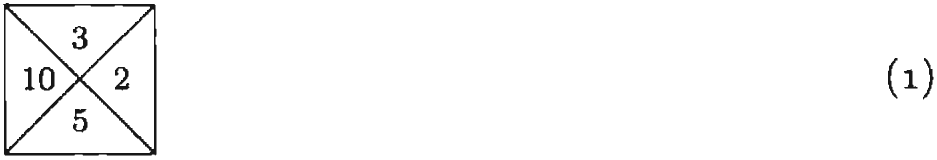
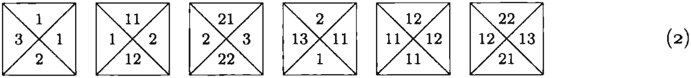
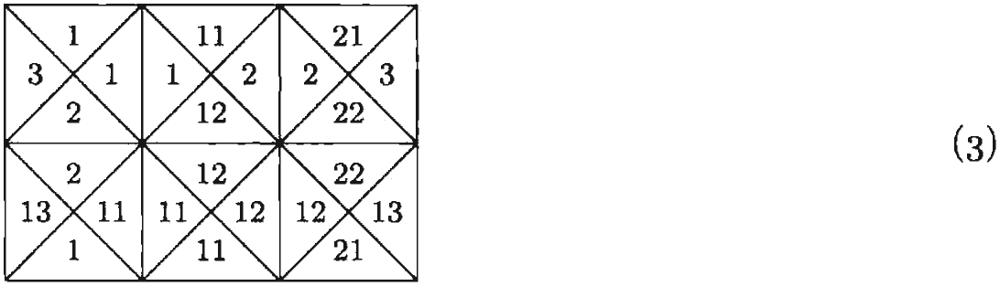
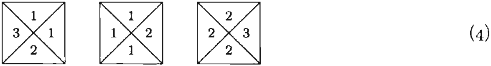
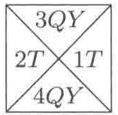

# \*2.3.4.3　无限性引理

到目前为止, 我们主要考虑了只具有有限多个顶点 (结点) 的树, 但是我们给出的自由树和定向树的定义也适用于无限图. 无限的有序树可以用多种方式定义, 如习题 2.3-14 那样, 把 “杜威记数法” 的概念推广到数的无限集. 即便是在计算机算法的研究中, 有时也需要无限树的性质. 例如, 通过反证法证明某棵树不是无限的. 无限树有一个最基本的性质, 首先由丹尼斯·科尼格以完全一般的形式陈述如下.

定理 K(“无限性引理”). 每一棵所有顶点的度数均为有限的无限定向树都有一条到根的无限路径, 即顶点的无限序列 $V_0,V_1,V_2,\ldots$, 其中 $V_{0}$ 是根, 并且对于所有的 $j \geq 0$ $\operatorname { f i n } ( e [ V _ { j + 1 } ] ) = V _ { j }$

证明: 我们从定向树的根 $V_{0}$ 开始定义该路径. 假定 $j \geq 0$ 并且选定 $V_{j}$ 具有无限多个后代. 根据假设, $V _ { j }$ 的度是有限的, 因此 $V _ { j }$ 有有限多个子女 $U _ { 1 } , \ldots , U _ { n }$. 这些子女中必然至少有一个具有无穷多个后代, 于是取 $V _ { j + 1 }$ 为 $V _ { j }$ 的一个这种子女.

那么, $V _ { 0 } , \: V _ { 1 } , \: V _ { 2 } , \: \ldots$. 是到根的无限路径. 1

学过微积分的学生可能意识到, 这里的论证本质上很像证明经典的波尔查诺一维尔斯特拉斯定理所使用的论证. 波一维定理是说: “任何有界的无限实数集都有一个聚点.” 正如科尼格所述, 一种陈述定理 K 的方法是: “如果人类不会灭绝, 则现在活着的某个人必然有一支不会灭绝的后代.”

大部分第一次遇到定理 K 的人都会认为定理 K 完全是显然的, 但是进一步思索并考虑更多的例子后, 他们就会意识到这里有一些深奥的东西. 尽管树的每个结点的度数都是有限的, 但是我们并未假定度数是有界的 (对于所有的顶点, 小于某个数 N), 因此可能有些结点具有越来越大的度. 至少可以想象每个人的后代都最终灭绝, 尽管有些家族可能传至百万代, 甚至十亿代, 等等. 事实上, 亨利·沃森曾经发表了一个 “证明”: 在永远成立的某些生物学概率定律下, 未来将有无限多个人出生, 但是每个家族最终都以概率 1 灭绝. 他的论文 [J.AnthropologicalInst. Gt. Britain and Ireland 4 (1874), 138-144] 包含了一些影响深远的重要定理, 尽管因为小疏漏而做出这一错误陈述. 值得注意的是, 他没有发现他的结论在逻辑上的不一致.

定理 K 的逆否命题可以直接用于计算机算法: 如果我们有一个算法, 它定期地把自身划分成有限多个子算法, 并且每条子算法链都最终终止, 则该算法本身终止.

还有另一种方式陈述: 假设我们有一个有限或无限的集合 S,S 的每个元素都是一个具有有限长度 $n \geq 0$ 的正整数序列 $( x _ { 1 } , x _ { 2 } , \ldots , x _ { n } )$. 如果我们施加条件

(i) 如果 $( x _ { 1 } , \ldots , x _ { n } )$ 在 S 中, 则对于 $0 \leq k \leq n , \quad ( x _ { 1 } , \ldots , x _ { k } )$ 也在 $S$ 中;

(ii) 如果 $( x _ { 1 } , \ldots , x _ { n } )$ 在 S 中, 则只存在有限多个 $x_{n + 1}$, 使得 $( x _ { 1 } , \ldots , \: x _ { n } , x _ { n + 1 } )$ 也在 S 中;

(iii) 不存在无限序列 $( x _ { 1 } , x _ { 2 } , \dots )$, 其所有初始子序列 $( x _ { 1 } , x _ { 2 } , \ldots , x _ { n } )$ 都在 S 中; 那么, $S$ 本质上是一棵定向树, 由杜威记数法确定, 并且定理 K 告诉我们 S 是有限的.

最能说明定理 K 的潜能的例子与王浩提出的一族有趣平铺问题有关. 一种四分形类型 (tetradtype) 是一个划分成 4 部分的正方形, 每部分上都有一个指定的数, 如

平面平铺 (tilingplane) 问题是取四分形类型的有限集, 每种类型都有无限多个, 看看如何把它们紧挨着放置到无限平面的正方形中 (不对四分形进行旋转或反射), 使得两个四分形相邻仅当它们的接触处具有相同的数. 例如, 我们可以使用如下 6 种四分形类型

来平铺平面. 这实际只有一种方法, 就是反复地用

来平铺平面. 容易验证, 没有办法使用如下 3 种四分形类型来平铺平面

王浩的结论 [ScientificAmerican 213,5(1965 年 11 月), 98-106] 是: 如果可以铺满平面的右上象限, 那么就能铺满整个平面. 这肯定令人吃惊, 因为铺满右上象限涉及沿 x 轴和 y 轴的 “边界”, 似乎无法由此想出如何铺满左上象限 (因为不能对四分形类型进行旋转和反射). 我们不能简单地把右上象限下移或左移来解决边界问题, 因为无限的移动量没有意义. 王浩的证明如下: 存在右上象限的解意味对于所有的 n, 都存在一种方法铺成一个 2n×2n 的正方形. 考虑正方形每条边用偶数个四分形类型单元平铺的问题, 它的所有解的集合形成一棵定向树, 每个 $2 n \times 2 n$ 解 x 的子女是对 x 镶边得到的可能的 (2n+2)×(2n+2) 解. 该定向树的根是 0×0 解, 它的子女是 2×2 解, 如此等等. 每个结点都有有限多个子女, 因为平面平铺问题假定只给定有限多种四分形类型. 因此, 根据无限性引理, 存在一条到根的无限路径. 这意味存在一种铺满整个平面的方法 (尽管我们可能不知道如何找到它)!

关于四分形类型平铺的后续研究进展, 请参阅布兰科·格兰巴姆和杰弗里·谢泼德的赏心悦目的书《平铺与模式》[Tilings and Patterns(Freeman,1987) 第 11 章.

#### 习题

1\. [M10] [答案](./answers/2-3-4-3.md#ans-2-3-4-3-1)  正文中提到包含正整数的有限序列的集合 S, 并说该集合 “本质上是一棵定向树”. 这棵定向树的根是什么, 弧是什么?

2\. [20] [答案](./answers/2-3-4-3.md#ans-2-3-4-3-2) 证明: 如果允许旋转四分形类型, 则总有可能铺满平面.

3\. [M23] [答案](./answers/2-3-4-3.md#ans-2-3-4-3-3) 当给定四分形类型的无限集时, 如果可以铺满平面的右上象限, 则总可能铺满整个平面吗?

4\. [M25] [答案](./answers/2-3-4-3.md#ans-2-3-4-3-4) (王浩)6 个四分形类型 (2) 给出平铺问题的环形解, 即在整个平面内重复像 (3) 这样的某种矩形模式的解.

不加证明地假定, 只要可以用四分形类型的有限集铺满平面, 就存在一个使用这些四分形类型的环形解. 使用这一假定和无限性引理, 设计一个算法, 给定四分形类型的任意有限集的说明, 在有限步内确定是否存在一种办法, 用这些四分形类型铺满平面.

5\. [M40] [答案](./answers/2-3-4-3.md#ans-2-3-4-3-5) 证明: 使用如下 92 个四分形类型可以铺满平面, 但是不存在习题 4 意义下的环形解. 为了简化 92 种类型的说明, 先介绍一些记号. 定义如下 “基本编码”:

$$
\alpha=(1,2,1,2),\quad\beta=(3,4,2,1),\quad\gamma=(2,1,3,4),\quad\delta=(4,3,4,3)
$$

$$
a=(Q,D,P,R)\quad b=(\ ,\ ,L,P)\quad c=(U,Q,T,S)\quad d=(\ ,\ ,S,T)
$$

$$
N=(Y,\ ,X,\ )\quad J=(D,U,\ ,X)\quad K=(\ ,Y,R,L)\quad B=(\ ,\ ,\ ,\ )
$$

$$
R=(\ ,\ ,R,R)\quad L=(\ ,\ ,L,L)\quad P=(\ ,\ ,P,P)\quad S=(\ ,\ ,S,S)
$$

$$
T=(\ ,\ ,T,T)\qquad X=(\ ,\ ,X,X)
$$

$$
Y = ( \mathit { Y } , \mathit { Y } , \quad , \quad ) \quad \mathit { U } = ( \mathit { U } , \mathit { U } , \quad , \quad ) \quad \mathit { D } = ( \mathit { D } , \mathit { D } , \quad , \quad ) \quad \mathit { Q } = ( \mathit { Q } , \mathit { Q } , \quad , \quad )
$$

现在, 四分形类型是

$$
\alpha \{ a , \bar { b } , \bar { c } , \bar { d } \}
$$

[4 种]

$$
\beta \big \{ Y \{ B , U , Q \} \{ P , T \} , \{ B , U , D , Q \} \{ P , S , T \} , K \{ B , U , Q \} \big \} \qquad [ 2 1
$$

种

$$
\gamma \{ \{ \{ X , B \} \{ L , P , S , T \} , R \} \{ B , Q \} , J \{ L , P , S , T \} \}
$$

[22 种]

$$
\delta \{ X \{ L , P , S , T \} \{ B , Q \} ,   Y \{ B , U , Q \} \{ P , T \} ,   N \{ a , b , c , d \} ,
$$

$$
J\{L,P,S,T\},K\{B,U,Q\},\{R,L,P,S,T\}\{B,U,D,Q\}\}\quad[45\text{ 种}]
$$

这些缩写意味基本编码的对应分量依次相乘, 并且每个分量内部按字典序排序, 例如

$$
\beta Y\{\widehat{B},U,Q\}\{P,T\}
$$

代表 6 种类型 $\beta YBP,\beta YUP,\beta YQP,\beta YBT,\beta YUT,\beta YQT.\quad\text{类型 }\beta YQT$ 在对应分量相乘并排序后是

$$
( 3 , 4 , 2 , 1 ) ( Y , Y , , ) ( Q , Q , , ) ( , , T , T ) = ( 3 Q Y , 4 Q Y , 2 T , 1 T )
$$

对应于如图所示的四分形类型, 4 个四分之一区域中使用符号串而不是使用整数. 两个四分形类型可以彼此相邻放置, 仅当它们的接触处具有相同的符号串.

$\beta -$ 四分形是在其记号中有 $\beta$ 的四分形. 为着手求解本题, 注意任何β-四分形的左右都必须是α-四分形, 上下都必须是 $\delta -$ 四分形. $\alpha a\text{-}$ 四分形右边必须是 $\beta K B$ 或 $\beta K U$ 或 $\beta K Q$, 再右边必须来一个 $\alpha b -$ 四分形, 等等.

(这一构造类似于罗伯特·博格给出的构造, 但更简单. 他进一步证明了, 如果没有此处给出的不正确假定, 那么习题 4 中的一般问题不能求解. 见 Memoirs Amer.Math.Soc.66(1966).)

6\. [M23] [答案](./answers/2-3-4-3.md#ans-2-3-4-3-6) (奥托·施赖埃尔) 在一篇著名的论文 [Nieuw Archiefvoor Wiskunde(2)15(1927), 212-216] 中, 范德瓦尔登证明了如下定理:

如果 $k$ 和 $m$ 是正整数, 并且我们有 k 个正整数的集合 $S _ { 1 } , \ldots , S _ { k }$, 使得每个正整数都至少包含在其中一个集合中, 则至少有一个 $S_{j}$ 包含一个长度为 m 的算术级数.

(结论意味存在整数 $a$ 和 $\delta > 0$, 使得 $a+\delta,a+2\delta,\ldots,a+m\delta$ 都在 $S_{j}$ 中.) 如果可能, 使用这一结果和无限性引理证明如下更强的命题:

如果 $k$ 和 $m$ 是正整数, 那么存在数 N 使得如果有 N 个正整数的集合 $S _ { 1 } , \ldots , S _ { k }$, 使得 1 和 N 之间的每个整数都至少包含在其中一个集合中, 则至少有一个 $S_{j}$ 包含一个长度为 m 的算术级数.

7\. [M30] [答案](./answers/2-3-4-3.md#ans-2-3-4-3-7) 如果可能, 使用习题 6 中的范德瓦尔登定理和无限性引理证明如下较强的命题:

如果 $k$ 是正整数, 并且我们有 k 个整数的集合 $S _ { 1 } , \ldots , S _ { k }$, 使得每个正整数都至少包含在其中一个集合中, 则至少有一个 $S_{j}$ 包含一个无限长的算术级数.

8\. [M39] [答案](./answers/2-3-4-3.md#ans-2-3-4-3-8) (约瑟夫·克鲁斯卡尔) 如果 T 和 $T ^ { \prime }$ 是 (有限的、有序的) 树, 像习题 2.3.2-22 那样, 令记号 $T \subseteq T ^ { \prime }$ 表示 T 可以嵌入 T'. 证明: 如果 $T _ { 1 } , \: T _ { 2 } , \: T _ { 3 } , \: . \:$. 是树的无穷序列, 则存在整数 $j < k$ 使得 $T _ { j } \subseteq T _ { k }$. (换言之, 不可能构造树的无穷序列, 使得没有一棵树包含该序列前面的树. 这一事实可以用来证明某些算法必定终止.)
