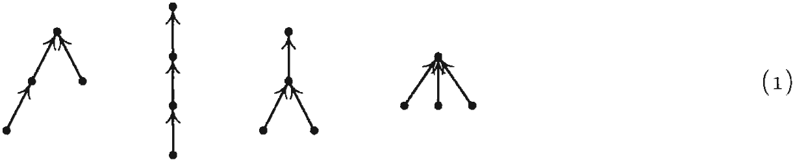
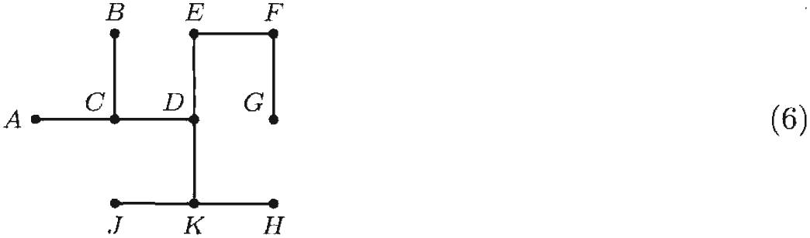
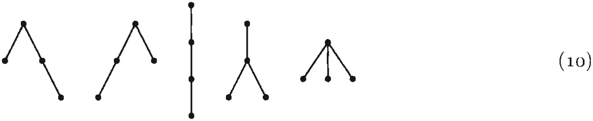
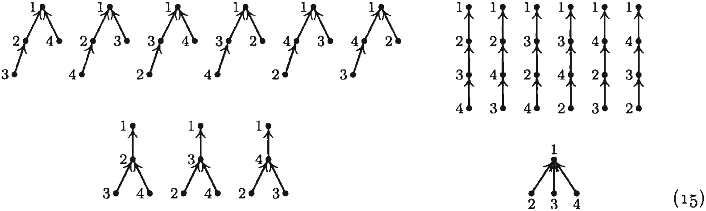
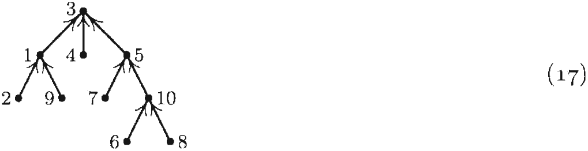
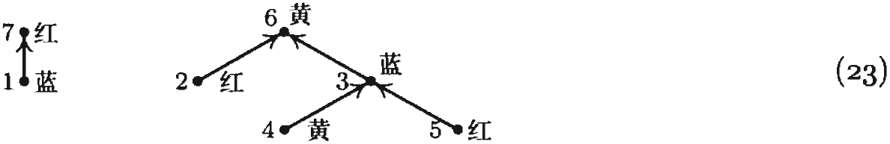
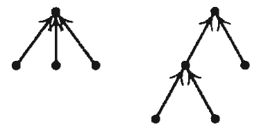

# \*2.3.4.4　树的枚举

对于算法分析而言, 树的数学理论最具启发性的一些应用都与统计各种类型的树的数目有关. 例如, 给定 4 个不能区别的顶点, 求能够构造多少棵不同的定向树, 则我们发现只有 4 种可能性:

我们的第一个枚举问题是, 确定具有 n 个顶点、结构不同的定向树的个数 $a_{n}.$ 显然 $a _ { 1 } = 1$ 如果 $n > 1$, 则树有一个根和各种子树. 假设存在 $j _ { 1 }$ 棵 1 个顶点的子树, $j _ { 2 }$ 棵 2 个顶点的子树, 等等. 于是, 因为允许重复 (见习题 1.2.6-60), 我们可以用

$$
\binom { a _ { k } + j _ { k } - 1 } { j _ { k } }
$$

种方法选择 $a_{k}$ 种可能的 k 个顶点的树中的 $j_k$ 棵, 因此

$$
a_n=\sum_{j_1+2j_2+\cdots=n-1}\binom{a_1+j_1-1}{j_1}\ldots\binom{a_{n-1}+j_{n-1}-1}{j_{n-1}},\qquad\text{对于 }n>1.
\qquad \text{(2)}
$$

考虑生成函数 $\begin{array} { l } { A ( z ) = \sum _ { n } a _ { n } z ^ { n } } \\ \end{array}$, 其中 $\bar { a } _ { 0 } = 0$, 则我们发现等式

$$
\frac { 1 } { ( 1 - z ^ { r } ) ^ { a } } = \sum _ { j } \binom { a + j - 1 } { j } z ^ { r j }
$$

连同 (2) 式蕴涵

$$
A(z)=\frac{z}{(1-z)^{a_1}(1-z^2)^{a_2}(1-z^3)^{a_3}\ldots}.
\qquad \text{(3)}
$$

对于 A(z) 来说, 这不是特别好的形式, 因为它涉及无限乘积, 并且系数 $a _ { 1 } , a _ { 2 } , . . .$. 出现在右端. 一个多少更优雅的表示 $A(z)$ 的方法见习题 1, 它可推出相当有效的计算 $a_{n}$ 值的公式 (见习题 2), 事实上它也能对大的 n 推导 $a _ { n }$ 的渐近行为 (习题 4). 我们发现

$$
\begin{aligned}A(z)={}&z+z^2+2z^3+4z^4+9z^5+20z^6+48z^7+115z^8\\&+286z^9+719z^{10}+1842z^{11}+\cdots.\end{aligned}
\qquad \text{(4)}
$$

既然已经基本上找到了定向树的个数, 接下来令人感兴趣的是确定具有 n 个顶点的不同结构的自由树个数. 对于 4 个顶点, 只有两棵不同的自由树, 即

因为去掉方向之后, (1) 的前两棵和后两棵定向树都成为等价的.

我们已经看到, 可以选择自由树的任意顶点 X 并且用唯一方法赋予每条边一个方向, 使之成为以 X 为根的定向树. 然后, 对于给定的顶点 X, 假设根 X 有 k 棵子树, 每棵子树分别有 $s _ { 1 } , s _ { 2 } , \ldots , s _ { k }$ 个顶点. 显然, k 是涉及 X 的弧的条数, 而 $s_1+s_2+\cdots+s_k=n-1$. 在这种情况下, 我们说 X 的权重 (weight) 为 $\operatorname* { m a x } ( s _ { 1 } , s _ { 2 } , \ldots , s _ { k } )$. 因此, 在树

中, 顶点 D 的权重为 3 (从 D 出来的每棵子树都有其余 9 个顶点中的 3 个), 而顶点 E 的权重为 max(7,2)=7. 具有最小权重的顶点称作自由树的形心 (centroid).

令 X 和 $s _ { 1 } , s _ { 2 } , \ldots , s _ { k }$ 如上所述, 并令 $Y _ { 1 } , Y _ { 2 } , \ldots , Y _ { k }$ 是 X 的诸子树的根. 如果 Y 是子树 $Y _ { 1 }$ 中的任意结点, 则它的权重至少为 $n-s_1=1+s_2+\cdots+s_k$, 因为假定 Y 为根时, 在它的包含 X 的子树中至少有 $n - s _ { 1 }$ 个顶点. 因此, 如果 Y 是形心, 则

$$
\operatorname { w e i g h t } \left( X \right) = \operatorname* { m a x } \left( s _ { 1 } , s _ { 2 } , \ldots , s _ { k } \right) \geq \operatorname { w e i g h t } \left( Y \right) \geq 1 + s _ { 2 } + \cdots + s _ { k } ,
$$

并且仅当 $s _ { 1 } > s _ { 2 } + \dots + s _ { k }$ 时, 上式才有可能成立. 如果把这一讨论中的 $Y _ { 1 }$ 用 $Y _ { j }$ 替换, 则可以导出类似的结果. 因此, 一个顶点上的子树最多有一棵可能包含形心.

这是一个很强的条件, 因为它蕴涵自由树最多有两个形心, 并且如果存在两个形心, 则它们是相邻的 (见习题 9).

反之, 如果 $s _ { 1 } \geq s _ { 2 } + \cdots + s _ { k }$, 则子树 $Y _ { 1 }$ 中存在一个形心, 因为

$$
\operatorname{weight}(Y_1)\le\max(s_1-1,1+s_2+\cdots+s_k)\le s_1=\operatorname{weight}(X),
$$

并且子树 $Y _ { 2 } , \ldots , Y _ { k }$ 中的所有结点的权重最少为 $s _ { 1 } + 1$. 我们证明了顶点 X 是自由树的唯一形心, 当且仅当

$$
s_j\le s_1+\cdots+s_k-s_j,\qquad\text{对于 }1\le j\le k.
\qquad \text{(7)}
$$

因此, 具有 n 个顶点、仅有一个形心的自由树的个数为具有 n 个顶点的定向树的个数, 减去违反条件 $( 7 )$ 的定向树的个数, 而后一类树实际上由一棵具有 $s _ { j }$ 个顶点的定向树和一棵具有 $n - s _ { j } \leq s _ { j }$ 个顶点的定向树组成. 于是, 具有一个形心的 n 个顶点的自由树的个数为

$$
a_n-a_1a_{n-1}-a_2a_{n-2}-\cdots-a_{\lfloor n/2\rfloor}a_{\lceil n/2\rceil}.
\qquad \text{(8)}
$$

具有两个形心的自由树有偶数个顶点, 并且每个形心的权重为 $n / 2$ (见习题 10). 因此, 如果 $n = 2 m$, 则双形心自由树的个数为从 $a _ { m }$ 个东西中允许重复地选择 2 个的方法数, 即

$$
\binom { a _ { m } + 1 } { 2 } .
$$

为了得到自由树的总数, 当 $n$ 为偶数时, 我们把 $\textstyle \frac { 1 } { 2 } a _ { n / 2 } ( a _ { n / 2 } + 1 )$ 加到式 (8) 上. 式 (8) 的形式暗示该序列有一个简单的生成函数. 确实如此, 不难发现结构不同的自由树个数的生成函数为

$$
\begin{aligned}F(z)&=A(z)-\tfrac12A(z)^2+\tfrac12A(z^2)\\&=z+z^2+z^3+2z^4+3z^5+6z^6+11z^7+23z^8\\&\quad+47z^9+106z^{10}+235z^{11}+\cdots.\end{aligned}
\qquad \text{(9)}
$$

这个简单的关系归功于卡米尔·若尔当, 他在 1869 年考虑了这一问题.

现在, 我们考虑枚举有序树问题, 对于计算机算法而言, 这是我们的主要关注点. 具有 4 个顶点、结构不同的有序树有 5 棵:

作为定向树, 前两棵是等价的, 因此它们只有一个出现在前面的 (1) 中.

在考察不同的有序树的个数之前, 让我们先考虑二叉树, 因为它更接近实际的计算机表示, 并且容易研究. 设 $b _ { n }$ 为具有 $n$ 个结点的不同二叉树的个数. 根据二叉树的定义, 显然 $b _ { 0 } = 1$, 并且对于 $n > 0$, 可能的个数就是把一棵具有 k 个结点的二叉树放到根的左边, 而其他 $n - 1 - k$ 个结点放到右边的方法数. 因此

$$
b_n=b_0b_{n-1}+b_1b_{n-2}+\cdots+b_{n-1}b_0,\qquad n\ge1.
\qquad \text{(11)}
$$

由这个关系式, 生成函数

$$
B ( z ) = b _ { 0 } + b _ { 1 } z + b _ { 2 } z ^ { 2 } + \cdots
$$

显然满足方程

$$
zB(z)^2=B(z)-1.
\qquad \text{(12)}
$$

解这个二次方程, 并利用 $\vec{B}(0) = 1$ 这一事实, 得到

$$
\begin{aligned}B(z)&=\frac1{2z}\bigl(1-\sqrt{1-4z}\bigr)=\frac1{2z}\left(1-\sum_{k\ge0}\binom{1/2}k(-4z)^k\right)\\&=2\sum_{n\ge0}\binom{1/2}{n+1}(-4z)^n=\sum_{n\ge0}\binom{-1/2}n\frac{(-4z)^n}{n+1}\\&=\sum_{n\ge0}\binom{2n}n\frac{z^n}{n+1}\\&=1+z+2z^2+5z^3+14z^4+42z^5+132z^6+429z^7\\&\quad+1430z^8+4862z^9+16796z^{10}+\cdots.\end{aligned}
\qquad \text{(13)}
$$

(见习题 1.2.6-47.) 因此, 所求的解是

$$
b_n=\frac1{n+1}\binom{2n}n.
\qquad \text{(14)}
$$

根据斯特林公式, 这近似等于 $4 ^ { n } / n \sqrt { \pi n } + O ( 4 ^ { n } n ^ { - 5 / 2 } )$. 式 $\left( 14 \right)$ 的一些重要推广见习题 11 和 32.

回到具有 n 个结点的有序树问题, 我们可以看出这一问题本质上与二叉树个数问题相同, 因为二叉树与森林之间存在自然的对应, 而树去掉它的根就是一个森林. 因此, 具有 n 个结点的 (有序) 树的个数为 $b _ { n - 1 }$, 即具有 n-1 个结点的二叉树的个数.

上述枚举都假定顶点是不可区分的点. 如果把 (1) 中的顶点用 1,2,3,4 标号, 并选定 1 为根, 则有 16 棵不同的定向树:

枚举有标号的树的问题显然与上面很不相同. 在这种情况下, 问题可以重新陈述如下: “考虑画 3 条线, 分别从顶点 2、3 和 4 指向其他顶点. 从每个顶点出发的线都有 3 种选择, 因此总共有 $3^{3} = 27$ 种可能性. 这 27 种方法有多少种产生以 1 为根的定向树?” 正如我们看到的, 答案是 16. 对于 $n$ 个顶点的情况, 相同问题有类似形式的陈述: “设 $f(x)$ 是一个整数值函数, 满足 $f ( \tilde { 1 } ) = 1$, 并且对于所有整数 $1 \leq f(x) \leq n$, 有 $1 \leq x \leq n .$ 如果对于所有 $x,\quad f^{[n]}(x)$ (即迭代 n 次的 $f \big ( f ( \cdots ( f ( x ) ) \cdots ) \big )$ ) 等于 1, 我们称 f 为一个树映射 (treemapping). 有多少个树映射?” 这个问题与随机数产生等应用有关. 我们将会相当吃惊地发现, 在平均情况下, 每 $n$ 个这样的函数恰有一个是树映射.

这个枚举问题的解可以利用前面已经得到的计算图的子树数的一般公式直接导出 (见习题 12). 但是, 还存在更有意义的解法, 它给我们一种紧凑表示定向树结构的新方法.

假设给定一棵具有顶点 $\{ 1 , 2 , \ldots , n \}$ 和 n-1 条弧的定向树, 其中除根外, 对于所有的 j, 弧都从 j 到 $f(j)$. 至少存在一个终端 (叶) 顶点. 令 $V _ { 1 }$ 是叶的最小编号, 如果 $n > 1$, 则记下$f(V_{1})$, 并从树中删除 $V_{1}$ 和弧 $V _ { 1 } \to f ( V _ { 1 } )$; 然后, 令 $V_{2}$ 是此时树中终端顶点的最小编号, 如果 $n > 2$, 则记下 $f(V_{2})$, 并从树中删除 $V_{2}$ 和弧 $V _ { 2 } \to f ( V _ { 2 } )$; 以这种方式继续, 直到除根外所有的顶点都被删除. 由此得到 $n-1$ 个数的序列

$$
f(V_1),f(V_2),\ldots,f(V_{n-1}),\qquad1\le f(V_j)\le n.
\qquad \text{(16)}
$$

称作原定向树的标准表示 (canonicalpresentation).

例如, 具有 10 个顶点的定向树

的标准表示为 1,3,10,5,10,1,3,5,3.

这里, 重要的是这一过程可以倒过来, 从任意 n—1 个数的序列 (16) 回到产生它的定向树. 因为, 如果我们有 1 和 $n$ 之间的数的任意序列 $x _ { 1 } , x _ { 2 } , \ldots , x _ { n - 1 }$, 则令 $V _ { 1 }$ 为不在序列 $x_{1},\cdots,$ $x_{n - 1}$ 中出现的最小数; 然后, 令 $V_{2} \neq V_{1}$ 为不在序列 $x _ { 2 } , \ldots , x _ { n - 1 }$ 中出现的最小数; 如此下去, 用这种方法得到{1,2,...,n}的一个排列 $V _ { 1 } V _ { 2 } \ldots V _ { n }$, 然后对于 $1 \leq j < n$, 画一条从顶点 V 到顶点 $x_{j}$ 的弧. 这构造出了一个没有定向回路的有向图, 根据习题 2.3.4.2-7, 它是一棵定向树. 显然, 序列 $x _ { 1 } , x _ { 2 } , \ldots , x _ { n - 1 }$ 与这棵定向树的序列 (16) 相同.

由于该过程是可逆的, 因此我们得到了数 $\{ 1 , \bar { 2 } , \ldots , n \}$ 的 $(n - 1)$ 元组与这些顶点上的定向树之间的一个一一对应. 因此, 存在 $\bar { n } ^ { n - 1 }$ 棵具有 n 个标号顶点的不同定向树. 如果我们指定一个顶点为根, 则指定这个顶点还是那个顶点显然并无差别, 因此具有给定根的 $\{ 1 , 2 , \ldots , n \}$ 上的定向树有 $n ^ { n - 2 }$ 棵. 这解释了式 (15) 中的 $16=4^{4-2}$ 棵树. 由此, 容易确定顶点有标号的自由树的个数 (见习题 22). 一旦我们知道顶点没有标号的解, 则顶点有标号的有序树的个数也容易确定 (见习题 23). 因此, 我们基本上解决了枚举三种基本类型的树的问题, 包括顶点有标号和无标号两种情况.

倘若我们把通常的生成函数方法用于枚举有标号的定向树, 看看会发生什么, 想必很有趣. 为此, 最简单的可能是考虑 $r(n,q)$, 即具有 $n$ 个有标号的顶点、没有定向回路、从 $q$ 个指定的顶点分别引出一条弧的有向图的个数. 这样, 以指定顶点为根的带标号的定向树的个数为 $r(n,   n = 1)$. 在这种记号下, 通过简单的计数论证可得, 对于固定的整数 m,

$$
r(n,q)=\sum_k\binom qk r(m+k,k)\,r(n-m-k,q-k),\qquad\text{如果 }0\le m\le n-q,
\qquad \text{(18)}
$$

$$
r(n,q)=\sum_k\binom qk r(n-1,q-k),\qquad\text{如果 }q=n-1.
\qquad \text{(19)}
$$

把未指定的顶点划分成两组 A 和 B,m 个顶点在 A 中, $n - q - m$ 个顶点在 B 中, 然后把 $q$ 个指定的顶点划分成两组, k 个顶点引出通向 A 的路径, $q = k$ 个顶点引出通向 B 的路径, 则得到关系 (18). 考虑根为 k 度的定向树则得到关系 (19).

这些关系的形式表明, 可以使用生成函数

$$
G _ { m } ( z ) = r ( m , 0 ) + r ( m + 1 , 1 ) z + \frac { r ( m + 2 , 2 ) z ^ { 2 } } { 2 ! } + \cdots = \sum _ { k } \frac { r ( k + m , k ) z ^ { k } } { k ! } .
$$

在这些项中, 式 (18) 表明 $G _ { n - q } ( z ) = G _ { m } ( z ) G _ { n - q - m } ( z )$. 因此, 对 m 归纳可得, $G_m(z)=$ $G _ { 1 } ( z ) ^ { m }$. 又由式 (19), 得到

$$
\begin{aligned}G_1(z)&=\sum_{n\ge1}\frac{r(n,n-1)z^{n-1}}{(n-1)!}=\sum_{k\ge0}\sum_{n\ge1}\frac{r(n-1,n-1-k)z^{n-1}}{k!(n-1-k)!}\\&=\sum_{k\ge0}\frac{z^k}{k!}G_k(z)=\sum_{k\ge0}\frac{(zG_1(z))^k}{k!}=e^{zG_1(z)}.\end{aligned}
$$

换言之, 置 $G_1(z)=w$, 则问题的解源自超越方程

$$
w=e^{zw}.
\qquad \text{(20)}
$$

的解的系数.

这个方程可以使用拉格朗日反演公式求解: $z = \zeta / f(\zeta)$ 蕴涵

$$
\zeta=\sum_{n\ge1}\frac{z^n}{n!}\,g_n^{(n-1)}(0),
\qquad \text{(21)}
$$

其中当 $f$ 是原点的邻域中的解析函数并且 $f(0) \neq 0$ 时, $\bar { g } _ { n } ( \zeta ) = f ( \zeta ) ^ { n }$ (见习题 4.7-16). 在此情况下, 我们可以置 $\zeta=zw,\ f(\zeta)=e^{\zeta}$, 从而导出解

$$
w=\sum_{n\ge0}\frac{(n+1)^{n-1}}{n!}z^n.
\qquad \text{(22)}
$$

这与上面得到的答案一致.

乔治·雷尼业已证明, 可以用一种重要的方式推广这种方法, 求解更加一般的方程

$$
w = y _ { 1 } e ^ { z _ { 1 } w } + y _ { 2 } e ^ { z _ { 2 } w } + \cdots + y _ { s } e ^ { z _ { s } w } ,
$$

用 $y _ { 1 } , \ldots , y _ { s }$ 和 $z _ { 1 } , \ldots , z _ { s }$ 的显式幂级数表示解 w. 为进行这种推广, 考虑整数的 s 维向量

$$
\mathbf { n } = \left( n _ { 1 } , n _ { 2 } , \ldots , n _ { s } \right) ,
$$

为方便起见, 记

$$
\Sigma \mathbf { n } = n _ { 1 } + n _ { 2 } + \cdots + n _ { s } .
$$

假设我们有 s 种颜色 $C _ { 1 } , C _ { 2 } , \ldots , C _ { s }$, 并考虑每个顶点都赋予一种颜色的有向图. 例如,

设 $r(\mathbf{n}, \mathbf{q})$ 为画弧并对顶点 $\{ 1 , 2 , \ldots , n \}$ 着色使之满足如下条件的方法数:

(i) 对于 $1 \leq i \leq s$, 恰好存在 $n _ { i }$ 个 $C _ { i }$ 色的顶点 (因而 $n=\Sigma\mathbf n)$;

(ii) 有 q 条弧, 分别从顶点 $\{ 1 , 2 , \ldots , q \}$ 引出;

(iii) 对于 $1 \leq i \leq s$, 恰好存在 $q _ { i }$ 条弧通向颜色为 $C _ { i }$ 的顶点 (因而 $q = \sum q$

(iv) 不存在定向回路 (因此, 除非 $q = n = 0$, 否则 $q < n )$

我们称之为一个 $\left(  n,q  \right)$ 构造.

例如, 如果 $C_{1} =$ 红, $C_{2} =$ 黄, $C_{3}= 蓝$, 则 $(23)$ 显示了一个 ((3,2,2), (1,2,2)) 构造. 当只有一种颜色时, 就是已经解决的定向树问题. 雷尼的思想是把一维构造推广到 s 维.

令 $n$ 和 $\mathbf { q }$ 为固定的 s 维非负整数向量, 令 $\bar { n } = \Sigma \mathbf { n } , \quad q = \Sigma \mathbf { q }$. 对于每个 (n,q) 构造和每个 $k , 1 \leq k \leq n$, 我们定义由 4 部分组成的标准表示:

(a) 一个数 t, 满足 $q < t \leq n ;$

(b) 一个 n 种颜色的序列, 其中颜色 $C _ { i }$ 有 $n _ { i }$ 个;

(c) 一个 q 种颜色的序列, 其中颜色 $C _ { i }$ 有 $q _ { i }$ 个;

(d) 对于 $1 \leq i \leq s$, 一个集合 $\{ 1 , 2 , \ldots , n _ { i } \}$ 中的 $q _ { i }$ 个元素的序列.

该标准表示定义如下: 首先按定向树的标准表示的次序 $V _ { 1 } , V _ { 2 } , \ldots , V _ { q }$ 列出顶点 $\{ 1 , 2 , \ldots , q \}$, 然后在顶点 $V_{j}$ 下面写上由 $V_{j}$ 引出的弧上的顶点号 $f(V_{j})$. 令 $\hat { t } = f ( V _ { q } )$. 令颜色序列 (c) 分别为顶点 $f ( V _ { 1 } ) , \ldots , f ( V _ { q } )$ 的颜色. 令颜色序列 (b) 分别为顶点 $k , \: k + 1 , \: \ldots , \: n , \: 1 , \: \ldots , \: k - 1$ 的颜色. 最后, 令 (d) 的第 $i$ 个序列为 $x _ { i 1 } , x _ { i 2 } , \ldots , x _ { i q _ { i } }$ 其中 $x _ { i j } = m$, 如果序列 $f ( V _ { 1 } ) , \ldots , f ( V _ { q } )$ 的第 $j$ 个 $C _ { i }$ 色元素是序列 $k,   k+1,   \ldots,   n,   1,   \ldots,   k-1$ 的第 $m$ 个 $C _ { i }$ 色元素.

例如, 考虑 (23) 的构造并令 $k=3$. 首先, 列出 $V _ { 1 } , \ldots , V _ { 5 }$ 和它们下面的 $f ( V _ { 1 } ) , \ldots , f ( V _ { 5 } )$ 如下:

$$
\begin{aligned} { 1 \quad 2 \quad 4 \quad 5 \quad 3 } \\ { 7 \quad 6 \quad 3 \quad 3 \quad 6 } \\ \end{aligned}
$$

因此, $t = 6$, 而序列 (c) 分别是 7,6,3,3,6 的颜色, 即红、黄、蓝、蓝、黄. 序列 (b) 分别是 3,4,5,6,7,1,2 的颜色, 即蓝、黄、红、黄、红、蓝、红. 最后, 为了得到 (d) 中的序列, 处理过程如下:

|  |  |  |  |
| --- | --- | --- | --- |
|  | 在 3,4,5,6,7,1,2 | 在 7,6,3,3,6 | 用第 2 列对 |
| 颜色 | 中该颜色的元素 | 中该颜色的元素 | 第 3 列编码 |
| 红 | 5,7,2 | 7 | 2 |
| 黄 | 4,6 | 6,6 | 2,2 |
| 蓝 | 3,1 | 3,3 | 1,1 |

因此, (d) 序列是 2;2,2;1,1.

由标准表示, 我们可以用如下方法倒推原来的 (n,q) 构造和数 k: 由 (a) 和 (c), 我们知道顶点 t 的颜色. 这种颜色的 (d) 序列的最后一个元素连同 (b) 告诉我们, t 在序列 $k , \ldots , n , 1 , \ldots , k - 1$ 中的位置. 因此, 我们知道 k 和所有顶点的颜色. 然后, (d) 中的子序列连同 (b) 和 (c) 确定 $f ( V _ { 1 } ) , f ( V _ { 2 } ) , \ldots , f ( V _ { q } )$, 而最后就像构造定向树那样, 找出 $V _ { 1 } , \ldots , V _ { q }$ 并构造有向图.

因为这种标准表示具有可逆性, 所以我们可以计算可能的 (n,q) 构造的个数. (a) 有 $n - q$ 种选择, (b) 的选择数为多项式系数

$$
\binom { n } { n _ { 1 } , \ldots , n _ { s } } ,
$$

(c) 的选择数为

$$
\left( \begin{matrix} { q } \\ { q _ { 1 } , \ldots , q _ { s } } \\ \end{matrix} \right) ,
$$

(d) 有 $n_1^{q_1}n_2^{q_2}\ldots n_s^{q_s}$ 种选择. 除以 k 的 n 种选择, 我们得到一般结果

$$
r(\mathbf n,\mathbf q)=\frac{n-q}{n}\,\frac{n!}{n_1!\ldots n_s!}\,\frac{q!}{q_1!\ldots q_s!}\,n_1^{q_1}n_2^{q_2}\ldots n_s^{q_s}.
\qquad \text{(24)}
$$

此外, 我们可以导出类似于 (18) 和 (19) 式的结果:

$$
r(\mathbf n,\mathbf q)=\sum_{\substack{\mathbf k,\mathbf t\\\Sigma(\mathbf t-\mathbf k)=m}}\binom{\Sigma\mathbf q}{\Sigma\mathbf k}r(\mathbf t,\mathbf k)\,r(\mathbf n-\mathbf t,\mathbf q-\mathbf k)\quad\text{如果 }0\le m\le\Sigma(\mathbf n-\mathbf q),
\qquad \text{(25)}
$$

其中, 约定 $r(0,0)=1$, 并且如果某 $n _ { i }$ 或 $q _ { i }$ 为负或 $q > n$, 则 $r(\mathbf{n}, \mathbf{q}) = 0$;

$$
r(\mathbf n,\mathbf q)=\sum_{i=1}^s\sum_k\binom{\Sigma\mathbf q}k r(\mathbf n-\mathbf e_i,\mathbf q-k\mathbf e_i)\quad\text{如果 }\Sigma\mathbf n=1+\Sigma\mathbf q,
\qquad \text{(26)}
$$

其中, $\mathbf{e}_{i}$ 是位置 i 为 1 而其余位置为 0 的向量. 关系式 (25) 基于把顶点 $\{ q + 1 , \ldots , n \}$ 划分成分别包含 m 和 $n - q - m$ 个元素的两部分; 关系式 (26) 通过删除唯一的根并考虑剩下的结构导出. 现在, 我们得到如下结果.

定理 R (雷尼, Canadian J.Math. 16(1964), 755–762). 令

$$
w=\sum_{\substack{\mathbf n,\mathbf q\\\Sigma(\mathbf n-\mathbf q)=1}}\frac{r(\mathbf n,\mathbf q)}{(\Sigma\mathbf q)!}\,y_1^{n_1}\ldots y_s^{n_s}z_1^{q_1}\ldots z_s^{q_s},
\qquad \text{(27)}
$$

其中 $r(\mathbf{n}, \mathbf{q})$ 由式 (24) 定义, 而 n 和 q 是 s 维整数向量. 则 $w$ 满足等式

$$
w=y_1e^{z_1w}+y_2e^{z_2w}+\cdots+y_s e^{z_s w}.
\qquad \text{(28)}
$$

证明: 由式 (25), 对 m 作归纳, 得

$$
w^m=\sum_{\substack{\mathbf n,\mathbf q\\\Sigma(\mathbf n-\mathbf q)=m}}\frac{r(\mathbf n,\mathbf q)}{(\Sigma\mathbf q)!}\,y_1^{n_1}\ldots y_s^{n_s}z_1^{q_1}\ldots z_s^{q_s}.
\qquad \text{(29)}
$$

现在, 由式 (26),

$$
\begin{aligned}w&=\sum_{i=1}^s\sum_k\sum_{\substack{\mathbf n,\mathbf q\\\Sigma(\mathbf n-\mathbf q)=1}}\frac{r(\mathbf n-\mathbf e_i,\mathbf q-k\mathbf e_i)}{k!(\Sigma\mathbf q-k)!}y_1^{n_1}\ldots y_s^{n_s}z_1^{q_1}\ldots z_s^{q_s}\\&=\sum_{i=1}^s\sum_k\frac1{k!}y_i z_i^k\sum_{\substack{\mathbf n,\mathbf q\\\Sigma(\mathbf n-\mathbf q)=k}}\frac{r(\mathbf n,\mathbf q)}{(\Sigma\mathbf q)!}y_1^{n_1}\ldots y_s^{n_s}z_1^{q_1}\ldots z_s^{q_s}\\&=\sum_{i=1}^s\sum_k\frac1{k!}y_i z_i^kw^k.\quad\blacksquare\end{aligned}
$$

在式 (27) 和 (28) 中, 特殊情况 $s =1$ 且 $z _ { 1 } = 1$ 在应用中特别重要, 此时称为 “树函数”

$$
T(y)=\sum_{n\ge1}\frac{n^{n-1}}{n!}y^n=ye^{T(y)}.
\qquad \text{(30)}
$$

关于该函数的历史和重要性质, 见罗伯特·考莱斯、加斯顿·格纳特、戴维·黑尔、戴维·杰弗瑞和高德纳合著的 Advances in Computational Math. 5 (1996), 329-359.

基于巧妙地使用生成函数得到树枚举公式的综述由古德给出 [Proc. CambridgePhilos.Soc.61(1965), 499-517;64(1968), 489]. 后来, 安德烈·卓亚提出数学的物种理论 [AdvancesinMath.42(1981), 1-82] 带来了更高级的观点, 其中生成函数上的代数操作直接对应于结构的组合性质. 弗朗索瓦·鲍格朗、吉尔伯特·拉贝尔和皮埃尔·勒鲁合著的书《组合物种与类树结构》[ Combinatorial Species and Tree-like Structures, Cambridge Univ. Press, 1998] 介绍了这 种富有教益的优美理论, 举例丰富, 推广了上面的许多公式.

#### 习题

1\. [M20] [答案](./answers/2-3-4-4.md#ans-2-3-4-4-1) (波利亚) 证明:

$$
A(z)=z\cdot\exp\left(A(z)+\tfrac12A(z^2)+\tfrac13A(z^3)+\cdots\right)
$$

[提示: 对 (3) 式取对数.]

2\. [答案](./answers/2-3-4-4.md#ans-2-3-4-4-2)  $\left[ H M 2 4 \right]$ (理查德·奥特) 证明: 数 $a _ { n }$ 满足如下条件:

$$
na_{n+1}=a_1s_{n1}+2a_2s_{n2}+\cdots+na_n s_{nn},
$$

其中

$$
s_{nk}=\sum_{1\le j\le n/k}a_{n+1-jk}.
$$

(这些公式对于计算 $a _ { n }$ 是有用的, 因为 $s_{nk}=s_{(n-k)k}+a_{n+1-k}.\ )$

3\. $[ M _ { 4 } 0 ]$ 写一个计算机程序, 对于 $n \leq 1 0 0$, 确定具有 n 个顶点的 (无标号的) 自由树和定向树的个数. (使用习题 2 的结果.) 探索这些数的算术性质, 关于它们的素因子或模 p 余数有什么结论?

4\. [HM39] [答案](./answers/2-3-4-4.md#ans-2-3-4-4-4) (波利亚, 1937) 使用复变量理论, 确定定向树个数的近似值如下:

(a) 证明: 存在一个 0 和 1 之间的实数α, 使得 $A(z)$ 具有收敛半径α, 并且对于所有满足 $| z | \leq \alpha$ 的复数 $z , A ( z )$ 都绝对收敛, 具有最大值 $A ( \alpha ) = a < \infty .$ [提示: 当幂级数具有非负系数时, 它或者是一个整函数, 或者具有正实数奇点; 使用习题 1 中的等式, 证明当 $z \to \alpha -$ 时, $A(z)/z$ 有界.]

(b) 令

$$
F(z,w)=\exp\left(zw+\tfrac12 A(z^2)+\tfrac13 A(z^3)+\cdots\right)-w
$$

证明: 在 $(z,w)=(\alpha,a/\alpha)$ 的一个邻域内, $F ( z , w )$ 分别对每个变量都是解析的.

(c) 证明: 在点 $(z,w)=(\alpha,a/\alpha)$, 有 $\partial F / \partial w = 0$, 因此 $a = 1 .$

(d) 在点 $( z , w ) = ( \alpha , 1 / \alpha )$, 证明

$$
\frac{\partial F}{\partial z}=\beta=\alpha^{-2}+\sum_{k\ge2}\alpha^{k-2}A'(\alpha^k)\qquad\text{和}\qquad\frac{\partial^2F}{\partial w^2}=\alpha.
$$

(e) 当 $| z | = \alpha$, 而 $z \neq \alpha$ 时, 证明 $\partial F / \partial w \neq 0$; 因此, A(z) 仅在 $|z| = \alpha$ 上有一个奇点.

(f) 证明: 存在一个比 $| z | < \alpha$ 大的区域, 在该区域

$$
\frac1zA(z)=\frac1\alpha-\sqrt{2\beta(1-z/\alpha)}+(1-z/\alpha)R(z),
$$

其中 $R ( z )$ 是 $\sqrt{z - \alpha}$ 的解析函数.

(g) 由此证明:

$$
a_n=\frac{1}{\alpha^{n-1}n}\sqrt{\beta/(2\pi n)}+O(n^{-5/2}\alpha^{-n}).
$$

[注记: $1 / \alpha \approx 2 . 9 5 5 7 6 5 2 8 5 6$ 52, $\alpha \sqrt { \beta / 2 \pi } \approx 0 . 4 3 9 9 2 4 0 1 2 5 7 1 . \quad ]$ _

5\. [M25] [答案](./answers/2-3-4-4.md#ans-2-3-4-4-5) (亚瑟·凯利) 令 $c _ { n }$ 为具有 n 个树叶 (即, 入度为 0 的顶点), 并且在每个其他顶点上至少有两棵子树的 (无标号的) 定向树的个数. 于是 $c _ { 3 } = 2$, 两棵树是

对于生成函数

$$
C(z)=\sum_n c_n z^n
$$

找出类似于 (3) 式的公式.

6\. [M25] [答案](./answers/2-3-4-4.md#ans-2-3-4-4-6) 令 “定向二叉树” 为每个顶点的入度小于等于 2 的定向树. 找出一个相当简单的关系, 对具有 n 个顶点的不同的定向二叉树的个数定义生成函数, 并找找出前几个值.

7\. [HM40] [答案](./answers/2-3-4-4.md#ans-2-3-4-4-7) 求习题 6 的数的近似值. (参见习题 4.)

8\. [20] [答案](./answers/2-3-4-4.md#ans-2-3-4-4-8) 根据式 (9), 存在 6 棵具有 6 个顶点的自由树. 画出它们, 并指出它们的形心.

9\. [M20] [答案](./answers/2-3-4-4.md#ans-2-3-4-4-9) 由自由树的顶点最多有一个子树可能包含形心这一事实, 证明自由树中最多有两个形心; 并进一步证明, 如果有两个形心, 则它们一定相邻.

10\. [M22] [答案](./answers/2-3-4-4.md#ans-2-3-4-4-10) 证明: 具有 n 个顶点和两个形心的自由树由两棵具有 $n / 2$ 个顶点的自由树经一条边连接而成. 反之, 如果两棵具有 m 个顶点的自由树经一条边连接, 则得到一棵具有 2m 个顶点和两个形心的自由树.

▶ 11. [M28] [答案](./answers/2-3-4-4.md#ans-2-3-4-4-11) 正文推导出了具有 n 个结点的不同二叉树的个数式 (14). 对其进行推广, 找出具有 n 个结点的不同 t 叉树的个数. (见习题 2.3.1-35; 一棵 t 叉树或者为空, 或者由一个根和 t 个不相交的 t 叉树组成.) 提示: 使用 1.2.9 节式 (21).

12\. [M20] [答案](./answers/2-3-4-4.md#ans-2-3-4-4-12) 利用行列式和习题 2.3.4.2-19 的结果, 找出具有 n 个顶点的有标号的定向树的个数. (又见习题 1.2.3-36. )

13\. [15] [答案](./answers/2-3-4-4.md#ans-2-3-4-4-13)  顶点 $\{ 1 , 2 , \ldots , 1 0 \}$ 上的什么定向树具有标准表示 3,1,4,1,5,9,2,6,5?

14\. [10] [答案](./answers/2-3-4-4.md#ans-2-3-4-4-14) 判断真假: 定向树的标准表示的最后一项 $f(V_{n - 1})$ 总是该树的根.

15\. [21] [答案](./answers/2-3-4-4.md#ans-2-3-4-4-15) 讨论 (如果有的话)2.2.3 节的拓扑排序算法与定向树的标准表示之间的关系.

16\. [25] [答案](./answers/2-3-4-4.md#ans-2-3-4-4-16) 设计一个 (尽可能高效的) 算法, 把定向树的标准表示转换成使用 PARENT 链的传统计算机表示.

▶ 17. [M26] [答案](./answers/2-3-4-4.md#ans-2-3-4-4-17) 令 $f(x)$ 是一个整数值函数, 对于所有的整数 $1 \leq x \leq m$, 有 $1 \leq f(x) \leq m.$ 定义 $x \equiv y,$ 如果对于某 $r , s \geq 0$ 有 $f^{[r]}(x) = f^{[s]}(y)$, 其中 $f^{[0]}(x) = x, \quad f^{[r+1]}(x) = f(f^{[r]}(x))$. 使用类似于本节的枚举方法, 证明: 对于所有的 x 和 y 满足 $x \equiv y$ 的函数的个数为 $m^{m - 1}Q(m)$, 其中 $Q(m)$ 是 1.2.11.3 节定义的函数.

18\. [24] [答案](./answers/2-3-4-4.md#ans-2-3-4-4-18) 证明下面的方法也可以定义 1 到 n 的数的 (n—1) 元组与具有 n 个有标号顶点的定向树之间的一一对应: 令树的叶以递增序为 $V _ { 1 } , \ldots , V _ { k } .$ 令 $( V _ { 1 } , V _ { k + 1 } , V _ { k + 2 } , \ldots , V _ { q } )$ 为 $V_{1}$ 到根的路径, 并写下顶点 $V _ { q } , \ldots , V _ { k + 2 } , V _ { k + 1 } .$ 然后, 令 $( V _ { 2 } , V _ { q + 1 } , V _ { q + 2 } , \ldots , V _ { r } )$ 为从 $V_{2}$ 到已经写下的 $V _ { r }$ 的最短定向路径, 并写下 $V _ { r } , \ldots , V _ { q + 2 } , V _ { q + 1 }$. 然后, 令 $( V _ { 3 } , V _ { r + 1 } , \ldots , V _ { s } )$ 为从 $V_{3}$ 到已经写下的 $V _ { s }$ 的最短定向路径, 并写下 $V _ { s } , \ldots , V _ { r + 1 }$; 如此下去. 例如, 树 (17) 将被编码为 3,1,3,3,5,10,5,10,1. 证明这一过程是可逆的, 并特别绘出具有顶点 {1,2,...,10} 和表示 3,1,4,1,5,9,2,6,5 的定向树.

19\. [M24] [答案](./answers/2-3-4-4.md#ans-2-3-4-4-19) 具有 n 个顶点, 其中 $k$ 个顶点为叶 (入度为 0) 的不同的有标号的定向树有多少种?

20\. [M24] [答案](./answers/2-3-4-4.md#ans-2-3-4-4-20) (约翰·泽尔丹) 具有 n 个顶点, 其中 $k _ { 0 }$ 个人度为 0, $k _ { 1 }$ 个人度为 1, $k _ { 2 }$ 个人度为 2,……的不同的有标号的定向树有多少种? (注意: 必然有 $k_0+k_1+k_2+\cdots=n,\quad k_1+2k_2+3k_3+\cdots=n-1.\ )$

▶ 21. [M21] [答案](./answers/2-3-4-4.md#ans-2-3-4-4-21) 试计算每个顶点入度为 0 或 2 的有标号的定向树的个数. (参见习题 20 和习题 2.3-20.)

22\. [M20] [答案](./answers/2-3-4-4.md#ans-2-3-4-4-22) 具有 n 个顶点的有标号的自由树有多少种? (换言之, 如果给定 $n$ 个顶点, 则存在 $2^{\binom{n}{2}}$ 个具有这些顶点的图, 取决于 () 条可能的边中的哪些放入图中. 这些图有多少个是自由树?)

23\. [M21] [答案](./answers/2-3-4-4.md#ans-2-3-4-4-23) 具有 n 个顶点的有标号的有序树有多少种? (给出一个包含阶乘的简单公式.)

24\. [M16] [答案](./answers/2-3-4-4.md#ans-2-3-4-4-24)  具有顶点 1,2,3,4 并以 1 为根的所有有标号的定向树都显示在 (15) 中. 如果我们用这些顶点和根列举所有有标号的有序树, 那么会有多少棵树?

25\. [M20] [答案](./answers/2-3-4-4.md#ans-2-3-4-4-25) 在式 (18) 和 (19) 中出现的量 $r(n,q)$ 的值是什么? (给出一个显式公式; 正文只提到 $r(n, n-1)=$ $n ^ { n - 2 } .$ )

26\. [20] [答案](./answers/2-3-4-4.md#ans-2-3-4-4-26) 使用本节结尾处的记号, 绘制类似于 (23) 的 ((3,2,4), (1,4,2)) 构造, 并找出数 k, 要求它对应的标准表示满足 $t=8$, 颜色序列为 “红、黄、蓝、红、黄、蓝、红、蓝、蓝” 和 “红、黄、蓝、黄、黄、蓝、黄” 和下标序列 3;1,2,2,1;2,4.

▶ 27. [M28] [答案](./answers/2-3-4-4.md#ans-2-3-4-4-27) 令 $U _ { 1 } , U _ { 2 } , \ldots , U _ { p } , \ldots , U _ { q } ; \quad V _ { 1 } , V _ { 2 } , \ldots , V _ { r }$ 为有向图的顶点, 其中 $1 \leq p \leq q .$ 令 $f$ 为从集合 $\{ p + 1 , \ldots , q \}$ 到集合 $\{ 1 , 2 , \ldots , r \}$ 的任意函数, 并令该有向图恰包含 $q - p$ 条弧, 对于 $p < k \leq q$, 从 $U_{k}$ 到 $V_{f(k)}$. 证明: 增加 r 条弧, 每条都从一个 V 到一个 U, 使得结果有向图不含定向回路, 添加的方法有 $q ^ { r - 1 } p$ 种. 通过推广标准表示方法来证明, 即建立这样添加条弧的所有方法与所有整数序列 $a _ { 1 } , a _ { 2 } , \ldots , a _ { r }$ 之间的一一对应, 其中, 对于所有 $1 \leq k < r$ 有 $1 \leq a _ { k } \leq \bar { q }$, 并且 $1 \leq a _ { r } \leq p .$

28\. [M22] [答案](./answers/2-3-4-4.md#ans-2-3-4-4-28) (二分树) 使用习题 27 的结果, 对于顶点 $U _ { 1 } , \; \ldots , \; U _ { m } , \; V _ { 1 } , \; \ldots , \; V _ { n }$ 上的有标号的自由树, 计算其中使得每条边都是对于某个 j 和 k 连接顶点 $U_{j}$ 和 $V _ { k }$ 的树的个数.

29\. [HM26] [答案](./answers/2-3-4-4.md#ans-2-3-4-4-29) 证明: 如果 $E_{k}(r,t)=r(r+kt)^{k-1}/k!$, 并且 $z x ^ { t } = \operatorname { l n } x$, 则对于固定的 t 和充分小的|z|和|x-1|, 有

$$
x^r=\sum_{k\ge0} E_k(r,t)z^k.
$$

[使用式 (19) 下面讨论中的事实 $G _ { m } ( z ) = G _ { 1 } ( z ) ^ { m } .$ ] 在这个公式中, γ代表任意实数. [注记: 作为这个公式的推论, 有等式

$$
\sum_{k=0}^n E_k(r,t)\,E_{n-k}(s,t)=E_n(r+s,t),
$$

这蕴涵 1.2.6 节的阿贝尔二项式定理式 (16). 与式 1.2.6-(30) 比较.]

30\. [M23] [答案](./answers/2-3-4-4.md#ans-2-3-4-4-30) 令 $n , x , y , z _ { 1 } , \ldots , z _ { n }$ 为正整数. 考虑 $x+y+z_1+\cdots+z_n+n$ 个顶点 $r_i,s_{jk},t_j\ (1\le i\le x+y,$ $1 \leq j \leq n , 1 \leq k \leq z _ { j } )$ 的集合, 其中对于所有的 j 和 k, 已经画出从 $s_{j}k$ 到 $t _ { j }$ 的弧. 根据习题 27, 存在 $(x + y)(x + y + z_1 + \cdots + z_n)^{n-1}$ 种方法从 $t _ { 1 } , \ldots , t _ { n }$ 的每一个到其他顶点画一条弧, 使得结果有向图不包含定向回路. 使用这一事实证明二项式定理的赫维茨推广:

$$
\begin{aligned}&\sum x(x+\epsilon_1z_1+\cdots+\epsilon_n z_n)^{\epsilon_1+\cdots+\epsilon_n-1} y(y+(1-\epsilon_1)z_1+\cdots+(1-\epsilon_n)z_n)^{n-1-\epsilon_1-\cdots-\epsilon_n}\\&\qquad=(x+y)(x+y+z_1+\cdots+z_n)^{n-1},\end{aligned}
$$

其中求和范围是 $\epsilon _ { 1 } , \ldots , \epsilon _ { n }$ 等于 0 或 1 的所有 $2 ^ { n }$ 个选择.

31\. [M24] [答案](./answers/2-3-4-4.md#ans-2-3-4-4-31) 对于有序树求解习题 5; 即对于具有 n 个终端结点并且没有 1 度结点的无标号有序树, 推导生成函数.

32\. [M37] [答案](./answers/2-3-4-4.md#ans-2-3-4-4-32) (阿瑟·埃尔代伊和艾弗·埃瑟林顿, Edinburgh Math.Notes32(1941), 7-12) 有多少棵具有 $n_{0}$ 个 0 度结点, $n _ { 1 }$ 个 1 度结点, $\cdots , n _ { \underline { { m } } }$ 个 $m$ 度结点并且没有度数高于 m 的结点的 (有序的、无标号的) 树? (这个问题的显式解可以用阶乘给出, 从而显著地推广习题 11 的结果.)

33\. [M28] [答案](./answers/2-3-4-4.md#ans-2-3-4-4-33) 正文基于某种定向森林的枚举公式, 对方程 $w = y_{1}e^{z_{1}w} + \cdots + y_{r}e^{z_{r}w}$ 给出了一个显式的幂级数解. 类似地, 证明习题 32 的枚举公式可推出方程

$$
w=z_1w^{e_1}+z_2w^{e_2}+\cdots+z_rw^{e_r}
$$

的显式幂级数解, 将 $w$ 表示成 $z _ { 1 } , \ldots , z _ { r }$ 的幂级数. (这里, $e _ { 1 } , \ldots , e _ { r }$ 是固定的非负整数, 其中最少有一个为 0.)
