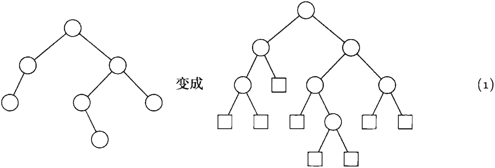
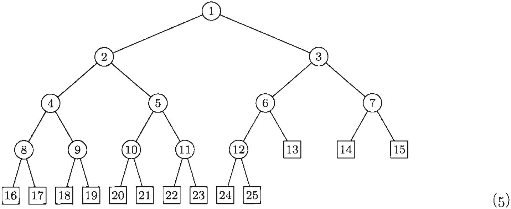
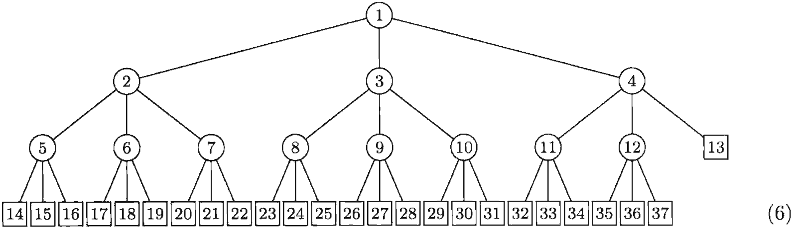
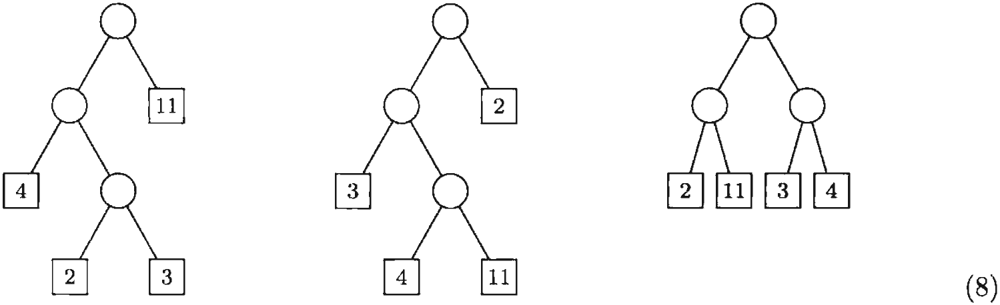
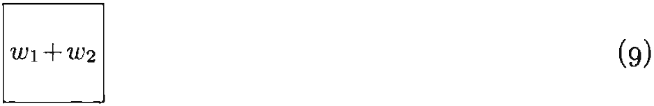
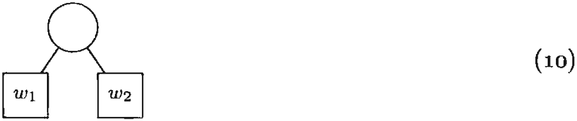
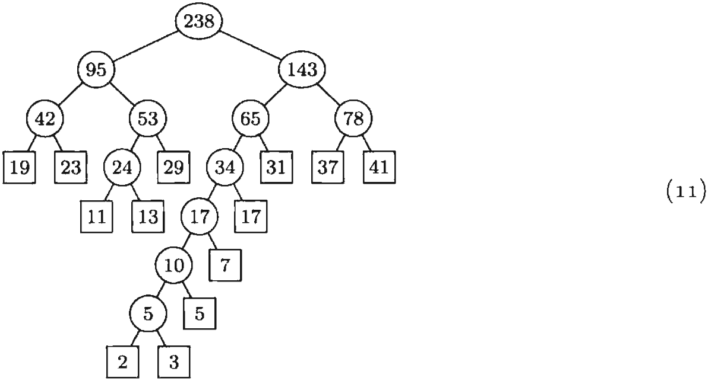

# 2.3.4.5　路径长度

树的 “路径长度” 概念在算法分析中极其重要, 因为它常常直接影响执行时间. 我们主要关注二叉树, 因为它最接近实际的计算机表示.

在下面的讨论中, 我们将扩展每个二叉树图, 在原树中出现空子树的地方增加一个特殊的结点, 使得

后者称作扩展的二叉树. 以这种方式增加方形结点后, 得到的结构有时更便于处理, 因此我们在后面的章节中经常用到扩展的二叉树. 显然, 每个圆形结点都有两个子女, 而方形结点没有子女. (与习题 2.3-20 比较.) 如果有 n 个圆形结点和 s 个方形结点, 则我们有 $n + s - 1$ 条边 (因为该图是自由树); 用另一种方法统计, 由子女个数可知, 存在 $2 n$ 条边. 因此, 显然有

$$
s=n+1;
\qquad \text{(2)}
$$

换言之, 刚增加的 “外部” 结点比原有的 “内部” 结点多一个. (另一种证明见习题 2.3.1-14.) 即便 $n = 0$, 公式 (2) 也是正确的.

假定二叉树已经按照这种方法扩展. 树的外部路径长度 E 定义为遍取所有的外部 (方形) 结点, 从根到每个结点的路径长度之和. 内部路径长度 I 是相同的量在内部 (圆形) 结点上求和. 在 (1) 中, 外部路径长度为

$$
E=3+3+2+3+4+4+3+3=25,
$$

而内部路径长度为

$$
I=2+1+0+2+3+1+2=11.
$$

这两个量总有关联公式

$$
E=I+2n,
\qquad \text{(3)}
$$

其中 $n$ 是内部结点数.

为了证明式 (3), 考虑删除一个与根的距离为 k 的内部结点 V, 其中 V 的两个子女都是外部的. 量 E 减少 $2(k + 1)$, 因为 V 的子女被删除; 然后它又增加 k, 因为 V 成为外部结点. 因此, E 的净改变为-k-2,I 的净改变为-k, 归纳可得式 (3).

不难看出, 当树退化成线性结构时, 内部路径长度最大 (因而外部路径长度也最大). 此时, 内部路径长度为

$$
(n-1)+(n-2)+\cdots+1+0=\frac{n^2-n}2.
$$

可以证明, 所有二叉树的 “平均” 路径长度正比于 $n \sqrt { n }$ (见习题 5).

现在, 考虑构造具有最小路径长度的 $n$ 个结点的二叉树问题. 这种树很重要, 因为它使各种算法的计算时间缩至最短. 显然, 仅有一个结点 (根) 与根的距离可能为 0, 最多有两个结点与根的距离可能为 1, 至多有 4 个结点与根的距离可能为 2, 如此下去. 因此, 内部路径长度至少与序列

$$
0,1,1,2,2,2,2,3,3,3,3,3,3,3,3,4,4,4,4,\ldots
$$

的前 n 项之和一样大. 这是和 $\sum_{k = 1}^{n} \left\lfloor \lg k \right\rfloor$, 从习题 1.2.4-42 可知, 它是

$$
(n+1)q-2^{q+1}+2,\qquad q=\lfloor\lg(n+1)\rfloor.
\qquad \text{(4)}
$$

最优值 (4) 是 $n \lg n + O(n)$, 因为 $q = \lg n + O(1)$. 显然如下所示的树会取得最优值 (以 $n = 1 2$ 为例):

像 (5) 这样的树称作具有 $n$ 个内部结点的完全二叉树. 在一般情况下, 我们可以把内部结点编号为 $1 , 2 , \ldots , n .$ 这种编号具有有用的性质: 结点 $k$ 的父母是结点 [k/2], 而结点 $k$ 的子女为结点 2k 和 2k+1. 外部结点用 $n + 1,   \cdots,   2n + 1$ 编号.

由此, 完全二叉树可以简单地用顺序的存储位置表示, 结构隐含在结点的位置中 (而不是链中). 完全二叉树显式或隐式出现在许多重要的计算机算法中, 因此读者应该对它特别留意.

这些概念具有重要的推广, 可以推广到三叉树、四叉树和更多叉树. 我们定义 t 叉树为结点的集合, 它或者为空, 或者由一个根和 t 个有序的、不相交的 t 叉树组成. (这推广了 2.3 节的二叉树定义.) 具有 12 个内部结点的完全三叉树是

容易看出, 对于任意 $t \geq 2$, 同样的构造有效. 在具有内部结点 $\{ 1 , \hat { 2 } , \ldots , n \}$ 的完全 k 叉树中, 结点 $k$ 的父母为

$$
\lfloor(k+t-2)/t\rfloor=\lceil(k-1)/t\rceil,
$$

而结点 $k$ 的子女为

$$
t(k-1)+2,\quad t(k-1)+3,\quad\ldots,\quad tk+1.
$$

在所有具有 n 个内部结点的 t 叉树中, 这棵树具有最小的内部路径长度. 习题 8 证明, 它的内部路径长度为

$$
\left(n+\frac1{t-1}\right)q-\frac{t^{q+1}-t}{(t-1)^2},\qquad q=\lfloor\log_t((t-1)n+1)\rfloor.
\qquad \text{(7)}
$$

稍微改变一下视角, 则这些结果有另一个重要的推广. 假设给定 $m$ 个实数 $w _ { 1 } , w _ { 2 } , \ldots , w _ { m }$ 问题是找出一棵具有 m 个外部结点的扩展的二叉树, 并且把这 m 个数 $w _ { 1 } , \ldots , w _ { m }$ 与这些结点相关联, 使得和 $\sum w_{j}l_{j}$ 最小, 其中 $l_{j}$ 是到根的路径长度, 求和对所有的外部结点进行. 例如, 如果给定的数为 2、3、4、11, 则我们可以形成像如下三棵这样的扩展的二叉树:

这里, “加权的” 路径长度 $\sum w_{j}l_{j}$ 分别为 34,53,40. (因此, 我们看到当权重为 2,3,4,11 时, 完全平衡的树并不给出最小的加权路径长度, 尽管我们已经看到在特殊情况 $w_1=w_2=\cdots=w_m=1$ 下, 它确实给出最小的加权路径长度.)

联系到不同的计算机算法, 加权的路径长度有多种解释. 例如, 我们可以把它用于合并长度分别为 $w _ { 1 } , w _ { 2 } , \ldots , w _ { m }$ 的已排序序列 (见第 5 章). 这种思想最直接的应用是把二叉树看作一般的搜索过程, 我们从根开始, 做某种测试; 根据测试的结果, 来到两个分支中的一个, 可以再做进一步的测试, 如此下去. 例如, 如果我们想判定 4 种不同的选择哪个为真, 并且这些可能性分别以概率 $\frac{2}{20}, \frac{3}{20}, \frac{4}{20}$, 1 为真, 则具有最小加权路径长度的树将形成最优搜索过程, 这些概率就是 (8) 中的权重乘以一个缩放因子.]

有一个精巧的算法能找出具有最小加权路径长度的树, 发现者是戴维·哈夫曼 [Proc.IRE40(1952), 1098-1101]: 首先, 找出两个最小的 $w$ 值, 比如说 $w _ { 1 }$ 和 $w _ { 2 }$; 然后, 求解 $m - 1$ 个权重 $w_1+w_2,w_3,\ldots,w_m$ 的问题, 并且把解中的结点

用

置换.

下面举例说明哈夫曼方法, 试对权重 2,3,5,7,11,13,17,19,23,29,31,37,41, 找出最优树. 首先组合 2+3, 并寻找 5,5,7,...,41 的解; 然后组合 5+5, 等等. 计算过程汇总如下:

|  |  |  |  |  |  |  |  |  |  |  |  |  |
| --- | --- | --- | --- | --- | --- | --- | --- | --- | --- | --- | --- | --- |
| 2 | 5 |  | 7 | 11 | 13 | 17 | 19 | 23 | 29 | 31 | 37 | 41 |
|  |  | 5 | 7 | 11 | 13 | 17 | 19 | 23 | 29 | 31 | 37 | 41 |
| 5 |  | 10 | 7 | 11 | 13 | 17 | 19 | 23 | 29 | 31 | 37 | 41 |
|  |  |  | 17 | 11 | 13 | 17 | 19 | 23 | 29 | 31 | 37 | 41 |
|  |  |  | 17 |  | 24 | 17 | 19 | 23 | 29 | 31 | 37 | 41 |
|  |  |  |  |  | 24 | 34 | 19 | 23 | 29 | 31 | 37 | 41 |
|  |  |  |  |  | 24 | 34 |  | 42 | 29 | 31 | 37 | 41 |
|  |  |  |  |  | 34 |  | 42 |  | 53 | 31 | 37 | 41 |
|  |  |  |  |  |  |  | 42 |  | 53 | 65 | 37 | 41 |
|  |  |  |  |  |  |  | 42 |  | 53 | 65 |  | 78 |
|  |  |  |  |  |  |  |  |  | 95 | 65 |  | 78 |
| 对应于哈夫曼的构造: |  |  |  |  |  |  |  |  | 95 |  |  | 143 |

因此, 下面的树对应于哈夫曼的构造:

(圆形结点中的数显示这棵树与计算过程的对应性, 另见习题 9.)

对 m 作归纳, 不难证明这种方法确实能得到最小的加权路径长度. 假设 $w _ { 1 } \leq w _ { 2 } \leq w _ { 3 } \leq$ $\cdots \leq w _ { m }$, 其中 $m \geq 2$, 并且假设给定了一棵最小化加权路径长度的树. (这种树一定存在, 因为具有 m 个终端结点的二叉树只有有限多种.) 令 V 是到根的距离最大的内部结点. 如果权重 $w _ { 1 }$ 和 $w _ { 2 }$ 未赋给 V 的子女, 则我们可以把它们与那里已经有的值交换, 因为这种交换不增加加权的路径长度. 因此, 存在一棵具有最小加权路径长度并且包含子树 (10) 的树. 容易证明, 对于权重 $w _ { 1 } , \cdots , \: w _ { m }$, 包含 (10) 作为子树的树的加权路径长度取最小值, 当且仅当用 (9) 替换 (10) 的树对于权重 $\underline { { w _ { 1 } } } + \underline { { w _ { 2 } } } , \: \underline { { w _ { 3 } } } , \: \ldots , \: \underline { { w _ { m } } }$. 有最小的加权路径长度. (见习题 9.)

如果给定的 $w _ { i }$ 都非负, 则每当构造过程中合并两个权重时, 待合并的权重都不小于上次合并之前的权重. 这意味只要给定的权重以非递减序排序, 则找出哈夫曼树的方法很简洁: 只需要维护两个队列, 一个包含原来的权重, 而另一个包含组合的权重. 在每一步, 未使用的最小权重都出现在某个队列的队首, 因此我们不必搜索它. 习题 13 表明, 甚至当权重可能为负时, 相同的思想依然有效.

一般而言, 存在多棵使 $\sum w_{j}l_{j}$ 取最小值的树. 如果上一段描述的算法在出现平局时总是使用原来的权重, 而不是组合权重, 则它构造的树在所有最小化 $\sum w _ { j } l _ { j }$ 的树中具有最小的 $\max l_{j}$ 和 $\sum l_{j}$ 值. 如果权重都为正, 则在所有这样的树中, 这棵树实际上对于任意凸函数 $f$ 具有最小的 $\sum w _ { j } f ( l _ { j } )$ 值. [尤金·施瓦茨的 Information and Control7(1964), 37-44; 马可夫斯基, Acta Informatica 16 (1981), 363-370. ]

哈夫曼方法可以推广到 t 叉树, 就像二叉树一样. (参见习题 10.) 另一个重要推广在 6.2.2 节讨论. 路径长度的进一步讨论见 5.3.1 节、5.4.9 节和 6.3 节.

#### 习题

1\. [12] [答案](./answers/2-3-4-5.md#ans-2-3-4-5-1) 除完全二叉树 (5) 之外, 还有具有 12 个内部结点和最小路径长度的其他二叉树吗?

2\. [17] [答案](./answers/2-3-4-5.md#ans-2-3-4-5-2) 画一棵扩展的二叉树, 它具有权重为 1,4,9,16,25,36,49,64,81,100 的终端结点, 具有最小的加权路径长度.

▶ 3. [M24] [答案](./answers/2-3-4-5.md#ans-2-3-4-5-3) 一棵具有 m 个外部结点的扩展的二叉树确定了路径长度 $l _ { 1 } , l _ { 2 } , \ldots , l _ { m }$ 的集合, 它们刻画从根到各外部结点的路径长度. 反之, 如果给定数 $l _ { 1 } , l _ { 2 } , \ldots , l _ { m }$ 的集合, 是否总可以构造一棵扩展的二叉树, 使得这些数是按照某种次序排列的路径长度吗? 证明: 能够构造这样的二叉树, 当且仅当 $\textstyle \sum _ { j = 1 } ^ { m } 2 ^ { - l _ { j } } = 1 .$

4\. [M25] [答案](./answers/2-3-4-5.md#ans-2-3-4-5-4) (施瓦茨和布鲁斯·卡利克) 假定 $w _ { 1 } \leq w _ { 2 } \leq \cdots \leq w _ { m }$. 证明: 存在一棵扩展的二叉树使 $\sum w _ { j } l _ { j }$ 取最小值, 并且其终端结点从左到右分别包含值 $w _ { 1 } , w _ { 2 } , \ldots , w _ { m }$. 例如, 树 (11) 不满足这一条件, 因为权重出现的次序为 19,23,11,13,29,2,3,5,7,17,31,37,41. 我们寻找权重以递增序出现的树, 而哈夫曼构造未必符合要求.]

5\. [HM26] [答案](./answers/2-3-4-5.md#ans-2-3-4-5-5) 令

$$
B ( w , z ) = \sum _ { n , p \geq 0 } b _ { n p } w ^ { p } z ^ { n } ,
$$

其中, $b _ { n p }$ 是具有 n 个结点并且内部路径长度为 p 的二叉树个数. [因此,

$$
B ( w , z ) = 1 + z + 2 w z ^ { 2 } + ( w ^ { 2 } + 4 w ^ { 3 } ) z ^ { 3 } + ( 4 w ^ { 4 } + 2 w ^ { 5 } + 8 w ^ { 6 } ) z ^ { 4 } + \cdots ,
$$

即 $B(1,z)$ 是 2.3.4.4 节式 (13) 的 $B ( z )$. \](a) 找出刻画 $B(w,z)$ 的函数关系, 推广 2.3.4.4-(12). (b) 使用 (a) 的结果确定具有 n 个结点的二叉树的内部路径的平均长度, 假定所有 $\frac{1}{n + 1} \binom{2n}{n}$ 种树都是等可能的. (c) 求出这个量的近似值.

6\. [16] [答案](./answers/2-3-4-5.md#ans-2-3-4-5-6) 如果 $t$ 叉树像 (1) 那样用方形结点扩展, 那么对应于式 (2) 的方形和圆形结点数量之间的关系是什么?

7\. [M21] [答案](./answers/2-3-4-5.md#ans-2-3-4-5-7) t 叉树的外部和内部路径长度之间的关系是什么? (参见习题 6, 希望推广式 (3).)

8\. [M23] [答案](./answers/2-3-4-5.md#ans-2-3-4-5-8) 证明式 (7).

9\. [M21] [答案](./answers/2-3-4-5.md#ans-2-3-4-5-9) 出现在 (11) 中圆形结点内的数等于对应子树中外部结点的权重之和. 证明: 所有圆形结点中的值之和等于加权的路径长度.

▶ 10. [M26] [答案](./answers/2-3-4-5.md#ans-2-3-4-5-10) (哈夫曼) 给定非负权重 $w _ { 1 } , w _ { 2 } , \ldots , w _ { m }$, 说明如何构造具有极小加权路径长度的 t 叉树. 对于权重 1,4,9,16,25,36,49,64,81,100, 构建一棵最优三叉树.

11\. [16] [答案](./answers/2-3-4-5.md#ans-2-3-4-5-11) 完全二叉树 (5) 与习题 2.3.1-5 介绍的二叉树的 “杜威记数法” 之间有无联系?

12\. [M20] [答案](./answers/2-3-4-5.md#ans-2-3-4-5-12) 假设在二叉树中随机选取一个结点, 每个结点都等可能. 证明, 以该结点为根的子树的平均大小与该树的路径长度有关.

13\. [22] [答案](./answers/2-3-4-5.md#ans-2-3-4-5-13) 设计一个算法, 从 m 个权重 $\hat { w } _ { 1 } \leq \hat { w } _ { 2 } \leq \cdots \leq \hat { w } _ { m }$ 开始, 构造一棵具有最小加权路径长度的扩展的二叉树. 用以下三个数组表示最终的树

$$
A [ 1 ] \ldots A [ 2 m - 1 ] , \quad L [ 1 ] \ldots L [ m - 1 ] , \quad R [ 1 ] \ldots R [ m - 1 ] ,
$$

这里, $L [ i ]$ 和 $R [ i ]$ 指向内部结点 $i$ 的左子女和右子女, 根是结点 1,A[i] 是结点 $i$ 的权重. 原来的权重应该作为外部结点的权重 $\underline { { A } } [ m ] , \: \ldots , \: \underline { { A } } [ 2 m - 1 ]$ 出现. 你的算法所做的权重比较应该少于 2m 次. 注意: 某些或所有给定的权重可能为负!

14\. [25] [答案](./answers/2-3-4-5.md#ans-2-3-4-5-14) (胡德强和艾伦·塔克) 在哈夫曼算法 k 步之后, 已组合的结点形成一个包含 $\bar { m } - k$ 棵扩展的二叉树的森林. 证明: 在所有的具有给定权重的 m—k 棵扩展的二叉树的森林中, 该森林具有最小的加权路径总长度.

15\. [M25] [答案](./answers/2-3-4-5.md#ans-2-3-4-5-15) 说明一个类哈夫曼算法能找出一棵扩展的二叉树, 它最小化 $\text{(a)}\max(w_1+l_1,\ldots,w_m+l_m)$ $\mathrm{(b)}w_{1}x^{l_{1}} + \cdots + w_{m}x^{l_{m}}$, 其中 $x > 1 .$

16\. [M25] [答案](./answers/2-3-4-5.md#ans-2-3-4-5-16) (黄光明) 令 $w _ { 1 } \leq \cdots \leq w _ { m }$ 和 $w _ { 1 } ^ { \prime } \leq \cdots \leq w _ { m } ^ { \prime }$ 是两组权重, 满足

$$
\sum_{j = 1}^{k} w_{j} \leq \sum_{j = 1}^{k} w_{j}^{\prime} \qquad  对于  1 \leq k \leq m.
$$

证明: 最小化的加权路径长度满足 $\textstyle \sum _ { j = 1 } ^ { m } w _ { j } l _ { j } \leq \sum _ { j = 1 } ^ { m } w _ { j } ^ { \prime } l _ { j } ^ { \prime } .$

17\. [HM30] [答案](./answers/2-3-4-5.md#ans-2-3-4-5-17) (查尔斯·格拉西和理查德·卡普) 令 $s _ { 1 } , \ldots , s _ { m - 1 }$ 是被哈夫曼算法形成的扩展的二叉树的内部 (圆形) 结点中的数, 按构造次序. 令 $s _ { 1 } ^ { \prime } , \ldots , s _ { m - 1 } ^ { \prime }$ 是相同权重集 $\{ w _ { 1 } , \ldots , w _ { m } \}$ 上的任意的扩展二叉树的内部结点权重, 按满足每个非根的内部结点都在其父母结点之前出现的任意次序列出. (a) 证明对于 $\begin{array} { r } { 1 \leq k < m , \sum _ { j = 1 } ^ { k } s _ { j } \leq \sum _ { j = 1 } ^ { k } s _ { j } ^ { \prime } } \end{array}$. (b) 对于每个非递减的凹函数 $f ;$, 即满足 $f ^ { \prime } ( x ) \geq 0 , f ^ { \prime \prime } ( x ) \leq 0$ 的函数 f, (a) 的结果等价于

$$
\sum _ { j = 1 } ^ { m - 1 } f ( s _ { j } ) \leq \sum _ { j = 1 } ^ { m - 1 } f ( s _ { j } ^ { \prime } ) .
$$

[见哈代、约翰·利特尔伍德和波利亚, MessengerofMath.58(1929), 145-152.] 使用这一事实证明: 给定任意函数 $f(n)$, 满足性质 $\Delta f(n)=f(n+1)-f(n)\ge0$, $\Delta^2 f(n)=\Delta f(n+1)-\Delta f(n)\le0$, 递推式

$$
F(n) = f(n) + \min_{1 \leq k < n} \left( F(k) + F(n - k) \right), \qquad F(1) = 0
$$

的极小值总是在 $k = 2 ^ { \lceil \operatorname { l g } ( n / 3 ) \rceil }$ 时取得.
