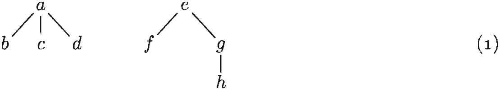
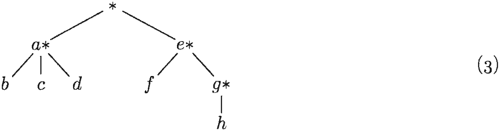
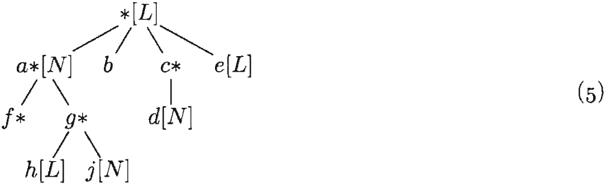
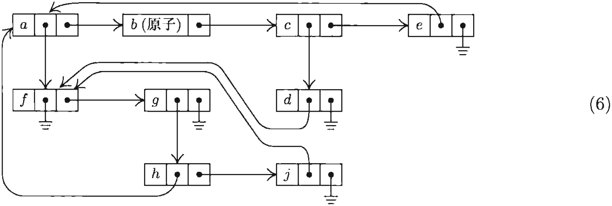
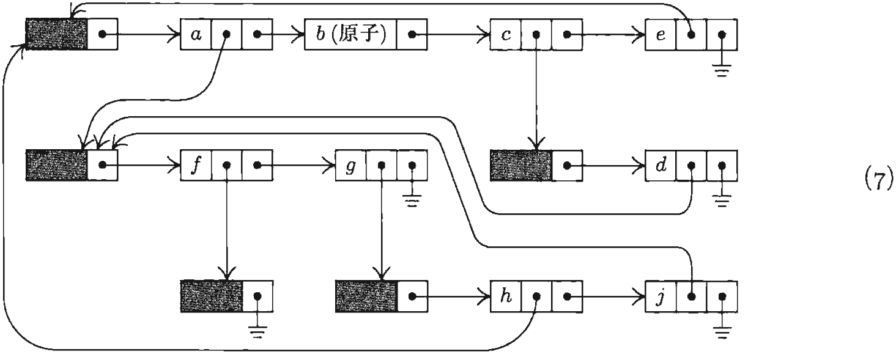
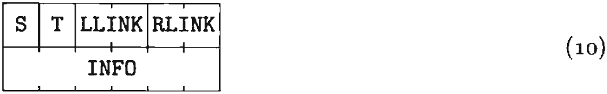
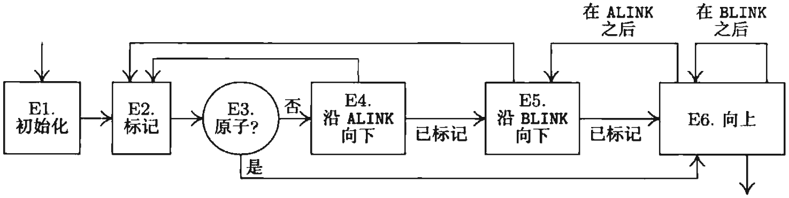
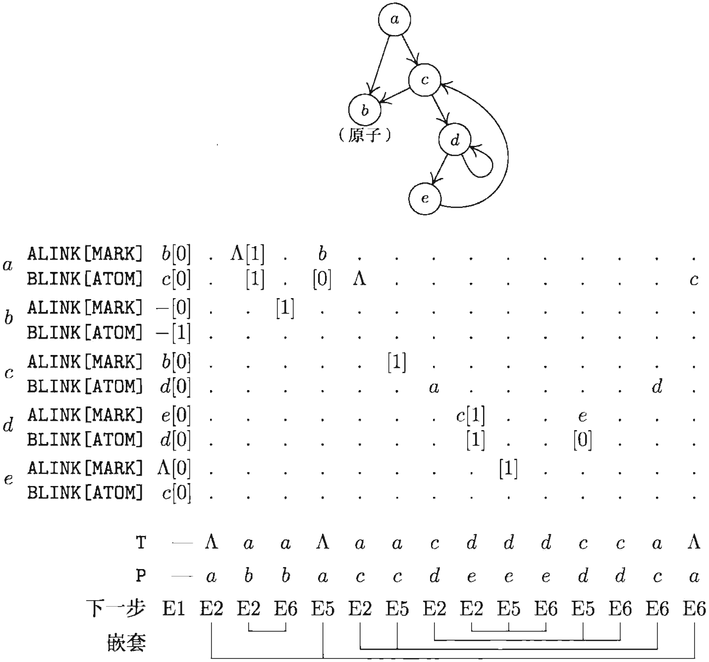
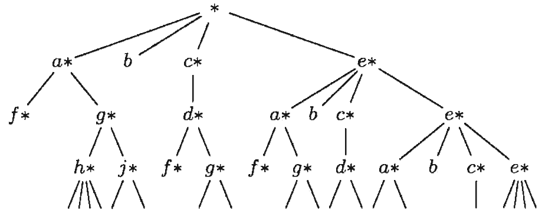

# 2.3.5表和垃圾回收

在 2.3 节的开始处, 我们非形式地定义表[^cn339-1] 是 “零个或多个原子或表的有限序列”, 任何森林都是一个表, 例如,

可以看作表

$$
(a\mathbin{:}(b,c,d),e\mathbin{:}(f,g\mathbin{:}(h))),
\qquad \text{(2)}
$$

而对应的表图为

此时, 读者应该复习一下以前给出的表的介绍, 特别是 2.3 节开始处的 (3) (4) (5) (6) (7). 回到上面的 $(2)$, 记号 $a ; ( b , c , d )$ 意味 $( b , c , d )$ 是包含 3 个原子的表, 由属性 $a$ 标记. 这种约定符合我们的一般规则除了结构联系之外, 树的每个结点可以包含信息. 然而, 正如在 2.3.3 节讨论树那样, 无标记的表可使所有信息都出现在原子中, 完全可以统一使用这种表, 有时还有好处.

尽管任何森林都可以看作一个表, 但是其逆不真. 下面的表可能比 (2) 和 (3) 更典型, 因为它显示了树结构的限制可能被违反:

$$
L=(a\mathbin{:}N,b,c\mathbin{:}(d\mathbin{:}N),e\mathbin{:}L),\qquad N=(f\mathbin{:}(\,),g\mathbin{:}(h\mathbin{:}L,j\mathbin{:}N))
\qquad \text{(4)}
$$

它可以图示为

[与 2.3-(7) 中的例子比较. 对这些图的形式不必太认真.]

不出所料, 存在许多种在计算机内存中表示表结构的方法. 这些方法一般与使用二叉树表示一般的树的森林有相同的基本主旨, 只作了变形: 一个字段, 比如说 RLINK, 用来指向表的下一个元素, 而另一个字段 DLINK 可以用来指向子表的第一个元素. 通过对 2.3.2 节介绍的内

存表示的自然扩充, 我们可以把表 (5) 表示如下:

遗憾的是, 对于最常见的表处理应用, 这种简单的思想并不太合适. 例如, 假设我们有表 $\bar{L} = \left( \bar{A}, a, \left( \bar{A}, \bar{A} \right) \right)$, 它包含对另一个表 $A = (b,c,d)$ 的三次引用. 一种典型的表处理操作是移去 A 的最左元素, 使得 A 变成 $( c , d )$. 但是, 如果我们使用 (6) 所示的技术, 则需要对 L 的表示做 3 处改变, 因为每个指向 A 的指针都指向要删除的元素 $b$. 略加考虑, 读者就会明白, 如果仅因为删除 A 的第一个元素就改变对 A 的所有引用, 那将非常不方便. (在这个例子中, 我们可以使用一点技巧, 假定没有指针指向元素 $c$, 把整个 $c$ 复制到 $b$ 先前占据的位置, 然后删除旧的元素 $c$. 但是, 如果 A 失去最后一个元素而成为空表, 则这种做法将失败.)

为此, 表示方案 (6) 通常换成另一种类似的方案所取代, 改用 2.2.4 节介绍的表头开始每个表. 每个表都包含一个称作表头的附加结点, 例如, 结构 (6) 将表示成

实践中, 这种头结点的引入实际上并不浪费内存空间, 因为明显不用的字段 (图示 (7) 的阴影区域) 一般有多种用法, 例如存放引用计数、指向表右端的指针、字母名, 或作为辅助遍历算法的 “临时” 字段.

在原来的图示 (6) 中, 包含 $b$ 的结点是一个原子, 而包含 $f$ 的结点则确定一个空表. 两者在结构上是等价的, 因此读者有理由问为什么还要谈论 “原子”. 不失一般性, 照常约定 “表的每个结点除了结构信息外还可能包含数据”, 我们本来可以简单地把表定义为 “零个或多个表的有限序列”. 这种观点肯定说得通, 显得 “原子” 概念非常不自然. 然而, 当考虑计算机内存的有效使用时, 确实有充分理由突出原子, 因为原子并不受制于希望对表进行的那些通用操作. 内存表示 (6) 表明, 原子结点 $b$ 中用于存放信息的空间可能比表结点 $f$ 中的大; 像 (7) 那样有表头时, 结点 $b$ 和 $f$ 的存储要求之间存在显著差别. 因此, 引进 “原子” 概念旨在高效地使用计算机内存. 典型的表包含的原子远比例 (4)-(7) 更多, 这里只想说明可能的复杂性, 而不是通常的简单性.

一个表本质上只不过是元素可能包含指向其他表的指针的线性表. 我们希望在表上进行的常用操作正是线性表的常用操作 (创建、销毁、插入、删除、拆分、连接), 加上主要对树结构有意义的其他操作 (复制、遍历、输入和输出嵌套信息). 为此, 用于表示内存中的链接线性表的三种基本技术 (即直线表、循环表或双链接表) 都可以使用, 效率取决于所使用的算法. 对于这三种表示, 图示 (7) 可能以下面的形式出现在内存中.

| 内存位置 | 直链 INFO | DLINK | RLINK | 循环链 INFO | DLINK | RLINK | 双链 INFO | DLINK | LLINK | RLINK |
| --- | --- | --- | --- | --- | --- | --- | --- | --- | --- | --- |
| 010 | — | 表头 | 020 | — | 表头 | 020 | — | 表头 | 050 | 020 |
| 020 | a | 060 | 030 | a | 060 | 030 | a | 060 | 010 | 030 |
| 030 | b | 原子 | 040 | b | 原子 | 040 | b | 原子 | 020 | 040 |
| 040 | c | 090 | 050 | c | 090 | 050 | c | 090 | 030 | 050 |
| 050 | e | 010 | Λ | e | 010 | 010 | e | 010 | 040 | 010 |
| 060 | — | 表头 | 070 | — | 表头 | 070 | — | 表头 | 080 | 070 |
| 070 | f | 110 | 080 | f | 110 | 080 | f | 110 | 060 | 080 |
| 080 | g | 120 | Λ | g | 120 | 060 | g | 120 | 070 | 060 |
| 090 | — | 表头 | 100 | — | 表头 | 100 | — | 表头 | 100 | 100 |
| 100 | d | 060 | Λ | d | 060 | 090 | d | 060 | 090 | 090 |
| 110 | — | 表头 | Λ | — | 表头 | 110 | — | 表头 | 110 | 110 |
| 120 | — | 表头 | 130 | — | 表头 | 130 | — | 表头 | 140 | 130 |
| 130 | h | 010 | 140 | h | 010 | 140 | h | 010 | 120 | 140 |
| 140 | j | 060 | Λ | j | 060 | 120 | j | 060 | 130 | 120 |

(8)

这里, LLINK 用作双链接表示的左指针. 在三种形式中, INFO 和 DLINK 字段都相同.

没有必要在此重复这三种形式下的表处理算法, 因为我们已经多次讨论过这些思想. 然而, 关于表, 需要注意如下要点, 因为它们有别于以前处理过的简单特殊情况.

(1) 由上面的内存表示可知, 原子结点不同于非原子结点. 此外, 当使用循环表或双链接表时, 为了方便表的遍历, 最好区别表头结点和其他结点. 因此, 每个结点通常包含一个 TYPE 字段, 指出结点代表的信息类型. TYPE 字段也常常用来区别不同类型的原子 (例如在处理或显示数据时, 用来区别字母、整数或浮点量).

(2) 用于 MIX 计算机的一般表处理的结点格式可以用以下两种方法设计.

(a) 假定所有 INFO 都出现在原子中, 可能的一字格式:

S (符号): 用于垃圾回收的标志位 (见下面).

T (类型): T=0 表示表头, T=1 表示子表元素, T>1 表示原子.

REF: 当 T=0 时, REF 是引用计数 (见下面); 当 T=1 时, REF 指向相关子表的表头; 当 T>1 时, REF 指向一个包含一个标志位和 5 个字节原子信息的结点.

RLINK: 用于直线链接或循环链接的指针, 同 (8).

(b) 可能的两字格式:

S 和 T: 同 (9).

LLINK 和 RLINK: 用于双链接的通常的指针, 同 (8).

INFO: 与该结点相关联的全字信息; 对于表头结点, 这可能包含引用计数、指向该表内部以辅助线性遍历的运行指针、符号名等. 当 T=1 时, 这一信息包括 DLINK.

(3) 显然, 表是一类非常一般的结构. 似乎可以合理地说, 只要进行适当约定, 无论什么结构都可以表示成表. 由于表的普适性, 大量程序设计系统都经过设计, 便于表处理, 并且任何计算机装置都有多种系统可供使用. 此类系统都是基于式 (9) 和 (10) 这样的通用结点格式, 是为了表操作的灵活性而设计的. 实际上容易发现, 通用格式通常并非适合特定应用的最佳格式, 使用通用程序的处理时间显著多于针对特定问题人工定制的系统. 例如, 容易看出, 如果统一使用像 (9) 和 (10) 中那样的通用表表示, 而不是用我们针对每种情况给出的结点格式, 则本章解决的应用几乎都会受到拖累. 在处理结点时, 表处理程序通常必须考察 T 字段, 而迄今为止我们写出的任何程序中都不需要. 使用通用系统虽然会损失效率, 但在许多情况下都可通过降低编程难度和减少排错时间来弥补.

(4) 表处理算法与本章前面给出的算法之间还存在一个非常显著的差别. 由于一个表可能同时包含在许多其他表中, 因此没有办法准确知道一个表何时应该送回可用存储池中. 迄今为止, 我们的算法都是只要不再需要 NODE(X), 就使用指令 “ ${ \mathsf { ^ { \prime } A V A I L } } \Leftarrow  { \mathsf { X } }$. 但是一般的表可能以完全不可预测的方式增长和消亡, 通常很难判断特定的结点何时是多余的. 因此, 对于表, 维护可用空间表的问题比原来考虑的简单情况困难得多. 本节的剩余部分将集中讨论存储回收再利用问题.

想象我们在设计一个通用表处理系统, 供几百名程序员使用. 为维护可用空间表, 目前有两种备选方案: 使用引用计数器 (reference counter) 和垃圾回收 (garbagecollection). 引用计数器技术利用每个结点中的一个新字段, 包含对指向该结点的箭头数量的计数. 这个计数在程序运行时很容易维护, 一旦它降至 0, 则对应的结点就成为可用的. 另一方面, 垃圾回收技术需要在每个结点新增一个称作标志位的一位字段. 其基本思想是, 把几乎所有算法都写成不向自由存储返回结点的形式, 让每个程序一直顺畅运行, 直到可用存储全部耗尽; 然后, “回收” 算法利用标志位识别当前不能访问的所有结点, 并把它们送回可用存储, 之后程序可以继续.

这两种方法都不完全令人满意. 引用计数器方法的主要缺点是, 它并不一定能释放所有可用结点. 对于重叠表 (包含公共子表的表), 它运行良好; 但是对于递归表, 像 (4) 中的 L 和 N, 该方法永远不能把这些结点返回到可用存储中. 即便没有运行程序可访问的其他表指向它们, 它们的计数也不会为 0 (因为它们自引用). 此外, 引用计数器方法在每个结点中都使用好大一块空间 (尽管有时计算机字容量有富余, 本来就有可用空间).

除了每个结点损失一位外, 垃圾回收技术的困难是, 当几乎所有内存空间都在用时, 它运行很慢, 并且此时找到的自由存储单元数量太少, 不值得费这么大的劲. 超过存储容量的程序 (很多未经过排错的程序就是如此!) 在存储耗尽之前常常多次调用垃圾回收程序, 浪费很多时间, 却几乎毫无成效. 对于这一问题, 一种部分解决方案是让程序员指定一个数 $k$, 表示当垃圾回收程序运行后只找到 $k$ 个或更少自由结点时, 就不再继续处理.

另一个问题是, 有时很难准确判定在给定的阶段什么表不是废料. 如果程序员一直使用非标准技术或总是在非常规位置存放指针值, 则垃圾回收程序就很可能出错. 程序调试史上出现过一些非常不可思议的事, 都是由于程序以前曾经多次正常运行, 但某次运行期间, 垃圾回收程序却在出人预料的时刻突然运行. 垃圾回收程序还要求程序员始终要在所有指针字段存放合法的值, 尽管把没有意义的信息留在程序不使用的字段 (例如队列尾结点的链字段) 常常是方便的, 见习题 2.2.3-6.

尽管对于每个结点, 垃圾回收都需要一个标志位, 但是我们可以把所有标志位组装成一个单独的表, 放在另外的存储区域中, 并建立结点的位置与标志位之间的对应关系. 在某些计算机上, 这种思想会带来很好的垃圾回收方法, 比在每个结点中用掉一位更有吸引力.

约瑟夫·维森鲍姆对引用计数器技术提出了一种有趣的改进. 他使用双链表结构, 只在每个表的表头设置一个计数器. 这样, 当指针变量遍历一个表时, 它们并不包含在个体结点的引用计数中. 如果知道对整个表维护引用计数的规则, 则 (理论上) 就知道如何避免访问引用计数为 0 的表. 我们还可以完全不管引用计数, 而把特定的表送回可用空间. 这些都需要小心从事, 对于没有经验的程序员来说, 这样做比较危险, 因为引用已经删除的结点会导致程序调试更加困难. 维森鲍姆方法的最精彩部分是处理引用计数刚变成 0 的表: 他把这种表附加到当前可用空间表的尾部 (使用双链表很容易做到), 仅当前面的可用单元都用完之后才把它作为可用空间. 最终, 随着这个表的一个个结点变成可用的, 它们引用的表的计数相应减 1. 这种延迟清除表的做法在运行时间上相当高效, 但是它常常使得不正确的程序正确地多运行一会儿! 更多细节参见 CACM 6(1963), 524-544.

垃圾回收算法非常令人感兴趣, 原因有多种. 首先, 这种算法在其他情况下也有用, 比如想标记一个给定结点直接或间接引用的所有结点时. (例如, 我们可能想要找出给定程序直接或间接调用的所有子程序, 如习题 2.2.3-26.)

垃圾回收通常分两个阶段. 我们假定所有结点的标志位初始都为 0 (或者都设置为 0). 第一阶段是从主程序可以直接访问的结点开始, 标记所有不是垃圾 (无用单元) 的结点; 第二阶段顺序扫描整个内存池区域, 把所有未标记的结点都放进自由空间表. 标记阶段最有趣, 因此我们把注意力放在这上面. 然而, 第二阶段也有某些重要变化形式, 参见习题 9.

运行垃圾回收算法时, 只有少量存储可以用于控制标记过程. 这个问题很有趣, 也很困难, 下面将抽丝剥茧, 分析清楚. 大部分人首次得知垃圾回收的想法时意识不到这种困难, 最初几年也一直没有出现好的解决方法.

下面的标记算法也许是最显而易见的.

算法 A (标记). 令整个可用的表内存为 NODE(1), NODE(2),...,NODE(M), 并假设这些字或者是原子, 或者包含两个链接字段 ALINK 和 BLINK. 假定所有结点初始均未标记. 这个算法的目的是从一组 “直接可访问的” 结点, 即从主程序中某些固定位置指向的结点开始, 标记通过一串非原子结点 ALINK 和/或 BLINK 指针链可以到达的所有结点. 主程序中的这些固定指针用作所有内存访问的依据.

A1.[初始化.] 标记所有直接可访问的结点. 置 K←1.

A2.[NODE(K) 蕴涵另一个吗?] 置 K1←K+1. 如果 NODE(K) 是原子或未标记的, 则转到步骤 A3. 否则, 如果 NODE(ALINK(K)) 是未标记的, 标记它, 并且如果它不是原子, 则置 K1←min(K1,ALINK(K)). 类似地, 如果 NODE(BLINK(K)) 是未标记的, 标记它, 并且如果它不是原子, 则置 K1 ← min(K1,BLINK(K)).

A3. [完成?] 置 K←K1. 如果 $\mathbb { K } \leq \mathbb { M }$, 则返回步骤 A2; 否则算法终止.

在这个算法和本节下面的算法中, 为方便起见, 我们假定实际不存在的结点 NODE(Λ) 已经标记. (例如, 在步骤 A2 中, ALINK(K) 或 BLINK(K) 可能等于Λ.)

算法 A 可变形为, 在步骤 A1 置 K1←M+1, 从步骤 A2 删除操作 K1←K+1, 把步骤 A3 改变成:

$\overline{A}3'.$ [完成?] 置 $K \leftarrow K + 1$. 如果 $\mathbb { K } \leq \mathbb { M }$, 则返回步骤 A2. 否则, 如果 $\mathbb { K } 1 \leq \mathbb { M }$, 则置 K←K1, $\mathtt { K 1 } \leftarrow \mathtt { M } + 1$, 并且返回步骤 A2. 否则算法终止.

很难给出算法 A 的精确分析, 也很难确定它比刚才介绍的变形好还是坏, 因为没有有意义的方法来刻画输入的概率分布. 我们可以说, 在最坏情况下, 它的运行时间正比于 nM, 其中 $n$ 是标记的结点数. 一般而言, 当 $n$ 很大时, 它肯定很慢. 算法 A 太慢, 难以作为垃圾回收的有用技术.

另一种相当明显的标记算法是沿着所有的路径前进, 并把分支点记录在栈中.

算法 B (标记). 这个算法使用 STACK[1],STACK[2],... 作为辅助存储, 记录所有尚未走完的路径, 达到与算法 A 相同的效果.

B1.[初始化.] 令 T 为直接可访问的结点数. 标记直接可访问的结点, 并且把指向它们的指针放入 STACK[1],...,STACK[T] 中.

B2.[栈空否?] 如果 T=0, 则算法终止.

B3.[移走顶部的项.] 置 K←STACK[T], T←T-1.

B4.[考察链.] 如果 NODE(K) 是原子, 则返回步骤 B2. 否则, 如果 NODE(ALINK(K)) 未标 记, 则标记它, 并且置 T←T+1,STACK[T]←ALINK(K); 如果 NODE(BLINK(K)) 未标 记, 则标记它, 并且置 T←T+1,STACK[T]←BLINK(K). 返回步骤 B2.

显然, 算法 B 的运行时间基本上正比于被它标记的单元数, 而这正是我们所能期望的最好效果. 但是, 对于垃圾回收, 它实际上没有用, 因为没有地方来维护栈! 算法 B 中的栈会增长, 比如说可以合理假定增长到内存大小的百分之五; 但是如果调用垃圾回收程序, 并且所有可用空间都已用完, 则只有固定数目 (相当少) 的单元可以用作栈. 早期的垃圾回收过程基本上都基于这个算法. 如果栈空间用完, 则整个程序都得终止.

结合算法 A 和 B, 使用固定大小的栈, 可得到稍微好一点的解决方案.

算法 C (标记). 这个算法使用 H 个单元的辅助表 STACK[0],STACK[1],...,STACK[H—1], 达到与算法 A 和 B 同样的效果.

在这个算法中, “把 X 插入到栈顶” 意指如下操作: “置 T←(T+1)modH,STACK[T]←X. 如果 T = B, 则置 B ←(B +1) mod H,K1 ← min(K1,STACK[B]).” (注意: T 指向当前栈顶, B 指向当前栈底的下一个位置; STACK 基本上像输入受限的队列一样操作.)

C1.[初始化.] 置 T←H-1,B←H-1,K1←M+1. 标记所有可以直接访问的结点, 按顺序把它们的位置插入到栈中 (如上所述).

C2.[栈空否?] 如果 T =B, 则转到步骤 C5.

C3. [移走顶部的项.] 置 K ←STACK[T],T ←(T-1)mod H.

C4.[考察链.] 如果 NODE(K) 是原子, 则返回步骤 C2. 否则, 如果 NODE(ALINK(K)) 未标记, 则标记它, 并且把 ALINK(K) 插入到栈中. 类似地, 如果 NODE(BLINK(K)) 未标记, 则标记它, 并且把 BLINK(K) 插入到栈中. 返回 C2.

C5.[扫描.] 如果 K1>M, 则算法终止. (变量 K1 代表可能指向需要标记的新结点的最小位置.) 否则, 如果 NODE(K1) 是原子或未标记的, 则 K1 增加 1, 并重复该步骤. 如果 NODE(K1) 是标记的, 则置 K←K1,K1 增加 1, 转到步骤 C4.

如果当 NODE(X) 是原子时不把 X 推入栈中, 则可以改进算法 C 和算法 B. 此外, 当知道某项马上就被移出时, B4 和 C4 步就不需把它推入栈中. 这些修改是直截了当的, 没有做只是为了避免无谓的算法复杂性.

当 H=1 时, 算法 C 基本上等价于算法 A, 而当 H=M 时等价于算法 B. 随着 H 增大, 算法 C 效率也逐渐提高. 可惜由于与算法 A 一样的原因, 算法 C 无法精确地分析, 所以我们不知道设置多大的 H 才能使这种方法足够快. 似乎可以说, 诸如 H=50 就足以使算法 C 可以用于多数应用的垃圾回收, 但是这种说法令人不放心.

算法 B 和 C 使用存放在顺序存储单元中的栈, 但是在这一章我们已经看到, 链接存储技术适合维护非连续内存中的栈. 这暗示算法 B 的栈恰好可以设法分散存放在希望收集垃圾的内存区域. 稍微给垃圾回收程序一点活动空间, 就可以轻松做到. 例如, 假定所有的表都像式 (9) 那样表示, 只是表头结点的 REF 字段用于垃圾回收, 而不是作为引用计数. 于是我们可以重新设计算法 B, 使得栈存放在表头结点的 REF 字段中:

算法 D (标记). 这个算法达到与算法 A、B 和 C 相同的效果, 但是假定结点有上面介绍的 S、T、REF 和 RLINK 字段, 而不是 ALINK 和 BLINK. 字段 S 用作标志位, 使得 S(P)=1 意味 NODE(P) 已标记.

D1.[初始化.] 置 TOP←Λ. 然后, 对于每个指向直接可访问的表的表头的指针 P (见算法 A 的步骤 A1), 如果 S(P) =0, 则置 $\mathtt S(\mathtt P)\leftarrow1,\quad\mathtt{REF}(\mathtt P)\leftarrow\mathtt{TOP},\quad\mathtt{TOP}\leftarrow\mathtt P.$

D2.[栈空否?] 如果 TOP=Λ, 则算法终止.

D3.[移走顶部项.] 置 $\mathbb { P } \leftarrow \mathtt { T O P } , \quad \mathtt { T O P } \leftarrow \mathtt { R E F } ( \mathbb { P } )$

D4.[扫描表.] 置 P←RLINK(P); 然后, 如果 P=Λ, 或者如果 T(P)=0, 则转到 D2. 否则, 置 S(P) ←1. 如果 $\mathrm{T}(\mathbb{P}) > 1$, 则置 S(REF(P))←1 (因而标记该原子信息). 否则 (即 (T(P) =1)), 置 Q←REF(P); 如果 $a \neq \Lambda$ 并且 S(Q) = 0, 则置 S(Q) ←1,REF(Q) ← TOP,TOP ← Q. 重复步骤 D4.

可以比较算法 D 与算法 B, 它们很类似, 运行时间基本正比于标记的结点数. 然而, 不能无条件推荐算法 D, 因为它的限制条件虽然看上去很温和, 但对于一般的表处理系统常常太严苛. 算法 D 实质上要求, 每次调用垃圾回收时, 所有的表结构都必须像 (7) 一样格式工整. 但是, 表处理算法会暂时破坏表结构, 而此时不能使用像算法 D 这样的垃圾回收程序. 此外, 当程序包含指向表中间的指针时, 步骤 D1 也需要特别小心.

基于这些考虑设计了算法 E. 这是一个优秀的标记算法, 分别由彼得·多伊奇, 以及赫伯特·肖尔和威廉姆·韦特在 1965 年独立发现. 算法 E 的假定与算法 A 到 D 稍有不同.

*图 38　不使用辅助栈空间的标记算法 E*

算法 E (标记). 假定给定的结点集具有如下字段: MARK (一个一位字段), ATOM (另一个一位字段),

ALINK (一个指针字段),

BLINK (一个指针字段).

当 ATOM=0 时, ALINK 和 BLINK 字段或者为Λ, 或者包含指向另一相同格式结点的指针; 当 ATOM=1 时, ALINK 和 BLINK 字段的内容与算法不相关.

给定一个非空指针 PO, 对于结点 NODE(PO) 和可以从 NODE(PO) 通过 ATOM=MARK=0 的结点的 ALINK 和 BLINK 指针链到达所有结点, 该算法把它们的 MARK 字段置为 1. 该算法使用三个指针变量 T、Q 和 P. 它修改指针和控制位, ATOM、ALINK 和 BLINK 可能临时改变, 但在算法完成时都会恢复为原来的设置.

E1.[初始化.] 置 T←Λ,P←PO. (在算法的其余部分, 变量 T 具有双重意义: 当 $\mathtt T\ne\Lambda$ 时, 它指向本质上像算法 D 中那样的栈的栈顶; T 指向的结点一度包含一个等于 P 的链, 代替当前占据 NODE(T) 的 “人为” 栈链.)

E2. [标记.] 置 MARK(P)←1.

E3. [原子?] 如果 ATOM(P) =1, 则转到 E6.

E4. [沿 ALINK 向下.] 置 Q← ALINK(P). 如果 $\mathbb{Q} \neq \Lambda$ 并且 MARK(Q) = 0, 则置 ATOM(P)←1, ALINK(P)←T,T←P,P←Q, 并且转到 E2. (这里, ATOM 和 ALINK 字段临时改变, 使得 当前被标记的结点的表结构被显著改变. 但是, 这些改变将在步骤 E6 恢复.)

E5. [沿 BLINK 向下. ] 置 Q←BLINK(P). 如果 $a \neq \Lambda$ 并且 MARK(Q) = 0, 则置 BLINK(P) ← T,T←P,P←Q, 并且转到 E2.

E6.[向上. \](这一步撤销步骤 E4 和 E5 所做的链接切换, 根据 ATOM(T) 的设置确定是 恢复 ALINK(T) 还是 BLINK(T).) 如果 T =Λ, 则算法终止. 否则, 置 Q←T. 如果 ATOM(Q) =1, 则置 ATOM(Q) ← 0,T ← ALINK(Q), ALINK(Q)←P,P←Q, 并返回 E5. 如果 ATOM(Q) =0, 则置 T←BLINK(Q), BLINK(Q)←P, P←Q, 并重复 E6.

算法 E 的一个运行实例如 [图39](#fig-2-39) 所示, 按顺序显示了简单表结构经历的步骤. 算法 E 值得仔细研究, 请读者注意, 为了维持一个类似于算法 D 的栈结构, 如何在步骤 E4 和 E5 中人为地改变链结构. 返回前一个状态时, ATOM 字段用来确定 ALINK 或 BLINK 是否包含人为改变的地址. [图39](#fig-2-39) 底部的 “嵌套” 表明, 在算法 E 执行期间, 每个非原子结点被访问三次: 同一个格局 (T,P) 在步骤 E2、E5 和 E6 开始时出现三次.

要证明算法 E 的正确性, 可以对标记的结点数进行归纳. 同时也可证明, 算法结束时, P 回到初始值 PO. 关于证明的细节, 见习题 3. 如果删除步骤 E3, 在步骤 E1 做测试 $\text{“}\mathtt{ATOM}(\mathtt Q)=1\text{”}$, 在步骤 E4 和 E5 对 “ $\text{“}\mathtt{ATOM}(\mathtt{P0})=1\text{”}$ 做特殊测试并采取其他适当的操作, 则算法 E 将运行得更快. 为了简单起见, 这里只给出算法 E 的简单形式, 上述修改见习题 4 的答案.

算法 E 的思想不仅适用于垃圾回收, 还可用于其他问题. 事实上, 习题 2.3.1-21 已经提到它在树遍历上的应用. 将算法 E 与习题 2.2.3-7 解决的较简单的问题进行比较, 对读者是有益的.

上面讨论的所有标记算法中, 只有算法 D 可以直接用于以式 (9) 形式表示的表. 其他算法都要测试给定的结点 P 是否为原子, 而式 (9) 约定允许原子信息填满除标志位之外的整个字, 故与这种测试是不相容的. 然而, 经过适当修改, 当区分原子数据和链接到它的指针数据, 而不是区分字本身时, 上述算法均可以正常运行. 算法 A 和算法 C 只要不标记原子字, 直到所有非原子字都被适当地标记之后, 再扫描一遍数据就足以标记所有的原子字. 算法 B 更容易修改, 因

*图 39　算法 E 标记的结构 (表中只显示自上步以来已发生的变化)*

为只需不让原子字进栈即可. 算法 E 几乎一样简单, 不过如果 ALINK 和 BLINK 都允许指向原子数据, 则在非原子结点中有必要引入另一个一位字段. 这通常不难做到. (例如, 当每个结点有两个字时, 每个链接字段的最低位可以用来存放临时信息.)

尽管算法 E 需要的运行时间正比于它标记的结点数, 但是其比例常数不像算法 B 那么小. 目前最快的垃圾回收算法结合算法 B 和 E, 见习题 5.

与本章前面的大部分例子使用 $\text{“}\mathtt{AVAIL}\Leftarrow\mathtt X\text{”}$ 相反, 现在让我们试着定量评估垃圾回收的效率. 在前面的每个例子中, 我们本来也可以省略把结点返回自由空间的所有操作, 代之以使用垃圾回收程序. (与一组通用的表处理程序相反, 在特定功能的应用中, 垃圾回收程序的设计与调试比我们使用的方法更困难, 还需要在每个结点中额外保留一位空间. 但是, 这里我们关注的是, 程序完成编写和调试之后的相对速度.)

目前最好的垃圾回收程序的运行时间基本上为 $c _ { 1 } \mathtt { N } + c _ { 2 } \mathtt { M }$, 其中 $c _ { 1 }$ 和 $c _ { 2 }$ 是常数, N 是被标记的结点数, M 是内存中的结点总数. 因此, M—N 是找到的自由结点数, 而把每个结点返回到自由存储空间所需要的时间为 $\left(c_{1}\mathrm{N}+c_{2}\mathrm{M}\right)/\left(\mathrm{M}-\mathrm{N}\right)$. 令 $\mathtt N=\rho\mathtt M$, 则这个数字变成 $( c _ { 1 } \rho + c _ { 2 } ) / ( 1 - \rho )$ 因此, 如果 $\rho = \frac{3}{4}$, 即内存四分之三已满, 则返回每个自由结点需要花费 $3 c1  +  4 c2$ 个单位时间; 当 $\rho = \frac{1}{4}$ 时, 对应的开销仅为 $\frac{1}{3}c_{1} + \frac{4}{3}c_{2}$. 如果我们不使用垃圾回收技术, 则返回每个结点的时间基本上是一个常量 $c _ { 3 }$, 并且 $c _ { 3 } / c _ { 1 }$ 可能非常大. 因此, 我们可以看出, 当内存变满时, 垃圾回收是何等低效, 而当内存需求很小时, 它又是何等高效.

在许多程序中, 好结点与整个内存的比值 $\rho = \mathbb{N} / \mathbb{M}$ 相当小. 这种情况下, 当一个存储池装满时, 最好是使用复制技术, 把所有活跃的表数据转移到另一个相等容量的存储池中 (见习题 10), 但不必费力保存被复制的结点的内容. 然后, 当第二个存储池装满时, 我们可以把数据再转移回第一个存储池. 使用这种方法, 更多的数据可以同时放在高速内存, 因为链接字段常常指向邻近的结点. 此外, 也不再需要标记阶段, 存储分配只不过是顺序分配.

有一些其他技术能把单元返回到自由空间, 可以将它们与垃圾回收相结合. 这些思想不是相互排斥的, 有些系统既允许程序员直接删除结点, 也使用引用计数和垃圾回收. 基本思想是把垃圾回收作为 “万不得已的下下策”, 只有返回单元的其他方法都失败时才使用. 一个精心设计的系统实现了这一思想, 并且为了提高效率, 还用到了引用计数上的延迟操作机制. 该系统的描述见多伊奇和丹尼尔·鲍勃罗, CACM19(1976), 522-526.

表的顺序表示也是可能的, 这节省大量链接字段, 其代价是更复杂的存储管理. 见奈尔·怀斯曼和约翰·海尔斯, Comp.J.10(1968), 338-343; 威尔弗雷德·汉森, CACM12(1969), 499-507; 克里斯托弗·切尼, CACM 13(1970), 677-678.

丹尼尔·弗里德曼和戴维·怀斯注意到, 如果不把某些链接字段包含在计数内, 则在许多情况下, 甚至当表指向自己时, 都可以相当令人满意地使用引用计数方法 Inf.Proc.Letters8(1979), 41–45 ].

人们提出了垃圾回收算法的许多变形和改进. 雅克·科恩 [ComputingSurveys13(1981), 341-364] 详细综述了 1981 年之前的文献, 并对于慢速和快速存储之间频繁移动页面时访问存储的附加开销给出了重要评述.

“实时” 应用要求每种基本表操作都必须很快, 因而我们介绍的垃圾回收并不适用. 即便垃圾回收程序不频繁运行, 它在运行时也需要大量计算时间. 习题 12 讨论了一些方法, 借助它们, 实时垃圾回收成为可能.

如今没有多少无用的信息, 实在是件非常悲哀的事情.

—奥斯卡·王尔德 (1894)

#### 习题

1\. [M21] [答案](./answers/2-3-5.md#ans-2-3-5-1) 在 2.3.4 节, 我们看到树是 “经典的” 数学概念有向图的特例. 能否用图论术语描述表?

2\. [20] [答案](./answers/2-3-5.md#ans-2-3-5-2) 在 2.3.1 节, 我们看到在计算机内使用线索表示有利于树遍历. 表结构能用同样的方法使用线索吗?

3\. [M26] [答案](./answers/2-3-5.md#ans-2-3-5-3) 证明算法 E 的正确性. [提示: 参见算法 2.3.1T 的证明.]

4\. [28] [答案](./answers/2-3-5.md#ans-2-3-5-4) 为算法 E 写一个 MIX 程序. 假定结点用一个 MIX 字表示, MARK 在 (0:0) 字段 [“+”表示 0, “−” 表示 1], ATOM 在 (1:1) 字段, ALINK 在 (2:3) 字段, BLINK 在 (4:5) 字段, 而 $\Lambda =0$. 此外, 借助相关参数, 确定程序的运行时间. (在 MIX 计算机上, 确定一个存储单元包含-0 还是+0 并非是平凡的, 可能大大影响你的程序.)

5\. [25] [答案](./answers/2-3-5.md#ans-2-3-5-5) (肖尔和韦特) 给出一个结合算法 B 和 E 的标记算法: 保留算法 E 关于结点内字段的假定, 但像算法 B 一样使用一个辅助栈 STACK[1],STACK[2],...,STACK[N], 仅当栈满时才使用算法 E 的机制.

6\. [00] [答案](./answers/2-3-5.md#ans-2-3-5-6) 本节结尾处的定量讨论表明垃圾回收的开销正比于 $c _ { 1 } \mathtt { N } + c _ { 2 } \mathtt { M }$ 个单位时间. 项 “c2M” 来自何处?

7\. [24] [答案](./answers/2-3-5.md#ans-2-3-5-7) (弗洛伊德) 设计一个类似于算法 E 的标记算法, 不使用辅助栈, 但是 (i) 它的任务更困难, 因为每个结点只包含 MARK、ALINK 和 BLINK 字段, 没有 ATOM 字段提供附加的控制; 或者 (ii) 它的任务更简单, 因为它只标记二叉树, 而不是一般的表. 这里, ALINK 和 BLINK 是二叉树中的 LLINK 和 RLINK.

8\. [27] [答案](./answers/2-3-5.md#ans-2-3-5-8) (多伊奇) 设计一个类似于算法 D 和 E 的标记算法, 不使用附加的内存作为栈, 修改方法使得它能处理变长结点和具有如下格式的可变个数的指针: 结点的第一个字有两个字段 MARK 和 SIZE;MARK

字段像算法 E 那样处理, 而 SIZE 字段包含一个数 $\underline { { n } } \geq 0 .$ 这意味第一个字后有 $n$ 个连续的字, 每个包含两个字段 MARK (它为 0 并且应该一直如此) 和 LINK (它为Λ或指向另一个结点的第一个字). 例如, 一个具有三个指针的结点将由 4 个连续字组成:

$$
\text{第一个字}\qquad \mathtt{MARK}=0\ \text{(将被设置为 1)}\qquad\mathtt{SIZE}=3
$$

$$
\text{第二个字}\qquad \mathtt{MARK}=0\qquad\mathtt{LINK}=\text{第一个指针}
$$

$$
\text{第三个字}\qquad \mathtt{MARK}=0\qquad\mathtt{LINK}=\text{第二个指针}
$$

$$
\text{第四个字}\qquad \mathtt{MARK}=0\qquad\mathtt{LINK}=\text{第三个指针}.
$$

你的算法应该标记从给定的结点 PO 能到达的所有结点.

9\. [28] [答案](./answers/2-3-5.md#ans-2-3-5-9) (丹尼尔·爱德华兹) 为垃圾回收的第二阶段设计一个算法, 它在以下意义下 “压缩存储”: 令 $\mathtt{NODE}(1),\ldots,\mathtt{NODE}(\mathtt M)$ 是一字结点, 具有如算法 E 所述的字段 MARK、ATOM、ALINK 和 BLINK. 假定所有非垃圾的结点中都有 MARK=1. 所求的算法必要时应该对被标记的结点重定位, 使得它们都出现在相邻位置 $\mathtt{NODE}(1),\ldots,\mathtt{NODE}(\mathtt K)$, 还应在必要时改变非原子字段的 ALINK 和 BLINK 字段以保持表结构.

10\. [答案](./answers/2-3-5.md#ans-2-3-5-10) 28|假定使用像 (7) 那样的内部表示, 设计一个复制表结构的算法. (这样, 如果用你的过程复制以 (7) 的左上角结点作为表头的表, 则应该创建一组具有 14 个结点并且具有等价于 (7) 的结构和信息的新表.)

假定表结构存放在内存, 使用像 (9) 那样的 S、T、REF 和 RLINK 字段, 而 NODE(PO) 是要复制的表的表头. 进一步假定每个表头的 REF 字段均为Λ; 为了避免需要附加内存空间, 你的复制过程应该使用这些 REF 字段 (并在之后把它们重新置为Λ).

11\. [M30] [答案](./answers/2-3-5.md#ans-2-3-5-11) 任何表结构都可以通过重复所有的重叠元素, 直到没有重叠, “完全扩展” 成一个树结构. 如果表是递归的, 这产生一棵无限树. 例如, 表 (5) 将扩展成一棵无限树, 其前 4 层为

设计一个算法检验两个表结构的等价性. 两个表结构等价意指当完全扩展时, 它们具有相同的图示. 例如, 表 A 和 B 在此意义下等价, 如果

$$
\begin{aligned}A&=(a\mathbin{:}C,b,a\mathbin{:}(b\mathbin{:}D))\\B&=(a\mathbin{:}(b\mathbin{:}D),b,a\mathbin{:}E)\\C&=(b\mathbin{:}(a\mathbin{:}C))\\D&=(a\mathbin{:}(b\mathbin{:}D))\\E&=(b\mathbin{:}(a\mathbin{:}C)).\end{aligned}
$$

12\. [30] [答案](./answers/2-3-5.md#ans-2-3-5-12) (马文·闵斯基) 说明在 “实时” 应用中有办法可靠使用垃圾回收程序. 例如, 当计算机正控制某外部设备时, 即便对每个表操作执行所需的最大运行时间施加严格的上界时, 也有可能使用垃圾回收程序. [提示: 如果小心谨慎, 则可以安排垃圾回收与表操作并行.]

[^cn339-1]: 本节中的表均指 List.——译者注
