

### 2.3　树

现在, 我们开始研究树. 树是计算机程序中的最重要的非线性结构. 一般地说, 树结构是指结点之间具有 “分支” 关系, 很像自然界的树.

让我们把树 (tree) 形式化地定义为一个或多个结点的有限集 $T$, 使得

(a) 有一个特别指定的结点, 称为树根 $\operatorname{root}(T)$;

(b) 剩下的结点 (除根外) 被划分成 $m \ge 0$ 个不相交的集合 $T_1,\ldots,T_m$, 并且这些集合中的每一个都是一棵树. 这些树 $T_1,\ldots,T_m$ 称为根的子树 (subtree).

刚才给出的定义是递归的: 我们用树定义树. 当然, 这里没有循环定义问题, 因为具有一个结点的树必然仅由根组成, 而具有 $n>1$ 个结点的树用少于 $n$ 个结点的树定义, 因此, 具有两个结点、三个结点乃至任意多个结点的树的概念都由已知定义所确定. 也有一些定义树的非递归方法 (例如, 见习题 10、12、14 和 2.3.4 节), 但是递归定义看来更合适, 因为递归是树结构的固有特征. 树的递归特征也出现在自然界, 因为幼树的芽最终长成子树, 具有自己的芽, 如此下去. 习题 3 说明了如何基于树的上述递归定义, 通过对树的结点个数归纳, 给出关于树的一些重要事实的严格证明.

由定义得到: 树的每个结点都是包含在整棵树中的某棵子树的根. 一个结点的子树个数称为该结点的*度*(degree). 零度结点称为*终端结点*(terminal node), 或者有时称为*叶*(leaf). 非终端结点通常称为*分支结点*(branch node). 结点关于树 $T$ 的*层*(level) 递归地定义为: $\operatorname{root}(T)$ 的层为 0, 而其他任何结点的层比包含该结点的 $\operatorname{root}(T)$ 子树的对应结点的层大 1.

这些概念如 [图 15](#fig-2-15) 所示, 该图显示了一棵具有 7 个结点的树. 根是 $A$, 它有两棵子树 $\{B\}$ 和 $\{C,D,E,F,G\}$. 树 $\{C,D,E,F,G\}$ 以 $C$ 为根. 关于整棵树, 结点 $C$ 在第一层, 它有三棵子树 $\{D\}$、$\{E\}$ 和 $\{F,G\}$; 因此 $C$ 为 3 度. [图 15](#fig-2-15) 中的终端结点是 $B$、$D$、$E$ 和 $G$; $F$ 是唯一的 1 度结点; $G$ 是唯一的第 3 层结点.

如果定义 (b) 中子树 $T_1,\ldots,T_m$ 的相对次序是重要的, 则称该树是一棵*有序树*(ordered tree). 当有序树中的 $m \ge 2$ 时, 称 $T_2$ 是根的 “第二棵子树” 等是有意义的. 有些作者称有序树为 “平面树”, 因为这与把树嵌入到平面中的方式有关. 如果两棵树的差别仅是各自结点子树的次序不同时就不作区分, 则称该树是*定向*的 (oriented), 因为我们只考虑结点的相对定向, 而不是它们的序. 树的计算机表示的自然特征是对任何树都定义了一个隐含的序, 因此在大部分情况下, 我们最感兴趣的是有序树.*除非另作明确说明, 否则我们默认所讨论的所有树都是有序的.* 据此, [图 15](#fig-2-15) 和 [图 16](#fig-2-16) 的树是不同的, 尽管作为定向树, 它们是相同的.

[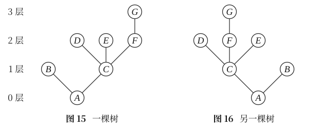](../../assets/figures/p262-fig15-16.svg)

一个*森林*(forest) 是 0 棵或多棵不相交的树的集合 (通常是有序集合). 树定义的 (b) 部分可改写成:*除根外, 树的结点形成一个森林.*

抽象的树与森林之间的差别很小. 如果删除一棵树的根, 则得到一个森林; 反过来, 如果在任意森林上仅增加一个新结点, 并把森林的诸树都看作新结点的子树, 则得到一棵树. 因此, 在非形式地讨论数据结构时, 树和森林这两个词几乎总是可互换地使用.

树可以用多种方法绘制. 除 [图15](#fig-2-15) 外, 取决于根放在什么位置, 同一棵树还有三种主要选择, 如 [图17](#fig-2-17) 所示. 关注如何在图中绘制树结构并非无关紧要的琐事, 因为在许多情况下, 我们想说一个结点在另一个 “之上” 或 “高于” 另一个结点, 或说 “最左” 元素等. 某些处理树结构的算法已经得名 “自顶向下” 方法, 也有相反的 “自底向上” 方法. 除非我们坚持一致的画树约定, 否则这些术语将导致混乱.

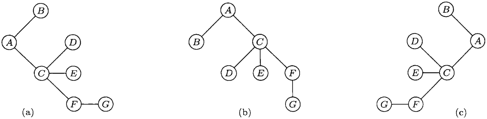

*图 17　应该如何绘制树?*

看上去, [图15](#fig-2-15) 的形式可能更可取, 因为它反映了树在自然界中如何生长, 也没有什么令人信服的理由选择其他三种形式, 似乎不妨沿袭自然界的悠久传统. 基于这种考虑, 我在开始写这套书时一直遵循根在下的约定, 试用两年之后, 才发现这是一种错误: 对计算机文献的观察, 以及就各种算法与计算机科学家的非正式讨论表明, 根在上绘制树超过所考察情况的 80%. 手工绘图时, 图表往往都是向下而不是向上生长 (从我们手写方式的角度, 这也容易理解). 我们使用的术语不是 “超树”, 而是 “子树”, 也暗示向下的联系. 从这些考虑出发, 我们断言 [图15](#fig-2-15) 上下颠倒了. 今后, 我们总是像 [图17](#fig-2-17) (b) 那样画树, 根在上, 叶在下. 对应于这种方向, 或许我们可以称根结点为树的顶点 (apex), 并用浅层或深层来形容结点所处的层.

有必要为谈论树建立好的描述性术语. 我们不用 “上” 和 “下” 这些多少有点含混不清的提法, 一般使用取自家族树的谱系术语. [图18](#fig-2-18) 显示了两类普通的家族树. 这两种类型很不相同: 家谱显示给定个人的先辈, 而直系图则显示后代.

如果出现族内通婚, 则家谱实际上不是一棵树, 因为树的不同分支 (按照我们的定义) 决不可能交汇在一起. 为了弥补这种不相符之处, 在 [图18](#fig-2-18) (a) 中, Victoria 女王和 Albert 王子在第六代出现两次, ChristianIX 国王和 Louise 王后实际既出现在第五代, 也出现在第六代. 如果树的每个结点代表 “一个人作为某人的父亲或母亲的身份”, 而不仅代表作为个体的一个人, 则家谱可以看作一棵真正的树.

树结构的标准术语取自家族树的第二种形式——直系图: 每个根称为其子树的根的父母, 子树的根称为兄妹 (sibling), 它们都是其父母的子女 (child). 整棵树的根没有父母. 例如, 在 [图19](#fig-2-19) 中, C 有三个子女 D、E 和 F;E 是 G 的父母; B 和 C 是兄妹. 显然可以推广这些术语. 例如, A 是 G 的曾祖父母, B 是 F 的一位叔姑, H 和 F 是第一代堂兄妹. 有些作者使用男性称呼 “父亲、儿子、兄弟”, 而不是 “父母、子女、兄妹”; 另一些作者使用 “母亲、女儿、姐妹”. 在任何情况下, 一个结点最多只有一个父母或前驱. 我们使用名词先辈和后代表示可能跨越树的若干层的关系. 在 [图19](#fig-2-19) 中, C 的后代是 D、E、F 和 G;G 的先辈是 E、C 和 A. 有时, 特别是谈及 “最近的共同先辈” 时, 我们会考虑将一个结点作为自身的先辈 (和自身的后代). G 的包容先辈是 G、E、C 和 A, 而它的真正先辈仅是 E、C 和 A.

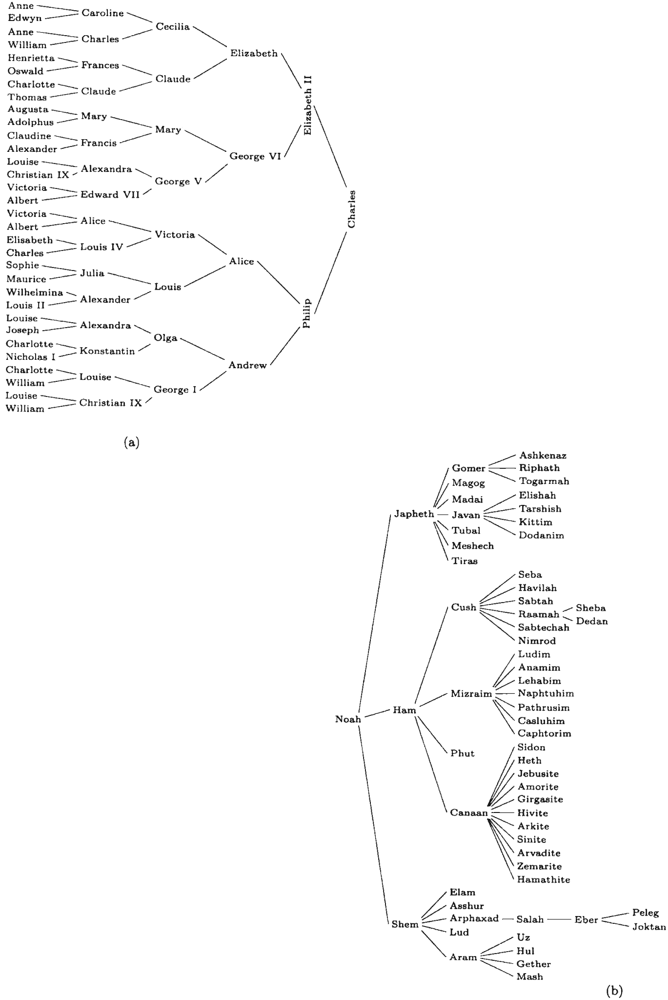

*图 18　家族树: (a) 家谱; (b) 直系图 [参见约翰·伯克, Peerage (1959); Almanach de Gotha (1871); Genealogisches Handbuch des Adels: Fürstliche Häuser, 1; Genesis 10:1–25]*

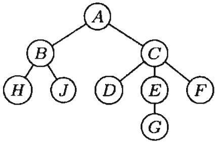

*图 19　传统树形图*

[图18](#fig-2-18) (a) 中的家谱是一棵二叉树 (binarytree). 二叉树是另一类重要的树结构. 毫无疑问, 读者已经看到过与网球比赛或其他体育活动有关的二叉树. 在二叉树中, 每个结点至多有两棵子树, 在只有一棵子树时, 我们区分左、右子树. 二叉树的正式定义是结点的有限集, 它或者为空, 或者由一个根和两棵分别称作根的左、右子树的不相交的二叉树组成.

应该仔细地研究二叉树的递归定义. 注意, 二叉树不是树的特殊情况, 而是另一种完全不同的概念 (尽管我们将看到这两个概念之间有许多关联). 例如, 二叉树

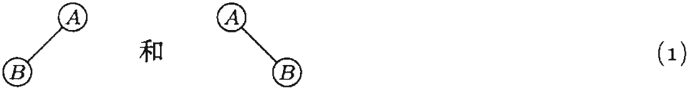

是不同的 (第一种的根具有空的右子树, 而第二个的根具有非空右子树), 尽管作为树, 这两个图表示相同的结构. 二叉树可能为空, 但树不能为空. 因此, 我们总是小心地使用 “二叉” 一词来区分二叉树和普通的树. 有些作者用稍微不同的方法定义二叉树 (见习题 20).

还可以用几种与实际的树并不相似的方法图示树结构. [图20](#fig-2-20) 显示了三种反映 [图19](#fig-2-19) 结构的图: [图20](#fig-2-20) (a) 本质上把 [图19](#fig-2-19) 表示成定向树. 该图是一般嵌套集 (nested set) 概念的特例, 嵌套集是集合的集族, 其中任意一对集合或者是不相交的, 或者一个包含另一个. (见习题 10.)[图20](#fig-2-20) (b) 在一条直线上显示嵌套集, 而 [图20](#fig-2-20) (a) 在平面上显示它们. [图20](#fig-2-20) (b) 还指出了树的序, 而且它也可以视为包含嵌套括号的代数式的大体结构. [图20](#fig-2-20) (c) 显示了另一种常见的表示树结构的方法, 使用缩排. 多种不同的表示方法本身就足以证明, 树结构在日常生活以及在计算机程序设计中都很重要性. 任何分层的分类方案都隐含树结构.

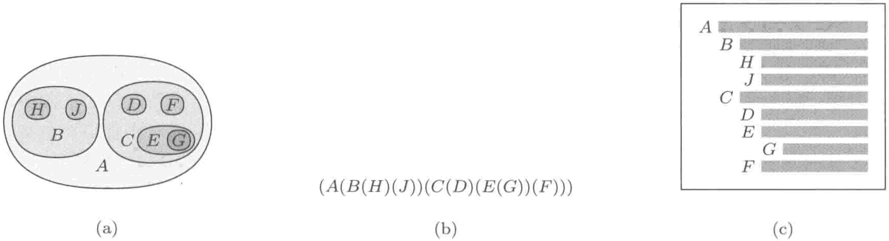

*图 20　表示树结构的其他方法: (a) 嵌套集; (b) 嵌套括号; (c) 缩排*

一个代数式定义了一个隐式树结构, 这种结构通常不是用括号表示, 或不仅仅用括号表示. 例如, [图21](#fig-2-21) 显示了一棵对应于如下算术表达式的树:

$$
a-b(c/d+e/f).
\qquad \text{(2)}
$$

按照先乘除、后加减的标准数学约定, 我们可以使用像式 (2) 这样的简化形式, 而不是完全括起来的形式 $^ acorner a - \left( b \times \left( ( c / d ) + ( e / f ) \right) \right)$. 在应用中, 公式与树之间的这种联系非常重要.

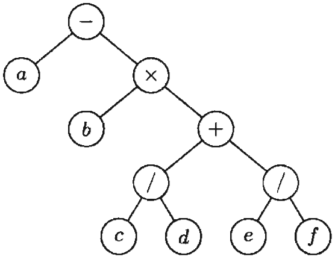

*图 21　式 (2) 的树表示*

注意, [图20](#fig-2-20) (c) 的缩排表看上去非常像一本书的目录表. 确实, 这本书本身也具有树结构, 第 2 章的树结构如 [图22](#fig-2-22) 所示. 这里, 我们注意到一个有意思的思想: 对本书章节编号的方法是另一种说明树结构的方法. 图书馆使用的类似分类方案称为 “杜威十进制分类法”, 因此这种树结构表示方法通常称作树的 “杜威记数法”(Deweydecimal notation). [图19](#fig-2-19) 的树用杜威记数法表示为

1 A; 1.1 B; 1.1.1 H; 1.1.2 J; 1.2 C;

1.2.1 D; 1.2.2 E; 1.2.2.1 G; 1.2.3 F.

杜威记数法可以用于森林: 森林中第 $k$ 棵树根的编号为 $k$; 如果 $\alpha$ 是 $m$ 度结点的编号, 则它的子女编号为 $\alpha . 1 , \alpha . 2 , \ldots , \alpha . m .$ 杜威记数法满足许多简单的数学性质, 是分析树的有用工具, 例如它把任意树的结点按自然顺序排序, 类似于本书的章节排序. 2.3 节在 2.3.1 节之前, 在 2.2.6 节之后.

杜威记数法与我们业已广泛使用的下标变量之间存在密切的关系. 如果 F 是树的森林, 我们可以用 F[1] 表示第一棵树的子树, 因此 $F[1][2] \equiv F[1,2]$ 表示 F[1] 的第二棵子树的诸子树, 而 F[1,2,1] 表示后者的第一个子森林, 如此下去. 杜威记数法中的结点 $a$. $b$. $c$. $d$ 是 $F [ a , b , c , d ]$ 的父母. 这种记号是一般下标的推广, 因为每个下标可容许的值域依赖于前一个下标位置上的值.

这样, 特殊地, 任意矩形数组都可以看作树或森林结构的特例. 例如, 这里有 $3\times 4$ 矩阵的两种表示:

[A[1, 1] A[1, 2] A[1, 3] A[1,4] A[2,1] A[2,2] A[2,3] A[2,4] A[3,1] A[3,2] A[3, 3] A[3,4]

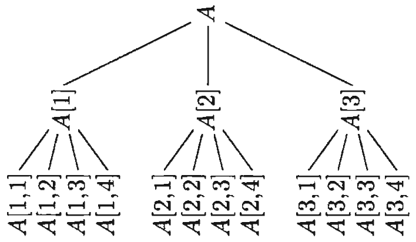

然而要注意, 这种树结构并不能忠实地反映矩阵结构的全部, 因为树中明显体现出行关系, 但是没有出现列结构.

森林也可以看作通常称作表结构的对象的特例. “表[^cn266-1]”(List) 在这里用的是技术意义, 为此, 我们大写该英文单词的首字母, 以示区别. 表递归地定义为零个或多个原子或表有穷序列. 这里, “原子” 是一个不予以定义的概念, 指所要考虑的对象域中的元素, 只要能够区别原子和

[^cn266-1]: 这里直到本节结尾, 以及习题 18 和 19 中, “表” 均指 List.——译者注

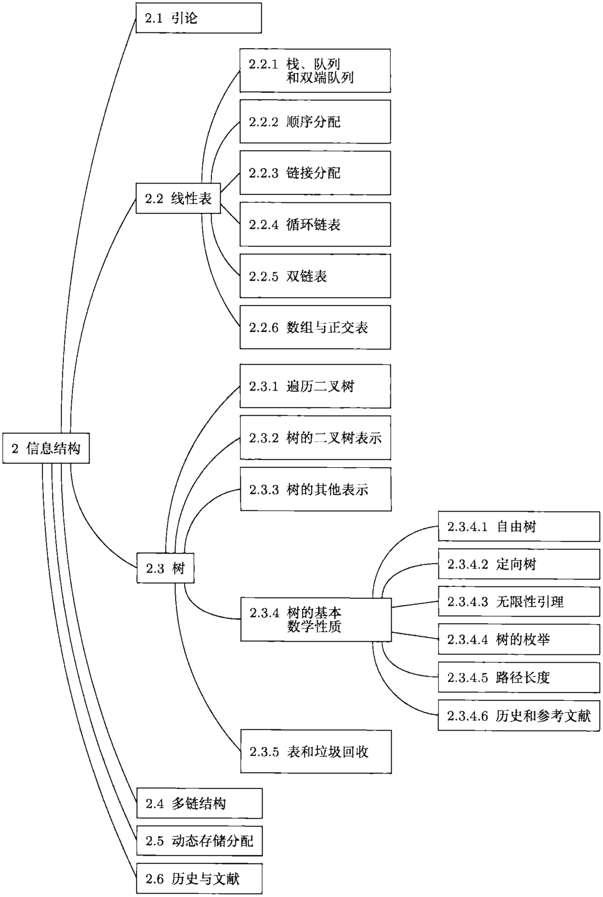

*图 22　第 2 章的结构*

表就行. 借助于使用逗号和圆括号的显而易见的约定, 我们可以区分原子与表, 并且还能方便地显示表中的次序. 例如, 考虑

$$
L=(a,\ (b,a,b),\ (\,),\ c,\ (((2)))),
\qquad \text{(3)}
$$

这是一个具有 5 个元素的表: 第一个是原子 $a$, 然后是表 $( b , a , b )$, 然后是空表, 然后是原子 $c ,$ 最后是表 (((2))). (((2))) 由表 ((2)) 组成, 而 ((2)) 又由表 (2) 组成, 而 (2) 由原子 2 组成.

下面的树结构对应于 L:

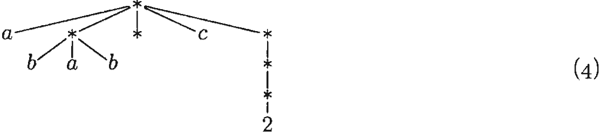

图中的星号表示表的定义和出现, 与原子的出现相区别. 下标记号也用于表, 就像用于森林一样. 例如, $L [ 2 ] = ( b , a , b ) , \quad L [ \bar { 2 } , \bar { 2 } ] = a .$

在 (4) 的表的结点中, 除了说它们都是表之外, 并没有数据. 但是, 也可以用信息标记表的非原子元素, 就像我们对树和其他结构所做的那样. 这样,

$$
A = (a \colon (b,c),d \colon ( ))
$$

将对应于一棵树, 我们可以绘制如下:

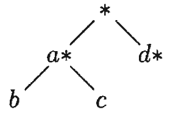

表和树之间的重大区别是表可能重叠 (即子表不必是不相交的), 甚至可能是递归的 (可能包含自身). 表

$$
M=(M)
\qquad \text{(5)}
$$

没有对应的树结构, 表

$$
N=(a\mathbin{:}M,b\mathbin{:}M,c,N).
\qquad \text{(6)}
$$

也没有对应的树结构. (在这些例子中, 大写字母表示表, 小写字母表示标记和原子.) 定义表的地方用星号表示, 则可以绘制 (5) 和 (6) 的图示如下:

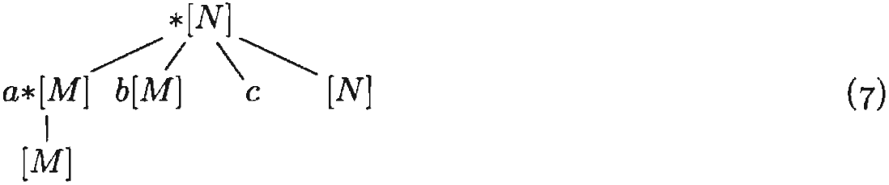

实际上, 表并不像上面例子所显示的那么复杂. 本质上, 表是 2.2 节讨论的线性表的相当简单的推广, 附加了条件 “线性表的元素可以是指向其他表 (可能指向自己) 的链变量”.

小结: 四类密切相关的信息结构——树、森林、二叉树和表——常在各种环境中出现, 因而在计算机算法中很重要. 我们已经看到绘制这些结构的多种方法, 并考虑了谈论它们时要用的术语和记号. 下面几节将更详细地展开讨论这些思想.

#### 习题

1\. [18] [答案](./answers/2-3.md#ans-2-3-1) 具有三个树结点 $A$、B 和 C 的不同的树有多少棵?

2\. [20] [答案](./answers/2-3.md#ans-2-3-2) 具有三个树结点 $A$、B 和 C 的不同的定向树有多少棵?

3\. [M20] [答案](./answers/2-3.md#ans-2-3-3) 从定义出发, 严格地证明: 对于树中每个结点 $X$, 存在到根的唯一一条路径, 即存在唯一的结点序列 $X _ { 1 } , X _ { 2 } , \ldots , X _ { k } \; ( k \geq 1 )$, 使得 $X_{1}$ 是树根, $X _ { k } = X$, 并且对于 $1 \leq j < k , X _ { j }$ 是 $X_{j + 1}$ 的父母. (这个证明可以代表几乎所有关于树的基本事实的证明方法.) 提示: 对树的结点个数使用归纳法.

4\. [01] [答案](./answers/2-3.md#ans-2-3-4) 判断真假: 在传统的树图示中 (根在上), 如果结点 $X$ 比结点 $Y$ 的层数高, 则在图中, 结点 $X$ 比结点 $Y$ 出现的位置低.

5\. [02] [答案](./answers/2-3.md#ans-2-3-5) 如果结点 $A$ 有 3 个兄妹, 并且 B 是 A 的父母, 那么结点 $B$ 是几度?

6\. [21] [答案](./answers/2-3.md#ans-2-3-6)  如果 $m > 0,\ n \geq 0$, 与家族树类比, 试把语句 “X 是 Y 的第 $m$ 代堂兄妹 (堂表亲), 高出 $n$ 辈” 定义为树的结点 $X$ 和 Y 之间的有意义关系. (关于家族树的术语, 请查字典.)

7\. [23] [答案](./answers/2-3.md#ans-2-3-7) 把上一题的定义推广到所有整数 $m \geq - 1$ 和 $n \geq - (m + 1)$, 使得对于树的任意两个结点 $X$ 和 $Y _ { ; \ast }$ 存在唯一的 $m$ 和 $n$, 使得 X 是 Y 的第 $m$ 代堂兄妹 (堂表亲), 并高出 $n$ 辈.

8\. [03] [答案](./answers/2-3.md#ans-2-3-8) 什么二叉树不是树?

9\. [00] [答案](./answers/2-3.md#ans-2-3-9) 在 (1) 的两棵二叉树中, 哪个结点是根 (B 还是 A)?

10\. [M20] [答案](./answers/2-3.md#ans-2-3-10) 一个非空集的集族称为嵌套的, 如果任意给定一对集合 $X$ 和 Y, 或者 $X \subseteq Y$, 或者 $X \supseteq Y$ 或者 X 与 Y 不相交. (换言之, $X \cap Y$ 或者为 X, 或者为 Y, 或者为 0.)[图20](#fig-2-20) (a) 显示任何树都对应于一个嵌套集的集族; 反之, 每个这样的集族都对应于一棵树吗?

11\. [HM32] [答案](./answers/2-3.md#ans-2-3-11) 考虑如习题 10 中的嵌套集的集族, 把树的定义扩展到无限树. 能够对无限树的每个结点定义层、度、父母、子女概念吗? 给出对应于树的实数嵌套集的例子, 分别要求

(a) 每个结点都具有不可数的度, 树有无限多层;

(b) 存在处于不可数层的结点;

(c) 每个结点至少为 2 度, 树有不可数多层.

12\. [M23] [答案](./answers/2-3.md#ans-2-3-12) 在什么条件下, 一个偏序集对应于一棵无序树或森林? (偏序集在 2.2.3 节定义.)

13\. [10] [答案](./answers/2-3.md#ans-2-3-13) 假定在杜威记数系统中, 结点 $X$ 的编号为 $a_1.a_2.\ldots.a_k$. 从 X 到根的路径上, 各结点的杜威数是多少 (见习题 3)?

14\. [M20] [答案](./answers/2-3.md#ans-2-3-14) 令 $S$ 为任意非空集合, 具有形如 $\text{“}1.a_1.\ldots.a_k\text{”}$ 的元素, 其中 $\hat { k } \geq 0$, 并且 $a _ { 1 } , \ldots , a _ { k }$ 都是正整数. 证明如果 S 有限并且满足如下条件: “如果 $\alpha$. $m$ 在该集合中, 那么若 $m > 1$ 则 $\alpha.(m - 1)$ 也在, 若 $m = 1$ 则 $\alpha$ 也在.” 则 $S$ 确定一棵树. (这个条件显然满足树的杜威记数法, 因此它是另一种绘制树结构的方法.)

▶ 15. [20] [答案](./answers/2-3.md#ans-2-3-15)  为二叉树的结点创造一套类似于树结点的杜威记数法的记号.

16\. [20] [答案](./answers/2-3.md#ans-2-3-16) 类似于 [图21](#fig-2-21), 绘制对应于如下算术表达式的树: (a) $2(a - b / c)$; (b) $a + b + 5 c .$

17\. [01] [答案](./answers/2-3.md#ans-2-3-17)  如果 Z 代表 [图19](#fig-2-19) 对应的森林, parent(Z[1,2,2]) 是哪个结点?

18\. [08] [答案](./answers/2-3.md#ans-2-3-18)  在表 (3) 中, $L[5,1,1]$ 是什么? $L[3,1]$ 是什么?

19\. [15] [答案](./answers/2-3.md#ans-2-3-19) 为 $L = (a,(L))$ 绘制类似 $于 (7)$ 的表图. 在该表中, L[2] 是什么? L[2,1,1] 是什么?

20\. [M21] [答案](./answers/2-3.md#ans-2-3-20) 定义 0-2 树为一棵树, 其中每个结点恰有零个或两个子女. (形式上, 一棵 0-2 树由一个称作根的结点, 加上 0 或 2 个不相交的 0-2 树组成.) 证明每棵 0-2 树都有奇数个结点, 并给出具有 $n$ 个结点的二叉树与具有 $2 n + 1$ 个结点的 (有序)0-2 树之间的一一对应.

21\. [M22] [答案](./answers/2-3.md#ans-2-3-21)  如果一棵树具有 $n _ { 1 }$ 个 1 度结点, $n _ { 2 }$ 个 2 度结点, $\cdots , n _ { m }$ 个 $m$ 度结点, 那么它有多少个终端结点?

▶ 22. [答案](./answers/2-3.md#ans-2-3-22)  [21 标准的欧洲纸张尺寸 $\mathtt A0,\ \mathtt A1,\ \mathtt A2,\ldots,\mathtt A n,\ldots$. 都是矩形, 长和宽的比例为 $\sqrt { 2 }$ 比 1, 面积为 $2 ^ { - n }$ 平方米. 因此, 如果我们把一张 An 的纸对半剪开, 则得到两张 $A(n+1)$ 的纸. 使用这一原则设计一种二叉树的图形表示, 并通过绘制 2.3.1(1) 的表示, 解释你的思想.
