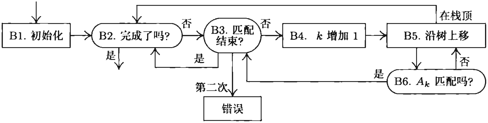
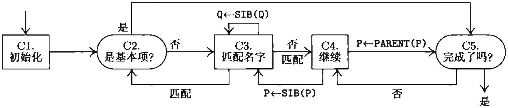

<a id="pdf-350"></a><a id="p-333"></a>

<a id="sec-2-4"></a>

# 2.4多链结构

我们既然已经详细考察过线性表和树结构, 便应该很清楚在计算机内部表示结构化信息的基本原理了. 本节将研究这些技术的另一个应用, 考虑结构信息稍微复杂一点的典型情况: 在更高级的应用中, 结构的几种类型通常同时出现.

“多链结构” 包含多个结点, 每个结点有好几个链字段, 而不是像前面大多数例子那样只有一个或两个链字段. 我们已经见过多重链接的一些实例, 如 2.2.5 节中的模拟电梯系统, 以及 2.3.3 节中的多元多项式.

我们将见到, 每个结点中出现许多不同种类的链接, 这并不一定导致相应的算法比之前研究过的那些更难写出或更难理解. 我们也将讨论一个重要的问题: “内存里应该显式记录多少结构信息?”

这个问题与为 COBOL 及相关语言编写编译器程序有关. 使用 COBOL 的程序员可能在几个层次上给程序变量赋予字母名字, 例如, 程序可能访问具有下列结构的销售和购买数据文件:

```text
1 SALES             1 PURCHASES
  2 DATE              2 DATE
    3 MONTH             3 DAY
    3 DAY               3 MONTH
    3 YEAR              3 YEAR
  2 TRANSACTION       2 TRANSACTION
    3 ITEM              3 ITEM
    3 QUANTITY          3 QUANTITY
    3 PRICE             3 PRICE
    3 TAX               3 TAX
    3 BUYER             3 SHIPPER
      4 NAME              4 NAME
      4 ADDRESS           4 ADDRESS
```

(1)

由这个布局可以看出: SALES 中的每项由 DATE 和 TRANSACTION 两部分组成; DATE 细分成三个部分, 而 TRANSACTION 则细分为五个部分. PURCHASES 的情况类似. 这些名字的相对顺序指出这些量在文件的外部表示 (如磁带或打印表格) 中出现的顺序. 注意, 本例中 “DAY” 和 “MONTH” 在两个文件中的出现顺序相反. 程序员除图示以外也给出其他信息, 说明每个信息项占据的空间以及使用的格式. 此类信息在本节中没有用, 所以不会再提起.

COBOL 程序员首先描述文件布局和其他程序变量, 然后确定对这些量进行操作的算法. 要引用 (访问) 上例中的单个变量, 仅给出名字 DAY 是不够的, 因为没法判断这个名为 DAY 的变量是在 SALES 文件中还是在 PURCHASES 文件中. 因此, COBOL 程序员可以写 “DAY OFSALES” 来引用 SALES 项的 DAY 部分. 程序员也可以写得更完整些:

“`DAY OF DATE OF SALES`”

但一般而言只要给出避免二义性所必需的限定即可, 无需更多. 因此,

$$
\text{" } \texttt{NAME} \texttt{OF} \texttt{SHIPPER} \texttt{OF} \texttt{TRANACT} \texttt{ON} \texttt{OF} \texttt{PURCHASS}  \text{" }
$$

可简化为

"NAMEOFSHIPPER"

因为数据只有一个部分名为 SHIPPER.

<a id="pdf-351"></a><a id="p-334"></a>

COBOL 的这些规则可以更准确地陈述如下:

(a) 每个名字前面紧挨着一个称为其层次编号的关联正整数. 名字或者指基本项, 或者是名字紧跟其后的一个或多个项构成的组的名字. 后一种情况中, 组中每项必须具有相同的层次编号, 该层次编号必须比组名的层次编号大. (例如, 上例中 DATE 和 TRANSACTION 的层次编号都为 2, 比 SALES 的层次编号 1 要大.)

(b) 要引用名为 $A_{0}$ 的基本项或项组, 一般形式为

$$
A _ { 0 } \mathtt { O F } A _ { 1 } \mathtt { O F } \dots \mathtt { O F } A _ { n } ,
$$

其中 $n \geq 0$, 且对于 $0 \leq j < n,\ A_{j}$ 是直接或间接包含在名为 $A_{j + 1}$ 的组中的某项的名字. 必定刚好有一个项 $A_{0}$ 满足这个条件.

(c) 如果同一名字 $A_{0}$ 在多处出现, 则必须可以使用条件限定来引用其中的每一个.

作为规则 (c) 的例子, 数据布局

```text
1 AA
  2 BB
    3 CC
    3 DD
  2 CC
```

(2)

是不允许的, 因为没有无二义的方式来引用 CC 的第二次出现 (见习题 4).

COBOL 还有另一个特征, 会影响编译器编写以及我们考虑的应用, 这就是 COBOL 语言可以选择一次引用多个项. COBOL 程序员可以写

$$
\mathtt { M O V E \_ C O R R E S P O N D I N G } \alpha \mathtt { T O } \beta
$$

将具有对应名字的所有项从数据区 $\alpha$ 移动到数据区 $\beta .$ 例如, COBOL 语句

$$
\mathtt { M O V E } \; \mathtt { C O R R E S P O N D I N G } \; \mathtt { D A T E } \; \mathtt { O F } \; \mathtt { S A L E S } \; \mathtt { T O } \; \mathtt { D A T E } \; \mathtt { O F } \; \mathtt { P U R C C A S S E S }
$$

意味着 SALES 文件中 MONTH、DAY 和 YEAR 的值将移动到 PURCHASES 文件中的变量 MONTH、DAY 和 YEAR 中去. (DAY 和 MONTH 的相对顺序因此交换)

本节将研究的问题是, 设计三个适合在 COBOL 编译器中使用的算法, 分别完成下列任务.

操作 1. 处理名字描述和层次编号, 如 (1), 将相关信息放入编译器的表中以备操作 2 和操作 3 使用.

操作 2. 按照规则 (b), 确定给定的限定引用是否合法. 若合法, 则找到对应的数据项.

操作 3. 找到由给定 CORRESPONDING 语句所指定的所有成对的对应项.

我们将假定编译器已具有 “符号表子程序”, 能将字母名字转换为一个链接, 指向该名字对应的符号表条目. (符号表算法的构造方法将在第 6 章详细讨论). 除符号表之外, 还有一个更大的表, 该表对于被编译的 COBOL 源程序中的每个数据项都有一个条目, 我们称之为数据表.

显然, 我们只有先了解数据表中存储什么类型的信息, 才能为操作 1 设计算法. 数据表的形式则取决于完成操作 2 和操作 3 所需要的信息, 因此, 我们首先考察操作 2 和 3.

为了确定 COBOL 引用

$$
A_0\ \mathtt{OF}\ A_1\ \mathtt{OF}\ \ldots\ \mathtt{OF}\ A_n,\qquad n\ge0
\qquad \text{(3)}
$$

的含义, 我们应该首先在符号表中查找名字 $A_{0},$ 对于这个名字, 应该存在从符号表条目指向所有数据表条目的一系列链接. 然后, 对于每个数据表条目, 需要一个指向该条目所在组<a id="pdf-352"></a><a id="p-335"></a>项条目的链接. 如果还有一个链字段从数据表项回到符号表, 就不难看出像 (3) 那样的引用该如何处理了. 此外, 我们还需要从组项的数据表条目到组中各项的某种链接, 以便找出由 “MOVE CORRESPONDING” 指定的成对的项.

因此, 每个数据表条目可能需要 5 个链字段:

PREV (链接到具有相同名字的前一条目, 如果存在的话);

PARENT (链接到包含该项的最小的组, 如果存在的话);

NAME (链接到该项的符号表条目);

CHILD (链接到组中的第一个子项);

SIB (链接到包含该项的组中下一个子项).

显然, 像上文中 SALES 和 PURCHASES 那样的 COBOL 数据结构实质上是树, 而且这里出现的 PARENT 链、CHILD 链和 SIB 链与前面研究过的类似 (树的标准二叉树表示由 CHILD 链和 SIB 链构成, 若加上 PARENT 链就是 “三链树”. 上面提到的五个链由这三个树链加上 PREV 链和 NAME 链构成, 后两个链在树结构上添加更多信息).

也许这五个链并非都是必要或充分的, 但我们首先尝试在数据表条目包括这五个链字段 (和与问题无关的其他信息) 这一试验性假设下设计算法. 作为使用上述多重链接的实例, 考虑如下两个 COBOL 数据结构

```text
1 A        1 H
  3 B        5 F
    7 C        8 G
    7 D      5 B
  3 E        5 C
  3 F          9 E
    4 G        9 D
               9 G
```

(4)

它们将如 (5) 那样表示 (带有用符号表示的链接). 符号表每个条目的 LINK 字段指向最近一个具有相应符号名字的数据表条目.

我们需要的第一个算法是按这种形式建立数据表的算法. 注意, COBOL 规则所允许的层次编号可以灵活选择, (4) 中左边的结构完全等价于

$$
\begin{aligned}&1\  A  \\&\quad 2\  B  \\&\quad\quad 3\  C  \\&\quad\quad 3\  D  \\&\quad 2\  E  \\&\quad 2\  F  \\&\quad\quad 3\  G \end{aligned}
$$

因为层次编号不必是连续的.

但是, 有些层次编号序列是非法的. 例如, 如果 (4) 中 D 的层次编号改为 “6” (在任一位置), 将得到无意义的数据布局, 因为违背了同一组中所有的项必须具有相同编号这一规则. 因此下列算法要确认没有破坏 COBOL 的规则 (a).

<a id="pdf-353"></a><a id="p-336"></a>

| 符号表 | LINK |
| --- | --- |
| A | A1 |
| B | B5 |
| C | C5 |
| D | D9 |
| E | E9 |
| F | F5 |
| G | G9 |
| H | H1 |

| 数据表 | PREV | PARENT | NAME | CHILD | SIB |
| --- | --- | --- | --- | --- | --- |
| A1 | Λ | Λ | A | B3 | H1 |
| B3 | Λ | A1 | B | C7 | E3 |
| C7 | Λ | B3 | C | Λ | D7 |
| D7 | Λ | B3 | D | Λ | Λ |
| E3 | Λ | A1 | E | Λ | F3 |
| F3 | Λ | A1 | F | G4 | Λ |
| G4 | Λ | F3 | G | Λ | Λ |
| H1 | Λ | Λ | H | F5 | Λ |
| F5 | F3 | H1 | F | G8 | B5 |
| G8 | G4 | F5 | G | Λ | Λ |
| B5 | B3 | H1 | B | Λ | C5 |
| C5 | C7 | H1 | C | E9 | Λ |
| E9 | E3 | C5 | E | Λ | D9 |
| D9 | D7 | C5 | D | Λ | G9 |
| G9 | G8 | C5 | G | Λ | Λ |

空的单元格指明附加信息与此处无关.

(5)

算法 A (构造数据表). 这个算法接受偶对 (L,P) 序列, 其中, L 是正整数 “层次编号”, P 指向对应如 (4) 所示 COBOL 数据结构的符号表条目. 算法构造如上例 (5) 所示的数据表. 若 P 指向之前尚未出现的符号表条目, 则 LINK(P) 将等于Λ. 该算法使用一个常规辅助栈 (要么像 2.2.2 节那样使用顺序内存分配, 要么像 2.2.3 节那样使用链式分配).

A1.[初始化] 设栈内容为单个条目 $( 0 , \Lambda )$. (在整个算法中, 栈条目为偶对 (L,P), 其中 L 是一个整数, 而 P 是一个指针. 随着算法进行, 栈包含层次编号以及树中当前层之上所有层中最近的数据条目的指针. 例如, 上例中在遇到偶对 “3 $\mathrm{F}^{\mathcal{P}}$ 之前, 栈中从栈底到栈顶将包含 (0,A) (1,A1) (3,E3)

三项.)

A2.[下一项.] 令 $(\mathtt L,\mathtt P)$ 为来自输入的下一数据项. 若输入结束, 则算法终止. 置 $\mathtt Q\Leftarrow\mathtt{AVAIL}$ (即令 $\mathbb { Q }$ 为可以放置下一数据表条目的新结点的位置).

A3.[设置名字链接.] 置

$$
\mathtt { P R E V ( Q ) } \leftarrow \mathtt { L I N K ( P ) } \; , \qquad \quad \mathtt { L I N K ( P ) } \leftarrow \mathtt { Q } \; , \qquad \quad \mathtt { N A M E ( Q ) } \leftarrow \mathtt { P } .
$$

NODE(Q) 中共有五个链接, 上面的语句恰当设置了其中两个, 下面要恰当地设置 PARENT、CHILD 和 SIB).

A4.[比较层次.] 令栈的栈顶条目为 (L1,P1). 若 $\mathtt { L } 1 < \mathtt { L }$, 则置 $\mathtt{CHILD}(\mathtt{P1})\leftarrow\mathtt Q$ (或者, 若 P1 =Λ, 则置 FIRST←Q, 其中 FIRST 是将指向第一个数据表条目的变量), 并转到 A6.

A5.[删除顶层.] 若 L1>L, 则删除栈顶条目, 令 (L1,P1) 为新的栈顶条目, 并重复步骤 A5. 若 L1<L, 提示出错 (同一层中出现了混合编号); 否则, 即 L1=L, 令 $\mathrm{SIB(P1)} \leftarrow \mathbb{Q}$ 删除栈顶条目, 并令 (L1,P1) 成为新进入栈顶的偶对.

<a id="pdf-354"></a><a id="p-337"></a>

A6.[设置家族链接.] 置 $\mathtt{PARENT}(\mathtt Q)\leftarrow\mathtt{P1},\quad\mathtt{CHILD}(\mathtt Q)\leftarrow\Lambda,\quad\mathtt{SIB}(\mathtt Q)\leftarrow\Lambda$.

A7.[加入栈.] 将 (L,Q) 放入栈顶, 并返回到步骤 A2.

引入步骤 A1 中说明的辅助栈, 这个算法一目了然, 因此无须进一步解释.

下一个问题是找到引用

$$
A_0\ \mathtt{OF}\ A_1\ \mathtt{OF}\ \ldots\ \mathtt{OF}\ A_n,\qquad n\ge0.
\qquad \text{(6)}
$$

所对应的数据表条目. 好的编译器还需要检查, 以保证这样的引用是无二义的. 在这种情况下, 适当的算法立即就能想到: 我们只需要针对名字 $A_{0}$ 遍历整个数据表条目列表, 确保只有一个条目与声明的限定 $A _ { 1 } , \ldots , A _ { n }$ 相符.

算法 B (检查受限引用). 对应于引用 (6), 符号表子程序将找出分别指向 $A _ { 0 } , A _ { 1 } , \ldots , A _ { n }$ 的符号表条目的指针 $P _ { 0 } , P _ { 1 } , \ldots , P _ { n }$

算法 B 的目的是检查 $P _ { 0 } , P _ { 1 } , \ldots , P _ { n }$, 要么确定引用 (6) 是错误的, 要么将变量 Q 置为与 (6) 所引用的项对应的数据表条目的地址.

B1.[初始化.] 置 $\mathbb { Q } \leftarrow \Lambda , \mathbb { P } \leftarrow \mathbb { L I N K } ( P _ { 0 } ) .$

B2.[完成了吗?] 若 P=Λ, 则算法终止, 此时若 (6) 没有对应的数据表条目, 则 Q 将等于Λ. 若 $P \neq \Lambda$, 则置 S←P 及 $k\leftarrow0.$ (S 是一个指针变量, 将从 P 开始沿着 PARENT 链走向树的上层, $k$ 是取值从 0 到 $n$ 的整数变量). 实际上, 指针 $P _ { 0 } , \ldots , P _ { n }$ 通常保存在链表中, 并用一个遍历该链表的指针代替 $k$. 见习题 5.)

B3.[匹配结束?] 若 $k < n$, 则转到 B4. 否则, 已找到一个匹配的数据表条目; 若 $a \neq \Lambda$ 则这是找到的第二个条目, 因此提示出错条件. 置 $\mathtt Q\leftarrow\mathtt P,\quad\mathtt P\leftarrow\mathtt{PREV}(\mathtt P)$, 转到 B2.

B4. [ $k$ 增加 1. ] 置 $k \leftarrow k + 1 .$

B5.[沿树上移.] 置 $\mathtt S\leftarrow\mathtt{PARENT}(\mathtt S)$. 若 S=Λ, 则找不到匹配; 置 P←PREV(P), 转到 B2.

B6. $\mathbb{E} A_{k}$ 匹配吗?] 若 $\mathrm{NAME}(\mathrm{S}) = P_{k}$, 则转到 B3, 否则, 转到 B5.

注意: 此算法不需要 CHILD 链和 SIB 链.

<a id="fig-2-40"></a>

<span></span>

*图 40　检查 COBOL 引用的算法*

我们需要的第三个也是最后一个算法涉及 $\text{" }  M0VE    CORRESPDNDING  \text{" }$. 在设计该算法之前, 必须准确定义所求操作. 设 $\alpha$ 和 $\beta$ 是形如 (6) 的数据项引用, 则 COBOL 语句

$$
\mathtt{MOVE\ CORRESPONDING}\ \alpha\ \mathtt{TO}\ \beta
\qquad \text{(7)}
$$

是对所有形如

$$
\mathrm{MOVE} \alpha^{\prime} \mathrm{T} 0 \beta^{\prime}
$$

<a id="pdf-355"></a><a id="p-338"></a>

的语句构成的集合的缩写, 其中存在整数 $\bar { n } \geq 0$ 以及 $n$ 个名字 $A _ { 0 } , A _ { 1 } , \ldots , A _ { n - 1 }$ 使得

$$
\begin{aligned}\alpha'&=A_0\ \mathtt{OF}\ A_1\ \mathtt{OF}\ \ldots\ \mathtt{OF}\ A_{n-1}\ \mathtt{OF}\ \alpha\\\beta'&=A_0\ \mathtt{OF}\ A_1\ \mathtt{OF}\ \ldots\ \mathtt{OF}\ A_{n-1}\ \mathtt{OF}\ \beta\end{aligned}
\qquad \text{(8)}
$$

且 $\alpha ^ { \prime }$ 或 $\beta ^ { \prime }$ 是基本项 (而不是组项). 此外, 我们要求 (8) 的第一层给出完备限定, 即 $\alpha$ 和 $\beta$ 是 $A _ { n } - 1$ 的父母, 且对于 $0 \leq j < n - 1$, $A_{j + 1}$ 是 $A_{j}$ 的父母; $\alpha ^ { \prime }$ 和 $\beta ^ { \prime }$ 在树中必定刚好比 $\alpha$ 和 $\beta$ 低 $n$ 层.

因此, 例 (4) 的语句

就是语句

$$
\begin{aligned} &\texttt{MOVE} \texttt{CORRESPDNDING} \texttt{A} \texttt{TO H}\\ &\\ \texttt{MOVE} \texttt{B OF} \texttt{A T0} \texttt{B OF H}\\ &\\ \texttt{MOVE} \texttt{G OF F OF A T0 G OF F OF H}\\ \end{aligned}
$$

的缩写.

识别所有相应对 $\alpha ^ { \prime } , \beta ^ { \prime }$ 的算法虽然不难, 但非常有趣. 我们按先序沿着以 $\alpha$ 为根的树移动, 同时在 $\beta$ 树中寻找匹配的名字, 跳过不可能出现相应元素的那些子树. (8) 中的名字 $A _ { 0 } , \ldots , A _ { n - 1 }$ 按照相反顺序 $A _ { n - 1 } , \ldots , A _ { 0 }$ 被发现.

算法 C (找出 CORRESPONDING 偶对). 给定 PO 和 QO, 分别指向 $\alpha$ 和 $\beta$ 的数据表条目, 本算法逐个找到指向满足上文限制的项 $( \alpha ^ { \prime } , \beta ^ { \prime } )$ 的所有指针偶对 (P,Q).

C1.[初始化.] 置 $\mathbb{P} \leftarrow \mathbb{P}0, \mathbb{Q} \leftarrow \mathbb{Q}0$. (在算法的剩余部分, 指针变量 P 和 Q 将遍历分别以 $\alpha$ 和 $\beta$ 为根的树).

C2.[是基本项?] 若 $\mathtt { C H I L D ( P ) } = \Lambda$ 或 $\mathtt { C H I L D ( Q ) } = \Lambda$, 则将 $(\mathtt P,\mathtt Q)$ 作为所求偶对输出, 并转到 C5. 否则, 置 $\mathrm{P} \leftarrow \mathrm{CHILD}(\mathrm{P})$, $\mathtt Q\leftarrow\mathtt{CHILD}(\mathtt Q)$. (在这一步中, P 和 Q 指向满足 (8) 的 $\alpha ^ { \prime }$ 和 $\beta ^ { \prime }$, 我们希望 $\mathrm{MOFE} \alpha^{\prime} \mathrm{T0} \beta^{\prime}$, 当且仅当 $\alpha ^ { \prime }$ 或 $\beta ^ { \prime }$ (或二者都) 为基本项).

C3. [匹配名字. \](现在 P 和 $\mathbb { Q }$ 分别指向具有形如

$$
A_0\ \mathtt{OF}\ A_1\ \mathtt{OF}\ \ldots\ \mathtt{OF}\ A_{n-1}\ \mathtt{OF}\ \alpha
$$

和

$$
B _ { 0 } \text { 0  F } A _ { 1 } \text { 0  F } \ldots \text { 0 F } A _ { n - 1 } \text { 0  F } \beta
$$

的完备限定的数据项. 目标是检查组 $A _ { 1 } \enspace  F \ldots \enspace 0 F \enspace A _ { n - 1 } \enspace 0 F \enspace \beta$ 中的所有名字, 看能否使得 $B_0=A_0)$. 若 $\mathtt{NAME}(\mathtt P)=\mathtt{NAME}(\mathtt Q)$, 则转到 C2 (找到了一个匹配). 否则, 若 $\mathrm{SIB}(Q) \neq \Lambda$, 则置 $\mathbb{Q} \leftarrow \mathrm{SIB}(\mathbb{Q})$ 并重复步骤 C3. (若 $\mathrm{SIB}(\mathbb{Q}) = \Lambda$, 则组中不存在匹配的名字, 继续进行步骤 C4).

C4. [继续.] 若 $\mathrm{SIB}(\mathbb{P}) \neq \Lambda$, 则置 $\mathtt P\leftarrow\mathtt{SIB}(\mathtt P),\quad\mathtt Q\leftarrow\mathtt{CHILD}(\mathtt{PARENT}(\mathtt Q))$, 转到 C3. 若 $\mathrm{SIB}(\mathbb{P}) = \Lambda$, 置 $\mathtt P\leftarrow\mathtt{PARENT}(\mathtt P),\quad\mathtt Q\leftarrow\mathtt{PARENT}(\mathtt Q)$

C5.[完成了吗?] 若 P=PO, 则算法终止; 否则, 转到 C4.

这个算法的流程图如 [图41](#fig-2-41) 所示. 对所涉及的树的大小使用归纳法, 可以很容易地构造出该算法的有效性证明 (见习题 9).

这时, 算法 B 和 C 使用五个链字段 PREV、PARENT、NAME、CHILD 和 SIB 的方式值得研究一下. 这种用法的特别之处在于, 当算法 B 和 C 沿数据表移动时, 实际上做最少量的工作, 在这个意义下, 这五个链构成了一个 “完备集”. 每次需要引用另一数据表条目, 都能够即刻得到

<a id="pdf-356"></a><a id="p-339"></a>

<a id="fig-2-41"></a>

<span></span>

*图 41　MOVE CORRESPONDING 的算法*

所需地址, 不必进行查找. 很难想象如何在表中添加链接信息, 加快算法 B 和 C 的速度 (见习题 11).

每个链字段可看作程序的线索, 安置在那里是为了让算法运行得更快. (当然这样一来, 用来构造各表的算法 A 要填充更多的链接, 就会相应变慢. 但是, 表构造只进行一次.) 另一方面, 上面所构造的数据表显然包含许多冗余信息. 考虑一下, 如果删除某些链字段会怎样?

PREV 链虽然在算法 C 中没有使用, 但对算法 B 极重要, 而且它似乎是任何 COBOL 编译器的必要部分, 除非执行冗长的搜索. 因此, 对效率而言, 将所有具有相同名字的各项链在一起的链字段似乎是必不可少的. 我们也许可以稍微修改一下策略, 采用循环链代替以Λ结尾的列表, 但是并没有理由这么做, 除非其他链字段改变或去掉.

PARENT 链在算法 B 和 C 中都用到. 不过如果使用一个辅助栈或者扩充 SIB 以包含线索链 (像在 2.3.2 节那样), 就可以避免在算法 C 中使用它. 因此我们看到, 只有在算法 B 中, PARENT 链的使用必不可少. 如果 SIB 链被线索化, 把结点现在的 SIB =Λ改成 $\mathtt { S I B } = \mathtt { P A R E N T } ,$ 就可以沿着 SIB 链定位到任意数据项的父结点. 可以在每个结点新增 TAG 字段来说明 SIB 链是否为线索, 或者如果数据表条目在内存中按出现顺序存放, 也可通过条件 $\text{“}\mathtt{SIB}(\mathtt P)<\mathtt P\text{”}$ 来区分线索链. 这意味着在步骤 B5 中需要进行简短的搜索, 算法 B 因此会相应慢一点.

NAME 链仅在算法步骤 B6 和 C3 中使用. 在这两种情况下, 如果没有 NAME 链, 都可以用其他方式测试 $\text{“}\mathtt{NAME}(\mathtt S)=P_k\text{”}$ 和 $\text{“}\mathtt{NAME}(\mathtt P)=\mathtt{NAME}(\mathtt Q)\text{”}$ (见习题 10), 但是, 这会大大降低算法 B 和算法 C 中内层循环的速度. 这里又一次出现链接空间与算法速度之间的取舍与折中 (只考虑 MOVECORRESPONDING 的典型使用时, 在 COBOL 编译器中算法 C 的速度不是特别重要, 但是算法 B 应该是快的). 经验表明, 在 COBOL 编译器中还可以找到 NAME 链的其他重要用途, 尤其是在打印诊断信息方面.

算法 A 一步一步构造数据表, 从不会将结点返回到可用存储池, 因此数据表条目通常根据 COBOL 源程序中数据项的出现顺序占据连续的内存位置. 比如在例 (5) 中, 位置 A1,B3,... 是互相跟随的. 利用数据表的这一顺序特征, 可做出某些简化. 例如, 每个结点的 CHILD 链或者为Λ, 或者指向其后紧跟着的结点, 因此可以将 CHILD 简化为 1 个二进制位的字段. 或者可以直接去掉, 改为测试 PARENT(P+c)=P 是否成立, 其中 $c$ 是数据表中的结点大小.

因此, 尽管从算法 B 和 C 的速度来看, 五个链字段都是有帮助的, 但它们并不都是必要的. 这种情况在大多数多链结构中非常典型.

有意思的是, 在 20 世纪 60 年代早期, 至少有 6 个编写 COBOL 编译器的人不谋而合, 独立地走到了使用 5 个链 (或其中 4 个链, 通常省略 CHILD 链) 维护数据表的同一路子上. 这一技术的第一篇发表文献来自哈罗德·劳松 [ACM National ConferenceDigest(Syracuse,N.Y.:1962)]. 但是, 戴维·达姆在 1965 年给出了一种巧妙技术, 仅使用两个链字段以及数据表的顺序存储, 不必大幅降低速度, 便达到了算法 B 和算法 C 的效果, 见习题 12 至 14.

<a id="pdf-357"></a><a id="p-340"></a><a id="pdf-358"></a><a id="p-341"></a>

<a id="alt-430"></a>

### 习题

1\. [00] <a id="ex-2-4-1"></a>[答案](./answers/2-4.md#ans-2-4-1)  把 COBOL 数据配置当做树结构, 由 COBOL 程序员列出的数据项是先根序, 后根序, 还是这两种次序都不是?

2\. [10] <a id="ex-2-4-2"></a>[答案](./answers/2-4.md#ans-2-4-2)  试对算法 A 的运行时间进行评述.

3\. [22] <a id="ex-2-4-3"></a>[答案](./answers/2-4.md#ans-2-4-3)  PL/I 语言接受类似于 COBOL 的数据结构, 只是层次号序列可以是任意的. 例如,

<table><tr><td>1</td><td>A</td><td></td><td>1</td><td>A</td></tr><tr><td>3</td><td>B</td><td></td><td>2</td><td>B</td></tr><tr><td>5</td><td>C</td><td>等价于</td><td>3</td><td>C</td></tr><tr><td>4</td><td>D</td><td></td><td>3</td><td>D</td></tr><tr><td>2</td><td>E</td><td></td><td>2</td><td>E</td></tr></table>

一般地说, 可把规则 a) 修改如下: “一个组中的项必须有非递增的层次号码的序列, 所有这些层次号码大于组名的层次号码.” 对算法 A 应做什么修改将使它从 COBOL 的约定转化成为 PL/I 的这个约定?

▸ 4. [26] <a id="ex-2-4-4"></a>[答案](./answers/2-4.md#ans-2-4-4)  算法 A 并不检测 COBOL 程序员是否违反正文中所述的规则 c) 的错误. 应如何修改 A 使得只有满足规则 c) 的数据结构才将被接受?

5\. [20] <a id="ex-2-4-5"></a>[答案](./answers/2-4.md#ans-2-4-5)  在实践中, 可以对算法 B 提供符号表访问链接表作为输入, 以代替我们所说的 “$P_0,P_1,\ldots,P_n$”. 令 `T` 是使得

$$
\begin{aligned}
\mathtt{INFO}(T)&\equiv P_0,\quad
\mathtt{INFO}(\mathtt{RLINK}(T))\equiv P_1,\quad\ldots,\\
\mathtt{INFO}(\mathtt{RLINK}^{[n]}(T))&\equiv P_n,\quad
\mathtt{RLINK}^{[n+1]}(T)=\Lambda
\end{aligned}
$$

的指针变量, 说明如何修改算法 B 使得它使用这样的链接表为输入.

6\. [23] <a id="ex-2-4-6"></a>[答案](./answers/2-4.md#ans-2-4-6)  PL/I 语言接受和在 COBOL 中那些非常相似的数据结构, 但对于规则 c) 不作限制; 代替的是, 我们有以下规则, 即如果合格的访问 (3) 显示 “完备的” 限定, 则它是无二义性的——即是, 如果对于 $0\le j<n$, $A_{j+1}$ 是 $A_j$ 的父亲, 而且 $A_n$ 没有父亲, 则它是无二义性的. 规则 c) 现在变弱成为如下的简单条件, 即组的两项没有相同的名字. (2) 中的第 2 个 `CC`, 将无二义性地看成是 `CC OF AA`. 相对于刚才提出的 PL/I 的约定, 三个数据项

```text
1  A
   2  A
      3  A
```

将被看成 `A`, `A OF A`, `A OF A OF A`. (注: 实际上, 在 PL/I 中, 词 `OF` 被句点所代替, 而且顺序是倒过来的; `CC OF AA` 在 PL/I 中写成 `AA.CC`, 但对于现在的习题的目的说来这并不重要.) 说明如何修改算法 B, 使得它遵从 PL/I 的约定.

7\. [15] <a id="ex-2-4-7"></a>[答案](./answers/2-4.md#ans-2-4-7)  给定 (1) 中的数据结构, COBOL 语句 `MOVE CORRESPONDING SALES TO PURCHASES` 意味着什么?


<a id="alt-431"></a>

8\. [10] <a id="ex-2-4-8"></a>[答案](./answers/2-4.md#ans-2-4-8)  按照正文中的定义, 在什么情况下, `MOVE CORRESPONDING` $\alpha$ `TO` $\beta$ 与 `MOVE` $\alpha$ `TO` $\beta$ 完全相同?

9\. [M23] <a id="ex-2-4-9"></a>[答案](./answers/2-4.md#ans-2-4-9)  证明算法 C 正确.

10\. [23] <a id="ex-2-4-10"></a>[答案](./answers/2-4.md#ans-2-4-10)  (a) 如果在数据表节点中没有 NAME 链接, 则如何实施在步骤 B6 中的测试 “$\mathtt{NAME}(S)=P_k$”? (b) 如果在数据表条目中没有 NAME 链接, 如何实施 C3 中的测试 “$\mathtt{NAME}(P)=\mathtt{NAME}(Q)$”? (假设所有其它链接像在正文中一样表示.)

▸ 11. [23] <a id="ex-2-4-11"></a>[答案](./answers/2-4.md#ans-2-4-11)  在正文算法的策略中附加什么链接或改变可以使算法 B 或算法 C 运行得更快些?

12\. [25] <a id="ex-2-4-12"></a>[答案](./answers/2-4.md#ans-2-4-12)  (D. M. Dahm) 考虑对于每个项仅使用两个链接, 以顺序单元表示数据表.

| 链接 | 含义 |
| --- | --- |
| `PREV` | 如同正文中那样 |
| `SCOPE` | 与本组中最后的初等项的链接 |

我们有 `SCOPE(P) = P`, 当且仅当 `NODE(P)` 表示初等项. 例如, (5) 的数据表将以下表代替:

<table><tr><td></td><td>PREV</td><td>SCOPE</td><td></td><td>PREV</td><td>SCOPE</td><td></td><td>PREV</td><td>SCOPE</td></tr><tr><td>A1:</td><td>Λ</td><td>G4</td><td>F3:</td><td>Λ</td><td>G4</td><td>B5:</td><td>B3</td><td>B5</td></tr><tr><td>B3:</td><td>Λ</td><td>D7</td><td>G4:</td><td>Λ</td><td>G4</td><td>C5:</td><td>C7</td><td>G9</td></tr><tr><td>C7:</td><td>Λ</td><td>C7</td><td>H1:</td><td>Λ</td><td>G9</td><td>E9:</td><td>E3</td><td>E9</td></tr><tr><td>D7:</td><td>Λ</td><td>D7</td><td>F5:</td><td>F3</td><td>G8</td><td>D9:</td><td>D7</td><td>D9</td></tr><tr><td>E3:</td><td>Λ</td><td>E3</td><td>G8:</td><td>G4</td><td>G8</td><td>G9:</td><td>G8</td><td>G9</td></tr></table>

(试同 2.3.3 小节的 (5) 作比较.) 注意, $\mathtt{NODE}(P)$ 是 $\mathtt{NODE}(Q)$ 之下树的一部分, 当且仅当 $Q<P\le\mathtt{SCOPE}(Q)$. 试设计一个算法, 当数据表有这个格式时它实现算法 B 的功能.

▸ 13. [24] <a id="ex-2-4-13"></a>[答案](./answers/2-4.md#ans-2-4-13)  当数据表有习题 12 中所示格式时给出替换算法 A 的算法.

▸ 14. [28] <a id="ex-2-4-14"></a>[答案](./answers/2-4.md#ans-2-4-14)  当数据表有习题 12 中所示格式时给出替换算法 C 的算法.

15\. [25] (David S. Wise) 重新阐述算法 A 使得栈不使用额外的存储. [提示: 在现在的阐述中由栈所指所有节点的 SIB 字段是 Λ.]
