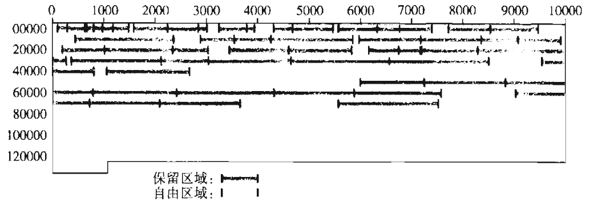
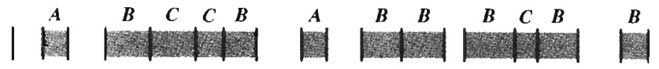
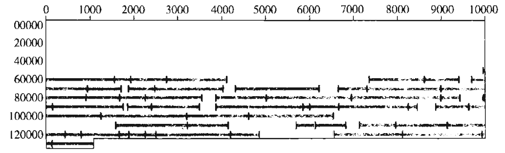
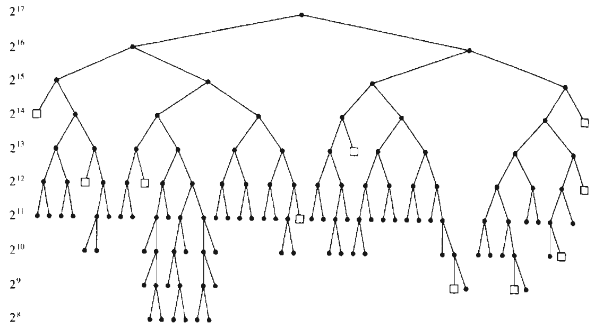

### 2.5 动态存储分配

我们已经看到链接的使用如何意味着数据结构不必顺序地放置在内存中; 许多表格可以独立地在公共的池状的内存区域中增长和收缩. 然而, 我们的讨论总是暗中假定所有节点都有相同的大小——即每个节点占有某个固定数目的内存单元.

对于大量的应用说来, 可以找到一种合适的折中, 使得对于所有结构确实使用一致的节点大小 (例如见习题 2). 习惯上, 不是简单地取所必需的最大的节点大小因而在较小的节点处浪费空间, 而是选择较小的节点大小并且应用所谓的经典的链接存储原理: “如果在这里没有存放信息的空间, 那就把它放在别处, 并安插一个指向该处的链接.”

然而, 对于大量的其它应用, 单一的节点大小是不合理的; 我们经常希望大小变化的节点共享公共的内存区域; 以另一个角度来谈这件事, 我们要求算法从更大的存储区域保留和释放可变大小的内存块, 其中这些块是由连续的内存单元组成的. 这样的技术一般称为动态存储分配算法.

有时, 通常在模拟程序中, 我们需要对于较小大小的节点进行动态存储分配 (比如从 1 到 10 个字); 而在其它时候, 通常是在操作系统中, 我们主要地涉及较大的信息块. 这两种视点导致对于动态存储分配的稍微不同的解决方法. 为求得这两个方法之间的一致性, 我们一般地在本节中使用块 (区) 和区域而不使用 “节点”, 来表示一组连续的内存单元.

一些作者于 1975 年左右开始把可用的内存池称做 “堆”. 但在这套书中, 我们仅仅在与优先队列有关的更传统的意义下使用该词 (见 5.2.3 小节).

**A. 保留**　[图 42](#fig-2-42) 示出典型的内存图或 “跳棋盘”, 即示出某个内存池当前状态的图表. 在这种情况下, 内存被划分成 53 个 “保留的”、即正在使用的存储块, 以及 21 个 “自由的” 或 “可用的”、即未被使用的存储块. 在动态存储分配已运行一段时间之后, 计算机的内存看起来或许就像这个样子, 我们的头一个问题是来回答下面两个问题:

a) 在计算机内部可用空间的这个分划是如何表示的?

b) 给定可用空间的这种表示, 找出 n 个连续自由空间的块并加以保留的好算法是什么?

当然, 对于问题 a) 的回答, 是在某个地方保留可用空间表; 通过使用可用空间本身来包含这样的表几乎总可以做得最好. (例外的情况是当我们对于盘文件或其它存储器分配存储空间时, 不一致的存取时间使得用分开的可用空间的目录表会更好些.)

因此, 我们可以把可用的段链接在一起: 每个自由存储区域的第一个字可以包含该块的大小和下一个自由区域的地址. 自由块可以用大小的递增或递降的顺序链接在一起, 或者以内存地址的顺序, 或者以实际上随机的顺序来做.

例如, 考虑 [图 42](#fig-2-42), 它示出从 0 到 131071 编址的 131072 个字的内存. 如果我们以内存单元的顺序把可用块链接在一起, 我们将有指向第一个自由块的变量 `AVAIL`

*图 42　内存图*

(在此情况下, `AVAIL` 将等于 0), 其余的块将被表示如下:

| 位置 | SIZE | LINK | |
| ---: | ---: | ---: | :--- |
| 0 | 101 | 632 | |
| 632 | 42 | 1488 | |
| ⋮ | ⋮ | ⋮ | [17 个相似的条目] |
| 73654 | 1909 | 77519 | |
| 77519 | 53553 | $\Lambda$ | [对于最后链接的特殊标记] |

因此单元 0 到 100 形成头一个可用块; 在 [图 42](#fig-2-42) 中示出的保留区域 101–290 和 291–631 之后, 我们在单元 632–673 中有更多的自由空间; 等等.

至于问题 b), 如果我们需要 n 个连续的字, 显然必须找出 $m\ge n$ 个可用字的某个块并把它的大小减小为 $m-n$ (而且, 当 $m = n$ 时, 我们还必须从这个表中删去该块.) 可能会有好几个有 n 或更多个单元的块, 因此问题就变成: 应该选择哪个区域呢?

这个问题有两个主要答案: 我们可以使用最好适合方法或首先适合方法. 在前种情况下, 我们决定选择有 m 个单元的区域, 其中 $m$ 是所出现的等于 n 或更大的值中最小者. 这可能要求在作出决策之前对整个可用空间表的查找. 另一方面, 首先适合方法, 简单地选择有≥n 个字的第个遇到的区域.

从历史上说, 最好适合方法被广泛使用好多年; 这自然地看起来是好的决策, 因为它节省更大的可用区域供给以后可能需要时使用. 但是最好适合方法也有若干缺陷: 它运行较缓慢, 因为它涉及了相当长时间的查找; 如果最好适合方法不是由于其它原因, 比首先适合方法实质上更好, 这额外的查找时间就不值得了. 更重要的是, 最好适合方法倾向于增加非常小的块的个数, 而小块的扩散通常是不合意的. 存在某些情况, 其中首先适合技术确实比最好适合方法要更好些; 例如, 假设给了我们其大小为 1300 和 1200 的两个可用内存区域, 并且假定有大小为 1000, 1100 和 250 的顺序内存请求:

<table><tr><td>内存</td><td>可用区域</td><td>可用区域</td></tr><tr><td>请求</td><td>首先适合方法</td><td>最好适合方法</td></tr><tr><td>—</td><td>1300,1200</td><td>1300,1200</td></tr><tr><td>1000</td><td>300,1200</td><td>1300,200</td></tr><tr><td>1100</td><td>300,100</td><td>200,200</td></tr><tr><td>250</td><td>50,100</td><td>卡住</td></tr></table>

(1)

(相反的例子出现在习题 7 中.) 关键之点是, 没有哪一个方法明显地优越于另一个. 因此简单的首先适合方法是可取的.

**算法 A (首先适合方法)**　令 `AVAIL` 指向第一个可用存储块, 并且假设带有地址 `P` 的每个可用块有两个字段: `SIZE(P)`, 即块中字的个数; `LINK(P)`, 即下一个可用块的指针. 最后的指针是 $\Lambda$. 这个算法查找和保留 $N$ 个字的内存块, 或者报告失败.

**A1.[初始化]** 置 `Q ← LOC(AVAIL)`. (贯穿于这个算法, 我们使用两个指针 `Q` 和 `P`, 它们一般地通过条件 `P = LINK(Q)` 而相互关联. 我们假定 `LINK(LOC(AVAIL)) = AVAIL`.)

**A2.[表结束了吗?]** 置 `P ← LINK(Q)`, 如果 $P=\Lambda$, 则算法不成功地结束; 没有可供 $N$ 个连续字块的内存空间.

**A3.[SIZE 足够吗?]** 如果 $\mathtt{SIZE}(P)\ge N$, 转到 A4; 否则置 `Q ← P` 并返回到步骤 A2.

**A4.[保留 N]** 置 `K ← SIZE(P) − N`. 如果 $K=0$, 则置 `LINK(Q) ← LINK(P)` (由此从这个表删去空的区域); 否则, 置 `SIZE(P) ← K`. 这个算法成功地结束, 并且保留由单元 $P+K$ 开始长度为 $N$ 的区域. ▮

这个算法肯定是足够地直截了当的. 然而, 只通过策略上的微小的改变, 就可作出在运行速度上的重大改进. 这个改进是十分重要的, 因此读者将会发现不告知这个秘密而自己去发现它是一件快事 (见习题 6).

无论对存储的分配是要求小的 N 还是大的 N, 算法 A 都是可用的. 然而, 暂时让我们假定, 我们主要是对于大的 N 值感兴趣. 然后注意当在这个算法中 SIZE(P) 等于 $N+1$ 时, 发生什么情况. 我们达到步骤 A4 并把 SIZE(P) 减少成 1. 换句话说, 刚刚建立了大小为 1 的可用块; 这个块是如此之小, 因而实际上它是没有用的, 它只不过阻塞着系统. 如果我们保留 N+1 字的整个块, 而不是节省额外的字, 我们可能处境更好. 通常扩展内存的一些字以避免处理不重要的细节, 是更好的. 类似的说明也适用于当 K 很小时 N+K 个字的块.

如果我们允许保留多于 N 个字的可能性, 则有必要记住已经保留了多少字, 使得过后当这个块再次变成可用时, 整个 N+K 个字的集合可予释放. 这附加的簿记的数量意味着在每个块中我们都紧束空间以便仅当在某些情况下出现严紧的适合时, 才使系统更加有效. 所以这个策略似乎并不特别吸引人. 然而, 作为每个可变大小的块的第一个字的特殊控制字, 由于若干原因通常证明是合乎要求的, 因此期望, 无论对于可用的还是保留的块, SIZE 字段出现在所有块的第一个字中, 这通常并非不合理.

遵照这些约定, 我们将修改上面的步骤 A4 如下:

**A4′.[保留 ≥ N]** 置 `K ← SIZE(P) − N`. 如果 $K<c$ (其中 $c$ 是小的正常数, 选定它以反映在节省时间的利益下我们愿意牺牲的内存数量), 置 `LINK(Q) ← LINK(P)` 和 `L ← P`. 否则置 `SIZE(P) ← K`, `L ← P + K`, `SIZE(L) ← N`. 算法成功地结束, 并且保留了由单元 $L$ 开始的长度为 $N$ 或更大的区域.

尽管有很少的理论或经验的证据存在, 以对 c 的选定值同其它值作比较, 但是常数 $c$ 的值用大约 8 或 10 是值得建议的. 当使用最好适合方法时, K< c 的测试要比对首先适合更为重要, 因为更严紧的适合 (即较小的 $K$ 值) 更有可能出现, 因此对此算法, 可用块的个数应保持尽可能地小.

**B. 释放**　现在让我们考虑相反的问题: 当内存块不再需要的时, 我们应当怎样把它们返回到可用空间表中去?

也许通过废料收集 (参见 2.3.5 小节) 会诱使我们草草打发这个问题; 我们可以遵照以下决策行事, 即在空间用完之前, 什么也不做, 而当空间用完后寻找当前正在使用的所有区域, 并且制作出新的 AVAIL 表.

然而, 废料收集的思想并非对所有应用都值得推荐. 首先, 如果我们能够保证当前正在使用的所有区域都将很容易找到, 则我们就需要相当 “守规矩” 地使用指针. 而这种规矩在这里所考虑的应用中通常是较缺少的; 其次, 如同我们以前所见到的, 当内存已接近满了时废料收集趋于缓慢.

为什么废料收集的方法不是令人满意还有另一更重要的原因, 它起因于前边关于这个技术的讨论中我们未曾碰到的一个现象: 假设有两个相邻的内存区域, 它们两个都是可用的, 但由于废料收集原理, 其中之一 (以阴影示出) 不在 AVAIL 表中.

(2)

上图中, 左端和右端的深阴影区域是不可用的. 我们现在可以保留已知是可用区域的一部分:

(3)

如果这时废料收集出现, 我们有两个分开的自由区域:

(4)

可用区域和保留区域之间的边界倾向于永久存在, 而且随着时间的推移, 情况逐渐变得更糟. 但如果我们有只要块变为自由了就立即把它们返回到 AVAIL 表中这样一种原理, 并且把相邻的可用区域都融合在一起, 我们就把 (2) 融合成为

(5)

而且我们就会得到 (6), 这比 (4) 好得多. 这个现象引起废料收集技术导致内存比应有的更为破碎.

(6)

为了消除这个困难, 我们可以把废料收集和紧凑内存的过程一起使用, 即把所有保留的内存块移动到相邻的单元, 使得每当完成废料收集过程时, 所有可用块就跑到一起来了. 同算法 A 相对照, 分配算法现在变成完全平凡了, 因为在所有时刻下都只有一个可用块. 即使这个技术要花时间重新复制当前正在使用的单元, 并且改变其中链接字段的值, 但当有对指针的守规矩的使用时, 以及当在每块中有空闲的链接字段以供应废料收集算法使用时, 它仍可以相当的效率被应用 (见习题 33).

由于许多应用不满足废料收集的可行性的要求, 我们现在将研究把内存返回到可用空间表的方法. 在这些方法中惟一的困难是融合的问题: 即两个相邻的自由区域应当合并成一个. 事实上, 当由两个可用块限定的区域变为自由时, 所有三个区域都应合并成一个. 这样一来, 即使在长时间里, 存储区域连续不断地被保留又被释放, 仍然可以得到内存的好的平衡. (关于这个事实的证明, 请见以下的 “百分之五十规则”.)

问题是确定在被返回块的任何一边的区域当前是否可用; 如果它们是, 我们就要适当地修改 AVAIL 表, 这后一个操作比起设想的要更为困难.

对这些问题的第一种解决方法是以递增的内存地址来保持 AVAIL 表.

**算法 B (通过排序表释放)**　在算法 A 的假定下, 并作附加的假定, 即 AVAIL 表是按内存单元排序了的 (即, 如果 $P$ 指向一个可用块且 $\mathtt{LINK}(P)\ne\Lambda$, 则 $\mathtt{LINK}(P)>P$). 这个算法往 AVAIL 表添加由单元 `P0` 开始的 $N$ 个连续单元的块. 我们自然假定这 $N$ 个单元无一已是可用的.

**B1.[初始化]** 置 `Q ← LOC(AVAIL)`. (见上面步骤 A1 中的说明.)

**B2.[推进 P]** 置 `P ← LINK(Q)`. 如果 $P=\Lambda$, 或者如果 $P>\mathtt{P0}$, 则转到 B3; 否则置 `Q ← P` 并重复步骤 B2.

**B3.[校验上界]** 如果 $\mathtt{P0}+N=P$ 且 $P\ne\Lambda$, 则置 `N ← N + SIZE(P)` 并置 `LINK(P0) ← LINK(P)`, 否则置 `LINK(P0) ← P`.

**B4.[校验下界]** 如果 $Q+\mathtt{SIZE}(Q)=\mathtt{P0}$ (我们假定 `SIZE(LOC(AVAIL)) = 0`, 因此这个检验在 `Q = LOC(AVAIL)` 时总失败), 置 `SIZE(Q) ← SIZE(Q) + N` 及 `LINK(Q) ← LINK(P0)`. 否则置 `LINK(Q) ← P0`, `SIZE(P0) ← N`. ▮

基于指针 Q < P0 < P 是三个连续可用区域的开始地址这样的事实, 步骤 B3 和 B4 完成所要求的融合.

如果 AVAIL 表中不是以单元的顺序保持的, 读者将看到融合问题的 “硬算” 方法需要对整个 $\mathtt{AVAIL}$ 表中的完全查找; 算法 B 把这个通遍查找减少到平均大约是 AVAIL 表的一半 (在步骤 B2). 习题 11 说明, 如何修改算法 B 使得平均说来, 只需查找 AVAIL 表的三分之一左右. 但是显然, 当 AVAIL 表很长时, 所有这些方法都比我们想要的要慢得多. 有没有其它的方法来保留和释放存储区域使得我们不必对整个 AVAIL 表进行

广泛的查找呢?

我们现在将考虑一种方法, 当把存储返回时, 消除所有的查找, 而且像在习题 6 中那样, 可加以修改以便当保留存储时, 避免几乎所有的查找. 这个技术利用在每个块两端的 TAG 字段和在每块第一个字中的 SIZE 字段; 当使用相当大的块时, 这个开销可以忽略不计, 尽管当块有很小的平均大小时, 这也许是要支付的相当大的代价. 习题 19 中描述的另一种方法在每块的第一个字中只要求一个二进位, 其代价仅是稍多一点的运行时间和稍微复杂一点的程序.

无论如何, 让我们现在假定, 我们不介意于稍微添加一点控制信息, 以便当 AVAIL 表很长时, 节省在算法 B 上的大量时间. 我们将描述的方法假定每块有下列格式:

(7)

在下列算法中的思想是保持双重链接的 $\mathtt{AVAIL}$ 表, 使得可以方便地从表的随机部分删去条目, 在一个块的任一端的 TAG 字段可用于控制融合的过程, 因为我们可以很容易地指出两个相邻的块是否可用.

通过令在第一个字中的 LINK 指向表中的下一个自由块, 和令第二个字中的 LINK 指向前一个块, 即可以熟知的方式实现双重链接. 因此, 如果 P 是可用块的地址, 我们总有

$$
\mathtt{LINK}(\mathtt{LINK}(P)+1)=P=\mathtt{LINK}(\mathtt{LINK}(P+1))\qquad \text{(8)}
$$

为确保适当的 “边界条件”, 把表头设置如下:

| 地址 | 符号 | SIZE | 字段 | LINK |
| --- | :---: | ---: | ---: | :--- |
| LOC(AVAIL) | − | 0 | 0 | → 指向可用空间表的头一块 |
| LOC(AVAIL) + 1 | − | 0 | 0 | → 指向可用空间表的最后一块 |

(9)

对于这个技术的首先适合保留算法可以被设计成同算法 A 非常相像, 因此在这里我们不加考虑 (请见习题 12). 这个方法主要的新特征, 是内存块可以在实质上固定的时间内被释放的方式.

**算法 C (利用边界标记释放)** 假定单元的块有如 (7) 中所示的形式, 并且假定 AVAIL 表如上面所述那样是双重链接. 这个算法把以地址 P0 开始的单元的块放入 AVAIL 表中. 如果可用存储池是从单元 $m_0$ 开始直到 $m_1$ (含) 为止, 为方便起见, 本算法假定

$$
\mathtt{TAG}(m_0-1)=\mathtt{TAG}(m_1+1)=\text{“+”}
$$

C1.[检验下界] 如果 $\mathtt{TAG}(\mathtt{P0}-1)=\text{“+”}$, 转到 $\mathrm{C3}$

**C2.[删去下部区域]** 置 `P ← P0 − SIZE(P0 − 1)`, 而后置 `P1 ← LINK(P)`, `P2 ← LINK(P + 1)`, `LINK(P1 + 1) ← P2`, `LINK(P2) ← P1`, `SIZE(P) ← SIZE(P) + SIZE(P0)`, `P0 ← P`.

**C3.[检验上界]** 置 `P ← P0 + SIZE(P0)`. 如果 `TAG(P) = “+”`, 则转到 C5.

**C4.[删除上部区域]** 置 `P1 ← LINK(P)`, `P2 ← LINK(P + 1)`, `LINK(P1 + 1) ← P2`, `LINK(P2) ← P1`, `SIZE(P0) ← SIZE(P0) + SIZE(P)`, `P ← P + SIZE(P)`.

**C5.[加到 AVAIL 表]** 置 `SIZE(P − 1) ← SIZE(P0)`, `LINK(P0) ← AVAIL`, `LINK(P0 + 1) ← LOC(AVAIL)`, `LINK(AVAIL + 1) ← P0`, `AVAIL ← P0`, `TAG(P0) ← TAG(P − 1) ← “−”`. ▮

算法 C 的步骤是存储布局 (7) 的直截了当的结果; 一种稍微快一点的也稍微长一点的算法出现于习题 15 中. 如同在 (9) 中所示, 在步骤 C5 中, AVAIL 是 LINK(LOC(AVAIL)) 的缩写.

**C. “伙伴系统”**　我们现在将研究适合于二进制计算机使用的动态存储分配的另一种方法. 这个方法在每块中使用一个二进位的开销, 而且它要求所有块有 1,2,4,8 或 16 等的长度. 如果一个块的长度不是对应于某个整数 $k$ 的 $2^k$ 个字的话, 则选取 2 的下一个更高的次幂, 而且相应地分配额外未使用的空间.

这个方法的思想, 是保持每个大小为 $2^k,\ 0\le k\le m$ 的可用块的分开表. 在分配之下整个内存空间也由 $2^m$ 个字组成, 我们可以假定它有从 0 开始到 $2^m-1$ 的地址. 原来, 整个 $2^m$ 个字都是可用的. 过后, 当要求 $2^k$ 个字的一块时, 如果没有这样大小的块可用, 则把一个更大的可用块分开成两个相等的部分; 最终, 将出现一个正好是 $2^k$ 大小的块. 当把一个块分成两块 (它们每一块都是原来块的一半那么大), 这两块就称为伙伴 (buddies). 过后当两个伙伴再次可用时, 它们又合并回来成为一块; 这样这个过程可以无限地维持下去, 直到某个时刻我们用完内存为止.

奠定这个方法在实践上的有用性的关键事实是, 如果我们知道一个块的地址 (即它的头一个字的内存地址), 而且如果我们还知道该块的大小, 那我们就知道它的伙伴的地址. 例如, 开始于二进制单元 `101110010110000` 的大小为 16 的块的伙伴是开始于二进制单元 `101110010100000` 的一个块. 为了知道为什么这为真, 我们首先观察到, 当算法进行时, 大小为 $2^k$ 的一个块的地址是 $2^k$ 的倍数. 换句话说, 在二进制下的地址在右边至少有 k 个零. 这个观察很容易通过归纳法来证明: 如果它对于所有大小为 $2^{k+1}$ 的块为真, 则当把逐个块折半时它肯定为真.

因此, 一个大小为比如说 32 的块有形如 xx…x00000 的地址 (其中 $x$ 表示 0 或 1); 如果把它分开, 则新形成的伙伴系统有地址 $xx\cdots x00000$ 和 $xx\cdots x10000$ 一般说来, 令 $\operatorname{buddy}_k(x)=$ 大小为 $2^k$ 其地址为 x 的块的伙伴的地址; 我们求得

$$
\operatorname{buddy}_k(x)=\begin{cases}x+2^k,&x\bmod 2^{k+1}=0,\\ x-2^k,&x\bmod 2^{k+1}=2^k.\end{cases}\qquad \text{(10)}
$$

通过在二进制计算机上通常可找到的 “异或” (有时称做 “有选择的补” 或 “无进位加”) 指

令, 可容易地计算这个函数; 见习题 28.

伙伴系统利用在每个块中的一位的 TAG 字段:

$$
\mathtt{TAG}(P)=\begin{cases}0,&\text{如果具有地址 }P\text{ 的块被保留},\\1,&\text{如果具有地址 }P\text{ 的块是可用的}.\end{cases}\qquad \text{(11)}
$$

除了在所有块中存在的这个 TAG 字段 (其不得被保留块的用户窜改) 之外, 可用块还有两个链接字段 LINKF 和 LINKB, 它们是双重链接系统通常向前和向后的链接; 而且当其大小为 $2^k$ 时, 它们还有一个 KVAL 字段来确定 $k$. 以下算法利用表格单元 $\mathtt{AVAIL}[0],\mathtt{AVAIL}[1],\ldots,\mathtt{AVAIL}[m]$, 它们分别作为大小为 $1,2,4,\ldots,2^m$ 的可用存储的表的表头. 这些表是双重链接的, 因此像通常一样表头包含两个指针 (见 2.2.5 小节):

$$
\begin{aligned}\mathtt{AVAILF}[k]&=\mathtt{LINKF}(\mathtt{LOC}(\mathtt{AVAIL}[k]))=\text{对 AVAIL}[k]\text{ 表尾部的链接},\\\mathtt{AVAILB}[k]&=\mathtt{LINKB}(\mathtt{LOC}(\mathtt{AVAIL}[k]))=\text{对 AVAIL}[k]\text{ 表首端的链接}.\end{aligned}\qquad \text{(12)}
$$

开始时, 在分配任何存储之前, 我们有

$$
\begin{aligned}\mathtt{AVAILF}[m]&=\mathtt{AVAILB}[m]=0,\\\mathtt{LINKF}(0)&=\mathtt{LINKB}(0)=\mathtt{LOC}(\mathtt{AVAIL}[m]),\\\mathtt{TAG}(0)&=1,\quad\mathtt{KVAL}(0)=m\end{aligned}\qquad \text{(13)}
$$

(表示开始于单元 0 处长度为 $2^m$ 的单个可用块), 且

$$
\mathtt{AVAILF}[k]=\mathtt{AVAILB}[k]=\mathtt{LOC}(\mathtt{AVAIL}[k]),\qquad 0\le k<m.\qquad \text{(14)}
$$

(表示对于所有 $k<m$, 长度为 $2^k$ 的可用块的空表.)

从伙伴系统的这一描述, 读者可以发现, 在阅读以下给出的算法之前, 自己亲自设计用于保留和释放存储区域的必要算法, 是颇有兴味的. 注意在这个保留算法中, 诸块可相当容易地分成两半.

**算法 R (伙伴系统的保留)**　这个算法, 利用以上所说明的伙伴系统之组织, 找出并保留一个 $2^k$ 个单元的块, 或报告失败.

**R1.[找块]** 命 $j$ 是在 $k\le j\le m$ 的范围内最小的整数, 使得对于它 $\mathtt{AVAILF}[j]\ne\mathtt{LOC}(\mathtt{AVAIL}[j])$, 即对它来说, 大小为 $2^j$ 的可用块的表不是空的. 如果不存在这样的 $j$, 则这个算法不成功地终止, 因为没有足够大小的已知可用块来满足需要.

**R2.[从表中撤消]** 置 `L ← AVAILF[j]`, `P ← LINKF(L)`, `AVAILF[j] ← P`, `LINKB(P) ← LOC(AVAIL[j])` 以及 `TAG(L) ← 0`.

**R3.[需要分开?]** 如果 $j=k$, 则这算法终止 (我们已经找到并保留了一个由地址 $L$ 开始的可用块).

**R4.[分开]** $j$ 减 1. 然后置 $P\leftarrow L+2^j$, `TAG(P) ← 1`, `KVAL(P) ← j`, `LINKF(P) ← LINKB(P) ← LOC(AVAIL[j])`, `AVAILF[j] ← AVAILB[j] ← P`. (这就把一个大块分开并把不用的一半记入原来是空的 `AVAIL[j]` 表中.) 返回步骤 R3. ▮

**算法 S (伙伴系统的释放)**　利用以上阐明的伙伴系统的组织, 这个算法把一个始于地址 $L$ 的 $2^k$ 个单元的块, 恢复到自由存储中.

**S1.[伙伴可用否?]** 置 $P\leftarrow\operatorname{buddy}_k(L)$. (见等式 (10).) 如果 $k=m$ 或如果 $\mathtt{TAG}(P)=0$, 或者如果 $\mathtt{TAG}(P)=1$ 且 $\mathtt{KVAL}(P)\ne k$, 则转到 S3.

**S2.[同伙伴结合]** 置 `LINKF(LINKB(P)) ← LINKF(P)`, `LINKB(LINKF(P)) ← LINKB(P)`. (这就从 `AVAIL[k]` 表撤消块 `P`.) 然后置 $k\leftarrow k+1$, 而且如果 $P<L$ 则置 $L\leftarrow P$. 返回到 S1.

**S3.[放到表中]** 置 `TAG(L) ← 1`, `P ← AVAILF[k]`, `LINKF(L) ← P`, `LINKB(P) ← L`, `KVAL(L) ← k`, `LINKB(L) ← LOC(AVAIL[k])`, `AVAILF[k] ← L`. (这就把块 L 放到 `AVAIL[k]` 表中.)▮

**D. 诸方法之比较** 要对这些动态存储分配算法进行数学分析, 已经证明是十分困难的. 但是, 有一个有趣的现象, 是相当容易来分析的, 即 “百分之五十规则”:

> 如果算法 A 和 B, 以系统趋向于一个均衡状态这样一种方式, 被连续地使用, 其中在这个系统中平均有 $N$ 个保留块, 每一块都同样可能地成为下一个被释放者, 而且其中算法 A 中之量 $K$ 取非零值 (或者, 更一般地, 如同在步骤 A4′ 中那样, 取值 $\ge c$) 之概率为 $p$, 那么, 可用块的平均数就近似地趋于 $\tfrac12pN$.

这个规则告诉我们 AVAIL 表近似地将有多长. 当数量 p 接近 1 时——如果 $c$ 非常小而且如果块的大小不常彼此相等, 则将发生这种情况——我们将有大约为不可用块之一半那么多的可用块; 因此就有 “百分之五十规则” 之称.

不难来导出这个规则. 考虑以下的内存图:

这就说明, 保留块分成了三类:

A: 当释放时, 可用块的个数将减 1;

B: 当释放时, 可用块的个数将不变;

C: 当释放时, 可用块的个数将加 1.

现在命 N 是保留块的个数, 并命 M 是可用块的个数; 命 A, B 和 C 是上述标识类型的块数. 我们有

$$
\begin{aligned}N&=A+B+C,\\M&=\tfrac12(2A+B+\epsilon).\end{aligned}\qquad \text{(15)}
$$

其中 $\epsilon=0,1$ 或 $2$, 取决于下界和上界的条件.

我们假定 N 实质上是常数, 但 A, B, C 和 $\epsilon$ 是随机变量, 在一个块被释放之后它们达到一个静止的分布, 而在一个块被分配之后它们达到另一个 (稍微不同的) 静止的分

布. 当一个块被释放时, $M$ 的平均变化是 $(C-A)/N$ 的平均值; 当一个块被分配时, $M$ 的平均变化是 $1-p$. 所以均衡假定告诉我们 $C-A-N+pN$ 的平均值为 0. 但是 $2M$ 的平均值是 $pN$ 加上 $\epsilon$ 的平均值, 因为由 (15), $2M=N+A-C+\epsilon$. 从而得出百分之五十规则.

如果一个块的生存期是一个指数分布的随机变量, 则关于每一个删除都适用于-个随机的保留块的假定将是正确的. 另一方面, 如果所有块有大约相同的生存期, 则这个假定是假的; JohnE.Shore 曾经指出, 当分配和释放倾向于有点先进先出的特性时, 类型 A 的块显得比类型 C 的块 “更老” 些, 因为相邻的保留块的一个序列倾向于是按从最年轻到最老的顺序的, 而且还因为最新分配的块几乎总不是类型 A 的. 这就倾向于产生更少量的可用块, 并且给出比百分之五十规则的预测甚至更好的性能. 见 CACM20(1977), 812–820.

关于百分之五十规则更详细的信息, 请见 D. J. M. Davies,*BIT* **20** (1980), 279–288; C. M. Reeves,*Comp. J.* **26** (1983), 25–35; G. Ch. Pflug,*Comp. J.* **27** (1984), 328–333.

除了这个有趣的规则外, 我们对这些动态存储分配算法的性能的知识, 几乎完全以蒙特卡罗实验为基础. 读者将会发现, 当就一台特殊的机器和一个特殊的应用或一类应用, 选择存储分配算法时, 实施他们自己的模拟实验是有启发的. 作者就曾在刚要写这一小节之前, 进行了若干次这样的实验 (其实, 在作出这个百分之五十规则的证明之前, 在做这些实验期间, 就已经注意到这个规则). 这里, 让我们简短地来检查一下这些实验的方法和结果.

基本的模拟程序运行如下, TIME 开始时为 0, 而且内存区域开始时全都可用:

P1.TIME 增 1.

P2. 释放系统中在 TIME 的当前值时所有被调度为要释放的块.

P3. 利用第 3 章的一些方法, 计算以某些概率分布为基础的两个量 S (一个随机的大小) 和 T (一个随机的生存期).

P4. 保留一个长度为 S 的新块, 它是在 (TIME + T) 时要被释放的. 返回到 P1.

每当 TIME 是 200 的一个倍数时, 就打印出关于保留和释放算法之性能的详细统计. S 和 T 值的同一序列为每一对被测试的算法所使用. 在 TIME 增加到超过 2000 之后, 这个系统通常已差不多达到一种稳定状态, 并明确指示此后将无限地保持此种状态. 然而, 依赖于可用存储的总量以及在步骤 P3 中 S 和 T 的分布, 分配算法有时候将不能找出足够的空间, 模拟实验将因此而被终止.

命 $C$ 是可用内存单元的总数, 并命 $\overline S,\overline T$ 表示步骤 P3 中 $S$ 和 $T$ 的平均值. 容易看出, 一旦 TIME 足够大, 在任何给定的时刻预期的内存不可用字数是 $\overline S\,\overline T$. 在实验中当 $\overline S\,\overline T$ 大于大约 $\tfrac23 C$ 时, 通常往往是在真正需要 $C$ 个内存字之前就出现内存溢出. 当块的大小相对于 $C$ 来说很小时, 则内存有可能充满到百分之九十以上, 但是当允许块的大小超过 $\tfrac13 C$ 时 (以至取更小的值时亦然), 若事实上少于 $\tfrac12 C$ 个单元在使用, 程序趋向于

认为内存已 “填满”. 经验的证据强烈地提示, 如果预期进行有效的操作, 则大于 $\tfrac1{10}C$ 的块大小不应为动态存储分配所使用.

借助于百分之五十规则可以理解这一特性的原因: 如果系统达到这样一个均衡条件, 其中一个平均的自由块的大小 $f$ 小于使用中的一个平均块的大小 $r$, 则除非在紧急情况下有一个大的自由块可用, 否则我们只能期望得到一个不能满足的请求. 因此在一个不溢出的饱和系统中 $f\ge r$, 而且我们有 $C=fM+rN\ge rM+rN\approx(\tfrac12p+1)rN$. 因此使用中的内存总量是 $rN\le C/(\tfrac12p+1)$; 当 $p\approx1$ 时我们不可能使用多于大约 $\tfrac23$ 的内存单元.

实验以对于 S 的三种大小分布实施:

(S1)100 与 2000 之间均匀选取的整数.

(S2) 分别以概率 $(\tfrac12,\tfrac14,\tfrac18,\tfrac1{16},\tfrac1{32},\tfrac1{32})$ 选定的大小 (1,2,4,8,16,32).

(S3) 以相等的概率选择的大小 (10,12,14,16,18,20,30,40,50,60,70,80,90,100, 150,200,250,500,1000,2000,3000,4000).

时间分布 T 通常是对于固定的 $t = 10$, 100 或 1000, 在 1 与 t 之间均匀地选取的随机整数.

实验也可以这样来进行, 即在步骤 P3 中, 在 1 与 $\min(\lfloor\tfrac54 U\rfloor,12500)$ 之间均匀地选择 T, 其中 U 是直到系统中的某个当前被保留的块下一次被调度释放为止, 剩下的时间单位数. 这种时间分布是用来模拟一个 “几乎是后进先出的” 行为: 因为如果总是把 T 选择成 ${}\le U$, 则存储分配系统就将退化成为只不过是一个不需要复杂算法的栈操作 (见习题 1). 所述的分布使 T 有大约百分之二十的时间被选择成大于 U, 所以我们就几乎有 (而不是完全有) 一个栈操作. 当采用这种分布时, 诸如 A, B 和 C 这些算法, 要比通常表现得好得多. 在整个 AVAIL 表中很少有多于两个的项目, 而同时却有大约 14 块保留块. 另一方面, 当使用这种分布时, 伙伴系统算法 R 和 S 是较慢的, 因为它需要更经常地以一种类似栈的操作来分开和合并诸块. 这种时间分布的理论性质, 显得特别难推导 (见习题 32).

这一节开头的 [图 42](#fig-2-42), 是在 TIME=5000 时的内存配置, 用的是大小分布 (S1) 和在 $\{1,\ldots,100\}$ 中一致分布的时间, 并且利用像上述算法 A 和 B 中那样的首先适合的方法. 对于这一实验, 进入 “百分之五十规则” 之概率 p 实质上是 1, 所以我们可以预期大约有保留块的一半那么多的可用块. 实际上, [图 42](#fig-2-42) 说明有 21 块可用块和 53 块保留块. 这并不否定百分之五十规则: 例如, 在 TIME=4600 时有 25 个可用块和 49 个保留块. [图 42](#fig-2-42) 中的配置只不过说明了百分之五十规则怎样以统计的变化为条件. 可用块的块数范围一般是在 20 与 30 之间, 而保留块的块数一般是在 45 与 55 之间.

图 43 示出了使用与图 42 相同的数据, 但使用的是 “最好适合” 而不是 “首先适合” 方法, 所得到的内存图. 步骤 A4′中的常数 $c$ 选择成 16, 以消除小块, 而且结果概率 p 降低到约 0.7, 并有更少的可用区域.

*图 43　用 “最好适合” 方法得到的内存图 (与示出 “首先适合” 方法的图 42, 以及对于同一个存储请求序列示出 “伙伴系统” 的图 44 相比较)*

当时间分布是从 1 到 1000 变化而不是从 1 到 100 时, 就得到确切地类似于 [图 42](#fig-2-42) 和 43 中所示的情况, 而且所有相应的数量都近似地乘以 10. 例如, 有 515 个保留块; 而在 [图 42](#fig-2-42) 的等价条件下有 240 个自由块, 在 [图 43](#fig-2-43) 的等价条件下有 176 个自由块.

在最好适合与首先适合方法的所有实验中, 后者总是显得更好些. 当内存大小被穷尽时, 在大多数情况下, 在内存出现溢出之前, 首先适合方法实际上比最好适合方法更能长久地持续活动.

伙伴系统也可应用到导致 [图 42](#fig-2-42) 和 [图 43](#fig-2-43) 的相同的数据上, 从而得到 [图 44](#fig-2-44) 作为其结果. 这里, 所有在 257 到 512 范围内的大小都被处理成 512, 而所有在 513 与 1024 之间的大小都被提高到 1024, 等等. 平均说来, 这意味着大约要求三分之四那么多的内存 (见习题 21); 当然, 伙伴系统对于像上边 (S2) 那样的大小分布, 而不是 (S1) 那样的, 要工作得更好. 注意在 [图 44](#fig-2-44) 中有大小为 $2^9,2^{10},2^{11},2^{12},2^{13}$ 和 $2^{14}$ 的可用块.

对伙伴系统的模拟说明, 它的执行比预料的要好得多. 显然, 伙伴系统有时将允许两个相邻的区域都是可用的, 而不把它们合并成一个 (设想它们不是 “伙伴”); 但这种情况在 [图 44](#fig-2-44) 中不出现, 事实上, 这在实践中是少见的. 在出现内存溢出的情况下, 内存百分之九十五被保留, 而这反映了一种十分好的分配平衡. 况且, 很少有必要在算法 R 中分开诸块, 或者在算法 S 中合并它们; 对于在最普遍使用的诸层上的可用块, 剩下的树极像 [图 44](#fig-2-44). 有助于理解在树之最低层上这种特性的某些数学结果, 已经由 P. W. Purdom, Jr 和 S. M. Stigler 得到, 见 JACM 17(1970), 683–697.

还有另一件令人吃惊的事情, 就是算法 A 在如习题 6 所述修改之后, 所得到的出色特性; 平均说来, 仅需要对可用块大小做 2.8 次检查 (使用大小分布 (S1) 和在 1 与 1000 之间均匀选取的时间), 而且多一半的时间, 仅仅需要极小的值, 即-一次迭代. 尽管事实上大约有 250 个可用块, 但这却是真的. 对于未修改的算法 A, 相同的实验证明, 平均大约需要 125 次迭代 (所以每次大约要检查 AVAIL 表的半); 而且发现 20%的时间需要 200 次或更多次的迭代.

事实上, 未修改的算法 A 的这种行为, 可以作为百分之五十规则的一个推论而预测到. 在均衡状态下, 内存中包含最后半保留块的内存部分, 也将包含最后一半的自由块; 当一块被释放时, 该部分将有一半时间被卷入, 从而它必须被卷入到一半的分配

*图 44　用 “伙伴系统” 得到的内存图 (这个树结构指出了某些大块分成大小折半的 “伙伴” 的划分. 正方形表示可用块)*

中以便维持均衡. 当以任何其它的分数来代替一半时, 同样的论证亦成立. (这些发现属于 J. M. Robson.)

后面的习题包括两个主要方法的 MIX 程序, 推荐它们作为上述说明的推论: (i) 习题 12 和习题 16 中所修改的边界标记系统; 以及 (ii) 伙伴系统. 下面是近似结果:

| 方法 | 用于保留的时间 | 用于释放的时间 |
| --- | ---: | ---: |
| 边界标记系统 | $33+7A$ | 18, 29, 31 或 34 |
| 伙伴系统 | $19+25R$ | $27+26S$ |

这里, $A\ge1$ 是在检索一个足够大的可用块时所需要的迭代次数; $R\ge0$ 是一块分成二块的次数 (在算法 R 中的 $j-k$ 之初始差); 而 $S\ge0$ 是在算法 S 期间伙伴块被重新融合在一起的次数. 模拟实验表明, 在所述的假定下, 用大小分布 (S1) 以及在 1 与 1000 之间选定的时间, 平均说来, 我们可以取 $A=2.8,R=S=0.04$. (当代换成如前所述的 “几乎是后进先出” 的时间分布时, 则发现这个平均值为 $A=1.3,R=S=0.9$.) 这说明, 两个方法都十分快, 而且伙伴系统在 MIX 的情况下稍微更快些. 记住, 当块的大小不被限制为 2 的幂次时, 伙伴系统要求多出大约 44% 的空间.

对于习题 33 的废料收集和紧凑算法, 其相应的时间估计是, 大约要 104 个时间单位来找出一个自由节点, 假定当内存近于半数充满时出现废料收集, 并且假定诸节点有 5 个字的平均长度, 又每个节点有 2 个链接. 废料收集的正反两个方面, 都已在 2.3.5 小节中讨论过了. 当内存未被大量装入而且当满足适当的限制时, 废料收集和紧凑算法是非常有效的; 例如, 在 MIX 计算机上如果内存空间绝不会充满到 1/3 以上, 而且节点又相当小, 废料收集方法要比其它两个方法都要快.

如果奠定废料收集的基础的假定被满足, 最好的策略可能是把内存池分成两半并且在一半之内进行所有的分配. 我们不在块变成可用时释放它们, 而是简单地等候到内存当前活动的一半变满为止; 然后我们可以把所有活动的数据都复制到另半去, 同时删去块间的所有空洞, 使用类似于习题 33 给出的方法. 当我们从一半转到另一半时, 我们也可对每一半池的大小作调整.

以上提到的模拟技术也可应用于某些其它的存储分配算法. 与这一小节的算法比较起来, 其它的算法就显然太拙劣了, 因此在这里仅仅简单地提及:

a) 对每个大小保存独立的 AVAIL 表. 一个单一的自由块必要时偶尔也分成两个更小的块, 但并不试图再把这样的块重又合到一起. 内存图破碎为越来越细的部分, 直至濒于细如毫毛的惨状; 一个与此相像的简单的方案, 几乎相当于在分散的区域里做独立的分配, 对于每个块的大小都分配一个区域.

b) 企图进行 “二级” 分配: 把内存分成 32 个大段. 用 “蛮干” 分配方法来保留 1,2 或 3 份 (很难再多了) 相邻段的大块. 每个这样的大块又被进一步分开以满足存储要求, 直到在当前的大块内已不再剩有余地为止; 而后保留另大块供其后的分配使用. 仅当每一大块内的所有空间都已成为可用时, 才把它恢复到自由存储. 这个方法几乎总是非常快地用完存储空间.

尽管这一特殊的 “二级” 分配方法, 对于作者的模拟实验中所考虑的数据是失败的, 却存在有其它一些情况 (在实践中不经常出现), 其中多级分配技巧可能有益. 例如, 如果一个相当大的程序在若干阶段中运行, 我们可能知道仅仅在某个子程序内需要某种类型的节点. 一些程序也可能发现对于不同类的节点使用非常不同的分配策略, 也是所希望的. 通过带区来分配存储, 在每个带区采用可能是十分不同的策略以及能一次释放整个带区, 这样的思想是由 Douglas T. Ross 在 CACM 10(1967), 481–492 中予以讨论的.

关于动态存储分配进一步的实验结果, 参见如下论文:*CACM* **12** (1969), 365–369, 372; P. W. Purdom, S. M. Stigler 和 T. O. Cheam,*BIT* **11** (1971), 187–195; B. H. Margolin, R. P. Parmelee 和 M. Schatzoff,*IBM Systems J.* **10** (1971), 283–304; J. A. Campbell,*Comp. J.* **14** (1971), 7–9; John E. Shore,*CACM* **18** (1975), 433–440; Norman R. Nielsen,*CACM* **20** (1977), 864–873.

**\*E. 分布适合**　 如果事先已经知道诸块大小的分布, 而且不管块分配何时进行, 当前的每个块都同样可能成为下一个被释放的块, 则通过遵循 E. G. Coffman, Jr. 和 F. T. Leighton[*J. Computer and System Sci.* 38(1989), 2–35] 的建议, 我们可以使用比迄今描述的通用技术要好得多的一项技术. 他们的 “分布适合方法” 通过把内存分成大约 $N+\sqrt N\lg N$ 个槽来工作, 其中 N 是在稳定状态下要加以处理的合适的极大块个数. 每个槽有一个固定的大小, 尽管不同的槽可以有不同的大小; 其要点是, 任何给定的槽, 都有固定的边界, 而且它将或者是空的或者包含单个已分配的块.

在 Coffman 和 Leighton 的方案中, 头 N 个槽是按照假定的大小分布来放置的, 而后边的 $\sqrt N\lg N$ 个槽全都有极大的大小. 例如, 如果我们假定块的大小将均匀地分布在 1

和 256 之间, 而且如果我们预期处理 $N=2^{14}$ 个这样的块, 则我们将把内存分成大小为 1, $2,\ldots,256$ 的 $N/256=2^6$ 个槽, 后边接着是包含 $\sqrt N\lg N=2^7\cdot14=1792$ 个大小为 256 的块. 当这个系统以其完全的容量进行操作时, 我们预期它处理平均大小为 257/2 的 N 个块, 并占有 $\tfrac{257}{2}N=2^{21}+2^{13}=2\,105\,344$ 个单元; 这是我们分配给头 N 个槽的空间数量. 我们还设置了另外的 $1792\cdot256=458\,752$ 个单元来处理随机变化的效果; 这额外的开销总计为整个空间的 $O(N^{-1/2}\log N)$, 而不是像在伙伴系统中那样是 N 的一个常数倍, 因此当 $N\to\infty$ 时它变成可忽略的因子. 然而, 在我们的例子中, 它仍然占有总的分配的大约 18%.

应该把槽按顺序安排, 使得较小的槽在较大的槽前边. 给定这种安排, 我们就可以通过使用首先适合或最好适合技术来分配诸块. (在这种情况下, 两种方法等价, 因为槽的大小是有序的.) 在我们的假定之下, 效果是每当一个新的分配请求到来时, 就在头 N 个槽当中开始在实质上随机的位置进行查找, 而且继续进行直到我们找到一个空的槽为止.

如果对于每个查找, 开始的槽真正是在 1 和 N 之间随机的, 我们就不会很经常地要侵犯溢出区域. 其实, 如果在随机槽处恰好插入 N 个项, 则平均说来溢出将仅出现 $O(\sqrt N)$ 次. 原因是我们可以把这个算法和带线性探查 (算法 6.4L) 的散列法作比较. 线性探查除了对于一个空单元的查找将从 N 绕回到 1 而不是进入到溢出区域之外, 有着相同的特性. 在定理 6.4K 中对于算法 6.4L 的分析表明, 当插入 N 个项时, 每个项同它的散列地址的平均偏离是 $\tfrac12(Q(N)-1)\sim\sqrt{\pi N/8}$; 由循环对称性容易看出这个平均与对于每个 k, 从槽 k 到 k+1 的一个查找的平均次数相同. 在分布适合方法中的溢出对应于从槽 N 到槽 1 的查找, 只是我们的情况甚至更好, 因为通过不绕转回来可避免某些拥塞现象. 因此平均说来, 将出现少于 $\sqrt{\pi N/8}$ 的溢出. 这个分析不把删除考虑在内, 仅当删除介于开始槽和已分配槽之间的另一个块时 (见算法 6.4R), 我们把块移回的话, 删除才保持算法 6.4L 的假定. 然而再把它们移回去, 将只会增加溢出的机会. 我们的分析也不能考虑一次有多于 N 个块存在的效果; 如果我们仅假定块之间的抵达时间大约是驻留时间的 N 分之一的话, 这个情况可能发生. 对于多于 N 个块的情况, 我们需要扩充对于算法 6.4L 的分析, 但是 Coffman 和 Leighton 证明, 溢出区域将几乎不会超过 $\sqrt N\lg N$ 个槽; 对于所有的 M, 跑出末尾的概率少于 $O(N^{-M})$.

在我们的例子中, 在一个分配期间查找的开始槽不是在槽 1,2, …, N 当中均匀的, 而是在槽 $1,65,129,\ldots,N-63$ 当中均匀的, 因为对于每一个大小, 有 $N/256=64$ 个槽. 但是这种对上一段中考虑的随机方法的偏离, 使溢出甚至比预期的更为不可能. 当然, 如果关于块大小的分布和占有时间的假定被违反的话, 所有的打赌都要输了.

**F. 溢出**　当不再有空间可用时, 我们应该做些什么呢? 假设, 有一个请求, 比如说, 要求 n 个连续的字, 而此时所有可用的块都太小. 这种情况头一次发生时, 通常有多于 n 个的可用单元存在, 但它们不是连续的; “紧凑内存” (即移动某些使用中的单

元, 使得所有可用单元都被挪到一起) 将意味着我们可以继续处理. 但紧凑是缓慢的; 而且绝大多数情况是, 当 “首先适合” 方法穷尽所有余地时, 不论进行多少次紧凑和再紧凑, 实际上此后不久空间也就完全用光了. 因此, 除非是在与废料收集相联系的特殊情况下, 如同习题 33 中那样, 一般说来已不值得来写紧凑程序. 如果预期会出现溢出, 则可以使用从内存撤消某些项目并把它们转存到一个外部存储装置上的某种方法, 同时提供必要时再次把信息送回的条件. 这就意味着, 所有访问动态存储区域的程序, 就其对其它块所作的访问来说, 必须加以严格的限制, 而且一般说来, 要求特殊的计算机硬件 (例如, 缺乏数据时的中断, 或自动 “分页”) 在这些条件下能进行有效的操作.

为了判定哪些块是最可能撤消者, 就必须有某些判定过程. 一种想法是维持一份保留块的双重链接表, 每当其中某个块被访问时, 就把它移动到该表的前头; 然后, 诸块即以它们最近访问的次序, 进行了有效的排序, 而且在这个表的末尾的块是首先要撤消的块. 通过把保留块放进-个循环表中, 并且在每一块中包括一位 “最近使用” 位, 就可以更简单地达到一种类似的效果; 每当一块被访问时, 该位即置成 1. 当要撤消一个块的时候, 一个指针沿着这个循环表移动, 复置所有的 “最近使用” 位成 0, 直到找到了自从指针上一次到达圆周上这个部分以来未曾使用过的一块为止.

J. M.Robson 已经证明 [JACM18(1971), 416–423], 从不对保留块重新定址的动态存储分配策略, 不可能保证有效地使用内存; 总是会有使这种方法崩溃的病理情况. 例如, 甚至当诸块大小均被限制为 1 和 2 时, 不论使用什么分配算法, 内存仅仅约 2/3 被填满, 就可出现溢出! 习题 36–40 及 42–43 综述了 Robson 的有趣结果, 在习题 42–43 中, Robson 证明, 通过和首先适合方法作比较, 最好适合方法有一个非常坏的最糟情况.

**G. 继续阅读**　 基于比作者编写上述材料来有更多经验材料可资利用, Paul R. Wilson, Mark S. Johnstone, Michael Neely 和 David Boles 编写了关于动态存储分配技术的全面综述和中肯评论, 见 *Lecture Notes in Computer Science* **986** (1995), 1–116.

### 习题

1\. [20] [答案](./answers/2-5.md#ans-2-5-1)  如果存储请求总是以 “后进先出” 的方式出现, 即只有所有被陆续保留的块都已经被释放以后, 才有自由的保留块, 问对于这一节的保留和释放算法, 可以作些什么简化?

2\. [HM23] [答案](./answers/2-5.md#ans-2-5-2)  (E.Wolman) 假设我们要为可变长度的项目选择固定的节点大小, 且又假设当每个节点有长度 $k$ 而一个项目有长度 $l$ 时, 就采用 $\lceil l/(k-b)\rceil$ 个节点来存这个项目. (这里 $b$ 是一个常数, 表示每个节点的 $b$ 个字包含控制信息, 比如指向下一节点的链接.) 如果一项的长度 $l$ 的平均值是 $L$, 则 $k$ 应如何选择, 以使所要求的存储空间的平均数量为极小? (假定对于任何固定的 k, 当 $l$ 变化时, $\bigl(l/(k-b)\bigr)\bmod1$ 的平均值等于 $\tfrac12$.)

3\. [40] 通过计算机模拟, 试比较存储分配的最好适合、首先适合与最坏适合方法; 在后一种方法下, 总是选择最大的可用块. 在内存的用法方面, 有什么显著的差别?

4\. [22] [答案](./answers/2-5.md#ans-2-5-4)  为算法 A 编写一个 MIX 程序, 特别要着眼于力求内循环运行快. 假定 SIZE 字段是 (4:5), LINK 字段是 (0:2), 以及 $\Lambda<0$.

▸ 5. [18] [答案](./answers/2-5.md#ans-2-5-5)  假设已知 N 在算法 A 中总是 100 或更大. 则在修改的步骤 A4′中置 $c = 100$ 是个好主意吗?

▸ 6. [23] [答案](./answers/2-5.md#ans-2-5-6)  (下一个适合) 在算法 A 已被反复地使用之后, 有一种强烈的趋向, 把 SIZE 小的块保存在 AVAIL 表的前头, 以致通常在找到一个长度为 N 或更大的块之前, 必须远远地进入这张表来进行检索. 例如, 注意在 [图 42](#fig-2-42) 中, 对于保留块和自由块两者, 从内存的开始到末尾, 诸块的大小实质上是如何在增加的. (在准备 [图 42](#fig-2-42) 的同时, 所用的 AVAIL 表已保持了按单元顺序的排序, 如同算法 B 所要求的那样.) 你能不能提出一个修改算法 A 的方法, 使得 (a) 短小的块不趋向于累积于一个特殊的区域, 以及 (b)AVAIL 表仍然可以以内存单元递增的顺序来保持, 以利于诸如算法 B 那样的一些算法?

7\. [10] [答案](./answers/2-5.md#ans-2-5-7)  例 (1) 说明有时候 “首先适合” 方法确实是优越于 “最好适合” 方法. 试给出一个类似的例子, 以示出一种 “最好适合” 方法优于 “首先适合” 方法的情况.

8\. [21] [答案](./answers/2-5.md#ans-2-5-8)  说明怎样以一种简单的方式修改算法 A, 以得到关于 “最好适合” 方法的算法, 来代替 “首先适合” 方法.

▸ 9. [26] [答案](./answers/2-5.md#ans-2-5-9)  用 “最好适合” 方法, 以什么方式来设计个保留算法, 使其无需检索整个 AVAIL 表? (试尽可能多地想出能减少必要检索的方法.)

10\. [22] [答案](./answers/2-5.md#ans-2-5-10)  说明怎样修改算法 B, 使得从单元 P0 开始的 N 个连续单元的块成为可用的, 无须假定这 N 个单元中的每一个当前不可用; 事实上, 假定这个正被释放的区域实际上可以与已经被释放的若干块相重叠.

11\. [M25] [答案](./answers/2-5.md#ans-2-5-11)  证明, 在习题 6 的答案中所提议的对算法 A 的改进, 也可用来实现对算法 B 的一点改进, 它把平均检索长度由 AVAIL 表长度的一半减少到这个长度的 1/3. (假定这个被释放的块将被插入到已分类的 AVAIL 表内的一个随机的位置处.)

▸ 12. [20] [答案](./answers/2-5.md#ans-2-5-12)  试修改算法 A, 使得它遵从 (7)\~(9) 的约定, 使用正文中所述的修改的步骤 A4′ , 并且也加入习题 6 中所作的改进.

13\. [21] [答案](./answers/2-5.md#ans-2-5-13)  为习题 12 的算法编写一个 MIX 程序.

14\. [21] [答案](./answers/2-5.md#ans-2-5-14)  (a) 如果 SIZE 字段不出现在自由块最后的字中, 或者 (b) 如果 SIZE 字段不出现在一保留块的头一个字中, 则对于算法 C 和习题 12 的算法将产生什么影响?

▸ 15. [24] [答案](./answers/2-5.md#ans-2-5-15)  以稍微长些的程序为代价, 在 TAG(P0 - 1) 和 TAG(P0 + SIZE(P0)) 是正还是负的四种情况的每一种情况下, 除绝对必要外不改变任何更多的链接, 试说明怎样提高算法 C 的速度.

16\. [24] [答案](./answers/2-5.md#ans-2-5-16)  利用习题 15 的思想为算法 C 编写一个 MIX 程序.

17\. [10] [答案](./answers/2-5.md#ans-2-5-17)  当不出现可用块时, (9) 中的 LOC(AVAIL) 和 LOC(AVAIL) + 1 的内容将是什么?

▸ 18. [20] [答案](./answers/2-5.md#ans-2-5-18)  图 42 和图 43 是利用相同的数据, 以及实际上相同的算法 (算法 A 和 B) 而得到的, 只是图 43 是通过把算法 A 加以修改以选择 “最好适合” 以代替 “首先适合” 而作出的. 为什么这就使得图 42 有一块大的可用区域在内存的较高单元中, 而在图 43 中则有一块大的可用区域在较低的单元中呢?

▸ 19. [24] [答案](./answers/2-5.md#ans-2-5-19)  假设内存中诸块都有 (7) 的形式, 但在块的最后一个字中没有所需要的 TAG 或 SIZE 字段. 进一步假设, 下述简单的算法正被用来再次地释放一个保留块: Q←AVAIL, LINK(P0)←Q, LINK(P0 + 1)←LOC(AVAIL), LINK(Q + 1)←P0, AVAIL←P0, TAG(P0)←“ -”. (该算法在把相邻的区域融合成为一体方面无所作为.)

设计一个类似于算法 A 的保留算法, 它在检索 AVAIL 表的同时对相邻的自由块进行必要的融合, 同时避免对内存进行 (2), (3) 和 (4) 中那样不必要的分段.

20\. [00] [答案](./answers/2-5.md#ans-2-5-20)  为什么希望在伙伴系统中的 $\mathtt{AVAIL}[k]$ 表都是双重链接的, 而不是简单的直接的线性表?

21\. [HM25] [答案](./answers/2-5.md#ans-2-5-21)  考察当 $n$ 趋于无穷时的比率 $a_n/b_n$, 其中 $a_n$ 是 $1+2+4+4+8+8+8+8+16+16+\cdots$ 的头 n 项之和, 而 $b_n$ 是 $1+2+3+4+5+6+7+8+9+10+\cdots$ 的头 n 项之和.

▸ 22. [21] [答案](./answers/2-5.md#ans-2-5-22)  正文反复地说到, 伙伴系统仅只允许使用大小为 $2^k$ 的块, 而且习题 21 表明这可能导致所需存储实质性地增加. 但如果在同伙伴系统相关联中需要一个 11 个字的块, 为什么我们不能找一个 16 个字的块, 并把它分成为一个 11 个字的和两个分别为 4 个字和 1 个字的自由块呢?

23\. [05] [答案](./answers/2-5.md#ans-2-5-23)  二进地址为 011011110000, 大小为 4 的块, 其伙伴的二进地址是什么? 当块的大小为 16 而不是 4 又将如何?

24\. [20] [答案](./answers/2-5.md#ans-2-5-24)  按照正文中的算法, (大小为 $2^m$ 的) 最大的块没有伙伴, 因为它表示存储的全部. 如果定义 $\operatorname{buddy}_m(0)=0$ (即命这一块就是它自己的伙伴), 从而避免在步骤 S1 中对 $k=m$ 的测试, 这对吗?

▸ 25. [22] [答案](./answers/2-5.md#ans-2-5-25)  鉴定下述想法: “在实际情况下, 使用伙伴系统的动态存储分配将从不保留大小为 $2^m$ 的一个块 (因为这将填满整个内存), 而且一般说来, 有一个极大值 $2^n$, 没有比其更大的块被保留. 因此, 当结合后的块有大于 $2^n$ 的大小时, 在算法 S 中以这样大的可用块开始, 还要把伙伴结合起来, 将是浪费时间的.”

▸ 26. [21] [答案](./answers/2-5.md#ans-2-5-26)  试阐明伙伴系统如何可用于从内存单元 0 到 M-1 之间的动态存储分配, 即便 $M$ 不像正文中所要求的那样有 $2^m$ 之形式.

27\. [24] [答案](./answers/2-5.md#ans-2-5-27)  为算法 R 写出一个 MIX 程序, 并确定它的运行时间.

28\. [25] [答案](./answers/2-5.md#ans-2-5-28)  假定 MIX 是一台二进计算机, 并有如下定义的一个新操作码 XOR (用 1.3.1 小节的记号): $C=5,\ F=5$. 对应于单元 M 中每个等于 1 的位, 在寄存器 A 的对应位上取补 (把 0 变成 1 或 1 变成 0); rA 的符号不受影响. 执行时间为 $2u$ ”

试为算法 S 写出一个 MIX 程序, 并确定它的运行时间.

29\. [20] [答案](./answers/2-5.md#ans-2-5-29)  如果在每个保留块中没有标记位, 伙伴系统能工作吗?

30\. [M48] 若给定关于存储请求序列的合理分布, 试分析算法 R 和 S 的平均特性.

31\. [M40] [答案](./answers/2-5.md#ans-2-5-31)  利用斐波那契序列代替 2 的幂, 能否设计一个类似于伙伴系统的存储分配系统? (这样, 我们可以从 $F_m$ 个可用字开始, 而且可以把有 $F_k$ 个字的一个可用块分开成为长度分别为 $F_{k-1}$ 和 $F_{k-2}$ 的两个伙伴.)

32\. [HM46] [答案](./answers/2-5.md#ans-2-5-32)  试确定 $\lim_{n\to\infty}\alpha_n$, 如果它存在的话, 其中 $\alpha_n$ 是在如下定义的一个随机序列中 $t_n$ 的平均值: 给定对于 $0\le k<n$ 的 $t_k$ 的值, 命 $t_n$ 是从 $\{1,2,\ldots,g_n\}$ 中均匀选取的, 其中

$$
g_n=\left\lfloor\frac54\min\bigl(1000,f(t_{n-1}-1),f(t_{n-2}-2),\ldots,f(t_0-n)\bigr)\right\rfloor
$$

而且如果 $x>0$, 则有 $f(x)=x$, 如果 $x\le0$, 则 $f(x)=\infty$. (注: 某些有限的经验测试表明, $\alpha_n$ 可能近似于 14, 但这大概不是很精确的.)

▸ 33. [28] [答案](./answers/2-5.md#ans-2-5-33)  (废料收集和紧凑) 假定内存单元 1,2, …, AVAIL -1 正被用作有如下形式的可变大小的节点的一个存储池: $\mathtt{NODE}(P)$ 的头一个字含有字段

$\mathtt{SIZE}(P)=\mathtt{NODE}(P)$ 中的字数;

$\mathtt{T}(P)=\mathtt{NODE}(P)$ 中链接字段的个数; $\mathtt{T}(P)<\mathtt{SIZE}(P)$

LINK(P) = 仅在废料收集期间使用的特殊的链接字段.

在内存中紧接 NODE(P) 之后的是节点 NODE(P+ SIZE(P)). 假定, NODE(P) 中仅有的用来链到其它节点的链接字段是 $\mathtt{LINK}(P+1),\mathtt{LINK}(P+2),\ldots,\mathtt{LINK}(P+\mathtt{T}(P))$, 而且这些链接字段中的每一个, 或者是Λ, 或者是另一个节点的头一个字的地址. 最后, 假定在程序中另有一个进一步的链接变量, 称做 USE, 它指向这些节点之一.

试设计一个算法, 它能: (i) 确定出可由变量 USE 直接地或间接地访问的所有节点, (ii) 改变所有链接使得保持结构关系, 对于某个 K, 把这些节点移入内存单元 1 到 K-1; 以及 (iii) 置 AVAIL←K.

例如, 考虑内存的下列内容, 其中 INFO(L) 表示单元 L 除 LINK(L) 外的内容:

| 地址 | 内容 | 地址 | 内容 | 变量 |
| ---: | --- | ---: | --- | --- |
| 1 | SIZE = 2, T = 1 | 6 | SIZE = 2, T = 0 | AVAIL = 11 |
| 2 | LINK = 6, INFO = A | 7 | CONTENTS = D | USE = 3 |
| 3 | SIZE = 3, T = 1 | 8 | SIZE = 3, T = 2 | |
| 4 | LINK = 8, INFO = B | 9 | LINK = 8, INFO = E | |
| 5 | CONTENTS = C | 10 | LINK = 3, INFO = F | |

你的算法应当把它变换成

| 地址 | 内容 | 地址 | 内容 | 变量 |
| ---: | --- | ---: | --- | --- |
| 1 | SIZE = 3, T = 1 | 4 | SIZE = 3, T = 2 | AVAIL = 7 |
| 2 | LINK = 4, INFO = B | 5 | LINK = 4, INFO = E | USE = 1 |
| 3 | CONTENTS = C | 6 | LINK = 1, INFO = F | |

34\. [29] [答案](./answers/2-5.md#ans-2-5-34)  为习题 33 的算法编写一个 MIX 程序, 并确定它的运行时间.

35\. [22] 把这一小节的动态存储分配方法, 与在 2.2.2 小节末尾讨论的可变大小的顺序表技术加以对比.

▸ 36. [20] [答案](./answers/2-5.md#ans-2-5-36)  在加利福尼亚的好莱坞, 有个便餐店, 一排含有 23 个席位. 用餐者以一人或二人一伙进入这餐馆, 女招待员指示他们在哪里就座. 假定任何时候都不会有多于 16 个顾客同时出现, 而且如果没有单独来到的顾客被指定到号码为 2,5,8, …, 20 中的任何一个席位上, 试证明, 这位女招待员总能立即让人们入席而不必分开任何一对. (各对一起离开.)

▸ 37. [26] [答案](./answers/2-5.md#ans-2-5-37)  继续习题 36, 证明当便餐店仅有 22 个席位时, 女招待员不可能总是这样好地进行工作: 不管她使用什么策略, 总是可能碰到这样一种情况: 两个朋友进入餐馆, 而且仅有 14 人已入席, 但是却没有两个相邻的座位空着.

38\. [M21] [答案](./answers/2-5.md#ans-2-5-38)  (J. M. Robson) 习题 36 和 37 的便餐店问题可以推而广之, 用以说明任何不对保留块重新进行再定址的动态存储分配算法的最坏情况特性. 命 N(n,m) 是最小的使得任何要求分配和释放的序列均可不产生溢出地被处理的内存数量, 假定所有块的大小都不大于 m 而且所要求的空间总数总不超过 $n$. 习题 36 和 37 证明了 N(16,2) = 23; 试对于所有的 n, 确定 N(n,2) 的精确值.

39\. [HM23] [答案](./answers/2-5.md#ans-2-5-39)  (J. M. Robson) 在习题 38 的记号下, 证明 $N(n_1+n_2,m)\le N(n_1,m)+N(n_2,m)+N(2m-2,m)$; 因此对于固定的 $m,\quad\lim_{n\to\infty}N(n,m)/n=N(m)$ 存在.

40\. [HM50] [答案](./answers/2-5.md#ans-2-5-40)  继续习题 39, 确定 N(3), N(4), 以及 $\lim_{m\to\infty}N(m)/\lg m$ (如果它存在的话).

41\. [M27] [答案](./answers/2-5.md#ans-2-5-41)  这道习题的目的, 是考虑伙伴系统的最坏情况内存用法. 例如, 会出现这样一个特别坏的情况——如果我们从一个空的内存开始, 并如下进行之: 首先保留长度为 1 的 $n=2^{r+1}$ 个块, 它从单元 0 开始到 n-1; 然后对于 $k=1,2,\ldots,r$, 释放全部其开始单元不可被 $2^k$ 整除的块, 并保留 $2^{-k-1}n$ 个长度为 $2^k$ 的块, 这些块从单元 $\tfrac12(1+k)n$ 开始到单元 $\tfrac12(2+k)n-1$ 为止. 这个过程竟动用了如此之多的内存, 达到曾被占用过内存的 $1+\tfrac12 r$ 倍!

证明最坏的情况实质上不会比以下这种情况更坏: 当所有的请求是针对大小为 $1,2,\ldots,2^r$ 的块的, 而且如果在任何时候所要求的总空间绝不超过 $n$, 其中 $n$ 是 $2^r$ 的一个倍数, 那么, 伙伴系统将不会溢出一个大小为 $(r+1)n$ 的内存区域.

42\. [M40] [答案](./answers/2-5.md#ans-2-5-42)  (J. M. Robson,1975) 当如同在习题 38 中一样对于存储分配使用最好适合方法时, 设 $N_{\mathrm{BF}}(n,m)$ 是为保证不溢出所需要的内存数量. 试找出一个进攻性策略来证明 $N_{\mathrm{BF}}(n,m)\ge mn-O(n+m^2)$.

43\. [HM35] [答案](./answers/2-5.md#ans-2-5-43)  继续习题 42, 设 $N_{\mathrm{FF}}(n,m)$ 是使用首先适合方法所需要的内存数量. 试找出一个防御性策略来证明 $N_{\mathrm{FF}}(n,m)\le H_m n/\ln 2$ (因此首先适合的最坏情况距离最好可能的最坏情况并不远.)

44\. [M21] [答案](./answers/2-5.md#ans-2-5-44)  假设分布函数 F(x)=(一个块有小于等于 x 的大小的概率) 是连续的. 例如, 如果诸大小是在 a 和 b 之间均匀分布的, 则对于 $a\le x\le b,\ F(x)$ 是 $(x-a)/(b-a)$. 当我们使用分布适合方法时, 试给出表达应建立的头 N 个槽的大小的公式.
