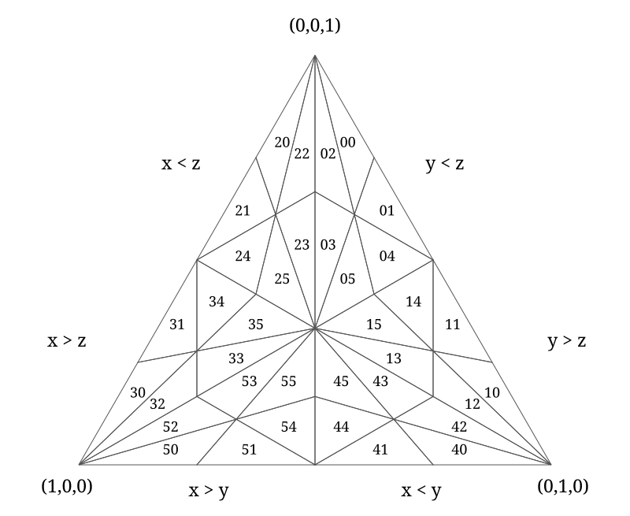
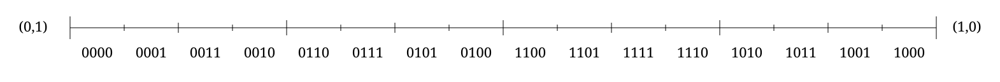
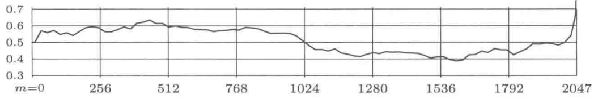

### 3.3.2 节

**1.** [题目](../sec-3-3-2.md#ex-3-3-2-1) 卡方检验的观测必须是独立的. 在第二个序列中, 相继的观测明显是相关的, 因为一个二元组的第二个分量等于下一个二元组的第一个分量.

**2.** [题目](../sec-3-3-2.md#ex-3-3-2-2) 对于 $0\le j<n$, 形成 $t$ 元组 $(Y_{jt},\ldots,Y_{jt+t-1})$, 并统计它们之中分别有多少个等于每个可能的取值. 以 $k=d^t$, 每个范畴的概率为 $1/d^t$, 运用卡方检验, 观测数 $n$ 至少应当为 $5d^t$.

**3.** [题目](../sec-3-3-2.md#ex-3-3-2-3) 首先计算恰好考察 $j$ 个值的概率, 即 $U_{j-1}$ 为落入区间 $\alpha\le U_{j-1}<\beta$ 的第 $n$ 个元素的概率. 枚举前面 $n-1$ 个这样的元素可能出现的位置, 计算具有这样的模式的概率, 容易看出所求概率为

$$
\binom{j-1}{n-1}p^n(1-p)^{j-n},
$$

生成函数为 $G(z)=(pz/(1-(1-p)z))^n$. 这是有意义的, 因为给定的分布是 $n=1$ 的相同事物的 $n$ 折卷积. 因此, 均值和方差正比于 $n$. 容易看出, 要考察的诸 $U$ 的个数具有特征 (最小值 $n$, 平均值 $n/p$, 最大值 $\infty$, 标准差 $\sqrt{n(1-p)}/p$). 当 $n=1$ 时, 这种概率分布的更详细的讨论见习题 3.4.1-17 的答案; 又见习题 2.3.4.2-26 的更一般结果.

**4.** [题目](../sec-3-3-2.md#ex-3-3-2-4) 间隔长度大于或等于 $r$ 的概率是 $r$ 个相继的 $U$ 落在给定区间之外的概率, 即 $(1-p)^r$. 间隙长度恰为 $r$ 的概率是长度大于或等于 $r$ 的概率减去长度大于或等于 $(r+1)$ 的概率.

**5.** [题目](../sec-3-3-2.md#ex-3-3-2-5) 随着 $N$ 趋于无穷大, $n$ 也 (以概率 1) 趋于无穷大, 因此除最后一个间隔长度外, 这种检验与正文中介绍的间隔检验完全一样. 正文中的间隔检验肯定逼近卡方分布, 因为每个间隔的长度都独立于其他间隔的长度. [注记: 伊芙·博芬格和维克多·博芬格给出了一个相当复杂的证明, 见 *Annals Math. Stat.* **32** (1961), 524–534. 这篇论文值得关注, 因为该文讨论了间隔检验的一些有趣的变形. 例如, 他们证明, 量

$$
\sum_{0\le r\le t}\frac{(Y_r-(Np)p_r)^2}{(Np)p_r}
$$

并不趋向于卡方分布, 尽管由于 $Np$ 是 $n$ 的期望值, 此前有人建议用这个统计量作为 “更强的” 检验.]

**7.** [题目](../sec-3-3-2.md#ex-3-3-2-7) 5, 3, 5, 6, 5, 5, 4.

**8.** [题目](../sec-3-3-2.md#ex-3-3-2-8) 见习题 10, 取 $w=d$.

**9.** [题目](../sec-3-3-2.md#ex-3-3-2-9) (把步骤 C1 和 C4 中的 $d$ 改变为 $w$.) 我们有

$$
p_r=\frac{d(d-1)\ldots(d-w+1)}{d^r}{r-1\brace w-1},\qquad w\le r<t;
$$

$$
p_t=1-\frac{d!}{d^{t-1}}\left(\frac1{0!}{t-1\brace d}+\cdots+\frac1{(d-w)!}{t-1\brace w}\right).
$$

**10.** [题目](../sec-3-3-2.md#ex-3-3-2-10) 像习题 3 一样, 我们实际上只需要考虑 $n=1$ 的情况. 由上一题和式 1.2.9-(28), 优惠券集合长度为 $r$ 的概率的生成函数为

$$
G(z)=\frac{d!}{(d-w)!}\sum_{r>0}{r-1\brace w-1}\left(\frac zd\right)^r
=z^w\left(\frac{d-1}{d-z}\right)\cdots\left(\frac{d-w+1}{d-(w-1)z}\right),
$$

利用定理 1.2.10A 和习题 3.4.1-17, 容易计算均值和方差. 我们得到

$$
\operatorname{mean}(G)=w+\left(\frac d{d-1}-1\right)+\cdots+\left(\frac d{d-w+1}-1\right)=d(H_d-H_{d-w})=\mu;
$$

$$
\operatorname{var}(G)=d^2(H_d^{(2)}-H_{d-w}^{(2)})-d(H_d-H_{d-w})=\sigma^2.
$$

由于优惠券集的搜索重复 $n$ 次, 因而被考察的 $U$ 的数目具有特征 (最小值 $wn$, 平均值 $\mu n$, 最大值 $\infty$, 标准差 $\sigma\sqrt n$).

**11.** [题目](../sec-3-3-2.md#ex-3-3-2-11) $\vert\,1\,\vert\,2\,\vert\,9\;8\;5\;3\,\vert\,6\,\vert\,7\;0\,\vert\,4\,\vert$.

**12.** [题目](../sec-3-3-2.md#ex-3-3-2-12) **算法 R (游程检验的数据).**

**R1.** [初始化.] 置 $j\leftarrow-1$, 并置 $\mathtt{COUNT}[1]\leftarrow\mathtt{COUNT}[2]\leftarrow\cdots\leftarrow\mathtt{COUNT}[6]\leftarrow0$. 还置 $U_n\leftarrow U_{n-1}$, 以便终止算法.

**R2.** [置 $r$ 为 0.] 置 $r\leftarrow0$.

**R3.** [$U_j<U_{j+1}$?]$r$ 和 $j$ 增加 1. 如果 $U_j<U_{j+1}$, 则重复此步骤.

**R4.** [记录长度.] 如果 $r\ge6$, 则 $\mathtt{COUNT}[6]$ 增加 1, 否则 $\mathtt{COUNT}[r]$ 增加 1.

**R5.** [完成?] 如果 $j<n-1$, 则返回 R2. ■

**13.** [题目](../sec-3-3-2.md#ex-3-3-2-13) 存在 $(p+q+1)\binom{p+q}p$ 种方法使得 $U_{i-1}\gtrless U_i<\cdots<U_{i+p-1}\gtrless U_{i+p}<\cdots<U_{i+p+q-1}$; 减去其中 $\binom{p+q+1}{p+1}$ 种 $U_{i-1}<U_i$ 的方法, 减去其中 $\binom{p+q+1}1$ 种 $U_{i+p-1}<U_{i+p}$ 的方法; 然后加上 1 种 $U_{i-1}<U_i$ 和 $U_{i+p-1}<U_{i+p}$ 都成立的方法, 因为这种情况被减去两次. (这是容斥原理的特殊情况, 详细解释见 1.3.3 节.)

**14.** [题目](../sec-3-3-2.md#ex-3-3-2-14) 假定诸 $U$ 不同, 长度为 $r$ 的游程出现的概率为 $1/r!-1/(r+1)!$. 因此, 对于 $r<t$, 我们用 $p_r=1/r!-1/(r+1)!$, 而对于游程长度大于或等于 $t$, 我们用 $p_t=1/t!$.

**15.** [题目](../sec-3-3-2.md#ex-3-3-2-15) 当 $F$ 连续并且 $X$ 具有分布 $F$ 时, 该假设对 $F(X)$ 必然成立, 见式 3.3.1-(23) 下面的评述.

**16.** [题目](../sec-3-3-2.md#ex-3-3-2-16) (a) $Z_{jt}=\max(Z_{j(t-1)},Z_{(j+1)(t-1)})$. 因此, 如果 $Z_{j(t-1)}$ 存放在内存中, 则很容易把该数组转换成 $Z_{jt}$ 的集合, 无需附加内存. (b) 使用他的 “改进”, $V$ 的每个值应该确实具有所述分布, 但是观测不再是独立的. 事实上, 当 $U_j$ 的值相对较大时, $Z_{jt},Z_{(j-1)t},\ldots,Z_{(j-t+1)t}$ 都将等于 $U_j$. 因此效果几乎相当于相同的数据重复 $t$ 次 (像习题 3.3.1-10 中那样, 将 $V$ 乘以 $t$).

**17.** [题目](../sec-3-3-2.md#ex-3-3-2-17) (b) 由比内等式, 差为 $\sum_{0\le k<j<n}(U_k'V_j'-U_j'V_k')^2$, 这一定非负. (c) 因此, 如果 $D^2=N^2$, 则对于所有 $j,k$ 对, 一定有 $U_k'V_j'-U_j'V_k'=0$. 这意味矩阵

$$
\begin{pmatrix}
U_0'&U_1'&\cdots&U_{n-1}'\\V_0'&V_1'&\cdots&V_{n-1}'
\end{pmatrix}
$$

的秩小于 2, 因此它的行是线性相关的. (使用如下事实可以给出更初等的证明: 只要 $U_0'$ 和 $V_0'$ 不全为 0, $U_0'V_j'-U_j'V_0'=0$, $1\le j<n$, 蕴涵存在常量 $\alpha$ 和 $\beta$, 使得对于所有的 $j$, $\alpha U_j'+\beta V_j'=0$; 如果不满足 $U_0'$ 和 $V_0'$ 不全为 0, 重新适当编号, 则可避免这种情形.)

**18.** [题目](../sec-3-3-2.md#ex-3-3-2-18) (a) 分子为 $-(U_0-U_1)^2$, 分母为 $(U_0-U_1)^2$. (b) 在这种情况下, 分子为 $-(U_0^2+U_1^2+U_2^2-U_0U_1-U_1U_2-U_2U_0)$, 分母为 $2(U_0^2+\cdots-U_2U_0)$. (c) 由习题 1.2.3-30 或 1.2.3-31, 分母总是等于 $\sum_{0\le j<k<n}(U_j-U_k)^2$.

**19.** [题目](../sec-3-3-2.md#ex-3-3-2-19) 事实上, 只要 $U_0,\ldots,U_{n-1}$ 的联合分布是对称的 (在排列下不变), 则所述结果就成立. 令 $S_1=U_0+\cdots+U_{n-1}$, $S_2=U_0^2+\cdots+U_{n-1}^2$, $X=U_0U_1+\cdots+U_{n-2}U_{n-1}+U_{n-1}U_0$, $D=nS_2-S_1^2$. 又令 $\operatorname E f(U_0,\ldots,U_{n-1})$ 表示满足条件 $D\ne0$ 的 $f(U_0,\ldots,U_{n-1})$ 的期望值. 由于 $D$ 是对称函数, 于是对于 $\{0,\ldots,n-1\}$ 的所有排列 $p$, 我们有 $\operatorname E f(U_0,\ldots,U_{n-1})=\operatorname E f(U_{p(0)},\ldots,U_{p(n-1)})$. 因此, $\operatorname E(S_2/D)=n\operatorname E(U_0^2/D)$, $\operatorname E(S_1^2/D)=n(n-1)\operatorname E(U_0U_1/D)+n\operatorname E(U_0^2/D)$, 并且 $\operatorname E(X/D)=n\operatorname E(U_0U_1/D)$. 由此得到, $1=\operatorname E((nS_2-S_1^2)/D)=-(n-1)\operatorname E((nX-S_1^2)/D)$. (严格地说, $\operatorname E(S_2/D)$ 和 $\operatorname E(S_1^2/D)$ 可能是无穷的, 因此我们应该小心, 只处理已知期望值存在的线性组合.)

**20.** [题目](../sec-3-3-2.md#ex-3-3-2-20) 令 $E_{1111},E_{211},E_{22},E_{31},E_4$ 分别表示值 $\operatorname E(U_0U_1U_2U_3/D^2)$, $\operatorname E(U_0^2U_1U_2/D^2)$, $\operatorname E(U_0^2U_1^2/D^2)$, $\operatorname E(U_0^3U_1/D^2)$, $\operatorname E(U_0^4/D^2)$. 于是, 我们有 $\operatorname E(S_2^2/D^2)=n(n-1)E_{22}+nE_4$, $\operatorname E(S_2S_1^2/D^2)=n(n-1)(n-2)E_{211}+n(n-1)E_{22}+2n(n-1)E_{31}+nE_4$, $\operatorname E(S_1^4/D^2)=n(n-1)(n-2)(n-3)E_{1111}+6n(n-1)(n-2)E_{211}+3n(n-1)E_{22}+4n(n-1)E_{31}+nE_4$, $\operatorname E(X^2/D^2)=n(n-3)E_{1111}+2nE_{211}+nE_{22}$, $\operatorname E(XS_1^2/D^2)=n(n-2)(n-3)E_{1111}+5n(n-2)E_{211}+2nE_{22}+2nE_{31}$, $\operatorname E((U_0-U_1)^4/D^2)=6E_{22}-8E_{31}+2E_4$, 由此得到第一个结果.

令 $\delta=\alpha((\ln n)/n)^{1/3}$, $M=\alpha^3/2+1/3$, $m=\lceil1/\delta\rceil$. 如果把分布的区间划分成 $m$ 个等可能的部分, 则使用尾部不等式 1.2.10-(24) 和 (25), 我们可以证明每部分包含的点数在 $n\delta(1-\delta)$ 和 $n\delta(1+\delta)$ 之间的概率大于或等于 $1-O(n^{-M})$. 因此, 如果分布是均匀的, 则 $D$ 至少以这一概率等于 $\frac1{12}n^2(1+O(\delta))$. 如果 $D$ 不在这一区间, 则我们有 $0\le(U_0-U_1)^4/D^2\le1$. 由于 $\operatorname E((U_0-U_1)^4)=\int_0^1\int_0^1(x-y)^4\,dx\,dy=\frac1{15}$, 我们可以断言 $\operatorname E((U_0-U_1)^4/D^2)=\frac{48}5n^{-4}(1+O(\delta))+O(n^{-M})$.

*注记:* 设 $N$ 为式 (23) 的分子. 当所有的变量均为正态分布时, 威尔弗里德·狄克逊证明, $e^{(wN+zD)/n}$ 的期望值为

$$
(1-2z-2w)^{1/2}\left(1-2z+\sqrt{(1-2z)^2-4w^2}\right)^{-n/2}+O(w^n).
$$

先关于 $w$ 求导, 再关于 $z$ 积分, 他发现当 $n>2k$ 时, 矩 $\operatorname E(N/D)^{2k-1}=(-\frac12)^{\overline k}/(n-\frac12)^{\overline k}$, $\operatorname E(N/D)^{2k}=(+\frac12)^{\overline k}/(n+\frac12)^{\overline k}$. 特殊地, 这时的方差恰为 $1/(n+1)-1/(n-1)^2$. [*Annals of Math. Stat.* **15** (1944), 119–144.]

**21.** [题目](../sec-3-3-2.md#ex-3-3-2-21) 在步骤 P2 中, $c_{r-1}=s-1$ 的相继值为 2, 3, 7, 6, 4, 2, 2, 1, 0; 因此 $f=886862$.

**22.** [题目](../sec-3-3-2.md#ex-3-3-2-22) $1024=6!+2\cdot5!+2\cdot4!+2\cdot3!+2\cdot2!+0\cdot1!$, 因而我们希望 $s-1$ 在步骤 P2 中的相继值为 0, 0, 0, 1, 2, 2, 2, 2, 0; 逆向处理, 排列为 $(9,6,5,2,3,4,0,1,7,8)$.

**23.** [题目](../sec-3-3-2.md#ex-3-3-2-23) 令 $P'(x_1,\ldots,x_t)=\frac1{\lambda'}\sum_{n=0}^{\lambda'-1}[(Y_n',\ldots,Y_{n+t-1}')=(x_1,\ldots,x_t)]$. 于是, 我们有

$$
Q(x_1,\ldots,x_t)=\sum_{(y_1,\ldots,y_t)}P'(y_1,\ldots,y_t)P\bigl((x_1-y_1)\bmod d,\ldots,(x_t-y_t)\bmod d\bigr);
$$

写成更紧凑的形式, $Q(x)=\sum_yP'(y)P(x-y)$. 因此, 使用一般的不等式 $(\operatorname E X)^2\le\operatorname E X^2$, 我们有 $\sum_x(Q(x)-d^{-t})^2=\sum_x(\sum_yP'(y)(P(x-y)-d^{-t}))^2\le\sum_x\sum_yP'(y)(P(x-y)-d^{-t})^2=\sum_yP'(y)\sum_x(P(x)-d^{-t})^2=\sum_x(P(x)-d^{-t})^2$. [见马尔萨利亚,*Comp. Sci. and Statistics: Symp. on the Interface* **16** (1984), 5–6. 这一结果仅当 $d^t\le2\lambda$ 时有意义, 因为每个 $P(x)$ 都是 $1/\lambda$ 的倍数.]

**24.** [题目](../sec-3-3-2.md#ex-3-3-2-24) 记 $k:\alpha$ 和 $\alpha:k$ 分别为串 $\alpha$ 的前 $k$ 个和后 $k$ 个元素. 令 $K(\alpha,\beta)=[\alpha=\beta]/P(\alpha)$, $\bar C$ 为 $d^t\times d^t$ 矩阵, 其元素为 $\bar c_{\alpha\beta}=K(\alpha,\beta)-K(t-1:\alpha,t-1:\beta)$. 对于 $|\alpha|=t$, 令 $C$ 为随机变量 $N(\alpha)$ 的协方差矩阵, 除以 $n$. 共有 $d^{t-1}$ 个串 $\alpha$. 对于每一个 $\alpha$, 这些变量满足约束条件 $\sum_{a=0}^{d-1}N(\alpha a)=\sum_{a=0}^{d-1}N(a\alpha)$, 并且我们还有 $\sum_{|\alpha|=t}N(\alpha)=n$. 所有其他线性约束都可以从这些约束导出 (见定理 2.3.4.2G). 因此, $C$ 的秩为 $d^t-d^{t-1}$, 而由习题 3.3.1-25, 我们只需要证明 $C\bar CC=C$ 即可.

不难验证 $c_{\alpha\beta}=P(\alpha\beta)\sum_{|k|<t}T_k(\alpha,\beta)$, 其中项 $T_k(\alpha,\beta)$ 对应于我们把 $\beta$ 放到 $\alpha$ 上并向右滑动 $k$ 个位置时可能出现的重叠:

$$
T_k(\alpha,\beta)=\begin{cases}
K(t+k:\alpha,\,\beta:t+k)-1,&\text{如果 }k\le0;\\
K(\alpha:t-k,\,t-k:\beta)-1,&\text{如果 }k\ge0.
\end{cases}
$$

例如, 如果 $d=2$, $t=5$, $\alpha=01101$, $\beta=10101$, 则我们有 $c_{\alpha\beta}=P(0)^4P(1)^6(P(01)^{-1}+P(101)^{-1}+P(1)^{-1}-9)$. 因此, $C\bar CC$ 的 $\alpha\beta$ 项为 $P(\alpha\beta)$ 乘以

$$
\sum_{|\gamma|=t-1}\sum_{a,b=0}^{d-1}P(\gamma ab)\sum_{|k|<t}\sum_{|l|<t}T_k(\alpha,\gamma a)(K(a,b)-1)T_l(\gamma b,\beta).
$$

给定 $k$ 和 $l$, 乘积 $T_k(\alpha,\gamma a)(K(a,b)-1)T_l(\gamma b,\beta)$ 展开到 8 项, 每一项乘以 $P(\gamma ab)$ 并在所有的 $\gamma ab$ 上求和时, 其和通常为 $\pm1$. 例如, 当 $\alpha=a_1\ldots a_t$, $\beta=b_1\ldots b_t$, $\gamma=c_1\ldots c_{t-1}$, 并且 $t\ge5$ 时, $P(\gamma ab)K(2:\alpha,\gamma a:2)K(a,b)K(3:\gamma b,\beta:3)$ 的和是 $P(c_4\ldots c_{t-2})$ 的和, 它等于 1. 如果 $t=4$, 则这个和是 $K(a_1,b_4)$, 但是它将与 $P(\gamma ab)K(2:\alpha,\gamma a:2)(-1)K(3:\gamma b,\beta:3)$ 的和相抵消. 因此, 净结果为 0, 除非 $k\le0\le l$; 否则其结果为 $K(i:(\alpha:i-k),\,i:(\beta:i+l))-K(i-1:(\alpha:i-k),\,i-1:(\beta:i+l))$, 其中 $i=\min(t+k,t-l)$. $k$ 和 $l$ 上的和缩写为 $c_{\alpha\beta}$.

**25.** [题目](../sec-3-3-2.md#ex-3-3-2-25) 事实上, 经验检验表明, 如果把式 (22) 推广到任意的 $t$, 则当 $t\ge5$ 时, $C_1^{-1}$ 与 $C_1^{-1}C_2C_1^{-1}$ 的对应元素的比非常接近于 $-t$. 例如, 当 $t=6$ 时, 它们都落在 $-6.039$ 与 $-6.111$ 之间; 当 $t=20$ 时, 它们都落在 $-20.039$ 与 $-20.045$ 之间. 这种现象需要解释.

**26.** [题目](../sec-3-3-2.md#ex-3-3-2-26) (a) 向量 $(S_1,\ldots,S_n)$ 是超平面 $S_1+\cdots+S_n=1$ 内由不等式 $S_1\ge0,\ldots,S_n\ge0$ 定义的 $(n-1)$ 维多面体中均匀分布的点. 简单归纳, 即可证明

$$
\int_{s_1}^\infty dt_1\int_{s_2}^\infty dt_2\cdots\int_{s_{n-1}}^\infty dt_{n-1}[1-t_1-\cdots-t_{n-1}\ge s_n]
=\frac{(1-s_1-s_2-\cdots-s_n)_+^{n-1}}{(n-1)!}.
$$

为了得到概率, 用该积分除以它在特殊情况 $s_1=\cdots=s_n=0$ 时的值. [布鲁诺·德·菲内蒂,*Giornale Istituto Italiano degli Attuari* **27** (1964), 151–173.]

(b) $S_{(1)}\ge s$ 的概率是 $S_1\ge s,\ldots,S_n\ge s$ 的概率.

(c) $S_{(k)}\ge s$ 的概率是最多有 $k-1$ 个 $S_j$ 小于 $s$ 的概率. 因此 $1-F_k(s)=G_0(s)+\cdots+G_{k-1}(s)$, 其中 $G_j(s)$ 是恰有 $j$ 个间隔小于 $s$ 的概率. 由对称性, $G_j(s)$ 是 $\binom nj$ 乘以 $S_1<s,\ldots,S_j<s,S_{j+1}\ge s,\ldots,S_n\ge s$ 的概率, 而后者为 $\Pr(S_1<s,\ldots,S_{j-1}<s,S_j\ge0,S_{j+1}\ge s,\ldots,S_n\ge s)-\Pr(S_1<s,\ldots,S_{j-1}<s,S_j\ge s,\ldots,S_n\ge s)$. 反复利用 (a), 证明 $G_j(s)=\binom nj\sum_l\binom jl(-1)^{j-l}(1-(n-l)s)_+^{n-1}$, 因此

$$
1-F_k(s)=\sum_l\binom nl\binom{n-l-1}{k-l-1}(-1)^{k-l-1}(1-(n-l)s)_+^{n-1}.
$$

特殊地, 最大间隔 $S_{(n)}$ 具有分布

$$
F_n(s)=1-\sum_l\binom nl\binom{n-l-1}{n-l-1}(-1)^{n-l-1}(1-(n-l)s)_+^{n-1}
=\sum_l\binom nl(-1)^l(1-ls)_+^{n-1}.
$$

[顺便一提, 类似的量 $x^{n-1}(n-1)!^{-1}F_n(x^{-1})$ 是均匀偏差之和 $U_1+\cdots+U_n$ 的密度函数.]

(d) 由公式 $\operatorname E s^r=r\int_0^1(1-F(s))s^{r-1}\,ds$ 和 $\int_0^1s^r(1-ks)_+^{n-1}\,ds=k^{-r-1}n^{-1}\binom{n+r}r^{-1}$, 我们发现 $\operatorname E S_{(k)}=n^{-1}(H_n-H_{n-k})$; 使用一点代数运算, 求得 $\operatorname E S_{(k)}^2=n^{-1}(n+1)^{-1}(H_n^{(2)}-H_{n-k}^{(2)}+(H_n-H_{n-k})^2)$. 于是, $S_{(k)}$ 的方差等于 $n^{-1}(n+1)^{-1}(H_n^{(2)}-H_{n-k}^{(2)}-(H_n-H_{n-k})^2/n)$.

[$F_k(s)$ 的分布首先被威廉·惠特沃思发现, 见 *DCC Exercises in Choice and Chance* (Cambridge, 1897), 习题 667. 惠特沃思还发现了一种优雅的方法, 可以计算函数 $G_k(s)=F_k(s)-F_{k+1}(s)$ 中任意多项式的期望值, 这一结果发表在题为 “分部的期望” 的小册子中 [*The Expectation of Parts* (Cambridge, 1898)], 并被编入《选择与机会》的第 5 版中 [*Choice and Chance* (1901)]. 关于均值和方差, 以及各种更一般的间隔统计量, 巴顿和戴维发现了它们的简化表达式 [*J. Royal Stat. Soc.* **B18** (1956), 79–94]. 统计学家把间隙作为数据偏倚的线索, 这类传统分析方法的综述, 见罗纳德·派克,*J. Royal Stat. Soc.* **B27** (1965), 395–449.]

**27.** [题目](../sec-3-3-2.md#ex-3-3-2-27) 考虑由不等式 $S_1\ge0,\ldots,S_n\ge0$ 定义的超平面 $S_1+\cdots+S_n=1$ 内的多面体. 这个多面体由 $n!$ 个由诸 $S$ 的次序定义的全等子多面体组成 (假定诸 $S$ 互不相同), 排序操作就是从大多面体到满足 $S_1\le\cdots\le S_n$ 的子多面体的 $n!$ 到 1 折叠. $(S_{(1)},\ldots,S_{(n)})$ 到 $(S_1',\ldots,S_n')$ 的变换是一一映射, 把微分体积扩大了 $n!$ 倍. 它把子多面体的顶点 $(\frac1n,\ldots,\frac1n),(0,\frac1{n-1},\ldots,\frac1{n-1}),\ldots,(0,\ldots,0,1)$ 分别映射到顶点 $(1,0,\ldots,0),(0,1,0,\ldots,0),\ldots,(0,\ldots,0,1)$, 在这一过程中线性地拉伸和扭曲总体形状. (子多面体中顶点 $(0,\ldots,0,\frac1j,\ldots,\frac1j)$ 与 $(0,\ldots,0,\frac1k,\ldots,\frac1k)$ 的欧氏距离为 $|j^{-1}-k^{-1}|^{1/2}$; 该变换产生一个正则单形, 其中所有的 $n$ 个顶点都相距 $\sqrt2$.)

要想理解迭代间隔的行为, 最简单的方法就是通过图解仔细观察当 $n=3$ 时的细节. 在这种情况下, 多面体其实就是一个等边三角形, 它的点用重心坐标 $(x,y,z)$ 表示, $x+y+z=1$. 附图显示了该三角形的前两层递归分解. $6^2$ 个子三角形都用两个数字 $pq$ 编码, 其中 $p$ 表示当 $(x,y,z)=(S_1,S_2,S_3)$ 排序为 $(S_{(1)},S_{(2)},S_{(3)})$ 时可用的排列, $q$ 表示下一阶段 $S_1',S_2',S_3'$ 排序时的排列, 编码规则如下:

$$
\begin{array}{lll}
0:\ x<y<z,&1:\ x<z<y,&2:\ y<x<z,\\
3:\ y<z<x,&4:\ z<x<y,&5:\ z<y<x.
\end{array}
$$

例如, 子三角形 34 中的点有 $S_2<S_3<S_1$ 和 $S_3'<S_1'<S_2'$. 我们可以继续这一过程, 重复无穷多层, 因此, 具有无理数重心坐标的三角形的所有点获得唯一的 6 进制无穷展开表示. 四面体可以类似地划分成 $24,24^2,24^3,\ldots$ 个子四面体. 一般地, 这一过程为任意 $(n-1)$ 维单形的点构造 $n!$ 进制展开.

当 $n=2$ 时, 该过程特别简单: 如果 $x\notin\{0,\frac12,1\}$, 则对应于 $x<y$ 或 $x>y$, 变换把间隔 $(x,1-x)=(x,y)$ 变换到 $(2x\bmod1,2y\bmod1)$ 或 $(2y\bmod1,2x\bmod1)$. 因此, 重复检验本质上是将二进制表示左移一位, 可能对结果取补. 在 $e$ 位数上最多 $e+1$ 次迭代之后, 该过程必然收敛于不动点 $(0,1)$. $n=2$ 时排列编码简单地对应于折叠和拉伸一条直线; 子划分的前 4 层具有如下 4 位编码:

这个序列恰为 7.2.1 节研究的二进制格雷码. 一般地, $n$ 单形的 $n!$ 进制排列编码具有如下性质: 相邻的区域除一个数字位置外, 具有相同的编码. 间隔变换每迭代一次, 就移去各个点的表示的最左数字. 注意, 相等的生日间隔是靠近第一层分解边界的点.

由 $(S_1,\ldots,S_n)$ 到 $(S_1',\ldots,S_n')$ 的基本变换隐含在惠特沃思对《选择与机会》(*Choice and Chance*) 第 5 版命题 LVI 的证明中 (见答案 26 引用文献). 首先明确研究它的人是杜宾 [*Biometrika* **48** (1961), 41–55], 其灵感来自彭杜朗格·苏哈特米的类似构造 [*Annals of Eugenics* **8** (1937), 52–56]. 迭代间隔的排列编码由亨利·丹尼尔斯发明 [*Biometrika* **49** (1962), 139–149].

**28.** [题目](../sec-3-3-2.md#ex-3-3-2-28) (a) 由习题 5.1.1-16, 把 $m$ 划分成 $n$ 个不同的正部分的划分数为 $p_n(m-\binom{n+1}2)$. 这些划分可以用 $n!$ 种方法排列, 产生的 $n$ 元组 $(y_1,\ldots,y_n)$ 满足 $0=y_1<y_2<\cdots<y_n<m$, 并且每个 $n$ 元组可推出 $(n-1)!$ 个满足 $y_1=0$ 且 $0<y_2,\ldots,y_n<m$ 的 $n$ 元组. 现在, 对每个 $y_j$ 加上一个常量模 $m$, 这保持间隔. 因此, $b_{n00}(m)=mn!(n-1)!p_n(m-\binom{n+1}2)$.

(b) 零间隔对应于落入相同瓮的球, 它们对相等间隔计数贡献 $s-1$. 因此, $b_{nrs}(m)={n\brace n-s}b_{(n-s)(r+1-s)0}(m)$.

(c) 由于 ${n\brace n-1}=\binom n2$, 因此该概率为

$$
n!(n-1)!m^{1-n}\left(p_n\left(m-\binom{n+1}2\right)-\frac12p_{n-1}\left(m-\binom n2\right)\right).
$$

**29.** [题目](../sec-3-3-2.md#ex-3-3-2-29) 由上一题的答案和习题 5.1.1-15, 我们有 $b_{n0}(z)=n!(n-1)!z^{\binom{n+1}2}/((1-z)\cdots(1-z^n))$. 当 $r=1$ 时, 前面推导中的 $n!$ 变成 $n!/2$, 满足 $s_1+\cdots+s_n=m$ 和 $0<s_1<\cdots<s_k\le s_{k+1}<\cdots<s_n$ 的解的个数等于满足 $(s_1-1)+\cdots+(s_k-k)+(s_{k+1}-k)+\cdots+(s_n-n+1)=m-\binom n2-k$ 和 $0\le s_1-1\le\cdots\le s_k-k\le s_{k+1}-k\le\cdots\le s_n-n+1$ 的解的个数. 因此, $b_{n1}(z)=\frac12n!(n-1)!\sum_{k=1}^n(z^k-z^n)z^{\binom n2}/((1-z)\cdots(1-z^n))$. 类似的推导表明

$$
\frac{b_{n2}(z)}{n!(n-1)!}
=\left(\frac1{2!2!}\sum_{1\le j<k<n}(z^j-z^n)(z^k-z^{n-1})+\frac1{3!}\sum_{1\le k<n}(z^k-z^n)(z^k-z^{n-1})\right)
\frac{z^{\binom{n-1}2}}{(1-z)\cdots(1-z^n)}.
$$

对于一般的 $r$, 我们可以由下面的公式得到 $b_{nr}(z)$:

$$
\frac{\sum_r b_{nr}(z)w^r}{n!(n-1)!z^n}
=\sum_{0\le b_1,\ldots,b_{n-1}\le1}\frac{(z-b_1z^n)\ldots(z^{n-1}-b_{n-1}z^n)}{c_1\ldots c_{n-1}(1-z)\cdots(1-z^n)}
\left(\frac w{z^{n-1}}\right)^{b_1}\cdots\left(\frac w{z^1}\right)^{b_{n-1}},
$$

其中, $c_k=1+b_k+b_kb_{k-1}+\cdots+b_k\cdots b_2b_1=1+b_kc_{k-1}$. (特殊情况 $w=1$ 值得注意, 因为在此情况下, 左端的和等于 $(1-z)^{-n}/n!$.)

**30.** [题目](../sec-3-3-2.md#ex-3-3-2-30) 对于鞍点方法, 这是一个好问题 [尼古拉斯·德布鲁因,*Asymptotic Methods in Analysis* (North-Holland, 1961), 第 5 章]. 我们有 $p_n(m)=\frac1{2\pi i}\oint e^{f(z)}\frac{dz}z$, 其中 $f(z)=-m\ln z-\sum_{k=1}^n\ln(1-z^k)$. 令 $\rho=n/m$, $\delta=\sqrt n/m$. 在路径 $z=e^{-\rho+it\delta}$ 上积分, 得到 $p_n(m)=\frac\delta{2\pi}\int_{-\pi/\delta}^{\pi/\delta}\exp(f(e^{-\rho+it\delta}))\,dt$. 使用等式

$$
g(se^t)=\sum_{j=0}^n\frac{t^j}{j!}\vartheta^jg(s)+\int_0^t\frac{u^n}{n!}\vartheta^{n+1}g(se^{t-u})\,du
$$

是方便的, 其中 $g=g(z)$ 是任意解析函数, $\vartheta$ 是算子 $z\frac d{dz}$. 在 $e^z$ 处计算函数 $\vartheta^jg$ 时, 结果与 $g(e^z)$ 关于 $z$ 求 $j$ 次微分相同. 根据这一原理, 借助方便的等式

$$
\vartheta^jf(e^{-\rho})=-m[j=1]+\frac{j!n}{\rho^j}+(-1)^j\sum_{k=1}^n\sum_{l\ge j}\frac{l^{\underline j}B_l}{l\cdot l!}k^l\rho^{l-j},
$$

得到公式

$$
\ln\left(\frac{1-e^{-z}}z\right)=\sum_{n\ge1}\frac{B_nz^n}{n\cdot n!}.
$$

因此, 我们得到该积分的渐近展开

$$
\exp f(e^{-\rho+it\delta})=\exp\left(\sum_{j\ge0}\frac{i^j\delta^jt^j}{j!}\vartheta^jf(e^{-\rho})\right)
=e^{-t^2/2+f(e^{-\rho})}\exp(ic_1t-c_2t^2-ic_3t^3+\cdots),
$$

其中 $c_1=(\frac{n(n+1)}2B_1+\frac{n(n+1/2)(n+1)}6B_2\rho)\delta+O(n^{-3})$, 等等; 并且对于 $j\ge3$, $c_j=O(n^{-3})$. 分解常数项的因子,

$$
\begin{aligned}
\frac\delta{2\pi}e^{f(e^{-\rho})}
&=\frac\delta{2\pi n!\rho^n e^{-m\rho}}\exp\left(-\sum_{k=1}^n\sum_{l\ge1}\frac{B_l}{l\cdot l!}k^l\rho^l\right)\\
&=\frac{\sqrt n\,m^{n-1}e^{n+\alpha/4}}{2\pi n!n^n}
\left(1+\frac{18\alpha-\alpha^2}{72n}+\frac{108\alpha^2-36\alpha^3+\alpha^4}{10368n^2}+O(n^{-3})\right).
\end{aligned}
$$

当 $|t|\ge n^\epsilon$ 时, 积分中的被积函数非常小 (指数级). 我们可以忽略较大的 $t$ 值, 因为部分分式展开表明该被积函数为 $O((m/n)^{n/2})$; 其他单位根都不会作为分母的极点出现 $n/2$ 次以上. 因此, 我们可以 “交换尾部”[《具体数学》, §9.4], 在所有的 $t$ 上积分. 使用公式 $\int_{-\infty}^\infty e^{-t^2/2}t^j\,dt=(j-1)(j-3)\cdots(1)\sqrt{2\pi}$[$j$ 为偶数] 和 $n!=(n/e)^n\sqrt{2\pi n}\exp(\frac1{12}n^{-1}+O(n^{-3}))$, 足以完成该计算.

以 $q_n(m)=p_n(m-\binom{n+1}2)$ 取代 $p_n(m)$, 按相同的方式进行计算, 但 $c_1$ 增加 $\frac12\alpha(n^{1/2}-n^{-1/2})$, 用到一个附加的因子 $\exp(-\rho\binom{n+1}2)$. 我们得到

$$
q_n(m)=\frac{m^{n-1}e^{-\alpha/4}}{n!(n-1)!}\left(1-\frac{13\alpha^2}{288n}+\frac{169\alpha^4-2016\alpha^3-1728\alpha^2+41472\alpha}{165888n^2}+O(n^{-3})\right);
$$

这与 $p_n(m)$ 的公式一致, 只是 $\alpha$ 变成 $-\alpha$. (事实上, 如果我们定义 $p_n(m)=r_n(2m+\binom{n+1}2)$, $q_n(m)=r_n(2m-\binom{n+1}2)$, 则生成函数 $R_n(z)=\sum_m r_n(z^m)=\prod_{k=1}^n(z^{-k}-z^k)^{-1}$, 满足 $R_n(1/z)=(-1)^nR_n(z)$. 这蕴涵对偶公式 $r_n(-m)=(-1)^{n-1}r_n(m)$, 亦即当我们把 $r_n(m)$ 表示成 $m$ 和单位根的多项式时, 这个等式恒为真. 因此, 我们可以说 $q_n(m)=p_n(-m)$. 关于这种对偶的一般处理, 见波利亚,*Math. Zeitschrift* **29** (1928), 549–640, §44. 更多的信息见哲尔吉·塞凯赖什,*Quarterly J. Math. Oxford* **2** (1951), 85–108;**4** (1953), 96–111.

当 $m=2^{25}$, $n=512$ 时, $q_n(m)$ 的准确值是 $7.08069\,34695\,90264\,094\ldots\times10^{1514}$; 我们的近似值给出估计 $7.080693501\times10^{1514}$.

由习题 28, 生日间隔检验发现 $R=0$ 间隔的概率为 $b_{n00}(m)/m^n=n!(n-1)!m^{1-n}q_n(m)=e^{-\alpha/4}+O(n^{-1})$, 因为来自 $b_{n01}(m)$ 的贡献约等于 $\frac\alpha{2n}e^{-\alpha/4}=O(n^{-1})$. 把因子 $g_n(z)=\sum_{k=1}^{n-1}(z^{-k}-1)$ 插入 $q_n(m)$ 的被积函数的效果相当于用 $\frac\alpha2+O(n^{-1})$ 乘以结果, 因为 $g_n(e^{-\rho+it\delta})=\binom n2\rho+O(n^3\rho^2)+itO(n^2\delta)-\frac12t^2O(n^3\delta^2)+\cdots$. 类似地, 附加的因子 $\sum_{1\le j<k<n}(z^{-j}-1)(z^{-k}-1)$ 本质上是乘以 $\frac18n^4\rho^2=\frac18\alpha^2$, 加上 $O(n^{-1})$; 对 $R=2$ 的概率的其他贡献为 $O(n^{-1})$. 用这种方法, 我们发现 $r$ 个相等间隔的概率为 $e^{-\alpha/4}(\alpha/4)^r/r!+O(n^{-1})$, 为泊松分布. 如果我们展开到 $O(n^{-2})$, 则出现更复杂的项.

**31.** [题目](../sec-3-3-2.md#ex-3-3-2-31) 总共 79 位, 由 24 个 3 位集合 $\{Y_n,Y_{n+31},Y_{n+55}\},\{Y_{n+1},Y_{n+32},Y_{n+56}\},\ldots,\{Y_{n+23},Y_{n+54},Y_{n+78}\}$, 加上另外 7 位 $Y_{n+24},\ldots,Y_{n+30}$ 组成. 后面的 7 位取 0 或 1 是等可能的, 前面的每个 3 位的集合取 $\{0,0,0\}$ 的概率为 $\frac14$, 取 $\{0,1,1\}$ 的概率为 $\frac34$. 因此, 诸位之和的概率生成函数为 $f(z)=((1+z)/2)^7((1+3z^2)/4)^{24}$, 是一个 55 次多项式. (唔, 严格说来, 不完全如此, 应该是 $(2^{55}f(z)-1)/(2^{55}-1)$, 因为排除了全为 0 的情况.)$2^{55}f(z)$ 的系数容易用计算机计算, 最终我们发现, 1 比 0 多的概率为 $18509401282464000/(2^{55}-1)\approx0.51374$.

*注记:* 本题基于瓦图莱宁、阿拉-尼西莱和坎卡拉的发现 [*Physical Review Letters* **73** (1994), 2513–2516]. 他们发现一种滞后斐波那契生成器不能通过更复杂的二维随机游程检验. 注意, 序列 $Y_{2n},Y_{2n+2},\ldots$ 也不能通过该检验, 因为它满足相同的递推关系. 偏向 1 的偏倚也被带入由 $X_n=(X_{n-55}\pm X_{n-24})\bmod2^e$ 生成的偶数值元素组成的子序列, 在二进制表示下, 序列中的 $(\ldots10)_2$ 比 $(\ldots00)_2$ 多.

在这个检验中, 数 79 并无任何神奇之处. 实验表明, 1 占多数的显著偏倚也出现在长度为 101 或 1001 或 10001 的随机游走中. 但是, 形式化证明看来很难. 86 步之后, 生成函数是 $((1+3z^2)/4)^{17}((1+2z^2+4z^3+z^4)/8)^7$, 然后因子是 $(1+2z^2+5z^3+5z^4+10z^5+8z^6+z^7)/32$, 然后是 $(1+2z^2+7z^3+7z^4+15z^5+25z^6+29z^7+28z^8+13z^9+z^{10})/128$, 等等. 随着游走变长, 分析变得越来越复杂.

直观来看, 只要其后的数在 0 和 1 之间保持合理的平衡, 那么前 79 步出现的 1 的优势将会持续. 附图显示了更小情况下的结果, 即生成器 $Y_n=(Y_{n-2}+Y_{n-11})\bmod2$, 容易对它穷举分析. 在这种情况下, 长度为 445 的随机游走有 64%的可能性在开始点右边结束; 仅当游走的长度增加到周期长度的一半时, 这种偏倚才会消失 (当然, 之后 0 的可能性更大, 尽管整个周期其实少一个 0).

当 $Y_n=Y_{n-2}\oplus Y_{n-11}$ 时, 随机 $m$ 元组中 1 的个数超过 0 的个数的概率

可以使用吕舍尔的丢弃方法来避免偏向 1 的偏倚 (见 3.2.2 节末尾). 例如, 使用滞后 55 和 24, 当每批生产 165 个数时, 如果仅使用每批的前 55 个数的话, 则对于长度为 1001 的随机游走, 观测不到任何随机性偏差.

**32.** [题目](../sec-3-3-2.md#ex-3-3-2-32) 比如说, 如果 $X$ 和 $Y$ 分别以概率 $(m/(m+n),n/(m+n))$ 取值 $(-n,m)$, 其中 $m<n<(1+\sqrt2)m$, 那么该命题为假. [假设打一轮高尔夫球之后, 两位选手相差 $X$. 于是, 根据平均成绩, 可以认为他俩实力相同, 但是有可能出现一位更可能赢得一轮联赛, 而另一位更可能在两轮联赛获胜的现象. 关于类似现象的讨论, 见托马斯·科弗,*Amer. Statistician* **43** (1989), 277–278.]

**33.** [题目](../sec-3-3-2.md#ex-3-3-2-33) 我们实质上希望 $[z^{(k+l-1)/2}]((1+z)/2)^{k-2l}((1+3z^2)/4)^l/(1-z)$. 令 $m=k-2l$, $n=l$, 所期望的系数为 $\frac1{2\pi i}\oint e^{g(z)}\frac{dz}{z(1-z)}$, 其中 $g(z)=m\ln((1+z)/2)+n\ln((1+3z^2)/4)-((m+3n-1)/2)\ln z$. 沿着路径 $z=e^{\epsilon u}$ 积分是方便的, 其中 $\epsilon^2=4/(m+3n)$, 并且对于 $-\infty<t<\infty$, 有 $u=-1+it$. 我们有 $g(e^{\epsilon u})=-\epsilon u/2+u^2/2+c_3\epsilon u^3+c_4\epsilon^2u^4+\cdots$, 其中 $c_k=\epsilon^2\vartheta^kg(1)/k!=O(1)$. 还有 $1/(1-e^{\epsilon u})=-1/(\epsilon u)+\frac12-B_2\epsilon u/2!-\cdots$. 乘出被积函数, 并利用事实 $\frac1{2\pi i}\int_{1-i\infty}^{1+i\infty}e^{u^2/2}\frac{du}u=\frac12$ 和 $\frac1{2\pi i}\int_{a-i\infty}^{a+i\infty}e^{u^2/2}u^{2k}\,du=(-1)^k(2k-1)(2k-3)\cdots(1)/\sqrt{2\pi}$, 产生近似公式 $\frac12+(2\pi)^{-1/2}n(m+3n)^{-3/2}+O((m+3n)^{-3/2})$. 如果 $m+3n$ 为偶数, 则相同的近似公式成立, 只要我们把 $z^{(m+3n)/2}$ 的系数一半给诸 1, 一半给诸 0. (这个系数是 $(2/(\pi(m+3n)))^{1/2}+O((m-3n)^{-3/2})$.)

**34.** [题目](../sec-3-3-2.md#ex-3-3-2-34) 在长度为 $n$、不包含给定的双字母子串或子串对的串中, 其串的个数为适当的生成函数中 $z^n$ 的系数, 可以写成 $ce^{n\tau}m^n+O(1)$, 其中 $c$ 和 $\tau$ 又可写成 $\epsilon=1/m$ 的幂级数展开式:

<table><thead><tr><th>情况</th><th>排除</th><th>生成函数</th><th>$c$</th><th>$\tau$</th></tr></thead><tbody>
<tr><td>1</td><td>$aa$</td><td>$(1+z)/p(z)$</td><td>$1+\epsilon^2-2\epsilon^3+\cdots$</td><td>$-\epsilon^2+\epsilon^3-\frac52\epsilon^4+\cdots$</td></tr>
<tr><td>2</td><td>$ab$</td><td>$1/(1-mz+z^2)$</td><td>$1+\epsilon^2+3\epsilon^4+\cdots$</td><td>$-\epsilon^2-\frac32\epsilon^4+\cdots$</td></tr>
<tr><td>3</td><td>$aa,bb$</td><td>$(1+z)/(p(z)+z^2)$</td><td>$1+2\epsilon^2-4\epsilon^3+\cdots$</td><td>$-2\epsilon^2+2\epsilon^3-8\epsilon^4+\cdots$</td></tr>
<tr><td>4</td><td>$aa,bc$</td><td>$(1+z)/(p(z)+z^2+z^3)$</td><td>$1+2\epsilon^2-2\epsilon^3+\cdots$</td><td>$-2\epsilon^2+\epsilon^3-7\epsilon^4+\cdots$</td></tr>
<tr><td>5</td><td>$ab,bc$</td><td>$1/(1-mz+2z^2-z^3)$</td><td>$1+2\epsilon^2-2\epsilon^3+\cdots$</td><td>$-2\epsilon^2+\epsilon^3-6\epsilon^4+\cdots$</td></tr>
<tr><td>6</td><td>$ab,cd$</td><td>$1/(1-mz+2z^2)$</td><td>$1+2\epsilon^2+12\epsilon^4+\cdots$</td><td>$-2\epsilon^2-6\epsilon^4+\cdots$</td></tr>
</tbody></table>

(这里, $a,b,c,d$ 表示不同的字母, $p(z)=1-(m-1)(z+z^2)$. 结果是, 排除 $\{ab,ba\}$ 或 $\{aa,ab\}$ 的效果等价于排除 $\{aa,bb\}$, 排除 $\{ab,ac\}$ 等价于排除 $\{ab,cd\}$.) 令 $S_n^{(j)}$ 为情况 $j$ 下 $z^n$ 的系数, $X$ 为不出现的两字母组合总数. 于是, $\operatorname E X=(mS_n^{(1)}+m^{\underline2}S_n^{(2)})/m^n$,

$$
\operatorname E X^2=\bigl(mS_n^{(1)}+m^{\underline2}(S_n^{(2)}+6S_n^{(3)})+2m^{\underline3}(S_n^{(4)}+S_n^{(5)}+S_n^{(6)})+m^{\underline4}S_n^{(6)}\bigr)/m^n.
$$

**35.** [题目](../sec-3-3-2.md#ex-3-3-2-35) (a) $\operatorname E S_m=N^{-1}\sum_{n=0}^{N-1}\sum_{j=0}^{m-1}Z_{n+j}=N^{-1}\sum_{j=0}^{m-1}\sum_{n=0}^{N-1}Z_{n+j}=m/N$, 因为 $\sum_{n=0}^{N-1}Z_{n+j}=2^{k-1}-(2^{k-1}-1)=1$.

(b) 令 $\xi^k=a_1\xi^{k-1}+\cdots+a_k$, 像习题 3.2.2-16 的第一种解法那样定义线性函数 $f$. 于是, $Y_n=f(\xi^n)$, 由此得到 $Y_{n+i}+Y_{n+j}=f(\xi^{n+i})+f(\xi^{n+j})\equiv f(\xi^{n+i}+\xi^{n+j})=f(\xi^n\alpha)\pmod2$, 其中, 当 $i\not\equiv j\ (\text{modulo }N)$ 时 $\alpha$ 非零. 因此 $\operatorname E S_m^2=N^{-1}\sum_{i=0}^{m-1}\sum_{j=0}^{m-1}\sum_{n=0}^{N-1}Z_{n+i}Z_{n+j}=N^{-1}(\sum_{i=0}^{m-1}\sum_{n=0}^{N-1}Z_{n+i}^2-2\sum_{0\le i<j<m}\sum_{n=0}^{N-1}Z_n)=m-m(m-1)/N$.

(c) 如果每个 $Z_n$ 都是真正随机的, 那么 $\operatorname E\sum_{j=0}^{m-1}Z_{n+j}=\sum_{j=0}^{m-1}\operatorname E Z_{n+j}=0$, 并且 $\operatorname E(\sum_{j=0}^{m-1}Z_{n+j})^2=\sum_{j=0}^{m-1}\operatorname E Z_{n+j}^2+\sum_{0\le i<j<m}(\operatorname E Z_{n+i})(\operatorname E Z_{n+j})=m$. 因此, 当 $m\ll N$ 时, $S_m$ 的均值与方差非常接近正确的值.

(d) $\operatorname E S_m^3=N^{-1}\sum_{h=0}^{m-1}\sum_{i=0}^{m-1}\sum_{j=0}^{m-1}\sum_{n=0}^{N-1}Z_{n+h}Z_{n+i}Z_{n+j}$. 如果任何 $h,i$ 或 $j$ 相等, 则 $n$ 上的和为 1. 因此

$$
\operatorname E S_m^3=\frac1N\left(m^3-m^{\underline3}+6\sum_{0\le h<i<j<m}\sum_{n=0}^{N-1}Z_{n+h}Z_{n+i}Z_{n+j}\right).
$$

仿照 (b) 的论证, 我们发现, 如果 $\xi^h+\xi^i+\xi^j\ne0$, 则 $n$ 上的和为 1; 否则为 $-N$. 因此, $\operatorname E S_m^3=m^3/N-6B(N+1)/N$, 其中 $B=\sum_{0\le h<i<j<m}[\xi^h+\xi^i+\xi^j=0]=\sum_{0<i<j<m}[1+\xi^i+\xi^j=0](m-j)$. 最后, 假定 $0<i<j<N$, 该域中 $1+\xi^i=\xi^j$, 当且仅当对于 $0<l<k$, $f(\xi^{i+l})=f(\xi^{j+l})$.

(e) 当 $i=31$, $j=55$ 时, 唯一的非零项出现, 因此 $B=79-55=24$. (当 $i=62$, $j=110$ 时, 下一个非零项出现.) 在真正随机的情况下, $\operatorname E S_m^3$ 应该为零, 因此这个值 $\operatorname E S_{79}^3\approx-144$ 显然非随机. 很奇怪, 它为负, 而习题 31 表明 $S_{79}$ 通常为正. 这是因为, 当 $S_{79}$ 的值偶尔降到 0 以下时, 它往往是绝对值更大的负数.

参考文献:*IEEE Trans.* **IT-14** (1968), 569–576. 松本真和栗田良春的实验证实 [*ACM Trans. Modeling and Comp. Simul.* **2** (1992), 179–194;**4** (1994), 254–266], 即便滞后相当大, 基于三项式的生成器都通不过这种分布检验. 他们还展示了低密度的指数级长度的子序列, 见 *ACM Trans. Modeling and Comp. Simul.* **6** (1996), 99–106.
