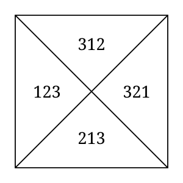
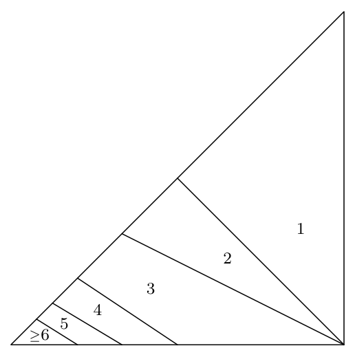
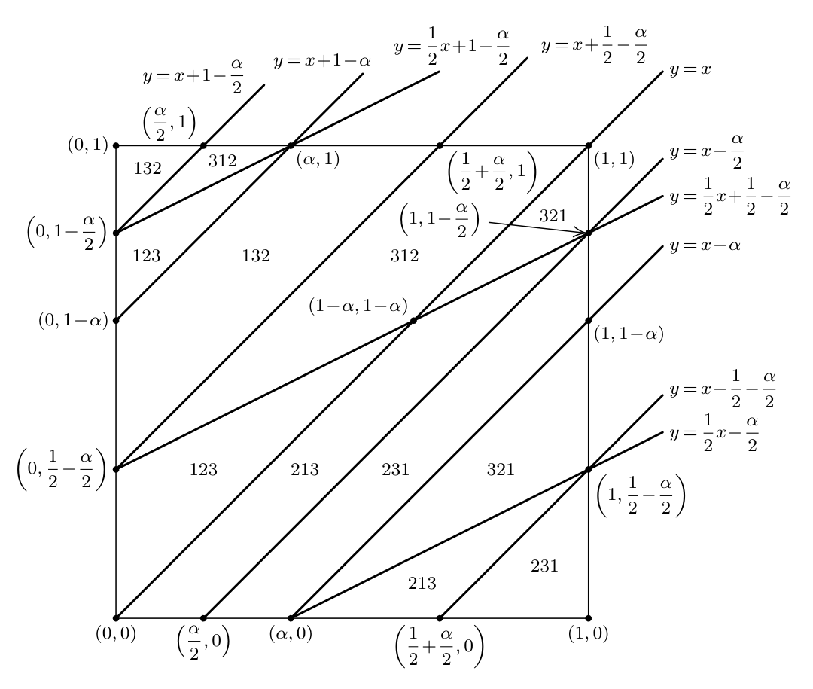

# 3.3.3 节

**1.** [题目](../sec-3-3-3.md#ex-3-3-3-1) $y((x/y))+\frac12y-\frac12y\delta(x/y)$.

**2.** [题目](../sec-3-3-3.md#ex-3-3-3-2) $((x))=-\sum_{n\ge1}\frac1{n\pi}\sin2\pi nx$, 对于所有的 $x$, 它都收敛. (对于 $x$ 为有理数的情况, 式 (24) 中的表示可以看作 “有穷” 傅里叶级数.)

**3.** [题目](../sec-3-3-3.md#ex-3-3-3-3) 该和为 $((2^nx))-((x))$. [见 *Trans. Amer. Math. Soc.* **65** (1949), 401.]

**4.** [题目](../sec-3-3-3.md#ex-3-3-3-4) $d_{\max}=2^{10}\cdot5$. 注意, $X_{n+1}<X_n$ 的概率为 $\frac12+\epsilon$, 其中

$$
|\epsilon|<d/(2\cdot10^{10})\le1/(2\cdot5^9).
$$

因此, 从定理 P 的角度来看, 每个势为 10 的生成器的质量都是不错的.

**5.** [题目](../sec-3-3-3.md#ex-3-3-3-5) 中间结果:

$$
\sum_{0\le x<m}\frac xm\frac{s(x)}m=\frac1{12}\sigma(a,m,c)+\frac m4-\frac c{2m}-\frac{x'}{2m}.
$$

**6.** [题目](../sec-3-3-3.md#ex-3-3-3-6) (a) 使用归纳法和公式

$$
\left(\!\left(\frac{hj+c}k\right)\!\right)-\left(\!\left(\frac{hj+c-1}k\right)\!\right)
=\frac1k-\frac12\delta\left(\frac{hj+c}k\right)-\frac12\delta\left(\frac{hj+c-1}k\right).
$$

(b) 利用事实 $-\left(\!\left(\frac{h'j}k\right)\!\right)=-\left(\!\left(\frac j{hk}-\frac{k'j}h\right)\!\right)=\left(\!\left(\frac{k'j}h\right)\!\right)-\frac j{hk}+\frac12\delta(\frac{k'j}h)$.

**7.** [题目](../sec-3-3-3.md#ex-3-3-3-7) 在习题 1.2.4-45 的第二个公式中, 取 $m=h$, $n=k$, $k=2$:

$$
\sum_{0<j<k}\left(\frac{hj}k-\left(\!\left(\frac{hj}k\right)\!\right)+\frac12\right)\left(\frac{hj}k-\left(\!\left(\frac{hj}k\right)\!\right)-\frac12\right)
+2\sum_{0<j<h}\left(\frac{kj}h-\left(\!\left(\frac{kj}h\right)\!\right)+\frac12\right)j=kh(h-1).
$$

左部的和化简, 并按标准操作, 我们得到

$$
h^2k-hk-\frac h2+\frac{h^2}{6k}+\frac k{12}+\frac14-\frac h6\sigma(h,k,0)-\frac h6\sigma(k,h,0)+\frac1{12}\sigma(1,k,0)=h^2k-hk.
$$

由于 $\sigma(1,k,0)=(k-1)(k-2)/k$, 这归约为互反律.

**8.** [题目](../sec-3-3-3.md#ex-3-3-3-8) 见 *Duke Math. J.* **21** (1954), 391–397.

**9.** [题目](../sec-3-3-3.md#ex-3-3-3-9) 首先, 使用有趣的等式 $\sum_{k=0}^{r-1}\lfloor kp/r\rfloor\lfloor kq/r\rfloor+\sum_{k=0}^{p-1}\lfloor kq/p\rfloor\lfloor kr/p\rfloor+\sum_{k=0}^{q-1}\lfloor kr/q\rfloor\lfloor kp/q\rfloor=(p-1)(q-1)(r-1)$, 假定 $p\perp q$, $q\perp r$, $r\perp p$, 该等式可以简单地用几何方法证明. [迪特尔,*Abh. Math. Sem. Univ. Hamburg* **21** (1957), 109–125.]

**10.** [题目](../sec-3-3-3.md#ex-3-3-3-10) 由式 (8), 显然 $\sigma(k-h,k,c)=-\sigma(h,k,-c)$. 在定义 (16) 中用 $k-j$ 替换 $j$, 推出 $\sigma(h,k,c)=\sigma(h,k,-c)$.

**11.** [题目](../sec-3-3-3.md#ex-3-3-3-11) (a) $\sum_{0\le j<dk}((j/(dk)))(((hj+c)/k))=\sum_{\substack{0\le i<d\\0\le j<k}}(((ik+j)/(dk)))(((hj+c)/k))$; 使用式 (10) 在 $i$ 上求和.

(b) $(((hj+c+\theta)/k))=(((hj+c)/k))+\theta/k-\frac12\delta((hj+c)/k)$; 现在求和.

**12.** [题目](../sec-3-3-3.md#ex-3-3-3-12) 由于 $(((hj+c)/k))$ 以某种次序取遍 $((j/k))$ 的所有取值, 柯西不等式蕴涵 $\sigma(h,k,c)^2\le\sigma(1,k,0)^2$, 并且 $\sigma(1,k,0)$ 可以直接求和, 见习题 7.

**13.** [题目](../sec-3-3-3.md#ex-3-3-3-13) 如果 $hh'\equiv1\pmod k$, 则 $\sigma(h,k,c)+3(k-1)/k=\frac{12}k\sum_{0<j<k}\frac{\omega^{-cj}}{(\omega^{-hj}-1)(\omega^j-1)}+\frac6k(c\bmod k)-6((h'c/k))$.

**14.** [题目](../sec-3-3-3.md#ex-3-3-3-14) $(2^{38}-3\cdot2^{20}+5)/(2^{70}-1)\approx2^{-32}$. 全局值极其令人满意, 尽管存在局部非随机性!

**15.** [题目](../sec-3-3-3.md#ex-3-3-3-15) 用 $\lfloor c\rfloor\lceil c\rceil$ 替换式 (19) 中的 $c^2$.

**16.** [题目](../sec-3-3-3.md#ex-3-3-3-16) 提示的等式等价于 $m_1=p_rm_{r+1}+p_{r-1}m_{r+2}$, 其中 $1\le r\le t$, 这由归纳得到 (又见习题 4.5.3-32). 现在, 用 $\sum_{j\le r\le t}b_rm_{r+1}$ 替换 $c_j$, 比较待证等式两端 $b_ib_j$ 的系数.

*注记:* 对于所有的指数 $e\ge1$, 类似的论证给出

$$
\sum_{1\le j\le t}(-1)^{j+1}\frac{c_j^e}{m_jm_{j+1}}
=\frac1{m_1}\sum_{1\le j\le t}(-1)^{j+1}b_j\frac{c_j^e-c_{j+1}^e}{c_j-c_{j+1}}p_{j-1}.
$$

**17.** [题目](../sec-3-3-3.md#ex-3-3-3-17) 在这个算法运行期间, 对于 $j=1,2,\ldots,t+1$, 我们将有 $k=m_j$, $h=m_{j+1}$, $c=c_j$, $p=p_{j-1}$, $p'=p_{j-2}$, $s=(-1)^{j+1}$.

**D1.** [初始化.] 置 $A\leftarrow0$, $B\leftarrow h$, $p\leftarrow1$, $p'\leftarrow0$, $s\leftarrow1$.

**D2.** [除.] 置 $a\leftarrow\lfloor k/h\rfloor$, $b\leftarrow\lfloor c/h\rfloor$, $r\leftarrow c\bmod h$. (现在, $a=a_j$, $b=b_j$, $r=c_{j+1}$.)

**D3.** [累加.] 置 $A\leftarrow A+(a-6b)s$, $B\leftarrow B+6bp(c+r)s$. 如果 $r\ne0$ 或 $c=0$, 则置 $A\leftarrow A-3s$. 如果 $h=1$, 则置 $B\leftarrow B+ps$. (这减去 $3e(m_{j+1},c_j)$ 并且处理 $\sum(-1)^{j+1}/(m_jm_{j+1})$ 项.)

**D4.** [准备下一次迭代.] 置 $c\leftarrow r$, $s\leftarrow-s$; 置 $r\leftarrow k-ah$, $k\leftarrow h$, $h\leftarrow r$; 置 $r\leftarrow ap+p'$, $p'\leftarrow p$, $p\leftarrow r$. 如果 $h>0$, 则返回 D2. ■

该算法结束时, $p$ 将等于 $k$ 的初值 $k_0$, 因此所求的解为 $A+B/p$. 如果 $s<0$, 则 $p'$ 的终值为 $h'$, 否则为 $k_0-h'$. 通过适当地调整 $A$, 可以保持 $B$ 在区间 $0\le B<k_0$, 从而如果 $k_0$ 是单精度数的话, 就只需要单精度运算 (乘积和被除数都是双精度的).

**18.** [题目](../sec-3-3-3.md#ex-3-3-3-18) 稍加思考就会明白, 公式

$$
S(h,k,c,z)=\sum_{0\le j<k}(\lfloor j/k\rfloor-\lfloor(j-z)/k\rfloor)(((hj+c)/k))
$$

事实上对于所有的 $z\ge0$ 都成立, 而不仅是当 $k\ge z$ 时成立. 记 $\lfloor j/k\rfloor-\lfloor(j-z)/k\rfloor=z/k+(((j-z)/k))-((j/k))+\frac12\delta_{j0}-\frac12\delta((j-z)/k)$, 计算和式得到

$$
S(h,k,c,z)=\frac{zd}k((c/d))+\frac1{12}\sigma(h,k,hz+c)-\frac1{12}\sigma(h,k,c)+\frac12((c/k))-\frac12(((hz+c)/k)),
$$

其中 $d=\gcd(h,k)$. [给定 $\alpha$, 这个公式允许我们用广义戴德金和表示 $X_{n+1}<X_n<\alpha$ 的概率.]

**19.** [题目](../sec-3-3-3.md#ex-3-3-3-19) 所求的概率为

$$
\begin{aligned}
&m^{-1}\sum_{x=0}^{m-1}\left(\left\lfloor\frac{x-\alpha}m\right\rfloor-\left\lfloor\frac{x-\beta}m\right\rfloor\right)\left(\left\lfloor\frac{s(x)-\alpha'}m\right\rfloor-\left\lfloor\frac{s(x)-\beta'}m\right\rfloor\right)\\
&=m^{-1}\sum_{x=0}^{m-1}\left(\frac{\beta-\alpha}m+(((x-\beta)/m))-(((x-\alpha)/m))+\frac12\delta((x-\alpha)/m)-\frac12\delta((x-\beta)/m)\right)\\
&\qquad\times\left(\frac{\beta'-\alpha'}m+(((s(x)-\beta')/m))-(((s(x)-\alpha')/m))+\frac12\delta((s(x)-\alpha')/m)-\frac12\delta((s(x)-\beta')/m)\right)\\
&=\frac{\beta-\alpha}m\frac{\beta'-\alpha'}m+\frac1{12m}\bigl(\sigma(a,m,c+a\alpha-\alpha')-\sigma(a,m,c+a\alpha-\beta')\\
&\qquad+\sigma(a,m,c+a\beta-\beta')-\sigma(a,m,c+a\beta-\alpha')\bigr)+\epsilon,
\end{aligned}
$$

其中, $|\epsilon|\le2.5/m$.

[这种方法由迪特尔提出. 由定理 K, 真实概率与理想值 $\frac{\beta-\alpha}m\frac{\beta'-\alpha'}m$ 之间的偏差有上界 $\sum_{j=1}^t a_j/(4m)$. 反之, 适当地选择 $\alpha,\beta,\alpha',\beta'$, 当存在大的部分商时, 我们将得到不小于这个界的一半的偏差, 这是因为定理 K 是 “能达到的最好情形”. 注意, 当 $a\approx\sqrt m$ 时, 偏差不可能超过 $O(1/\sqrt m)$, 因此即便是习题 14 中具有局部非随机性的生成器, 在满周期上的序列检验也会看上去很好. 看来我们应该坚持要求偏差极其小.]

**20.** [题目](../sec-3-3-3.md#ex-3-3-3-20) $\sum_{0\le x<m}\lceil(x-s(x))/m\rceil\lceil(s(x)-s(s(x)))/m\rceil/m=\sum_{0\le x<m}((x-s(x))/m+(((bx+c)/m))+\frac12)((s(x)-s(s(x)))/m+((a(bx+c)/m))+\frac12)/m$, 并且 $x/m=((x/m))+\frac12-\frac12\delta(x/m)$, $s(x)/m=(((ax+c)/m))+\frac12-\frac12\delta((ax+c)/m)$, $s(s(x))/m=(((a^2x+ac+c)/m))+\frac12-\frac12\delta((a^2x+ac+c)/m)$. 令 $s(x')=s(s(x''))=0$, $d=\gcd(b,m)$. 该和式归约为

$$
\begin{aligned}
\frac14+\frac1{12m}(S_1-S_2+S_3-S_4+S_5-S_6+S_7-S_8+S_9)+\frac dm((c/d))\\
+\frac1{2m}\left((((x'-x'')/m))-((x'/m))+((x''/m))+(((ac+c)/m))-((ac/m))-((c/m))-\frac12\right),
\end{aligned}
$$

其中, 如果 $a'a\equiv1\pmod m$, 则 $S_1=\sigma(a,m,c)$, $S_2=\sigma(a^2,m,ac+c)$, $S_3=\sigma(ab,m,ac)$, $S_4=\sigma(1,m,0)=(m-1)(m-2)/m$, $S_5=\sigma(a,m,c)$, $S_6=\sigma(b,m,c)$, $S_7=-\sigma(a'-1,m,a'c)$, $S_8=-\sigma(a'(a'-1),m,(a')^2c)$, 最后

$$
\begin{aligned}
S_9&=12\sum_{0\le x<m}(((bx+c)/m))((a(bx+c)/m))\\
&=12d\sum_{0\le x<m/d}\left(\!\left(\frac{x+c_0/d}{m/d}\right)\!\right)\left(\!\left(\frac{a(x+c_0/d)}{m/d}\right)\!\right)\\
&=12d\sum_{0\le x<m/d}\left(\left(\!\left(\frac x{m/d}\right)\!\right)+\frac{c_0}m-\frac12\delta_{x0}\right)\left(\!\left(\frac{a(x+c_0/d)}{m/d}\right)\!\right)\\
&=d\left(\sigma(ad,m,ac_0)+12\frac{c_0}m((ac_0/d))-6((ac_0/m))\right),
\end{aligned}
$$

其中 $c_0=c\bmod d$. 当 $d$ 很小, 并且 $a/m$, $(a^2\bmod m)/m$, $(ab\bmod m)/m$, $b/m$, $(a'-1)/m$, $(a'(a'-1)\bmod m)/m$, $((ad)\bmod m)/m$ 这些分数都具有很小的部分商时, 总和将接近于 $\frac16$. (注意, 同习题 3.2.1.3-7 中一样, $a'-1\equiv-b+b^2-\cdots$.)

**21.** [题目](../sec-3-3-3.md#ex-3-3-3-21) 首先注意, 主积分很好地分解为

$$
\begin{aligned}
s_n&=\int_{x_n}^{x_{n+1}}x\{ax+\theta\}\,dx=\frac1{a^2}\left(\frac13-\frac\theta2+\frac n2\right),\quad x_n=\frac{n-\theta}a;\\
s&=\int_0^1x\{ax+\theta\}\,dx=s_0+s_1+\cdots+s_{a-1}+\int_{-\theta/a}^0(ax+\theta)\,dx\\
&=\frac1{3a}-\frac\theta{2a}+\frac{a-1}{4a}+\frac{\theta^2}{2a}.
\end{aligned}
$$

因此, $C=(s-(\frac12)^2)/(\frac13-(\frac12)^2)=(1-6\theta+6\theta^2)/a$.

**22.** [题目](../sec-3-3-3.md#ex-3-3-3-22) 在不相交的区间 $[\frac{1-\theta}a\,\mathinner{.\,.}\,\frac{1-\theta}{a-1}),[\frac{2-\theta}a\,\mathinner{.\,.}\,\frac{2-\theta}{a-1}),\ldots,[\frac{a-\theta}a\,\mathinner{.\,.}\,1)$, 我们有 $s(x)<x$, 这些区间的总长度为

$$
1+\sum_{0<j\le a-1}\left(\frac{j-\theta}{a-1}\right)-\sum_{0<j\le a}\left(\frac{j-\theta}a\right)
=1+\frac a2-\theta-\frac{a+1}2+\theta=\frac12.
$$

**23.** [题目](../sec-3-3-3.md#ex-3-3-3-23) 当 $x$ 在 $[\frac{k-\theta}a\,\mathinner{.\,.}\,\frac{k-\theta}{a-1})$ 中并且 $ax+\theta-k$ 在 $[\frac{j-\theta}a\,\mathinner{.\,.}\,\frac{j-\theta}{a-1})$ 中 ($0<j\le k<a$) 时, 或者当 $x$ 在 $[\frac{a-\theta}a\,\mathinner{.\,.}\,1)$ 中并且 $ax+\theta-a$ 在 $[\frac{j-\theta}a\,\mathinner{.\,.}\,\frac{j-\theta}{a-1})$ 中 ($0<j\le\lfloor a\theta\rfloor$) 或在 $[\frac{\lfloor a\theta\rfloor+1-\theta}a\,\mathinner{.\,.}\,\theta)$ 中时, 我们有 $s(s(x))<s(x)<x$. 所求概率为

$$
\begin{aligned}
&\sum_{0<j\le k

**24.** [题目](../sec-3-3-3.md#ex-3-3-3-24) 像上题一样处理, 区间长度的和为

$$
\sum_{0<j_1\le\cdots\le j_{t-1}<a}\frac{j_1}{a^{t-1}(a-1)}=\frac1{a^{t-1}(a-1)}\binom{a+t-2}t.
$$

为计算平均长度, 令 $p_k$ 为游程长度大于或等于 $k$ 的概率, 平均值为

$$
\sum_{k\ge1}p_k=\sum_{k\ge1}\binom{a+k-2}k\frac1{a^{k-1}(a-1)}=\left(\frac a{a-1}\right)^a-\frac a{a-1}.
$$

对于真正随机的序列, 该值为 $e-1$, 而我们的值为 $e-1+(e/2-1)/a+O(1/a^2)$. [注记: 相同的结果对于升游程成立, 因为 $U_n>U_{n+1}$ 当且仅当 $1-U_n<1-U_{n+1}$. 这让我们怀疑线性同余序列的游程可能比正常情况稍长, 因此游程检验应当用于这种生成器.]

**25.** [题目](../sec-3-3-3.md#ex-3-3-3-25) 对于某个 $k$, $x$ 一定在区间 $[(k+\alpha'-\theta)/a\,\mathinner{.\,.}\,(k+\beta'-\theta)/a)$ 中, 并且还在区间 $[\alpha\,\mathinner{.\,.}\,\beta)$ 中. 令 $k_0=\lceil a\alpha+\theta-\beta'\rceil$, $k_1=\lceil a\beta+\theta-\beta'\rceil$. 由于边界条件, 我们得到概率

$$
(k_1-k_0)(\beta'-\alpha')/a+\max(0,\beta-(k_1+\alpha'-\theta)/a)-\max(0,\alpha-(k_0+\alpha'-\theta)/a).
$$

这是 $(\beta-\alpha)(\beta'-\alpha')+\epsilon$, 其中 $|\epsilon|<2(\beta'-\alpha')/a$.

**26.** [题目](../sec-3-3-3.md#ex-3-3-3-26) 见图 A-1. $U_1<U_3<U_2$ 和 $U_2<U_3<U_1$ 这两种序是不可能的; 其他 4 种序的概率均为 $\frac14$.

**27.** [题目](../sec-3-3-3.md#ex-3-3-3-27) $U_n=\{F_{n-1}U_0+F_nU_1\}$. 我们需要有 $F_{k-1}U_0+F_kU_1<1$ 和 $F_kU_0+F_{k+1}U_1>1$. $U_0>U_1$ 的半个单位正方形被划分的情况如图 A-2 所示, 图中标明了不同的 $k$ 值. 游程长度为 $k$ 的概率, 如果 $k=1$, 为 $\frac12$; 如果 $k>1$, 为 $1/(F_{k-1}F_{k+1})-1/(F_kF_{k+2})$. 对于一个随机序列, 对应的概率为 $2k/(k+1)!-2(k+1)/(k+2)!$. 下表比较前几个值.

| $k$ | 1 | 2 | 3 | 4 | 5 |
|---|---:|---:|---:|---:|---:|
| 斐波那契情况下的概率 | $\frac12$ | $\frac13$ | $\frac1{10}$ | $\frac1{24}$ | $\frac1{65}$ |
| 随机情况下的概率 | $\frac13$ | $\frac5{12}$ | $\frac{11}{60}$ | $\frac{19}{360}$ | $\frac{29}{2520}$ |

图 A-1　斐波那契生成器的排列区域

图 A-2　斐波那契生成器的游程长度区域

图 A-3　势为 2 的生成器的排列区域, $\alpha=(a-1)c/m$

**28.** [题目](../sec-3-3-3.md#ex-3-3-3-28) 图 A-3 显示一般情况下的各种区域. 213 区域表示 $U_1$ 和 $U_2$ 随机选择时, $U_2<U_1<U_3$; 321 区域表示 $U_3<U_2<U_1$, 等等. 区域 123 和 321 的概率为 $\frac14-\alpha/2+\alpha^2/2$; 其他所有情况的概率都为 $\frac18+\alpha/4-\alpha^2/4$. 为了使两者都等于 $\frac16$, 必须有 $1-6\alpha+6\alpha^2=0$. [此题建立了乔尔·富兰克林提出的一则定理, 见 *Math. Comp.* **17** (1963), 28–59, 定理 13. 该论文的其他结果与习题 22 和 23 相关.]
